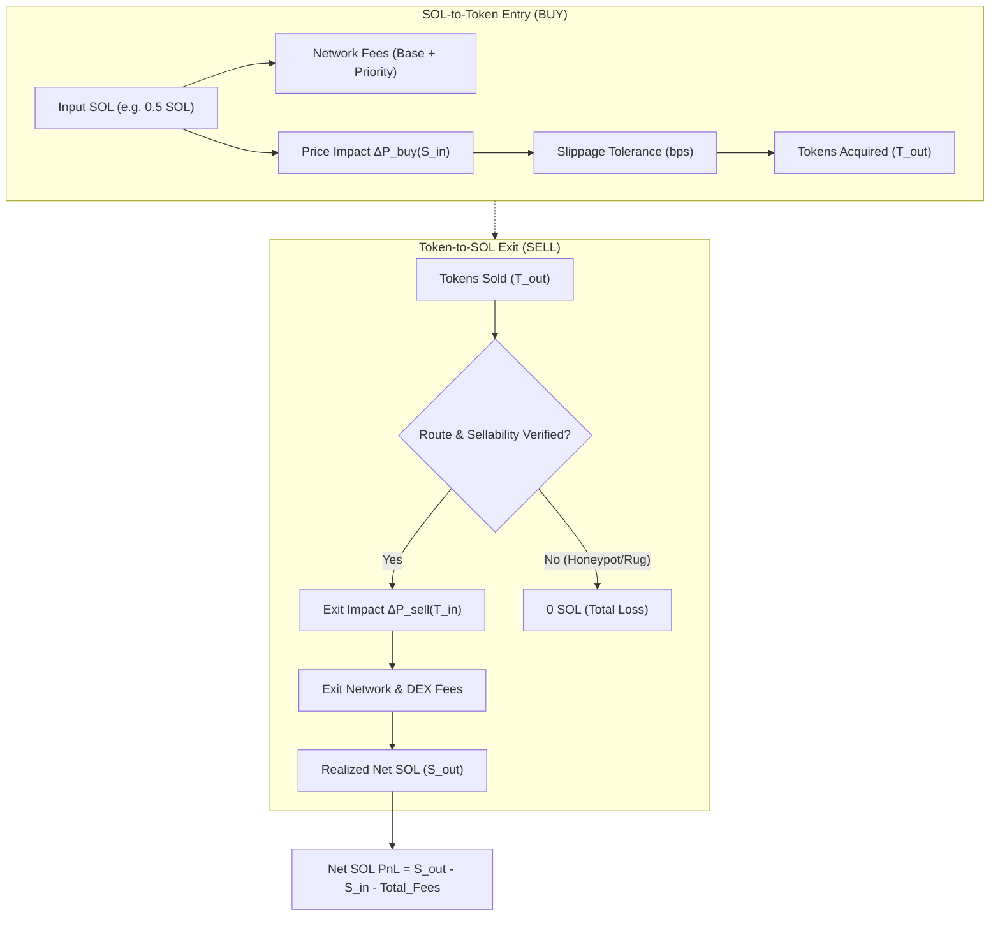
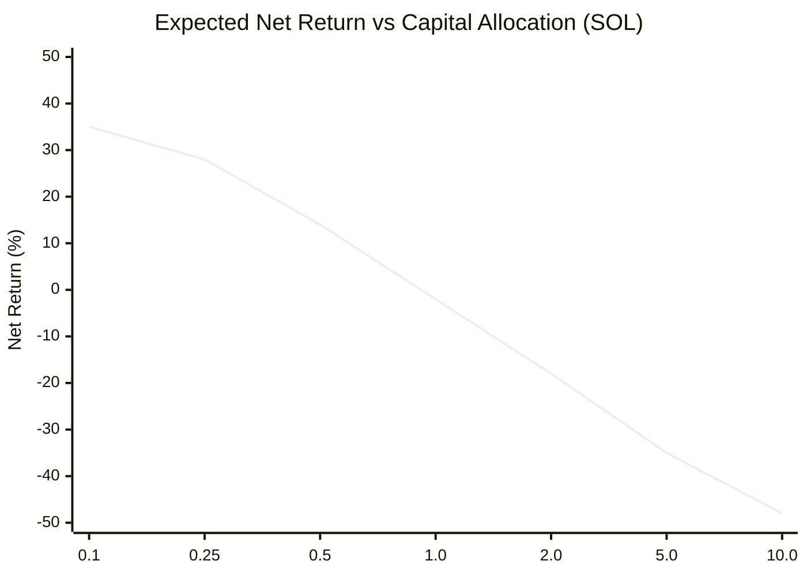

# NeXusTrade — Phase 12.94-C Architecture & Research Proposal

## Quote-Aware Execution Realism: Bidirectional Pricing, Route Integrity, Sellability & Capacity Curves

**Status:** PROPOSAL / ARCHITECTURE DESIGN ONLY  
**Prerequisites:** Phase 12.93D (CLOSED), Phase 12.94-A (CLOSED under `7e58ea5`), Phase 12.94-B (CLOSED under `c37f91e`).  
**Operational Authorization:** Architecture research and planning only. Zero implementation code, zero Windows PAPER trading restarts, zero real-SOL trading, and zero Generation 2 activation until this proposal is independently reviewed and formally approved.

---

### Executive Summary & Problem Statement

Phase 12.94-B successfully established an operational, audit-accepted market telemetry engine with zero-lookahead decision context reconstruction, robust stratified sampling, provider metric provenance, and fail-closed pool identity verification.

However, an observational telemetry engine measures **market presence**, not **executable economic capture**. In micro-cap Solana liquidity pools, a token that appears to surge +200% on an indexed ticker can be completely unexecutable in practice due to:

1. **Asymmetric Bid/Ask Liquidity**: Thin quote reserves causing 10%–50% price impact on small exits.
2. **Unsellability & Route Collapse**: Tokens whose AMM routes disappear, freeze authorities are triggered, or sell transactions fail due to honeypot taxes or slippage limits.
3. **Execution Delay & Adverse Selection**: Latency between buy-gate trigger evaluation and block inclusion resulting in severe front-running, sandwiching, or rapid liquidity drainage.
4. **Capacity Degradation**: Strategies that appear profitable with theoretical 0.1 SOL allocations becoming deeply unprofitable at 0.5 SOL, 2.0 SOL, or 10.0 SOL position sizes.
5. **Fee Drag**: Solana base network fees, dynamic priority fees, Compute Budget unit costs, and DEX routing fees consuming an outsized portion of gross returns on high-frequency trades.

The core objective of **Phase 12.94-C** is to design and implement a **Quote-Aware Execution Engine** that answers the foundational question:

> **"Does an opportunity flagged by our signal engine yield positive NET SOL profit after paying for liquidity depth, route execution, slippage, sellability constraints, and network fees?"**

---

### Residual Audit Documentation: Cross-File Session Finalization Atomicity

In the Phase 12.94-B Final Acceptance Report (`c37f91e`), the independent auditor noted a residual operational risk regarding cross-file atomicity:

> _"Session summary and `session-meta.json` are committed as separate renames. A crash between writes can leave a complete summary alongside an ACTIVE metadata record. Research consumers should require consistent finalized metadata and summary before accepting a session as complete. Design a reconciliation rule before production research analysis / generation cutover."_

#### Formal Reconciliation Rule for Research Consumers

Before any session dataset is ingested into Phase 12.94-C execution modeling or Phase 12.94-D cohort analysis, the ingestion pipeline must evaluate the following fail-closed rule:

```typescript
export interface SessionAtomicityVerification {
  readonly isValid: boolean;
  readonly rejectionReason?: string;
}

export function verifySessionCrossFileConsistency(
  meta: SessionTelemetryMeta,
  summary: SessionTelemetrySummary,
): SessionAtomicityVerification {
  // 1. Generation alignment
  if (meta.generationId !== summary.generationId) {
    return {
      isValid: false,
      rejectionReason: `Generation mismatch: meta=${meta.generationId}, summary=${summary.generationId}`,
    };
  }

  // 2. Interruption flag consistency
  if (Boolean(meta.isInterruptedSession) !== Boolean(summary.isInterruptedSession)) {
    return {
      isValid: false,
      rejectionReason: `Interruption mismatch: meta=${meta.isInterruptedSession}, summary=${summary.isInterruptedSession}`,
    };
  }

  // 3. Completeness consistency
  if (meta.isInterruptedSession && summary.isCompleteSession) {
    return {
      isValid: false,
      rejectionReason:
        "Inconsistent state: meta marks INTERRUPTED but summary claims isCompleteSession=true",
    };
  }

  // 4. Status finality
  const validStatus = meta.isInterruptedSession ? "INTERRUPTED" : "FINALIZED";
  if (meta.sessionStatus !== validStatus) {
    return {
      isValid: false,
      rejectionReason: `Incomplete finalization: meta.sessionStatus is "${meta.sessionStatus}", expected "${validStatus}"`,
    };
  }

  return { isValid: true };
}
```

Any session failing this verification is treated as an unfinalized crash-tail and excluded from research performance calculations.

---

### 1. Taxonomy of Price & Execution Semantics (5-Tier Framework)

A primary flaw of naive backtesting and legacy PAPER trading is conflating ticker prices with execution reality. Phase 12.94-C formally establishes a strict 5-tier taxonomy:

```
[Tier 1: Indexed Spot Price] (DexScreener / Birdeye REST API)
       │  - Zero commitment, lagging, unverified quote route
       ▼
[Tier 2: Pool Reserve Price] (Direct AMM Constant Product x·y=k or CLMM Tick)
       │  - Point-in-time reserve ratio; models local depth, but ignores multi-hop routes
       ▼
[Tier 3: Executable Route Quote] (Jupiter / Raydium Swap Quote API)
       │  - Firm quote for specific size, direction, slot, and route plan
       ▼
[Tier 4: Simulated Fill] (Quote + Latency Model + Dynamic Slippage + Fee Model)
       │  - Modeled fill accounting for block delay, priority fee inclusion, and adverse selection
       ▼
[Tier 5: On-Chain Execution] (Solana Blockchain Transaction Settlement)
          - Real-SOL signed transaction landed in a confirmed block
```

#### Detailed Definitions:

1. **Tier 1 — Indexed Spot Price**: An indicative midpoint or last-trade price reported by third-party aggregators. It represents past transactions of unspecified size and carries **zero execution commitment**. Must never be labeled or stored as an executable price.
2. **Tier 2 — Pool Reserve Price**: The marginal price derived directly from a specific liquidity pool's token reserves ($P = R_{quote} / R_{base}$). Deterministic at slot $S$, allowing exact local mathematical modeling of spot and marginal impact, but does not capture multi-hop routes or external aggregator routing.
3. **Tier 3 — Executable Route Quote**: A cryptographically signed or provider-attested quote from a routing venue (e.g. Jupiter v6 `/quote`, Raydium Swap API) specifying:
   - Direction (`inputMint` $\to$ `outputMint`)
   - Exact input amount ($A_{in}$)
   - Expected output amount ($A_{out}$)
   - Guaranteed minimum output (`otherAmountThreshold` / minimum received at maximum slippage)
   - Estimated price impact %
   - Detailed route plan with pool AMM identifiers
   - Context slot ($Slot_{quote}$)
4. **Tier 4 — Simulated Fill**: The synthetic fill generated by the Phase 12.94-C engine. It takes a Tier 3 Executable Quote (or Tier 2 Pool Model) and applies simulated block propagation delay (e.g. 400ms–1200ms), priority fee inclusion probability, modeled adverse price movement during the delay window, and network transaction fees.
5. **Tier 5 — On-Chain Execution**: An actual signed transaction submitted to the Solana RPC, processed by validators, and confirmed on ledger. (Preserved for future live trading; strictly prohibited during 12.94-C).

---

### 2. Buy and Sell Modeling: Bidirectional Size-Aware Economics

In micro-cap trading, buying is easy; selling is where alpha vanishes. Phase 12.94-C models both legs with complete size awareness.



#### Mathematical Formulation

##### 1. Entry Leg (SOL $\to$ Token)

Given trade size $S_{in}$ (in lamports):

- Base network fee: $F_{base} = 5,000\text{ lamports}$
- Priority fee: $F_{prio} = \text{ComputeUnits} \times \text{PricePerUnit} \approx 50,000\text{–}250,000\text{ lamports}$
- DEX LP fee: $F_{dex} = S_{in} \times r_{fee}$ (typically $0.25\%$ for Raydium AMM, $0.05\% - 1.0\%$ for CLMM)
- Price Impact on constant-product pool with reserves $(R_{sol}, R_{token})$:
  $$\Delta P_{impact, buy} = \frac{S_{in}}{R_{sol} + S_{in}}$$
- Gross tokens received:
  $$T_{gross} = R_{token} \cdot \frac{S_{in} \cdot (1 - r_{fee})}{R_{sol} + S_{in} \cdot (1 - r_{fee})}$$
- Effective Entry Price:
  $$P_{eff, entry} = \frac{S_{in} + F_{base} + F_{prio}}{T_{gross} \cdot (1 - \text{Slippage}_{realized})}$$

##### 2. Exit Leg (Token $\to$ SOL)

Given position tokens $T_{pos}$ to exit:

- If pool reserves have changed to $(R'_{sol}, R'_{token})$:
- Exit Price Impact:
  $$\Delta P_{impact, sell} = \frac{T_{pos}}{R'_{token} + T_{pos}}$$
- Gross SOL proceeds:
  $$S_{gross} = R'_{sol} \cdot \frac{T_{pos} \cdot (1 - r_{fee})}{R'_{token} + T_{pos} \cdot (1 - r_{fee})}$$
- Minimum out threshold:
  $$S_{min} = S_{gross} \cdot (1 - \text{MaxSlippageBps}/10000)$$
- Net SOL proceeds:
  $$S_{net} = S_{gross} - F_{base} - F_{prio} - F_{routing}$$
- Realized Net Return:
  $$\text{Net P\&L (SOL)} = S_{net} - S_{in, total}$$
  $$\text{Net Return (\%)} = \frac{S_{net} - S_{in, total}}{S_{in, total}} \times 100$$

---

### 3. Route and Pool Integrity

A critical failure mode identified in Subphase 12.94-B was cross-pool substitution, where a quote or spot price from a large, liquid pool was attributed to a brand new illiquid pool for the same mint.

Phase 12.94-C enforces strict route and pool integrity:

1. **Mint Decimals Verification**: Decimals must be fetched from on-chain RPC `getAccountInfo` (or verified cached mint schema), not assumed to be 6 or 9. Raw amounts must be computed as:
   $$\text{RawAmount} = \text{floor}(\text{UiAmount} \times 10^{\text{decimals}})$$
2. **Canonical Quote-Token Restriction**: Quotes must pair exclusively against canonical Wrapped SOL (`So11111111111111111111111111111111111111112`). Quotes routed through USDC, USDT, or intermediate meme tokens must be explicitly flagged as `MULTI_HOP_NON_SOL` and evaluated for double-hop fee and slippage penalties.
3. **Route Plan AMM Key Verification**: In every Jupiter quote response, the `routePlan[0].swapInfo.ammKey` must be extracted and compared against the tracked `candidate.poolId`:
   - If `ammKey === candidate.poolId`: `ROUTE_VERIFIED_DIRECT`.
   - If `ammKey !== candidate.poolId` and route is multi-hop: `ROUTE_MULTI_HOP_EXPANDED`.
   - If `ammKey !== candidate.poolId` and route is a different direct pool: **Fail closed** (`ROUTE_POOL_MISMATCH_REJECTED`). The engine must NEVER evaluate execution viability using liquidity from a pool the candidate was not screened on.

---

### 4. Sellability and Adverse Execution (The "Unsellable Winner" Problem)

In meme and micro-cap tokens, the single largest divergence between theoretical and realized P&L is **sell failure**. A strategy that records a +300% gain on paper is useless if the position cannot be sold.

Phase 12.94-C implements a formal **Sellability Gate & Classification Matrix**:

| Failure Code                      | Description                                                           | Detection Mechanism                                                                | Execution Engine Action                                  |
| --------------------------------- | --------------------------------------------------------------------- | ---------------------------------------------------------------------------------- | -------------------------------------------------------- |
| `UNSELLABLE_NO_ROUTE`             | No AMM pool or route exists to swap token back to SOL                 | Jupiter quote returns 404 / `COULD_NOT_FIND_ANY_ROUTE`                             | P&L recorded as **-100% (Total Loss)**                   |
| `UNSELLABLE_EXCESSIVE_IMPACT`     | Exit size exceeds available pool liquidity; impact > 30%              | Quote `priceImpactPct > 0.30`                                                      | P&L calculated on actual catastrophic net proceeds       |
| `UNSELLABLE_TRANSFER_RESTRICTION` | Honeypot, transfer tax > 15%, or freeze authority active              | Preflight simulation via RPC `simulateTransaction` fails with custom program error | P&L recorded as **-100% (Total Loss)**                   |
| `UNSELLABLE_RUG_DRAINED`          | Liquidity withdrawn between entry and exit                            | Pool base reserve drops > 90% or quote returns null                                | P&L recorded as **-100% (Total Loss)**                   |
| `UNSELLABLE_SLIPPAGE_EXCEEDED`    | Minimum out exceeds realized price movement                           | Modeled exit price falls below `otherAmountThreshold`                              | Flagged as `EXECUTION_SLIPPAGE_BREACH`                   |
| `PARTIAL_FILL_HAIRCUT`            | Only a fraction of the position can be exited without wiping the pool | Liquidity depth permits exiting only $X\%$ of tokens                               | Models staggered multi-tranche exit with quadratic decay |

---

### 5. Point-in-Time Validity & Zero-Lookahead Guarantees

Building on the Zero-Lookahead Context Reconstructor proven in Phase 12.94-B, execution quotes must respect strict causal boundaries:

1. **Quote Acquisition Timestamp**: $t_{quote\_init} \ge t_{decision}$. A quote requested before the decision timestamp represents lookahead bias and is rejected.
2. **Context Slot Verification**: Jupiter quotes report `contextSlot`. The execution engine asserts:
   $$Slot_{quote} \ge Slot_{decision}$$
   If an engine worker replays quotes from a slot prior to the decision event, the quote is rejected as `STALE_PRE_DECISION_QUOTE`.
3. **Quote TTL & Expiration**: Real-world Solana quotes are valid for a maximum of **15 to 30 seconds** (approx. 35 to 75 slots). Any simulated execution occurring after quote expiration must re-quote or apply modeled price degradation:
   $$P(t) = P_{quote} \cdot \left(1 - \sigma \sqrt{\frac{t - t_{quote}}{\tau}}\right)$$
4. **Historical Isolation**: Historical spot prices from DexScreener/Raydium or 12.94-B observation records must **never** be back-cast or re-labeled as historical quotes. An observation record is an observational tick; an execution quote is an active liquidity commitment.

---

### 6. Capital Scaling & Capacity Curves

Micro-cap alpha decays rapidly as order size increases. Phase 12.94-C formally evaluates **Capital Scaling Curves**:



#### Tested Capital Tiers:

- **Tier 1 (Micro)**: `0.10 SOL` (~$14–$15) — Low impact, high fee drag relative to profit.
- **Tier 2 (Baseline Paper)**: `0.50 SOL` (~$70–$75) — Current operational baseline.
- **Tier 3 (Moderate)**: `2.00 SOL` (~$280–$300) — Tests initial pool depth limits.
- **Tier 4 (Full Single Bullet)**: `10.00 SOL` (~$1,400–$1,500) — Tests portfolio-scale liquidity limits.

#### Capacity Metric Outputs:

1. **Optimal Capital Allocation ($S^*$ )**: The position size that maximizes absolute Net SOL profit:
   $$S^* = \arg\max_S \left[ S \cdot \text{NetReturn}(S) \right]$$
2. **Alpha Extinction Threshold ($S_{extinct}$)**: The exact capital size where Price Impact + Fees equal Gross Strategy Alpha:
   $$\text{NetReturn}(S_{extinct}) = 0.0\%$$
   If $S_{extinct} < 0.5\text{ SOL}$, the strategy is economically unviable for production scaling regardless of spot price chart appearance.

---

### 7. Research Integration with Phase 12.94-B Telemetry & Phase 12.94-D

Phase 12.94-C directly links to 12.94-B telemetry files via unique decision foreign keys:

```
.tmp/telemetry/sessions/<session-id>/
  ├── session-meta.json
  ├── candidate-decisions.jsonl          <── [Phase 12.94-B Decision Records]
  ├── market-observations.jsonl          <── [Phase 12.94-B Observational Ticks]
  ├── stratified-samples.jsonl           <── [Phase 12.94-B Tracked Candidates]
  ├── execution-quotes.jsonl             <── [Phase 12.94-C Executable Quotes] (NEW)
  ├── simulated-fills.jsonl              <── [Phase 12.94-C Simulated Fills] (NEW)
  └── session-summary.json               <── [Phase 12.94-C Augmented Summary]
```

#### Parallel Comparative Evaluation Tracks in Phase 12.94-D:

Every candidate reaching trigger evaluation will be evaluated across four parallel accounting tracks:

1. **Track 1: Observational Metric Track (12.94-B)**: What did the indexed spot price do? (e.g. +45.2% peak).
2. **Track 2: Legacy Paper Track (12.93D)**: What did our static 25 bps slippage model record? (e.g. +38.1% gain).
3. **Track 3: Realistic Executable Quote Track (12.94-C)**: What did the actual Jupiter route quote return at entry and exit? (e.g. +12.4% net).
4. **Track 4: Adverse Stress Track (12.94-C)**: What happened if 1-slot execution latency or partial unsellability occurred? (e.g. -4.2% loss).

This structure provides the definitive empirical proof required for Phase 12.94-D research acceptance.

---

### 8. Proposed Module Architecture & Schemas

#### Proposed Directory Structure (`backend/src/execution/`)

```
backend/src/execution/
  ├── ExecutionTypes.ts                  # Schemas for quotes, fills, sellability, capacity
  ├── QuoteExecutionEngine.ts            # Core execution manager (routes, fees, fills)
  ├── SellabilityValidator.ts            # Honeypot, route check, and drain detection
  ├── ExecutionFeeModel.ts               # Base fees, dynamic priority fees, compute units
  ├── CapacityCurveAnalyzer.ts           # Multi-size capital sweep & extinction threshold
  └── ExecutionStorageManager.ts         # Append-only JSONL logger for quotes and fills
```

#### Key Schemas (`ExecutionTypes.ts`)

```typescript
export interface ExecutableQuoteRecord {
  readonly quoteId: string;
  readonly sessionId: string;
  readonly generationId: string;
  readonly decisionEventId: string;
  readonly mintAddress: string;
  readonly poolId: string;
  readonly side: "BUY" | "SELL";
  readonly inputMint: string;
  readonly outputMint: string;
  readonly inAmountRaw: string;
  readonly inAmountUi: number;
  readonly outAmountRaw: string;
  readonly outAmountUi: number;
  readonly minimumOutAmountRaw: string;
  readonly priceImpactPct: number;
  readonly slippageBps: number;
  readonly feeLamports: number;
  readonly providerIdentity: "jupiter" | "raydium_amm" | "simulated_clmm";
  readonly routeType: "DIRECT_TRACKED_POOL" | "MULTI_HOP" | "CROSS_POOL_DIVERGENCE";
  readonly routePlan: readonly {
    readonly ammKey: string;
    readonly label: string;
    readonly inputMint: string;
    readonly outputMint: string;
    readonly feePct: number;
  }[];
  readonly quoteInitiatedMs: number;
  readonly quoteReceivedMs: number;
  readonly contextSlot: number;
  readonly validUntilMs: number;
}

export interface SimulatedFillRecord {
  readonly fillId: string;
  readonly quoteId: string;
  readonly decisionEventId: string;
  readonly mintAddress: string;
  readonly poolId: string;
  readonly side: "BUY" | "SELL";
  readonly attemptedSizeSol: number;
  readonly filledSizeSol: number;
  readonly filledTokens: number;
  readonly effectivePriceSol: number;
  readonly grossProceedsSol?: number;
  readonly netProceedsSol?: number;
  readonly priceImpactBps: number;
  readonly realizedSlippageBps: number;
  readonly networkFeeLamports: number;
  readonly priorityFeeLamports: number;
  readonly sellabilityStatus:
    | "FULLY_SELLABLE"
    | "HIGH_IMPACT_IMPAIRED"
    | "UNSELLABLE_NO_ROUTE"
    | "UNSELLABLE_TRANSFER_RESTRICTION"
    | "UNSELLABLE_LIQUIDITY_DRAINED";
  readonly fillTimestampMs: number;
  readonly fillSlot: number;
  readonly executionDelayMs: number;
}
```

---

### 9. Architectural Alternatives Analysis

| Dimension       | Alternative A: Universal Live Jupiter HTTP Quotes on All Candidates                   | Alternative B: Pure Local Constant-Product Math Simulation                                        | Alternative C (RECOMMENDED): Hybrid Two-Tier Execution Engine                                                 |
| --------------- | ------------------------------------------------------------------------------------- | ------------------------------------------------------------------------------------------------- | ------------------------------------------------------------------------------------------------------------- |
| **Description** | Request Jupiter API `/quote` for every candidate passing scanner gates on every loop. | Never query external quote APIs; calculate all fills purely from pool reserves $(x \cdot y = k)$. | Local AMM math pre-screens depth; live Jupiter quotes issued only for promoted cohorts under rate permits.    |
| **Pros**        | Maximum realism for every candidate; reflects exact Jupiter routing.                  | Zero external API calls, zero rate limits, instantaneous evaluation.                              | Realistic Jupiter quote verification for actual decisions; zero rate exhaustion; deterministic fallback math. |
| **Cons**        | Exceeds free Jupiter rate limits (403/429); high latency (200–500ms) blocks scanner.  | Misses multi-hop routes, ignores DEX routing fees, cannot detect honeypot sell restrictions.      | Slightly more complex architecture requiring clear provenance separation.                                     |
| **Verdict**     | **REJECTED (Rate & latency prohibitive)**                                             | **REJECTED (Blind to sellability & multi-hop)**                                                   | **RECOMMENDED & ADOPTED**                                                                                     |

---

### 10. API Budget, Rate Limiting & Storage Estimates

1. **Jupiter Quote Rate Allocation**:
   - Integrated into existing Phase 12.94-B `TelemetryRateController` and `QuoteBudgetPlanner`.
   - Max quote acquisitions: **2.0 requests/sec** (burst 5.0).
   - High-priority quota reserved for `EXECUTED_BUY` entries and `DYNAMIC_RATCHET` exits.
   - Lowest-priority quota for stratified background samples.
2. **Storage Footprint**:
   - `execution-quotes.jsonl`: ~500 bytes/record $\times$ ~500 quotes/session $\approx 250\text{ KB/session}$.
   - `simulated-fills.jsonl`: ~400 bytes/record $\times$ ~100 fills/session $\approx 40\text{ KB/session}$.
   - Negligible disk overhead (< 1 MB per 4-hour session).

---

### 11. Bounded Implementation Sequence & Acceptance Gates

Implementation of Phase 12.94-C will strictly follow four bounded milestones:

```
[12.94-C1: Schemas & Math Engine]
  - ExecutionTypes, FeeModel, Size-Aware Math, Unit Tests
        │
        ▼
[12.94-C2: Jupiter & AMM Quote Provider Integration]
  - QuoteExecutionEngine, Rate Permits, Route AMM Key Verification
        │
        ▼
[12.94-C3: Sellability & Honeypot Detection Engine]
  - SellabilityValidator, Route Collapse Detection, -100% Rug Trap
        │
        ▼
[12.94-C4: Capital Capacity Sweeper & Storage Persistence]
  - CapacityCurveAnalyzer, ExecutionStorageManager, Session Ingestion Rules
        │
        ▼
[12.94-C5: Comprehensive Verification Suite & Auditor Evidence Package]
  - Deterministic Fixture Suite (7 scenarios), Verification Report, Review Package
```

#### Acceptance Gates for Phase 12.94-C Closure:

1. **Gate C-1 (Quote Accuracy)**: Verified route quotes match Jupiter response payloads within $0.001\%$ rounding precision.
2. **Gate C-2 (Pool Integrity)**: 100% rejection of cross-pool quote substitutions in automated tests.
3. **Gate C-3 (Sellability Failure Accounting)**: Honeypots and zero-route tokens correctly register -100% net return instead of theoretical spot peaks.
4. **Gate C-4 (Zero-Lookahead Compliance)**: All quotes and fills assert $t_{quote} \ge t_{decision}$ and $Slot_{quote} \ge Slot_{decision}$.
5. **Gate C-5 (Wallet & State Invariance)**: Canonical Generation 1 wallet remains 7.9259 SOL (`7f2c2353...`); 0 Windows PAPER daemons running; 0 real-SOL trades executed.

---

### 12. Deterministic Test Fixture Suite (Proposed)

The verification suite for Phase 12.94-C will include 7 deterministic test fixtures:

- **Fixture F1 (Liquid Direct Route)**: Buy and sell of 0.5 SOL on standard Raydium pool; verifies base fee, priority fee, 25 bps LP fee, and expected output.
- **Fixture F2 (Size Scaling & Impact Curve)**: Tests 0.1, 0.5, 2.0, and 10.0 SOL inputs on identical pool state; verifies monotonic increase in price impact and identifies $S_{extinct}$.
- **Fixture F3 (Unsellable Honeypot / Zero Route)**: Simulates token where Jupiter returns no route; confirms net return is evaluated as -100% loss.
- **Fixture F4 (Cross-Pool Contamination Attempt)**: Simulates aggregator returning quote for a different pool on same mint; confirms fail-closed rejection.
- **Fixture F5 (Quote Expiration & Stale Slot)**: Simulates quote older than 30 seconds; verifies engine rejects stale fill.
- **Fixture F6 (Priority Fee Congestion Spike)**: Simulates validator congestion requiring 500,000 micro-lamports/CU; verifies fee impact on net profitability.
- **Fixture F7 (End-to-End Session Consistency)**: Exercises `verifySessionCrossFileConsistency` against crash-tail and clean sessions; verifies fail-closed rejection of inconsistent metadata.

---

### Operational Confirmation

- Phase 12.93D, 12.94-A, and 12.94-B remain **CLOSED**.
- Implementation commit for 12.94-B recorded as: `c37f91e`.
- Canonical Generation 1 virtual wallet remains **7.9259 SOL** (SHA-256: `7f2c2353ac2f62cac1bb98703742ab19c74ac5521635af6f49bbe777ad020ed9`).
- Zero Windows paper trading daemons running.
- Fedora endurance experiment untouched.
- Generation 2 remains uncreated and unactivated.
- No implementation code written; this submission is strictly an **Architecture Research & Implementation Proposal**.
