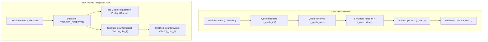

# NeXusTrade — Phase 12.94-D Architecture & Research Proposal (v2)

## Rigorous Quantitative Strategy Research: Data Feasibility, Point-in-Time Reconciliation, Falsifiable Hypotheses, Anti-Bias Protocols & Generation 2 Governance

**Status:** REVISED PROPOSAL (v2) / ARCHITECTURE & RESEARCH DESIGN ONLY  
**Review Reference:** Addressing Independent Review v1 Findings D-01 through D-07  
**Prerequisites:**

- Phase 12.93D (CLOSED)
- Phase 12.94-A (CLOSED under `7e58ea5`)
- Phase 12.94-B (CLOSED under `c37f91e`)
- Phase 12.94-C (CLOSED under `2541d5b` / `c5931ca` / `7faf705`)  
  **Operational Authorization:** Architecture research and planning only. Zero implementation code, zero Windows PAPER trading restarts, zero real-SOL trading, zero live network daemons, and zero Generation 2 activation until this revised proposal is independently reviewed and formally approved.

---

### Executive Summary & Review v1 Response Matrix

Phase 12.94-B established an audit-accepted **Market Telemetry Engine** capturing zero-lookahead decision contexts, stratified counterfactual tracking, and verified pool identities. Phase 12.94-C subsequently established a **Quote-Aware Execution Realism Subsystem** as a standalone conservative AMM research model.

In Independent Architecture Review v1 (`NeXusTrade_Phase_12_94D_Architecture_Independent_Review_v1.md`), the auditor conditionally approved the overall research direction while identifying seven critical methodological, financial, and data-lineage blockers (D-01 through D-07). This revised proposal addresses each finding in full:

| Review Finding                            | Primary Issue Identified                                                                                                                                                                                                                  | Implemented Architecture Revision                                                                                                                                                                                                                                                                                                                                                                                                                           | Section Reference |
| :---------------------------------------- | :---------------------------------------------------------------------------------------------------------------------------------------------------------------------------------------------------------------------------------------- | :---------------------------------------------------------------------------------------------------------------------------------------------------------------------------------------------------------------------------------------------------------------------------------------------------------------------------------------------------------------------------------------------------------------------------------------------------------- | :---------------- |
| **D-01 (Feasibility & Provenance)**       | Assuming historical 12.94-B sessions already contain 12.94-C quotes/fills; assuming optional telemetry fields exist for all records; danger of silent zero-imputation.                                                                    | Defined two operational modes: _(i) Observational-Only_ and _(ii) Synthetic Replay_ (with explicit `SYNTHETIC_REPLAY` origin and verified point-in-time reserve snapshots). Created a comprehensive field-by-field Availability & Lineage Matrix mapping exact current field names, nullable fields, and explicit unavailability reason codes. Prohibited zero-imputation. Added Milestone D.1 Readiness Audit.                                             | **Section 1**     |
| **D-02 (Temporal Causality)**             | Overly rigid linear timeline ($t_{\text{decision}} \le t_{\text{quote}} \le t_{\text{fill}} \le t_{\text{obs}}$); failure to support non-traded/rejected decisions, multiple decisions per pool, or observations preceding delayed fills. | Replaced global chain with **Event-Specific Causal Partial Ordering**. Enforced strict Feature Availability Boundary ($\max(t_f^{\text{source}}, t_f^{\text{recv}}) \le t_{\text{decision}}$); post-decision observations contribute _only_ to forward labels. Specified trajectory linkage, interval matching, deduplication, and purging/embargo rules for overlapping horizons.                                                                          | **Section 2**     |
| **D-03 (Censoring & Failure Accounting)** | 12.94-B follow-ups are stratified samples, not complete censuses; risk of improving performance by dropping untradeable or bad tokens; conflating conservative impairment with realized losses.                                           | Established full funnel denominator accounting (Screened $\to$ Eligible $\to$ Tracked $\to$ Quoted $\to$ Filled $\to$ Sellable $\to$ Observed). Preserved design inclusion probabilities and stratum labels. Explicitly decoupled _Realized Cash P&L_, _Marked-to-Model P&L_, _Capital Tied Up_, and _Unrealized Impairment Write-Downs_. Preserved signed negative cash deltas on dust exits.                                                              | **Section 3**     |
| **D-04 (Financial Mathematics)**          | Unstable $R_{\text{synthetic}} / R_{\text{theoretical}}$ ratio; dimensionally invalid square-root sizing formula ($\sqrt{k \cdot \text{tolerance}}$); non-additive gap claims.                                                            | Replaced ratio with well-defined metric bundle: _Net SOL Expectancy_, _Return Degradation (pp)_, _Fillability Coverage_, and _Execution Drag Ratio_ (strictly where gross return $>0$). Replaced square-root sizing with constrained optimization over `CapacityCurveAnalyzer` grid. Formalized exact continuous portfolio cash and inventory balance equations. Labeled all cutoffs as preregistered research proposals.                                   | **Section 4**     |
| **D-05 (Statistical Validity)**           | Unclear unit of analysis; undefined crypto annualization; incomplete DSR formula; conflating $p$-values with FDR $q$-values; claiming significance "proves" edge.                                                                         | Defined primary unit as **Daily Portfolio Return Series** from continuous marked equity curve (including no-trade days and inventory). Specified 24/7 annualization ($\sqrt{365}$). Implemented full DSR estimator with trial variance $V[\{\widehat{SR}_k\}]$. Defined trial registry, pre-registered testing families, and required sample minimums ($\ge 100$ decisions, $\ge 30$ days, $\ge 15$ tokens). Added explicit `INSUFFICIENT_EVIDENCE` status. | **Section 5**     |
| **D-06 (Tier 3 & Gen2 Governance)**       | Conflating Tier 3 quotes with fills; proposing live daemon polling during Phase D; broken acceptance table; conflating paper wallet creation with live capital deployment.                                                                | Clarified Tier 3 as contemporaneous indicative quotes (not fills). Deferred all live network polling daemons; Phase D specifies interfaces only. Established **Four-Stage Tiered Governance** separating research viability, PAPER Gen2 wallet creation, PAPER execution, and live capital. Fixed acceptance table with complete schema and `NOT_EVALUATED` states.                                                                                         | **Section 6**     |
| **D-07 (Revised Milestones & Oracles)**   | Unrealistic sequencing; missing data feasibility in D.1; tests duplicating implementation math.                                                                                                                                           | Re-sequenced milestones: D.1 begins with **Input Feasibility & Lineage Audit** and invariant gating. D.2 evaluates hypotheses on _verified available data_. D.3 implements equity-process accounting and statistical tests. D.4 produces Tier 3 specification and evidence package. Defined independent test oracles (academic reference tables, hand-calculated waterfalls).                                                                               | **Section 7**     |

---

## 1. Data Feasibility Inventory & Honest Source Provenance (Finding D-01)

### 1.1 Dual Operational Modes

Historical Phase 12.94-B telemetry sessions on disk contain candidate decisions and stratified market observations, but **do not** contain `execution-quotes.jsonl` or `simulated-fills.jsonl` because Phase 12.94-C was authored and verified as a standalone conservative AMM library.

To ensure absolute research integrity without fabricating historical records, Phase 12.94-D defines two distinct operational evaluation modes:

```
┌────────────────────────────────────────────────────────────────────────┐
│ Mode A: Observational-Only Evaluation                                  │
│ - Ingests historical CandidateDecisionRecord & MarketObservationRecord │
│ - Evaluates filter efficacy, trajectory persistence, and spot returns  │
│ - Zero execution quotes or fills are inferred or assumed to exist      │
└────────────────────────────────────────────────────────────────────────┘
                                    │
                                    ▼
┌────────────────────────────────────────────────────────────────────────┐
│ Mode B: Synthetic AMM Replay Evaluation                                │
│ - Requires verified, time-stamped base/quote reserves in observation   │
│ - Generates deterministic quotes & simulated fills at decision time    │
│ - Origin is explicitly tagged: providerIdentity: "SYNTHETIC_REPLAY"    │
│ - Price tier is explicitly tagged: priceTier: "TIER_2_POOL_RESERVE"   │
│ - Fails closed if entry or exit reserves are unavailable               │
└────────────────────────────────────────────────────────────────────────┘
```

### 1.2 Field-by-Field Availability & Lineage Matrix

The table below maps the exact current property names across `TelemetryTypes.ts` (12.94-B) and `ExecutionTypes.ts` (12.94-C), establishing their verified availability, provenance class, source provider, sampling cadence, timestamp, pool verification, and decision-time causality:

| Target Property        | Source Schema & Field                               | Provenance Class   | Source Provider    | Sampling Cadence                | Field Timestamp       | Verified Pool?               | Causal at Decision?    | Missingness / Notes                          |
| :--------------------- | :-------------------------------------------------- | :----------------- | :----------------- | :------------------------------ | :-------------------- | :--------------------------- | :--------------------- | :------------------------------------------- |
| **Decision ID**        | `CandidateDecisionRecord.eventId`                   | `OBSERVED`         | Internal Daemon    | Event-driven                    | `decisionTimestampMs` | Yes (`poolId`)               | Yes                    | Primary decision identifier                  |
| **Session ID**         | `CandidateDecisionRecord.sessionId`                 | `OBSERVED`         | Internal Daemon    | Event-driven                    | `decisionTimestampMs` | N/A                          | Yes                    | Foreign key to session metadata              |
| **Token Mint**         | `CandidateDecisionRecord.mintAddress`               | `OBSERVED`         | Candidate Scanner  | Event-driven                    | `decisionTimestampMs` | Yes                          | Yes                    | SPL mint address                             |
| **Tracked Pool**       | `CandidateDecisionRecord.poolId`                    | `OBSERVED`         | Candidate Scanner  | Event-driven                    | `decisionTimestampMs` | Yes                          | Yes                    | Primary AMM pair address                     |
| **Decision Cohort**    | `CandidateDecisionRecord.decisionCohort`            | `OBSERVED`         | Internal Daemon    | Event-driven                    | `decisionTimestampMs` | Yes                          | Yes                    | `FILTERED_REJECTED`, `WATCHLIST_RADAR`, etc. |
| **Token Age**          | `metricsSnapshot.tokenAgeSec`                       | `DERIVED`          | Scanner / RPC      | Event-driven                    | `decisionTimestampMs` | Yes                          | Yes                    | Nullable if pair open time unknown           |
| **Liquidity USD**      | `metricsSnapshot.liquidityUsd`                      | `OBSERVED`         | DexScreener / Ray  | Event-driven                    | `sourceTimestampMs`   | Yes                          | Yes                    | Nullable on provider omission                |
| **Market Cap USD**     | `metricsSnapshot.marketCapUsd`                      | `OBSERVED`         | DexScreener / Ray  | Event-driven                    | `sourceTimestampMs`   | Yes                          | Yes                    | Nullable on provider omission                |
| **L/MC Ratio**         | `metricsSnapshot.lmcRatio`                          | `DERIVED`          | Scanner Calc       | Event-driven                    | `decisionTimestampMs` | Yes                          | Yes                    | Nullable if cap or liq is null               |
| **LP Burn %**          | `metricsSnapshot.lpBurnPct`                         | `OBSERVED`         | On-Chain / DAS     | Event-driven                    | `sourceTimestampMs`   | Yes                          | Yes                    | **Frequently null** in DexScreener paths     |
| **Spot Price USD**     | `metricsSnapshot.spotPriceUsd`                      | `OBSERVED`         | DexScreener / Ray  | Event-driven                    | `sourceTimestampMs`   | Yes                          | Yes                    | Nullable on provider omission                |
| **5m Volume USD**      | `metricsSnapshot.volume5mUsd`                       | `OBSERVED`         | DexScreener / Ray  | Event-driven                    | `sourceTimestampMs`   | Yes                          | Yes                    | Nullable in some Raydium paths               |
| **5m Tx Count**        | `metricsSnapshot.txCount5m`                         | `OBSERVED`         | DexScreener / Ray  | Event-driven                    | `sourceTimestampMs`   | Yes                          | Yes                    | Nullable if transaction stats omitted        |
| **5m Buys / Sells**    | `metricsSnapshot.buys5m / sells5m`                  | `OBSERVED`         | DexScreener / Ray  | Event-driven                    | `sourceTimestampMs`   | Yes                          | Yes                    | Nullable if transaction stats omitted        |
| **Metric Provenance**  | `metricsSnapshot.metricProvenance`                  | `OBSERVED`         | 12.94-B Provenance | Event-driven                    | `decisionTimestampMs` | Yes                          | Yes                    | Maps provenance per metric                   |
| **Follow-Up Spot**     | `MarketObservationRecord.priceMetrics.spotPriceSol` | `OBSERVED`         | DexScreener / Ray  | Scheduled (1m, 5m, 15m)         | `sourceTimestampMs`   | Yes (`actualResponsePoolId`) | **No (Forward Label)** | Strict forward observation                   |
| **Pool Base Reserve**  | `liquidityMetrics.baseReserve`                      | `OBSERVED`         | Raydium / DexSc    | Scheduled                       | `sourceTimestampMs`   | Yes (`actualResponsePoolId`) | **No (Forward Label)** | **Nullable in REST DexScreener**             |
| **Pool Quote Reserve** | `liquidityMetrics.quoteReserve`                     | `OBSERVED`         | Raydium / DexSc    | Scheduled                       | `sourceTimestampMs`   | Yes (`actualResponsePoolId`) | **No (Forward Label)** | **Nullable in REST DexScreener**             |
| **Top-10 Conc. %**     | `holderMetrics?.top10ConcentrationPct`              | `OBSERVED`         | DAS / RPC          | Scheduled / Optional            | `sourceTimestampMs`   | Yes                          | Yes / Forward          | **Optional / Unavailable** in base HTTP      |
| **Dev Holding %**      | `holderMetrics?.devHoldingPct`                      | `OBSERVED`         | DAS / RPC          | Scheduled / Optional            | `sourceTimestampMs`   | Yes                          | Yes / Forward          | **Optional / Unavailable** in base HTTP      |
| **Execution Quote**    | `ExecutableQuoteRecord.*`                           | `SYNTHETIC_REPLAY` | 12.94-C Engine     | Replay at $t_{\text{decision}}$ | `quoteInitiatedMs`    | Yes                          | Yes                    | Generated only when reserves exist           |
| **Simulated Fill**     | `SimulatedFillRecord.*`                             | `SYNTHETIC_REPLAY` | 12.94-C Engine     | Replay at $t_{\text{fill}}$     | `fillTimestampMs`     | Yes                          | **No (Outcome)**       | Modeled with arrival delay & fee drag        |

### 1.3 Provenance-Bearing Feature Representation & Anti-Imputation Rules

To guarantee that missing data is never silently defaulted to zero or mistaken for an observed measurement, all extracted features in Phase 12.94-D use a formal provenance-bearing wrapper:

```typescript
export type ProvenanceClass = "OBSERVED" | "DERIVED" | "SYNTHETIC_REPLAY" | "UNAVAILABLE";

export type UnavailabilityReason =
  | "FIELD_NOT_COLLECTED_IN_GENERATION"
  | "PROVIDER_RESPONSE_OMITTED_FIELD"
  | "POOL_IDENTITY_MISMATCH_DISCARDED"
  | "STALE_SAMPLE_DISCARDED"
  | "RESERVE_QUANTITY_ZERO_OR_NONFINITE"
  | "NO_INDEPENDENT_POINT_IN_TIME_SNAPSHOT";

export interface ProvenanceFeature<T = number> {
  readonly value: T | null;
  readonly provenance: ProvenanceClass;
  readonly isAvailable: boolean;
  readonly unavailabilityReason?: UnavailabilityReason;
  readonly sourceTimestampMs?: number;
}
```

**Anti-Imputation Rules**:

1. If `lpBurnPct` is missing from the record, it must have `value: null`, `provenance: "UNAVAILABLE"`, and `unavailabilityReason: "PROVIDER_RESPONSE_OMITTED_FIELD"`. It **must not** be imputed as `0`, `100`, or the sample mean.
2. If `baseReserve` or `quoteReserve` is missing at decision time, `Synthetic Replay` is barred; the record can only be evaluated in `Observational-Only` mode.
3. Any quantitative hypothesis requiring an unavailable feature must classify the candidate as `INELIGIBLE_MISSING_FEATURE` and report it in the research denominator.

### 1.4 Milestone D.1 Input Readiness & Lineage Report

Prior to running any strategy research, Milestone D.1 executes an automated audit across all available disk records producing a formal **Input Readiness & Coverage Report**:

- Total candidate decisions across sessions, broken down by `decisionCohort`.
- Exact availability percentages for every feature in the Lineage Matrix.
- Number of decisions with verified point-in-time reserve pairs enabling `Synthetic Replay`.
- Distribution of observation follow-up durations ($+1\text{m}, +5\text{m}, +15\text{m}, +60\text{m}$).
- Proportion of records eligible for each proposed hypothesis ($H_1$ through $H_{\text{composite}}$).

---

## 2. Event-Specific Causal Ordering & Trajectory Multiplicity (Finding D-02)

### 2.1 Event-Specific Causal Partial Ordering

The previous assumption of a single universal linear chain ($t_{\text{decision}} \le t_{\text{quote}} \le t_{\text{fill}} \le t_{\text{obs}}$) is replaced by an **Event-Specific Causal Partial Ordering**:



### 2.2 Strict Feature Availability Boundary

To eliminate lookahead bias:

1. **Decision Features ($X$)**:
   $$\forall \text{ feature } f \in X(D), \quad \max(t_f^{\text{source}}, t_f^{\text{ingest}}, t_f^{\text{recv}}) \le t_{\text{decision}}$$
   If a provider response was initiated at $t_{\text{init}} < t_{\text{decision}}$ but received at $t_{\text{recv}} > t_{\text{decision}}$, it is **barred from the decision feature vector** because the information was not yet physically in the system when the decision was rendered.
2. **Outcome Valuation ($Y$)**:
   An outcome valuation at horizon $\Delta t$ (e.g. 15 minutes) evaluates observations where:
   $$t_{\text{obs}}^{\text{source}} \in [t_{\text{decision}} + \Delta t - \epsilon, \quad t_{\text{decision}} + \Delta t + \epsilon]$$
   Post-decision observations can **never** feed backward into decision features.

### 2.3 Trajectory Multiplicity, Linkage & Disambiguation

In high-frequency decentralized markets, multiple decisions occur for the same token mint and liquidity pool across time. To eliminate ambiguous linkages:

1. **Unambiguous Trajectory Binding**:
   Every follow-up observation in 12.94-B is bound to an initiating decision via:
   $$\text{TrajectoryBinding} = \langle \text{sessionId}, \text{initiatingEventId}, \text{mintAddress}, \text{poolId}, \text{nominalHorizonSec} \rangle$$
2. **Interleaved Follow-Up Disambiguation**:
   If decision $D_2$ occurs on the same pool 3 minutes after $D_1$:
   - Observations occurring between $t(D_1)$ and $t(D_2)$ represent valid forward outcome data for $D_1$, and can serve as historical feature inputs for $D_2$.
   - Observations occurring after $t(D_2)$ are partitioned based on their explicit `initiatingEventId`. If unlinked, observations are assigned to the most recent preceding decision whose nominal horizon window encompasses the observation timestamp.
3. **Deduplication & Tie-Handling**:
   If multiple observations fall within a single nominal horizon window, the observation with the minimum absolute distance $|t_{\text{obs}}^{\text{source}} - (t_{\text{decision}} + \Delta t)|$ is deterministically selected. Tied distances break deterministically by choosing the observation with the earlier `ingestionTimestampMs`.

### 2.4 Purging and Embargo in Time-Series Cross-Validation

To prevent information leakage across chronological folds:

- **Purging**: When an in-sample training fold ends at $t_{\text{split}}$, all training observations whose forward outcome evaluation horizon extends beyond $t_{\text{split}}$ are purged.
- **Embargo**: When a test fold precedes a training fold (or vice versa in rolling schemes), an embargo window $\Delta_{\text{embargo}} = 48\text{ hours}$ is enforced between the test period and training data to eliminate autoregressive contamination.
- **Token-Level Grouping**: All decisions and follow-ups for a specific `mintAddress` are clustered into a single fold to prevent cross-fold memory leakage.

---

## 3. Censoring, Stratified Sampling & Failure Accounting (Finding D-03)

### 3.1 Stratified Sampling & Horvitz-Thompson Weighting

Phase 12.94-B follow-ups are collected via a **stratified sampling controller**, not an exhaustive population census:

- `EXECUTED_POSITION`: Sampled at 100% ($p_i = 1.0$).
- `WATCHLIST_ACTIVE`: Sampled at high priority ($p_i \approx 0.50$).
- `NEAR_MISS_CANDIDATE`: Sampled at medium priority ($p_i \approx 0.10$).
- `HARD_REJECT_BASELINE`: Sampled at low baseline rate ($p_i \approx 0.01$).
- `EXCLUDED_SPAM`: Omitted ($p_i = 0.0$).

**Statistical Weighting Rules**:

1. When reporting **population-level metrics** (e.g. market-wide opportunity rates), samples must be weighted by inverse selection probability using the Horvitz-Thompson estimator:
   $$\widehat{\mu}_Y = \frac{\sum_{i=1}^n \frac{y_i}{p_i}}{\sum_{i=1}^n \frac{1}{p_i}}$$
2. Where inclusion probabilities are unrecorded, variable, or rate-limited, results must be explicitly reported within unweighted strata as **Stratified Exploratory Cohorts** and never claimed as an unbiased market census.
3. Censoring events (`TERMINATED_EARLY`, `EXPIRED`, `NOT_SELECTED`, `RATE_LIMITED_OMISSION`) must be tracked and reported in denominator counts.

### 3.2 Full Funnel Denominator Accounting

Strategy performance must never be inflated by silently dropping difficult, illiquid, or unquoted tokens. Phase 12.94-D enforces strict **Funnel Denominator Invariance**:

$$\text{Screened} \xrightarrow{N_1} \text{Eligible} \xrightarrow{N_2} \text{Tracked} \xrightarrow{N_3} \text{Quote Attempted} \xrightarrow{N_4} \text{Quote Obtained} \xrightarrow{N_5} \text{Fill Simulated} \xrightarrow{N_6} \text{Sellable} \xrightarrow{N_7} \text{Outcome Observed}$$

Every evaluation report must publish the complete denominator waterfall:

- $N_{\text{screened}}$: Total candidates discovered by scanners.
- $N_{\text{filtered}}$: Rejected by initial strategy filter rules.
- $N_{\text{watchlist}}$: Admitted to watchlist radar.
- $N_{\text{trigger\_reject}}$: Rejected at trigger threshold evaluation.
- $N_{\text{quote\_fail}}$: Quote attempted but failed (e.g. no route, subatomic input).
- $N_{\text{fill\_fail}}$: Fill attempted but rejected (e.g. slippage breach, preflight price impact).
- $N_{\text{unsellable}}$: Acquired position that became unliquidatable (honeypot, liquidity drain).
- $N_{\text{censored}}$: Follow-up expired, session interrupted, or provider omitted.
- $N_{\text{evaluated}}$: Complete outcome observed.

### 3.3 Financial State Taxonomy

To prevent conflating paper valuations with realized wallet cash:

```
┌────────────────────────────────────────────────────────────────────────┐
│ 1. Realized Cash P&L (SOL)                                             │
│ - Confirmed on-chain simulated liquidation (executionOutcome: FILLED)  │
│ - RealizedNetPnl = GrossSolProceeds - OutOfPocketNetworkFees           │
│                    - PriorityFees - AtaRentDeposits + AtaRentRefunds   │
└────────────────────────────────────────────────────────────────────────┘
                                    │
                                    ▼
┌────────────────────────────────────────────────────────────────────────┐
│ 2. Marked-to-Model P&L (SOL)                                           │
│ - Open, unsold inventory valued at conservative AMM bid quote          │
│ - MarkedPnl = CurrentEstimatedBidProceeds - InitialTotalOutlaySol      │
│ - Reflects holding-period fluctuations without wallet cash debit/credit│
└────────────────────────────────────────────────────────────────────────┘
                                    │
                                    ▼
┌────────────────────────────────────────────────────────────────────────┐
│ 3. Capital Tied Up (SOL)                                               │
│ - Initial purchase cost of held tokens + outstanding ATA rent deposits │
│ - Represents capital at risk unavailable for new allocations           │
└────────────────────────────────────────────────────────────────────────┘
                                    │
                                    ▼
┌────────────────────────────────────────────────────────────────────────┐
│ 4. Unrealized Impairment Stress Write-Down (SOL)                       │
│ - Conservative valuation stress for illiquid, trapped, or rugged tokens│
│ - UNSELLABLE_NO_ROUTE / UNSELLABLE_LIQUIDITY_DRAINED = 100% write-down  │
│ - Recorded as a risk metric; does NOT generate a false liquidation     │
└────────────────────────────────────────────────────────────────────────┘
```

### 3.4 Preservation of Negative Dust Cash Deltas

When a position is liquidated for gross proceeds less than external transaction fees ($\text{GrossProceedsSol} < \text{ExternalFeesSol}$):

- `simulateFill` records a **signed negative net cash flow**:
  $$\Delta \text{Cash} = \text{GrossProceedsSol} - \text{ExternalFeesSol} < 0$$
- This negative cash delta is preserved in portfolio equity and total realized P&L.
- Submarginal dust exits are flagged as `EXECUTION_DEFICIT_SUBMARGINAL` and barred from positive-return rankings, but **must never be dropped from the total portfolio P&L denominator**.

---

## 4. Financial Mathematics, Constrained Capacity & Return Metrics (Finding D-04)

### 4.1 Replacement of Unstable Return Ratio with Defined Metric Bundle

The proposed ratio $R_{\text{synthetic}} / R_{\text{theoretical}}$ is mathematically degenerate when $R_{\text{theoretical}} \to 0$ and reverses meaning when returns are negative. Phase 12.94-D permanently replaces this ratio with a **Well-Defined Return & Degradation Bundle**:

1. **Net SOL Expectancy ($\mathbb{E}[\Delta \text{SOL}_{\text{net}}]$)**:
   The primary economic performance metric:
   $$\mathbb{E}[\Delta \text{SOL}_{\text{net}}] = \frac{1}{N_{\text{total\_intents}}} \sum_{i=1}^{N_{\text{total\_intents}}} \text{NetRealizedPnlSol}_i$$
   Evaluated over all trade intents (including preflight rejections, failed fills, and fees).

2. **Return Degradation in Percentage Points ($\Delta R_{\text{pp}}$)**:
   Well-defined across all return signs:
   $$\Delta R_{\text{pp}} = R_{\text{theoretical}} - R_{\text{synthetic}}$$
   Measures exactly how many percentage points of profit are consumed by execution friction.

3. **Execution Drag Ratio ($\text{DragRatio}_{\text{pos}}$)**:
   Defined **strictly** for trades with positive gross opportunity ($R_{\text{theoretical}} > 0$):
   $$\text{DragRatio}_{\text{pos}} = \frac{\text{TotalExecutionFrictionSol}}{\text{GrossTheoreticalProfitSol}} = \frac{\text{ImpactSol} + \text{FeesSol} + \text{SlippageSol}}{\text{GrossTheoreticalProfitSol}}$$
   For losing trades ($R_{\text{theoretical}} \le 0$), this metric is recorded as `NON_APPLICABLE_LOSS_TRADE`.

4. **Fillability & Cohort Coverage**:
   $$\text{FillabilityRate} = \frac{N_{\text{filled}}}{N_{\text{quote\_attempted}}}, \quad \text{CohortCoverage} = \frac{N_{\text{evaluated}}}{N_{\text{cohort\_total}}}$$

### 4.2 Dimensionally Correct Capacity Optimization

The previous formula $S^* = \min(S_{\text{max}}, \sqrt{k \cdot \text{tolerance}})$ had invalid units ($\sqrt{\text{SOL} \cdot \text{Tokens}}$). Phase 12.94-D replaces it with a **Constrained Capacity Optimization** over the discrete sizing grid already implemented in `CapacityCurveAnalyzer`:

$$\max_{S \in \mathcal{S}} \quad \mathbb{E}\left[ \text{NetProceeds}(S, R_{\text{sol}}(t_0), R_{\text{token}}(t_0), \Delta t) - S - \text{TotalOutOfPocketFees}(S) \right]$$

subject to:
$$S \le S_{\text{max\_wallet}}, \quad \text{PriceImpactBps}(S) \le \text{MaxImpactToleranceBps}, \quad \text{SellabilityStatus}(S) = \text{FULLY\_SELLABLE}$$

where $\mathcal{S} = \{0.05, 0.10, 0.25, 0.50, 1.00, 2.00, 5.00\}\text{ SOL}$.

- All calculations evaluate strictly against point-in-time entry reserves $R_{\text{sol}}(t_0)$, never future reserves.
- If no size $S \in \mathcal{S}$ yields positive expected net return after impact and fees, the capacity engine outputs $S^* = 0\text{ SOL}$ (`ZERO_CAPACITY_UNPROFITABLE`).

### 4.3 Exact Continuous Portfolio Balance Equations

Continuous portfolio equity is governed by exact conservation laws:

$$\text{Cash}(t) = \text{Cash}(0) - \sum_{i \in \text{Buys}} \text{OutlaySol}_i + \sum_{j \in \text{Sells}} \text{GrossProceedsSol}_j - \sum_{k \in \text{Submissions}} \text{ExternalNetworkFeeSol}_k - \sum_{m \in \text{OpenATA}} \text{AtaRentDepositSol}_m + \sum_{n \in \text{CloseATA}} \text{AtaRentRefundSol}_n$$

$$\text{Inventory}_m(t) = \sum_{i \in \text{Buys}(m)} \text{TokensFilled}_{i,m} - \sum_{j \in \text{Sells}(m)} \text{TokensSold}_{j,m}$$

$$\text{PortfolioEquity}(t) = \text{Cash}(t) + \sum_{m} \text{Inventory}_m(t) \cdot P_{\text{conservative\_bid}}(m, t) + \text{ActiveAtaRentSol}(t)$$

### 4.4 Preregistration of Numerical Targets

All specific numerical thresholds proposed in this document (such as 3.5% price impact, 2.0 buyer ratio, 90% LP burn, 1.50 Sharpe ratio, and 18% maximum drawdown) are formally categorized as **Preregistered Research Parameters**. They represent falsifiable hypotheses and target evaluation benchmarks, **not established facts or guaranteed outcomes**.

---

## 5. Statistical Validity, Portfolio Equity Process & Evidence Sufficiency (Finding D-05)

### 5.1 Unit of Analysis & Continuous Portfolio Equity Process

To avoid the severe statistical biases of isolated trade-level averages (which ignore holding periods, concurrent capital lockup, and cash drag), the primary statistical unit of analysis is the **Timestamped Daily Portfolio Return Series**:

$$r_t = \frac{V_{\text{portfolio}}(t) - V_{\text{portfolio}}(t-1)}{V_{\text{portfolio}}(t-1)}$$

where $V_{\text{portfolio}}(t)$ is the continuous marked portfolio valuation evaluated at 00:00:00 UTC daily.

- Days with zero trading activity are explicitly included as $r_t = 0.0$ (reflecting cash drag).
- Open positions are marked using conservative AMM reserve bids.
- Annualization for 24/7/365 Decentralized Cryptocurrency Markets:
  $$SR_{\text{annualized}} = \sqrt{365} \cdot \frac{\bar{r}_{\text{daily}} - r_{f,\text{daily}}}{\hat{\sigma}_{\text{daily}}}$$
  (where $r_f = 0$ for SOL-denominated capital).
- **Degenerate Sample Protection**: If active calendar days $T < 30$ or variance $\hat{\sigma}^2 = 0$, Sharpe calculation is refused and marked `INSUFFICIENT_SAMPLE_SIZE`.

### 5.2 Research Experiment Registry & Complete Deflated Sharpe Ratio Estimator

To prevent p-hacking and multiple-testing snooping, Phase 12.94-D establishes an immutable **Research Experiment Registry**:

- Every tested hypothesis, parameter combination, filter cutoff, and sizing rule is assigned a unique `experimentId` and recorded in `research-experiment-registry.jsonl`.
- The total number of registered trials $K$ and their estimated variance $V[\{\widehat{SR}_k\}]$ are tracked continuously.

**Complete Deflated Sharpe Ratio (DSR) Formulation (Bailey & López de Prado, 2014)**:
$$DSR = \Phi \left( \frac{(\widehat{SR} - SR^*) \sqrt{T - 1}}{\sqrt{1 - \hat{\gamma}_3 \widehat{SR} + \frac{\hat{\gamma}_4 - 1}{4} \widehat{SR}^2}} \right)$$

where:

- $\widehat{SR}$ is the unannualized (daily) sample Sharpe ratio.
- $T$ is the number of daily return observations.
- $\hat{\gamma}_3$ is the sample skewness of daily returns.
- $\hat{\gamma}_4$ is the sample kurtosis of daily returns.
- $SR^*$ is the expected maximum Sharpe ratio under the null hypothesis of no true alpha:
  $$SR^* = \sqrt{V[\{\widehat{SR}_k\}]} \cdot \left( (1 - \gamma) \Phi^{-1}\left(1 - \frac{1}{K}\right) + \gamma \Phi^{-1}\left(1 - \frac{1}{K \cdot e}\right) \right)$$
  where $\gamma \approx 0.57721566$ is the Euler-Mascheroni constant, and $V[\{\widehat{SR}_k\}]$ is the empirical variance across all $K$ registered strategy trials.

A candidate strategy passes multiple-testing validation only if $DSR \ge 0.95$ (statistically significant at $p < 0.05$ after correcting for $K$ trials).

### 5.3 Hypothesis Testing, P-Values vs. Adjusted Q-Values, and Language Precision

- **Raw Hypothesis Test**: Each individual factor is evaluated against the null $H_0: \mathbb{E}[\Delta \text{SOL}] \le 0$ using a two-tailed Welch's t-test at nominal significance $\alpha_{\text{raw}} = 0.01$.
- **False Discovery Rate (FDR) Control**: Across a family of $M$ tested hypothesis variants, p-values are ranked $p_{(1)} \le p_{(2)} \le \dots \le p_{(M)}$. The Benjamini-Hochberg critical threshold is computed:
  $$p_{(i)} \le \frac{i}{M} \cdot q^*, \quad q^* = 0.05$$
  The adjusted q-value is reported alongside the raw p-value.
- **Language Precision**: Statistical significance **rejects the null hypothesis of zero edge under specific model assumptions**. It **never proves future profitability** or guarantees positive execution in live markets.

### 5.4 Minimum Evidence Thresholds & Indeterminate Outcomes

To prevent drawing conclusions from tiny or degenerate samples, evaluations must satisfy:

1. $N_{\text{decisions}} \ge 100$ independent candidate events.
2. $N_{\text{days}} \ge 30$ active calendar trading days.
3. $N_{\text{tokens}} \ge 15$ distinct SPL mints.
4. $N_{\text{regimes}} \ge 2$ distinct macro market regimes.

If any threshold is not satisfied, the engine outputs:
$$\text{Status: } \mathbf{INSUFFICIENT\_EVIDENCE} \quad (\text{or } \mathbf{NOT\_EVALUATED})$$
Binary PASS/FAIL decisions are strictly barred on insufficient data.

---

## 6. Tier 3 Indicative Quoting & Four-Stage Generation 2 Governance (Finding D-06)

### 6.1 Indicative Quoting Boundary & Decoupling

A Tier 3 DEX aggregator response (e.g. from Jupiter or Raydium REST APIs) represents a **contemporaneous indicative executable-route quote**, **NOT** an on-chain transaction fill (Tier 5) and **NOT** a consensus guarantee:

- Live on-chain execution is subject to latency races, MEV sandwiching, block inclusion failure, and dynamic priority fee spikes.
- Phase 12.94-D produces **research specifications and simulation interfaces only**.
- **No live network-polling daemons or background workers will be deployed or activated in Phase 12.94-D.** Any future live shadow-quoting deployment requires separate explicit operator authorization.

### 6.2 Four-Stage Tiered Governance & Acceptance Framework

To ensure that research findings are never conflated with live trading authorization:

```
[Stage 1: Strategy Research Viability (Phase 12.94-D)]
- Standalone synthetic AMM research on historical & replayed data
- Output: Formal Evidence Package & Hypothesis Evaluation Report
- ZERO live quotes, ZERO paper trades, ZERO real capital
                  │
                  ▼ (Requires Independent Auditor Approval)
[Stage 2: Experimental PAPER Gen2 Wallet Creation (Phase 12.94-E Auth)]
- Separate operator authorization to provision a NEW, isolated virtual wallet
- Existing 7.9259 SOL Gen 1 wallet remains PERMANENTLY IMMUTABLE
- ZERO real capital
                  │
                  ▼ (Requires Explicit Operator Start Command)
[Stage 3: Controlled PAPER Observation (Phase 12.94-E Execution)]
- Paper trading daemon started with Gen 2 strategy configuration
- Live Tier 3 shadow route validation enabled (non-blocking)
- ZERO real capital
                  │
                  ▼ (Future / Separate Governance)
[Stage 4: Production Capital Deployment (Out of Scope)]
- Requires multi-week live paper profitability and separate formal review
```

### 6.3 Corrected Generation 2 Research Readiness Acceptance Table

The table below replaces the malformed table from proposal v1, establishing a complete, consistent schema for all proposed research readiness gates:

| Gate ID  | Metric Name                        | Preregistered Benchmark Target                                     | Unit of Analysis               | Minimum Sample Requirement          | Exact Calculation Formula                                                        | Status if Data Missing          |
| :------- | :--------------------------------- | :----------------------------------------------------------------- | :----------------------------- | :---------------------------------- | :------------------------------------------------------------------------------- | :------------------------------ | ------------------------------------------------- | -------------------------- |
| **G2-1** | **Out-of-Sample Net Sharpe**       | $SR_{\text{OOS}} \ge 1.50$                                         | Daily portfolio returns        | $T \ge 30$ days, $N \ge 100$ trades | $\sqrt{365} \cdot \frac{\bar{r}_{\text{daily}}}{\hat{\sigma}_{\text{daily}}}$    | `INSUFFICIENT_EVIDENCE`         |
| **G2-2** | **Statistical Significance**       | Adjusted $q \le 0.05$                                              | All tested hypotheses          | $M \ge 5$ registered trials         | Benjamini-Hochberg FDR ranking on Welch's t-test                                 | `INSUFFICIENT_EVIDENCE`         |
| **G2-3** | **Deflated Sharpe Ratio**          | $DSR \ge 0.95$                                                     | Daily portfolio returns        | $T \ge 30$ days, $K$ trials         | Bailey & López de Prado (2014) closed-form DSR                                   | `INSUFFICIENT_EVIDENCE`         |
| **G2-4** | **Return Degradation Floor**       | $\Delta R_{\text{pp}} \le 25.0\text{ pp}$                          | Trade-level return deltas      | $N \ge 50$ executable quotes        | $\frac{1}{N} \sum (R_{\text{theoretical}} - R_{\text{synthetic}})$               | `NOT_EVALUATED`                 |
| **G2-5** | **Maximum Out-of-Sample Drawdown** | $\text{MaxDD}_{\text{OOS}} \le 18.0\%$                             | Daily portfolio equity curve   | $T \ge 30$ days continuous          | $\max_{t} \left[ \frac{\max_{s \le t} V(s) - V(t)}{\max_{s \le t} V(s)} \right]$ | `INSUFFICIENT_EVIDENCE`         |
| **G2-6** | **Capital Capacity Floor**         | $S^* \ge 0.50\text{ SOL}$ with $\mathbb{E}[\Delta \text{SOL}] > 0$ | Capacity curve grid evaluation | $\ge 20$ eligible liquidity pools   | Constrained optimization over `CapacityCurveAnalyzer`                            | `NOT_EVALUATED`                 |
| **G2-7** | **Tier 3 Route Concordance**       | Fillability $\ge 85\%$, $                                          | \Delta P                       | \le 1.5\%$                          | Live shadow quote comparison                                                     | $\ge 50$ contemporaneous quotes | Concurrent shadow quote comparison (Future Stage) | `NOT_EVALUATED (DEFERRED)` |

---

## 7. Revised Implementation Sequence & Milestone D.1 Scope (Finding D-07)

### 7.1 Sequenced Milestone Roadmap

Implementation of Phase 12.94-D is sequenced strictly by **verified data availability**:

```
[Milestone D.1] ──► Input Feasibility, Lineage Mapping & Invariant Gating
                     - Audit existing disk records; produce Lineage & Coverage Report
                     - Implement Event-Specific Causal Joiner & Provenance Wrapper
                     - Implement Fail-Closed Eligibility Gates (Audit v3 prequantization & signed dust)
                     - Scope: Data contracts & deterministic offline joiner ONLY
                           │
                           ▼ (Independent Review & Approval Gate)
[Milestone D.2] ──► Feature Engineering & Available-Data Hypothesis Testing
                     - Implement feature extractors restricted to VERIFIED AVAILABLE fields
                     - Evaluate H1 through H_composite; report feature missingness
                     - Constrained capacity curve sizing optimization
                           │
                           ▼ (Independent Review & Approval Gate)
[Milestone D.3] ──► Portfolio Equity Accounting & Statistical Validation
                     - Implement continuous daily equity curve, marked valuation, cash tracking
                     - Deflated Sharpe Ratio, Benjamini-Hochberg FDR, MinBTL
                     - Purged & embargoed chronological walk-forward cross-validation
                           │
                           ▼ (Independent Review & Approval Gate)
[Milestone D.4] ──► Tier 3 Interface Specification & Research Evidence Package
                     - Author interface specification for future Tier 3 shadow validator
                     - Generate comprehensive Research Evidence Package & Governance Audit
```

### 7.2 Bounded Scope for Milestone D.1 Only

Milestone D.1 is strictly bounded to data contracts, feasibility auditing, and causal join logic. **Zero strategy modifications or trading code will be written**:

1. **Input Feasibility Audit**:
   - Write a standalone script/service `scripts/audit-research-readiness.mjs` that scans all historical telemetry files on disk, computes field availability distributions, and outputs `audit/RESEARCH_INPUT_READINESS_REPORT.md`.
2. **Data Contracts & Provenance Wrappers**:
   - Define `ProvenanceFeature<T>`, `JoinedResearchRecord`, and `ResearchEligibilityResult` in `backend/src/research/ResearchTypes.ts`.
3. **Event-Specific Causal Joiner (`TelemetryExecutionJoinEngine`)**:
   - Implements event-specific causal ordering, trajectory window binding, deduplication, and tie-breaking.
   - Enforces the Feature Availability Boundary ($\max(t_f^{\text{source}}, t_f^{\text{recv}}) \le t_{\text{decision}}$).
4. **Fail-Closed Eligibility Gating (`ResearchEligibilityGate`)**:
   - Implements Gates 1 through 6: session finality, pool identity verification, staleness checks, route integrity, prequantized atomic input validation, and signed dust cash-flow preservation.
5. **Deterministic Adversarial Test Suite (`QuantitativeResearch.test.ts` — RF-D1 & RF-D2)**:
   - Evaluated against independent mathematical test oracles.
   - Fixture with B telemetry and NO C quotes runs cleanly, reporting coverage without fabricating prices.
   - Fixture with interleaved decisions on the same pool produces correct causal separation.
   - Fixture with dust exits preserves signed negative cash flows.

---

## 8. Operational Constraints & Boundaries Summary

- **Phases 12.93D, 12.94-A, 12.94-B, and 12.94-C remain CLOSED.**
- **Generation 1 Virtual Wallet:** Balance remains exactly **`7.9259 SOL`** with canonical historical SHA-256 `7F2C2353AC2F62CAC1BB98703742AB19C74AC5521635AF6F49BBE777AD020ED9`.
- **Background Processes:** Exactly **0** Windows paper trading daemons running.
- **Fedora Endurance Experiment:** Untouched and isolated.
- **Trading Strategies:** Strategy parameters, exit rules, triggers, and position sizes remain unchanged.
- **Generation 2:** Uncreated and unactivated.
- **Real-Money Trading:** Strictly disabled.
- **Scope Restriction:** Planning only. **Zero code implementation is authorized until this revised proposal is approved.**
