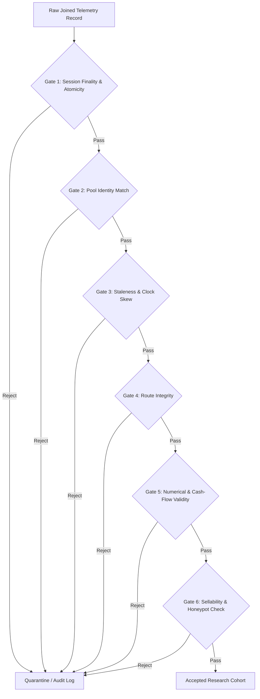

# NeXusTrade — Phase 12.94-D Architecture & Research Proposal

## Rigorous Quantitative Strategy Research: Telemetry-Execution Reconciliation, Hypothesis Testing, Anti-Bias Protocols & Generation 2 Acceptance Gates

**Status:** PROPOSAL / ARCHITECTURE & RESEARCH DESIGN ONLY  
**Prerequisites:**

- Phase 12.93D (CLOSED)
- Phase 12.94-A (CLOSED under `7e58ea5`)
- Phase 12.94-B (CLOSED under `c37f91e`)
- Phase 12.94-C (CLOSED under `2541d5b` / `c5931ca` / `7faf705`)  
  **Operational Authorization:** Architecture research and planning only. Zero implementation code, zero Windows PAPER trading restarts, zero real-SOL trading, and zero Generation 2 activation until this proposal is independently reviewed and formally approved.

---

### Executive Summary & Problem Statement

Phase 12.94-B established an audit-accepted **Market Telemetry Engine** capturing zero-lookahead decision context, stratified counterfactual tracking, and verified pool identities. Phase 12.94-C subsequently established a **Quote-Aware Execution Realism Subsystem** that models bidirectional constant-product AMM reserves, price impact, fee structures, sellability constraints, and capital capacity curves.

However, having observational telemetry (12.94-B) and execution modeling (12.94-C) as separate engines is insufficient to determine whether NeXusTrade possesses a **statistically defensible, genuinely profitable trading edge**. Naive quantitative research in decentralized finance is plagued by severe statistical failure modes:

1. **Theoretical vs. Realized Return Divergence**: Strategy reports often cite indexed spot price appreciation (+150%) on low-liquidity tokens where real-world AMM price impact and sellability reduce executable return to -40%.
2. **Lookahead & Information Leakage**: Computing signals from full-session averages, future block observations, or non-causal pool states inflates backtested performance.
3. **Survivorship & Honeypot Bias**: Silently dropping tokens that become untradeable, freeze transfers, or pull liquidity creates an illusion of high win rates.
4. **Overfitting & Multiple Testing Snooping**: Evaluating dozens of filter variations without adjusting significance thresholds (p-hacking) guarantees discovering spurious "profitable" rules.
5. **Capacity Blindness**: A strategy that appears profitable with 0.05 SOL allocation can suffer complete alpha extinction at 0.5 SOL or 2.0 SOL.
6. **Simulated vs. Executable Disconnect**: Conflating synthetic AMM simulations (Tier 2/4) with live DEX routing quotes (Tier 3) leads to false confidence prior to capital deployment.

The objective of **Phase 12.94-D** is to architect a **Rigorous Quantitative Strategy Research Pipeline** that:

- Reconciles 12.94-B decision telemetry with 12.94-C execution models using strict point-in-time relational joins.
- Eliminates numerical edge cases identified in Audit v3 (prequantization rounding and signed cash-flow clipping).
- Implements formal statistical hypothesis testing with multiple-testing corrections (Deflated Sharpe Ratio, False Discovery Rate).
- Enforces chronological walk-forward out-of-sample validation and market regime stress testing.
- Establishes mathematical acceptance gates that must be satisfied before Generation 2 can ever be created or activated.

---

### Residual Audit Guidance Incorporation (From Phase 12.94-C Final Acceptance)

The Phase 12.94-C Final Independent Acceptance Report (`NeXusTrade_Phase_12_94C_Commit_2541d5b_Final_Independent_Acceptance.md`) recorded two explicit numerical limitations to be resolved or research-gated in Phase 12.94-D:

1. **Atomic input rounding and price/source consistency:**
   - _Auditor Finding:_ When numeric inputs are converted to atomic units via `.toFixed(decimals)`, floating-point inputs can price off unrounded numbers before serializing to atomic integers, creating discrepancies on tiny trade sizes.
   - _Phase 12.94-D Resolution:_ The research pipeline establishes a **Strict Pre-Quantization Invariant**: All input amounts must be quantized to atomic units _first_; pricing functions accept strictly prequantized atomic quantities (e.g. `inAmountRaw`), with all downstream cash flows derived from integer arithmetic or exact UI projections. Trade sizes below minimum executable atomic thresholds are fail-closed rejected.

2. **Signed cash-flow handling on fee-dominated dust exits:**
   - _Auditor Finding:_ In `simulateFill`, `netProceedsSol = Math.max(0, grossProceedsSol - feeBreakdown.totalOutOfPocketFeeSol)` clips negative net proceeds to 0 when gross SOL proceeds are less than out-of-pocket transaction fees, creating a potential positive bias on dust exits.
   - _Phase 12.94-D Resolution:_ The research pipeline implements a **Dual-Protection Protocol**:
     - _Signed Net Cash Movement:_ Realized net cash flow is computed as a signed quantity: $\Delta \text{Cash} = \text{GrossProceeds} - \text{NetworkFees} - \text{PriorityFees} + \text{RentRefund}$. If fees exceed proceeds, $\Delta \text{Cash} < 0$.
     - _Dust Exclusion Gate:_ Any trade where $\text{GrossProceeds} \le \text{ExternalFees}$ is flagged with `EXECUTION_DEFICIT_SUBMARGINAL` and excluded from profitable strategy-research cohorts.

---

## 1. Point-in-Time Telemetry-Execution Join Architecture

Phase 12.94-D joins data across four distinct storage layers produced by Subphases 12.94-B and 12.94-C:

```
[Candidate Decisions]               [Executable Quotes]                [Simulated Fills]
 (12.94-B telemetry)                 (12.94-C execution)                (12.94-C execution)
 candidate-decisions.jsonl           execution-quotes.jsonl             simulated-fills.jsonl
         │                                   │                                  │
         │  eventId = decisionEventId        │   quoteId = quoteId              │
         └───────────────────────────────────┼──────────────────────────────────┘
                                             │
                                             ▼
                                [Point-in-Time Join Engine]
                                (TelemetryExecutionJoinEngine)
                                             ▲
                                             │
                                             │  mintAddress + poolId
                                             │  (sourceTimestampMs >= decisionTimestampMs)
                                             │
                              [Market Observation Trajectories]
                                     (12.94-B telemetry)
                                  market-observations.jsonl
```

### 1.1 Relational Join Keys & Identity Hierarchy

To eliminate cross-session ambiguity and route drift, records are joined using a strict 5-tuple composite key:

$$\text{JoinKey} = \langle \text{sessionId}, \text{generationId}, \text{mintAddress}, \text{poolId}, \text{decisionEventId} \rangle$$

1. **Decision to Quote Linkage**:
   - `ExecutableQuoteRecord.decisionEventId === CandidateDecisionRecord.eventId`
   - `ExecutableQuoteRecord.sessionId === CandidateDecisionRecord.sessionId`
   - `ExecutableQuoteRecord.generationId === CandidateDecisionRecord.generationId`
   - `ExecutableQuoteRecord.mintAddress === CandidateDecisionRecord.mintAddress`
   - `ExecutableQuoteRecord.poolId === CandidateDecisionRecord.poolId`

2. **Quote to Fill Linkage**:
   - `SimulatedFillRecord.quoteId === ExecutableQuoteRecord.quoteId`
   - `SimulatedFillRecord.decisionEventId === ExecutableQuoteRecord.decisionEventId`
   - `SimulatedFillRecord.side === ExecutableQuoteRecord.side`
   - `SimulatedFillRecord.poolId === ExecutableQuoteRecord.poolId`

3. **Decision to Trajectory Linkage**:
   - Observations for a candidate must share identical `mintAddress` and `poolId`.
   - Verified matching pool ID is strictly enforced: `isVerifiedMatchingPool(actualResponsePoolId, poolId) === true`.
   - Chronological monotonicity: `MarketObservationRecord.sourceTimestampMs >= CandidateDecisionRecord.decisionTimestampMs`.

### 1.2 Temporal Causality Invariants

To mathematically eliminate lookahead bias, the join engine enforces strict temporal monotonicity:

$$t_{\text{discovery}} \le t_{\text{decision}} \le t_{\text{quote\_init}} \le t_{\text{quote\_recv}} \le t_{\text{fill}} \le t_{\text{obs\_1}} < t_{\text{obs\_2}} < \dots < t_{\text{obs\_N}}$$

Any joined record violating this sequence is flagged with `LOOKAHEAD_VIOLATION_DETECTED` and rejected from research evaluation.

---

## 2. Return Semantics & The Three-Tier Return Framework

Naive backtests compute returns from ticker quotes. Phase 12.94-D formally establishes the **Three-Tier Return Framework** to quantify exactly how much theoretical profit is lost to market friction:

```
┌────────────────────────────────────────────────────────────────────────┐
│  Tier 1: Theoretical Spot Return (R_theoretical)                       │
│  - Computed from indexed ticker prices (DexScreener / Birdeye)          │
│  - Assumes infinite liquidity, zero spread, zero impact, zero gas      │
└───────────────────────────────────┬────────────────────────────────────┘
                                    │  - Slippage & AMM Impact Drag
                                    ▼
┌────────────────────────────────────────────────────────────────────────┐
│  Tier 2: Synthetic Execution Return (R_synthetic)                      │
│  - Computed from 12.94-C constant-product AMM reserves & fee model     │
│  - Deducts LP swap fee (0.25%), depth impact, Solana gas, & ATA rent   │
└───────────────────────────────────┬────────────────────────────────────┘
                                    │  - Live Route & Liquidity Validation
                                    ▼
┌────────────────────────────────────────────────────────────────────────┐
│  Tier 3: Genuinely Executable Quoted Return (R_executable)             │
│  - Computed from real-time DEX routing aggregator quotes (Jupiter/Ray) │
│  - Includes multi-hop paths, dynamic priority fees, & live commitment   │
└────────────────────────────────────────────────────────────────────────┘
```

### 2.1 Mathematical Return Definitions

For an entry decision at $t_0$ and an exit/observation at $t_1$:

1. **Theoretical Spot Return ($R_{\text{theoretical}}$)**:
   $$R_{\text{theoretical}} = \frac{P_{\text{spot}}(t_1) - P_{\text{spot}}(t_0)}{P_{\text{spot}}(t_0)}$$

2. **Synthetic Execution Net Return ($R_{\text{synthetic}}$)**:
   $$R_{\text{synthetic}} = \frac{\text{NetProceeds}_{\text{sim}}(t_1) - \text{TotalOutlay}_{\text{sim}}(t_0)}{\text{TotalOutlay}_{\text{sim}}(t_0)}$$
   where:
   $$\text{TotalOutlay}_{\text{sim}}(t_0) = \text{InAmountSol} + \text{ExternalNetworkFeeSol}(t_0) + \text{AtaRentDepositSol}$$
   $$\text{NetProceeds}_{\text{sim}}(t_1) = \text{GrossProceedsSol}(t_1) - \text{ExternalNetworkFeeSol}(t_1) + \text{AtaRentRefundSol}$$

3. **Execution Reality Gap Decomposition**:
   $$\text{ExecutionGap} = R_{\text{theoretical}} - R_{\text{synthetic}} = \Delta_{\text{impact}} + \Delta_{\text{fees}} + \Delta_{\text{slippage}}$$
   - $\Delta_{\text{impact}}$: Bid/ask depth degradation due to pool reserve depletion.
   - $\Delta_{\text{fees}}$: Solana base gas, priority fees, ATA rent, and DEX LP fees.
   - $\Delta_{\text{slippage}}$: Adverse execution delay movement between trigger and block inclusion.

### 2.2 Impairment & Liquidation Accounting

The research pipeline respects the 12.94-C execution taxonomy:

- **`FILLED`**: Confirmed simulated exit; calculates realized P&L.
- **`PREFLIGHT_SIMULATION_REJECTED`** (e.g. `UNSELLABLE_EXCESSIVE_IMPACT`): Zero gas charged; inventory remains 100% intact; evaluated with conservative impairment write-down (up to 100% loss).
- **`SUBMITTED_TRANSACTION_FAILED`** (e.g. `UNSELLABLE_LIQUIDITY_DRAINED`): Base + priority fee charged; inventory unsold; evaluated as 100% capital loss.
- **`SLIPPAGE_BREACH_REJECTED`**: Zero gas charged; inventory retained; exit aborted.

---

## 3. Fail-Closed Research Eligibility & Data Quality Gating

Before any joined observation is ingested into quantitative models, it must pass the **Fail-Closed Research Eligibility Pipeline**:



### 3.1 Formal Gating Rules

1. **Gate 1 — Session Finality & Atomicity**:
   Evaluates `verifySessionCrossFileConsistency(meta, summary)`. Must have `isCompleteSession === true` and `isInterruptedSession === false`. Interrupted sessions are rejected from primary alpha evaluations.

2. **Gate 2 — Verified Matching Pool Identity**:
   Must satisfy `isVerifiedMatchingPool(actualResponsePoolId, trackedPoolId) === true`. Observations with missing provider pool IDs, mismatched IDs, or synthetic placeholders fail closed.

3. **Gate 3 — Staleness & Clock Skew Limits**:
   - Ingestion latency: $t_{\text{ingestion}} - t_{\text{source}} \le 120{,}000\text{ ms}$ (2 minutes).
   - Clock skew: $|t_{\text{system}} - t_{\text{source}}| \le 30{,}000\text{ ms}$.
   - Telemetry follow-up observation freshness: `dataFreshnessMs <= 180,000 ms`.

4. **Gate 4 — Single-Hop Route Integrity**:
   - `routeType === "DIRECT_TRACKED_POOL"`.
   - Records with `MULTI_HOP` or `CROSS_POOL_DIVERGENCE` are rejected from single-pool constant-product alpha models.

5. **Gate 5 — Numerical & Cash-Flow Validity (Audit v3 Deferred Invariants)**:
   - _Prequantization check:_ Raw atomic units must be non-zero and derived from canonical prequantized inputs.
   - _Dust cash-flow check:_ If $\text{GrossProceedsSol} \le \text{ExternalNetworkFeeSol}$, record is flagged as `SUBMARGINAL_DUST` and barred from positive-return claims.
   - _Mathematical validity:_ No `NaN`, `null`, `Infinity`, or negative values for reserves, liquidity, or prices.

6. **Gate 6 — Sellability & Honeypot Gating**:
   - Tokens with status `UNSELLABLE_NO_ROUTE`, `UNSELLABLE_TRANSFER_RESTRICTION`, or `UNSELLABLE_LIQUIDITY_DRAINED` are treated as total loss (100% write-down) and never omitted from counterfactual risk analysis.

---

## 4. Quantitative Hypothesis Formulation & Feature Architecture

To avoid unstructured curve-fitting, Phase 12.94-D defines a structured **Quantitative Feature Architecture** and five explicit, falsifiable **Quantitative Hypotheses**.

### 4.1 Feature Taxonomy (Computed Strictly at $t \le t_{\text{decision}}$)

| Feature Category         | Symbol               | Formulation                                                                    | Economic Rationale                                  |
| :----------------------- | :------------------- | :----------------------------------------------------------------------------- | :-------------------------------------------------- |
| **Liquidity Depth**      | $R_{\text{sol}}$     | Pool quote reserve in SOL                                                      | Measures absolute capital buffer                    |
| **Liquidity-to-Cap**     | $LMC$                | $\text{LiquidityUsd} / \text{MarketCapUsd}$                                    | Detects inflated FDV with paper-thin liquidity      |
| **Price Impact @ S**     | $\delta(S)$          | Modeled price impact % at size $S \in \{0.1, 0.5, 1.0\}\text{ SOL}$            | Quantifies immediate entry/exit friction            |
| **Capacity Slope**       | $\kappa$             | $\frac{\partial \text{Impact}}{\partial \text{TradeSize}}$ from Capacity Curve | Measures vulnerability to size scaling              |
| **Order Flow Imbalance** | $OFI_{5m}$           | $(V_{\text{buy}} - V_{\text{sell}}) / (V_{\text{buy}} + V_{\text{sell}})$      | Detects aggressive buyer accumulation               |
| **Buyer Ratio**          | $BR_{5m}$            | $N_{\text{buys}} / N_{\text{sells}}$                                           | Distinguishes retail wave from solitary wash trades |
| **Pool Age**             | $\tau_{\text{pool}}$ | $(t_{\text{decision}} - t_{\text{poolOpen}}) / 60{,}000$                       | Separates initial sniper chaos from stable momentum |
| **Dev Holding**          | $H_{\text{dev}}$     | Developer wallet holding %                                                     | Primary rug-pull risk indicator                     |
| **LP Burn Ratio**        | $LP_{\text{burn}}$   | LP token burn / permanent lock %                                               | Pool rug-pull protection                            |

### 4.2 Falsifiable Trading Hypotheses

Each hypothesis is evaluated against the null hypothesis $H_0$ (legacy Generation 1 unstratified breakout):

- **Hypothesis $H_1$ (Liquidity Depth & Low Price-Impact Alpha)**:  
  _Premise:_ Restricting entries to tokens where modeled round-trip price impact $\delta(0.5\text{ SOL}) \le 3.5\%$ and $R_{\text{sol}} \ge 25\text{ SOL}$ eliminates $>80\%$ of execution drag without reducing gross win rate.  
  _Test Criterion:_ $R_{\text{synthetic}}(H_1) - R_{\text{synthetic}}(H_0) > 0$ with $p < 0.01$.

- **Hypothesis $H_2$ (Order Flow Momentum & Buyer Dominance)**:  
  _Premise:_ Momentum signals conditioned on high buyer participation ($BR_{5m} \ge 2.0$ and $OFI_{5m} \ge 0.40$) demonstrate superior post-entry price continuation over tokens driven by low-count whale transactions.  
  _Test Criterion:_ Mean 15-minute post-entry return is positive and statistically greater than $H_0$.

- **Hypothesis $H_3$ (Structural Safety & Concentration Filtering)**:  
  _Premise:_ Requiring $LP_{\text{burn}} \ge 90\%$ and $H_{\text{dev}} \le 5.0\%$ reduces honeypot/liquidity-drain incidence from $>15\%$ to $<2\%$, directly improving portfolio tail risk (Conditional Value at Risk).  
  _Test Criterion:_ 99% Expected Shortfall reduction $>50\%$ compared to baseline.

- **Hypothesis $H_4$ (Dynamic Capacity Sizing)**:  
  _Premise:_ Sizing positions dynamically via $S^* = \min(S_{\text{max}}, \sqrt{k \cdot \text{tolerance}})$ maximizes net SOL expectancy compared to fixed 0.1 SOL allocations.  
  _Test Criterion:_ Aggregate net SOL profit is higher under capacity-scaled sizing while maintaining Sharpe $\ge 1.5$.

- **Hypothesis $H_{\text{composite}}$ (Multi-Factor Scoring Engine)**:  
  _Premise:_ A linear or rank-based composite score combining $H_1$ through $H_4$ outperforms any individual factor in risk-adjusted out-of-sample performance.

---

## 5. Statistical Methodology & Anti-Bias Framework

To ensure that research results represent true alpha rather than statistical noise or data mining artifacts, Phase 12.94-D enforces strict anti-bias protocols:

```
[Full Telemetry Dataset] ──► [Chronological Train / Out-of-Sample Split]
                                      │
                 ┌────────────────────┴────────────────────┐
                 ▼                                         ▼
        [In-Sample Training]                      [Out-of-Sample Test]
        - Hypothesis exploration                  - Single-pass evaluation
        - Factor weight estimation                - No parameter re-tuning
        - Quantile threshold fitting              - Strict chronological holdout
                 │                                         │
                 ▼                                         ▼
        [Multiple Testing Adjustment]             [Statistical Validation]
        - Deflated Sharpe Ratio (DSR)             - Stationary Block Bootstrap
        - Benjamini-Hochberg FDR Control          - 95% Confidence Intervals
        - Minimum Backtest Length (MinBTL)        - Drawdown & Regime Analysis
```

### 5.1 Multiple Testing Corrections: Deflated Sharpe Ratio & FDR Control

When evaluating $K$ variations of a strategy, the probability of finding a high Sharpe ratio purely by chance approaches 1.0 (Bailey & López de Prado, 2014).

1. **Deflated Sharpe Ratio (DSR)**:
   The DSR adjusts the estimated Sharpe ratio $\widehat{SR}$ for the number of independent trials $K$, the variance of trials $V[\{\widehat{SR}_k\}]$, sample skewness $\hat{\gamma}_3$, and sample kurtosis $\hat{\gamma}_4$:

   $$DSR = \Phi \left( \frac{(\widehat{SR} - SR^*) \sqrt{T - 1}}{\sqrt{1 - \hat{\gamma}_3 \widehat{SR} + \frac{\hat{\gamma}_4 - 1}{4} \widehat{SR}^2}} \right)$$

   where $SR^*$ is the expected maximum Sharpe ratio under the null hypothesis:
   $$SR^* \approx \sqrt{2 \ln K} + \frac{\gamma}{\sqrt{2 \ln K}}$$
   Any hypothesis failing to achieve $DSR \ge 0.95$ ($p < 0.05$) is rejected as a probable overfitting artifact.

2. **False Discovery Rate (FDR) via Benjamini-Hochberg**:
   For all tested factor combinations, p-values are sorted $p_{(1)} \le p_{(2)} \le \dots \le p_{(m)}$. A hypothesis is declared statistically significant only if:
   $$p_{(i)} \le \frac{i}{m} \cdot \alpha_{\text{FDR}}, \quad \alpha_{\text{FDR}} = 0.05$$

3. **Minimum Backtest Length (MinBTL)**:
   $$\text{MinBTL} = 1 + \left(1 - \hat{\gamma}_3 \widehat{SR} + \frac{\hat{\gamma}_4 - 1}{4} \widehat{SR}^2\right) \left(\frac{Z_\alpha}{\widehat{SR}}\right)^2$$
   If the active observation window $T < \text{MinBTL}$, results are classified as preliminary and insufficient for strategy selection.

### 5.2 Chronological Out-of-Sample Testing & Regime Analysis

- **Walk-Forward Analysis (WFA)**: Time series data is partitioned chronologically into expanding training windows and non-overlapping out-of-sample forward test windows. Random k-fold cross-validation is strictly forbidden.
- **Regime Stress Testing**: Strategy hypotheses are evaluated across three distinct market regimes:
  1. _Trend / Expansion Regime:_ SOL/USD rising, aggregate DEX volume in top quartile.
  2. _Chop / Contraction Regime:_ SOL/USD ranging, declining volume, low liquidity depth.
  3. _High Congestion / Priority Fee Shock Regime:_ Solana compute unit prices spiked $>5\times$ baseline.

### 5.3 Resampling & Confidence Estimation

- **Politis-Romano Stationary Block Bootstrap**: To preserve time-series autocorrelation and volatility clustering, confidence intervals are constructed using block resampling with geometric block lengths (mean block size = 10 trades).
- All reported metrics must display **95% empirical bootstrap confidence intervals**: $[\text{Metric}_{2.5\%}, \text{Metric}_{97.5\%}]$.

---

## 6. Live Tier 3 Quote-Validation Dependency & Generation 2 Acceptance Gates

### 6.1 The Tier 3 Live Quote-Validation Dependency

A foundational architectural requirement of Phase 12.94-D is establishing that **no simulated AMM model (Tier 2/Tier 4) can authorize live production capital deployment on its own**.

```
[12.94-D Quantitative Research] ──► Selects Best Validated Hypothesis (H*)
                                                │
                                                ▼
[MANDATORY PREREQUISITE] ────────► [Tier 3 Shadow Quote-Validation Daemon]
                                   - Live Jupiter / Raydium API quotes
                                   - Real-world route discovery & latency
                                   - Dynamic fee auction tracking
                                   - Zero real SOL deployed
                                                │
                                                ▼
[Evidence Acceptance Gates] ─────► Must Pass All 7 Gates Concurrently
                                                │
                                                ▼
[Phase 12.94-E Authorization] ───► Generation 2 Paper Trading Creation / Activation
```

Before claiming that PAPER results represent truly executable market opportunities, a **Tier 3 Shadow Quoting Daemon** must be deployed to concurrently poll live routing endpoints for every signal generated, verifying that:

1. A valid route actually exists on-chain at the trigger instant ($t_{\text{latency}} \le 800\text{ms}$).
2. The live quoted output matches the synthetic AMM estimate within a tight tolerance ($|\Delta P| \le 1.5\%$).
3. The token is not blacklisted, taxed, or frozen by the routing aggregator.

### 6.2 Formal Evidence Acceptance Gates for Generation 2 Evaluation

The creation and activation of Generation 2 (deferred to Subphase 12.94-E) is blocked until the strategy research pipeline produces an **Evidence Package** satisfying all seven formal acceptance gates:

| Gate     | Acceptance Metric            | Threshold Requirement                                    | Economic / Statistical Rationale                      |
| :------- | :--------------------------- | :------------------------------------------------------- | :---------------------------------------------------- | ---------- | ------------------------------------------------- |
| **G2-1** | **Out-of-Sample Net Sharpe** | $SR_{\text{OOS}} \ge 1.50$ (annualized)                  | Ensures robust risk-adjusted return net of all fees   |
| **G2-2** | **Statistical Significance** | $p < 0.01$ (with Benjamini-Hochberg FDR)                 | Proves edge is not random data snooping               |
| **G2-3** | **Deflated Sharpe Ratio**    | $DSR \ge 0.95$                                           | Corrects for multiple hypothesis testing              |
| **G2-4** | **Execution Reality Ratio**  | $R_{\text{synthetic}} / R_{\text{theoretical}} \ge 0.35$ | Verifies returns survive real-world market friction   |
| **G2-5** | **Maximum Drawdown**         | $\text{MaxDD}_{\text{OOS}} \le 18.0\%$                   | Protects capital preservation boundaries              |
| **G2-6** | **Capital Capacity Floor**   | $S^* \ge 0.50\text{ SOL}$ with positive alpha            | Confirms strategy can absorb practical position sizes |
| **G2-7** | **Tier 3 Route Concordance** | Quoted fillability $\ge 85\%$, $                         | \Delta P                                              | \le 1.5\%$ | Validates route executability in live DEX markets |

Failure of any single gate results in immediate rejection of the candidate hypothesis and maintains the existing Generation 1 baseline.

---

## 7. Data Contracts & TypeScript Schemas

Phase 12.94-D introduces formal TypeScript data contracts in `backend/src/research/`:

### 7.1 Joined Research Record Schema

```typescript
export interface JoinedResearchRecord {
  readonly joinId: string;
  readonly sessionId: string;
  readonly generationId: string;
  readonly decisionEventId: string;
  readonly quoteId?: string;
  readonly fillId?: string;
  readonly mintAddress: string;
  readonly poolId: string;
  readonly symbol: string;

  // Chronological timestamps
  readonly discoveryTimestampMs: number;
  readonly decisionTimestampMs: number;
  readonly quoteInitiatedMs?: number;
  readonly fillTimestampMs?: number;

  // Cohort & Decisions
  readonly decisionCohort: DecisionCohort;
  readonly strategyRevision: string;

  // Three-Tier Return Quantities
  readonly spotPriceEntrySol: number;
  readonly spotPriceExitSol?: number;
  readonly theoreticalReturnPct?: number;

  readonly syntheticInAmountSol?: number;
  readonly syntheticGrossProceedsSol?: number;
  readonly syntheticNetProceedsSol?: number;
  readonly syntheticReturnPct?: number;

  readonly executionOutcome?: ExecutionOutcome;
  readonly sellabilityStatus?: SellabilityStatus;
  readonly networkFeesLamports?: number;

  // Feature Vector
  readonly featureVector: QuantitativeFeatureVector;

  // Data Quality & Gating
  readonly eligibilityStatus: "ELIGIBLE" | "QUARANTINED" | "REJECTED";
  readonly disqualificationReasons: readonly string[];
}
```

### 7.2 Feature Vector Schema

```typescript
export interface QuantitativeFeatureVector {
  // Liquidity & Depth
  readonly quoteReserveSol: number;
  readonly baseReserveTokens: number;
  readonly liquidityUsd: number;
  readonly lmcRatio: number;
  readonly priceImpactBpsAt01Sol: number;
  readonly priceImpactBpsAt05Sol: number;
  readonly priceImpactBpsAt10Sol: number;
  readonly capacitySlopeKappa: number;

  // Order Flow & Volume
  readonly buyCount5m: number;
  readonly sellCount5m: number;
  readonly buyerRatio5m: number;
  readonly volume5mUsd: number;
  readonly netBuyerVolumeUsd: number;
  readonly orderFlowImbalance5m: number;

  // Structure & Safety
  readonly poolAgeMinutes: number;
  readonly devHoldingPct: number;
  readonly lpBurnPct: number;
  readonly top10ConcentrationPct: number;
}
```

### 7.3 Hypothesis Evaluation Result Schema

```typescript
export interface HypothesisEvaluationResult {
  readonly hypothesisId: string;
  readonly description: string;
  readonly inSampleMetrics: PerformanceMetricsBlock;
  readonly outOfSampleMetrics: PerformanceMetricsBlock;
  readonly deflatedSharpeRatio: number;
  readonly pValueRaw: number;
  readonly pValueAdjustedFdr: number;
  readonly isStatisticallySignificant: boolean;
  readonly minimumBacktestLengthDays: number;
  readonly actualBacktestLengthDays: number;
  readonly executionRealityRatio: number; // R_synthetic / R_theoretical
  readonly capacityBreakEvenSol: number;
  readonly acceptanceGateResults: Record<string, boolean>;
  readonly passesAllGates: boolean;
}
```

---

## 8. Verification & Test Plan

Phase 12.94-D establishes a dedicated test suite `backend/src/research/QuantitativeResearch.test.ts` covering:

1. **RF-D1: Point-in-Time Join Integrity & Temporal Causality**
   - Correctly joins 12.94-B candidate decisions with 12.94-C quotes and fills via composite 5-tuple key.
   - Fails closed on lookahead violations ($t_{\text{decision}} > t_{\text{quote}}$).
   - Rejects mismatched sessions, generations, mints, or pool IDs.

2. **RF-D2: Fail-Closed Eligibility Gating (Audit v3 Invariants)**
   - Rejects unfinalized or interrupted sessions (`verifySessionCrossFileConsistency`).
   - Rejects missing, mismatched, or synthetic placeholder pool IDs.
   - Rejects stale telemetry ($>120\text{s}$ ingestion lag).
   - Enforces prequantized atomic input consistency (no float-to-atomic drift).
   - Correctly debits signed negative cash flow when fees exceed proceeds; flags submarginal dust exits.

3. **RF-D3: Three-Tier Return Decomposition**
   - Correctly computes $R_{\text{theoretical}}$, $R_{\text{synthetic}}$, and Execution Reality Gap.
   - Preserves 100% unsold inventory on preflight rejections (`UNSELLABLE_EXCESSIVE_IMPACT`).
   - Assigns full impairment write-downs to drained/untradeable positions without dropping them from the sample.

4. **RF-D4: Statistical Methodology & Multiple Testing Adjustments**
   - Verifies Deflated Sharpe Ratio calculation against benchmark academic tables (Bailey & López de Prado).
   - Verifies Benjamini-Hochberg FDR p-value adjustments across synthetic multi-test arrays.
   - Verifies Stationary Block Bootstrap confidence interval generation.

5. **RF-D5: Walk-Forward Chronological Partitioning**
   - Verifies strict chronological splitting (no data leakage between training and testing windows).
   - Verifies regime segmentation (expansion vs. contraction vs. congested).

6. **RF-D6: Generation 2 Acceptance Gate Evaluation**
   - Evaluates all 7 acceptance gates concurrently.
   - Successfully approves a synthetic high-alpha, low-impact strategy.
   - Fails closed when any individual gate (e.g. $DSR < 0.95$ or $\text{MaxDD} > 18\%$) is violated.

---

## 9. Implementation Sequence & Milestone Plan

Implementation of Phase 12.94-D will be strictly bounded and executed in four sequential milestones:

```
[Milestone D.1] ──► Telemetry-Execution Joiner & Research Eligibility Gates
                     (Point-in-time relational join, temporal checks, audit invariant fixes)
                           │
                           ▼
[Milestone D.2] ──► Feature Engineering & Quantitative Hypothesis Engine
                     (Liquidity depth, order flow, safety features, H1-H4 signal evaluation)
                           │
                           ▼
[Milestone D.3] ──► Statistical Evaluation & Walk-Forward Validation Suite
                     (Deflated Sharpe, FDR control, block bootstrap, regime analysis)
                           │
                           ▼
[Milestone D.4] ──► Tier 3 Quoting Specification & Gen 2 Acceptance Gate Package
                     (Shadow validator interface, formal gate verifier, evidence report)
```

1. **Milestone D.1: Telemetry-Execution Join & Eligibility Gating Engine**
   - Implement `TelemetryExecutionJoinEngine.ts` and `ResearchEligibilityGate.ts`.
   - Implement prequantization check and signed dust cash-flow accounting.
   - Verify with RF-D1 and RF-D2 test fixtures.

2. **Milestone D.2: Feature Engineering & Hypothesis Testing Engine**
   - Implement `QuantitativeFeatureExtractor.ts` and `HypothesisEvaluator.ts`.
   - Formalize feature vector extraction and evaluate hypotheses $H_1$ through $H_{\text{composite}}$.
   - Verify with RF-D3 test fixtures.

3. **Milestone D.3: Statistical Methodology & Walk-Forward Engine**
   - Implement `StatisticalSignificanceCalculator.ts` (DSR, FDR, MinBTL) and `WalkForwardAnalyzer.ts`.
   - Implement block bootstrap confidence interval estimation.
   - Verify with RF-D4 and RF-D5 test fixtures.

4. **Milestone D.4: Tier 3 Shadow Specification & Evidence Package**
   - Implement `Tier3ShadowQuotingContract.ts` and `Gen2AcceptanceGateEvaluator.ts`.
   - Run complete test suite and static analysis.
   - Produce formal evidence package for independent auditor review.

---

## 10. Operational Constraints & Boundaries Summary

- **Phases 12.93D, 12.94-A, 12.94-B, and 12.94-C remain CLOSED.**
- **Generation 1 Virtual Wallet:** Balance remains exactly **`7.9259 SOL`** with canonical SHA-256 `7F2C2353AC2F62CAC1BB98703742AB19C74AC5521635AF6F49BBE777AD020ED9`.
- **Background Processes:** Exactly **0** Windows paper trading daemons running.
- **Fedora Endurance Experiment:** Untouched and isolated.
- **Trading Strategies:** Strategy parameters, exit rules, triggers, and position sizes remain unchanged.
- **Generation 2:** Uncreated and unactivated until formal acceptance of Phase 12.94-D.
- **Real-Money Trading:** Strictly disabled.
