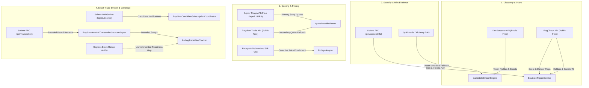
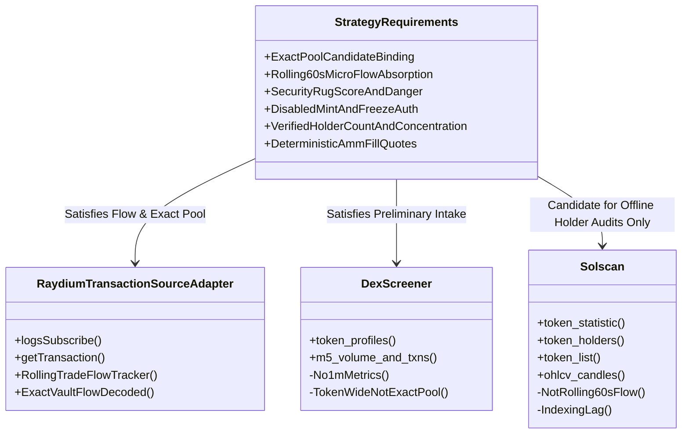
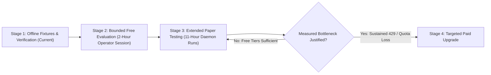

# NeXusTrade — API Provider Capabilities and Cost Roadmap

**Document ID**: `NXT-API-PROVIDER-ROADMAP-V1`  
**Location**: `docs/research-planning/api-provider-capabilities-and-cost-roadmap.md`  
**Status**: **ACTIVE PROJECT REFERENCE & FREE-FIRST UPGRADE ROADMAP**  
**Verification Date**: November 2026  
**Execution Authority**: **READ-ONLY DOCUMENTATION REPOSITORY. NO LIVE CALLS, SUBSCRIPTIONS, PURCHASES, OR DAEMON LAUNCHES AUTHORIZED.**

---

## 1. Executive Summary & Purpose

This document provides a concise, source-backed inventory of external API providers evaluated, integrated, or considered for NeXusTrade. It consolidates provider decisions from Phase 9 through Phase 12.94-D into a single, authoritative reference without rewriting historical decisions or duplicating active implementation documents.

### Core Architecture & Operating Principles

1. **Free-First Prioritization**: Maximize use of reliable, perpetual free tiers and open Solana RPC capabilities before committing capital to paid subscriptions.
2. **Strict Request Pacing & Budget Preservation**: Provider-advertised capacities are not license to spam. NeXusTrade enforces deliberate, lower internal request limits ($\ge 2,500\text{ ms}$ provider spacing via `GlobalResourceBudgetManager`, session ceilings of 25–50 requests, and `JupiterDemandController` 60 req/min limits) to protect reliability and prevent rate-limit throttling.
3. **Fail-Closed Coverage & Data Equivalence**: Aggregated market feeds (e.g. 5-minute candles, token-wide volume, indicative mid-market prices) are mathematically not equivalent to exact-pool rolling transaction flow. Trading gates fail closed whenever exact-pool data is unavailable.
4. **Virtual vs. Real Realities**: Simulated profits in virtual paper wallets ($7.9259\text{ SOL}$) are non-custodial accounting figures and cannot pay real-world SaaS invoices. Any paid upgrade recommendation must identify the precise operational bottleneck, expected benefit, hard monthly spending cap, and require realized net trading proceeds for long-term self-funding.

---

## 2. Source-Backed Provider Capability & Cost Matrix

The following matrix categorizes all primary and secondary API providers. Each entry distinguishes between:

- **Published Capabilities**: What the provider advertises in public documentation.
- **Account Entitlements**: Actual verified plan quotas and credential tiers.
- **Code-Validated Usage**: Functionality currently implemented and tested in the codebase.

### 2.1 Primary & Integrated Providers

| Provider              | Project Usage & Code Status                                                                                                                                                     | Exact Endpoints & Protocol                                                                                                                                                                                           | Continuing Free Allowance vs. Trial                                                                                                                                  | Rate Limits & Request Costs                                                                                                                | Relevant Paid Tiers & Spending Caps                                                                                                                                                         | Verification Date & Docs Link                                                  |
| :-------------------- | :------------------------------------------------------------------------------------------------------------------------------------------------------------------------------ | :------------------------------------------------------------------------------------------------------------------------------------------------------------------------------------------------------------------- | :------------------------------------------------------------------------------------------------------------------------------------------------------------------- | :----------------------------------------------------------------------------------------------------------------------------------------- | :------------------------------------------------------------------------------------------------------------------------------------------------------------------------------------------ | :----------------------------------------------------------------------------- |
| **DexScreener**       | **Primary Discovery Engine** • Implemented in `CandidateStreamEngine.ts` • Enriches tokens with liquidity, FDV, volume, and pair address                                  | • `GET /token-profiles/latest/v1` • `GET /latest/dex/tokens/{address}` • `GET /token-boosts/top/v1` • `GET /token-boosts/latest/v1` • `GET /latest/dex/pairs/solana/{pair}` • Auth: **None** (public) | **Permanent Free Public API** • No trial expiration • No account or API key required                                                                           | • **300 requests/minute** per IP (5 RPS) • Cost per call: **$0.00**                                                                     | • **No paid API tier** offered (monetized via UI ads and token boosts)                                                                                                                      | Nov 2026 [DexScreener API Docs](https://docs.dexscreener.com/api/reference) |
| **RugCheck**          | **Security Gating Engine** • Implemented in `BuyGateTriggerService.ts` • Enforces RugScore $\le 700$, danger flag check, top 10 holders %, bundler %                      | • `GET /v1/tokens/{mint}/report` • Auth: **None** for public report (JWT optional for enterprise)                                                                                                                 | **Permanent Free Public API** • No trial expiration • Unauthenticated access verified in tests                                                                 | • **~60 requests/minute** (unauthenticated) • Cost per call: **$0.00**                                                                  | • Enterprise JWT plans available for high-frequency webhooks (custom pricing)                                                                                                               | Nov 2026 [RugCheck Swagger](https://api.rugcheck.xyz/swagger/index.html)    |
| **Jupiter**           | **Primary Route Quoter** • Implemented in `JupiterAdapter.ts` • Managed by `JupiterDemandController.ts` (capped $\le 60\text{ req/min}$) • Supports price diagnostics  | • `GET https://api.jup.ag/swap/v1/quote` • `GET https://api.jup.ag/price/v3` • Auth: `x-api-key` header (Bearer key from portal)                                                                               | **Permanent Free Keyed Tier** • No trial expiration • Keyless: 0.5 RPS (30/min) • Keyed: 1.0 RPS (60/min)                                                   | • Keyed Free: **1 RPS** (~60/min) • Execute bucket: **50 RPS** ($0 cost) • Monthly Credits: **Unlimited** (rate-constrained)         | • **Developer**: $25/mo (10 RPS, 25M credits) • **Launch**: $100/mo (50 RPS, 100M credits) • Rate-limit headers: `x-ratelimit-*`                                                      | Nov 2026 [Jupiter Portal](https://jup.ag)                                   |
| **Raydium**           | **Secondary Quote Fallback** • Implemented in `RaydiumAdapter.ts` • `CandidateStreamEngine` pool discovery • Swap decoder in `RaydiumAmmV4SwapDecoder.ts`              | • `GET https://transaction-v1.raydium.io/compute/swap-base-in` • `GET https://api-v3.raydium.io/pools/info/mint` • `GET https://api-v3.raydium.io/pools/info/list` • Auth: **None**                         | **Permanent Free Public API** • No trial expiration • No API key required for public endpoints                                                                 | • **~60–120 requests/minute** per IP (burst throttled) • Cost per call: **$0.00**                                                       | • **No paid API tier** • Route preflight failure (`NO_ROUTE`) is common on newly launched pools                                                                                          | Nov 2026 [Raydium Docs](https://raydium.io)                                 |
| **Public Solana RPC** | **Authority Parsing & RPC Baseline** • Implemented in `SolanaRpcProviderConfig` • Direct `getAccountInfo` for mint/freeze authority checks • Fallback `getTransaction` | • `POST https://api.mainnet-beta.solana.com` • `WSS wss://api.mainnet-beta.solana.com` • JSON-RPC 2.0 (`getAccountInfo`, `getTransaction`, `logsSubscribe`) • Auth: **None**                                | **Permanent Free Public Cluster** • Provided by Solana Foundation • Zero trial expiration                                                                      | • **40 requests per 10 seconds** (~4 RPS sustained per IP) • Cost per call: **$0.00**                                                   | • **None** (public infrastructure) • Highly vulnerable to 429 drops and WebSocket disconnects under load                                                                                 | Nov 2026 [Solana RPC Docs](https://solana.com/docs/rpc)                     |
| **Birdeye**           | **Selective Market Enrichment** • Implemented in `BirdeyeAdapter.ts` • Guarded by `BirdeyeBudgetTracker.ts` and in-memory cache                                           | • `GET https://public-api.birdeye.so/defi/price` • `GET /defi/token_overview` • `GET /defi/v3/token/market-data` • Auth: `X-API-KEY` header                                                                 | **Standard Free Plan (Active)** • Entitlement: **30,000 CUs/month** • Rate limit: **1 RPS** (60/min) • **No overages allowed** • **No WebSocket access** | • `/defi/price`: **3 CUs** (~10,000 calls/mo) • `/defi/token_overview`: **15 CUs** (~2,000 calls/mo) • External 429 rate: 0% in code | • **Lite**: $39/mo (1.5M–2.5M CUs, 15 RPS) • **Starter**: $99/mo (8M CUs, 15 RPS, $12/1M overage) • **Premium**: $199/mo (20M CUs, 50 RPS, WebSockets)                                | Nov 2026 [Birdeye API Pricing](https://birdeye.so)                          |
| **Helius**            | **Historical Authority & Metadata** • Configured in `HeliusProviderConfig` • DAS `getAsset` supported • Exhausted July 2026 in validation                              | • `POST https://mainnet.helius-rpc.com/?api-key=<KEY>` • Standard RPC + DAS API + WebSockets • Auth: Query parameter `api-key`                                                                                 | **Permanent Free Plan** • **1,000,000 credits/month** • Proved insufficient for long validation batches in Phase 9.3B                                          | • Standard RPC: **1 credit/req** (10 RPS) • DAS (`getAsset`): **10 credits/req** (2 RPS) • WebSockets: **1 credit/event pushed**     | • **Developer**: $49/mo (10M credits, 50 RPS, $5/1M overage) • **Business**: $499/mo (100M credits, 200 RPS) • Spending caps: Manual prepaid credits                                  | Nov 2026 [Helius Pricing Docs](https://docs.helius.dev)                     |
| **QuickNode**         | **Secondary DAS & RPC Fallback** • Base URL configured in `providerConfig.ts` • Handled via `DasMetadataAdapter.ts`                                                       | • Custom endpoint URL with token path • Solana RPC + DAS add-on (`getAsset`) • Auth: Endpoint secret path                                                                                                      | **Discover Free Plan** • **10,000,000 credits/month** • Rate limit: **25 credits/sec**                                                                         | • Standard RPC: **1 credit/call** • DAS methods: **5–10 credits/call** • WebSockets: Included                                        | • **Build**: $49/mo (20M credits, 50 RPS, $1.50/1M overage) • **Scale**: $299/mo (120M credits, 300 RPS)                                                                                 | Nov 2026 [QuickNode Solana Docs](https://www.quicknode.com/docs/solana)     |
| **Alchemy**           | **Tertiary DAS & RPC Fallback** • Base URL configured in `providerConfig.ts` • Handled via `DasMetadataAdapter.ts`                                                        | • `https://solana-mainnet.g.alchemy.com/v2/{KEY}` • Solana RPC + DAS API • Auth: URL API key                                                                                                                   | **Starter Free Plan** • **30,000,000 CUs/month** • Rate limit: **300 CUs/sec**                                                                                 | • Standard RPC: **10–25 CUs/call** • DAS (`getAsset`): **25–50 CUs/call** • WebSockets: Included                                     | • **Growth**: $49/mo (larger base allowance, $1.20/1M CUs overage with hard spend caps)                                                                                                     | Nov 2026 [Alchemy Solana Docs](https://docs.alchemy.com)                    |
| **Solscan**           | **Explorer & Holder Verification** • **Not implemented in backend code** • Explorer link generation only                                                                  | • `GET https://pro-api.solscan.io/v2.0/token/meta` • `GET /token/holders` • `GET /token/statistic` • `GET /token/list-v2` • `GET /market/token/{address}/ohlcv` • Auth: `token: <API_KEY>` header     | **Free Public API Tier** • "Start Free" marketing gives basic key • Rate capped at **1–2 RPS** • Strict limits on bulk/export queries                       | • Standard endpoints: **100 CUs/request** • Heavy/paginated queries cost more • Free allowance restricted to basic tests             | • **Pro Lite**: $49/mo (20M CUs, 1,000 req/60s) • **Pro Level 2**: $199/mo (150M CUs, 1,000 req/60s) • **Pro Level 3**: $399/mo (500M CUs) • **Pro Level 4**: $1,099/mo (1.5B CUs) | Nov 2026 [Solscan Pro API v2.0](https://pro-api.solscan.io/v2.0)            |

---

### 2.2 Previously Considered & Deferred Providers

The following providers were formally evaluated in historical architecture reviews and intentionally deferred:

1. **Orca Whirlpools SDK / Direct Quote**:
   - _Status_: **Deferred** (Phase 9.6).
   - _Reason_: Whirlpools requires concentrated-liquidity tick-array math and pool-specific state caching. The current strategy operates on standard Raydium AMM v4 pools. Direct Orca quoting introduces SDK dependency overhead without candidate pool alignment.
2. **Meteora DLMM Direct Quote**:
   - _Status_: **Deferred** (Phase 9.6).
   - _Reason_: Meteora Dynamic AMM and DLMM require bin-step tracking. Raydium AMM v4 covers $>90\%$ of screened candidate pairs in our current discovery profiles.
3. **Titan (DART / Gateway API)**:
   - _Status_: **Deferred** (Phase 9.5).
   - _Reason_: Access-gated institutional aggregator. Requires systematic trader approval and private onboarding agreements. Not accessible via standard self-serve developer tiers.
4. **Autobahn (Hosted / Self-Hosted API)**:
   - _Status_: **Deferred** (Phase 9.5).
   - _Reason_: Self-hosted node setup introduces substantial infrastructure maintenance and server costs; hosted access was access-gated.
5. **Shyft (GraphQL / Solana API)**:
   - _Status_: **Deferred** (Phase 9.3C).
   - _Reason_: Redundant with Solana RPC `getAccountInfo` and QuickNode/Alchemy DAS metadata adapters.
6. **GeckoTerminal (Gecko API)**:
   - _Status_: **Deferred** (Phase 9).
   - _Reason_: Redundant with DexScreener. Has lower rate limits (30 calls/minute on free tier) and higher indexing latency.

---

## 3. Mapping Provider Capabilities to NeXusTrade Strategy Requirements

NeXusTrade’s multi-stage execution model ([`NXT-D3.3-PAPER-READINESS-ASSESSMENT-V4`](file:///u:/Projects/TopG/docs/research-planning/phase-12.94d-milestone-d3-3-paper-readiness-assessment.md)) imposes strict mathematical data requirements. This section evaluates each provider against those requirements.

### 3.1 Requirement Breakdown

#### 1. Source Completeness, Disconnect Recovery & Transaction Reconciliation

- **Strategy Input Needed**: Continuous observation across the latest 60-second window ($[T - 60\text{s}, T]$) without dropped transactions, calculating exact buyer vs. seller trade counts (`recentBuys60s`, `recentSells60s`) and flow ratios for Retest Gate absorption checks (Rule A: $\ge 1.15\times / 1.25\times$; Rule B: $\ge 1.25\times / 1.50\times$; Rule E: seller surge detection).
- **Provider Evaluation**:
  - **DexScreener / Birdeye**: **Unsuitable**. Both provide fixed aggregations (minimum 5-minute buckets `m5` on DexScreener; 1-minute fixed OHLCV on Birdeye). They aggregate across all pools on the token mint (token-wide), obscuring pool-specific liquidity drains. Furthermore, indexing delays of 10–60 seconds make them incapable of real-time absorption evaluation.
  - **Solscan OHLCV / Token Statistics**: **Unsuitable**. Fixed-bucket historical OHLCV data lacks transaction-level directionality (buys vs. sells on base/quote vaults), lacks exact-pool binding, and suffers from indexing lag.
  - **Solana WebSocket (`logsSubscribe`) + RPC (`getTransaction`)**: **The Only Valid Architecture**. Implemented in [`RaydiumCandidateSubscriptionCoordinator.ts`](file:///u:/Projects/TopG/backend/src/candidate-scanner/RaydiumCandidateSubscriptionCoordinator.ts), [`RaydiumAmmV4TransactionSourceAdapter.ts`](file:///u:/Projects/TopG/backend/src/candidate-scanner/RaydiumAmmV4TransactionSourceAdapter.ts), and [`RollingTradeFlowTracker.ts`](file:///u:/Projects/TopG/backend/src/candidate-scanner/RollingTradeFlowTracker.ts). Bounded retrieval with exact 8-field pool context matching guarantees exact-pool decoding.
  - **Remaining Readiness Gap**: Production source completeness verification (e.g. gapless block-range polling proving zero dropped transactions across slots) remains unimplemented. Explanatory text strings, open socket liveness, and empty queues do not prove source completeness.

#### 2. Security Scores & Authority Evidence

- **Strategy Input Needed**: RugScore $\le 700$, zero `danger` risk flags, mint authority `DISABLED`, freeze authority `DISABLED`.
- **Provider Evaluation**:
  - **RugCheck**: **Satisfies Security Gating**. `/v1/tokens/{mint}/report` delivers normalized risk scores and specific danger flags (`level === 'danger'`). Fully validated in [`BuyGateTriggerService.ts`](file:///u:/Projects/TopG/backend/src/candidate-scanner/BuyGateTriggerService.ts).
  - **Public Solana RPC (`getAccountInfo`)**: **Satisfies Authority Evidence**. Parsing the raw SPL token mint account (byte offsets 0–82) determines mint authority and freeze authority presence directly with zero reliance on third-party aggregators. Fully validated in Phase 9.3C with 0% rate limits.

#### 3. Holder Counts & Concentration

- **Strategy Input Needed**: Total holders count $\ge 250$ (Established cohort gate), top 10 holders percentage $\le 30\%$ (probe sizing risk adjustment), bundler percentage $\le 60\%$.
- **Provider Evaluation**:
  - **RugCheck**: `/v1/tokens/{mint}/report` supplies `totalHolders` and top holder percentages directly in the report envelope. Sufficient for preliminary screening and confirmed gating.
  - **Solscan**:
    - `GET /v2.0/token/holders`: Returns a paginated list of token accounts, amounts, and holding percentages (`percentage`, `value`). High fidelity, but costs 100 CUs per call.
    - `GET /v2.0/token/statistic`: Returns distribution analytics.
    - _Verdict_: Solscan is valuable for periodic offline verification and truth audits of top holders, but unnecessary for continuous live screening given RugCheck's availability.

#### 4. Exact-Pool Market Data, Pricing & Executable Quote Evidence

- **Strategy Input Needed**: Confirmed-entry probe quotes (0.10–0.65 SOL) and exit quotes (50% Tier 1, 25% Tier 2, 25% Moonbag) with realistic slippage, price impact, and ATA rent debiting/crediting.
- **Provider Evaluation**:
  - **Jupiter Swap API (`/swap/v1/quote`)**: Primary aggregator quote engine. Delivers exact executable quote evidence. Keyed free tier provides 1 RPS (adequate under our $\ge 2,500\text{ ms}$ pacing).
  - **Raydium Trade API (`/compute/swap-base-in`)**: Secondary direct venue fallback when Jupiter is rate-limited or unavailable.
  - **DexScreener / Birdeye Price**: Useful for indicative mid-market pricing only; cannot generate executable quotes.

---

### 3.2 Deep-Dive: Analysis of 1-Minute Trading Metrics & Non-Equivalence

A critical architectural pitfall in automated trading engines is conflating aggregator candle feeds with micro-flow strategy metrics.

| Dimension                | NeXusTrade Required Strategy Input                                                                                       | Aggregator Feeds (DexScreener / Birdeye / Solscan OHLCV)                                                                  | Architectural Implication                                                                                               |
| :----------------------- | :----------------------------------------------------------------------------------------------------------------------- | :------------------------------------------------------------------------------------------------------------------------ | :---------------------------------------------------------------------------------------------------------------------- |
| **Window Boundary**      | **Rolling 60-Second Window** Evaluated continuously from $[T - 60\text{s}, T]$ dynamically at each tick.              | **Fixed Time Buckets** Bound to clock-minute boundaries (e.g. 14:02:00–14:03:00 UTC) or 5-minute intervals (`m5`).     | A fixed candle can be up to 59 seconds stale relative to an in-flight decision tick, missing immediate seller surges.   |
| **Pool Identity**        | **Exact Candidate Pool Only** Transactions must bind to specific `poolId`, `baseVault`, and `quoteVault`.             | **Token-Wide Aggregate** Combines all DEX pools, cross-DEX arbitrage, and multi-hop routed trades.                     | Token-wide volume masks a sudden liquidity drain or rug pull occurring on the specific candidate pool.                  |
| **Trade Directionality** | **Vault-Decoded Balance Deltas** Exact base token transferred vs. quote SOL transferred determines BUY vs. SELL.      | **Heuristic / Net Tick Change** OHLCV candles only record open/high/low/close prices; net volume is often unseparated. | Retest absorption rules require the exact ratio $\text{buys60s} / \text{sells60s}$. Candles cannot supply trade counts. |
| **Timestamp Provenance** | **On-Chain BlockTime & Host Local Receipt** Bounded future skew $\le 2,000\text{ ms}$; contradiction checks enforced. | **Indexer Ingestion Timestamp** Aggregator database commit time with 5–60 second indexing delays.                      | Delayed indexer timestamps violate temporal integrity and would confirm expired retest windows.                         |

> **Conclusion**:  
> Candlesticks, indicative prices, and token-wide metrics **cannot substitute** for exact-pool transaction decoding. Any attempt to replace `RaydiumAmmV4TransactionSourceAdapter` with an aggregator candle endpoint violates strategy specifications and is prohibited.

---

### 3.3 Deep-Dive: Solscan API Review & "Start Free" Reality Check

Recent marketing communications from Solscan emphasize a "Start Free" onboarding path. An independent technical audit of Solscan Pro API v2.0 (`pro-api.solscan.io/v2.0`) clarifies the actual capabilities:

1. **Endpoint Access & Costs**:
   - `GET /v2.0/token/statistic`: Returns structural metrics, market behavior, and distribution data. Documented cost: **100 CUs per call**.
   - `GET /v2.0/token/list-v2`: Paginated token lists sorted by market metrics. Documented cost: **100 CUs per call**. Advanced multi-token filters require paid Pro tiers.
   - `GET /v2.0/token/holders`: Paginated holder list with addresses, balances, and percentages. Documented cost: **100 CUs per call**.
   - `GET /v2.0/market/token/{address}/ohlcv`: Historical candlestick bars across fixed time frames.
2. **The "Start Free" Marketing vs. Technical Reality**:
   - Registering a user account on `solscan.io` generates a basic developer API key.
   - However, this free tier is strictly intended for developer prototyping, low-volume scripts, and basic explorer querying. It enforces low rate limits (1–2 RPS) and strict concurrency limits.
   - Standard data endpoints consume 100 Compute Units (CUs) per request. High-frequency candidate screening (e.g. 100 queries/hour) would rapidly exhaust free usage allowances.
   - Dedicated multi-token streams, deep historical exports, and production rate limits require the **Pro Lite ($49/mo)** or **Pro Level 2 ($199/mo)** plans.
3. **Verdict for NeXusTrade**:
   - Solscan is **not required** for live scanner execution or candidate gating.
   - Solscan’s free API key is best utilized for **offline data truthing, benchmark fixture generation, and independent holder audit scripts**.

---

## 4. Free-First Upgrade Roadmap & Session Consumption

NeXusTrade adheres to a strictly paced, resource-budgeted execution policy.

### 4.1 Internal Configured Limits vs. Provider Maximums

To prevent provider pressure and avoid 429 throttling, NeXusTrade deliberately configures operating limits well below advertised provider maximums:

| Provider        | Documented / Advertised Maximum      | NeXusTrade Configured Limit                                                                | Enforcing Component                        |
| :-------------- | :----------------------------------- | :----------------------------------------------------------------------------------------- | :----------------------------------------- |
| **Solana RPC**  | 40 req/10s (public) or 50 RPS (paid) | **$\ge 2,500\text{ ms}$ spacing** ($\le 24\text{ req/min}$), **25–50 req/session ceiling** | `GlobalResourceBudgetManager`              |
| **Jupiter**     | 1 RPS (free) or 10 RPS (Dev $25/mo)  | **$\le 60\text{ req/min}$**, priority queue with cooldown backoff                          | `JupiterDemandController`                  |
| **Raydium**     | ~120 req/min                         | **$\le 60\text{ req/min}$**, venue guard preflight + negative cache                        | `providerConfig.ts`, `QuoteProviderRouter` |
| **Birdeye**     | 1 RPS, 30,000 CUs/month              | **$\le 20\text{ calls/cycle}$**, selective enrichment for $\ge 50$ score only              | `BirdeyeBudgetTracker`, `BirdeyeCache`     |
| **DexScreener** | 300 req/min                          | **5-second polling interval** for scanner discovery                                        | `CandidateStreamEngine`                    |
| **RugCheck**    | ~60 req/min                          | **Single call per preliminary candidate**                                                  | `BuyGateTriggerService`                    |

---

### 4.2 Estimated Session Consumption

Using our actual configured controls, consumption is modeled across three representative operational sessions:

1. **Short Session**: 2 hours (testing, parameter calibration, ~20 candidates evaluated).
2. **Daily Session**: 11 hours (standard paper-trading session, ~110 candidates evaluated).
3. **Week-Long Session**: 77 hours (7 daily sessions, ~770 candidates evaluated).

| Provider & Metric                           | Short Session (2 Hours, ~20 Candidates) | Daily Session (11 Hours, ~110 Candidates) | Week-Long Session (77 Hours, ~770 Candidates) | Status Under Free Plan Allowances                                                                 |
| :------------------------------------------ | :-------------------------------------- | :---------------------------------------- | :-------------------------------------------- | :------------------------------------------------------------------------------------------------ |
| **DexScreener** (Discovery)                 | 1,440 requests (5s loop)                | 7,920 requests (5s loop)                  | 55,440 requests                               | **100% Free** (within 300 req/min public limit)                                                   |
| **RugCheck** (Gating Reports)               | 20 requests                             | 110 requests                              | 770 requests                                  | **100% Free** (well within ~60 req/min unauthenticated limit)                                     |
| **Public Solana RPC** (`getAccountInfo`)    | 20 requests (mint/freeze auth)          | 110 requests                              | 770 requests                                  | **100% Free** (paced $\ge 2,500\text{ ms}$, 0% rate limits observed)                              |
| **Jupiter** (Confirmed Entry & Exits)       | ~40 requests                            | ~220 requests                             | ~1,540 requests                               | **100% Free** (keyed free tier: 1 RPS = 3,600 req/hr capacity)                                    |
| **Raydium Trade API** (Quote Fallback)      | ~4 requests (fallback only)             | ~20 requests                              | ~140 requests                                 | **100% Free** (public unauthenticated endpoints)                                                  |
| **Birdeye** (Selective High-Score)          | 5 overviews = **75 CUs**                | 25 overviews = **375 CUs**                | 175 overviews = **2,625 CUs**                 | **100% Free** (Standard allowance: 30,000 CUs/mo; spends $\approx 8.75\%$ of monthly budget)      |
| **Solana RPC** (`getTransaction` Retrieval) | ~40 transaction fetches                 | ~220 transaction fetches                  | ~1,540 transaction fetches                    | **100% Free** if spread across public RPC / QuickNode (10M free credits) / Alchemy (30M free CUs) |

> **Key Finding**:  
> Under NeXusTrade's existing request pacing and candidate screening filters, **all standard research and 11-hour daily paper trading sessions operate fully within verified, continuing free-tier allowances**.

---

### 4.3 Staged Upgrade Path & Trigger Criteria

Paid upgrades are strictly contingent on empirical, measured bottlenecks during operator-run sessions.

#### Stage 1: Offline Fixtures & Documentation Verification (Current State)

- Strict offline testing using recorded mock transports, deterministic fixtures, and isolated unit suites.
- Production source completeness remains an explicit open readiness gap.
- **Cost**: **$0.00**.

#### Stage 2: Bounded Operator-Run Evaluation (Verified Free Access)

- The operator personally executes bounded runs (1–2 hours) connecting live free-tier endpoints.
- Verifies that `JupiterDemandController` 1 RPS allowance and RugCheck report latency perform without operational stalls.
- **Cost**: **$0.00**.

#### Stage 3: Extended Controlled PAPER Testing

- Full 11-hour daily paper-trading daemon sessions.
- Bounded transaction retrieval for admitted candidates distributed across QuickNode (10M free credits/mo) and Alchemy (30M free CUs/mo).
- Birdeye budget capped at 1,000 CUs/day ($\le 30,000\text{ CUs/mo}$).
- **Cost**: **$0.00**.

#### Stage 4: Selective Paid Upgrades (Condition-Based Only)

Paid upgrades are authorized **only** if measured session logs prove that free quotas degrade strategy execution.

| Upgrade Candidate     | Concrete Bottleneck Trigger                                                                                       | Expected Benefit                                                                                                                      | Monthly Cost       | Hard Spending Cap & Self-Funding Policy                                                                                                |
| :-------------------- | :---------------------------------------------------------------------------------------------------------------- | :------------------------------------------------------------------------------------------------------------------------------------ | :----------------- | :------------------------------------------------------------------------------------------------------------------------------------- |
| **Jupiter Developer** | Measured quote cooldown skips $> 15\%$ on confirmed retest candidates due to 1 RPS ceiling.                       | Raises rate limit from 1 RPS to **10 RPS**, eliminating quoter queuing delays during rapid market moves.                              | **$25.00 / month** | Hard cap: **$25.00/mo** (overages disabled). Initial funding from operator capital; later renewal requires realized net trading gains. |
| **Helius Developer**  | Transaction retrieval drops on public RPC or QuickNode/Alchemy free credits exhausted across multi-week sessions. | Provides dedicated RPC node with **50 RPS** and **10,000,000 credits/month**, reducing `getTransaction` latency to $< 200\text{ ms}$. | **$49.00 / month** | Hard cap: **$49.00/mo** (autoscaling overage capped at $10.00). Must be justified by measured transaction loss.                        |
| **Birdeye Lite**      | Monthly 30,000 CU budget exhausted before month-end due to expanded watchlist tracking.                           | Increases allowance from 30k CUs to **1,500,000 CUs/month** and rate limit from 1 RPS to 15 RPS.                                      | **$39.00 / month** | Hard cap: **$39.00/mo**. Overages disallowed.                                                                                          |
| **Solscan Pro Lite**  | Offline token distribution auditing and holder concentration validation require automated bulk extraction.        | Provides programmatic access to `/token/holders` and `/token/statistic` at **1,000 req/60s** (20M CUs).                               | **$49.00 / month** | Hard cap: **$49.00/mo**. Defer until live strategy profitability is established.                                                       |

---

## 5. Practical Recommendations

### 5.1 Requirements Plausibly Satisfied with Verified Free Services

1. **Candidate Discovery & Intake**: DexScreener free API (300 req/min) fully covers token profiles, boosts, and new pair scanning.
2. **Security & Gating**: RugCheck public `/report` endpoint ($0 cost) satisfies RugScore $\le 700$ and danger flag gating.
3. **Mint & Freeze Authority Evidence**: Raw Solana RPC `getAccountInfo` calls ($0 cost) reliably parse mint accounts with 0% rate limits.
4. **Primary Executable Quotes**: Jupiter keyed free tier (1 RPS) provides sufficient quoting throughput for our calibrated probe sizes.
5. **Secondary Direct Quote Fallback**: Raydium public Trade API provides unauthenticated compute quote fallback.
6. **Selective Price Enrichment**: Birdeye Standard free plan (30k CUs/mo) satisfies high-score candidate validation under existing `BirdeyeBudgetTracker` controls.

### 5.2 Requirements Needing Account-Entitlement Confirmation

1. **QuickNode & Alchemy Free RPC Endpoints**: Confirm that the operator's personal QuickNode (10M credits/mo) and Alchemy (30M CUs/mo) endpoints have the Solana Digital Asset Standard (DAS) add-on enabled for `getAsset` fallback.
2. **Jupiter Keyed Portal Access**: Verify that the operator's registered Jupiter API key is configured in `JUPITER_API_KEY` to guarantee 1 RPS rather than the 0.5 RPS keyless throttling.

### 5.3 Requirements Still Unsupported or Unproven

1. **Production Source Completeness Verification**: No third-party API provides verified gapless transaction observation. Gapless block-range verification remains an explicit, unresolved readiness gap.
2. **Live WebSocket Network Resilience**: Behavior under severe network partitions or RPC provider WebSocket drops is verified offline via mock transports, but unmeasured under live Solana mainnet congestion.

### 5.4 The Smallest Next Implementation Step

- **Step**: Keep the offline boundary closed. Do **not** implement new provider adapters or modify existing request pacing.
- The next engineering task is completing documentation and test handoffs for the accepted coordinator (`cbf2cf5`), keeping production completeness as an open readiness requirement.

---

## 6. Document Lineage & Historical References

- [`DECISIONS_Phase9Plus.md`](file:///u:/Projects/TopG/docs/DECISIONS_Phase9Plus.md): Provider strategy decisions (Phases 9.0–9.4D).
- [`ROADMAP_Phase9_to_12.88.md`](file:///u:/Projects/TopG/docs/ROADMAP_Phase9_to_12.88.md): Evolutionary milestones from Phase 9 to Phase 12.88.
- [`Provider-Strategy-Phase9Plus.md`](file:///u:/Projects/TopG/docs/archived/legacy-planning/Provider-Strategy-Phase9Plus.md): Historical provider architecture and Helius credit exhaustion findings.
- [`providerConfig.ts`](file:///u:/Projects/TopG/backend/src/providers/config/providerConfig.ts): Active TypeScript provider configuration schemas and rate-limit definitions.
- [`phase-12.94d-milestone-d3-3-paper-readiness-assessment.md`](file:///u:/Projects/TopG/docs/research-planning/phase-12.94d-milestone-d3-3-paper-readiness-assessment.md): Phase 12.94-D Milestone D.3.3 source-accurate readiness assessment.
