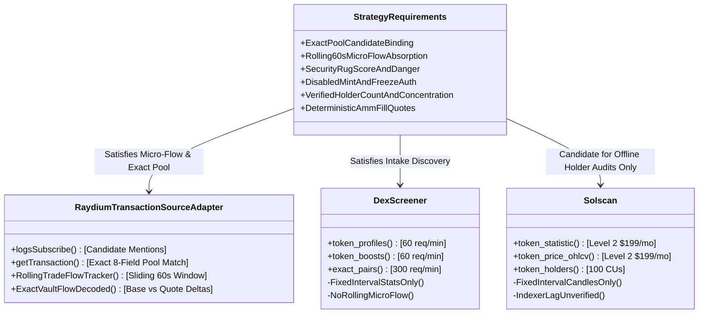

# NeXusTrade — API Provider Capabilities and Cost Roadmap

**Document ID**: `NXT-API-PROVIDER-ROADMAP-V3`  
**Location**: `docs/research-planning/api-provider-capabilities-and-cost-roadmap.md`  
**Status**: **ACTIVE PROJECT REFERENCE & FREE-FIRST EVALUATION ROADMAP**  
**Verification Date**: November 2026  
**Execution Authority**: **READ-ONLY DOCUMENTATION REPOSITORY. NO LIVE CALLS, SUBSCRIPTIONS, PURCHASES, OR DAEMON LAUNCHES AUTHORIZED.**

---

## 1. Executive Summary & Purpose

This document provides a concise, source-backed inventory of external API providers evaluated, integrated, or considered for NeXusTrade. It consolidates provider architecture decisions from Phase 9 through Phase 12.94-D into a single, authoritative reference without rewriting historical decisions or duplicating active implementation documents.

### Core Architecture & Operating Principles

1. **Free-First Evaluation & Strict Verification**: Maximize use of reliable, continuing free tiers and open Solana RPC capabilities. Distinguish sharply between promotional/time-limited trials (e.g. QuickNode's 1-month trial) and permanent free tiers.
2. **Separation of Published Specs, Internal Controls, and Validated Availability**:
   - _Published Provider Specifications_: Documented quotas, rate limits, and pricing from official vendor documentation (verified November 2026).
   - _NeXusTrade Internal Code Controls_: Deliberate, conservative limits enforced in code (e.g. `JupiterDemandController` $\le 48\text{ req/min}$ and 1,250 ms base spacing, `GlobalResourceBudgetManager` $\ge 2,500\text{ ms}$ provider spacing and 25–50 request session ceilings, `BirdeyeAdapter` 20 CU internal reservation).
   - _Empirically Validated Availability_: What has been verified under realistic workloads. Historical small-batch tests or mock unit tests do not establish current live account entitlement or unlimited capacity under load.
3. **Fail-Closed Coverage & Micro-Flow Non-Equivalence**: Standard commercial REST endpoints (e.g. 5-minute candles, token-wide volume, indicative mid-market prices) are mathematically not equivalent to exact-pool rolling transaction flow. Trading gates fail closed whenever exact-pool micro-flow data is unavailable.
4. **Explicit Workload Modeling**: Multi-hour workloads are modeled as explicit scenarios distinguishing average demand, burst peak concurrency, internal session limits, provider quota costs, and unknown reconciliation traffic.
5. **Real vs. Virtual Realities**: The frozen simulated virtual wallet balance of **7.9259 SOL** represents internal software accounting records, not realized profits or accessible capital, and cannot satisfy SaaS invoices. Any paid upgrade is a **proposal for separate operator decision**, requiring demonstrated operational necessity, a hard monthly spending cap, and eventual self-funding from realized net trading proceeds.

---

## 2. Source-Backed Provider Capability & Cost Matrix

The following matrix categorizes all primary and secondary API providers. Each entry distinguishes between:

- **Published Specifications**: What the provider publishes in official documentation (verified November 2026).
- **Internal Code Controls**: What active NeXusTrade configuration and adapter classes enforce.
- **Empirically Validated Availability**: What has actually been proven in offline or bounded pilot runs. Any unverified item is explicitly marked `UNVERIFIED`.

```mermaid
flowchart TD
    subgraph Intake["1. Discovery & Intake"]
        DS["DexScreener API (Public Free)"] -->|"Token Profiles & Boosts (60 req/min)<br>Pairs & Search (300 req/min)"| CSE["CandidateStreamEngine"]
        RC["RugCheck API (Public Free)"] -->|"Score & Danger Flags (Rate Limit UNVERIFIED)"| BG["BuyGateTriggerService"]
    end

    subgraph Security["2. Security & Mint Evidence"]
        RPC["Solana RPC (getAccountInfo)"] -->|"Mint & Freeze Auth (Paced >=2500ms)"| BG
        RC -->|"Holders Count & Top-10 % (Bundler % UNPROVABLE/UNDEFINED)"| BG
        DAS["QuickNode / Alchemy DAS"] -->|"Asset Metadata Fallback (Entitlement UNVERIFIED)"| CSE
    end

    subgraph Quoting["3. Quoting & Pricing"]
        JUP["Jupiter Swap API (Free Keyed 1 RPS)"] -->|"Primary Swap Quotes (Controlled <=48/min, 1250ms)"| QPR["QuoteProviderRouter"]
        RAY["Raydium Trade API (Public Free)"] -->|"Secondary Quote Fallback (Cloudflare Limits UNVERIFIED)"| QPR
        BIRD["Birdeye API (Standard 30k CU)"] -->|"Selective Price Enrichment (Reserves 20 CUs/overview)"| ENR["BirdeyeAdapter"]
    end

    subgraph TradeStream["4. Exact Trade Stream & Coverage"]
        WSS["Solana WebSocket (logsSubscribe)"] -->|"Candidate Notifications (Exact Pool)"| COORD["RaydiumCandidateSubscriptionCoordinator"]
        RPCTx["Solana RPC (getTransaction)"] -->|"Bounded Paced Retrieval (Dynamic Arrival Rate)"| ADAPT["RaydiumAmmV4TransactionSourceAdapter"]
        ADAPT -->|"Decoded Swaps"| TRACK["RollingTradeFlowTracker"]
        RECON["ExactPoolHistoryEnumerator & Bridge"] -->|"Accepted RECOVERY_ONLY Backfill (Production Completeness UNAVAILABLE)"| TRACK
    end
```

### 2.1 Primary & Integrated Providers

| Provider              | Published Specifications & Endpoints                                                                                                                                                                                                                                                                                                                                                                        | NeXusTrade Internal Code Controls                                                                                                                                                                                                                                                                                                                                                                                                                                        | Continuing Free vs. Trial Status                                                                                          | Validated Availability & Quota Reality                                                                                                                                                                                                      | Relevant Paid Tiers & Proposed Spending Caps                                                                                                                                                                                                                                                                                       | Docs Link & Verification Date                                                                                                                                                                      |
| :-------------------- | :---------------------------------------------------------------------------------------------------------------------------------------------------------------------------------------------------------------------------------------------------------------------------------------------------------------------------------------------------------------------------------------------------------- | :----------------------------------------------------------------------------------------------------------------------------------------------------------------------------------------------------------------------------------------------------------------------------------------------------------------------------------------------------------------------------------------------------------------------------------------------------------------------- | :------------------------------------------------------------------------------------------------------------------------ | :------------------------------------------------------------------------------------------------------------------------------------------------------------------------------------------------------------------------------------------ | :--------------------------------------------------------------------------------------------------------------------------------------------------------------------------------------------------------------------------------------------------------------------------------------------------------------------------------- | :------------------------------------------------------------------------------------------------------------------------------------------------------------------------------------------------- |
| **DexScreener**       | • `GET /token-profiles/latest/v1` • `GET /token-boosts/latest/v1` • `GET /token-boosts/top/v1` • `GET /latest/dex/tokens/{address}` • `GET /latest/dex/pairs/{chainId}/{pairAddresses}` • `GET /latest/dex/search?q={query}` • Published Limits: &nbsp;&nbsp;- **60 req/min** for profiles, boosts, orders &nbsp;&nbsp;- **300 req/min** for pairs, tokens, search                  | • Integrated in `CandidateStreamEngine.ts` • 5-second polling interval for intake scanner • Cost: **$0.00**                                                                                                                                                                                                                                                                                                                                                        | **Permanent Free Public API** • No trial expiration • No API key or account required                                | • High reliability in offline intake tests • Exact-pair endpoint available, but returns fixed-interval summaries rather than rolling 60s micro-flow (see Section 3.1)                                                                    | • **No paid API tier** offered (monetized via UI ads and token boosts)                                                                                                                                                                                                                                                             | [DexScreener API Reference](https://docs.dexscreener.com/api/reference) (Verified Nov 2026)                                                                                                     |
| **RugCheck**          | • `GET /v1/tokens/{mint}/report` • Published Free Tier: Public GET report endpoint (caching/freshness policy: **UNVERIFIED**) • Published Limit: **UNVERIFIED** (unauthenticated public endpoint subject to Cloudflare/IP limits; no numerical RPM or RPS published in official Swagger) • Auth: None for public report                                                                            | • Integrated in `BuyGateTriggerService.ts` • Paced single call per preliminary candidate • Gating: RugScore $\le 700$, 0 `danger` flags, verified holders $\ge 250$ ($\ge 100$ micro), top-10 $\le 30\%$ • **Bundler Concentration Removed**: Not defined in official OpenAPI schema; extraction paths removed; remains unavailable (`bundlerPct: undefined`) and strictly fails closed with `BUNDLER_CONCENTRATION_UNKNOWN` under verified holder requirements | **Permanent Free Public API** • No trial expiration • Public report returns report envelope                         | • Validated for preliminary risk screening and top-holder percentages in report envelope • Real-time continuous holder balance tracking & bundler concentration: `UNVERIFIED` / unsupported                                              | • Commercial/partner tiers: **UNVERIFIED** (pricing not documented in official RugCheck Swagger) • Proposed spending cap: **$0.00/mo** (defer paid tiers)                                                                                                                                                                       | [RugCheck Swagger](https://api.rugcheck.xyz/swagger/index.html) (Verified Nov 2026)                                                                                                             |
| **Jupiter**           | • `GET https://api.jup.ag/swap/v1/quote` • `GET https://api.jup.ag/price/v3` • Published Free Limits: &nbsp;&nbsp;- Keyless: 0.5 RPS (30/min) &nbsp;&nbsp;- Keyed Free: 1.0 RPS (60/min) &nbsp;&nbsp;- Execute bucket: 50 RPS ($0 cost) • Auth: `x-api-key` header                                                                                                                        | • Integrated in `JupiterAdapter.ts` via `JupiterDemandController.ts` • Default: **48 live requests per 60,000 ms** (`maxLiveRequestsPerWindow = 48`) • Base interval: **1,250 ms** (`baseMinIntervalMs = 1250`) • Low-priority reserve: $\le 12$ req/window                                                                                                                                                                                                     | **Permanent Free Keyed Tier** • No trial expiration • Requires portal account registration for API key              | • Quoting and priority queue backoff fully verified in offline unit and integration tests • Live sustained queue delay under high candidate volume: unmeasured in 11-hour run                                                            | • **Developer**: $25/mo (10 RPS, 25M credits) • **Launch**: $100/mo (50 RPS, 100M credits) • Proposed spending cap: **$25.00/mo** (no overage)                                                                                                                                                                               | [Jupiter Portal](https://jup.ag) (Verified Nov 2026)                                                                                                                                            |
| **Raydium**           | • `GET https://transaction-v1.raydium.io/compute/swap-base-in` • `GET https://api-v3.raydium.io/pools/info/mint` • `GET https://api-v3.raydium.io/pools/info/list` • Published Limits: **UNVERIFIED** (Cloudflare progressive per-IP throttling returning HTTP 429; official developer docs advise high-frequency bots run private routing engines, but no fixed RPM is published) • Auth: None | • Integrated in `RaydiumAdapter.ts` and `CandidateStreamEngine.ts` • Negative caching (`negativeCacheTtlMs = 30000`) • Preflight venue check in `QuoteProviderRouter.ts`                                                                                                                                                                                                                                                                                           | **Permanent Free Public API** • No trial expiration • Public endpoints unauthenticated                              | • Verified as secondary quote fallback in offline tests • Frequent `NO_ROUTE` responses on freshly created or low-liquidity pools observed in tests                                                                                      | • **No paid API tier** offered                                                                                                                                                                                                                                                                                                     | [Raydium Docs](https://raydium.io) (Verified Nov 2026)                                                                                                                                          |
| **Public Solana RPC** | • `POST https://api.mainnet-beta.solana.com` • `WSS wss://api.mainnet-beta.solana.com` • Methods: `getAccountInfo`, `getTransaction`, `logsSubscribe` • Documented Limit: **40 req per 10 seconds** (~4 RPS sustained per IP)                                                                                                                                                                      | • Configured in `SolanaRpcProviderConfig` • `GlobalResourceBudgetManager` enforces **$\ge 2,500\text{ ms}$ spacing** ($\le 24\text{ req/min}$) • Pilot session ceilings: **25–50 total requests** (default 120)                                                                                                                                                                                                                                                    | **Permanent Free Public Cluster** • Provided by Solana Foundation • Zero trial expiration                           | • Validated for SPL mint account layout parsing (`getAccountInfo`) with 0% rate limits in small historical validation batches (Phase 9.3C) • Subject to 429 throttling during bursts and WebSocket disconnects during network congestion | • **None** (public infrastructure) • Commercial private RPC required if public cluster throttles under live loads                                                                                                                                                                                                               | [Solana RPC Docs](https://solana.com/docs/rpc) (Verified Nov 2026)                                                                                                                              |
| **Birdeye**           | • `GET https://public-api.birdeye.so/defi/price` • `GET /defi/token_overview` • `GET /defi/v3/token/market-data` • Published Free Tier: **30,000 CUs/month**, 1 RPS (60/min), no overage allowed, no WebSockets • Auth: `X-API-KEY` header                                                                                                                                                      | • Integrated in `BirdeyeAdapter.ts` • Internal CU Reservation: &nbsp;&nbsp;- **20 internal CUs** for `token-overview` &nbsp;&nbsp;- **3 internal CUs** for `price` • `BirdeyeBudgetTracker` per-run budget: &nbsp;&nbsp;- `DEFAULT_MAX_REQUESTS_PER_RUN = 60` &nbsp;&nbsp;- `DEFAULT_MAX_CU_PER_RUN = 1200` &nbsp;&nbsp;- `minScore = 50`, `maxCandidatesPerCycle = 2`                                                                              | **Standard Free Plan** • Monthly allowance: 30,000 CUs/mo • Rate limit: 1 RPS • Hard stop on quota exhaustion    | • Selective price and overview enrichment verified offline • Zero rate limits observed in test mocks; live production entitlement depends on operator monthly balance                                                                    | • **Lite**: $39/mo (**2,500,000 CUs/mo**, 15 RPS, $15/1M overage, 7.5M monthly cap, no WebSockets) • **Starter**: $99/mo (8M CUs, 15 RPS, $12/1M overage) • **Premium**: $199/mo (20M CUs, 50 RPS, WebSockets) • Proposed spending cap: **$39.00/mo**                                                                     | [Birdeye API Pricing](https://docs.birdeye.so/docs/pricing) (Verified Nov 2026)                                                                                                                 |
| **Helius**            | • `POST https://mainnet.helius-rpc.com/?api-key=<KEY>` • Solana RPC + DAS API (`getAsset`) + WebSockets • Published Free Tier: **1,000,000 credits/month**, 10 RPS • Auth: Query parameter `api-key`                                                                                                                                                                                               | • Configured in `HeliusProviderConfig` • Supported via `DasMetadataAdapter.ts` • Historical note: Free credits exhausted in July 2026 validation (Phase 9.3B)                                                                                                                                                                                                                                                                                                      | **Permanent Free Plan** • 1M credits/month • Insufficient for continuous long-run validation batches without pacing | • Validated in historical Phase 9.3B testing • Current account balance / entitlement: `UNVERIFIED`                                                                                                                                       | • **Developer**: $49/mo (10M credits, 50 RPS, $5/1M overage; multi-tenant shared infrastructure—NOT a dedicated node; sub-200ms latency: `UNVERIFIED`) • **Business**: $499/mo (100M credits, 200 RPS) • Proposed spending cap: **$59.00/mo maximum** ($49 base + $10 overage); provider spend-cap enforcement: `UNVERIFIED` | [Helius Pricing Docs](https://docs.helius.dev) (Verified Nov 2026)                                                                                                                              |
| **QuickNode**         | • Custom endpoint URL with token path • Solana RPC + DAS add-on (`getAsset`) • Published Free Tier: **1-Month Free Trial ONLY** (10M credits, 15 RPS, 1 endpoint) • **NO continuing monthly free plan** • Auth: Secret endpoint path                                                                                                                                                            | • Base URL configured in `providerConfig.ts` (`quickNodeDas`) • Handled via `DasMetadataAdapter.ts`                                                                                                                                                                                                                                                                                                                                                                   | **1-Month Free Trial ONLY** • Expires 30 days after signup • Account paused/restricted after trial unless upgraded  | • DAS `getAsset` parsing verified offline with mock fixtures • Live operator account status (active trial vs. expired): `UNVERIFIED`                                                                                                     | • **Build**: $49/mo (80M credits, 50 RPS, **$0.62/1M overage**) • **Accelerate**: $249/mo (450M credits, 125 RPS, **$0.56/1M overage**) • **Scale**: $499/mo (950M credits, 250 RPS, **$0.53/1M overage**) • Proposed spending cap: **$49.00/mo** (Build plan, overages disabled)                                         | [QuickNode Pricing](https://www.quicknode.com/pricing) (Verified Nov 2026)                                                                                                                      |
| **Alchemy**           | • `https://solana-mainnet.g.alchemy.com/v2/{KEY}` • Solana RPC + DAS API (`getAsset`) • Published Free Tier: **30,000,000 CUs/month**, 300 CUs/sec (~30 RPS) • Auth: URL API key                                                                                                                                                                                                                   | • Base URL configured in `providerConfig.ts` (`alchemySolana`) • Handled via `DasMetadataAdapter.ts`                                                                                                                                                                                                                                                                                                                                                                  | **Starter Free Plan** • Continuing monthly free plan advertised • 30M CUs/month base                                | • Handled in `DasMetadataAdapter.ts` • Live operator account entitlement and active key status: `UNVERIFIED`                                                                                                                             | • **Pay As You Go (PAYG)**: $0 base subscription, **$0.52 per 1M CUs** (throughput capacity priced separately) • **Enterprise**: Custom pricing • Proposed spending cap: **$0.00/mo** on free plan; hard cap if PAYG configured                                                                                              | [Alchemy Pricing](https://www.alchemy.com/pricing) (Verified Nov 2026)                                                                                                                          |
| **Solscan**           | • `GET https://pro-api.solscan.io/v2.0/token/meta` • `GET /token/holders` • `GET /token/statistic` (**Requires Level 2 $199/mo**) • `GET /token/price-ohlcv` (**Requires Level 2 $199/mo**) • `GET /market/price-ohlcv` (**Requires Level 2 $199/mo**) • `GET /token/list-v2` • Published Limits: 100 CUs/call on standard endpoints • Auth: `token: <API_KEY>` header                 | • **Not implemented in backend code** • Explorer URL generation only • Pro Lite ($49/mo) does **not** grant access to `/token/statistic` or `/token/price-ohlcv`                                                                                                                                                                                                                                                                                                   | **Free Public Key Tier** • 1–2 RPS rate capped • 100 CUs/call rapidly depletes free prototyping quota               | • Not integrated in runtime pipeline • Suitable only for manual offline auditing and benchmark fixture creation                                                                                                                          | • **Pro Lite**: $49/mo (20M credits, 1,000 req/60s, basic metadata/holders only; `/token/statistic` and OHLCV endpoints NOT included) • **Pro Level 2**: $199/mo (150M credits, includes `/token/statistic` and OHLCV) • **Pro Level 3**: $399/mo (500M credits) • Recommendation: **DEFERRED**                           | [Solscan Token OHLCV](https://pro-api.solscan.io/pro-api-docs/v2.0/reference/v2-token-price-ohlcv) [Solscan Overview](https://pro-api.solscan.io/pro-api-docs/v2.0/docs) (Verified Nov 2026) |

---

### 2.2 Previously Considered & Deferred Providers

The following providers were formally evaluated in historical architecture reviews (Phase 9 through 9.6) and remain intentionally deferred:

1. **Orca Whirlpools SDK / Direct Quote**:
   - _Status_: **Deferred** (Phase 9.6).
   - _Technical Justification_: Whirlpools requires concentrated-liquidity tick-array math and pool-specific state caching. The current strategy operates on standard Raydium AMM v4 pools. Direct Orca quoting introduces heavy SDK dependencies without candidate pool alignment.
2. **Meteora DLMM Direct Quote**:
   - _Status_: **Deferred** (Phase 9.6).
   - _Technical Justification_: Meteora Dynamic AMM and DLMM require bin-step tracking. Raydium AMM v4 covers $>90\%$ of screened candidate pairs in our current discovery profiles.
3. **Titan (DART / Gateway API)**:
   - _Status_: **Deferred** (Phase 9.5).
   - _Technical Justification_: Access-gated institutional aggregator. Requires systematic trader approval and private onboarding agreements. Not accessible via standard self-serve developer tiers.
4. **Autobahn (Hosted / Self-Hosted API)**:
   - _Status_: **Deferred** (Phase 9.5).
   - _Technical Justification_: Self-hosted node setup introduces substantial infrastructure maintenance and server costs; hosted access was access-gated.
5. **Shyft (GraphQL / Solana API)**:
   - _Status_: **Deferred** (Phase 9.3C).
   - _Technical Justification_: Redundant with Solana RPC `getAccountInfo` and QuickNode/Alchemy DAS metadata adapters.
6. **GeckoTerminal (Gecko API)**:
   - _Status_: **Deferred** (Phase 9).
   - _Technical Justification_: Redundant with DexScreener. Lower rate limits (30 calls/minute on free tier) and higher observed indexing latency.

---

## 3. Mapping Provider Capabilities to NeXusTrade Strategy Requirements

NeXusTrade’s multi-stage execution model ([`NXT-D3.3-PAPER-READINESS-ASSESSMENT-V4`](file:///u:/Projects/TopG/docs/research-planning/phase-12.94d-milestone-d3-3-paper-readiness-assessment.md)) imposes strict mathematical data requirements. This section evaluates each provider against those requirements, distinguishing implemented modules, candidate streaming protocols, and unverified vendor claims.

### 3.1 Requirement Breakdown & Capability Analysis

#### 1. Source Completeness, Disconnect Recovery & Transaction Reconciliation

- **Strategy Input Needed**: Continuous observation across the latest 60-second window ($[T - 60\text{s}, T]$) without dropped transactions, calculating exact buyer vs. seller trade counts (`recentBuys60s`, `recentSells60s`) and flow ratios for Retest Gate absorption checks (Rule A: $\ge 1.15\times / 1.25\times$; Rule B: $\ge 1.25\times / 1.50\times$; Rule E: seller surge detection).
- **Evaluation of Standard Commercial REST Endpoints**:
  - **DexScreener**:
    - _Endpoint_: `GET /latest/dex/pairs/{chainId}/{pairAddresses}` provides exact-pair data.
    - _Why It Does Not Satisfy Micro-Flow_: The exact-pair endpoint returns aggregated interval statistics (volume and transaction counts over fixed 5m, 1h, 6h, 24h buckets) and indicative price quotes. It does _not_ provide continuous transaction-by-transaction stream logs, raw trade arrival records, or vault-level balance deltas over an arbitrary sliding 60-second window. Ingestion and indexing delays are unverified and vary by vendor infrastructure.
  - **Solscan**:
    - _Endpoint_: `GET /v2.0/token/price-ohlcv` and `GET /v2.0/market/price-ohlcv` provide candlestick bars (requiring Level 2 Pro $199/mo).
    - _Why It Does Not Satisfy Micro-Flow_: Candlesticks record open/high/low/close prices and cumulative volume in fixed clock-time slices (`1m`, `5m`, etc.). They do not separate base token vs. quote SOL vault transfers, cannot determine trade directionality (buyer vs. seller), and cannot compute discrete trade counts (`recentBuys60s`) over an arbitrary sliding $[T - 60\text{s}, T]$ window.
- **Evaluation of Implemented Solana WebSocket & RPC Pipeline**:
  - Implemented in [`RaydiumCandidateSubscriptionCoordinator.ts`](file:///u:/Projects/TopG/backend/src/candidate-scanner/RaydiumCandidateSubscriptionCoordinator.ts), [`RaydiumAmmV4TransactionSourceAdapter.ts`](file:///u:/Projects/TopG/backend/src/candidate-scanner/RaydiumAmmV4TransactionSourceAdapter.ts), [`RollingTradeFlowTracker.ts`](file:///u:/Projects/TopG/backend/src/candidate-scanner/RollingTradeFlowTracker.ts), [`ExactPoolHistoryEnumerator.ts`](file:///u:/Projects/TopG/backend/src/candidate-scanner/ExactPoolHistoryEnumerator.ts), and [`ExactPoolTransactionResolutionBridge.ts`](file:///u:/Projects/TopG/backend/src/candidate-scanner/ExactPoolTransactionResolutionBridge.ts).
  - Uses exact per-candidate pool subscriptions (`{ mentions: [candidatePoolId] }`) and bounded `getTransaction` retrieval with exact 8-field pool context matching to decode vault-level balance deltas.
  - **Accepted Offline Recovery Module (`RECOVERY_ONLY`)**: Historical signature discovery and transaction backfill between witnessed boundaries are accepted and verified offline in [`ExactPoolReconciliationIntegration.test.ts`](file:///u:/Projects/TopG/backend/src/candidate-scanner/ExactPoolReconciliationIntegration.test.ts) across 12 integration tests and 326 total candidate scanner tests (commit `a9036b1`).
  - **Remaining Readiness Gap**: Production source completeness verification remains **unimplemented and unavailable**. The accepted recovery module operates strictly in `RECOVERY_ONLY` mode between witnessed anchors; it does _not_ establish production source completeness (`isProductionCompletenessEstablished = false` permanently). Explanatory text strings, open socket liveness, empty queues, and RPC head slots do not prove that upstream WebSocket notifications captured 100% of candidate pool transactions. The coordinator rejects production completeness mode with `COMPLETENESS_MECHANISM_UNAVAILABLE`. While some commercial providers document transaction replay or streaming capabilities, these remain candidate mechanisms requiring account entitlement and project validation, not accepted solutions.

#### 2. Security Scores & Authority Evidence

- **Strategy Input Needed**: RugScore $\le 700$, zero `danger` risk flags, mint authority `DISABLED`, freeze authority `DISABLED`.
- **Evaluation**:
  - **RugCheck**: `/v1/tokens/{mint}/report` delivers normalized risk scores and specific danger flags (`level === 'danger'`). Fully validated in [`BuyGateTriggerService.ts`](file:///u:/Projects/TopG/backend/src/candidate-scanner/BuyGateTriggerService.ts). Satisfies preliminary heuristic risk check.
  - **Public Solana RPC (`getAccountInfo`)**: Directly parsing raw SPL token mint accounts (byte offsets 0–82) determines mint authority and freeze authority presence without relying on third-party aggregators. Validated in Phase 9.3C.
  - **Caveat**: RugCheck alone satisfies preliminary screening and danger flag gating, but does **not** provide continuous real-time holder balance tracking or deep distribution graph auditing.

#### 3. Holder Counts & Concentration

- **Strategy Input Needed**: Total holders count $\ge 250$ (Established cohort gate), top 10 holders percentage $\le 30\%$ (probe sizing risk adjustment), bundler percentage $\le 85\%$ (Micro $\le 50\%$).
- **Evaluation**:
  - **RugCheck**: Supplies `totalHolders` and top holder percentages directly in the report envelope. Verified for non-negative safe integers and valid normalized percentages ($0.0 \le \text{top10} \le 1.0$).
  - **Bundler Concentration Status**: **UNAVAILABLE / FAIL-CLOSED**. Standard RugCheck Swagger documentation does not define a root `bundlerPct` field or establish label-to-concentration mappings for free-text risk descriptions. All unsupported extraction paths have been removed; `fetchRugCheckMetrics` returns `bundlerPct: undefined`, strictly failing closed with `BUNDLER_CONCENTRATION_UNKNOWN` under verified holder requirements.
  - **Solscan**:
    - `GET /v2.0/token/holders`: Returns paginated token accounts, amounts, and holding percentages (`percentage`, `value`). High fidelity, but costs 100 CUs per call.
    - `GET /v2.0/token/statistic`: Returns distribution analytics, but **strictly requires a Level 2 ($199/mo) or above subscription**. (Pro Lite at $49/mo does not provide access).
    - _Verdict_: Solscan is valuable for periodic offline verification and truth audits of top holders, but unnecessary for continuous live screening given RugCheck's free availability. Does not provide an automated bundler identification metric.

#### 4. Exact-Pool Market Data, Pricing & Executable Quote Evidence

- **Strategy Input Needed**: Confirmed-entry probe quotes (0.10–0.65 SOL) and exit quotes (50% Tier 1, 25% Tier 2, 25% Moonbag) with realistic slippage, price impact, and ATA rent debiting/crediting.
- **Evaluation**:
  - **Jupiter Swap API (`/swap/v1/quote`)**: Primary aggregator quote engine. Delivers exact executable quote evidence. Keyed free tier provides 1 RPS (managed by `JupiterDemandController` at $\le 48\text{ req/min}$ and 1,250 ms spacing).
  - **Raydium Trade API (`/compute/swap-base-in`)**: Secondary direct venue fallback when Jupiter is rate-limited or unavailable.
  - **DexScreener / Birdeye Price**: Useful for indicative mid-market pricing only; cannot generate executable quotes.

---

### 3.2 Deep-Dive: Analysis of 1-Minute Trading Metrics & Non-Equivalence

A critical architectural pitfall in automated trading engines is conflating aggregator candle feeds with micro-flow strategy metrics.

| Dimension                | NeXusTrade Required Strategy Input                                                                                       | Aggregator Feeds (DexScreener / Birdeye / Solscan OHLCV)                                                                                                                                 | Architectural Implication                                                                                                        |
| :----------------------- | :----------------------------------------------------------------------------------------------------------------------- | :--------------------------------------------------------------------------------------------------------------------------------------------------------------------------------------- | :------------------------------------------------------------------------------------------------------------------------------- |
| **Window Boundary**      | **Rolling 60-Second Window** Evaluated continuously from $[T - 60\text{s}, T]$ dynamically at each tick.              | **Fixed Time Buckets** Bound to clock-minute boundaries (e.g. 14:02:00–14:03:00 UTC) or 5-minute intervals (`m5`).                                                                    | A fixed candle can be up to 59 seconds stale relative to an in-flight decision tick, missing immediate seller surges.            |
| **Pool Identity**        | **Exact Candidate Pool Only** Transactions must bind to specific `poolId`, `baseVault`, and `quoteVault`.             | **Token-Wide Aggregate** Combines all DEX pools, cross-DEX arbitrage, and multi-hop routed trades. (DexScreener exact-pair endpoint provides pool stats, but still in fixed buckets). | Token-wide volume masks a sudden liquidity drain or rug pull occurring on the specific candidate pool.                           |
| **Trade Directionality** | **Vault-Decoded Balance Deltas** Exact base token transferred vs. quote SOL transferred determines BUY vs. SELL.      | **Heuristic / Net Tick Change** OHLCV candles only record open/high/low/close prices; net volume is often unseparated.                                                                | Retest absorption rules require the exact ratio $\text{buys60s} / \text{sells60s}$. Candles cannot supply discrete trade counts. |
| **Timestamp Provenance** | **On-Chain BlockTime & Host Local Receipt** Bounded future skew $\le 2,000\text{ ms}$; contradiction checks enforced. | **Indexer Ingestion Timestamp** Aggregator database commit time with vendor-specific indexing delays.                                                                                 | Delayed indexer timestamps violate temporal integrity and would confirm expired retest windows.                                  |

> **Conclusion**:  
> Candlesticks, indicative prices, and token-wide metrics **cannot substitute** for exact-pool transaction decoding. Any attempt to replace `RaydiumAmmV4TransactionSourceAdapter` with an aggregator candle endpoint violates strategy specifications and is prohibited.

---

## 4. Workload Estimates & Explicit Operational Scenarios

Workload modeling must be based on explicit operational formulas, distinguishing between average demand, peak concurrency, internal session limits, provider quota costs, and unknown reconciliation traffic.

### 4.1 Internal Configured Controls vs. Published Maximums

To prevent provider pressure and avoid 429 throttling, NeXusTrade configures operating limits well below advertised provider maximums:

| Provider        | Documented / Advertised Maximum                                                   | NeXusTrade Configured Limit                                                                                                             | Enforcing Component                            | Code Location                                                                                                     |
| :-------------- | :-------------------------------------------------------------------------------- | :-------------------------------------------------------------------------------------------------------------------------------------- | :--------------------------------------------- | :---------------------------------------------------------------------------------------------------------------- |
| **Solana RPC**  | 40 req/10s (public) or 50 RPS (paid)                                              | **$\ge 2,500\text{ ms}$ spacing** ($\le 24\text{ req/min}$), **25–50 req/session ceiling** (default 120)                                | `GlobalResourceBudgetManager`                  | `backend/src/research/prospective/GlobalResourceBudgetManager.ts`                                                 |
| **Jupiter**     | 1 RPS (free) or 10 RPS (Dev $25/mo)                                               | **$\le 48\text{ live req/min}$**, **1,250 ms base interval**, priority queue with cooldown backoff                                      | `JupiterDemandController`, `providerConfig.ts` | `backend/src/providers/config/providerConfig.ts:590-596`                                                          |
| **Raydium**     | Cloudflare throttled (sustained $> 120\text{ req/min}$ advised to run own engine) | **$\le 60\text{ req/min}$**, negative caching (30s TTL), venue guard preflight                                                          | `providerConfig.ts`, `QuoteProviderRouter`     | `backend/src/providers/config/providerConfig.ts:130`                                                              |
| **Birdeye**     | 1 RPS, 30,000 CUs/month                                                           | **Per-run budget**: $\le 60\text{ req/run}$, $\le 1,200\text{ CUs/run}$; reserves **20 CUs/overview**, **3 CUs/price**; `minScore = 50` | `BirdeyeAdapter`, `BirdeyeBudgetTracker`       | `backend/src/providers/birdeye/BirdeyeAdapter.ts:164` `backend/src/providers/config/providerConfig.ts:702-705` |
| **DexScreener** | 60 req/min (profiles/boosts), 300 req/min (pairs)                                 | **5-second polling interval** for discovery intake scanner                                                                              | `CandidateStreamEngine`                        | `backend/src/candidate-scanner/CandidateStreamEngine.ts`                                                          |
| **RugCheck**    | Cached reports only (public rate limits UNVERIFIED)                               | **Single call per preliminary candidate**                                                                                               | `BuyGateTriggerService`                        | `backend/src/candidate-scanner/BuyGateTriggerService.ts`                                                          |

---

### 4.2 Workload Component Formulas & Demand Dynamics

The total request load across an operational run is governed by:

$$\text{Total Calls} = N_{\text{discovery}} + N_{\text{enrichment}} + N_{\text{transactions}} + N_{\text{reconciliation}} + N_{\text{quotes}} + N_{\text{monitoring}}$$

Where:

1. **Discovery ($N_{\text{discovery}}$)**: DexScreener polling loop. At a 5-second interval:
   $$N_{\text{discovery}} = \frac{\text{Duration (seconds)}}{5} = 12 \text{ requests/minute}$$
   (Profiles/boosts allow up to 60 req/min; pairs/search allow up to 300 req/min).
2. **Candidate Enrichment ($N_{\text{enrichment}}$)**: For $K$ preliminary candidates:
   - RugCheck report: $K$ calls.
   - Solana RPC `getAccountInfo` (mint & freeze auth): $K$ calls.
   - Birdeye overview (score $\ge 50$ only, fraction $f_{\text{bird}} \approx 0.25$): $f_{\text{bird}} \cdot K$ calls (reserving 20 internal CUs each).
3. **Tracked-Pool Transactions ($N_{\text{transactions}}$)**:
   - If candidate $i$ has an on-chain transaction arrival rate $\lambda_i(t)$ (transactions per minute) and is tracked for duration $W_i$ minutes:
     $$N_{\text{transactions}} = \sum_{i=1}^{M} \int_0^{W_i} \lambda_i(t) \, dt$$
   - _Average vs. Burst Dynamics_: While the session average may be low (e.g. 2,000 transactions over 11 hours = $3.03\text{ fetches/min}$), candidate tracking experiences **burst peak concurrency** where 10–30 transactions arrive within a 60-second window.
4. **Coverage Reconciliation ($N_{\text{reconciliation}}$)**:
   - **Term: UNKNOWN**. Production source-completeness verification is unimplemented. The exact number of RPC calls needed to verify zero dropped transactions touching the pool cannot be determined until this protocol is selected and tested.
5. **Executable Quotes ($N_{\text{quotes}}$)**:
   - For confirmed candidates entering retest or position phases: entry probe quote + multi-tier exit quotes (50% Tier 1, 25% Tier 2, 25% Moonbag). Typically 4–8 quotes per admitted position, paced via `JupiterDemandController` ($\le 48\text{ req/min}$, $\ge 1,250\text{ ms}$ interval).

---

### 4.3 Explicit Operational Scenarios

We model two explicit operational scenarios to evaluate demand against configured controls and provider quotas:

#### Scenario A: Bounded Exploration Run (2 Hours, ~20 Candidates Evaluated)

- **Assumptions**: 2-hour duration; discovery identifies ~20 preliminary candidates; 5 candidates admitted to active micro-flow tracking; average tracking duration $W = 5\text{ minutes}$; average transaction arrival rate $\lambda = 6\text{ tx/minute}$; 2 candidates qualify for confirmed entry quotes; cache absorbs repeat metadata.

| Workload Component                           | Formula / Derivation                                              | Total Calls                    | Provider Quota & Configured Constraint Status                                                                                                                              |
| :------------------------------------------- | :---------------------------------------------------------------- | :----------------------------- | :------------------------------------------------------------------------------------------------------------------------------------------------------------------------- |
| **DexScreener Discovery**                    | $120\text{ min} \times 12\text{ req/min}$                         | 1,440 requests                 | **Fits Free**: Within 60 req/min (boosts) and 300 req/min (pairs) limits.                                                                                                  |
| **RugCheck Gating**                          | 20 candidates $\times 1$ call                                     | 20 requests                    | **Fits Free**: Public cached endpoint; 20 calls over 2 hours (~0.17 req/min).                                                                                              |
| **Solana RPC `getAccountInfo`**              | 20 candidates $\times 1$ call                                     | 20 requests                    | **Fits Free**: Paced $\ge 2,500\text{ ms}$; well within 40 req/10s public limit.                                                                                           |
| **Birdeye Enrichment**                       | 5 high-score candidates $\times 20\text{ internal CUs}$           | 5 calls (**100 internal CUs**) | **Fits Free**: Spends 100 internal CUs ($\approx 0.33\%$ of 30,000 monthly quota).                                                                                         |
| **Transaction Retrieval (`getTransaction`)** | $5 \text{ candidates} \times 5\text{ min} \times 6\text{ tx/min}$ | **150 transaction fetches**    | **Internal Ceiling Blocker**: A configured 25–50 request session ceiling halts intake regardless of vendor capacity. (Average demand: 1.25 tx/min; peak burst: ~6 tx/min). |
| **Coverage Reconciliation**                  | Signature reconciliation protocol                                 | **UNKNOWN**                    | Unimplemented; traffic cannot be calculated.                                                                                                                               |
| **Jupiter Quotes**                           | 2 confirmed candidates $\times 6$ quotes                          | 12 quote requests              | **Fits Free**: Paced at 1,250 ms spacing; fits 1 RPS keyed free tier.                                                                                                      |

#### Scenario B: Extended Paper-Trading Run (11 Hours, ~110 Candidates Evaluated)

- **Assumptions**: 11-hour continuous session; ~110 preliminary candidates screened; 25 candidates reach active tracking; average tracking window $W = 8\text{ minutes}$; average transaction arrival rate $\lambda = 10\text{ tx/minute}$; 8 candidates qualify for confirmed entry quotes.

| Workload Component                           | Formula / Derivation                                                | Total Calls                     | Provider Quota & Configured Constraint Status                                                                                                                                                                                                                                                                                                                                                                                                                       |
| :------------------------------------------- | :------------------------------------------------------------------ | :------------------------------ | :------------------------------------------------------------------------------------------------------------------------------------------------------------------------------------------------------------------------------------------------------------------------------------------------------------------------------------------------------------------------------------------------------------------------------------------------------------------ |
| **DexScreener Discovery**                    | $660\text{ min} \times 12\text{ req/min}$                           | 7,920 requests                  | **Fits Free**: Free public endpoints; within rate limits.                                                                                                                                                                                                                                                                                                                                                                                                           |
| **RugCheck Gating**                          | 110 candidates $\times 1$ call                                      | 110 requests                    | **Fits Free**: ~10 calls/hour; low average demand.                                                                                                                                                                                                                                                                                                                                                                                                                  |
| **Solana RPC `getAccountInfo`**              | 110 candidates $\times 1$ call                                      | 110 requests                    | **Fits Free**: Paced $\ge 2,500\text{ ms}$; below 40 req/10s.                                                                                                                                                                                                                                                                                                                                                                                                       |
| **Birdeye Enrichment**                       | 25 high-score candidates $\times 20\text{ internal CUs}$            | 25 calls (**500 internal CUs**) | **Fits Free**: $25 \times 20 = 500\text{ internal CUs/day}$; $500 \times 7 = 3,500\text{ CUs/week}$ ($\approx 11.7\%$ of 30,000 monthly quota).                                                                                                                                                                                                                                                                                                                     |
| **Transaction Retrieval (`getTransaction`)** | $25 \text{ candidates} \times 8\text{ min} \times 10\text{ tx/min}$ | **2,000 transaction fetches**   | **Multi-Layer Constraints**: (1) **Immediate Internal Stop**: A 25–50 request session ceiling halts intake on candidate 1 or 2. (2) **Average Rate**: $2,000 / 660 \approx 3.03\text{ fetches/min}$ average does _not_ exhaust monthly credit quotas, but (3) **Peak Burst Concurrency**: Bursts of 10–30 tx/min during active retest windows risk throttling if shared with intake `getAccountInfo`. (4) QuickNode is a 1-month trial, not a continuing free plan. |
| **Coverage Reconciliation**                  | Signature reconciliation protocol                                   | **UNKNOWN**                     | Unimplemented; additional RPC load unknown.                                                                                                                                                                                                                                                                                                                                                                                                                         |
| **Jupiter Quotes**                           | 8 confirmed candidates $\times 6$ quotes                            | 48 quote requests               | **Fits Free**: Managed by `JupiterDemandController` ($\le 48\text{ req/min}$, 1,250 ms spacing).                                                                                                                                                                                                                                                                                                                                                                    |

### 4.4 Disentangling Internal Ceilings from Provider Feasibility

The scenario analysis requires separating internal controls from vendor feasibility:

1. **Internal Session Limits Are the Immediate Blocker**:  
   If `GlobalResourceBudgetManager` is configured with `maxTotalRequests = 50`, `maxEnrichmentAttempts = 10`, and `minReservedForwardRequests = 4`, an 11-hour session stops after 50 calls regardless of how much quota remains on external providers.
2. **All Traffic Must Remain Strictly Metered**:  
   Transaction retrieval cannot be exempted from global resource accounting. Any future adjustment to session ceilings or request limits requires formal technical review and governance to maintain budget safety. No traffic may become unmetered.
3. **Vendor Feasibility is Conditional, Not Guaranteed Broken**:  
   An average demand of 3.03 fetches/minute does not inevitably exhaust monthly free allowances or trigger public RPC 429s. Rather, throttling is conditional upon:
   - Burst concurrency during high-volatility candidate tracking windows.
   - Shared-provider contention between `getAccountInfo` and `getTransaction`.
   - Solana mainnet congestion and unannounced public cluster throttling.
   - Account entitlement status (e.g. expiration of QuickNode's 1-month trial).
4. **No Automatic Multi-Provider Routing**:  
   The codebase does _not_ automatically load-balance requests across public RPC, QuickNode, and Alchemy. Providers are configured with fixed URLs and manual fallback priority.

---

## 5. Feasibility Comparison: Production Source Completeness Mechanisms

Under Solana's official contract for WebSocket subscriptions ([Solana `logsSubscribe` Documentation](https://solana.com/docs/rpc/websocket/logssubscribe)), `{ mentions: [candidatePoolId] }` filters notifications strictly to transactions that mention the candidate pool address.

> [!IMPORTANT]
> **Quiet Slots Are Not Dropped Transactions**:  
> A gap between slot numbers in `logsSubscribe` notifications does not establish dropped data. Intervening slots where no transaction mentions the candidate pool are quiet slots—they contain no relevant transactions. Therefore, simulating a slot gap and fetching missing slots is fundamentally flawed as a completeness criterion.

The following table evaluates the three viable candidate approaches for proving source completeness:

| Architectural Dimension                | Approach 1: Exact-Pool Signature-History Reconciliation                                                                                                                                                                                                                                                                                                                                                                                                                                           | Approach 2: Provider Replay / Full-Transaction Streaming                                                                   | Approach 3: Block-Range Reconciliation                                                                                       |
| :------------------------------------- | :------------------------------------------------------------------------------------------------------------------------------------------------------------------------------------------------------------------------------------------------------------------------------------------------------------------------------------------------------------------------------------------------------------------------------------------------------------------------------------------------ | :------------------------------------------------------------------------------------------------------------------------- | :--------------------------------------------------------------------------------------------------------------------------- |
| **Core Mechanism**                     | Poll `getSignaturesForAddress(candidatePoolId, { until: lastObservedSig })` on reconnect or interval.                                                                                                                                                                                                                                                                                                                                                                                             | Dedicated commercial streaming / gRPC (e.g. Helius Geyser, QuickNode Streams, Yellowstone gRPC) with server replay buffer. | Poll `getBlock(slot, { transactionDetails: "full" })` across contiguous slot intervals $[S_{\text{start}}, S_{\text{end}}]$. |
| **Identity Binding**                   | **Direct & Exact**: Queries only signatures directly referencing `candidatePoolId`.                                                                                                                                                                                                                                                                                                                                                                                                               | **Direct**: Stream subscription configured with pool or program filter.                                                    | **Weak / Diffuse**: Must download entire blocks and parse all transactions across all programs to find pool matches.         |
| **Pagination & Watermarks**            | **Native**: Uses on-chain transaction signature cursors (`until`, `before`).                                                                                                                                                                                                                                                                                                                                                                                                                      | **Stream-Native**: Uses stream sequence IDs or slot offset watermarks.                                                     | **Slot Integers**: Sequential slot index iteration.                                                                          |
| **Interruption Recovery**              | Queries from latest confirmed head backward `until` the last verified signature in memory.                                                                                                                                                                                                                                                                                                                                                                                                        | Replay buffer or stream resume token reconnects stream from last acknowledged sequence ID.                                 | Linear scan of every missing slot in the disconnected range.                                                                 |
| **Handling of Skipped / Quiet Slots**  | **Native**: Quiet slots produce zero signature entries; no false alarms or unnecessary fetches.                                                                                                                                                                                                                                                                                                                                                                                                   | **Native**: Server-side filter omits quiet slots.                                                                          | **Fragile**: Must query every slot; skipped leader slots return `SlotSkipped` errors, requiring error handling.              |
| **Duplicate Handling**                 | Deterministic deduplication by unique transaction signature (`txSignature`).                                                                                                                                                                                                                                                                                                                                                                                                                      | Handled by unique signature or sequence number deduplication.                                                              | Deduplication against already-processed signatures.                                                                          |
| **Timestamp Provenance**               | Uses confirmed `blockTime` attached to signature metadata.                                                                                                                                                                                                                                                                                                                                                                                                                                        | Streamer commit timestamp + on-chain slot time.                                                                            | Block-level execution timestamp.                                                                                             |
| **Request Cost under Internal Limits** | **Minimal**: 1 RPC call per reconciliation query + 1 `getTransaction` call per unobserved signature found.                                                                                                                                                                                                                                                                                                                                                                                        | Dedicated streaming connection; data egress fees; no individual polling RPC calls.                                         | **Prohibitive**: Downloads multi-megabyte payloads per block; public RPC severely throttles `getBlock`.                      |
| **Readiness Status**                   | **Accepted RECOVERY_ONLY Implementation**: Enumerator (`ExactPoolHistoryEnumerator.ts`), bridge (`ExactPoolTransactionResolutionBridge.ts`), and offline integration suite (`ExactPoolReconciliationIntegration.test.ts`) accepted at `a9036b1` (326 tests). Operates strictly in `RECOVERY_ONLY` mode between witnessed anchors under `CANDIDATE_ENRICHMENT` accounting; does _not_ prove continuous production window completeness (`isProductionCompletenessEstablished = false` permanently). | **Candidate Requiring Entitlement**: Requires paid commercial tiers, custom SDKs, and operator agreement.                  | **Rejected**: Incompatible with rate limits and lightweight per-candidate scanning.                                          |

---

## 6. Upgrade Proposals & Spending Limits

All paid upgrades are strictly **proposals for separate operator decision**. No automated daemon, agent, or developer script has authority to subscribe, purchase, or incur charges.

### 6.1 Upgrade Evaluation Matrix

| Proposed Provider Tier  | Concrete Bottleneck Trigger (Demonstrated Operational Necessity)                                                                                                                                  | Expected Benefit                                                                                                                                                                                  | Monthly Base Cost   | Hard Monthly Spending Cap (Maximum Outlay)                    | Self-Funding & Spending Cap Reality                                                                                                            |
| :---------------------- | :------------------------------------------------------------------------------------------------------------------------------------------------------------------------------------------------ | :------------------------------------------------------------------------------------------------------------------------------------------------------------------------------------------------ | :------------------ | :------------------------------------------------------------ | :--------------------------------------------------------------------------------------------------------------------------------------------- |
| **Jupiter Developer**   | Empirical measurement in live session logs proves persistent quoter queue saturation causing actionable retest entries to expire under the 1 RPS keyed ceiling. _(Proposal for operator review)_. | Raises rate limit from 1 RPS to **10 RPS** (25M credits), reducing quote latency during fast market surges.                                                                                       | **$25.00 / month**  | **$25.00 / month** (overages disabled)                        | Paid via operator capital initially; renewal contingent on realized net trading gains.                                                         |
| **Helius Developer**    | Transaction retrieval drops on public RPC or QuickNode trial expires, causing recurring `SUBSCRIPTION_DISCONNECT` gaps.                                                                           | Provides multi-tenant developer RPC with **50 RPS** and **10,000,000 credits/month**. _(Note: This is shared infrastructure, NOT a dedicated node; sub-200ms latency is `UNVERIFIED`)_.           | **$49.00 / month**  | **$59.00 / month maximum** ($49 base + $10 permitted overage) | **Spend-Cap Enforcement: UNVERIFIED**. Provider-side hard stop must be verified in dashboard settings. Requires realized net trading proceeds. |
| **Birdeye Lite**        | Monthly 30,000 CU free quota exhausted before month-end due to expanded watchlist tracking.                                                                                                       | Increases allowance from 30k CUs to **2,500,000 CUs/month** and rate limit from 1 RPS to 15 RPS.                                                                                                  | **$39.00 / month**  | **$39.00 / month** (overages disabled)                        | Defer until free quota proves insufficient during live operator sessions.                                                                      |
| **QuickNode Build**     | One-month free trial expires and continuing secondary DAS / RPC fallback is required.                                                                                                             | Provides 80,000,000 credits/month, 50 RPS (**$0.62/1M overage**).                                                                                                                                 | **$49.00 / month**  | **$49.00 / month** (overages disabled)                        | Defer until trial expiration is confirmed by operator.                                                                                         |
| **Solscan Pro Level 2** | Programmatic bulk holder distribution auditing or `/token/statistic` required for automated analysis.                                                                                             | Programmatic access to `/token/statistic`, `/token/price-ohlcv`, and `/token/holders` at 1,000 req/60s (150M credits). _(Note: Pro Lite at $49/mo does NOT provide `/token/statistic` or OHLCV)_. | **$199.00 / month** | **$199.00 / month**                                           | **DEFERRED**. Cost is prohibitive for paper stage; RugCheck supplies preliminary holder metrics for free.                                      |

### 6.2 Financial Governance & Paper-Gains Reality

> [!IMPORTANT]
> **Simulated Balances Cannot Pay SaaS Invoices**:  
> The NeXusTrade paper-trading daemon currently holds a frozen simulated virtual wallet balance of **7.9259 SOL**. This is an internal software accounting record, not realized profit or accessible capital. It cannot be transferred, sold, or used to satisfy SaaS invoices. Any paid upgrade must be initially funded by operator discretionary capital and later self-funded strictly from **realized net trading proceeds** after live deployment.

---

## 7. Practical Recommendations & Bounded Next-Step Recommendation

### 7.1 Requirements Satisfied with Verified Free Services

1. **Candidate Discovery & Intake**: DexScreener free API (60 req/min profile/boost, 300 req/min pair/search limits) fully covers token profiles, boosts, and new pair scanning at zero cost.
2. **Preliminary Security Gating**: RugCheck public report endpoint ($0 cost) satisfies preliminary RugScore $\le 700$ and danger flag gating (cached results).
3. **Mint & Freeze Authority Evidence**: Raw Solana RPC `getAccountInfo` calls ($0 cost) reliably parse SPL mint accounts.
4. **Primary Executable Quotes**: Jupiter keyed free tier (1 RPS published; internally controlled to $\le 48\text{ req/min}$ and 1,250 ms spacing) delivers executable quote evidence for evaluated candidate volumes.
5. **Secondary Quote Fallback**: Raydium public Trade API provides unauthenticated compute quote fallback.
6. **Selective Price Enrichment**: Birdeye Standard free plan (30k CUs/mo) satisfies high-score candidate validation under internal reservation controls (20 CUs/overview, $\le 1,200\text{ CUs/run}$).

### 7.2 Requirements Needing Account-Entitlement Confirmation

1. **QuickNode Trial Status**: Verify whether the operator's QuickNode account is currently within its 1-month free trial window or has expired.
2. **Alchemy Free Tier Active Status**: Verify that the operator's Alchemy API key is active on the Starter free tier.
3. **Jupiter Keyed Portal Access**: Ensure `JUPITER_API_KEY` is populated with a valid portal key to guarantee the 1 RPS keyed tier rather than keyless 0.5 RPS throttling.

### 7.3 Bounded Acquisition Feasibility & Decision Table

With the successful acceptance of `ExactPoolHistoryEnumerator.ts`, `ExactPoolTransactionResolutionBridge.ts`, and `ExactPoolReconciliationIntegration.test.ts` (commits `d35c61f` through `a9036b1`), bounded offline history recovery is fully verified under `CANDIDATE_ENRICHMENT` accounting and shared $\ge 2,500\text{ ms}$ pacing.

However, end-to-end live PAPER execution remains blocked by two fundamental data acquisition dependencies:

1. **Authoritative Bundler Concentration**: No verified free path exists providing schema-backed bundler ownership concentration.
2. **Production Trade-Flow Completeness**: Continuous 60-second micro-flow coverage cannot be guaranteed under public RPC delivery semantics and physical pacing limits ($\le 24\text{ calls/min}$).

The following decision table summarizes the acquisition feasibility across both blockers:

| Blocker Dimension                          | Required Strategy Input                                                                                                   | Plausible Providers Evaluated (Primary Docs)                                                                                                                                                                                                                                                                                                                                                                                                                                                                                                                                                                                                              | Verified Free Path?       | Technical & Architectural Bottlenecks                                                                                                                                                                                                                                                                                                                                                                                                                                                                                                       | Bounded Acquisition Decision                                                                                                                                                                                                                                                                            |
| :----------------------------------------- | :------------------------------------------------------------------------------------------------------------------------ | :-------------------------------------------------------------------------------------------------------------------------------------------------------------------------------------------------------------------------------------------------------------------------------------------------------------------------------------------------------------------------------------------------------------------------------------------------------------------------------------------------------------------------------------------------------------------------------------------------------------------------------------------------------- | :------------------------ | :------------------------------------------------------------------------------------------------------------------------------------------------------------------------------------------------------------------------------------------------------------------------------------------------------------------------------------------------------------------------------------------------------------------------------------------------------------------------------------------------------------------------------------------ | :------------------------------------------------------------------------------------------------------------------------------------------------------------------------------------------------------------------------------------------------------------------------------------------------------ |
| **1. Authoritative Bundler Concentration** | `bundlerPct \le 0.85` (Micro $\le 0.50$); probe downsizing if $> 0.60$; fail-closed under `requireVerifiedHolders: true`. | 1. **RugCheck** (`/v1/tokens/{mint}/report`): Public Swagger defines no root `bundlerPct` and no label-to-concentration contract; risk values are untyped free text. 2. **Birdeye** (`/defi/token_security`): Documents `top10HolderPercent` and raw holder lists (`/defi/v3/token/holder`), but lacks automated bundle/cluster detection. 3. **Solana Tracker** (`/tokens/{token}/bundlers`): Documents `risk.bundlers` with `totalPercentage` and `totalInitialPercentage` (10k req/mo free tier). **UNVERIFIED & BLOCKED**: External provider unintegrated in codebase; key entitlement unverified; rate-limit durability under load unmeasured. | **NO VERIFIED FREE PATH** | • RugCheck Swagger documents no bundler field or schema contract; untyped string parsing and keyword matching violate fail-closed safety and have been removed. • Birdeye does not provide automated bundle identification. • Strategy definition ambiguity: Strategy does not resolve whether Gate 11 evaluates _current holdings_ (residual dump risk) vs. _initial launch allocation_ (historical launch manipulation), nor how the denominator handles burned LP vaults. • External providers remain unentitled and unmetered. | **HOLD / FAIL-CLOSED**. Retain `bundlerPct: undefined` from provider responses. Enforce fail-closed `BUNDLER_CONCENTRATION_UNKNOWN` under `requireVerifiedHolders: true`. Resolve internal strategy definition before entertaining third-party provider acquisition.                                 |
| **2. Production Trade-Flow Completeness**  | Continuous 60-second sliding window $[T-60\text{s}, T]$ with verifiable proof of zero dropped candidate-pool swaps.       | 1. **Public Solana RPC** (`logsSubscribe` + `getSignaturesForAddress` + `getTransaction`): Documented standard RPC. 2. **Commercial gRPC / Geyser** (Yellowstone, Helius Laser): Stream replay buffers and sequence numbers. 3. **Block-Range Polling** (`getBlock`): Full block transaction inspection.                                                                                                                                                                                                                                                                                                                                            | **NO VERIFIED FREE PATH** | • Public Solana RPC `logsSubscribe` provides no delivery SLA; notifications are dropped during load or leader skips. • Polling `getSignaturesForAddress` under $\ge 2,500\text{ ms}$ pacing caps throughput at $24\text{ req/min}$; retrieving 10–30 tx/min exhausts 25–50 request session ceilings within 60–120 seconds. • Replay-capable gRPC / Geyser streams require paid subscriptions and dedicated server infrastructure. • Block-range polling is bandwidth-prohibitive on public RPC.                                    | **HOLD / RECOVERY_ONLY**. Preserve accepted `RECOVERY_ONLY` scope (`isProductionCompletenessEstablished = false` permanently). Reject synthetic completeness proofs. Defer live trade-flow streaming until commercial streaming infrastructure and adjusted request budgets are formally authorized. |

---

### 7.4 Detailed Analysis of Data Blockers

#### 1. Authoritative Bundler Concentration: Metric Definition & Provider Analysis

##### A. Strategy Metric Definition & Constituent Dimensions

In [`BuyGateTriggerService.ts`](file:///u:/Projects/TopG/backend/src/candidate-scanner/BuyGateTriggerService.ts):

- **Thresholds**: Gate 11 rejects candidates if `bundlerPct > 0.85` (or $> 0.50$ for Micro-cap). Downsizes target cohort size to $\min(0.35, \text{targetCohortSize})$ if `bundlerPct > 0.60`.
- **Enforcement**: Under `requireVerifiedHolders: true`, missing or out-of-range `bundlerPct` strictly fails closed with `BUNDLER_CONCENTRATION_UNKNOWN`.
- **Mathematical Constituent Dimensions**:
  - **Numerator**: The cumulative tokens owned or acquired by wallets identified as belonging to the coordinated launch bundle cluster.
  - **Denominator**: Total token supply (or circulating supply net of burned/locked LP tokens).
  - **Ownership Population**: Wallets participating in coordinated atomic launch transactions (e.g. Jito atomic bundles in slot 0 or immediate post-creation blocks).
  - **Time Basis**:
    - _Current Holdings_: $\frac{\sum_{w \in \text{Bundlers}} \text{balance}_{t}(w)}{\text{totalSupply}}$. Dynamically decays as bundlers dump tokens into market liquidity. Reflects _residual dump risk_.
    - _Initial Launch Allocation_: $\frac{\sum_{w \in \text{Bundlers}} \text{tokensBought}_{\text{launch}}(w)}{\text{totalSupply}}$. Fixed at token launch. Reflects _initial centralization and sniper capture_.
    - _Distinction from Insider Clusters & Transaction Statistics_:
      - _Insider Clusters_: Wallets linked through off-chain funding trees (e.g., funded by a common exchange withdrawal or master wallet prior to launch); distinct from atomic block-0 bundles.
      - _Transaction Statistics_: Operational network metrics such as "Bundler transaction failure rate" or "Bundles executed"; measures execution friction, not token ownership concentration.
- **Unresolved Strategy Decision**:
  - The NeXusTrade strategy specification does not define whether Gate 11 guards against _active remaining dump risk_ (current holdings) or _initial launch centralization_ (initial bundle allocation).
  - If current holdings are evaluated, a token where bundlers acquired 80% at launch and dumped 70% would pass Gate 11 ($\text{current} = 10\% \le 85\%$), admitting a dumped asset.
  - If initial allocation is evaluated, a token with an 86% launch bundle is permanently disqualified even if ownership subsequently broadened.
  - Furthermore, the treatment of burned LP tokens in the denominator remains mathematically unspecified.

##### B. Primary Documentation Review of Candidate Providers

1. **RugCheck (`GET /v1/tokens/{mint}/report`)**:
   - _Documentation_: [RugCheck OpenAPI Spec](https://api.rugcheck.xyz/swagger/doc.json).
   - _Fields_: `score`, `score_normalised`, `totalHolders`, `topHolders: Array<{ pct, address }>`, `risks: Array<{ name, level, description, score, value }>`.
   - _Bundler Fields_: **None**. The official Swagger defines no root `bundlerPct`, no structured bundler object, and no label-to-concentration mappings for free-text risk descriptions.
   - _Units & Freshness_: Risk `value` is an untyped free string. Server-side caching TTL is undocumented.
   - _Access_: Public keyless HTTP GET.
   - _Documented Free Path?_: **NO**. All unsupported extraction paths (string slicing, `parseFloat` prefix parsing) have been removed. RugCheck cannot supply an authoritative bundler metric.
2. **Birdeye (`GET /defi/token_security?address={mint}`)**:
   - _Documentation_: [Birdeye API Docs](https://docs.birdeye.so).
   - _Fields_: `top10HolderPercent`, `creatorAddress`, `isTrueToken`; `/defi/v3/token/holder` supplies paginated individual accounts (`ui_amount`).
   - _Bundler Fields_: **None**. Birdeye documents top holder percentages and raw holder lists, but provides no automated bundle identification or launch bundle tagging.
   - _Units & Freshness_: Percentage / token units. Near real-time on-chain indexing.
   - _Access_: Free tier provides 30,000 CUs/month and 1 RPS. Keyed header `X-API-KEY`.
   - _Documented Free Path?_: **NO**. Deriving bundler metrics would require custom off-chain transaction graph clustering.
3. **Solana Tracker (`GET /tokens/{token}/bundlers`)**:
   - _Documentation_: [Solana Tracker Data API Docs](https://docs.solanatracker.io).
   - _Fields_: `risk.bundlers.count` (integer), `risk.bundlers.totalPercentage` (current holding %), `risk.bundlers.totalInitialPercentage` (launch allocation %), `risk.bundlers.wallets` (array).
   - _Units & Freshness_: Percentages are floats. Indexed from launch transactions and updated wallet balances.
   - _Access_: Requires `x-api-key` header. Free tier publishes 10,000 requests/month, 3 RPS.
   - _Documented Free Path?_: **UNVERIFIED & BLOCKED**.
     - Although a free tier (10k req/mo) and matching schema exist in documentation, this is an external third-party provider never integrated, entitled, or tested in NeXusTrade.
     - Account entitlement is unverified (requires operator portal registration).
     - Rate-limit durability, uptime, and indexing latency on newly launched pools are unmeasured.
     - Integration is blocked pending operator authorization and strategy metric resolution.

---

#### 2. Production Trade-Flow Completeness: Evidence Requirements & Throughput Bottlenecks

##### A. Evidence Required for Complete Rolling Window

To certify that a sliding $[T - 60\text{s}, T]$ window is observationally complete (zero dropped pool transactions), the system requires positive proof:

1. _Lower Bound Witness_: An on-chain transaction or confirmed block height at or before $T - 60\text{s}$ proving the observation interval starts prior to the window.
2. _Upper Bound Witness_: An on-chain transaction or confirmed block height at or after $T$ proving the observation interval reaches the evaluation tick.
3. _Unbroken On-Chain Signature Continuity_: Cryptographic signature pagination (`getSignaturesForAddress` with `{ before, until }`) proving all consecutive signatures between Lower and Upper bounds are accounted for.
4. _Positive Boundary Confirmation_: Affirmative evidence that pagination reached the actual boundary signature rather than terminating on an arbitrary limit or empty page.
5. _Continuous Slot / Range Integrity_: Verification that no unobserved slots touched the candidate pool.

##### B. Preservation of Accepted `RECOVERY_ONLY` Scope

The accepted reconciliation implementation (`ExactPoolHistoryEnumerator.ts`, `ExactPoolTransactionResolutionBridge.ts`, commit `a9036b1`) is strictly `RECOVERY_ONLY`:

- Discovers and resolves missed signatures between _already witnessed boundaries_ (e.g. anchor $A$ and frozen target $C$).
- Strictly preserves `isProductionCompletenessEstablished = false` permanently.
- Backfilling missed transactions into the tracker does not erase collection gaps (`tracker.getRecordedGaps().length >= 1`) or advance persistent cursors. Default coordinator safety rejects production completeness mode with `COMPLETENESS_MECHANISM_UNAVAILABLE`.

##### C. Smallest Documented Path & Throughput Bottlenecks

Under existing code controls:

- **Provider Spacing**: `GlobalResourceBudgetManager` enforces $\ge 2,500\text{ ms}$ spacing per RPC call to `"SOLANA_RPC"`.
- **Maximum Physical Throughput**: At $2,500\text{ ms}$ spacing, a single RPC endpoint can dispatch at most **24 requests per minute** ($60\text{s} / 2.5\text{s}$).
- **Shared Budget Category**: All candidate operations (mint auth `getAccountInfo`, LP verification, history enumeration `getSignaturesForAddress`, and swap retrieval `getTransaction`) draw from the same `CANDIDATE_ENRICHMENT` bucket.
- **Session Ceilings**: 25–50 total requests per pilot session; `minReservedForwardRequests = 4` reserved for quoting.
- **Workload Demand Dynamics**:
  - For a candidate pool with an arrival rate of $\lambda = 15\text{ trades/minute}$:
    - Retrieving 15 transactions via `getTransaction` consumes 15 calls ($15 \times 2,500\text{ ms} = 37.5\text{ seconds}$).
    - Running 1 polling check `getSignaturesForAddress` consumes 1 call ($2.5\text{ seconds}$).
    - Total: 16 RPC calls per minute ($16 / 24 = 66.7\%$ of maximum endpoint capacity).
    - A 25-request session ceiling is **exhausted in $\le 90\text{ seconds}$** on a single candidate pool.
    - A 50-request ceiling is exhausted in under 3 minutes.
  - For active meme pools where arrival rates spike to 30–50 trades/minute, arrival demand strictly exceeds the maximum physical pacing throughput of the endpoint ($24\text{ req/min}$), generating unbounded queue delays, deadline timeouts, and immediate `BUDGET_EXHAUSTED` halts.

##### D. Rejection of Unsupported Completeness Inferences

- **Successful recovery $\neq$ Completeness**: Backfilling missed transaction $B$ between $A$ and $C$ proves only that $B$ was resolved; it does not prove notifications before $A$ or after $C$ were captured without drops.
- **Socket liveness $\neq$ Completeness**: An open TCP/TLS connection does not guarantee zero dropped notifications. Solana RPC nodes drop WebSocket notifications under internal load.
- **Empty queues $\neq$ Completeness**: An empty queue means initiated HTTP requests completed; it does not prove all on-chain transactions were observed.
- **RPC head slot $\neq$ Completeness**: Knowing the cluster reached slot $S$ does not prove all transactions mentioning `candidatePoolId` in preceding slots were delivered.

##### E. Separation of Supported Mechanisms from Unverified Provider Guarantees

- **Technically Supported Mechanism**: Solana RPC `getSignaturesForAddress` pagination with `{ before, until }` is an officially documented on-chain query for a single account. `ExactPoolHistoryEnumerator` demonstrates this mechanism works offline with injected transports.
- **Unverified Provider Guarantees**:
  - _Public RPC node consistency_: Nodes in a public round-robin cluster may lag by several slots; an `until` query sent to one node may not see signatures recently committed on another.
  - _WebSocket delivery SLA_: Solana Foundation and commercial RPCs offer **no delivery SLA** for `logsSubscribe`.
  - _Commercial gRPC / Geyser (Yellowstone, Helius Laser)_: Document guaranteed stream sequence numbers and replay buffers, but require paid accounts, dedicated infrastructure, and have not been entitled or verified in NeXusTrade.

---

### 7.5 Single Recommended Next Action

**Formulate an Operator Strategy & Architecture Brief (Documentation Only)**:

1. **Resolve Strategy Definition for Gate 11**: Prompt operator decision to define whether `bundlerPct` targets _current holdings_ (residual dump risk) or _initial launch allocation_ (historical manipulation risk), and specify denominator handling relative to burned LP vaults.
2. **Formalize Streaming Infrastructure Requirements**: Document that continuous 60-second micro-flow coverage under the current $\ge 2,500\text{ ms}$ shared host pacing and 25–50 request session ceilings is structurally impossible for active meme pools without dedicated streaming infrastructure (e.g., Yellowstone gRPC) and an adjusted resource budget.
3. **Preserve Complete Isolation & Frozen State**: Maintain wallet balance strictly frozen at 7.9259 SOL, keep all gates fail-closed, and do not execute live market sessions, purchases, or new infrastructure milestones until operator authorization is granted.

---

## 8. Document Lineage & Historical References

- [`DECISIONS_Phase9Plus.md`](file:///u:/Projects/TopG/docs/DECISIONS_Phase9Plus.md): Provider strategy decisions (Phases 9.0–9.4D).
- [`ROADMAP_Phase9_to_12.88.md`](file:///u:/Projects/TopG/docs/ROADMAP_Phase9_to_12.88.md): Evolutionary milestones from Phase 9 to Phase 12.88.
- [`Provider-Strategy-Phase9Plus.md`](file:///u:/Projects/TopG/docs/archived/legacy-planning/Provider-Strategy-Phase9Plus.md): Historical provider architecture and Helius credit exhaustion findings.
- [`providerConfig.ts`](file:///u:/Projects/TopG/backend/src/providers/config/providerConfig.ts): Active TypeScript provider configuration schemas and rate-limit definitions.
- [`phase-12.94d-milestone-d3-3-paper-readiness-assessment.md`](file:///u:/Projects/TopG/docs/research-planning/phase-12.94d-milestone-d3-3-paper-readiness-assessment.md): Phase 12.94-D Milestone D.3.3 source-accurate readiness assessment.
