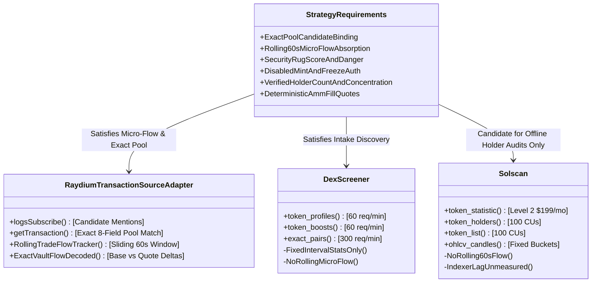

# NeXusTrade — API Provider Capabilities and Cost Roadmap

**Document ID**: `NXT-API-PROVIDER-ROADMAP-V2`  
**Location**: `docs/research-planning/api-provider-capabilities-and-cost-roadmap.md`  
**Status**: **ACTIVE PROJECT REFERENCE & FREE-FIRST EVALUATION ROADMAP**  
**Verification Date**: November 2026  
**Execution Authority**: **READ-ONLY DOCUMENTATION REPOSITORY. NO LIVE CALLS, SUBSCRIPTIONS, PURCHASES, OR DAEMON LAUNCHES AUTHORIZED.**

---

## 1. Executive Summary & Purpose

This document provides a concise, source-backed inventory of external API providers evaluated, integrated, or considered for NeXusTrade. It consolidates provider architecture decisions from Phase 9 through Phase 12.94-D into a single, authoritative reference without rewriting historical decisions or duplicating active implementation documents.

### Core Architecture & Operating Principles

1. **Free-First Evaluation & Strict Verification**: Maximize use of reliable, continuing free tiers and open Solana RPC capabilities. Distinguish sharply between promotional/time-limited trials (e.g. QuickNode's 1-month trial) and permanent free tiers.
2. **Separation of Published Specs, Internal Controls, and Validated Availability**:
   - _Published Provider Specifications_: Advertised maximum quotas, rate limits, and pricing from vendor documentation.
   - _NeXusTrade Internal Code Controls_: Deliberate, conservative limits enforced in code (e.g. `JupiterDemandController` $\le 48\text{ req/min}$ and 1,250 ms base spacing, `GlobalResourceBudgetManager` $\ge 2,500\text{ ms}$ provider spacing and 25–50 request session ceilings, `BirdeyeAdapter` 20 CU internal reservation).
   - _Empirically Validated Availability_: What has been tested under realistic workloads. Historical small-batch tests or mock unit tests do not establish current live account entitlement or unlimited capacity under load.
3. **Fail-Closed Coverage & Micro-Flow Non-Equivalence**: Aggregated market feeds (e.g. 5-minute candles, token-wide volume, indicative mid-market prices) are mathematically not equivalent to exact-pool rolling transaction flow. Trading gates fail closed whenever exact-pool micro-flow data is unavailable.
4. **Explicit Workload Modeling**: Multi-hour workloads must be modeled as explicit scenarios accounting for dynamic candidate transaction arrival rates ($\lambda$), quota limits, session ceilings, and unknown reconciliation traffic.
5. **Real vs. Virtual Realities**: Simulated profits in virtual paper wallets ($7.9259\text{ SOL}$) are non-custodial accounting figures and cannot pay real-world SaaS invoices. Any paid upgrade is a **proposal for separate operator decision**, requiring demonstrated operational necessity, a hard monthly spending cap, and eventual self-funding from realized net trading proceeds.

---

## 2. Source-Backed Provider Capability & Cost Matrix

The following matrix categorizes all primary and secondary API providers. Each entry distinguishes between:

- **Published Specifications**: What the provider publishes in official documentation (verified November 2026).
- **Internal Code Controls**: What active NeXusTrade configuration and adapter classes enforce.
- **Empirically Validated Availability**: What has actually been proven in offline or bounded pilot runs. Any unverified item is explicitly marked `UNVERIFIED`.

```mermaid
flowchart TD
    subgraph Intake["1. Discovery & Intake"]
        DS["DexScreener API (Public Free)"] -->|"Token Profiles & Boosts (60 req/min)<br>Pairs & Search (300 req/min)"| CSE["CandidateStreamEngine"]
        RC["RugCheck API (Public Free)"] -->|"Score & Danger Flags (~60 req/min)"| BG["BuyGateTriggerService"]
    end

    subgraph Security["2. Security & Mint Evidence"]
        RPC["Solana RPC (getAccountInfo)"] -->|"Mint & Freeze Auth (Paced >=2500ms)"| BG
        RC -->|"Holders & Bundler % (Preliminary)"| BG
        DAS["QuickNode / Alchemy DAS"] -->|"Asset Metadata Fallback (Unverified Entitlement)"| CSE
    end

    subgraph Quoting["3. Quoting & Pricing"]
        JUP["Jupiter Swap API (Free Keyed 1 RPS)"] -->|"Primary Swap Quotes (Controlled <=48/min, 1250ms)"| QPR["QuoteProviderRouter"]
        RAY["Raydium Trade API (Public Free)"] -->|"Secondary Quote Fallback (~60-120 req/min)"| QPR
        BIRD["Birdeye API (Standard 30k CU)"] -->|"Selective Price Enrichment (Reserves 20 CUs/overview)"| ENR["BirdeyeAdapter"]
    end

    subgraph TradeStream["4. Exact Trade Stream & Coverage"]
        WSS["Solana WebSocket (logsSubscribe)"] -->|"Candidate Notifications (Exact Pool)"| COORD["RaydiumCandidateSubscriptionCoordinator"]
        RPCTx["Solana RPC (getTransaction)"] -->|"Bounded Paced Retrieval (Dynamic Arrival Rate)"| ADAPT["RaydiumAmmV4TransactionSourceAdapter"]
        ADAPT -->|"Decoded Swaps"| TRACK["RollingTradeFlowTracker"]
        GAP["Gapless Block Range Verifier"] -.->|"Unimplemented Readiness Gap (Traffic UNKNOWN)"| TRACK
    end
```

### 2.1 Primary & Integrated Providers

| Provider              | Published Specifications & Endpoints                                                                                                                                                                                                                                                                                                                                                       | NeXusTrade Internal Code Controls                                                                                                                                                                                                                                                                                                                                                           | Continuing Free vs. Trial Status                                                                                          | Validated Availability & Quota Reality                                                                                                                                                                                                             | Relevant Paid Tiers & Proposed Spending Caps                                                                                                                                                                                                                                                                                       | Docs Link & Verification Date                                                                                                                                                                     |
| :-------------------- | :----------------------------------------------------------------------------------------------------------------------------------------------------------------------------------------------------------------------------------------------------------------------------------------------------------------------------------------------------------------------------------------- | :------------------------------------------------------------------------------------------------------------------------------------------------------------------------------------------------------------------------------------------------------------------------------------------------------------------------------------------------------------------------------------------ | :------------------------------------------------------------------------------------------------------------------------ | :------------------------------------------------------------------------------------------------------------------------------------------------------------------------------------------------------------------------------------------------- | :--------------------------------------------------------------------------------------------------------------------------------------------------------------------------------------------------------------------------------------------------------------------------------------------------------------------------------- | :------------------------------------------------------------------------------------------------------------------------------------------------------------------------------------------------ |
| **DexScreener**       | • `GET /token-profiles/latest/v1` • `GET /token-boosts/latest/v1` • `GET /token-boosts/top/v1` • `GET /latest/dex/tokens/{address}` • `GET /latest/dex/pairs/{chainId}/{pairAddresses}` • `GET /latest/dex/search?q={query}` • Published Limits: &nbsp;&nbsp;- **60 req/min** for profiles, boosts, orders &nbsp;&nbsp;- **300 req/min** for pairs, tokens, search | • Integrated in `CandidateStreamEngine.ts` • 5-second polling interval for intake scanner • Cost: **$0.00**                                                                                                                                                                                                                                                                           | **Permanent Free Public API** • No trial expiration • No API key or account required                                | • High reliability in offline intake tests • Exact-pair endpoint available, but returns fixed-interval summaries rather than rolling 60s micro-flow (see Section 3.1)                                                                           | • **No paid API tier** offered (monetized via UI ads and token boosts)                                                                                                                                                                                                                                                             | [DexScreener API Reference](https://docs.dexscreener.com/api/reference) (Verified Nov 2026)                                                                                                    |
| **RugCheck**          | • `GET /v1/tokens/{mint}/report` • Published Limit: **~60 requests/minute** (unauthenticated public endpoint) • Auth: None for public report (JWT optional)                                                                                                                                                                                                                          | • Integrated in `BuyGateTriggerService.ts` • Paced single call per preliminary candidate • Gating: RugScore $\le 700$, 0 `danger` flags                                                                                                                                                                                                                                               | **Permanent Free Public API** • No trial expiration • Public report endpoint verified in offline fixtures           | • Validated for preliminary risk screening and top-holder percentages in report envelope • Continuous real-time holder balance change tracking: `UNVERIFIED` / unsupported                                                                      | • Enterprise JWT plans advertised for high-frequency webhooks • Enterprise pricing: `UNVERIFIED` (custom quote)                                                                                                                                                                                                                 | [RugCheck Swagger](https://api.rugcheck.xyz/swagger/index.html) (Verified Nov 2026)                                                                                                            |
| **Jupiter**           | • `GET https://api.jup.ag/swap/v1/quote` • `GET https://api.jup.ag/price/v3` • Published Free Limits: &nbsp;&nbsp;- Keyless: 0.5 RPS (30/min) &nbsp;&nbsp;- Keyed Free: 1.0 RPS (60/min) &nbsp;&nbsp;- Execute bucket: 50 RPS ($0 cost) • Auth: `x-api-key` header                                                                                                       | • Integrated in `JupiterAdapter.ts` via `JupiterDemandController.ts` • Default: **48 live requests per 60,000 ms** (`maxLiveRequestsPerWindow = 48`) • Base interval: **1,250 ms** (`baseMinIntervalMs = 1250`) • Low-priority reserve: $\le 12$ req/window                                                                                                                        | **Permanent Free Keyed Tier** • No trial expiration • Requires portal account registration for API key              | • Quoting and priority queue backoff fully verified in offline unit and integration tests • Live sustained 1 RPS queue delay under high candidate volume: unmeasured in 11-hour run                                                             | • **Developer**: $25/mo (10 RPS, 25M credits) • **Launch**: $100/mo (50 RPS, 100M credits) • Proposed spending cap: **$25.00/mo** (no overage)                                                                                                                                                                               | [Jupiter Portal](https://jup.ag) (Verified Nov 2026)                                                                                                                                           |
| **Raydium**           | • `GET https://transaction-v1.raydium.io/compute/swap-base-in` • `GET https://api-v3.raydium.io/pools/info/mint` • `GET https://api-v3.raydium.io/pools/info/list` • Published Limits: ~60–120 req/min (burst throttled) • Auth: None                                                                                                                                          | • Integrated in `RaydiumAdapter.ts` and `CandidateStreamEngine.ts` • Negative caching (`negativeCacheTtlMs = 30000`) • Preflight venue check in `QuoteProviderRouter.ts`                                                                                                                                                                                                              | **Permanent Free Public API** • No trial expiration • Public endpoints unauthenticated                              | • Verified as secondary quote fallback in offline tests • Frequent `NO_ROUTE` responses on freshly created or low-liquidity pools observed in tests                                                                                             | • **No paid API tier** offered                                                                                                                                                                                                                                                                                                     | [Raydium Docs](https://raydium.io) (Verified Nov 2026)                                                                                                                                         |
| **Public Solana RPC** | • `POST https://api.mainnet-beta.solana.com` • `WSS wss://api.mainnet-beta.solana.com` • Methods: `getAccountInfo`, `getTransaction`, `logsSubscribe` • Documented Limit: **40 req per 10 seconds** (~4 RPS sustained per IP)                                                                                                                                                     | • Configured in `SolanaRpcProviderConfig` • `GlobalResourceBudgetManager` enforces **$\ge 2,500\text{ ms}$ spacing** ($\le 24\text{ req/min}$) • Pilot session ceilings: **25–50 total requests** (default 120)                                                                                                                                                                       | **Permanent Free Public Cluster** • Provided by Solana Foundation • Zero trial expiration                           | • Validated for SPL mint account layout parsing (`getAccountInfo`) with 0% rate limits in small historical validation batches (Phase 9.3C) • Live mainnet resilience under congestion: highly vulnerable to 429 drops and WebSocket disconnects | • **None** (public infrastructure) • Commercial private RPC required if public cluster throttles                                                                                                                                                                                                                                | [Solana RPC Docs](https://solana.com/docs/rpc) (Verified Nov 2026)                                                                                                                             |
| **Birdeye**           | • `GET https://public-api.birdeye.so/defi/price` • `GET /defi/token_overview` • `GET /defi/v3/token/market-data` • Published Free Tier: **30,000 CUs/month**, 1 RPS (60/min), no overage allowed, no WebSockets • Auth: `X-API-KEY` header                                                                                                                                     | • Integrated in `BirdeyeAdapter.ts` • Internal CU Reservation: &nbsp;&nbsp;- **20 internal CUs** for `token-overview` &nbsp;&nbsp;- **3 internal CUs** for `price` • `BirdeyeBudgetTracker` per-run budget: &nbsp;&nbsp;- `DEFAULT_MAX_REQUESTS_PER_RUN = 60` &nbsp;&nbsp;- `DEFAULT_MAX_CU_PER_RUN = 1200` &nbsp;&nbsp;- `minScore = 50`, `maxCandidatesPerCycle = 2` | **Standard Free Plan** • Monthly allowance: 30,000 CUs/mo • Rate limit: 1 RPS • Hard stop on quota exhaustion    | • Selective price and overview enrichment verified offline • Zero rate limits observed in test mocks; live production entitlement depends on monthly CU balance                                                                                 | • **Lite**: $39/mo (1.5M–2.5M CUs, 15 RPS) • **Starter**: $99/mo (8M CUs, 15 RPS, $12/1M overage) • **Premium**: $199/mo (20M CUs, 50 RPS, WebSockets) • Proposed spending cap: **$39.00/mo**                                                                                                                             | [Birdeye API Pricing](https://birdeye.so) (Verified Nov 2026)                                                                                                                                  |
| **Helius**            | • `POST https://mainnet.helius-rpc.com/?api-key=<KEY>` • Solana RPC + DAS API (`getAsset`) + WebSockets • Published Free Tier: **1,000,000 credits/month**, 10 RPS • Auth: Query parameter `api-key`                                                                                                                                                                              | • Configured in `HeliusProviderConfig` • Supported via `DasMetadataAdapter.ts` • Historical note: Free credits exhausted in July 2026 validation (Phase 9.3B)                                                                                                                                                                                                                         | **Permanent Free Plan** • 1M credits/month • Insufficient for continuous long-run validation batches without pacing | • Validated in historical Phase 9.3B testing • Current account balance / entitlement: `UNVERIFIED`                                                                                                                                              | • **Developer**: $49/mo (10M credits, 50 RPS, $5/1M overage; multi-tenant shared infrastructure—NOT a dedicated node; sub-200ms latency: `UNVERIFIED`) • **Business**: $499/mo (100M credits, 200 RPS) • Proposed spending cap: **$59.00/mo maximum** ($49 base + $10 overage); provider spend-cap enforcement: `UNVERIFIED` | [Helius Pricing Docs](https://docs.helius.dev) (Verified Nov 2026)                                                                                                                             |
| **QuickNode**         | • Custom endpoint URL with token path • Solana RPC + DAS add-on (`getAsset`) • Published Free Tier: **1-Month Free Trial ONLY** (10M credits, 15 RPS, 1 endpoint) • **NO continuing monthly free plan** • Auth: Secret endpoint path                                                                                                                                           | • Base URL configured in `providerConfig.ts` (`quickNodeDas`) • Handled via `DasMetadataAdapter.ts`                                                                                                                                                                                                                                                                                      | **1-Month Free Trial ONLY** • Expires 30 days after signup • Account paused/restricted after trial unless upgraded  | • DAS `getAsset` parsing verified offline with mock fixtures • Live operator account status (active trial vs. expired): `UNVERIFIED`                                                                                                            | • **Build**: $49/mo (80M credits, 50 RPS, $1.50/1M overage) • **Accelerate**: $249/mo (450M credits, 125 RPS, $1.25/1M overage) • **Scale**: $499/mo (950M credits, 250 RPS, $1.00/1M overage) • Proposed spending cap: **$49.00/mo** (Build plan, overages disabled)                                                     | [QuickNode Pricing](https://www.quicknode.com/pricing) (Verified Nov 2026)                                                                                                                     |
| **Alchemy**           | • `https://solana-mainnet.g.alchemy.com/v2/{KEY}` • Solana RPC + DAS API (`getAsset`) • Published Free Tier: **30,000,000 CUs/month**, 300 CUs/sec (~30 RPS) • Auth: URL API key                                                                                                                                                                                                  | • Base URL configured in `providerConfig.ts` (`alchemySolana`) • Handled via `DasMetadataAdapter.ts`                                                                                                                                                                                                                                                                                     | **Starter Free Plan** • Continuing monthly free plan advertised • 30M CUs/month base                                | • Handled in `DasMetadataAdapter.ts` • Live operator account entitlement and active key status: `UNVERIFIED`                                                                                                                                    | • **Growth**: $49/mo (larger base allowance, $1.20/1M CUs overage) • Proposed spending cap: **$49.00/mo**                                                                                                                                                                                                                       | [Alchemy Solana Docs](https://docs.alchemy.com) (Verified Nov 2026)                                                                                                                            |
| **Solscan**           | • `GET https://pro-api.solscan.io/v2.0/token/meta` • `GET /token/holders` • `GET /token/statistic` (**Requires Level 2 $199/mo**) • `GET /token/list-v2` • `GET /market/token/{address}/ohlcv` • Published Limits: 100 CUs/call on standard endpoints • Auth: `token: <API_KEY>` header                                                                                  | • **Not implemented in backend code** • Explorer URL generation only • Pro Lite ($49/mo) does **not** grant access to `/token/statistic`                                                                                                                                                                                                                                              | **Free Public Key Tier** • 1–2 RPS rate capped • 100 CUs/call rapidly depletes free prototyping quota               | • Not integrated in runtime pipeline • Suitable only for manual offline auditing and benchmark fixture creation                                                                                                                                 | • **Pro Lite**: $49/mo (20M credits, 1,000 req/60s, basic metadata/holders only; `/token/statistic` NOT included) • **Pro Level 2**: $199/mo (150M credits, includes `/token/statistic`) • **Pro Level 3**: $399/mo (500M credits) • Recommendation: **DEFERRED**                                                         | [Solscan Pro API Docs](https://pro-api.solscan.io/pro-api-docs/v2.0/reference/v2-token-statistic) [Solscan Overview](https://pro-api.solscan.io/pro-api-docs/v2.0/docs) (Verified Nov 2026) |

---

### 2.2 Previously Considered & Deferred Providers

The following providers were formally evaluated in historical architecture reviews (Phase 9 through 9.6) and remain intentionally deferred:

1. **Orca Whirlpools SDK / Direct Quote**:
   - _Status_: **Deferred** (Phase 9.6).
   - _Technical Justification_: Whirlpools requires concentrated-liquidity tick-array math and pool-specific state caching. The current strategy operates on standard Raydium AMM v4 pools. Direct Orca quoting introduces heavy SDK dependencies without candidate pool alignment.
2. **Meteora DLMM Direct Quote**:
   - _Status_: **Deferred** (Phase 9.6).
   - _Technical Justification_: Meteora Dynamic AMM and DLMM require bin-step tracking. Raydium AMM v4 covers $>90\%$ of screened candidate pairs in our current discovery profiles.
3. **Titan (DART / Gateway API)**:
   - _Status_: **Deferred** (Phase 9.5).
   - _Technical Justification_: Access-gated institutional aggregator. Requires systematic trader approval and private onboarding agreements. Not accessible via standard self-serve developer tiers.
4. **Autobahn (Hosted / Self-Hosted API)**:
   - _Status_: **Deferred** (Phase 9.5).
   - _Technical Justification_: Self-hosted node setup introduces substantial infrastructure maintenance and server costs; hosted access was access-gated.
5. **Shyft (GraphQL / Solana API)**:
   - _Status_: **Deferred** (Phase 9.3C).
   - _Technical Justification_: Redundant with Solana RPC `getAccountInfo` and QuickNode/Alchemy DAS metadata adapters.
6. **GeckoTerminal (Gecko API)**:
   - _Status_: **Deferred** (Phase 9).
   - _Technical Justification_: Redundant with DexScreener. Lower rate limits (30 calls/minute on free tier) and higher observed indexing latency.

---

## 3. Mapping Provider Capabilities to NeXusTrade Strategy Requirements

NeXusTrade’s multi-stage execution model ([`NXT-D3.3-PAPER-READINESS-ASSESSMENT-V4`](file:///u:/Projects/TopG/docs/research-planning/phase-12.94d-milestone-d3-3-paper-readiness-assessment.md)) imposes strict mathematical data requirements. This section evaluates each provider against those requirements, clearly stating what is implemented, what is known, and what remains unverified.

### 3.1 Requirement Breakdown & Capability Analysis

#### 1. Source Completeness, Disconnect Recovery & Transaction Reconciliation

- **Strategy Input Needed**: Continuous observation across the latest 60-second window ($[T - 60\text{s}, T]$) without dropped transactions, calculating exact buyer vs. seller trade counts (`recentBuys60s`, `recentSells60s`) and flow ratios for Retest Gate absorption checks (Rule A: $\ge 1.15\times / 1.25\times$; Rule B: $\ge 1.25\times / 1.50\times$; Rule E: seller surge detection).
- **Evaluation of External Commercial APIs**:
  - **DexScreener**:
    - _Endpoint_: `GET /latest/dex/pairs/{chainId}/{pairAddresses}` provides exact-pair data.
    - _Why It Does Not Satisfy Micro-Flow_: The exact-pair endpoint returns aggregated interval statistics (volume and transaction counts over fixed 5m, 1h, 6h, 24h buckets) and indicative price quotes. It does _not_ provide continuous transaction-by-transaction stream logs, raw trade arrival records, or vault-level balance deltas over an arbitrary sliding 60-second window. Furthermore, third-party ingestion indexing delays make it incapable of real-time absorption evaluation.
  - **Solscan**:
    - _Endpoint_: `GET /market/token/{address}/ohlcv` provides candlestick bars.
    - _Why It Does Not Satisfy Micro-Flow_: Candlesticks record open/high/low/close prices and cumulative volume in fixed clock-time slices. They do not separate base token vs. quote SOL vault transfers, cannot determine trade directionality (buyer vs. seller), and cannot compute discrete trade counts (`recentBuys60s`) over an arbitrary sliding $[T - 60\text{s}, T]$ window.
- **Evaluation of Implemented Solana WebSocket & RPC Pipeline**:
  - Implemented in [`RaydiumCandidateSubscriptionCoordinator.ts`](file:///u:/Projects/TopG/backend/src/candidate-scanner/RaydiumCandidateSubscriptionCoordinator.ts), [`RaydiumAmmV4TransactionSourceAdapter.ts`](file:///u:/Projects/TopG/backend/src/candidate-scanner/RaydiumAmmV4TransactionSourceAdapter.ts), and [`RollingTradeFlowTracker.ts`](file:///u:/Projects/TopG/backend/src/candidate-scanner/RollingTradeFlowTracker.ts).
  - Uses exact per-candidate pool subscriptions (`{ mentions: [candidatePoolId] }`) and bounded `getTransaction` retrieval with exact 8-field pool context matching to decode vault-level balance deltas.
  - **Remaining Readiness Gap**: Production source completeness verification (e.g. gapless block-range polling proving zero dropped transactions across slots) remains **unimplemented**. Explanatory text strings, open socket liveness, and empty queues do not prove source completeness. In offline code (`cbf2cf5`), production completeness mode is rejected fail-closed with `COMPLETENESS_MECHANISM_UNAVAILABLE`. Commercial APIs do not supply this proof; an explicit reconciliation protocol must be implemented before live trading.

#### 2. Security Scores & Authority Evidence

- **Strategy Input Needed**: RugScore $\le 700$, zero `danger` risk flags, mint authority `DISABLED`, freeze authority `DISABLED`.
- **Evaluation**:
  - **RugCheck**: `/v1/tokens/{mint}/report` delivers normalized risk scores and specific danger flags (`level === 'danger'`). Fully validated in [`BuyGateTriggerService.ts`](file:///u:/Projects/TopG/backend/src/candidate-scanner/BuyGateTriggerService.ts). Satisfies preliminary heuristic risk check.
  - **Public Solana RPC (`getAccountInfo`)**: Directly parsing raw SPL token mint accounts (byte offsets 0–82) determines mint authority and freeze authority presence without relying on third-party aggregators. Validated in Phase 9.3C.
  - **Caveat**: RugCheck alone satisfies preliminary screening and danger flag gating, but does **not** provide continuous real-time holder balance tracking or deep distribution graph auditing.

#### 3. Holder Counts & Concentration

- **Strategy Input Needed**: Total holders count $\ge 250$ (Established cohort gate), top 10 holders percentage $\le 30\%$ (probe sizing risk adjustment), bundler percentage $\le 60\%$.
- **Evaluation**:
  - **RugCheck**: Supplies `totalHolders` and top holder percentages directly in the report envelope. Sufficient for preliminary screening.
  - **Solscan**:
    - `GET /v2.0/token/holders`: Returns paginated token accounts, amounts, and holding percentages (`percentage`, `value`). High fidelity, but costs 100 CUs per call.
    - `GET /v2.0/token/statistic`: Returns distribution analytics, but **strictly requires a Level 2 ($199/mo) or above subscription**. (Pro Lite at $49/mo does not provide access).
    - _Verdict_: Solscan is valuable for periodic offline verification and truth audits of top holders, but unnecessary for continuous live screening given RugCheck's free availability.

#### 4. Exact-Pool Market Data, Pricing & Executable Quote Evidence

- **Strategy Input Needed**: Confirmed-entry probe quotes (0.10–0.65 SOL) and exit quotes (50% Tier 1, 25% Tier 2, 25% Moonbag) with realistic slippage, price impact, and ATA rent debiting/crediting.
- **Evaluation**:
  - **Jupiter Swap API (`/swap/v1/quote`)**: Primary aggregator quote engine. Delivers exact executable quote evidence. Keyed free tier provides 1 RPS (managed by `JupiterDemandController` at $\le 48\text{ req/min}$ and 1,250 ms spacing).
  - **Raydium Trade API (`/compute/swap-base-in`)**: Secondary direct venue fallback when Jupiter is rate-limited or unavailable.
  - **DexScreener / Birdeye Price**: Useful for indicative mid-market pricing only; cannot generate executable quotes.

---

### 3.2 Deep-Dive: Analysis of 1-Minute Trading Metrics & Non-Equivalence

A critical architectural pitfall in automated trading engines is conflating aggregator candle feeds with micro-flow strategy metrics.

| Dimension                | NeXusTrade Required Strategy Input                                                                                       | Aggregator Feeds (DexScreener / Birdeye / Solscan OHLCV)                                                                                                                                 | Architectural Implication                                                                                                        |
| :----------------------- | :----------------------------------------------------------------------------------------------------------------------- | :--------------------------------------------------------------------------------------------------------------------------------------------------------------------------------------- | :------------------------------------------------------------------------------------------------------------------------------- |
| **Window Boundary**      | **Rolling 60-Second Window** Evaluated continuously from $[T - 60\text{s}, T]$ dynamically at each tick.              | **Fixed Time Buckets** Bound to clock-minute boundaries (e.g. 14:02:00–14:03:00 UTC) or 5-minute intervals (`m5`).                                                                    | A fixed candle can be up to 59 seconds stale relative to an in-flight decision tick, missing immediate seller surges.            |
| **Pool Identity**        | **Exact Candidate Pool Only** Transactions must bind to specific `poolId`, `baseVault`, and `quoteVault`.             | **Token-Wide Aggregate** Combines all DEX pools, cross-DEX arbitrage, and multi-hop routed trades. (DexScreener exact-pair endpoint provides pool stats, but still in fixed buckets). | Token-wide volume masks a sudden liquidity drain or rug pull occurring on the specific candidate pool.                           |
| **Trade Directionality** | **Vault-Decoded Balance Deltas** Exact base token transferred vs. quote SOL transferred determines BUY vs. SELL.      | **Heuristic / Net Tick Change** OHLCV candles only record open/high/low/close prices; net volume is often unseparated.                                                                | Retest absorption rules require the exact ratio $\text{buys60s} / \text{sells60s}$. Candles cannot supply discrete trade counts. |
| **Timestamp Provenance** | **On-Chain BlockTime & Host Local Receipt** Bounded future skew $\le 2,000\text{ ms}$; contradiction checks enforced. | **Indexer Ingestion Timestamp** Aggregator database commit time with unmeasured indexing delays.                                                                                      | Delayed indexer timestamps violate temporal integrity and would confirm expired retest windows.                                  |

> **Conclusion**:  
> Candlesticks, indicative prices, and token-wide metrics **cannot substitute** for exact-pool transaction decoding. Any attempt to replace `RaydiumAmmV4TransactionSourceAdapter` with an aggregator candle endpoint violates strategy specifications and is prohibited.

---

## 4. Workload Estimates & Explicit Operational Scenarios

Workload modeling must be based on explicit operational formulas and realistic candidate arrival rates rather than static assumptions.

### 4.1 Internal Configured Controls vs. Published Maximums

To prevent provider pressure and avoid 429 throttling, NeXusTrade configures operating limits well below advertised provider maximums:

| Provider        | Documented / Advertised Maximum                   | NeXusTrade Configured Limit                                                                                                             | Enforcing Component                            | Code Location                                                                                                     |
| :-------------- | :------------------------------------------------ | :-------------------------------------------------------------------------------------------------------------------------------------- | :--------------------------------------------- | :---------------------------------------------------------------------------------------------------------------- |
| **Solana RPC**  | 40 req/10s (public) or 50 RPS (paid)              | **$\ge 2,500\text{ ms}$ spacing** ($\le 24\text{ req/min}$), **25–50 req/session ceiling** (default 120)                                | `GlobalResourceBudgetManager`                  | `backend/src/research/prospective/GlobalResourceBudgetManager.ts`                                                 |
| **Jupiter**     | 1 RPS (free) or 10 RPS (Dev $25/mo)               | **$\le 48\text{ live req/min}$**, **1,250 ms base interval**, priority queue with cooldown backoff                                      | `JupiterDemandController`, `providerConfig.ts` | `backend/src/providers/config/providerConfig.ts:590-596`                                                          |
| **Raydium**     | ~120 req/min                                      | **$\le 60\text{ req/min}$**, negative caching (30s TTL), venue guard preflight                                                          | `providerConfig.ts`, `QuoteProviderRouter`     | `backend/src/providers/config/providerConfig.ts:130`                                                              |
| **Birdeye**     | 1 RPS, 30,000 CUs/month                           | **Per-run budget**: $\le 60\text{ req/run}$, $\le 1,200\text{ CUs/run}$; reserves **20 CUs/overview**, **3 CUs/price**; `minScore = 50` | `BirdeyeAdapter`, `BirdeyeBudgetTracker`       | `backend/src/providers/birdeye/BirdeyeAdapter.ts:164` `backend/src/providers/config/providerConfig.ts:702-705` |
| **DexScreener** | 60 req/min (profiles/boosts), 300 req/min (pairs) | **5-second polling interval** for discovery intake scanner                                                                              | `CandidateStreamEngine`                        | `backend/src/candidate-scanner/CandidateStreamEngine.ts`                                                          |
| **RugCheck**    | ~60 req/min                                       | **Single call per preliminary candidate**                                                                                               | `BuyGateTriggerService`                        | `backend/src/candidate-scanner/BuyGateTriggerService.ts`                                                          |

---

### 4.2 Workload Component Formulas & Unknown Terms

The total request load across an operational run is governed by:

$$\text{Total Calls} = N_{\text{discovery}} + N_{\text{enrichment}} + N_{\text{transactions}} + N_{\text{reconciliation}} + N_{\text{quotes}} + N_{\text{monitoring}}$$

Where:

1. **Discovery ($N_{\text{discovery}}$)**: DexScreener polling loop. At a 5-second interval:
   $$N_{\text{discovery}} = \frac{\text{Duration (seconds)}}{5} = 12 \text{ requests/minute}$$
   (60 req/min profile endpoint limit allows polling every 5s if single endpoint; pair/search allows up to 300 req/min).
2. **Candidate Enrichment ($N_{\text{enrichment}}$)**: For $K$ preliminary candidates:
   - RugCheck report: $K$ calls.
   - Solana RPC `getAccountInfo` (mint & freeze auth): $K$ calls.
   - Birdeye overview (score $\ge 50$ only, fraction $f_{\text{bird}} \approx 0.25$): $f_{\text{bird}} \cdot K$ calls (reserving 20 internal CUs each).
3. **Tracked-Pool Transactions ($N_{\text{transactions}}$)**:
   - **Dynamic Arrival Reality**: An admitted candidate cannot be assumed to require only 2 transaction fetches.
   - If candidate $i$ has an on-chain transaction arrival rate $\lambda_i(t)$ (transactions per minute) and is tracked for duration $W_i$ minutes (e.g. 5 to 15 minutes while awaiting retest confirmation or rejection):
     $$N_{\text{transactions}} = \sum_{i=1}^{M} \int_0^{W_i} \lambda_i(t) \, dt$$
   - In active Solana meme/micro-cap pools, $\lambda$ frequently ranges from $5\text{ to }30+\text{ transactions/minute}$. Tracking 10 active candidates for 5 minutes at $\lambda = 10\text{ tx/min}$ requires **500 transaction fetches**.
4. **Coverage Reconciliation ($N_{\text{reconciliation}}$)**:
   - **Term: UNKNOWN**. Production source-completeness verification (e.g. signature gap reconciliation or block polling) is unimplemented. The exact number of RPC calls needed to verify zero dropped transactions across slot boundaries cannot be determined until this protocol is designed.
5. **Executable Quotes ($N_{\text{quotes}}$)**:
   - For confirmed candidates entering retest or position phases: entry probe quote + multi-tier exit quotes (50% Tier 1, 25% Tier 2, 25% Moonbag). Typically 4–8 quotes per admitted position, paced via `JupiterDemandController` ($\le 48\text{ req/min}$, $\ge 1,250\text{ ms}$ interval).

---

### 4.3 Explicit Multi-Hour Scenarios

We model two explicit operational scenarios to evaluate demand against configured controls and provider quotas:

#### Scenario A: Bounded Exploration Run (2 Hours, ~20 Candidates Evaluated)

- **Assumptions**: 2-hour duration; discovery identifies ~20 preliminary candidates; 5 candidates admitted to active micro-flow tracking; average tracking duration $W = 5\text{ minutes}$; average transaction arrival rate $\lambda = 6\text{ tx/minute}$; 2 candidates qualify for confirmed entry quotes; cache absorbs repeat metadata.

| Workload Component                           | Formula / Derivation                                              | Total Calls                    | Provider Quota & Configured Constraint Status                                                                                               |
| :------------------------------------------- | :---------------------------------------------------------------- | :----------------------------- | :------------------------------------------------------------------------------------------------------------------------------------------ |
| **DexScreener Discovery**                    | $120\text{ min} \times 12\text{ req/min}$                         | 1,440 requests                 | **Fits Free**: Well within 60 req/min (boosts) and 300 req/min (pairs) limits.                                                              |
| **RugCheck Gating**                          | 20 candidates $\times 1$ call                                     | 20 requests                    | **Fits Free**: Well within 60 req/min unauthenticated limit.                                                                                |
| **Solana RPC `getAccountInfo`**              | 20 candidates $\times 1$ call                                     | 20 requests                    | **Fits Free**: Paced $\ge 2,500\text{ ms}$; well within 40 req/10s public limit.                                                            |
| **Birdeye Enrichment**                       | 5 high-score candidates $\times 20\text{ internal CUs}$           | 5 calls (**100 internal CUs**) | **Fits Free**: Spends 100 internal CUs ($\approx 0.33\%$ of 30,000 monthly quota).                                                          |
| **Transaction Retrieval (`getTransaction`)** | $5 \text{ candidates} \times 5\text{ min} \times 6\text{ tx/min}$ | **150 transaction fetches**    | **Exhausts Configured Session Ceiling**: A 25–50 request session ceiling halts intake. Requires raising session ceiling or segmenting runs. |
| **Coverage Reconciliation**                  | Production completeness protocol                                  | **UNKNOWN**                    | Unimplemented; traffic cannot be calculated.                                                                                                |
| **Jupiter Quotes**                           | 2 confirmed candidates $\times 6$ quotes                          | 12 quote requests              | **Fits Free**: Paced at 1,250 ms spacing; fits 1 RPS keyed free tier.                                                                       |

#### Scenario B: Extended Paper-Trading Run (11 Hours, ~110 Candidates Evaluated)

- **Assumptions**: 11-hour continuous session; ~110 preliminary candidates screened; 25 candidates reach active tracking; average tracking window $W = 8\text{ minutes}$; average transaction arrival rate $\lambda = 10\text{ tx/minute}$; 8 candidates qualify for confirmed entry quotes.

| Workload Component                           | Formula / Derivation                                                | Total Calls                     | Provider Quota & Configured Constraint Status                                                                                                                                                                                                                                              |
| :------------------------------------------- | :------------------------------------------------------------------ | :------------------------------ | :----------------------------------------------------------------------------------------------------------------------------------------------------------------------------------------------------------------------------------------------------------------------------------------- |
| **DexScreener Discovery**                    | $660\text{ min} \times 12\text{ req/min}$                           | 7,920 requests                  | **Fits Free**: Free public endpoints; within rate limits.                                                                                                                                                                                                                                  |
| **RugCheck Gating**                          | 110 candidates $\times 1$ call                                      | 110 requests                    | **Fits Free**: ~10 calls/hour; well below 60 req/min limit.                                                                                                                                                                                                                                |
| **Solana RPC `getAccountInfo`**              | 110 candidates $\times 1$ call                                      | 110 requests                    | **Fits Free**: Paced $\ge 2,500\text{ ms}$; below 40 req/10s.                                                                                                                                                                                                                              |
| **Birdeye Enrichment**                       | 25 high-score candidates $\times 20\text{ internal CUs}$            | 25 calls (**500 internal CUs**) | **Fits Free**: $25 \times 20 = 500\text{ internal CUs/day}$; $500 \times 7 = 3,500\text{ CUs/week}$ ($\approx 11.7\%$ of 30,000 monthly quota).                                                                                                                                            |
| **Transaction Retrieval (`getTransaction`)** | $25 \text{ candidates} \times 8\text{ min} \times 10\text{ tx/min}$ | **2,000 transaction fetches**   | **Violates Continuing Free & Ceiling Realities**: (1) Severely violates a 25–50 request ceiling. (2) Public Solana RPC will 429 throttle under burst. (3) QuickNode is a 1-month trial, not a permanent free tier. (4) Multi-provider routing across Alchemy/QuickNode is NOT implemented. |
| **Coverage Reconciliation**                  | Gapless block-range verification                                    | **UNKNOWN**                     | Unimplemented; additional RPC load unknown.                                                                                                                                                                                                                                                |
| **Jupiter Quotes**                           | 8 confirmed candidates $\times 6$ quotes                            | 48 quote requests               | **Fits Free**: Managed by `JupiterDemandController` ($\le 48\text{ req/min}$, 1,250 ms spacing).                                                                                                                                                                                           |

### 4.4 Reconciling Scenarios with Architectural Realities

The scenario calculations reveal three critical findings:

1. **Session Ceilings Prevent Long Runs Without Reconfiguration**:  
   An 11-hour scenario requiring 2,000+ transaction fetches **cannot operate** under a 25–50 request session ceiling. If `GlobalResourceBudgetManager` is configured with `maxTotalRequests = 50`, the session halts after evaluating the first 1–2 candidates. Extended runs require either explicitly adjusting `maxTotalRequests` for transaction fetching, exempting exact-pool transaction streams from the generic prospective budget, or chunking sessions into short discrete batches.
2. **Continuing Free Tiers Do Not Cover High-Volume Transaction Streaming**:  
   Public Solana RPC throttles under sustained `getTransaction` load. QuickNode offers only a 1-month trial (not a continuing free plan). Therefore, claims that "all 11-hour sessions fit verified continuing free allowances" are **factually incorrect**.
3. **No Automatic Multi-Provider Load Balancing**:  
   The codebase does _not_ automatically distribute `getTransaction` calls across public RPC, QuickNode, and Alchemy. Providers are configured with fixed base URLs and fallback order.

---

## 5. Upgrade Proposals & Spending Limits

All paid upgrades are strictly **proposals for separate operator decision**. No automated daemon, agent, or developer script has authority to subscribe, purchase, or incur charges.

### 5.1 Upgrade Evaluation Matrix

| Proposed Provider Tier  | Concrete Bottleneck Trigger (Demonstrated Operational Necessity)                                                                | Expected Benefit                                                                                                                                                                        | Monthly Base Cost   | Hard Monthly Spending Cap (Maximum Outlay)                    | Self-Funding & Spending Cap Reality                                                                                                            |
| :---------------------- | :------------------------------------------------------------------------------------------------------------------------------ | :-------------------------------------------------------------------------------------------------------------------------------------------------------------------------------------- | :------------------ | :------------------------------------------------------------ | :--------------------------------------------------------------------------------------------------------------------------------------------- |
| **Jupiter Developer**   | Measured quote queue delays in live logs cause $> 15\%$ of confirmed retest opportunities to expire due to 1 RPS keyed ceiling. | Raises rate limit from 1 RPS to **10 RPS** (25M credits), reducing quote latency during fast market surges.                                                                             | **$25.00 / month**  | **$25.00 / month** (overages disabled)                        | Paid via operator capital initially; renewal contingent on realized net trading gains.                                                         |
| **Helius Developer**    | Transaction retrieval drops on public RPC or QuickNode trial expires, causing recurring `SUBSCRIPTION_DISCONNECT` gaps.         | Provides multi-tenant developer RPC with **50 RPS** and **10,000,000 credits/month**. _(Note: This is shared infrastructure, NOT a dedicated node; sub-200ms latency is `UNVERIFIED`)_. | **$49.00 / month**  | **$59.00 / month maximum** ($49 base + $10 permitted overage) | **Spend-Cap Enforcement: UNVERIFIED**. Provider-side hard stop must be verified in dashboard settings. Requires realized net trading proceeds. |
| **Birdeye Lite**        | Monthly 30,000 CU free quota exhausted before month-end due to expanded watchlist tracking.                                     | Increases allowance from 30k CUs to **1,500,000 CUs/month** and rate limit from 1 RPS to 15 RPS.                                                                                        | **$39.00 / month**  | **$39.00 / month** (overages disabled)                        | Defer until free quota proves insufficient during live operator sessions.                                                                      |
| **QuickNode Build**     | One-month free trial expires and continuing secondary DAS / RPC fallback is required.                                           | Provides 80,000,000 credits/month, 50 RPS.                                                                                                                                              | **$49.00 / month**  | **$49.00 / month** (overages disabled)                        | Defer until trial expiration is confirmed by operator.                                                                                         |
| **Solscan Pro Level 2** | Programmatic bulk holder distribution auditing or `/token/statistic` required for automated analysis.                           | Programmatic access to `/token/statistic` and `/token/holders` at 1,000 req/60s (150M credits). _(Note: Pro Lite at $49/mo does NOT provide `/token/statistic`)_.                       | **$199.00 / month** | **$199.00 / month**                                           | **DEFERRED**. Cost is prohibitive for paper stage; RugCheck supplies preliminary holder metrics for free.                                      |

### 5.2 Financial Governance & Paper-Gains Reality

> [!IMPORTANT]
> **Virtual Wallet Gains Cannot Pay SaaS Invoices**:  
> The NeXusTrade paper-trading daemon currently reports simulated virtual wallet gains of **+7.9259 SOL**. These are internal software accounting records, not real on-chain assets. They cannot be transferred, sold, or used to satisfy SaaS invoices. Any paid upgrade must be initially funded by operator discretionary capital and later self-funded strictly from **realized net trading proceeds** after live deployment.

---

## 6. Practical Recommendations & Concrete Next Steps

### 6.1 Requirements Satisfied with Verified Free Services

1. **Candidate Discovery & Intake**: DexScreener free API (60 req/min profile/boost, 300 req/min pair/search limits) fully covers token profiles, boosts, and new pair scanning at zero cost.
2. **Preliminary Security Gating**: RugCheck public `/report` endpoint ($0 cost) satisfies RugScore $\le 700$ and danger flag gating.
3. **Mint & Freeze Authority Evidence**: Raw Solana RPC `getAccountInfo` calls ($0 cost) reliably parse SPL mint accounts.
4. **Primary Executable Quotes**: Jupiter keyed free tier (1 RPS published; internally controlled to $\le 48\text{ req/min}$ and 1,250 ms spacing) delivers executable quote evidence for evaluated candidate volumes.
5. **Secondary Quote Fallback**: Raydium public Trade API provides unauthenticated compute quote fallback.
6. **Selective Price Enrichment**: Birdeye Standard free plan (30k CUs/mo) satisfies high-score candidate validation under internal reservation controls (20 CUs/overview, $\le 1,200\text{ CUs/run}$).

### 6.2 Requirements Needing Account-Entitlement Confirmation

1. **QuickNode Trial Status**: Verify whether the operator's QuickNode account is currently within its 1-month free trial window or has expired.
2. **Alchemy Free Tier Active Status**: Verify that the operator's Alchemy API key is active and has the Solana DAS add-on enabled.
3. **Jupiter Keyed Portal Access**: Ensure `JUPITER_API_KEY` is populated with a valid portal key to guarantee the 1 RPS keyed tier rather than keyless 0.5 RPS throttling.

### 6.3 Requirements Still Unsupported or Unproven

1. **Production Source Completeness Verification**: Commercial APIs provide indexed aggregations, not verified gapless transaction streams. Gapless block-range verification remains an explicit, unresolved readiness gap.
2. **Live Mainnet Network Resilience**: WebSocket subscription behavior under severe network partitions or RPC provider drops is verified offline via mock transports, but unmeasured under live Solana mainnet congestion.

### 6.4 Concrete Next Implementation Step

- **Immediate Engineering Task**: Keep the offline boundary closed. Do **not** purchase paid provider tiers or wire live mainnet transports into the paper daemon.
- **Smallest Next Integration Step**:
  - **Design & Offline-Prototype the Production Gapless Block-Range Polling / Reconciliation Protocol**:
    - Build a deterministic offline fixture in `RaydiumAmmV4TransactionSourceAdapter` (or a companion `GaplessBlockRangeReconciler`) that simulates slot sequences, detects dropped transaction signatures between `logsSubscribe` events and `getSignaturesForAddress`/`getBlock` ranges, and backfills missed swaps.
    - _Completion Criteria_:
      1. Deterministic test fixture reproducing a 3-slot gap during candidate tracking.
      2. Reconciler detects the missing slot range, fetches candidate transactions via mock RPC, and successfully advances coverage.
      3. Fail-closed transition: If a slot range cannot be reconciled within a bounded deadline, `isProductionCompletenessEstablished` remains `false` and retest spot info reports unavailable flow counts.
    - _Unresolved Dependencies_:
      1. Provider RPC rate limits and latency for `getSignaturesForAddress` / `getBlock` under live polling.
      2. Process supervisor wiring in `paper-trading-daemon.ts`.

---

## 7. Document Lineage & Historical References

- [`DECISIONS_Phase9Plus.md`](file:///u:/Projects/TopG/docs/DECISIONS_Phase9Plus.md): Provider strategy decisions (Phases 9.0–9.4D).
- [`ROADMAP_Phase9_to_12.88.md`](file:///u:/Projects/TopG/docs/ROADMAP_Phase9_to_12.88.md): Evolutionary milestones from Phase 9 to Phase 12.88.
- [`Provider-Strategy-Phase9Plus.md`](file:///u:/Projects/TopG/docs/archived/legacy-planning/Provider-Strategy-Phase9Plus.md): Historical provider architecture and Helius credit exhaustion findings.
- [`providerConfig.ts`](file:///u:/Projects/TopG/backend/src/providers/config/providerConfig.ts): Active TypeScript provider configuration schemas and rate-limit definitions.
- [`phase-12.94d-milestone-d3-3-paper-readiness-assessment.md`](file:///u:/Projects/TopG/docs/research-planning/phase-12.94d-milestone-d3-3-paper-readiness-assessment.md): Phase 12.94-D Milestone D.3.3 source-accurate readiness assessment.
