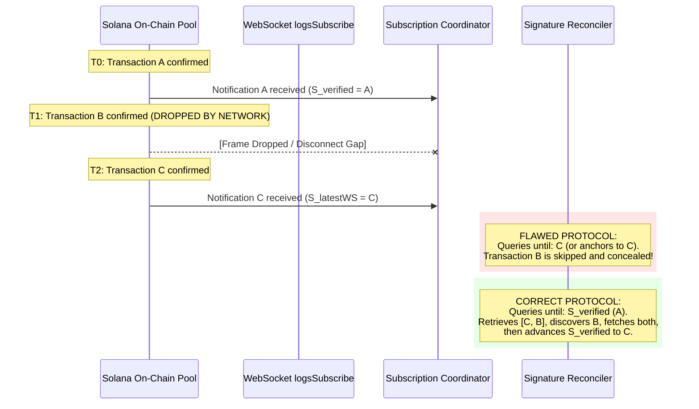
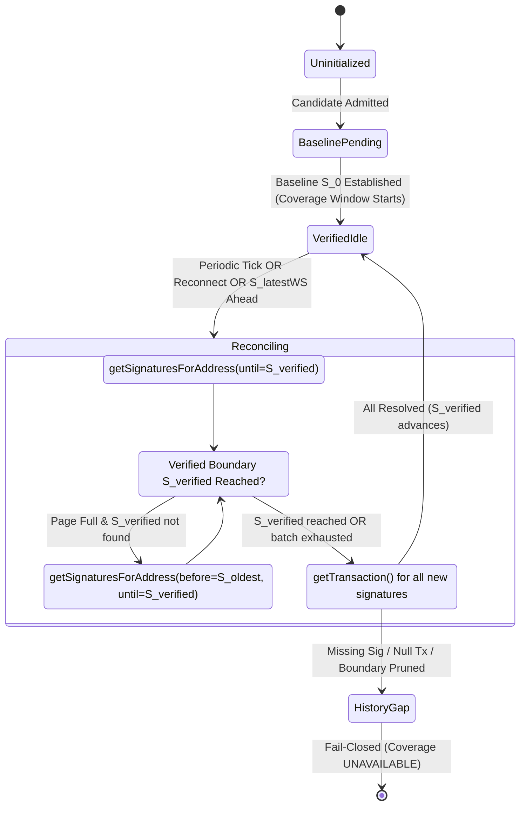

# NeXusTrade — Exact-Pool Signature-History Reconciliation Specification

**Document ID**: `NXT-SPEC-SIG-RECONCILIATION-V1`  
**Location**: `docs/research-planning/exact-pool-signature-reconciliation-spec.md`  
**Status**: **OFFLINE DESIGN PROPOSAL (DOCUMENTATION ONLY. NO IMPLEMENTATION OR LIVE EXECUTION AUTHORIZED)**  
**Verification Date**: November 2026  
**Execution Authority**: **READ-ONLY DOCUMENTATION REPOSITORY. PRODUCTION SOURCE COMPLETENESS REMAINS UNPROVEN. ZERO RUNTIME MODIFICATIONS AUTHORIZED.**

---

## 1. Executive Summary & Purpose

This design specification defines the architecture, cursor mechanics, failure modes, and budget feasibility for **Exact-Pool Signature-History Reconciliation**. It establishes a rigorous method to audit and backfill transactions touching a specific liquidity pool using the official Solana JSON-RPC method `getSignaturesForAddress`.

### Core Design Constraints

1. **Dual-Cursor Independence**: The latest received WebSocket notification signature ($S_{\text{latestWS}}$) represents an unverified forward notification hint; it has _zero_ authority to establish historical completeness. A separate verified-history cursor ($S_{\text{verified}}$) must be maintained independently.
2. **Batching vs. Completeness**: A history page size ($L$, e.g. 20 or 50) is an arbitrary batching parameter, not a completeness guarantee. Completeness requires paginating backward until explicitly terminating at the verified boundary.
3. **Separation of History Enumeration from Trade Resolution**: Enumerating signatures via `getSignaturesForAddress` proves only that transactions occurred on-chain. Trade flow coverage cannot advance until each enumerated transaction is successfully fetched via `getTransaction`, confirmed against the exact 8-field pool context, and decoded into the `RollingTradeFlowTracker`.
4. **Honest Coverage Boundaries**: Host response receipt time, empty history pages, and open sockets do not prove observation through current host wall-clock time. If indexing lag or RPC inconsistency prevents establishing the boundary, the reconciler must return `UNKNOWN` and fail closed.
5. **Strict Budget Compliance**: The protocol must operate entirely within active NeXusTrade resource controls ($\ge 2,500\text{ ms}$ provider spacing, 25–50 request session ceilings). No traffic may be unmetered, and no budget ceilings may be bypassed.

---

## 2. Reconciliation Anchor & Verified-History Cursor Model

### 2.1 The Critical Anchor Pitfall: The Missed-B Counter-Example

A foundational defect in naive reconciliation protocols is treating the most recently received WebSocket notification as proof that all prior transactions were captured.



#### Detailed Failure Mechanics:

1. Candidate pool $P$ experiences three transactions in chronological order: $A \rightarrow B \rightarrow C$.
2. Transaction $A$ is the last independently reconciled boundary ($S_{\text{verified}} = A$).
3. Transaction $B$ is confirmed on-chain at slot $S_B$. The WebSocket notification for $B$ is dropped due to transient socket buffer overflow, TCP reset, or RPC publisher lag.
4. Transaction $C$ is confirmed on-chain at slot $S_C$. The WebSocket notification for $C$ is received by the coordinator ($S_{\text{latestWS}} = C$).
5. **The Pitfall**: If reconciliation anchors to $C$ as "already observed" and only queries for signatures _after_ $C$ (or queries backward stopping at $C$), **missed transaction $B$ is completely concealed**. The flow tracker will calculate micro-flow ratios without $B$, violating the fail-closed absorption invariant.

---

### 2.2 Dual-Cursor Architecture & Official RPC Contract

To guarantee that missed transactions are detected, the protocol maintains two distinct cursors:

1. **$S_{\text{latestWS}}$ (Unverified Observation Hint)**:
   - The newest signature received via `logsSubscribe`.
   - Used only to trigger proactive reconciliation checks or update intake telemetry.
   - **Never** advances trade coverage or marks history complete.
2. **$S_{\text{verified}}$ (Verified-History Watermark)**:
   - The newest transaction signature up to which _every_ preceding transaction has been enumerated via RPC, fetched via `getTransaction`, and successfully decoded.
   - Initialized at candidate admission baseline ($S_0$) and advanced strictly by the reconciler.

#### Solana JSON-RPC Contract: `getSignaturesForAddress`

Per the official Solana specification ([Solana `getSignaturesForAddress` RPC Documentation](https://solana.com/docs/rpc/http/getsignaturesforaddress)):

```json
{
  "jsonrpc": "2.0",
  "id": 1,
  "method": "getSignaturesForAddress",
  "params": [
    "<candidatePoolId>",
    {
      "limit": 50,
      "until": "<S_verified>",
      "commitment": "confirmed"
    }
  ]
}
```

- **Sort Order**: Results are returned ordered from **newest to oldest**.
- **`until` Parameter**: Search stops backward in time when it encounters this signature (exclusive). Thus, setting `until: S_verified` retrieves all transactions that occurred _after_ $S_{\text{verified}}$ down to $S_{\text{verified}}$.
- **`before` Parameter**: Start searching backward starting _before_ this signature (exclusive). Used for multi-page backward pagination.

---

### 2.3 Strict Cursor Advance Rules

$S_{\text{verified}}$ may advance from $S_A$ to $S_{\text{target}}$ **if and only if** all of the following conditions are met:

1. **Contiguous Chain Proof**: A contiguous series of signatures $[S_{\text{target}}, S_{k}, \dots, S_{1}]$ connecting to $S_A$ was returned by `getSignaturesForAddress` with zero pagination gaps or truncation.
2. **Complete Resolution**: For every signature $S_i$ in the chain:
   - `getTransaction(S_i)` was dispatched and returned confirmed transaction data.
   - The transaction was validated against the exact 8-field pool context (`poolId`, `baseVault`, `quoteVault`, etc.).
   - If identified as a relevant AMM swap, the vault balance deltas were processed into `RollingTradeFlowTracker`.
   - If confirmed as an unrelated instruction (e.g. pool administrative update with zero vault balance change), it is marked resolved without affecting flow counters.
3. **Zero Unresolved Exceptions**: If any transaction in the chain fails to retrieve (e.g. transient 429, timeout, or ledger pruning), $S_{\text{verified}}$ **must not advance** past the unresolved signature.

---

## 3. The Bounded Reconciliation Protocol

### 3.1 Protocol State Machine



---

### 3.2 Step-by-Step Execution Sequence

#### Step 1: Exact Pool & Connection-Epoch Binding

- The reconciler is instantiated with an immutable `candidatePoolId` and bound to the active coordinator `connectionEpoch`.
- If a WebSocket disconnect occurs, the coordinator increments `connectionEpoch` ($E \rightarrow E+1$) and marks coverage `SUBSCRIPTION_DISCONNECT`.
- Any reconciliation job initiated during epoch $E$ is discarded; a new reconciliation cycle begins in epoch $E+1$ anchoring to persistent $S_{\text{verified}}$.

#### Step 2: Baseline Establishment ($S_0$)

- At candidate admission tick $T_0$, before opening candidate micro-flow observation, the reconciler queries:
  `getSignaturesForAddress(candidatePoolId, { limit: 1, commitment: "confirmed" })`.
- If a signature is returned, it becomes $S_0 = S_{\text{verified}}$. If the pool has zero confirmed transactions, $S_0 = \text{GENESIS\_ANCHOR}$.
- **Honest Pre-Admission Boundary**: Establishing $S_0$ does **not** claim observation of pre-admission history. History prior to $S_0$ is marked `NOT_OBSERVED`. The rolling 60-second window begins accumulating valid observation time strictly from $T_0$ forward.

#### Step 3: Backward Pagination & Boundary Verification

- The reconciler sets upper boundary target $S_{\text{top}} = S_{\text{latestWS}}$ (or the newest signature returned in the first page).
- The reconciler issues:
  `getSignaturesForAddress(candidatePoolId, { limit: L, until: S_verified, commitment: "confirmed" })` (with $L = 20$).
- **Case 3A: Empty Response (`[]`)**:
  - Zero transactions occurred on the pool between $S_{\text{verified}}$ and the query execution.
  - Quiet period confirmed. $S_{\text{verified}}$ remains current; coverage remains complete up to the confirmed slot of the query.
- **Case 3B: Batch Terminates at $S_{\text{verified}}$ (Count $< L$ or `until` satisfied)**:
  - All transactions between $S_{\text{verified}}$ and the newest returned signature have been enumerated.
  - Proceed to Step 4 (Resolution).
- **Case 3C: Batch Full ($= L$) and $S_{\text{verified}}$ Not Yet Reached**:
  - The number of intervening transactions exceeds batch size $L$.
  - Record oldest signature in batch $S_{\text{batchOldest}}$.
  - Issue paginated backward query:
    `getSignaturesForAddress(candidatePoolId, { limit: L, before: S_batchOldest, until: S_verified, commitment: "confirmed" })`.
  - Repeat until the batch reaches $S_{\text{verified}}$.

#### Step 4: Transaction Retrieval & Resolution

- For each discovered signature $S_i$ that is not already present in the flow tracker:
  - Dispatch `getTransaction(S_i, { commitment: "confirmed", maxSupportedTransactionVersion: 0 })`.
  - Verify exact 8-field pool binding in instructions/innerInstructions.
  - If valid AMM swap: pass decoded amounts to `RollingTradeFlowTracker.recordTrade()`.
- Once _all_ discovered transactions up to $S_{\text{top}}$ are resolved, $S_{\text{verified}}$ advances to $S_{\text{top}}$.

#### Step 5: Handling Concurrency During Pagination

- If new WebSocket notifications ($S_{\text{new1}}, S_{\text{new2}}$) arrive while backward pagination is in-flight, they are appended to an unverified intake queue.
- They do not interrupt backward pagination.
- Once the in-flight reconciliation batch resolves and $S_{\text{verified}}$ advances to $S_{\text{top}}$, the next reconciliation cycle will query `until: S_top`, seamlessly capturing $S_{\text{new1}}, S_{\text{new2}}$ and any transactions that arrived between them.

---

### 3.3 Failure Modes & Edge Cases

| Edge Case / Failure Condition               | System Impact                                                                                                   | Required Protocol Handling                                                                                         | Fail-Closed Coverage Status                                                              |
| :------------------------------------------ | :-------------------------------------------------------------------------------------------------------------- | :----------------------------------------------------------------------------------------------------------------- | :--------------------------------------------------------------------------------------- |
| **Pruned Ledger / Boundary Not Found**      | Reconciler paginates backward to RPC node history retention limit without encountering $S_{\text{verified}}$.   | The chain of continuity is permanently broken. Halt candidate tracking; emit `UNRESOLVABLE_HISTORY_GAP`.           | **`UNAVAILABLE`**                                                                        |
| **`getTransaction` Returns `null`**         | RPC node has indexed signature but purged or failed to locate transaction data, or transaction dropped in fork. | Retry bounded $\le 2$ attempts. If still `null`, transaction cannot be audited.                                    | **`INSUFFICIENT`** ($S_{\text{verified}}$ cannot advance)                                |
| **WebSocket Disconnect / Reconnect**        | Notification stream interrupted; intermediate frames lost.                                                      | Increment `connectionEpoch`. Paced query `getSignaturesForAddress(until: S_verified)` backfills missed signatures. | **`UNAVAILABLE`** during disconnect; transitions to **`SUFFICIENT`** only after backfill |
| **Quiet Pool (Skipped Notification Slots)** | Zero transactions touch the pool across 50 consecutive slots.                                                   | `getSignaturesForAddress(until: S_verified)` returns `[]`. Reconciler verifies no transactions were missed.        | **`SUFFICIENT`** (No lost data)                                                          |
| **Duplicate Signatures**                    | Same signature received via WebSocket and returned in reconciliation page.                                      | Flow tracker and reconciler deduplicate by cryptographic signature string (`txSignature`).                         | **`SUFFICIENT`** (Idempotent ignore)                                                     |
| **Same-Slot Multiple Transactions**         | Multiple swaps occur within the same Solana block/slot for candidate pool.                                      | Signatures within the same slot are sorted by transaction index or `blockTime`.                                    | **`SUFFICIENT`** (All decoded in order)                                                  |

---

## 4. Honest Coverage Boundary Evaluation

### 4.1 What Evidence Establishes a Completed Observation Interval?

To declare an observation interval $[T_{\text{start}}, T_{\text{end}}]$ "complete" for strategy absorption evaluation, the system must hold verifiable evidence:

1. **Lower Boundary ($T_{\text{start}}$)**: Anchored to a verified transaction signature $S_{\text{start}}$ with on-chain `blockTime` $\le T_{\text{start}}$, or candidate baseline $S_0$.
2. **Upper Boundary ($T_{\text{end}}$)**: Anchored to a confirmed transaction signature $S_{\text{end}}$ whose on-chain `blockTime` and slot are $\ge T_{\text{end}}$, OR a confirmed slot watermark queried from `getSlot(commitment: "confirmed")`.
3. **Internal Contiguity**: Proof that `getSignaturesForAddress` from $S_{\text{end}}$ down to $S_{\text{start}}$ was enumerated with zero dropped records, and every transaction was decoded.

### 4.2 What Does NOT Establish Completeness?

> [!CAUTION]
> **Prohibited Proxies for Coverage**:
>
> - **Host Response Receipt Time**: The millisecond timestamp when the HTTP response arrives at the node host does _not_ prove observation through that host timestamp.
> - **Empty History Response (`[]`)**: An empty response indicates no transactions were found on the queried node; it does not prove the absence of transactions if the node is lagging behind cluster consensus.
> - **Active WebSocket Connection**: A healthy, open WebSocket socket does not prove zero dropped frames. Frame drops can occur in OS socket buffers or intermediate proxies without terminating the TCP session.

### 4.3 Environmental Assumptions & Inconsistencies

- **Commitment Mismatch**: All WebSocket subscriptions (`logsSubscribe`) and RPC queries (`getSignaturesForAddress`, `getTransaction`) must strictly specify `commitment: "confirmed"`. Using `processed` risks ingesting forked transactions; mixing commitments produces unresolvable signature ordering contradictions.
- **Multi-Node Cluster Replication Lag**: Standard commercial RPC providers route requests across load-balanced clusters. A WebSocket notification emitted by Node 1 may arrive at the host before Node 2 (servicing the subsequent HTTP RPC request) has indexed the block. A reconciliation query executed immediately upon WebSocket receipt can return stale results. A minimum cooldown spacing is required before reconciliation queries.
- **On-Chain Clock Skew**: Validator `blockTime` estimates can drift by $\pm 2$ to $5$ seconds relative to UTC wall-clock time. Bounded skew validation ($\le 2,000\text{ ms}$) must remain active.
- **Honest Verdict**: If available RPC evidence cannot verify complete observation through the required window, the system must return **`UNKNOWN`** and maintain `isProductionCompletenessEstablished = false`.

---

## 5. Feasibility Under Existing NeXusTrade Controls

### 5.1 Enforced Code Controls & Budget Limits

The reconciliation protocol must operate strictly within existing limits configured in [`GlobalResourceBudgetManager.ts`](file:///u:/Projects/TopG/backend/src/research/prospective/GlobalResourceBudgetManager.ts) and [`providerConfig.ts`](file:///u:/Projects/TopG/backend/src/providers/config/providerConfig.ts):

- **Provider Spacing**: $\ge 2,500\text{ ms}$ minimum interval between calls to the same provider (`minProviderSpacingMs = 2500`). Maximum sustained dispatch rate: **$\le 24\text{ requests/minute}$**.
- **Session Ceilings**: Hard ceiling of **25–50 total requests** in prospective pilot configurations (default `maxTotalRequests = 120`).
- **Enrichment Limit**: `maxEnrichmentAttempts = 10`.
- **Reserved Capacity**: `minReservedForwardRequests = 4` (reserved for forward quotes).
- **Policy Invariant**: No limits may be increased, no traffic may be unmetered, and no automated budget resets are permitted.

---

### 5.2 Scenario Workload Models (Assumed, Not Measured)

To evaluate feasibility, we calculate RPC demand across three assumed candidate tracking profiles over a 5-minute ($300\text{ s}$) observation window:

$$\text{Total RPC Calls} = N_{\text{baseline}} + N_{\text{history\_queries}} + N_{\text{tx\_retrievals}} + N_{\text{shared\_intake}}$$

Where:

- $N_{\text{baseline}} = 1$ `getSignaturesForAddress` call.
- $N_{\text{history\_queries}} = \frac{300\text{ s}}{\text{Reconciliation Interval (e.g. 30s)}} = 10$ calls.
- $N_{\text{shared\_intake}} = 1$ `getAccountInfo` (mint auth) $+ 1$ RugCheck (free external).

#### Scenario 1: Quiet Candidate Pool (0 Transactions during 5m window)

- $N_{\text{baseline}} = 1$
- $N_{\text{history\_queries}} = 10$ (each returning `[]`)
- $N_{\text{tx\_retrievals}} = 0$
- $N_{\text{shared\_intake}} = 1$ (`getAccountInfo`)
- **Total Solana RPC Calls**: **12 calls** over 300 seconds (1 call every 25 seconds).
- **Feasibility**: **Fully Feasible**. Consumes 12 requests ($\le 24\%$ of a 50-request session budget). Spacing well above $2,500\text{ ms}$.

#### Scenario 2: Moderate Activity Pool (1 Transaction/minute = 5 Transactions over 5m window)

- $N_{\text{baseline}} = 1$
- $N_{\text{history\_queries}} = 10$
- $N_{\text{tx\_retrievals}} = 5$ (`getTransaction`)
- $N_{\text{shared\_intake}} = 1$ (`getAccountInfo`)
- **Total Solana RPC Calls**: **17 calls** over 300 seconds.
- **Feasibility**: **Feasible**. Consumes 17 requests ($34\%$ of a 50-request budget). Required dispatch time: $17 \times 2.5\text{ s} = 42.5\text{ seconds}$ total spread across 300 seconds.

#### Scenario 3: Volatile Retest Surge (15 Transactions in a 60-Second Surge)

- $N_{\text{baseline}} = 1$
- $N_{\text{history\_queries}} = 2$ (in that minute)
- $N_{\text{tx\_retrievals}} = 15$ (`getTransaction`)
- $N_{\text{shared\_intake}} = 1$
- **Total Solana RPC Calls**: **19 calls in 60 seconds**.
- **Feasibility**: **Marginal / Bottlenecked by Host Pacing**:
  - Dispatching 19 calls at $\ge 2,500\text{ ms}$ spacing requires **$47.5\text{ seconds}$** of continuous serialized queue time.
  - Consumes 19 requests ($38\%$ of a 50-request ceiling) in a single candidate surge.
  - If two candidates surge simultaneously (38 calls), the 50-request session ceiling is nearly exhausted, triggering `GLOBAL_REQUEST_CEILING_REACHED`.

---

## 6. Illustrative Protocol Fixture Scenarios

### Fixture 1: The Missed-B Resolution ($A \rightarrow B \rightarrow C$)

| Step  | On-Chain Event            | WebSocket Event         | Coordinator State         | Reconciler Action   | RPC Query & Parameters                              | Result Returned | Cursors & Tracker State                                                           |
| :---- | :------------------------ | :---------------------- | :------------------------ | :------------------ | :-------------------------------------------------- | :-------------- | :-------------------------------------------------------------------------------- |
| **1** | Tx A confirmed (Slot 100) | Notification A received | $S_{\text{latestWS}} = A$ | Baseline check      | `getSignaturesForAddress(P, {limit: 1})`            | `[A]`           | $S_{\text{verified}} = A$. Tracker: `buys=1`.                                     |
| **2** | Tx B confirmed (Slot 101) | **DROPPED BY SOCKET**   | $S_{\text{latestWS}} = A$ | None                | None                                                | None            | $S_{\text{verified}} = A$. Tx B unobserved.                                       |
| **3** | Tx C confirmed (Slot 103) | Notification C received | $S_{\text{latestWS}} = C$ | Reconcile triggered | `getSignaturesForAddress(P, {until: A, limit: 20})` | `[C, B]`        | Discovers missed B! Fetches `getTransaction(C)` and `getTransaction(B)`.          |
| **4** | Tx C & B decoded          | None                    | Active tracking           | Ingest into tracker | None                                                | Swaps decoded   | Tracker: `buys=3`. $S_{\text{verified}}$ advances to $C$. **Missed B recovered**. |

---

### Fixture 2: Multi-Page Backward Pagination ($L = 10$, 25 New Transactions)

- Context: $S_{\text{verified}} = S_0$. High volume creates 25 transactions ($S_{25} \dots S_1$) since $S_0$.

| Query Step     | Method Call & Parameters                                            | Signatures Returned                          | Boundary Check                         | Action Taken                                                                    |
| :------------- | :------------------------------------------------------------------ | :------------------------------------------- | :------------------------------------- | :------------------------------------------------------------------------------ |
| **Page 1**     | `getSignaturesForAddress(P, {limit: 10, until: S_0})`               | $[S_{25}, S_{24}, \dots, S_{16}]$ (10 items) | $S_0$ not reached; page full ($= 10$). | Store batch. Prepare backward pagination with `before: S_16`.                   |
| **Page 2**     | `getSignaturesForAddress(P, {limit: 10, before: S_16, until: S_0})` | $[S_{15}, S_{14}, \dots, S_6]$ (10 items)    | $S_0$ not reached; page full ($= 10$). | Store batch. Prepare backward pagination with `before: S_6`.                    |
| **Page 3**     | `getSignaturesForAddress(P, {limit: 10, before: S_6, until: S_0})`  | $[S_5, S_4, S_3, S_2, S_1]$ (5 items)        | Terminated at $S_0$ (5 items $< 10$).  | **Boundary Reached**. Complete contiguous chain $[S_{25} \dots S_1]$ confirmed. |
| **Resolution** | Dispatch `getTransaction` for $S_1 \dots S_{25}$ in bounded order   | 25 transactions decoded                      | All resolved                           | $S_{\text{verified}}$ advances to $S_{25}$.                                     |

---

### Fixture 3: Quiet Period Across Skipped Slots

- Context: $S_{\text{verified}} = A$ at Slot 100. Slots 101–105 contain transactions for other programs, but zero transactions mention candidate pool $P$.

| Step  | Slot Sequence | Pool P Activity           | Reconciler Query                                    | Result             | Interpretation & State                                                                                              |
| :---- | :------------ | :------------------------ | :-------------------------------------------------- | :----------------- | :------------------------------------------------------------------------------------------------------------------ |
| **1** | Slot 100      | Tx A confirmed            | Baseline query                                      | `[A]`              | $S_{\text{verified}} = A$.                                                                                          |
| **2** | Slots 101–105 | Zero transactions for $P$ | None                                                | None               | No notifications received.                                                                                          |
| **3** | Slot 106 tick | Periodic audit check      | `getSignaturesForAddress(P, {until: A, limit: 20})` | `[]` (Empty array) | **Valid Quiet Period**. Verified zero transactions touched $P$ between Slot 100 and 106. Coverage remains complete. |

---

### Fixture 4: Interrupted Reconciliation During WebSocket Disconnect

- Context: Reconciler is paginating when WebSocket disconnects at Host Time $T_{\text{drop}}$.

| Step  | System Event       | Reconciler State                              | In-Flight Job Handling                    | Recovery Action on Reconnect                                                                   |
| :---- | :----------------- | :-------------------------------------------- | :---------------------------------------- | :--------------------------------------------------------------------------------------------- |
| **1** | Active pagination  | In-flight Page 2 query pending                | Job bound to Epoch $E_1$                  | Disconnect detected by coordinator.                                                            |
| **2** | WebSocket Drops    | Coordinator enters `DISCONNECTED`             | Epoch advances to $E_2$                   | In-flight Page 2 response arrives; discarded because epoch $E_1 \ne E_2$.                      |
| **3** | Socket Reconnects  | Coordinator enters `SUBSCRIBED` (Epoch $E_2$) | Coverage marked `SUBSCRIPTION_DISCONNECT` | Reconciler triggers fresh query: `getSignaturesForAddress(P, {until: S_verified, limit: 20})`. |
| **4** | Backfill Completes | Backfill retrieved and decoded                | $S_{\text{verified}}$ advances            | Disconnect collection gap resolved; coverage restored to `SUFFICIENT`.                         |

---

## 7. Feasibility Assessment, Evidence Gaps & Implementation Recommendation

### 7.1 Feasibility Assessment Under Stated Assumptions

Exact-Pool Signature-History Reconciliation is **architecturally sound and mathematically feasible** for low-to-moderate activity pools within NeXusTrade's design constraints:

1. **Exact-Pool Affinity**: It operates exclusively on `candidatePoolId`, avoiding the massive data waste of full block downloads.
2. **Quiet-Slot Resilience**: It naturally ignores slots where no candidate trades occurred, eliminating false drop alarms.
3. **Cursor Rigor**: The dual-cursor model ($S_{\text{verified}}$ vs. $S_{\text{latestWS}}$) guarantees that dropped WebSocket frames cannot conceal missed trades.
4. **Budget Reality**: For a single candidate, tracking consumes 12–17 calls over 5 minutes, easily fitting within host pacing and request caps. However, **concurrent bursts across multiple candidates will rapidly exhaust a 25–50 request session ceiling**.

---

### 7.2 Unresolved Evidence & Entitlement Requirements

Before this specification can transition from an offline design proposal to an implementation patch, the following unresolved items must be addressed:

1. **RPC Provider Latency & Indexing Lag under Load**:
   - `getSignaturesForAddress` response latency on public Solana RPC under mainnet congestion is unmeasured.
   - Replication lag across load-balanced RPC endpoints must be empirically characterized to prevent querying nodes that have not yet indexed the confirmed slot.
2. **Signature Retention & Pruning Depth**:
   - The exact historical signature depth supported on free and trial tiers (Solana public RPC, QuickNode trial, Alchemy Starter) must be confirmed to establish maximum allowable disconnect duration before an unresolvable history gap occurs.
3. **Budget Ceiling Governance**:
   - Operator decision required: Can session ceilings (`maxTotalRequests = 50`) support multi-candidate tracking with reconciliation, or must sessions be strictly segmented into short 15-minute evaluation bursts?

---

### 7.3 Implementation Recommendation

> [!IMPORTANT]
> **Recommendation: DO NOT IMPLEMENT IN RUNTIME CODE YET**.  
> Production source completeness remains an **unresolved readiness gap**.

#### Reason Not to Implement Immediately:

1. **Pacing Bottleneck in Bursts**: Under current `minProviderSpacingMs = 2500`, reconciling a 15-transaction burst takes 40+ seconds of serialized dispatch time. Implementing this against a 25–50 request ceiling without multi-session chunking or coordinator rate-limit refactoring risks stalling the paper daemon.
2. **Offline Completeness Separation**: The accepted coordinator (`cbf2cf5`) cleanly enforces fail-closed behavior via `COMPLETENESS_MECHANISM_UNAVAILABLE`. Adding a partially wired reconciler without live network profiling would weaken the existing offline boundary.

#### Smallest Proposed Future Implementation Patch (When Authorized):

When implementation is authorized by operator decision, the smallest non-disruptive patch consists of:

1. Creating an isolated offline utility class `ExactPoolSignatureReconciler.ts` implementing the state machine in Section 3.
2. Writing a focused unit test suite using deterministic offline mock RPC transports validating Fixtures 1–4.
3. Keeping live network wiring disabled until operator entitlement confirmation and budget governance decisions are finalized.

---

## 8. Document Lineage & Historical References

- [`api-provider-capabilities-and-cost-roadmap.md`](file:///u:/Projects/TopG/docs/research-planning/api-provider-capabilities-and-cost-roadmap.md): Provider capability matrix and rate limits.
- [`RaydiumCandidateSubscriptionCoordinator.ts`](file:///u:/Projects/TopG/backend/src/candidate-scanner/RaydiumCandidateSubscriptionCoordinator.ts): Active offline coordinator implementation.
- [`RaydiumAmmV4TransactionSourceAdapter.ts`](file:///u:/Projects/TopG/backend/src/candidate-scanner/RaydiumAmmV4TransactionSourceAdapter.ts): Accepted transaction adapter and context validation.
- [`RollingTradeFlowTracker.ts`](file:///u:/Projects/TopG/backend/src/candidate-scanner/RollingTradeFlowTracker.ts): Rolling 60s micro-flow accumulator.
- [`GlobalResourceBudgetManager.ts`](file:///u:/Projects/TopG/backend/src/research/prospective/GlobalResourceBudgetManager.ts): Enforced provider pacing and session request ceilings.
- [`phase-12.94d-milestone-d3-3-paper-readiness-assessment.md`](file:///u:/Projects/TopG/docs/research-planning/phase-12.94d-milestone-d3-3-paper-readiness-assessment.md): Phase 12.94-D Milestone D.3.3 source-accurate readiness assessment.
