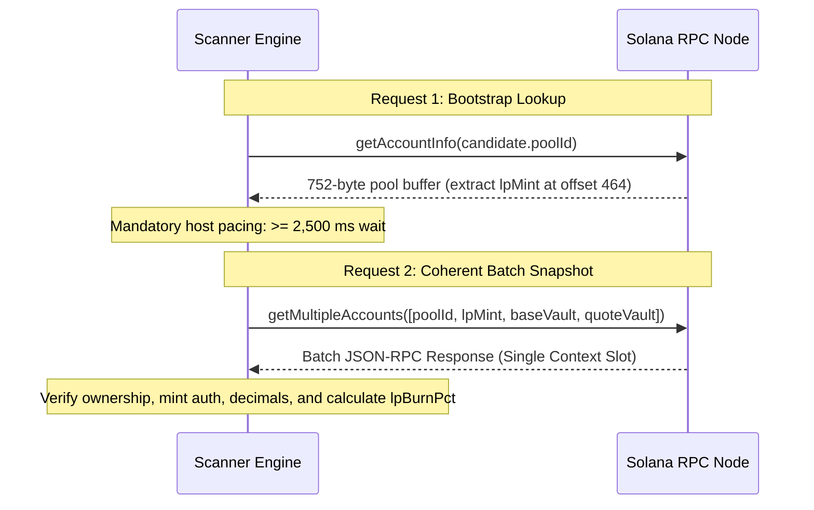

# NeXusTrade — Phase 12.94-D Milestone D.3.3: Raydium AMM v4 LP-Security Acquisition Contract

**Author:** Antigravity (AI Systems Pair Programmer)  
**Status:** REVISED SPECIFICATION / OFFLINE PARSER & HELPER IMPLEMENTED (Pending RPC & Pipeline Approval)  
**Scope:** Strict Legacy Raydium AMM v4 Protocol Accounting (`lpReserve` vs `lpMint.supply`)  
**Deferred Extensions:** CPMM, Token-2022, Third-Party Lockers, External Provider Schemas (All deferred)  
**Target Components:** `RaydiumAmmParser.ts`, `RaydiumAmmLpAccounting.ts`  
**Wallet Status:** Strictly Frozen at `7.9259 SOL` (Offline implementation and specification only; zero live calls, zero RPC probes, zero wallet mutations)

---

## 1. Supported Protocol & Meaning of `lpBurnPct`

### 1.1 Narrowed Scope: Legacy Raydium AMM v4 Only

To establish a verifiable, protocol-enforced acquisition path without architectural bloat or unverified assumptions, this contract is strictly scoped to:

- **Protocol**: Canonical Raydium AMM v4 (`675kPX9MHTjS2zt1qfr1NYHuzeLXfQM9H24wFSUt1Mp8`).
- **Token Standard**: Canonical SPL Token Program (`TokenkegQfeZyiNwAJbNbGKPFXCWuBvf9Ss623VQ5DA`).
- **Explicit Deferrals**:
  - Raydium CPMM (`CPMMoo8L3F4NbTegBCKVNunggL7H1ZpdTHKxQB5qKP1C`) is **DEFERRED**.
  - Token-2022 LP mints are **DEFERRED**.
  - Third-party locking contracts (Streamflow, Team Finance, etc.) are **DEFERRED**.
  - External provider LP schemas (RugCheck `markets[].lp`) are **DEFERRED**.
- **Strategy Threshold**: Unchanged at `minLpBurnPct = 90.0%` in [`AntiRugEvaluator.ts:27-37`](file:///u:/Projects/TopG/backend/src/candidate-scanner/evaluators/AntiRugEvaluator.ts#L27-L37).

### 1.2 Precise Physical & Economic Meaning: Point-in-Time Snapshot

In Raydium AMM v4, `lpBurnPct` measures the **point-in-time fraction of total LP claims on the pool's vault reserves that are inaccessible to circulating token holders**:

$$\text{lpBurnPct} = \frac{L_{\text{protocol}} - S_{\text{current}}}{L_{\text{protocol}}} \times 100\%$$

where:

- $L_{\text{protocol}}$: The protocol-tracked LP amount (`amm.lp_amount` / `lpReserve`), which serves as the actual mathematical denominator in the AMM's on-chain withdrawal instruction.
- $S_{\text{current}}$: The total circulating SPL mint supply of the LP token (`lpMint.supply`).

> [!IMPORTANT]
> **Strict Point-in-Time Snapshot Framing**  
> This calculation is strictly a point-in-time evaluation of LP claim accounting under legacy Raydium AMM v4 protocol mechanics. It computes the mathematical fraction of vault reserves that cannot be redeemed via the standard AMM withdrawal instruction by circulating LP tokens at the observed slot.  
> It does **not** constitute a guarantee of "permanently protected SOL", token safety, pool solvency, absence of price collapse, or protection against malicious token logic (minting, blacklisting, freeze authorities, tax fees), team dumps, or other protocol attack vectors.

---

## 2. Correct Account & Withdrawal Model in Raydium AMM v4

### 2.1 Pinned Official Source Revisions

The protocol accounting is verified against official upstream Raydium source code pinned to exact commit SHAs:

1. **On-Chain Program**: [`raydium-io/raydium-amm`](https://github.com/raydium-io/raydium-amm/tree/c03264c92131970258cbde51a70ff569b9f91a26) (commit `c03264c92131970258cbde51a70ff569b9f91a26`)
   - [`program/src/state.rs#L85-L105`](https://github.com/raydium-io/raydium-amm/blob/c03264c92131970258cbde51a70ff569b9f91a26/program/src/state.rs#L85-L105): Struct `AmmInfo` defines `pub lp_amount: u64` at offset 720.
   - [`program/src/state.rs#L12-L28`](https://github.com/raydium-io/raydium-amm/blob/c03264c92131970258cbde51a70ff569b9f91a26/program/src/state.rs#L12-L28): Enum `AmmStatus` bitflags defining independent protocol permissions.
   - [`program/src/processor.rs#L400-L460`](https://github.com/raydium-io/raydium-amm/blob/c03264c92131970258cbde51a70ff569b9f91a26/program/src/processor.rs#L400-L460): `process_withdraw` uses `amm.lp_amount` as the redemption denominator.
   - [`program/src/processor.rs#L340-L390`](https://github.com/raydium-io/raydium-amm/blob/c03264c92131970258cbde51a70ff569b9f91a26/program/src/processor.rs#L340-L390): `process_deposit` increments `amm.lp_amount` on deposits.
   - [`program/src/processor.rs#L180-L240`](https://github.com/raydium-io/raydium-amm/blob/c03264c92131970258cbde51a70ff569b9f91a26/program/src/processor.rs#L180-L240): `process_initialize2` calculates initial liquidity and withholds the unminted minimum.
2. **TypeScript SDK Layout**: [`raydium-io/raydium-sdk`](https://github.com/raydium-io/raydium-sdk/tree/2e6a92ec2c4a30e463567882200ecf95a8f4c47f) (commit `2e6a92ec2c4a30e463567882200ecf95a8f4c47f`)
   - [`src/raydium/liquidity/layout.ts#L45-L75`](https://github.com/raydium-io/raydium-sdk/blob/2e6a92ec2c4a30e463567882200ecf95a8f4c47f/src/raydium/liquidity/layout.ts#L45-L75): `liquidityStateV4Layout` defines `u64("lpReserve")` at byte offset **720..728**.

### 2.2 Layout Location & Units of `lpReserve`

The 752-byte Raydium AMM v4 account layout contains `lpReserve` at offset **720..728**:

| Offset Range   | Field Name in SDK / Program   | Rust Data Type   | TypeScript Decoding    | Purpose                                |
| :------------- | :---------------------------- | :--------------- | :--------------------- | :------------------------------------- |
| `0..8`         | `status`                      | `u64`            | `BigUInt64LE(0)`       | Pool status bitflags (see Section 2.3) |
| `32..40`       | `baseDecimal`                 | `u64`            | `BigUInt64LE(32)`      | Base token decimals                    |
| `40..48`       | `quoteDecimal`                | `u64`            | `BigUInt64LE(40)`      | Quote token decimals                   |
| `336..368`     | `baseVault`                   | `Pubkey` (32B)   | `subarray(336, 368)`   | Base SPL token vault                   |
| `368..400`     | `quoteVault`                  | `Pubkey` (32B)   | `subarray(368, 400)`   | Quote SPL token vault                  |
| `400..432`     | `baseMint`                    | `Pubkey` (32B)   | `subarray(400, 432)`   | Base token mint                        |
| `432..464`     | `quoteMint`                   | `Pubkey` (32B)   | `subarray(432, 464)`   | Quote token mint                       |
| `464..496`     | `lpMint`                      | `Pubkey` (32B)   | `subarray(464, 496)`   | Pool LP token mint                     |
| `496..528`     | `openOrders`                  | `Pubkey` (32B)   | `subarray(496, 528)`   | OpenOrders account                     |
| `528..560`     | `marketId`                    | `Pubkey` (32B)   | `subarray(528, 560)`   | Serum/OpenBook market ID               |
| `560..592`     | `marketProgramId`             | `Pubkey` (32B)   | `subarray(560, 592)`   | Market program ID                      |
| `592..624`     | `targetOrders`                | `Pubkey` (32B)   | `subarray(592, 624)`   | Target orders account                  |
| `624..656`     | `withdrawQueue`               | `Pubkey` (32B)   | `subarray(624, 656)`   | Withdraw queue                         |
| `656..688`     | `lpVault`                     | `Pubkey` (32B)   | `subarray(656, 688)`   | LP vault                               |
| `688..720`     | `ammOwner` / `owner`          | `Pubkey` (32B)   | `subarray(688, 720)`   | AMM pool owner                         |
| **`720..728`** | **`lpReserve` (`lp_amount`)** | **`u64`**        | **`BigUInt64LE(720)`** | **Protocol-tracked LP supply**         |
| `728..752`     | `padding` (3 $\times$ `u64`)  | `[u64; 3]` (24B) | `subarray(728, 752)`   | Layout trailing padding                |

**Total Length**: Exactly **752 bytes** (`RAYDIUM_AMM_V4_LAYOUT_LENGTH`).  
**Units**: Atomic integer LP units (`bigint`), matching `lpMint.decimals`.

### 2.3 Pool Status Bitflags: Separation of Permissions

In upstream Raydium AMM v4 ([`program/src/state.rs#L12-L28`](https://github.com/raydium-io/raydium-amm/blob/c03264c92131970258cbde51a70ff569b9f91a26/program/src/state.rs#L12-L28)), the `status: u64` field represents an enum of bitflags, not a single monolithic status code:

| Bit Position | Bitmask | Flag Name       | Semantic Meaning in On-Chain Program                     |
| :----------- | :------ | :-------------- | :------------------------------------------------------- |
| Bit 0        | `1`     | `Uninitialized` | `0` = Uninitialized, `status & 1 !== 0` = Initialized    |
| Bit 1        | `2`     | `Swap`          | Swap instruction enabled (`(status & 2) !== 0`)          |
| Bit 2        | `4`     | `Withdraw`      | Withdraw instruction enabled (`(status & 4) !== 0`)      |
| Bit 3        | `8`     | `Deposit`       | Deposit instruction enabled (`(status & 8) !== 0`)       |
| Bit 4        | `16`    | `CancelOrder`   | Cancel order instruction enabled (`(status & 16) !== 0`) |

> [!NOTE]
> **No Conflation of Permissions**  
> Pool initialization (`status & 1 !== 0`), withdrawal permissions (`status & 4 !== 0`), and swap eligibility (`status & 2 !== 0`) are distinct protocol flags and must **not** be conflated into an artificial `status === 1` check. Fully operational pools permitting swaps and withdrawals typically carry compound values (e.g. `status = 6` or `7`). The parser decodes and exposes raw `status: bigint` without restricting candidates via a new `status === 1` constraint.

### 2.4 Pool Initialization & The Unminted Minimum

When a Raydium AMM v4 pool is initialized via `initialize2`:

1. The program calculates initial liquidity from atomic token units:
   $$L_{\text{calc}} = \lfloor \sqrt{\text{init\_coin\_amount} \times \text{init\_pc\_amount}} \rfloor$$
2. The program sets the protocol tracker:
   $$\text{amm.lp\_amount} = L_{\text{calc}}$$
3. The program enforces an unminted minimum liquidity retention ($L_{\text{unminted}} = 10^{\text{lp\_decimals}}$, typically $1,000,000$ raw units for a 6-decimal LP token):
   $$S_{\text{initial\_minted}} = L_{\text{calc}} - L_{\text{unminted}}$$
4. Only $S_{\text{initial\_minted}}$ is minted via SPL Token Program to the pool creator.
5. Consequently, at genesis:
   $$L_{\text{protocol}} - S_{\text{current}} = L_{\text{unminted}} > 0$$

### 2.5 State Transitions: Deposits, Redemptions & Direct Burns

#### A. Liquidity Deposit (`deposit`)

- User deposits tokens; program calculates proportional LP tokens $\Delta L$.
- Program updates protocol state: $\text{amm.lp\_amount} \leftarrow L_{\text{protocol}} + \Delta L$.
- Program issues CPI to SPL Token Program: $\text{lpMint.supply} \leftarrow S_{\text{current}} + \Delta L$.
- **Invariant**: Both increase by $\Delta L$. The difference $(L_{\text{protocol}} - S_{\text{current}})$ **remains constant**.

#### B. Normal Liquidity Withdrawal (`withdraw`)

- User submits $L_{\text{user}}$ LP tokens to the AMM program.
- Program calculates asset return using $\text{amm.lp\_amount}$ as the denominator:
  $$\text{coin\_out} = \lfloor \frac{L_{\text{user}} \times \text{total\_coin}}{\text{amm.lp\_amount}} \rfloor$$
  $$\text{pc\_out} = \lfloor \frac{L_{\text{user}} \times \text{total\_pc}}{\text{amm.lp\_amount}} \rfloor$$
- Program decrements protocol tracker: $\text{amm.lp\_amount} \leftarrow L_{\text{protocol}} - L_{\text{user}}$.
- Program burns LP tokens via CPI: $\text{lpMint.supply} \leftarrow S_{\text{current}} - L_{\text{user}}$.
- **Invariant**: Both decrement by $L_{\text{user}}$. The difference $(L_{\text{protocol}} - S_{\text{current}})$ **remains constant**. Normal withdrawal does NOT increase the locked or protected quantity.

#### C. Direct SPL Burn Outside AMM (`spl_token::instruction::burn`)

- Token holder invokes `spl_token::instruction::burn` directly against the SPL Token Program on their LP token account.
- The AMM program is **not** called.
- SPL Token Program decrements supply: $\text{lpMint.supply} \leftarrow S_{\text{current}} - L_{\text{burned}}$.
- AMM protocol state $\text{amm.lp\_amount}$ is **completely unchanged** ($L_{\text{protocol}}$ remains constant).
- Vault reserves in `baseVault` and `quoteVault` are **completely unchanged**.
- **Result**: The difference $(L_{\text{protocol}} - S_{\text{current}})$ **increases by exactly $L_{\text{burned}}$**.
- **Crucial AMM Consequence**: Because the AMM `withdraw` instruction divides by $\text{amm.lp\_amount}$ ($L_{\text{protocol}}$), the maximum tokens all remaining circulating LP holders combined can ever withdraw is:
  $$\text{Max Circulating Claim} = \frac{S_{\text{current}}}{L_{\text{protocol}}}$$
  The remaining fraction $\frac{L_{\text{protocol}} - S_{\text{current}}}{L_{\text{protocol}}}$ cannot be withdrawn via the standard AMM withdrawal instruction.

---

## 3. The Pure Calculation Helper

### 3.1 Mathematical Formulation & Exact BigInt Arithmetic

Under validated Raydium AMM v4 assumptions, the pure calculation evaluates:

1. **Input Validation**:
   - $0 \le L_{\text{protocol}} \le 2^{64} - 1$
   - $0 \le S_{\text{current}} \le 2^{64} - 1$
   - $L_{\text{protocol}} > 0$ (`ZERO_PROTOCOL_LP` on $L = 0$)
   - $S_{\text{current}} \le L_{\text{protocol}}$ (`SUPPLY_EXCEEDS_PROTOCOL_LP` on $S > L$)
2. **Raw Differences**:
   - $\text{rawInaccessibleLp} = L_{\text{protocol}} - S_{\text{current}}$
   - $\text{rawDenominator} = L_{\text{protocol}}$
3. **Exact 90.0% Threshold Comparison**:
   Using exact integer cross-multiplication with no floating-point arithmetic:
   $$100n \times (L_{\text{protocol}} - S_{\text{current}}) \ge 90n \times L_{\text{protocol}}$$
4. **Display Value Conversion**:
   Converted to floating-point solely for presentation and logging after integer pre-scaling:
   $$\text{displayInaccessiblePct} = \frac{\text{Number}\left(\frac{(L - S) \times 100,000,000n}{L}\right)}{1,000,000}$$

### 3.2 Protocol Lifecycle Behaviors

| Event                     | $L_{\text{protocol}}$ | $S_{\text{current}}$ | Difference $(L_{\text{protocol}} - S_{\text{current}})$ | $\text{displayPct}$ | Evaluation Outcome                                                    |
| :------------------------ | :-------------------: | :------------------: | :-----------------------------------------------------: | :-----------------: | :-------------------------------------------------------------------- |
| **Genesis Pool Init**     |   $316,227,766,016$   |  $316,226,766,016$   |               $1,000,000$ (unminted min)                |     $0.0003\%$      | $\mathbf{0.0003\% < 90\%} \rightarrow$ **REJECTED** (Unprotected)     |
| **90% Normal Redemption** |     $100,000,000$     |     $99,000,000$     |                 $1,000,000$ (constant)                  |      $1.00\%$       | $\mathbf{1.0\% < 90\%} \rightarrow$ **REJECTED** (Unprotected)        |
| **95% Direct SPL Burn**   |    $1,000,000,000$    |     $49,000,000$     |                      $951,000,000$                      |      $95.10\%$      | $\mathbf{95.1\% \ge 90\%} \rightarrow$ **PASSED** (Meets threshold)   |
| **Subsequent Deposit**    |    $1,500,000,000$    |    $549,000,000$     |                 $951,000,000$ (diluted)                 |      $63.40\%$      | $\mathbf{63.4\% < 90\%} \rightarrow$ **REJECTED** (Diluted below 90%) |
| **Inconsistent State**    |     $100,000,000$     |    $120,000,000$     |                 $-20,000,000$ ($S > L$)                 |         N/A         | **REJECTED** (`SUPPLY_EXCEEDS_PROTOCOL_LP`)                           |

---

## 4. Proposed Coherent Acquisition Snapshot (Pending Separate Approval)

When approved for future live integration, acquisition will be divided into two distinct outbound RPC operations separated by mandatory host rate pacing:

### 4.1 Request 1: Bootstrap Lookup (Pool Discovery)

- **Call**: `getAccountInfo(poolId)` (**1 outbound HTTP request**).
- **Purpose**: Read 752-byte pool buffer and decode `lpMint` from offset `464..496`.
- **Pacing**: A mandatory delay of $\ge 2,500\text{ ms}$ must elapse before issuing Request 2.

### 4.2 Request 2: Coherent Final Measurement Batch

- **Call**: `getMultipleAccounts([poolId, lpMint, baseVault, quoteVault])` (**1 batch outbound HTTP request**).
- **Single Context Slot**: All 4 accounts are returned from the exact same RPC response snapshot at the exact same block slot, eliminating cross-account slot skew.
- **Total Invocations**: Exactly **2 outbound HTTP requests**, separated by pacing.

---

## 5. Worked Integer Examples

### Scenario 1: Genesis Pool Initialization (Atomic Units & Integer Square Root)

- Base token deposit: $1,000,000\text{ tokens}$ with 6 decimals = $10^6 \times 10^6 = 10^{12}$ atomic units ($1,000,000,000,000n$).
- Quote token deposit: $100\text{ SOL}$ with 9 decimals = $100 \times 10^9 = 10^{11}$ atomic units ($100,000,000,000n$).
- Product of atomic units:
  $$10^{12} \times 10^{11} = 10^{23}$$
- Integer square root calculated on-chain:
  $$L_{\text{calc}} = \lfloor \sqrt{10^{23}} \rfloor = 316,227,766,016\text{ raw units} = L_{\text{protocol}}$$
- Program unminted minimum (LP token has 6 decimals):
  $$L_{\text{unminted}} = 10^6 = 1,000,000n$$
- Initial minted circulating supply:
  $$S_{\text{current}} = 316,227,766,016n - 1,000,000n = 316,226,766,016n$$
- Inaccessible LP claims:
  $$L_{\text{protocol}} - S_{\text{current}} = 1,000,000n$$
  $$\text{Fraction} = \frac{1,000,000n}{316,227,766,016n} \approx 0.0003162277\%$$
- Exact cross-multiplication comparison with 90%:
  `100n * (L - S) >= 90n * L`
  $$100n \times 1,000,000n = 100,000,000n$$
  $$90n \times 316,227,766,016n = 28,460,498,941,440n$$
  $$100,000,000n < 28,460,498,941,440n \rightarrow \mathbf{false}$$
- **Outcome**: **REJECTED** ($0.0003\% < 90.0\%$). The deployer controls $99.999684\%$ of pool claims. Correctly identified as unprotected.

### Scenario 2: 90% Liquidity Withdrawal (Ordinary Rug Pull)

- Starting from: $L_{\text{protocol}} = 1,000,000,000n$, $S_{\text{current}} = 999,000,000n$, Reserves $= 100\text{ SOL}$.
- Deployer calls `withdraw(900,000,000)`.
- AMM updates:
  - $L_{\text{protocol}} \leftarrow 1,000,000,000 - 900,000,000 = 100,000,000n$.
  - $S_{\text{current}} \leftarrow 999,000,000 - 900,000,000 = 99,000,000n$.
  - Reserves drop to $10\text{ SOL}$.
- Calculation:
  $$\frac{100,000,000 - 99,000,000}{100,000,000} \times 100\% = 1.0\%$$
- Exact comparison:
  `100n * 1,000,000n >= 90n * 100,000,000n`
  $$100,000,000n < 9,000,000,000n \rightarrow \mathbf{false}$$
- **Outcome**: **REJECTED** ($1.0\% < 90.0\%$). The model correctly prevents ordinary redemptions from qualifying.

### Scenario 3: 95% Direct SPL Burn Outside AMM

- Starting from: $L_{\text{protocol}} = 1,000,000,000n$, $S_{\text{current}} = 999,000,000n$, Reserves $= 100\text{ SOL}$.
- Deployer calls `spl_token::instruction::burn(950,000,000)`.
- State updates:
  - $L_{\text{protocol}}$ remains $1,000,000,000n$.
  - $S_{\text{current}} \leftarrow 999,000,000 - 950,000,000 = 49,000,000n$.
- Calculation:
  $$\frac{1,000,000,000 - 49,000,000}{1,000,000,000} \times 100\% = 95.1\%$$
- Exact comparison:
  `100n * 951,000,000n >= 90n * 1,000,000,000n`
  $$95,100,000,000n \ge 90,000,000,000n \rightarrow \mathbf{true}$$
- **Outcome**: **PASSED** ($95.1\% \ge 90.0\%$).

---

## 6. Implementation Status & Offline Regression Coverage

The offline implementation approved by the auditor is complete:

1. **Parser Extension in [`RaydiumAmmParser.ts`](file:///u:/Projects/TopG/backend/src/research/pilot/RaydiumAmmParser.ts)**:
   - Added `LP_RESERVE: 720` to `RAYDIUM_V4_OFFSETS`.
   - Decodes `view.getBigUint64(RAYDIUM_V4_OFFSETS.LP_RESERVE, true)`.
   - Exposes `lpReserve: bigint` in `D23RaydiumAmmV4State`.
   - Preserves all existing validation without adding an artificial `status === 1` constraint.
2. **Pure Calculation Helper in [`RaydiumAmmLpAccounting.ts`](file:///u:/Projects/TopG/backend/src/research/pilot/RaydiumAmmLpAccounting.ts)**:
   - Validates unsigned 64-bit bounds (`0 <= val <= 2^64 - 1`).
   - Requires $L > 0$ and rejects $S > L$.
   - Performs exact 90% comparison via integer cross-multiplication: `100n * (L - S) >= 90n * L`.
   - Returns raw numerator (`rawInaccessibleLp`) and denominator (`rawDenominator`).
   - Re-exported from `RaydiumAmmParser.ts`.
3. **Deterministic Offline Test Suites**:
   - [`RaydiumAmmParser.test.ts`](file:///u:/Projects/TopG/backend/src/research/pilot/RaydiumAmmParser.test.ts): 15 tests verifying offset 720 decoding, zeroed default safety, and round-trip parsing.
   - [`RaydiumAmmLpAccounting.test.ts`](file:///u:/Projects/TopG/backend/src/research/pilot/RaydiumAmmLpAccounting.test.ts): 14 tests covering all 5 lifecycle scenarios, exact boundary testing ($89.999999\%$, $90.0\%$, $90.000001\%$), zero denominator, $S > L$, negative inputs, and magnitudes above JavaScript's safe integer limit ($> 2^{53} - 1$).

---

## 7. Explicitly Pending Items (Not Approved / Deferred)

The following items are **explicitly pending** and remain unapproved:

1. **Solana RPC Client Acquisition**: Direct RPC network retrieval of live pool and mint accounts.
2. **RPC Commitment Policy**: Selection and enforcement of commitment levels (`confirmed` vs `finalized`).
3. **On-Chain Authority & Ownership Validation**: Live validation that `lpMintAccount.owner` is SPL Token Program and `lpMint.mintAuthority` matches authorized AMM PDA or is renounced.
4. **Slot Skew & Batch Coherence Enforcement**: Rejecting snapshots where pool and mint accounts do not originate from identical context slots.
5. **Strategy Gate Qualification**: Feeding computed LP inaccessible percentages into `AntiRugEvaluator.ts` or admitting live candidates.
6. **Daemon & Pipeline Wiring**: Modifying discovery intervals, position monitoring loops, or candidate watchlists.
