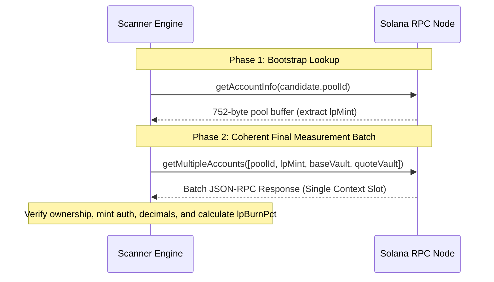

# NeXusTrade — Phase 12.94-D Milestone D.3.3: Raydium AMM v4 LP-Security Acquisition Contract

**Author:** Antigravity (AI Systems Pair Programmer)  
**Status:** PROPOSED / UNAPPROVED (In-Project Specification)  
**Scope:** Strict Legacy Raydium AMM v4 Protocol Accounting (`lpReserve` vs `lpMint.supply`)  
**Deferred Extensions:** CPMM, Token-2022, Third-Party Lockers, External Provider Schemas (All deferred)  
**Branch:** `main` | **Target Components:** `RaydiumAmmParser.ts`, `VerificationDispatchService.ts`, `AntiRugEvaluator.ts`  
**Wallet Status:** Strictly Frozen at `7.9259 SOL` (Specification only; zero live calls, zero RPC probes, zero wallet mutations)

---

## 1. Supported Protocol & Meaning of `lpBurnPct`

### 1.1 Narrowed Scope: Legacy Raydium AMM v4 Only

To establish a verifiable, protocol-enforced acquisition path without architectural bloat or unverified assumptions, this contract is strictly scoped to:

- **Protocol**: Canonical Raydium AMM v4 (`675kPX9MHTjS2zt1qfr1NYHuzeLXfQM9H24wFSUt1Mp8`).
- **Token Standard**: Canonical SPL Token Program (`TokenkegQfeZyiNwAJbNbGKPFXCWuBvf9Ss623VQ5DA`).
- **Explicit Deferrals**:
  - Raydium CPMM (`CPMMoo8L3F4NbTegBCKVNunggL7H1ZpdTHKxQB5qKP1C`) is **DEFERRED**.
  - Token-2022 LP mints are **DEFERRED**.
  - Third-party locking contracts (Streamflow, Team Finance, etc.) are **DEFERRED**.
  - External provider LP schemas (RugCheck `markets[].lp`) are **DEFERRED**.
- **Strategy Threshold**: Unchanged at `minLpBurnPct = 90.0%` in [`AntiRugEvaluator.ts:27-37`](file:///u:/Projects/TopG/backend/src/candidate-scanner/evaluators/AntiRugEvaluator.ts#L27-L37).

### 1.2 Precise Physical & Economic Meaning

In Raydium AMM v4, `lpBurnPct` measures the **fraction of total liquidity claims on the pool's vault reserves that are permanently and irrevocably inaccessible to any circulating token holder**:

$$\text{lpBurnPct} = \frac{L_{\text{protocol}} - S_{\text{current}}}{L_{\text{protocol}}} \times 100\%$$

where:

- $L_{\text{protocol}}$: The protocol-tracked LP amount (`amm.lp_amount` / `lpReserve`), which serves as the actual mathematical denominator in the AMM's on-chain withdrawal instruction.
- $S_{\text{current}}$: The total circulating SPL mint supply of the LP token (`lpMint.supply`).

---

## 2. Correct Account & Withdrawal Model in Raydium AMM v4

### 2.1 Pinned Official Source Revisions

The protocol accounting is verified against official upstream Raydium source code:

1. **On-Chain Program**: `raydium-io/raydium-amm`
   - `program/src/state.rs`: Struct `AmmInfo` defines `lp_amount: u64`.
   - `program/src/processor.rs`: `process_withdraw` uses `amm.lp_amount` as the redemption denominator.
   - `program/src/processor.rs`: `process_deposit` increments `amm.lp_amount` on deposits.
   - `program/src/processor.rs`: `process_initialize2` sets initial `amm.lp_amount` and withholds the unminted minimum.
2. **TypeScript SDK Layout**: `raydium-io/raydium-sdk` (`src/raydium/liquidity/layout.ts`)
   - `liquidityStateV4Layout` defines `u64("lpReserve")` at byte offset **720..728**.

### 2.2 Layout Location & Units of `lpReserve`

The 752-byte Raydium AMM v4 account layout contains `lpReserve` at offset **720..728**:

| Offset Range   | Field Name in SDK / Program   | Rust Data Type   | TypeScript Decoding    | Purpose                        |
| :------------- | :---------------------------- | :--------------- | :--------------------- | :----------------------------- |
| `0..8`         | `status`                      | `u64`            | `BigUInt64LE(0)`       | Pool status (1: Initialized)   |
| `32..40`       | `baseDecimal`                 | `u64`            | `BigUInt64LE(32)`      | Base token decimals            |
| `40..48`       | `quoteDecimal`                | `u64`            | `BigUInt64LE(40)`      | Quote token decimals           |
| `336..368`     | `baseVault`                   | `Pubkey` (32B)   | `subarray(336, 368)`   | Base SPL token vault           |
| `368..400`     | `quoteVault`                  | `Pubkey` (32B)   | `subarray(368, 400)`   | Quote SPL token vault          |
| `400..432`     | `baseMint`                    | `Pubkey` (32B)   | `subarray(400, 432)`   | Base token mint                |
| `432..464`     | `quoteMint`                   | `Pubkey` (32B)   | `subarray(432, 464)`   | Quote token mint               |
| `464..496`     | `lpMint`                      | `Pubkey` (32B)   | `subarray(464, 496)`   | Pool LP token mint             |
| `496..528`     | `openOrders`                  | `Pubkey` (32B)   | `subarray(496, 528)`   | OpenOrders account             |
| `528..560`     | `marketId`                    | `Pubkey` (32B)   | `subarray(528, 560)`   | Serum/OpenBook market ID       |
| `560..592`     | `marketProgramId`             | `Pubkey` (32B)   | `subarray(560, 592)`   | Market program ID              |
| `592..624`     | `targetOrders`                | `Pubkey` (32B)   | `subarray(592, 624)`   | Target orders account          |
| `624..656`     | `withdrawQueue`               | `Pubkey` (32B)   | `subarray(624, 656)`   | Withdraw queue                 |
| `656..688`     | `lpVault`                     | `Pubkey` (32B)   | `subarray(656, 688)`   | LP vault                       |
| `688..720`     | `ammOwner` / `owner`          | `Pubkey` (32B)   | `subarray(688, 720)`   | AMM pool owner                 |
| **`720..728`** | **`lpReserve` (`lp_amount`)** | **`u64`**        | **`BigUInt64LE(720)`** | **Protocol-tracked LP supply** |
| `728..752`     | `padding` (3 $\times$ `u64`)  | `[u64; 3]` (24B) | `subarray(728, 752)`   | Layout trailing padding        |

**Total Length**: Exactly **752 bytes** (`RAYDIUM_AMM_V4_LAYOUT_LENGTH`).  
**Units**: Atomic integer LP units (`bigint`), with decimals matching `lpMint.decimals`.

### 2.3 Pool Initialization & The Unminted Minimum

When a Raydium AMM v4 pool is initialized via `initialize2`:

1. The program calculates initial liquidity:
   $$L_{\text{calc}} = \lfloor \sqrt{\text{init\_coin\_amount} \times \text{init\_pc\_amount}} \rfloor$$
2. The program sets the protocol tracker:
   $$\text{amm.lp\_amount} = L_{\text{calc}}$$
3. The program enforces an unminted minimum liquidity retention ($L_{\text{unminted}} = 10^{\text{lp\_decimals}}$, typically $1,000,000$ raw units for a 6-decimal LP token):
   $$S_{\text{initial\_minted}} = L_{\text{calc}} - L_{\text{unminted}}$$
4. Only $S_{\text{initial\_minted}}$ is minted via SPL Token Program to the pool creator.
5. Consequently, at genesis:
   $$L_{\text{protocol}} - S_{\text{current}} = L_{\text{unminted}} > 0$$

### 2.4 State Transitions: Deposits, Redemptions & Direct Burns

#### A. Liquidity Deposit (`deposit`)

- User deposits tokens; program calculates proportional LP tokens $\Delta L$.
- Program updates protocol state: $\text{amm.lp\_amount} \leftarrow L_{\text{protocol}} + \Delta L$.
- Program issues CPI to SPL Token Program: $\text{lpMint.supply} \leftarrow S_{\text{current}} + \Delta L$.
- **Invariant**: Both increase by $\Delta L$. The difference $(L_{\text{protocol}} - S_{\text{current}})$ **remains constant**.

#### B. Normal Liquidity Withdrawal (`withdraw`)

- User submits $L_{\text{user}}$ LP tokens to the AMM program.
- Program calculates asset return using $\text{amm.lp\_amount}$ as the denominator:
  $$\text{coin\_out} = \lfloor \frac{L_{\text{user}} \times \text{total\_coin}}{\text{amm.lp\_amount}} \rfloor$$
  $$\text{pc\_out} = \lfloor \frac{L_{\text{user}} \times \text{total\_pc}}{\text{amm.lp\_amount}} \rfloor$$
- Program decrements protocol tracker: $\text{amm.lp\_amount} \leftarrow L_{\text{protocol}} - L_{\text{user}}$.
- Program burns LP tokens via CPI: $\text{lpMint.supply} \leftarrow S_{\text{current}} - L_{\text{user}}$.
- **Invariant**: Both decrement by $L_{\text{user}}$. The difference $(L_{\text{protocol}} - S_{\text{current}})$ **remains constant**. Normal withdrawal does NOT increase the locked or protected quantity.

#### C. Direct SPL Burn Outside AMM (`spl_token::instruction::burn`)

- Token holder invokes `spl_token::instruction::burn` directly against the SPL Token Program on their LP token account.
- The AMM program is **not** called.
- SPL Token Program decrements supply: $\text{lpMint.supply} \leftarrow S_{\text{current}} - L_{\text{burned}}$.
- AMM protocol state $\text{amm.lp\_amount}$ is **completely unchanged** ($L_{\text{protocol}}$ remains constant).
- Vault reserves in `baseVault` and `quoteVault` are **completely unchanged**.
- **Result**: The difference $(L_{\text{protocol}} - S_{\text{current}})$ **increases by exactly $L_{\text{burned}}$**.
- **Crucial AMM Consequence**: Because the AMM `withdraw` instruction divides by $\text{amm.lp\_amount}$ ($L_{\text{protocol}}$), the maximum tokens all remaining circulating LP holders combined can ever withdraw is:
  $$\text{Max Circulating Claim} = \frac{S_{\text{current}}}{L_{\text{protocol}}}$$
  The remaining fraction $\frac{L_{\text{protocol}} - S_{\text{current}}}{L_{\text{protocol}}}$ is **permanently and mathematically impossible to withdraw from the vaults**.

---

## 3. The Smallest Defensible Calculation

### 3.1 Mathematical Formulation

Under validated Raydium AMM v4 assumptions, the permanently inaccessible liquidity percentage is:

$$\text{lpBurnPct} = \frac{L_{\text{protocol}} - S_{\text{current}}}{L_{\text{protocol}}} \times 100\%$$

where:

- $L_{\text{protocol}} = \text{readBigUInt64LE}(720)$ from the 752-byte AMM v4 pool account.
- $S_{\text{current}} = \text{readBigUInt64LE}(36)$ from the 82-byte SPL Token Mint account for `lpMint`.

### 3.2 Protocol Lifecycle Behaviors

| Event                     | $L_{\text{protocol}}$ | $S_{\text{current}}$ | Difference $(L_{\text{protocol}} - S_{\text{current}})$ | $\text{lpBurnPct}$ | Evaluation Outcome                                                    |
| :------------------------ | :-------------------: | :------------------: | :-----------------------------------------------------: | :----------------: | :-------------------------------------------------------------------- |
| **Genesis Pool Init**     |    $1,000,000,000$    |    $999,000,000$     |               $1,000,000$ (unminted min)                |      $0.10\%$      | $\mathbf{0.1\% < 90\%} \rightarrow$ **REJECTED** (Unprotected)        |
| **90% Normal Redemption** |     $100,000,000$     |     $99,000,000$     |                 $1,000,000$ (constant)                  |      $1.00\%$      | $\mathbf{1.0\% < 90\%} \rightarrow$ **REJECTED** (Unprotected)        |
| **95% Direct SPL Burn**   |    $1,000,000,000$    |     $49,000,000$     |                      $951,000,000$                      |     $95.10\%$      | $\mathbf{95.1\% \ge 90\%} \rightarrow$ **PASSED** (Protected)         |
| **Subsequent Deposit**    |    $1,500,000,000$    |    $549,000,000$     |                 $951,000,000$ (diluted)                 |     $63.40\%$      | $\mathbf{63.4\% < 90\%} \rightarrow$ **REJECTED** (Diluted below 90%) |
| **Inconsistent State**    |     $100,000,000$     |    $120,000,000$     |                 $-20,000,000$ ($S > L$)                 |        N/A         | **REJECTED** (`REJECTED_AMM_LP_INCONSISTENT`)                         |

### 3.3 Explicit Removal of Unsound Fallbacks

1. **No Automatic Zero-Supply Rule**: The heuristic "zero mint supply plus positive quote reserves equals 100% secure" is **removed**. If $L_{\text{protocol}} = 0$ or $S_{\text{current}} = 0$, the calculation fails closed with `REJECTED_AMM_LP_UNAVAILABLE` unless justified by a verified genesis state.
2. **No Holder Address Classification**: This minimal calculation does not rely on scraping third-party holder accounts, ATA derivations, or unverified lock program addresses. It relies strictly on protocol-enforced AMM math.

---

## 4. Coherent Acquisition Snapshot

To avoid cross-slot discrepancies and race conditions without asserting "trustless" provider RPC behavior, acquisition is divided into two distinct phases:

### 4.1 Phase 1: Bootstrap Lookup (Pool Discovery)

- **Call**: `getAccountInfo(poolId)` (1 read-only RPC call).
- **Purpose**: Decode `lpMint` from offset `464..496` of the 752-byte buffer.

### 4.2 Phase 2: Coherent Final Measurement Snapshot

- **Call**: `getMultipleAccounts([poolId, lpMint, baseVault, quoteVault])` (**exactly 1 batch read-only RPC call**).
- **Single Context Slot**: All 4 accounts are returned from the exact same RPC node response snapshot at the exact same block slot, eliminating cross-account slot skew.

### 4.3 Strict On-Chain Verification Assertions

Before computing `lpBurnPct`, the engine verifies:

1. **Pool Ownership**: `poolAccount.owner === "675kPX9MHTjS2zt1qfr1NYHuzeLXfQM9H24wFSUt1Mp8"`.
2. **Pool Layout Length**: `poolAccount.data.length === 752`.
3. **Pool Status**: `poolAccount.data.readBigUInt64LE(0) === 1n` (Initialized).
4. **Mint Ownership**: `lpMintAccount.owner === "TokenkegQfeZyiNwAJbNbGKPFXCWuBvf9Ss623VQ5DA"`.
5. **Mint Address Match**: `lpMintAccount.address === pool.lpMint`.
6. **Mint Authority Constraint**: `lpMint.mintAuthority` must either be `None` (renounced) OR equal to the pool's authorized AMM Authority PDA. If owned by an arbitrary keypair, fail closed (`REJECTED_ROGUE_LP_MINT_AUTHORITY`).
7. **Monotonic Supply Constraint**: $S_{\text{current}} \le L_{\text{protocol}}$ ($S_{\text{current}} > L_{\text{protocol}}$ indicates state corruption or unparsed protocol extensions $\rightarrow$ `REJECTED_AMM_LP_INCONSISTENT`).
8. **Positive Protocol Supply**: $L_{\text{protocol}} > 0$ (`REJECTED_AMM_LP_ZERO_SUPPLY`).

### 4.4 Request Pacing & Budgeting

- The snapshot batch call consumes **1 outbound HTTP request**.
- Fully satisfies the internal $\ge 2,500\text{ ms}$ host pacing policy.
- Preserves `contextSlot`, request timestamp, response timestamp, and raw byte buffers for audit reconciliation.

---

## 5. Worked Integer Examples

### Scenario 1: Genesis Pool Initialization

- Deployer deposits $100\text{ SOL}$ and $1,000,000\text{ MEME}$.
- $L_{\text{calc}} = \sqrt{100 \times 10^9 \times 1,000,000 \times 10^6} = 10^{12}$ raw units.
- Program sets: $L_{\text{protocol}} = \text{amm.lp\_amount} = 1,000,000,000,000$.
- Program unminted minimum: $L_{\text{unminted}} = 10^6 = 1,000,000$.
- Program mints to deployer: $S_{\text{current}} = 999,999,000,000$.
- Calculation:
  $$\text{lpBurnPct} = \frac{1,000,000,000,000 - 999,999,000,000}{1,000,000,000,000} \times 100\% = 0.0001\%$$
- **Outcome**: **REJECTED** ($0.0001\% < 90.0\%$). Deployer holds $99.9999\%$ of claims. Correctly identified as unprotected.

### Scenario 2: 90% Liquidity Withdrawal (Ordinary Rug Pull)

- Starting from Genesis: $L_{\text{protocol}} = 1,000,000,000$, $S_{\text{current}} = 999,000,000$, Reserves $= 100\text{ SOL}$.
- Deployer calls `withdraw(900,000,000)`.
- AMM payout calculation:
  $$\text{SOL Out} = \lfloor \frac{900,000,000 \times 100\text{ SOL}}{1,000,000,000} \rfloor = 90\text{ SOL}$$
- AMM updates:
  - $L_{\text{protocol}} \leftarrow 1,000,000,000 - 900,000,000 = 100,000,000$.
  - $S_{\text{current}} \leftarrow 999,000,000 - 900,000,000 = 99,000,000$.
  - Reserves in vault drop to $10\text{ SOL}$.
- Calculation under actual AMM v4 model:
  $$\text{lpBurnPct} = \frac{100,000,000 - 99,000,000}{100,000,000} \times 100\% = 1.0\%$$
- **Outcome**: **REJECTED** ($1.0\% < 90.0\%$).
- **Contrast with Flawed Historical Formula**:
  - Flawed formula: $\frac{L_{\text{genesis}} - S_{\text{current}}}{L_{\text{genesis}}} = \frac{1,000,000,000 - 99,000,000}{1,000,000,000} = 90.1\%$ (would have falsely passed!).
  - The AMM v4 protocol model correctly catches the rug pull.

### Scenario 3: 95% Direct SPL Burn Outside AMM (True Lock)

- Starting from Genesis: $L_{\text{protocol}} = 1,000,000,000$, $S_{\text{current}} = 999,000,000$, Reserves $= 100\text{ SOL}$.
- Deployer calls `spl_token::instruction::burn(950,000,000)` directly on their token account.
- AMM program is NOT called:
  - $L_{\text{protocol}}$ remains $1,000,000,000$.
  - $S_{\text{current}} \leftarrow 999,000,000 - 950,000,000 = 49,000,000$.
  - Reserves in vault remain $100\text{ SOL}$.
- Calculation:
  $$\text{lpBurnPct} = \frac{1,000,000,000 - 49,000,000}{1,000,000,000} \times 100\% = 95.1\%$$
- **Outcome**: **PASSED** ($95.1\% \ge 90.0\%$).
- **Verification of Inaccessible Reserves**:
  If the deployer now attempts to withdraw with all their remaining $49,000,000$ LP tokens:
  $$\text{Max Payout} = \lfloor \frac{49,000,000 \times 100\text{ SOL}}{1,000,000,000} \rfloor = 4.9\text{ SOL}$$
  The remaining $95.1\text{ SOL}$ is permanently unwithdrawable from the vault.

---

## 6. Smallest Parser Extension & Offline Test Plan (Post-Approval)

Following formal auditor approval, the required implementation consists of only:

1. **Parser Extension in [`RaydiumAmmParser.ts`](file:///u:/Projects/TopG/backend/src/research/pilot/RaydiumAmmParser.ts)**:
   - Add `LP_RESERVE: 720` to `RAYDIUM_V4_OFFSETS`.
   - Read `view.getBigUint64(RAYDIUM_V4_OFFSETS.LP_RESERVE, true)`.
   - Expose `lpReserve: bigint` in `D23RaydiumAmmV4State`.
2. **Short Offline Tests in `RaydiumAmmParser.test.ts`**:
   - Verify decoding of `lpReserve` at byte offset 720 from authoritative buffers.
   - Verify calculation of `(lpReserve - mintSupply) / lpReserve` across the 5 worked scenarios.
   - Verify fail-closed rejection on $S_{\text{current}} > L_{\text{protocol}}$.

---

## 7. Outstanding Dependencies (Separately Listed)

This specification bounds the LP-security acquisition path for Raydium AMM v4. The following remain tracked as distinct outstanding dependencies:

1. **Verified Pool Reserves & Token Decimals**: Exact atomic reserve verification from `baseVault` and `quoteVault` in the single batch snapshot.
2. **Current Security Metrics**: Live, metered RugCheck report adapter delivering validated risk score ($\le 700$), danger flags (`hasDangerRisk: false`), holder count, and concentration metrics.
3. **Authentic Micro-Flow Observations**: Rolling 60-second trade flow ingestion (`recentBuys60s`, `recentSells60s`) for flow-absorption rules (1.15x / 1.25x / 1.5x) and anti-surge rules.
4. **Execution Engine Integration**: Realism integration connecting confirmed retests to `QuoteExecutionEngine.ts` with strict lookahead guards, 2,039,280 lamports ATA rent accounting, and multi-tier partial-profit state preservation.
