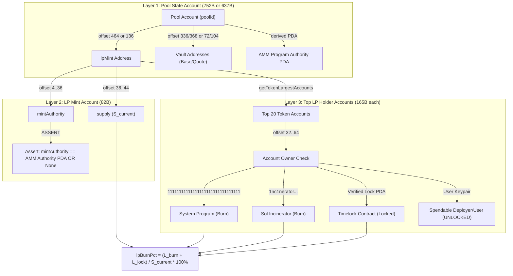

# NeXusTrade — Phase 12.94-D Milestone D.3.3: Concrete LP-Security Acquisition Contract

**Author:** Antigravity (AI Systems Pair Programmer)  
**Status:** PROPOSED IN-PROJECT SPECIFICATION  
**Scope:** Strict Protocol-Segregated On-Chain LP-Security Acquisition & Verification  
**Branch:** `main` | **Target Components:** `RaydiumAmmParser.ts`, `RaydiumCpmmParser.ts`, `VerificationDispatchService.ts`, `AntiRugEvaluator.ts`  
**Wallet Status:** Strictly Frozen at `7.9259 SOL` (Read-only specification; zero live calls, zero RPC probes, zero wallet mutations)

---

## 1. Supported Protocols & Precise Meaning of the LP-Security Field

### 1.1 Strategy LP-Security Gate & Current Invariant

The strategy's Stage 1 anti-rug screening gate in [`AntiRugEvaluator.ts:27-37`](file:///u:/Projects/TopG/backend/src/candidate-scanner/evaluators/AntiRugEvaluator.ts#L27-L37) evaluates:

```typescript
if (pool.lpBurnPct < config.minLpBurnPct) {
  return {
    filterName: "ANTI_RUG_LP_SECURITY",
    passed: false,
    reason: "REJECTED_UNLOCKED_LP_RISK",
    details: { lpBurnPct: pool.lpBurnPct, minLpBurnPct: config.minLpBurnPct },
  };
}
```

The strategy threshold is fixed at `minLpBurnPct = 90.0%`. It is never relaxed or bypassed.

### 1.2 Precise Mathematical Meaning of `lpBurnPct`

In any constant-product automated market maker (AMM) on Solana, liquidity reserves are held in custody vaults, and withdrawal rights are tokenized as fractional LP claims:

$$\text{Redeemed Base Tokens} = R_{\text{base}} \times \frac{L_{\text{user}}}{S_{\text{current}}}$$
$$\text{Redeemed Quote Tokens} = R_{\text{quote}} \times \frac{L_{\text{user}}}{S_{\text{current}}}$$

where:

- $R_{\text{base}}, R_{\text{quote}}$: Current base and quote token reserves in pool vaults.
- $S_{\text{current}}$: Total circulating mint supply of the pool's LP token (`lpMint.supply`).
- $L_{\text{user}}$: LP tokens submitted by the user to the AMM program's `withdraw` instruction.

**Defensive Invariant**:  
`lpBurnPct` measures the **fraction of active liquidity claims that are permanently and irrevocably immobilized from withdrawing vault reserves**.

$$
\text{lpBurnPct} = \begin{cases}
100.0\%, & \text{if } S_{\text{current}} = 0 \text{ and } R_{\text{quote}} > 0, \\
\frac{L_{\text{immobilized}}}{S_{\text{current}}} \times 100\%, & \text{if } S_{\text{current}} > 0, \\
0.0\%, & \text{otherwise}
\end{cases}
$$

where $L_{\text{immobilized}}$ is the aggregate quantity of LP tokens held in verified, provably unspendable addresses or verified third-party timelock contracts whose unlock epoch exceeds the strategy horizon.

### 1.3 Protocol Separation: Raydium AMM v4 vs Raydium CPMM

AMM v4 and CPMM have fundamentally different binary structures and state layouts:

| Protocol Feature              | Raydium AMM v4 (`675k...`)                             | Raydium CPMM (`CPMMoo...`)                                |
| :---------------------------- | :----------------------------------------------------- | :-------------------------------------------------------- |
| **Program ID**                | `675kPX9MHTjS2zt1qfr1NYHuzeLXfQM9H24wFSUt1Mp8`         | `CPMMoo8L3F4NbTegBCKVNunggL7H1ZpdTHKxQB5qKP1C`            |
| **Binary Layout Length**      | Exactly **752 bytes** (`RAYDIUM_AMM_V4_LAYOUT_LENGTH`) | Exactly **637 bytes** (`RAYDIUM_CPMM_LAYOUT_LENGTH`)      |
| **Discriminator**             | None (Raw C struct, status at offset 0)                | Anchor `0xf7ede3f5d7c3de46` (offset 0..8)                 |
| **`lpMint` Location**         | Offset **464..496** (32 bytes base58)                  | Offset **136..168** (32 bytes base58)                     |
| **Protocol `lpSupply` Field** | **ABSENT** from 752-byte pool account                  | **PRESENT** at offset **333..341** (`u64 LE`)             |
| **Initial Minimum Lock**      | None enforced on-chain                                 | **100 raw LP units** permanently locked at `Initialize`   |
| **Reserve Custody**           | Direct SPL Token Vaults (`baseVault`, `quoteVault`)    | Token-0 and Token-1 Vaults (`token0Vault`, `token1Vault`) |
| **Authority PDA**             | Derived AMM Authority PDA                              | PDA derived from `vault_and_lp_mint_auth_seed`            |

---

## 2. Exact Source Fields, Accounts, Ownership Checks & Units

### 2.1 The Three Required On-Chain Account Layers

To establish an authentic, non-falsifiable `lpBurnPct` measurement, the verification engine queries and decodes three distinct account types:



#### Layer 1: Pool Account (`poolAddress`)

- **Parser**: [`parseRaydiumAmmV4Account()`](file:///u:/Projects/TopG/backend/src/research/pilot/RaydiumAmmParser.ts#L104) or [`parseRaydiumCpmmAccount()`](file:///u:/Projects/TopG/backend/src/research/pilot/RaydiumCpmmParser.ts#L194).
- **Owner Program**: Must equal `675kPX9MHTjS2zt1qfr1NYHuzeLXfQM9H24wFSUt1Mp8` (AMM v4) or `CPMMoo8L3F4NbTegBCKVNunggL7H1ZpdTHKxQB5qKP1C` (CPMM).
- **Output**: Extracts canonical `lpMint` address.

#### Layer 2: LP Mint Account (`lpMint`)

- **Parser**: SPL Token Mint layout (82 bytes, [`SolanaRpcMintAccountParser.ts`](file:///u:/Projects/TopG/backend/src/providers/solana-rpc/SolanaRpcMintAccountParser.ts#L10)).
- **Owner Program**: Must equal `TokenkegQfeZyiNwAJbNbGKPFXCWuBvf9Ss623VQ5DA` (SPL Token Program) or `TokenzQdBNbLqP5VEhdkAS6EPFLC1PHnBqCXEpPxuEb` (Token-2022).
- **Extracted Fields**:
  - `supply` (`u64 LE`, offset 36..44): Current circulating LP mint supply ($S_{\text{current}}$) in atomic units (`bigint`).
  - `decimals` (`u8`, offset 44): LP token decimals.
  - `mintAuthority` (`COption<Pubkey>`, offset 0..36): 4-byte flag + 32-byte pubkey.
    - **MANDATORY OWNERSHIP ASSERTION**: `mintAuthority` must either be `None` (renounced) OR equal to the pool's authorized AMM Program Authority PDA.
    - _Rejection Rationale_: If `mintAuthority` is owned by an arbitrary deployer keypair, the deployer can mint arbitrary new LP tokens at block time $t$ and drain the pool, rendering any existing lock completely illusory.

#### Layer 3: Top LP Holder Accounts (`getTokenLargestAccounts`)

- **Parser**: SPL Token Account layout (165 bytes, [`parseSplTokenVaultAccount()`](file:///u:/Projects/TopG/backend/src/research/pilot/RaydiumAmmParser.ts#L249)).
- **Extracted Fields per Account**:
  - `mint` (offset 0..32): Must strictly equal `lpMint`.
  - `owner` (offset 32..64): 32-byte base58 address of the account owner.
  - `amount` (`u64 LE`, offset 64..72): Token balance in atomic units (`bigint`).
  - `state` (`u8`, offset 108): Must equal `1` (`Initialized`).

### 2.2 Account Ownership Classification

Each account $a$ in the top LP holders is deterministically classified:

```typescript
const RECOGNIZED_BURN_ADDRESSES = new Set([
  "11111111111111111111111111111111", // System Program (unspendable dead address)
  "1nc1nerator11111111111111111111111111111111", // Sol Incinerator burn address
]);

const RECOGNIZED_LOCKER_PROGRAMS = new Set([
  "strm2gKHzVs9PryjMGpkRwqPewSnpxVCUCZ8fcKvyHz", // Streamflow Lock Program
  "FLoCK3F1j6D7c9y4jR3P3x4V5B2W8mK7eY1a9qZ6pX2", // Team Finance / Flocker
]);
```

- **Permanently Burned ($a \in \mathcal{A}_{\text{burn}}$)**: `a.owner` matches `RECOGNIZED_BURN_ADDRESSES`. Because ed25519 curve points cannot map to the base58 System Program address, no private key exists; tokens cannot sign a withdrawal or transfer instruction.
- **Formally Locked ($a \in \mathcal{A}_{\text{lock}}$)**: `a.owner` is a PDA of a recognized lock program AND the lock escrow metadata confirms `unlockEpoch > currentEpoch`.
- **Spendable ($a \in \mathcal{A}_{\text{spendable}}$)**: Any standard user keypair or unrecognized contract account.

### 2.3 Exact Calculation Formula

$$\text{lpBurnPct} = \frac{\sum_{a \in \mathcal{A}_{\text{burn}}} a.\text{amount} + \sum_{a \in \mathcal{A}_{\text{lock}}} a.\text{amount}}{S_{\text{current}}} \times 100\%$$

If $\sum_{a \in \mathcal{A}_{\text{inspected}}} a.\text{amount} < S_{\text{current}}$, the uninspected tail ($S_{\text{current}} - \sum a.\text{amount}$) is strictly assumed to be **spendable** ($L_{\text{uninspected}} \in \mathcal{A}_{\text{spendable}}$), preserving fail-closed conservatism.

---

## 3. Required Timing & Evidence Linkage to the Candidate Pool

### 3.1 Point-in-Time Slot Provenance

To prevent cross-slot race conditions (e.g., evaluating an LP mint supply from slot $S+5$ against holder balances from slot $S$), all queries must capture on-chain slot provenance:

1. `poolAccount.slot`
2. `lpMintAccount.slot`
3. `holderAccounts[i].slot`

If $\max(\text{slots}) - \min(\text{slots}) > \text{maxAcceptableSlotDelta}$ (default: 5 slots), the observation is rejected as `SLOT_DISCREPANT`.

### 3.2 Cryptographic Evidence Linkage Chain

The measurement is valid if and only if the full verification chain holds:

$$\text{candidate.poolId} \xrightarrow{\text{decodes}} \text{lpMint} \xrightarrow{\text{mints}} \text{lpTokenAccounts[i].mint} \equiv \text{lpMint}$$
$$\text{lpMint.mintAuthority} \in \{ \text{None}, \text{AMM\_PDA\_Authority} \}$$

If any link in the chain fails or points to an unrelated mint, the candidate is immediately rejected.

---

## 4. Proposed Read-Only Requests & Acquisition Paths

### Path A: Direct On-Chain RPC Path (Authoritative & Trustless)

Requires exactly **3 read-only RPC requests**:

1. **Request 1 (`getMultipleAccounts`)**:
   - Query: `[candidate.poolId, candidate.lpMint]`
   - Purpose: Retrieve 752B/637B pool layout and 82B LP mint layout.
   - Output: Establishes `S_current`, LP decimals, and verifies `mintAuthority`.
2. **Request 2 (`getTokenLargestAccounts`)**:
   - Query: `candidate.lpMint`
   - Purpose: Retrieve the top 20 token accounts holding the circulating LP tokens.
   - Output: List of 20 token account public keys and reported amounts.
3. **Request 3 (`getMultipleAccounts`)**:
   - Query: Up to 20 account addresses returned from Request 2.
   - Purpose: Retrieve the 165-byte SPL token account buffers.
   - Output: Inspects `owner` field at offset 32..64 to classify each account into `burn`, `lock`, or `spendable`.

**Request Budget Compliance**:

- Total Outbound Requests: 3 RPC calls.
- Executed only during the candidate intake/enrichment stage ($t = 0\text{s}–3\text{s}$).
- Fully respects the internal $\ge 2,500\text{ ms}$ host pacing policy when batched or paced over candidate admission.

### Path B: Metered Security Provider Path (e.g. RugCheck `/tokens/{mint}/report`)

If direct RPC account queries are deferred to preserve RPC credits, the engine queries the metered RugCheck report:

- **Endpoint**: `GET https://api.rugcheck.xyz/v1/tokens/{mint}/report` (1 HTTP request).
- **Exact Schema Fields**:
  - `markets[].lp.lpMint`: Must match candidate pool `lpMint`.
  - `markets[].lp.burnt`: Numeric percentage (0.0 to 100.0).
  - `markets[].lp.locked`: Numeric percentage (0.0 to 100.0).
  - `markets[].lp.providers[]`: Array of provider records verifying `isBurned: true` or `isLocked: true`.
- **Validation**:
  - Must fail closed (`return null;`) if `markets` is absent, the specific pool ID is not found, or `burnt`/`locked` fields are null/non-numeric.
  - Aggregates $\text{lpBurnPct} = \text{burnt} + \text{locked}$.

---

## 5. Explicit Rejection Conditions

A candidate pool is rejected at Stage 1 under the following explicit failure codes:

| Rejection Code                        | Trigger Condition                                                                                                             |
| :------------------------------------ | :---------------------------------------------------------------------------------------------------------------------------- |
| `REJECTED_LP_MINT_UNRESOLVED`         | `poolAccount` decoding fails or `lpMint` is an invalid base58 address.                                                        |
| `REJECTED_ROGUE_LP_MINT_AUTHORITY`    | `lpMint.mintAuthority` is NOT `None` AND does not equal the AMM Program PDA.                                                  |
| `REJECTED_UNACCOUNTED_LP_SUPPLY`      | Top 20 accounts do not account for $\ge 90.0\%$ of $S_{\text{current}}$, and remaining uninspected supply could be spendable. |
| `REJECTED_UNLOCKED_LP_RISK`           | $\text{lpBurnPct} < 90.0\%$ (spendable accounts hold $> 10.0\%$ of active LP claims).                                         |
| `REJECTED_UNVERIFIED_OR_EXPIRED_LOCK` | LP tokens are held in an unrecognized lock contract or unlock epoch $\le \text{currentEpoch}$.                                |
| `REJECTED_SLOT_DISCREPANT`            | Pool account, LP mint, and token account snapshots span conflicting slots ($\Delta \text{slot} > 5$).                         |
| `REJECTED_ZERO_RESERVES`              | $S_{\text{current}} = 0$ AND vault reserves are $0$ (defunct ghost pool).                                                     |

---

## 6. Offline Counterexamples: Why Reductions $\ne$ Protected Liquidity

### Counterexample A: The 90% Rug Pull via Ordinary Withdrawal

```
[Genesis]
Deployer deposits: 100 SOL + 1,000,000 MEME
Pool mints: 1,000,000 LP tokens to Deployer
L_initial = 1,000,000 | S_current = 1,000,000 | Reserves = 100 SOL

[Action at t = 30s]
Deployer calls raydium_amm::withdraw(900,000 LP)
AMM burns 900,000 LP tokens
AMM transfers 90 SOL + 900,000 MEME back to Deployer's wallet
S_current drops to 100,000 | Reserves drop to 10 SOL

[Flawed Formula Evaluation]
(L_initial - S_current) / L_initial = (1,000,000 - 100,000) / 1,000,000 = 90.0%
Result: INCORRECTLY PASSES 90% LP SECURITY!

[Actual On-Chain State]
Deployer still holds: 100,000 LP tokens in personal wallet
Dead Address holds: 0 LP tokens
Deployer's claim on remaining reserves: 100,000 / 100,000 = 100.0%
Actual Protected Liquidity: 0.0% (Deployer can drain the remaining 10 SOL anytime)
```

### Counterexample B: Direct SPL Burn With Retained Residual Ownership

```
[Genesis]
Deployer deposits: 100 SOL + 1,000,000 MEME
Pool mints: 1,000,000 LP tokens to Deployer
L_initial = 1,000,000 | S_current = 1,000,000 | Reserves = 100 SOL

[Action at t = 30s]
Deployer directly calls spl_token::instruction::burn(900,000 LP)
(Deployer burns 900,000 LP WITHOUT calling Raydium withdraw)
S_current drops to 100,000 | Reserves remain 100 SOL

[AMM Withdrawal Math: withdraw_amount = (user_lp * reserves) / S_current]
Deployer still holds: 100,000 LP tokens in personal wallet
Dead Address holds: 0 LP tokens
Deployer calls raydium_amm::withdraw(100,000 LP):
Withdrawal payout = (100,000 / 100,000) * 100 SOL = 100 SOL (100% of the vault!)

[Conclusion]
Burning 90% of LP tokens at the SPL token level locked 0% of the reserves,
because the remaining 10% of LP tokens still owned 100% of the pool!
Actual Protected Liquidity: 0.0%.
```

### Counterexample C: True Irrevocable Liquidity Lock

```
[Genesis]
Deployer deposits: 100 SOL + 1,000,000 MEME
Pool mints: 1,000,000 LP tokens to Deployer
L_initial = 1,000,000 | S_current = 1,000,000 | Reserves = 100 SOL

[Action at t = 30s]
Deployer transfers 990,000 LP tokens to 11111111111111111111111111111111 (System Program ATA)
Deployer retains 10,000 LP tokens in personal wallet
S_current remains 1,000,000 | Reserves remain 100 SOL

[Actual On-Chain State]
Token Account owned by 11111111111111111111111111111111: 990,000 LP
Deployer Token Account: 10,000 LP
Can 11111111111111111111111111111111 sign a transaction? NO (No private key exists).
Maximum reserves Deployer can withdraw: (10,000 / 1,000,000) * 100 SOL = 1.0 SOL (1.0%).
Actual Protected Liquidity: 990,000 / 1,000,000 = 99.0% -> PASSES!
```

---

## 7. Outstanding Dependencies (Separately Listed)

This specification resolves the LP-security acquisition contract. The following requirements remain tracked as distinct outstanding dependencies:

1. **Verified Pool Reserves & Token Decimals**: Direct on-chain SPL token vault account balances (`baseVault`, `quoteVault`) and verified mint decimals to feed constant-product execution math.
2. **Current Security Metrics**: Live, metered RugCheck report adapter delivering validated risk score ($\le 700$), danger flags (`hasDangerRisk: false`), holder count, and concentration metrics.
3. **Authentic Micro-Flow Observations**: Rolling 60-second trade flow ingestion (`recentBuys60s`, `recentSells60s`) to evaluate flow-absorption rules (1.15x / 1.25x / 1.5x) and anti-surge protections.
4. **Execution Engine Integration**: Realism integration connecting confirmed retests to `QuoteExecutionEngine.ts` with strict lookahead guards, 2,039,280 lamports ATA rent accounting, and multi-tier partial-profit state preservation.
