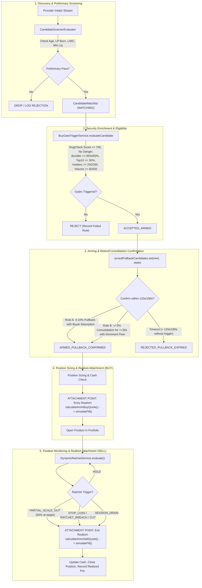

# NeXusTrade — Phase 12.94-D Milestone D.3.3: Corrected PAPER Readiness Assessment

**Document ID**: `NXT-D3.3-PAPER-READINESS-ASSESSMENT-V2`  
**Location**: `docs/research-planning/phase-12.94d-milestone-d3-3-paper-readiness-assessment.md`  
**Related Closure Report**: [`audit/PHASE_12_94D_MILESTONE_D3_3_QUOTE_PILOT_003_CLOSURE_REPORT.md`](file:///u:/Projects/TopG/audit/PHASE_12_94D_MILESTONE_D3_3_QUOTE_PILOT_003_CLOSURE_REPORT.md)  
**Assessment Status**: **READ-ONLY ARCHITECTURAL & DATA PROVENANCE ASSESSMENT**  
**Execution Authority**: **THE OPERATOR PERSONALLY RUNS ALL LIVE MARKET-DATA, PAPER, SIMULATION SESSIONS, AND LONG TESTS. ZERO LIVE NETWORK CALLS OR TRADES ARE AUTHORIZED IN THIS ASSESSMENT.**

---

## 1. Actual Existing Strategy Lifecycle & Realism Integration Points

The strategy implemented across [`backend/src/candidate-scanner/`](file:///u:/Projects/TopG/backend/src/candidate-scanner), [`backend/src/exits/`](file:///u:/Projects/TopG/backend/src/exits), and [`backend/src/scripts/paper-trading-daemon.ts`](file:///u:/Projects/TopG/backend/src/scripts/paper-trading-daemon.ts) is a multi-stage, state-machine driven engine.

An immediate buy upon candidate admission followed by a fixed $+300\text{s}$ exit does **not** evaluate this strategy; that is merely an execution-model smoke test. A true strategy evaluation must respect the full decision pipeline:



### Detailed Lifecycle Stages & Execution-Realism Attachment Points

#### Stage 1: Discovery & Preliminary Screening

- **Component**: [`CandidateScannerEvaluator.ts`](file:///u:/Projects/TopG/backend/src/candidate-scanner/CandidateScannerEvaluator.ts)
- **Rules Evaluated**:
  - `PAIR_MATURITY_WINDOW`: $300\text{s} \le \text{age} \le 900\text{s}$ (Micro-Cap) or $1800\text{s} \le \text{age} \le 7200\text{s}$ (Established).
  - `ANTI_RUG_LP_SECURITY`: $\text{lpBurnPct} \ge 90.0\%$.
  - `ANTI_RUG_AUTHORITY`: Mint and freeze authorities must be renounced.
  - `DEPTH_BALANCE_GATE`: $0.15 \le L/MC \le 0.55$ (Micro-Cap) or $0.03 \le L/MC \le 0.55$ (Established).
  - `ORGANIC_FLOW`: Transaction count $\ge 20$ in 5m, average transaction $\ge \$15$.
- **Outcome**: Qualifying candidates are admitted to [`CandidateWatchlistService`](file:///u:/Projects/TopG/backend/src/candidate-scanner/CandidateWatchlistService.ts) in `WATCHING` status. Zero qualifying candidates is a valid, normal outcome.

#### Stage 2: Security Enrichment & Final Eligibility

- **Component**: [`BuyGateTriggerService.ts`](file:///u:/Projects/TopG/backend/src/candidate-scanner/BuyGateTriggerService.ts)
- **Rules Evaluated**:
  - Symbol blacklist (`SOL`, `WSOL`, `USDC`, `TEST`, etc.).
  - Security score ($\le 700$) and binary danger flags (`false`).
  - Bundler concentration ($\le 85\%$ established, $\le 50\%$ micro-cap).
  - Top 10 holder concentration ($\le 30\%$).
  - Minimum verified holders ($\ge 250$ established, $\ge 350$ micro-cap).
  - Anti-wash-trading ceiling ($\text{txns5m} \le 300$) and anti-sell-congestion ceiling ($\text{sells5m} \le 100$).
  - Dev single disposal ceiling ($\le 5\%$ of liquidity).
  - Volume surge ($\ge \$2,500$ 5m volume and $\ge \$25$ average transaction).
  - Minimum sells floor ($\ge 15$ sells in 5m).
  - Buyer flow absorption ($\text{buys} / \text{sells} \ge 1.5\times$).
- **Outcome**: If any gate fails, candidate is rejected with an explicit rule diagnostic. If all gates pass, candidate transitions to `ACCEPTED_ARMED`.

#### Stage 3: Arming & Retest/Consolidation Confirmation

- **Implementation**: [`backend/src/scripts/paper-trading-daemon.ts`](file:///u:/Projects/TopG/backend/src/scripts/paper-trading-daemon.ts#L1980-L2055)
- **Mechanics**: Candidates do **not** enter immediately. An armed candidate enters `armedPullbackCandidates` and must satisfy one of two market confirmations:
  1. **Rule A (Retest Pullback Discount with Flow Absorption)**:
     - Established: $4\%\text{ to }10\%$ discount ($0.90 \le \text{spot} / \text{peak} \le 0.96$) with flow absorption ($\text{recentBuys60s} \ge 1.15 \times \text{recentSells60s}$).
     - Micro-Cap: $10\%\text{ to }15\%$ discount ($0.85 \le \text{spot} / \text{peak} \le 0.90$) with flow absorption ($\text{recentBuys60s} \ge 1.25 \times \text{recentSells60s}$).
  2. **Rule B (Consolidation Breakout)**:
     - Price consolidates within $\pm 3\%$ of peak for $\ge 30\text{s}$ (or $\ge 3$ consecutive ticks) with dominant buyer flow ($\text{recentBuys60s} \ge 1.5 \times \text{recentSells60s}$).
  3. **Retest Timeout Expiry**:
     - If neither rule confirms within $120\text{s}$ ($180\text{s}$ for established), the candidate is dropped with `REJECTED_PULLBACK_EXPIRED`.
- **Outcome**: Armed candidates frequently expire without triggering. Dropping candidates here is an expected, correct outcome.

#### Stage 4: Confirmed Entry & Execution Realism (BUY)

- **Attachment Point**: Triggered exclusively upon `ARMED_PULLBACK_CONFIRMED`.
- **API Call Sequence**:
  1. Obtain verified atomic pool reserves (`baseReserveTokens`, `quoteReserveSol`) and token decimals.
  2. Call [`calculateAmmBuyQuote()`](file:///u:/Projects/TopG/backend/src/execution/QuoteExecutionEngine.ts#L341) with desired SOL size, verified pool reserves, and dexFeeRate.
  3. Wrap quote via [`createDeterministicAmmQuote()`](file:///u:/Projects/TopG/backend/src/execution/QuoteExecutionEngine.ts#L451) with verified route plan, context slot, and TTL.
  4. Call [`simulateFill()`](file:///u:/Projects/TopG/backend/src/execution/QuoteExecutionEngine.ts#L661) passing [`calculateEntryFees()`](file:///u:/Projects/TopG/backend/src/execution/ExecutionFeeModel.ts#L61) options (modeled Solana base fee 5,000 lamports + priority fee + ATA rent deposit of 2,039,280 lamports).
  5. If `executionOutcome === "FILLED"`, instantiate open position with actual `filledTokens` (reflecting AMM price impact and slippage). If rejected (`SLIPPAGE_BREACH_REJECTED` or `NO_ROUTE_REJECTED`), abort entry safely with zero position opened.

#### Stage 5: Position Monitoring, Dynamic Ratchets & Realism (SELL)

- **Component**: [`DynamicRatchetService.ts`](file:///u:/Projects/TopG/backend/src/exits/DynamicRatchetService.ts)
- **Mechanics**: Position updates on every subsequent price tick.
  - Multi-tier profit ratchet: Breakeven stop locked at $+20\%$, Tier 1 floor at $+40\%$, trailing moonbag floor at $+72\%$.
  - Moonbag scaling: $50\%$ position liquidated at primary profit target; remaining $50\%$ tracked with trailing ratchet.
  - Defensive cuts: Immediate liquidation on tight stop breach, stagnant tick timeout (10 ticks without valid price), unconfirmed dump, or portfolio drawdown breach.
- **Attachment Point**: Triggered upon exit signal from `DynamicRatchetService`:
  1. Call [`calculateAmmSellQuote()`](file:///u:/Projects/TopG/backend/src/execution/QuoteExecutionEngine.ts#L390) for the exact token quantity being liquidated against updated pool reserves.
  2. Call [`simulateFill()`](file:///u:/Projects/TopG/backend/src/execution/QuoteExecutionEngine.ts#L661) with `side: "SELL"`, passing [`calculateExitFees()`](file:///u:/Projects/TopG/backend/src/execution/ExecutionFeeModel.ts#L86) (including ATA rent refund credit of 2,039,280 lamports if closing the ATA).
  3. Calculate net realized proceeds in SOL, realized slippage, and net PnL. If sell fails (`UNSELLABLE_NO_ROUTE` or `PREFLIGHT_SIMULATION_REJECTED`), preserve unsold tokens in inventory and apply conservative write-down.

---

## 2. Field-Level Data Gaps & Unsafe Fallbacks

To ensure complete data integrity, all strategy fields are classified into four strict categories:

| Field Name            | Preserved in DexScreener Payload? | Validated in Candidate Contract? | Qualified for Execution Realism? | Status & Provenance Gaps                                                                             |
| :-------------------- | :-------------------------------: | :------------------------------: | :------------------------------: | :--------------------------------------------------------------------------------------------------- |
| `pairAddress`         |                Yes                |               Yes                |       Yes (Identity only)        | Exact case-sensitive pool address matching on Raydium.                                               |
| `priceNative`         |                Yes                |  Yes (as `indicativePriceSol`)   |       No (Indicative only)       | Strictly validated against canonical WSOL. Represents indexer spot price, not executable fill price. |
| `liquidity.usd`       |                Yes                |               Yes                |                No                | Validated $> 0$. Useful for screening depth, not execution math.                                     |
| `liquidity.base`      |                Yes                |                No                |              **NO**              | Provider-reported balance. **Not qualified as executable reserve.** (See below).                     |
| `liquidity.quote`     |                Yes                |                No                |              **NO**              | Provider-reported balance. **Not qualified as executable reserve.** (See below).                     |
| `volume.m5`           |                Yes                |               Yes                |                No                | 5-minute trading volume.                                                                             |
| `txns.m5.buys/sells`  |                Yes                |               Yes                |                No                | 5-minute transaction counts for flow ratio.                                                          |
| `pairCreatedAt`       |                Yes                |    Yes (as `assetAgeSeconds`)    |                No                | Epoch ms creation time compared against runner clock.                                                |
| `marketCap` / `fdv`   |                Yes                |               Yes                |                No                | Point-in-time valuation for $L/MC$ ratio.                                                            |
| `lpBurnPct`           |              **NO**               |         **NO** (`null`)          |              **NO**              | **Completely unavailable from DexScreener.**                                                         |
| `holdersCount`        |              **NO**               |         **NO** (`null`)          |              **NO**              | **Completely unavailable from DexScreener.**                                                         |
| `rugScore`            |              **NO**               |         **NO** (`null`)          |              **NO**              | **Completely unavailable from DexScreener.**                                                         |
| `hasDangerRisk`       |              **NO**               |         **NO** (`null`)          |              **NO**              | **Completely unavailable from DexScreener.**                                                         |
| `bundlerPct`          |              **NO**               |         **NO** (`null`)          |              **NO**              | **Completely unavailable from DexScreener.**                                                         |
| `top10HolderPct`      |              **NO**               |         **NO** (`null`)          |              **NO**              | **Completely unavailable from DexScreener.**                                                         |
| `recentBuys/Sells60s` |              **NO**               |         **NO** (`null`)          |              **NO**              | **Completely unavailable from DexScreener.**                                                         |

### Why Provider Balances Are NOT Verified Constant-Product Reserves

DexScreener's `liquidity.base` and `liquidity.quote` cannot be directly plugged into `calculateAmmBuyQuote()` without independent qualification:

1. **AMM Model & Program Ownership**: DexScreener tags pools as `dexId: "raydium"`, but does not verify whether the pool program is Raydium AMM v4 (`675kPX9MHTjS2zt1qfr1NYHuzeLXfQM9H24wFSUt1Mp8`), Raydium CPMM (`CPMMoo8L3F4NbTegBCKVNunggL7H1ZpdTHKxQB5qKP1C`), or Raydium CLMM (Concentrated Liquidity). CLMM pools do **not** obey constant-product $x \cdot y = k$ math.
2. **Denomination & Mint Decimals**: DexScreener returns human-readable UI numbers (e.g. `1340502` RAY, `24306` SOL). To perform atomic BigInt constant-product math, token mint decimals (e.g. 6 decimals for RAY, 9 for WSOL) must be verified.
3. **Indexer Lag & Timing**: DexScreener balances reflect indexer state, which can lag on-chain slot state by several blocks, violating zero-lookahead and freshness constraints.
4. **Pool Fee Assumptions**: The swap fee schedule (e.g., 25 bps for AMM v4) is an assumed constant unless verified from pool configuration.

### Audit of Existing Unsafe Fallbacks in the Codebase

1. **Unsafe Favorable Risk Default in `BuyGateTriggerService.ts`**:
   Line 430 contains an unsafe fallback:
   ```typescript
   const rugScore = typeof data.score === "number" ? data.score : 0;
   ```
   If RugCheck omits the `score` field, it silently defaults to `0` (the safest possible score). This violates fail-closed integrity. Missing risk scores must be treated as `null` and rejected.
2. **`fetchRugCheckMetrics()` Does NOT Return `lpBurnPct`**:
   [`BuyGateTriggerService.fetchRugCheckMetrics()`](file:///u:/Projects/TopG/backend/src/candidate-scanner/BuyGateTriggerService.ts#L402-L474) extracts `score`, `risks`, `totalHolders`, and `topHolders`. It does **not** parse or return `lpBurnPct`. Simply calling this helper cannot resolve the LP-burn blocker.
3. **Legacy Fallbacks in `CandidateStreamEngine.ts`**:
   Lines 317 and 499 contain legacy fallback defaults:
   ```typescript
   lpBurnPct: 100.0,
   const lpBurnPct = typeof p.burnPercent === "number" ? p.burnPercent * 100 : 100;
   ```
   These fabricated 100% defaults must remain strictly quarantined and never reused.
4. **Historical Fixture Scope Limitations**:
   The preserved C3 ground-truth registry verifies historical pool initialization instructions, program IDs, and pool addresses. It does **not** establish current liquidity balances, current holder distribution, current risk scores, or ongoing LP lock status.

---

## 3. Smallest Justified Implementation Scope

To establish a truthful PAPER evaluation without broad infrastructure expansion, only two narrowly scoped adjustments are necessary:

### Adjustment 1: Resolving the LP-Burn & Security Provenance Blocker

Because DexScreener cannot provide LP security or holder metrics, a decision is required between two concrete implementation paths:

- **Option A (Pre-Registered Verified Candidate Fixture — Recommended for Initial PAPER Evaluation)**:
  - Select a candidate whose pool program ownership (Raydium AMM v4), token decimals, LP burn percentage, authority status (renounced), and holder distribution are verified offline from on-chain ground truth.
  - Pre-register this fixture with an immutable cryptographic manifest in the launcher.
  - _Justification_: Requires **zero new network APIs**, zero risk of third-party rate limits, and strictly satisfies all strategy thresholds without lowering a single gate.
- **Option B (Metered RugCheck Provider Adapter under Global Budget Manager)**:
  - Update `BuyGateTriggerService.fetchRugCheckMetrics()` to eliminate the `rugScore = 0` fallback and parse the `markets` array for LP lock/burn percentages (`lp.lpLockedPct` or `lp.lpBurnedPct`).
  - Register RugCheck as an external provider under [`GlobalResourceBudgetManager`](file:///u:/Projects/TopG/backend/src/research/prospective/GlobalResourceBudgetManager.ts) with strict per-provider pacing ($\ge 2,500\text{ ms}$) and a dedicated request allocation.

### Adjustment 2: Minimal Execution Realism Bridge

Connect the real exported functions of [`QuoteExecutionEngine.ts`](file:///u:/Projects/TopG/backend/src/execution/QuoteExecutionEngine.ts) and [`ExecutionFeeModel.ts`](file:///u:/Projects/TopG/backend/src/execution/ExecutionFeeModel.ts) into the evaluation lifecycle:

1. **On Entry Trigger (`ARMED_PULLBACK_CONFIRMED`)**:
   - Call `calculateAmmBuyQuote({ inputSol, baseReserveTokens, quoteReserveSol, tokenDecimals: 9, dexFeeRate: 0.0025, maxSlippageBps: 25 })`.
   - Call `createDeterministicAmmQuote()` with verified route plan and context slot.
   - Call `simulateFill(quote, { decisionTimestampMs, decisionSlot, isNewAta: true, executionDelayMs: 150 })`.
   - Instantiate position tracking with actual `filledTokens`, cost basis, and fee breakdown.
2. **On Exit Trigger (`DynamicRatchetService` signal or session closure)**:
   - Call `calculateAmmSellQuote({ inputTokens: tokensToLiquidate, baseReserveTokens, quoteReserveSol, tokenDecimals: 9, dexFeeRate: 0.0025, maxSlippageBps: 25 })`.
   - Call `createDeterministicAmmQuote()` with `side: "SELL"`.
   - Call `simulateFill(quote, { decisionTimestampMs, decisionSlot, closeAta: true, hasFundedAta: true, priorEntryCostSol })`.
   - Record simulated fill in an immutable `simulated-fills.jsonl` artifact, logging net realized PnL in SOL and net return percentage after all fees and slippage.

---

## 4. Realistic Proposed Operator Run & Request Derivation

The previously proposed settings (15 requests, 0.10 SOL size, 10-minute duration) are discarded as arbitrary.

The request budget and session duration must be **derived mathematically from the observation needs of the strategy lifecycle**:

### A. Mathematical Derivation of Request Budget

| Purpose                            | External Calls Required | Derivation & Timing Assumptions                                                                                |
| :--------------------------------- | :---------------------: | :------------------------------------------------------------------------------------------------------------- |
| **Baseline Discovery & Intake**    |            1            | Seeded pool lookup or initial discovery poll.                                                                  |
| **Security Enrichment (RugCheck)** |            1            | If Option B is selected (0 if Option A pre-registered fixture).                                                |
| **Arming & Retest Confirmation**   |         4 to 6          | Polling spot price & flow every 30s during the 120s–180s arming window ($180\text{s} / 30\text{s} = 6$).       |
| **Position Ratchet Monitoring**    |         8 to 12         | Polling spot price every 60s during an active 10–15m position holding period ($12\text{m} / 60\text{s} = 12$). |
| **Exit Execution Quote**           |            1            | Final quote fetch upon exit trigger or session closure.                                                        |
| **Buffer / Reserved Capacity**     |            4            | Reserved for fail-safe finalization.                                                                           |
| **Total Derived Request Ceiling**  |  **20 to 25 requests**  | Strictly bounded under the global budget manager.                                                              |

### B. Derived Session Duration & Pacing

- **Provider Pacing**: Minimum $2,500\text{ ms}$ between consecutive requests to the same provider.
- **Intake Window**: 2 to 3 minutes.
- **Arming Window**: Up to 3 minutes (180s timeout).
- **Position Ratchet Window**: Up to 15 minutes to allow dynamic ratchets, partial scaling, or trailing stops to trigger naturally.
- **Hard Session Deadline**: **20 minutes** total duration.
- **Position Sizing**: Dynamically sized according to strategy rules ($\min(\text{positionSizeSol}, 0.25 \times \text{cash}, \text{capacityCeiling})$).

---

## 5. Correctness-Based Acceptance Criteria

A valid evaluation assesses **pipeline correctness and truthful execution**, NOT forced trading activity or cherry-picked profitability.

The operator-run evaluation will be accepted if and only if:

1. **Zero Strategy Threshold Reductions**: All evaluation gates are evaluated against approved thresholds; no gates are relaxed or bypassed.
2. **Zero Fabricated Inputs**: All inputs have verified provenance; no default values (`lpBurnPct = 100`, `rugScore = 0`, estimated market cap) are injected.
3. **Truthful Handling of Non-Trade Outcomes**:
   - If the candidate fails screening $\rightarrow$ truthful record in `decision-observations.jsonl` with 0 trades opened is **ACCEPTED**.
   - If the candidate is armed but expires without pullback/consolidation confirmation $\rightarrow$ truthful drop with `REJECTED_PULLBACK_EXPIRED` and 0 trades opened is **ACCEPTED**.
4. **Execution Realism Math Verification (If Confirmed Entry Occurs)**:
   - Entry fill uses `calculateAmmBuyQuote()` and `simulateFill()`; price impact in BPS is strictly non-zero.
   - Solana base fee (5,000 lamports) and ATA rent deposit (2,039,280 lamports) are accurately debited.
   - Realized slippage is verified against maximum slippage tolerance.
5. **Dynamic Exit Realism Math Verification (If Exit Occurs)**:
   - Exit fill uses `calculateAmmSellQuote()` and `simulateFill()`; computes gross proceeds, exit fees (with ATA rent refund credit), and net proceeds.
   - Realized PnL in SOL and net return percentage are calculated strictly net of all out-of-pocket fees.
6. **Cryptographic Manifest Verification**:
   - All session artifacts (`decision-observations.jsonl`, `forward-observations.jsonl`, `simulated-fills.jsonl`, `paper-session-summary.json`) are cryptographically verified via SHA-256 digests in `session-manifest.json`.
7. **Safety Invariants**:
   - Wallet balance remains strictly frozen at `7.9259 SOL` with zero balance mutations.
   - Zero on-chain transactions submitted; zero unmetered network activity.
