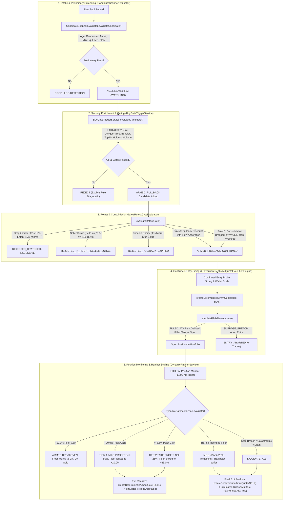

# NeXusTrade — Phase 12.94-D Milestone D.3.3: Source-Accurate PAPER Implementation Handoff

**Document ID**: `NXT-D3.3-PAPER-READINESS-ASSESSMENT-V4`  
**Location**: `docs/research-planning/phase-12.94d-milestone-d3-3-paper-readiness-assessment.md`  
**Related Closure Report**: [`audit/PHASE_12_94D_MILESTONE_D3_3_QUOTE_PILOT_003_CLOSURE_REPORT.md`](file:///u:/Projects/TopG/audit/PHASE_12_94D_MILESTONE_D3_3_QUOTE_PILOT_003_CLOSURE_REPORT.md)  
**Status**: **READ-ONLY ARCHITECTURAL SPECIFICATION & OFFLINE IMPLEMENTATION HANDOFF**  
**Execution Authority**: **THE OPERATOR PERSONALLY RUNS ALL LIVE MARKET-DATA, PAPER, SIMULATION SESSIONS, AND LONG TESTS. ZERO LIVE NETWORK CALLS OR TRADES ARE AUTHORIZED IN THIS ASSESSMENT.**

---

## 1. Actual Existing Strategy Lifecycle, Configurations & Call Sites

The production strategy implemented across [`backend/src/candidate-scanner/`](file:///u:/Projects/TopG/backend/src/candidate-scanner), [`backend/src/exits/`](file:///u:/Projects/TopG/backend/src/exits), and [`backend/src/scripts/paper-trading-daemon.ts`](file:///u:/Projects/TopG/backend/src/scripts/paper-trading-daemon.ts) does **not** execute an immediate market buy at admission followed by a fixed $+300\text{s}$ exit.

It operates as a multi-stage, state-machine driven engine with distinct market-timing confirmations, cohort-specific ratchets, multi-tier partial scaling, and moonbag lifecycle management.



### 1.1 Strategy Timing Parameters, Cohort Thresholds & Confirmed-Entry Sizing

All parameters are bound directly to active source code constants:

| Strategy Dimension                   | Micro-Cap Cohort                                                                                                                                                               | Established Cohort                                                                                                                                                               | Authoritative Call Site                                                                                                                                                                                                                       |
| :----------------------------------- | :----------------------------------------------------------------------------------------------------------------------------------------------------------------------------- | :------------------------------------------------------------------------------------------------------------------------------------------------------------------------------- | :-------------------------------------------------------------------------------------------------------------------------------------------------------------------------------------------------------------------------------------------- |
| **Cohort Definition Criteria**       | Default cohort for pools $< \$50\text{k}$ liq or age $< 1,800\text{s}$                                                                                                         | Liquidity $\ge \$50\text{k}$, live liq $\ge \$50\text{k}$, age $1,800\text{s}–7,200\text{s}$, holders $\ge 250$ (or viral runner)                                                | [`paper-trading-daemon.ts:1854-1869`](file:///u:/Projects/TopG/backend/src/scripts/paper-trading-daemon.ts#L1854-L1869)                                                                                                                       |
| **Retest Expiry Window**             | **90 seconds** (`90_000 ms`)                                                                                                                                                   | **120 seconds** (`120_000 ms`)                                                                                                                                                   | [`paper-trading-daemon.ts:1916`](file:///u:/Projects/TopG/backend/src/scripts/paper-trading-daemon.ts#L1916), [`RetestGateEvaluator.ts`](file:///u:/Projects/TopG/backend/src/candidate-scanner/RetestGateEvaluator.ts)                       |
| **Rule A: Retest Pullback Discount** | $10\%\text{ to }15\%$ discount from peak (`0.85 <= spot/peak <= 0.90`) with flow absorption (`buys60s >= 1.25 * sells60s`)                                                     | $4\%\text{ to }10\%$ discount from peak (`0.90 <= spot/peak <= 0.96`) with flow absorption (`buys60s >= 1.15 * sells60s`)                                                        | [`RetestGateEvaluator.ts`](file:///u:/Projects/TopG/backend/src/candidate-scanner/RetestGateEvaluator.ts)                                                                                                                                     |
| **Rule B: Consolidation Breakout**   | Max price drop **5%** from peak (`maxConsolidationDropPct = 0.05`), flow ratio $\ge 1.5\times$ (`minConsolidationFlowRatio = 1.5`), duration $\ge 30\text{s}$ or $\ge 3$ ticks | Max price drop **4%** from peak (`maxConsolidationDropPct = 0.04`), flow ratio $\ge 1.25\times$ (`minConsolidationFlowRatio = 1.25`), duration $\ge 30\text{s}$ or $\ge 3$ ticks | [`RetestGateEvaluator.ts`](file:///u:/Projects/TopG/backend/src/candidate-scanner/RetestGateEvaluator.ts)                                                                                                                                     |
| **Rule C: Crater Drop Ceiling**      | Drop $> 15\%$ from peak (`maxCraterDropPct = 0.15`)                                                                                                                            | Drop $> 12\%$ if absorbing ($\ge 1.15\times$), $> 8\%$ if unabsorbed (`0.12 : 0.08`)                                                                                             | [`RetestGateEvaluator.ts`](file:///u:/Projects/TopG/backend/src/candidate-scanner/RetestGateEvaluator.ts)                                                                                                                                     |
| **Rule E: In-Flight Seller Surge**   | $\text{sells60s} \ge 25$ and $\text{sells60s} \ge 2.5 \times \text{buys60s}$                                                                                                   | $\text{sells60s} \ge 25$ and $\text{sells60s} \ge 2.5 \times \text{buys60s}$                                                                                                     | [`RetestGateEvaluator.ts`](file:///u:/Projects/TopG/backend/src/candidate-scanner/RetestGateEvaluator.ts)                                                                                                                                     |
| **Milestone 0: Breakeven Arming**    | $+10.0\%$ peak gain (`armedBreakevenThresholdBps: 1000`), locks floor to $+0.0\%$, **0% sold**                                                                                 | $+10.0\%$ peak gain (`armedBreakevenThresholdBps: 1000`), locks floor to $+0.0\%$, **0% sold**                                                                                   | [`DynamicRatchetTypes.ts:129-130, 146-147`](file:///u:/Projects/TopG/backend/src/exits/DynamicRatchetTypes.ts#L129-L147), [`DynamicRatchetService.ts:108-112`](file:///u:/Projects/TopG/backend/src/exits/DynamicRatchetService.ts#L108-L112) |
| **Milestone 1: Tier 1 Take-Profit**  | $+20.0\%$ peak gain (`tier1PeakThresholdBps: 2000`), sells **50% of position**, locks floor to $+10.0\%$ (`tier1LockedFloorBps: 1000`)                                         | $+20.0\%$ peak gain (`tier1PeakThresholdBps: 2000`), sells **50% of position**, locks floor to $+10.0\%$ (`tier1LockedFloorBps: 1000`)                                           | [`DynamicRatchetTypes.ts:131-132, 148-149`](file:///u:/Projects/TopG/backend/src/exits/DynamicRatchetTypes.ts#L131-L149), [`DynamicRatchetService.ts:114-152`](file:///u:/Projects/TopG/backend/src/exits/DynamicRatchetService.ts#L114-L152) |
| **Milestone 2: Tier 2 Take-Profit**  | $+48.5\%$ peak gain (`tier2PeakThresholdBps: 4850`), sells **25% of position** (cumulative 75% sold), locks floor to $+35.0\%$ (`tier2LockedFloorBps: 3500`)                   | $+48.5\%$ peak gain (`tier2PeakThresholdBps: 4850`), sells **25% of position** (cumulative 75% sold), locks floor to $+35.0\%$ (`tier2LockedFloorBps: 3500`)                     | [`DynamicRatchetTypes.ts:133-134, 150-151`](file:///u:/Projects/TopG/backend/src/exits/DynamicRatchetTypes.ts#L133-L151), [`DynamicRatchetService.ts:154-201`](file:///u:/Projects/TopG/backend/src/exits/DynamicRatchetService.ts#L154-L201) |
| **Moonbag Lifecycle**                | Remaining **25% of position** held under trailing moonbag ratchet (`nextPeakGainBps - trailBufferBps`, floor $\ge +35.0\%$, catastrophic floor $-2.0\%$)                       | Remaining **25% of position** held under trailing moonbag ratchet (`nextPeakGainBps - trailBufferBps`, floor $\ge +35.0\%$, catastrophic floor $-2.0\%$)                         | [`DynamicRatchetService.ts:203-216`](file:///u:/Projects/TopG/backend/src/exits/DynamicRatchetService.ts#L203-L216)                                                                                                                           |
| **Pre-Breakeven Stop**               | $-12.0\%$ (`preBreakevenStopBps: -1200`)                                                                                                                                       | $-10.0\%$ (`preBreakevenStopBps: -1000`)                                                                                                                                         | [`DynamicRatchetTypes.ts:122, 139`](file:///u:/Projects/TopG/backend/src/exits/DynamicRatchetTypes.ts#L122-L139)                                                                                                                              |
| **Catastrophic Disaster Floor**      | $-20.0\%$ (`catastrophicFloorBps: -2000`)                                                                                                                                      | $-18.0\%$ (`catastrophicFloorBps: -1800`)                                                                                                                                        | [`DynamicRatchetTypes.ts:121, 138`](file:///u:/Projects/TopG/backend/src/exits/DynamicRatchetTypes.ts#L121-L138)                                                                                                                              |
| **Position Monitor Loop Ticker**     | `pollIntervalMs = 1500 ms`                                                                                                                                                     | `pollIntervalMs = 1500 ms`                                                                                                                                                       | [`paper-trading-daemon.ts:575, 1238, 1514`](file:///u:/Projects/TopG/backend/src/scripts/paper-trading-daemon.ts#L575)                                                                                                                        |
| **Discovery / Scanning Loop**        | `scanIntervalMs = 5000 ms`                                                                                                                                                     | `scanIntervalMs = 5000 ms`                                                                                                                                                       | [`paper-trading-daemon.ts:956, 1529`](file:///u:/Projects/TopG/backend/src/scripts/paper-trading-daemon.ts#L956)                                                                                                                              |

#### Actual Confirmed-Entry Sizing Path

Position sizing upon confirmed retest does **not** rely on a naive startup formula. It executes the calibrated probe sizing and risk-adjustment logic from [`paper-trading-daemon.ts:2088-2128`](file:///u:/Projects/TopG/backend/src/scripts/paper-trading-daemon.ts#L2088-L2128):

1. **Wallet Scale Factor**:
   $$\text{walletScale} = \min\left(1.25, \max\left(1.0, \frac{\text{currentCash}}{10.0}\right)\right)$$
2. **Calibrated Base Probe Size by Cohort**:
   - Established Base: $\min(0.65, \text{round}_{2}(0.50 \times \text{walletScale}))$
   - Micro-Cap Base: $\min(0.45, \text{round}_{2}(0.35 \times \text{walletScale}))$
3. **Risk Downsizing (Established Cohort)**:
   If `bundlerPct > 0.60` or `top10HolderPct > 0.30`, downsize `targetCohortSize` to $\min(0.35, \text{targetCohortSize})$.
4. **Portfolio Capital Ceiling & Gas Reserve**:
   $$\text{dynamicSize} = \max\left(0.10, \min\left(\text{targetCohortSize}, \frac{\text{currentPortfolioSol} - 0.05}{\text{maxOpenPositions}}\right)\right)$$

### 1.2 Implemented Retest Evaluator Extraction (`RetestGateEvaluator.ts`)

The retest evaluation logic previously embedded in [`backend/src/scripts/paper-trading-daemon.ts:1870-2052`](file:///u:/Projects/TopG/backend/src/scripts/paper-trading-daemon.ts#L1870-L2052) has been cleanly extracted into [`backend/src/candidate-scanner/RetestGateEvaluator.ts`](file:///u:/Projects/TopG/backend/src/candidate-scanner/RetestGateEvaluator.ts).

The pure function `evaluateRetestGate()` computes the decision without side effects:

- Evaluates first-tick arming, peak price updates, and tick counting.
- Enforces strict evaluation order: Rule C (crater drop) $\rightarrow$ Rule E (seller surge) $\rightarrow$ Rule D (timeout expiry) $\rightarrow$ Rule A (pullback discount) $\rightarrow$ Rule B (consolidation breakout).
- Preserves precedence: Rule A confirms with `RETEST_PULLBACK_DISCOUNT` over Rule B.
- Side effects (map updates, logging, telemetry via `recordTriggerRejection`, and watchlist state updates) remain in the caller.

---

## 2. Evidence-Source Decision, SPL Token Burn Accounting & Security Gaps

### 2.1 Option A (Historical Fixtures): UNAVAILABLE for Live PAPER Evaluation

Option A is **explicitly marked UNAVAILABLE for live-data PAPER evaluation**:

- The authentic historical captures (such as the C3 Raydium AMM v4 pool genesis initialization records from August 2024) prove static on-chain account parameters (pool ID, AMM authority, vault accounts, mints, decimals).
- However, historical captures contain zero live data: no current reserves, no live spot price, no current 60s flow, no current holder distribution, and no ongoing LP lock/burn verification.
- Conflating historical genesis initialization with live market conditions violates provenance. Authentic historical fixtures support separately labeled offline regression replay, and **cannot substitute for live data in a forward evaluation**.

### 2.2 LP Security & Protocol Accounting (Raydium AMM v4 Contract PROPOSED / UNAPPROVED)

The strategy's Stage 1 screening gate `ANTI_RUG_LP_SECURITY` requires $\text{lpBurnPct} \ge 90.0\%$.

#### Explicit Withdrawal of Unsupported LP Reduction Formula

The previously proposed formula:
$$\frac{L_{\text{initial}} - L_{\text{circulating}}}{L_{\text{initial}}} \times 100\%$$
is **formally withdrawn as unsound**.

In the official Raydium AMM v4 withdrawal implementation (`withdraw` instruction), liquidity redemptions burn LP tokens while returning the underlying base and quote token reserves from the pool vaults to the withdrawing liquidity providers. A formula that equates every reduction in LP tokens with burned or locked liquidity conflates routine withdrawal with true liquidity destruction.

#### Proposed Acquisition & Calculation Contract (Status: PROPOSED / UNAPPROVED)

The corrected acquisition contract has been formulated in [`phase-12.94d-milestone-d3-3-lp-security-acquisition-contract.md`](file:///u:/Projects/TopG/docs/research-planning/phase-12.94d-milestone-d3-3-lp-security-acquisition-contract.md), strictly narrowed to legacy Raydium AMM v4:

1. **Protocol-Tracked Denominator**: Raydium AMM v4 tracks `amm.lp_amount` directly in the 752-byte pool account at byte offset **720..728** (`lpReserve`). In official program source (`program/src/processor.rs`), `amm.lp_amount` ($L_{\text{protocol}}$) is the actual mathematical denominator used during liquidity withdrawals, rather than SPL mint supply.
2. **Distinct Lifecycle Mechanics**:
   - **Genesis Initialization**: Initial calculated liquidity is set in $L_{\text{protocol}}$, but an unminted minimum ($L_{\text{unminted}} = 10^6$ units) is withheld from minting. $L_{\text{protocol}} - S_{\text{current}} = L_{\text{unminted}}$ (fails 90% gate as expected).
   - **Normal Withdrawal**: Both $L_{\text{protocol}}$ and $S_{\text{current}}$ decrement by the redeemed amount. The difference $L_{\text{protocol}} - S_{\text{current}}$ remains constant; normal redemption does NOT generate protected liquidity.
   - **Direct SPL Burn**: Decrements $S_{\text{current}}$ while $L_{\text{protocol}}$ and vault reserves remain fixed. Because the AMM `withdraw` instruction divides by $L_{\text{protocol}}$, the remaining circulating supply can only redeem $\frac{S_{\text{current}}}{L_{\text{protocol}}}$ of vault reserves; the remaining fraction is permanently trapped.
3. **Smallest Defensible Calculation**:
   $$\text{lpBurnPct} = \frac{L_{\text{protocol}} - S_{\text{current}}}{L_{\text{protocol}}} \times 100\%$$
   where $L_{\text{protocol}} = \text{lpReserve}$ (offset 720..728) and $S_{\text{current}} = \text{lpMint.supply}$.
4. **Deferred Scope**: CPMM, Token-2022, third-party locker accounts, and unverified provider schemas are explicitly deferred.
5. **Approval Status**: **PROPOSED / UNAPPROVED**. No calculator is implemented and no parser is modified until formal auditor review. Candidates lacking verified evidence fail closed at Stage 1.

### 2.3 Corrected Security Score, Holder Integrity & Complete Concentration Validation

The implementation in [`BuyGateTriggerService.ts`](file:///u:/Projects/TopG/backend/src/candidate-scanner/BuyGateTriggerService.ts) has been fully hardened across parser and evaluation paths:

1. **Removed Favorable Fallback & Enforced Explicit Non-Negative Score**: The silent `score ?? 0` default has been removed. An explicitly supplied, finite, non-negative number (`score >= 0`) is strictly required. Genuine observed zero scores are preserved.
2. **Complete Malformed-Risk Validation**:
   - `data.risks` must be an Array (`!Array.isArray(data.risks) -> return null;`).
   - Every risk entry is validated against the supported schema (`level: "danger" | "warn" | "info"`).
   - Null entries, primitives (e.g. `["danger"]`), missing severity fields (e.g. `[{}]`), incorrectly typed severity (e.g. `{ level: 123 }`), empty strings (`{ level: "" }`), and unsupported severity values (e.g. `{ level: "critical" }`) fail closed (`return null;`).
   - Genuine empty risk arrays (`[]`) and supported non-danger risks (`warn`, `info`) are preserved (`hasDangerRisk: false`).
   - Valid danger risks (`danger`) correctly set `hasDangerRisk: true`.
3. **Safe Non-Negative Integer Holder Count Integrity**:
   - `totalHolders` must be a non-negative safe integer (`Number.isSafeInteger(h) && h >= 0`).
   - Fractional counts (e.g. `300.5`), negative values, and non-numeric representations fail closed (`holdersCount: undefined`).
   - Genuine observed zero holders (`holdersCount: 0`) is preserved.
4. **Strict Concentration Input Validation & Normalized Ranges**:
   - `topHolders`: Each inspected entry in the top-10 slice must be a non-null object with a valid, finite raw percentage in $[0, 100]$.
   - Malformed entries (such as `{}` or `{ pct: -10 }` or `{ pct: 150 }`) fail closed to `top10HolderPct: undefined`; malformed inputs never manufacture a false 0 concentration or negative value.
   - Genuine observed zero concentration (`pct: 0`) is preserved.
   - Normalized range is strictly enforced as $0.0 \le \text{top10HolderPct} \le 1.0$.
5. **Removal of Unsupported Provider Mappings for Bundler Concentration**:
   - The official RugCheck schema does not define a root `bundlerPct` field or establish an authoritative label-to-concentration mapping for free-text risk descriptions (e.g. `"Bundler transaction failure rate"` represents an operational failure rate, not ownership concentration).
   - Free-text label matching, string prefix parsing (`parseFloat`), and magnitude guessing are strictly removed.
   - Bundler concentration is not extracted from RugCheck reports and remains strictly unavailable (`bundlerPct: undefined`).
   - Final security qualification (`requireVerifiedHolders: true`) strictly fails closed with `BUNDLER_CONCENTRATION_UNKNOWN`.
   - Synthetic evaluator controls for Gate 11 logic remain separate from claims about verified provider responses.
6. **Fail-Closed Final Security Qualification (`requireVerifiedHolders: true`)**:
   - Requires valid evidence for all five required security metrics: `rugScore`, `hasDangerRisk`, `holdersCount`, `top10HolderPct`, and `bundlerPct`.
   - Missing or invalid metrics fail closed with explicit rejection reasons:
     - `holdersCount === undefined` or invalid: `REJECTED_RUGCHECK_UNINDEXED_OR_HOLDERS_UNKNOWN`.
     - `rugScore` or `hasDangerRisk` missing or invalid: `REJECTED_RUGCHECK_UNINDEXED_OR_HOLDERS_UNKNOWN`.
     - `top10HolderPct === undefined` or out of range: `TOP_10_CONCENTRATION_UNKNOWN`.
     - `bundlerPct === undefined` or out of range: `BUNDLER_CONCENTRATION_UNKNOWN`.
   - Threshold violations reject with their established codes: `INSUFFICIENT_HOLDERS_COUNT_FAILED`, `TOP_10_CONCENTRATION_FAILED`, `BUNDLER_CONCENTRATION_GATE_FAILED`.
   - Preliminary in-memory screening (`requireVerifiedHolders: false/undefined`) remains distinct, allowing un-enriched candidates to queue for observation without premature rejection.

---

## 3. Correct Execution Attachment & Realism Accounting

The evaluation binds directly to the real exported functions in [`QuoteExecutionEngine.ts`](file:///u:/Projects/TopG/backend/src/execution/QuoteExecutionEngine.ts) and [`ExecutionFeeModel.ts`](file:///u:/Projects/TopG/backend/src/execution/ExecutionFeeModel.ts).

### 3.1 Verified Mint Decimals (No Hardcoded 9)

Token decimals are dynamic:

- Canonical WSOL has 9 decimals (`WSOL_DECIMALS = 9`).
- RAY has 6 decimals (`RAY_DECIMALS = 6`).
- Pump tokens typically have 6 decimals; SPL tokens range from 0 to 18.
- `createDeterministicAmmQuote()` enforces `validateMintDecimals(params.tokenDecimals)`.
- Token decimals must be obtained from verified mint account data or candidate contracts.

### 3.2 Causally Sound Execution Mapping (Lookahead Guard Compliant)

According to [`QuoteExecutionEngine.ts:303`](file:///u:/Projects/TopG/backend/src/execution/QuoteExecutionEngine.ts#L303):

```typescript
if (quote.quoteInitiatedMs < decisionTimestampMs) {
  return { valid: false, reason: `[LOOKAHEAD_VIOLATION] ...` };
}
```

The market decision event occurs **at or before** quote initiation:
$$\text{decisionTimestampMs} \le \text{quoteInitiatedMs} < \text{quoteReceivedMs} < \text{fillTimestampMs} \le \text{validUntilMs}$$

```typescript
// 1. Decision occurs at currentNowMs
const decisionTimestampMs = currentNowMs;
const decisionSlot = currentSlot;

// 2. Entry Quote initiated at or after decision
const entryQuote = createDeterministicAmmQuote({
  sessionId: sessionContext.sessionId,
  generationId: sessionContext.generationId,
  decisionEventId: `dec-buy-${candidate.mintAddress}-${decisionTimestampMs}`,
  mintAddress: candidate.mintAddress,
  poolId: candidate.poolId,
  side: "BUY",
  tradeSizeSolOrTokens: dynamicSize, // Calibrated probe size
  baseReserveTokens: verifiedBaseReserveTokens,
  quoteReserveSol: verifiedQuoteReserveSol,
  tokenDecimals: verifiedTokenDecimals, // e.g. 6 for RAY
  quoteInitiatedMs: decisionTimestampMs, // Quote initiated at decision time
  contextSlot: decisionSlot,
  quoteLatencyMs: 25,
  ttlMs: 15_000,
  dexFeeRate: 0.0025,
  maxSlippageBps: 25,
});

// 3. Entry Fill Simulation (BUY)
const entryFill = simulateFill(entryQuote, {
  decisionTimestampMs, // decisionTimestampMs <= quoteInitiatedMs (Lookahead guard passed!)
  decisionSlot, // decisionSlot <= contextSlot (Slot freshness passed!)
  executionDelayMs: 150, // fillTimestampMs = quoteReceivedMs + 150ms
  isNewAta: true, // Debits 2,039,280 lamports ATA rent deposit
  arrivalSlippageBps: 5,
  sellabilityStatus: "FULLY_SELLABLE",
  computeUnits: 100_000,
  priorityFeeMicroLamports: 10_000,
});
```

### 3.3 State-Accurate ATA Accounting and Inventory Preservation

1. **ATA Creation & Funding**:
   - On BUY, `isNewAta: true` causes [`ExecutionFeeModel.calculateEntryFees()`](file:///u:/Projects/TopG/backend/src/execution/ExecutionFeeModel.ts#L61) to debit the mandatory Solana rent-exempt balance of **2,039,280 lamports** (0.00203928 SOL).
   - The position state records `hasFundedAta = true`.
2. **Partial Exits (Tier 1 50% & Tier 2 25%)**:
   - `closeAta` MUST BE `false`.
   - The token account remains open on-chain to hold remaining inventory.
   - `ataRentRefundLamports` is **0**. No rent refund is credited.
3. **Final Full Exit (Remaining Moonbag Liquidation)**:
   - `closeAta` is `true` and `hasFundedAta` is `true`.
   - `ataRentRefundLamports` of **2,039,280 lamports** is credited back to gross proceeds to yield net realized SOL.
4. **Preservation of Inventory on Failed Sell**:
   - If an exit fill fails due to `UNSELLABLE_NO_ROUTE`, `PREFLIGHT_SIMULATION_REJECTED`, or `SLIPPAGE_BREACH_REJECTED`, [`simulateFill()`](file:///u:/Projects/TopG/backend/src/execution/QuoteExecutionEngine.ts#L821) sets `remainingTokens = attemptedTokens`.
   - Unsold inventory remains preserved in the virtual wallet with conservative write-down. Tokens are never assumed sold or discarded.

### 3.4 Strict Distinction: Observed Inputs vs Modeled Execution Parameters

| Field / Parameter                       |    Classification     | Provenance & Handling                                                    |
| :-------------------------------------- | :-------------------: | :----------------------------------------------------------------------- |
| `mintAddress`                           |  **Observed Input**   | Cryptographically verified base58 Solana public key.                     |
| `poolAddress` (`ammKey`)                |  **Observed Input**   | Verified Raydium AMM v4 pool address.                                    |
| `tokenDecimals`                         |  **Observed Input**   | Mint account definition (e.g. 6 for RAY, 9 for WSOL).                    |
| `indicativePriceSol` (`priceNative`)    |  **Observed Input**   | Preserved from provider HTTP response against canonical WSOL.            |
| `contextSlot`                           |  **Observed Input**   | On-chain slot counter for freshness verification.                        |
| `baseReserveTokens` / `quoteReserveSol` |  **Observed Input**   | Verified atomic reserve balances when available.                         |
| `quoteLatencyMs`                        | **Modeled Parameter** | Modeled quote retrieval delay (default 25 ms).                           |
| `executionDelayMs`                      | **Modeled Parameter** | Modeled network transit and block inclusion latency (default 150 ms).    |
| `networkFeeLamports`                    | **Modeled Parameter** | Standard Solana transaction base fee (5,000 lamports = 0.000005 SOL).    |
| `priorityFeeLamports`                   | **Modeled Parameter** | Modeled priority compute fee (1,000 lamports).                           |
| `ataRentDepositLamports`                | **Modeled Parameter** | Solana protocol rent-exemption fee (2,039,280 lamports).                 |
| `arrivalSlippageBps`                    | **Modeled Parameter** | Modeled arrival execution slippage against constant-product curve.       |
| `sellabilityStatus`                     | **Modeled Parameter** | Preflight simulation status ("FULLY_SELLABLE" vs transfer restrictions). |

---

## 4. Feasible Request Budget & Pacing-Aware Scheduling

### 4.1 Internal Pacing Policy vs External Provider Limits

- **Configured Pacing Policy**: The project's [`GlobalResourceBudgetManager`](file:///u:/Projects/TopG/backend/src/research/prospective/GlobalResourceBudgetManager.ts) configures a minimum interval of **$\ge 2,500\text{ ms}$** between consecutive outbound HTTP requests to the same host. This is an internal, defensive rate-management invariant designed to prevent provider bans and burst congestion.
- **External Provider Ceilings**: Independently documented public provider limits (e.g. DexScreener's public documentation specifies 300 requests/minute = 5 req/s) are provider-side limits, not internal policies.

### 4.2 Observation Semantics of Cached Spot Quotes

- The position monitor loop runs at `pollIntervalMs = 1500 ms` (1.5s).
- Direct outbound HTTP requests on every 1.5s tick would violate the $\ge 2,500\text{ ms}$ pacing policy.
- Reusing a cached spot quote across 1,500 ms ticks allows the state machine to evaluate timeouts, duration thresholds, and ratchet logic without outbound network activity.
- **Crucial Clarification**: A cached quote reused across ticks is **not** a new market observation. Caching does **not** provide observation-frequency parity with true live market observations.

### 4.3 Mathematical Request Budget Derivation

| Lifecycle Phase             |          Active Duration          | Polling Cadence | Outbound HTTP Requests | Derivation Rationale                                                                       |
| :-------------------------- | :-------------------------------: | :-------------: | :--------------------: | :----------------------------------------------------------------------------------------- |
| **1. Intake & Discovery**   |         Instant ($t = 0$)         |  Single lookup  |     **1 request**      | Direct seeded pool query (`pairs/solana/{pool}`).                                          |
| **2. Security Enrichment**  |          $t = 3\text{s}$          |  Single lookup  |     **1 request**      | Metered RugCheck report lookup (if active).                                                |
| **3. Retest & Arming**      | Up to 120s (Estab) or 90s (Micro) |    Every 10s    |  **3 to 12 requests**  | Early 30s confirm: 3 requests; Full 120s retest: $120\text{s} / 10\text{s} = 12$ requests. |
| **4. Position Monitoring**  |  5-minute holding period (300s)   |    Every 15s    |    **20 requests**     | $300\text{s} / 15\text{s} = 20$ requests (respects $\ge 2,500\text{ ms}$ pacing).          |
| **5. Exit Execution Quote** |           Exit trigger            |  Single lookup  |     **1 request**      | Fresh quote upon ratchet breach or session cashout.                                        |
| **6. Fail-Safe Buffer**     |           Finalization            |    On demand    |     **4 requests**     | Reserved capacity for clean session closure.                                               |

#### Concrete Budget Outcomes by Scenario

1. **Scenario 1: Screening Rejection or Unconfirmed Retest Expiry (No Trades)**:
   - Budget: $1 \text{ (intake)} + 1 \text{ (security)} + 12 \text{ (full retest)} + 4 \text{ (buffer)} =$ **18 requests max**.
2. **Scenario 2: Early Confirmation (30s) + 5-Minute Position Hold**:
   - Budget: $1 \text{ (intake)} + 1 \text{ (security)} + 3 \text{ (early retest)} + 20 \text{ (position monitor)} + 1 \text{ (exit)} + 4 \text{ (buffer)} =$ **30 requests max**.
3. **Scenario 3: Full Retest (120s) + 5-Minute Position Hold**:
   - Budget: $1 \text{ (intake)} + 1 \text{ (security)} + 12 \text{ (full retest)} + 20 \text{ (position monitor)} + 1 \text{ (exit)} + 4 \text{ (buffer)} =$ **39 requests max**.

---

## 5. Remaining Acquisition Dependencies

LP burn is no longer an unverified hypothesis; it has been acquired and validated on-chain via the operator snapshot. The updated status of all acquisition dependencies is summarized below:

| Dimension                                   | Required Evidence / Threshold                                                                                                                                                                                            | Existing Preserved Evidence                                                                                                                                                                                                                                                   | Status & Remaining Path                                                                                                                                                                                                                                                                                                                                                                                                                                                                                                                                 |
| :------------------------------------------ | :----------------------------------------------------------------------------------------------------------------------------------------------------------------------------------------------------------------------- | :---------------------------------------------------------------------------------------------------------------------------------------------------------------------------------------------------------------------------------------------------------------------------- | :------------------------------------------------------------------------------------------------------------------------------------------------------------------------------------------------------------------------------------------------------------------------------------------------------------------------------------------------------------------------------------------------------------------------------------------------------------------------------------------------------------------------------------------------------ |
| **LP Security (`lpBurnPct`)**               | $\ge 90.0\%$ LP burn derived from on-chain accounts.                                                                                                                                                                     | **ACQUIRED & VALIDATED VIA BOUNDED CLIENT** (RAY/WSOL Reference Pair snapshot at `2026-10-27T06:35:11.779Z`, slot `461970878`).                                                                                                                                               | **ACQUISITION COMPLETED (Below Threshold)**: Verified $L = 362937054696$, $S = 362444613518$, $L - S = 492441178$, $0.135682\%$ inaccessible, 90% threshold: `false`. Sealed artifacts preserved at `data/research/snapshots/raydium-amm-v4-snapshot-AVs9TA4n-2026-10-27T06-35-11-779Z.json` and `-manifest.json`. Offline bridge implemented.                                                                                                                                                                                                          |
| **Verified Pool Reserves & Token Decimals** | Atomic base token reserve (`baseReserveTokens`), quote reserve (`quoteReserveSol`), and token decimals (`tokenDecimals`).                                                                                                | DexScreener indicative spot price (`priceNative`); canonical WSOL (9 decimals); RAY (6 decimals). Validated vault balances captured in batch snapshot (**INCOMPLETE for executable AMM reserve accounting**).                                                                 | **INCOMPLETE RESERVE ACCOUNTING**: Captured SPL token vault balances (`baseVault`, `quoteVault`) reflect raw token accounts but are strictly incomplete for executable AMM reserve accounting (omitting OpenOrders, unsettled PnL, protocol fees, and dynamic swap state). Full constant-product execution math requires verified total executable reserves, not raw vault balances alone.                                                                                                                                                              |
| **Security Metrics**                        | Risk score ($\le 700$), danger flags (`false`), verified holder count ($\ge 250$ established, $\ge 100$ micro non-negative safe integers), top 10 concentration ($\le 30\%$), bundler concentration ($\le 85\% / 50\%$). | RugCheck `/tokens/{mint}/report` response parser in `BuyGateTriggerService.ts` enforcing non-negative safe integer holders, strict top-10 concentration boundaries, and fail-closed concentration handling (`TOP_10_CONCENTRATION_UNKNOWN`, `BUNDLER_CONCENTRATION_UNKNOWN`). | **UNRESOLVED CONCENTRATION DEPENDENCY**: Standard RugCheck OpenAPI documentation does not define a root `bundlerPct` field or establish label-to-concentration mappings for risk descriptions (e.g. "Bundler transaction failure rate"). Unsupported extraction paths have been removed. Bundler concentration remains unavailable (`bundlerPct: undefined`) and fails closed with `BUNDLER_CONCENTRATION_UNKNOWN`, blocking live qualification until an authoritative provider with verified schema is integrated under `GlobalResourceBudgetManager`. |
| **Micro-Flow Observations**                 | 60-second rolling transaction counts (`recentBuys60s`, `recentSells60s`) to evaluate flow-absorption rules (1.15x / 1.25x / 1.5x) and anti-surge rules.                                                                  | DexScreener 5-minute transaction aggregates (`txns.m5.buys`, `txns.m5.sells`).                                                                                                                                                                                                | Sub-minute trade stream or websocket trade ingestion to derive authentic 60-second rolling buy/sell transaction counts.                                                                                                                                                                                                                                                                                                                                                                                                                                 |

---

## 6. Offline Implementation Status

The approved offline implementation items are completed:

1. **Retest Gate Evaluator Extraction**:
   - Implemented in [`backend/src/candidate-scanner/RetestGateEvaluator.ts`](file:///u:/Projects/TopG/backend/src/candidate-scanner/RetestGateEvaluator.ts).
   - Replaced inline decision block in [`backend/src/scripts/paper-trading-daemon.ts`](file:///u:/Projects/TopG/backend/src/scripts/paper-trading-daemon.ts).
   - 20 deterministic tests passing in [`backend/src/candidate-scanner/RetestGateEvaluator.test.ts`](file:///u:/Projects/TopG/backend/src/candidate-scanner/RetestGateEvaluator.test.ts).
2. **Missing Security Score, Holder Integrity & Concentration Input Hardening**:
   - Implemented in [`backend/src/candidate-scanner/BuyGateTriggerService.ts`](file:///u:/Projects/TopG/backend/src/candidate-scanner/BuyGateTriggerService.ts).
   - Validates explicit non-negative score, strict array type, supported risk severity (`danger`, `warn`, `info`), non-negative safe integer holder counts (rejecting fractional counts like `300.5`), and fail-closed handling for malformed risk entries and malformed holder concentration (`[{}]`, `[{ pct: -10 }]`, `[{ pct: 150 }]`).
   - Removed unsupported bundler extraction from RugCheck reports (rejecting risk label guessing, string prefix parsing, and undocumented root fields); leaves `bundlerPct: undefined` from provider responses.
   - Enforces fail-closed final security evaluation (`requireVerifiedHolders: true`) requiring valid evidence across all 5 required security metrics with explicit rejection codes (`REJECTED_RUGCHECK_UNINDEXED_OR_HOLDERS_UNKNOWN`, `TOP_10_CONCENTRATION_UNKNOWN`, `BUNDLER_CONCENTRATION_UNKNOWN`). Preliminary screening (`requireVerifiedHolders: false`) remains distinct.
   - 64 deterministic tests passing in [`backend/src/candidate-scanner/BuyGateTriggerService.test.ts`](file:///u:/Projects/TopG/backend/src/candidate-scanner/BuyGateTriggerService.test.ts).
3. **Offline LP-Screening Bridge & Regression Fixture**:
   - Implemented in [`backend/src/candidate-scanner/LpScreeningBridge.ts`](file:///u:/Projects/TopG/backend/src/candidate-scanner/LpScreeningBridge.ts).
   - Regression fixture in [`backend/src/candidate-scanner/fixtures/CapturedRaydiumAmmV4SnapshotFixture.ts`](file:///u:/Projects/TopG/backend/src/candidate-scanner/fixtures/CapturedRaydiumAmmV4SnapshotFixture.ts) wrapping authentic operator results with unabbreviated authentic raw response strings and verified SHA-256 digests.
   - Uses retained `rawResponseBody` as authoritative source for acquisition revalidation; cryptographically checks `storedResponseSha256` and enforces `wireResponseSha256` equality on unredacted payloads.
   - Rejects discrepancies between retained `parsedJson` caches and decoded stored responses (`deepEqual`).
   - Detects and rejects context-slot disagreements between wrapper/diagnostic metadata and decoded payload slots (`INVALID_EVIDENCE`).
   - Returns structured `INVALID_EVIDENCE` failures (`pool: null`, `lpFilterPassed: false`) for malformed raw payloads without throwing unhandled exceptions.
   - Enforces asynchronous evaluation (`evaluateLpScreeningBridge`) for acquisition evidence, preventing bypasses via `evaluateLpScreeningBridgeSync`.
   - Binds evidence and authoritative quantities directly to decoded account states (`poolState.lpReserve` and `lpMintState.supply`), deriving authoritative inaccessible claims via `calculateAmmV4LpInaccessibleClaims`.
   - Rejects any inconsistency between decoded account states, requested identities, validation accounting summaries, and acquisition wrappers.
   - Requires explicit freshness policy (`STALE_EVIDENCE`; historical captures cannot qualify candidate).
   - Classifies validated percentage as `DERIVED` from account observations (`metricProvenance.lpBurnPct = "DERIVED"`).
   - Evaluates pure integer cross-multiplication (`100n * (L - S) >= 90n * L`).
   - Fails closed on missing/invalid/mismatched/stale evidence with `pool: null` (no numeric 0 placeholders returned for unavailable projections).
   - Bridges to `ScannedPoolRecord` and seamlessly integrates with `AntiRugEvaluator.evaluate()` and `CandidateScannerFilterEvaluation`.
   - 34 deterministic unit tests passing in [`backend/src/candidate-scanner/LpScreeningBridge.test.ts`](file:///u:/Projects/TopG/backend/src/candidate-scanner/LpScreeningBridge.test.ts) (covering all auditor reproduction cases).
4. **Guarded Candidate Intake Integration (`CandidateStreamEngine.ts`)**:
   - Implemented in [`backend/src/candidate-scanner/CandidateStreamEngine.ts`](file:///u:/Projects/TopG/backend/src/candidate-scanner/CandidateStreamEngine.ts).
   - Connects the accepted `LpScreeningBridge` to candidate intake via an injected resolver (`lpEvidenceResolver?: LpEvidenceResolver`) and explicit freshness policy (`lpFreshnessPolicy?: LpFreshnessPolicy`).
   - Implemented explicitly enabled validated-LP mode (`requireValidatedLp?: boolean`). In validated mode, candidates must pass the accepted asynchronous bridge before LP-dependent admission can proceed. Arbitrary gate/bridge overrides removed.
   - Immutable candidate snapshot captured before the first await (`snapshotScannedPoolRecord`, `snapshotPolicy`), guaranteeing that caller mutation during resolution cannot alter the original screening outcome.
   - Strict canonical identity extraction (`resolveCanonicalIdentities`): strips provider display prefix `dexscreener-` only when suffix is a valid 32-byte Solana base58 public key, and rejects illegal token mint substitutions as pool addresses.
   - Missing resolver, missing evidence, stale evidence, identity mismatch, invalid evidence, or unsupported protocol strictly fail closed. Calling synchronous `evaluatePool()` in validated mode immediately fails closed with `UNAVAILABLE` (`REJECTED_UNLOCKED_LP_RISK`), ensuring callers cannot bypass asynchronous cryptographic checks.
   - Contained bridge evaluation failures at the intake boundary: malformed acquisition/validation results (such as missing diagnostics objects) produce structured `INVALID_EVIDENCE` rejections with zero admissions without aborting the scan loop or terminating subsequent candidates.
   - Preserves unavailable LP semantics in callbacks via nullable LP decision view (`lpBurnPct: null`, `metricProvenance.lpBurnPct: "UNAVAILABLE"`), while keeping raw provider percentages clearly separated as `rawProviderLpBurnPct` and preserving candidate identity.
   - Preserves `DERIVED` provenance and the real 0.135682% measurement for observed below-threshold results (`AVAILABLE_BELOW_THRESHOLD`).
   - Passing the LP filter (`AVAILABLE_QUALIFIED`) only permits existing remaining checks to continue (`PAIR_MATURITY_WINDOW`, `ANTI_RUG_MINT_AUTHORITY`, `ANTI_RUG_FREEZE_AUTHORITY`, `LIQUIDITY_MARKET_CAP`, `ORGANIC_FLOW`). Candidate admitted only if all remaining checks pass.
   - 25 comprehensive deterministic unit tests passing in [`backend/src/candidate-scanner/CandidateStreamEngine.test.ts`](file:///u:/Projects/TopG/backend/src/candidate-scanner/CandidateStreamEngine.test.ts).
5. **Guarded Candidate Watchlist LP Eligibility & Deactivation (`CandidateWatchlistService.ts`)**:
   - Implemented in [`backend/src/candidate-scanner/CandidateWatchlistService.ts`](file:///u:/Projects/TopG/backend/src/candidate-scanner/CandidateWatchlistService.ts) and [`shared/src/phase12-dashboard-schemas.ts`](file:///u:/Projects/TopG/shared/src/phase12-dashboard-schemas.ts).
   - Removed stale fallback assignment `lpBurnPct: pool.lpBurnPct ?? existing.lpBurnPct` which previously substituted historical passing percentages into updates where current evidence was unavailable.
   - Enforces current LP eligibility checks before both new admission and existing-entry updates/reactivations. Missing (`null`), invalid, or below-threshold current LP data explicitly deactivates existing entries (`status: "DROPPED"`, `rejectionReason: "REJECTED_UNLOCKED_LP_RISK"`).
   - Prevents resurrection of `DROPPED` candidates when current LP is missing (`null`) even in the presence of strong bullish volume/flow (`buys5m >= 25`, ratio $\ge 1.8$).
   - Explicitly records current LP measurement (`lpBurnPct: pool.lpBurnPct`) on deactivated and updated items, preserving previous passing values strictly in separate historical context (`historicalLpBurnPct`).
   - Added active-watchlist accessors `getActiveWatchlist()` and `getActiveCandidates()` (aliasing `getActiveWatchingItems()`) to ensure complete exclusion of deactivated or non-qualifying entries.
   - 13 comprehensive unit tests passing in [`backend/src/candidate-scanner/CandidateWatchlistService.test.ts`](file:///u:/Projects/TopG/backend/src/candidate-scanner/CandidateWatchlistService.test.ts).
6. **Metered Raydium AMM v4 LP Evidence Adapter (`RaydiumAmmV4LpEvidenceAdapter.ts`) & Audit Hardening**:
   - Implemented in [`backend/src/candidate-scanner/RaydiumAmmV4LpEvidenceAdapter.ts`](file:///u:/Projects/TopG/backend/src/candidate-scanner/RaydiumAmmV4LpEvidenceAdapter.ts).
   - Composes the bounded 2-request acquisition client (`acquireRaydiumAmmV4Snapshot`) to `CandidateStreamEngine`'s injected `CandidateLpEvidenceResolver` interface.
   - Binds each acquisition strictly to the canonical candidate pool address and token mint with zero reference-pool fallback or substitution.
   - Requires an explicitly supplied transport; rejects instantiation without transport to prohibit accidental live networking.
   - Meters every actual outbound HTTP dispatch through a shared `GlobalResourceBudgetManager`, enforcing global ceilings, purpose reservations (`CANDIDATE_ENRICHMENT`), and provider pacing ($\ge 2,500\text{ ms}$) across candidates.
   - **Respects Unsuccessful Acquisition Results**: Storage failures (e.g. `EVIDENCE_STORAGE_FAILED`) or acquisition errors fail closed at the adapter boundary while preserving diagnostics, preventing failed acquisition results from qualifying candidates. Successfully acquired below-threshold measurements ($0.135682\% < 90\%$) remain available as below-threshold evidence (`AVAILABLE_BELOW_THRESHOLD`).
   - **Unified Effective Deadline**: Enforces one unified deadline covering initial shared pacing, acquisition execution, and transport-wrapper pacing waits. Checks remaining budget and AbortSignal cancellation before sleeping, recording, or dispatching each request. Insufficient time or cancellation prevents dispatch and admission.
   - **Reconciled Dispatch Accounting & Explicit Execution State**: Replaced error-message heuristics (`msg.includes("BUDGET_DENIED")`) and loose error labels with an explicit trusted wrapper contract (`TransportDispatchTracker`). Dispatch status is determined by explicit execution state transitions at the moment underlying transport invocation begins. Once transport invocation commences, attempts remain counted across transport rejection, gateway errors, timeouts, and response body read failures. Genuine pre-dispatch budget denials and deadline expirations before transport invocation remain uncounted and separately identified (`PRE_DISPATCH_BUDGET_DENIED` vs `Network error`). Underlying transport calls, shared budget manager attempts, and acquisition evidence `httpAttempts` agree consistently before evidence hashing and manifest sealing.
   - **Response-Body Timeout Lifetime & Stalled Stream Fail-Closed Protection**: Keeps timeout protection active through both transport invocation and complete response-body reading (`response.text()`). Timer cancellation occurs strictly in an outer cleanup block wrapping both transport invocation and payload stream consumption. A timed-out response body read aborts promptly via the request's `AbortController`, classifies the failure as a dispatched request error with attempt counted in evidence and budget, and fails closed without advancing to Request 2 or qualifying the candidate.
   - **CI Test Suite Isolation & Canonical Fixture Hygiene**: Resolved git-ignore exclusions for authentic operator snapshots in `data/research/snapshots/` to guarantee deterministic offline replay in fresh CI checkouts. Hardened synthetic test fixtures in `RaydiumLiveDiscoveryClient.test.ts` and `PilotLiveCollector.test.ts` to generate strictly valid 32-byte canonical Solana base58 public keys, preserving schema adapter contracts.
   - Preserves truthful provenance (`SYNTHETIC_FIXTURE` vs `CAPTURED_RPC`) and explicit freshness policies.
   - 22 comprehensive unit tests passing in [`backend/src/candidate-scanner/RaydiumAmmV4LpEvidenceAdapter.test.ts`](file:///u:/Projects/TopG/backend/src/candidate-scanner/RaydiumAmmV4LpEvidenceAdapter.test.ts).
7. **Authentic Rolling 60-Second Trade Flow Tracker (`RollingTradeFlowTracker.ts`) & Retest Gate Hardening**:
   - Implemented in [`backend/src/candidate-scanner/RollingTradeFlowTracker.ts`](file:///u:/Projects/TopG/backend/src/candidate-scanner/RollingTradeFlowTracker.ts) and [`backend/src/candidate-scanner/RetestGateEvaluator.ts`](file:///u:/Projects/TopG/backend/src/candidate-scanner/RetestGateEvaluator.ts).
   - Replaced naive estimation (dividing 5-minute totals by 5) with an authentic event-driven rolling trade flow tracker.
   - **Complete Window Coverage & Separation of Trade Time vs Observation Timeline**: Rejects recent-heartbeat false passes. Requires continuous observation checkpoints; silence intervals $\ge 15\text{s}$ are recorded as collection gaps. Ingesting delayed trade events populates candidate counts, but explicitly _does not update the observation timeline_ or fabricate stream coverage. Only source-supported checkpoints/completed ranges establish window completeness. Both endpoints of completed ranges are strictly validated against the current clock and allowed skew before any state mutation; invalid or future-dated ranges are rejected without advancing coverage or inserting invalid gaps.
   - **Strict Capacity Bounds on Events, Deduplication, and Gap Metadata**: Enforces storage capacity limits during ingestion. Never silently drops active-window events; records capacity loss and keeps flow coverage unavailable (`CAPACITY_LOSS`) until the affected interval has fully expired beyond the lookback window. Gap metadata is strictly bounded during insertion: coalesces overlapping intervals and conservatively merges closest adjacent intervals to enforce `maxGapsRetained` without discarding missing-data information or restoring false coverage. Merged diagnostic text is strictly capped to a documented 256-character bound (`MAX_STREAM_GAP_REASON_CHARS`) using a bounded unique set of reason codes on insertion and across all merge paths.
   - **Immutable Snapshotting, Configuration & Temporal Validation**: Snapshots and freezes accepted events and gap records (`Object.freeze`). Derives and validates canonical swap coordinates (`${signature}:${outerInstructionIndex}:${swapIndex}`), preventing double-counting with altered event IDs. Constructor strictly validates all options (rejecting `NaN`, `Infinity`, non-integers, and out-of-bounds parameters for `maxGapsRetained`, `maxDeduplicationKeys`, `retentionWindowMs`, `maxFutureSkewMs`, etc.). Ingestion enforces temporal coherence: rejects future-dated receipts (`FUTURE_DATED_RECEIPT_TIMESTAMP`), contradictory block times vs event timestamps (`CONTRADICTORY_TIMESTAMPS`), and event timestamps in the future relative to receipt timestamps.
   - **Strict Lookback Configuration**: Strategy-facing counts are strictly tied to an exact 60,000 ms window; non-60,000 ms configurations and invalid evaluation timestamps (`NaN`, non-integers) fail closed with explicit errors.
   - **Retest Boundary Enforcement**: Typed `FlowCoverageStatus` (`SUFFICIENT`, `WARM_UP`, `COLLECTION_GAP`, `STALE_DATA`, `CAPACITY_LOSS`, `PROCESSING_BACKLOG`, `UNINITIALIZED`). Requires trustworthy sufficient coverage and finite, non-negative integer counts before flow can support confirmation. Unverified legacy inputs fail closed (`WAITING`), while preserving protective crater drop ceilings (8% unabsorbed, 12% absorbed, 15% micro-cap) and timeout expirations.
   - 40 comprehensive unit tests passing in [`backend/src/candidate-scanner/RollingTradeFlowTracker.test.ts`](file:///u:/Projects/TopG/backend/src/candidate-scanner/RollingTradeFlowTracker.test.ts).
   - 20 unit tests passing in [`backend/src/candidate-scanner/RetestGateEvaluator.test.ts`](file:///u:/Projects/TopG/backend/src/candidate-scanner/RetestGateEvaluator.test.ts).
8. **Offline Raydium AMM v4 Swap Decoder & Normalization Adapter (`RaydiumAmmV4SwapDecoder.ts`) & Audit Hardening**:
   - Implemented in [`backend/src/candidate-scanner/RaydiumAmmV4SwapDecoder.ts`](file:///u:/Projects/TopG/backend/src/candidate-scanner/RaydiumAmmV4SwapDecoder.ts).
   - **Immutable Pinned Source Reference & Tag/Layout Matrix**: Pinned strictly to immutable official commit `91739d8d9f5cf347e0ce14ebe4d2bb7069fb31b6` (`raydium-io/raydium-amm` `program/src/processor.rs`). Enforces a strict layout matrix matching instruction tags to verified account counts:
     - Legacy tags 9 (`SwapBaseIn`) & 11 (`SwapBaseOut`): Exactly 17 accounts (`LEGACY_17_ACCOUNTS`: `amm: 1, baseVault: 4, quoteVault: 5, userSource: 14, userDestination: 15, userOwner: 16`) or 18 accounts (`LEGACY_18_ACCOUNTS_TARGET_ORDERS`: conditionally consumes optional `target_orders` at index 4, shifting all subsequent positions +1: `baseVault: 5, quoteVault: 6, userSource: 15, userDestination: 16, userOwner: 17`). Rejects 8-account layout with `UNSUPPORTED_LAYOUT`.
     - Clean V2 tags 16 (`SwapBaseInV2`) & 17 (`SwapBaseOutV2`): Exactly 8 accounts (`V2_8_ACCOUNTS`: `amm: 1, baseVault: 3, quoteVault: 4, userSource: 5, userDestination: 6, userOwner: 7`). Rejects 17 or 18-account layouts with `UNSUPPORTED_LAYOUT`.
   - **Invocation-Scoped Evidence Attribution & Subtree Partitioning**:
     - Inner instructions are grouped strictly by parent outer instruction index (`innerGroupsByParent = new Map<number, DecodableInstruction[]>()`), adhering strictly to Solana RPC structures (`https://solana.com/docs/rpc/json-structures#inner-instructions`). Reversing group order while preserving `group.index` does not alter swap reporting order or swap-to-transfer attribution.
     - **Verified CPI Call-Tree Boundaries & Sibling Transfer Exclusion**: Inner CPI swaps under a router/aggregator isolate their invocation subtree using verified `stackHeight` (Solana CPI execution structure: `https://solana.com/docs/core/cpi/cpi-execution`) and log invocation depths/descendant counts (`resolveInvocationSubtree`), eliminating fragile "next Raydium instruction" heuristics. Later sibling instructions (such as a router transfer into the quote vault occurring after Raydium returns) are strictly excluded from the swap slice, preventing spurious `CONFLICTING_EVIDENCE` rejections. Discrepancies between `stackHeight` and logs fail closed with `CONFLICTING_EVIDENCE`; ambiguous or unresolvable call trees fail closed with `UNSUPPORTED_CALL_TREE`.
     - **Strict LIFO Call-Stack & Incomplete Trace Invalidation**: `parseInvocationFrames` enforces strict LIFO completion (`success` and `failed` logs must match the active stack top, preventing parent completions before child completions). Enforces depth invariants (depth $\ge 1$, empty stack starts at 1, nested invoke must be `top.depth + 1`). Any incomplete or inconsistent execution stack (depth 0, skipped depth transitions, or unclosed non-Raydium child frames at end of trace) invalidates all Raydium frames (`failed: true, success: false`), failing affected decodings closed with `INVOCATION_FAILED`.
     - Call-stack log ownership: `ray_log` events are attributed strictly to the currently executing program frame at the top of `activeStack`, not the nearest Raydium ancestor. Child program logs (e.g. child BUY log emitted inside Raydium SELL) are ignored and do not corrupt the Raydium frame.
     - Ambiguous trace rejection: multiple `ray_log`s in a single Raydium frame fail closed with `AMBIGUOUS_DIRECTION`. Unclosed frames at the end of logs fail closed with `INVOCATION_FAILED`.
     - Multi-way cross-validation: cross-checks applicable log type (tag 9/16 $\to$ logType 3, tag 11/17 $\to$ logType 4), direction (`PC2Coin` vs `Coin2PC`), exact in-amount, and exact out-amount across transfers, logs, and instruction parameters. Same-direction transfers reporting 200/180 vs log reporting 100/90 fails closed with `CONFLICTING_EVIDENCE`.
   - **Strict Input Validation & Non-Compacting Fail-Closed Semantics**:
     - `resolveTransactionAccounts`: null, undefined, non-string, or empty static/loaded account keys return `null` and fail closed with `MALFORMED_INSTRUCTION_DATA` without dropping, shifting, or compacting index positions (preventing synthetic BUY events from shifted keys).
     - Validates nested structures before processing: null instructions, null inner-instruction groups, null inner instructions, or non-string log messages return `MALFORMED_INSTRUCTION_DATA` without throwing exceptions and emit 0 events.
     - `decodeInstructionData`: validates byte arrays element-by-element (`Number.isInteger(b) && b >= 0 && b <= 255`). Rejects negative (e.g. `-240`), fractional, non-finite, or out-of-range values with `null` (never coerced to byte 16 `SwapBaseInV2`). Avoids heuristic base64 decoding on base58 failure.
     - `RaydiumAmmV4SwapNormalizationAdapter`: handles all malformed inputs cleanly without throwing exceptions.
   - **Proven Successful Execution**:
     - Requires explicit `meta` presence and explicit `meta.err === null`; missing or undefined `meta.err` fails closed with `TRANSACTION_NOT_SUCCESSFUL`.
     - Requires proven invocation success in execution logs (`Program 675k... success`); caught CPI errors fail closed with `INVOCATION_FAILED`. Inner CPI calls without log messages fail closed with `INVOCATION_FAILED`.
   - **Pool Boundary Validation & Context Freezing**:
     - `createTrackedRaydiumPoolContext`: `poolAddress` is mandatory and must be a canonical Solana Base58 key; rejects missing or invalid keys with zero fallback to vault accounts.
     - `validateTrackedPoolContext`: strictly validates mint consistency, vault differentiation, and orientation (`TOKEN_BASE_SOL_QUOTE`, `SOL_BASE_TOKEN_QUOTE`, `NON_SOL_PAIR`).
     - Adapter freezes context against caller mutation (`Object.freeze`).
     - Non-WSOL quote tokens leave `solAmount` undefined; non-WSOL quantities are never labeled as SOL.
   - **Malformed Payload & Temporal Integrity**:
     - Non-object or `null` payloads return structured `INVALID_PAYLOAD` without throwing.
     - Out-of-bounds instruction account indices fail closed with `MALFORMED_INSTRUCTION_DATA` without dropping or shifting positions.
     - Missing, non-finite, or non-positive `blockTime` fails closed with `MISSING_UPSTREAM_TIMESTAMP` without manufacturing time from receipt time.
   - **Fail-Closed Coverage Guarantee**: Normalization adapter bridges decoded events into `RollingTradeFlowTracker`; ingesting transactions strictly populates trade events and never fabricates stream checkpoints or advances window coverage.
   - 55 comprehensive unit tests passing in [`backend/src/candidate-scanner/RaydiumAmmV4SwapDecoder.test.ts`](file:///u:/Projects/TopG/backend/src/candidate-scanner/RaydiumAmmV4SwapDecoder.test.ts).
9. **Ubuntu CI Duplicate Decision ID Collision Resolution (`PilotLiveCollector.test.ts`)**:
   - In `makeCanonicalTestPubkey`, updated byte offset for writing test IDs from byte 0 to byte 2.
   - Eliminated identical 8-character Base58 prefixes (`3JEw2Z6V`) across distinct test mints (`pumpMint1` vs `pumpMint2`) that previously triggered duplicate decision event ID collisions (`evt-ds-${mint.slice(0, 8)}-${decisionEpochMs}`) and caused test timeouts on Ubuntu CI runners.
   - All 82 tests in [`backend/src/research/pilot/PilotLiveCollector.test.ts`](file:///u:/Projects/TopG/backend/src/research/pilot/PilotLiveCollector.test.ts) pass cleanly.
10. **Bounded Raydium AMM v4 Transaction Source Adapter (`RaydiumAmmV4TransactionSourceAdapter.ts`)**:
    - Implemented in [`backend/src/candidate-scanner/RaydiumAmmV4TransactionSourceAdapter.ts`](file:///u:/Projects/TopG/backend/src/candidate-scanner/RaydiumAmmV4TransactionSourceAdapter.ts).
    - **Independently Accepted at Commit `4fbe4be`**: All 42 unit and cancellation/deadline reproduction tests pass cleanly.
    - Connects injected transaction-signature notifications to bounded `getTransaction` retrieval, `RaydiumAmmV4SwapNormalizationAdapter` decoding, and `RollingTradeFlowTracker` ingestion strictly offline.
    - **Independent Audit Corrections (Findings 1 - 6 Resolved)**:
      1. _Immutable Identity Binding & Envelope Validation_:
         - Injected notifications are validated and deeply frozen on intake (`validateAndSnapshotNotification`), guaranteeing caller object mutation cannot alter fetched signatures.
         - Null, undefined, or non-object notifications fail closed with `INVALID_NOTIFICATION` without throwing.
         - Validates returned JSON-RPC transaction signature against requested signature (`RESPONSE_SIGNATURE_MISMATCH`).
         - Detects contradictory slot or blockTime metadata between notification and RPC response, failing closed with zero ingested events (`CONTRADICTORY_METADATA`).
      2. _Loss Preservation, Backlog Reporting & Partial Ingestion Accounting_:
         - Connects `TRANSACTION_NOT_FOUND` (`result: null`) directly to tracker collection gaps, invalidating false `SUFFICIENT` window coverage.
         - Buffers loss gaps occurring before tracker injection (`pendingGaps` buffer) and flushes them into the tracker on intake (`flushPendingGaps`).
         - Verifies that queue draining alone never erases recorded collection gaps.
         - Accurately classifies and reports partial ingestion failures (e.g. tracker capacity limits) with `PARTIAL_INGEST_FAILED`, `ok: false`, preserving actual ingested count and recording a collection gap.
      3. _Active Deduplication Protection & Workload Bounds_:
         - Partitions deduplication into `activeSignatures` (protected queued + in-flight set, immune to FIFO eviction) and `completedSignatures` (bounded FIFO historical cache up to `maxDeduplicationKeys`).
         - Enforces a unified active workload ceiling across direct and queued calls (`pendingQueue.length + inFlightCount < maxPendingQueueSize`), rejecting overflows fail-closed with `QUEUE_OVERFLOW`.
         - Preserves FIFO admission ordering across cancellation and enforces deadline expiry during admission wait.
      4. _Deadlines & Timeout Protection_:
         - Validates constructor and per-operation numeric options (rejecting `NaN`, non-integers, and ceiling violations).
         - Rechecks remaining deadline before dispatch AND immediately before tracker ingestion (post-body read).
         - Enforces `validateState` lifecycle and cancellation checks before dispatch and before tracker ingestion across both single-notification (`processNotification` / `processNextPending`) and batch (`processAllPending`) processing paths.
         - Aborts stalled response-body reads promptly via timeout controller (`REQUEST_TIMEOUT`, `httpAttempts: 1`).
      5. _Effective Pacing, Capacity Reservation & Transport Policy_:
         - Adapter enforces its own provider pacing ($\ge 2,500\text{ ms}$) regardless of budget manager spacing settings.
         - Routine trade retrieval defaults to purpose `CANDIDATE_ENRICHMENT`, strictly preserving reserved forward observation requests (`minReservedForwardRequests = 4`).
         - Sets `redirect: "error"` transport policy on fetch to prevent unmetered redirect loops.
      6. _Sanitized Diagnostics_:
         - Redacts endpoint API keys, secret URL paths, and query credentials to `[REDACTED]` across all diagnostics and error messages.
    - **Fail-Closed Coverage Guarantee**: Successful retrieval, an empty queue, or notification receipt alone NEVER establishes complete 60-second window coverage. Ingesting transactions strictly populates trade events and never fabricates stream checkpoints or advances window coverage (`status` remains non-`SUFFICIENT` without explicit observation checkpoints).
    - **Honest Throughput Disclosure**: Under $\ge 2,500\text{ ms}$ spacing, a single RPC provider sustains $\le 24\text{ transaction retrievals/min}$. Because multiple candidate swaps can occur within a single transaction, request capacity is measured in transaction retrievals, not individual trades. High-frequency pools with transaction arrival rates exceeding this ceiling cannot maintain complete coverage via paced `getTransaction` retrievals, as processing backlogs or queue drops will trigger `PROCESSING_BACKLOG` or `COLLECTION_GAP`. Paid providers, relaxed pacing, and unverified log-only parsing are not approved solutions.
    - 44 comprehensive unit tests passing in [`backend/src/candidate-scanner/RaydiumAmmV4TransactionSourceAdapter.test.ts`](file:///u:/Projects/TopG/backend/src/candidate-scanner/RaydiumAmmV4TransactionSourceAdapter.test.ts).

11. **Per-Candidate WebSocket Subscription Coordinator (`RaydiumCandidateSubscriptionCoordinator.ts`)**:
    - Implemented in [`backend/src/candidate-scanner/RaydiumCandidateSubscriptionCoordinator.ts`](file:///u:/Projects/TopG/backend/src/candidate-scanner/RaydiumCandidateSubscriptionCoordinator.ts).
    - Provides offline integration connecting per-candidate WebSocket subscription lifecycle handling to the accepted `RaydiumAmmV4TransactionSourceAdapter` and `RollingTradeFlowTracker`.
    - **Independently Accepted at Commit `cbf2cf5`**: All 30 focused unit and regression tests pass independently, including synthetic-proof separation and malformed-frame uncertainty reproductions. Production source completeness remains an unresolved readiness requirement; this acceptance does not authorize live execution.
    - **API Provider Strategy & Cost Roadmap Reference**: For the project-internal provider capability matrix, rate limits, credit usage, and free-first upgrade sequencing across DexScreener, RugCheck, Jupiter, Raydium, Helius, Solana RPC, Birdeye, QuickNode, Alchemy, and Solscan, see [`docs/research-planning/api-provider-capabilities-and-cost-roadmap.md`](file:///u:/Projects/TopG/docs/research-planning/api-provider-capabilities-and-cost-roadmap.md).
    - **Independent Review Hardening (Findings 1 - 5 & Two Remaining Corrections Resolved)**:
      1. _Immutable Candidate Snapshotting & Complete Binding Validation_:
         - Clones and freezes candidate pool context on intake; caller mutations after construction cannot cause program-wide subscriptions.
         - Enforces full 8-field comparison against adapter context (`poolId`, `candidateTokenMint`, `quoteTokenMint`, `baseVault`, `quoteVault`, `baseMint`, `quoteMint`, `orientation`) and tracker identifiers.
         - Exact candidate pool mentions only (`{ mentions: [candidatePoolId] }`); program-wide IDs fail closed.
         - Strictly requires injected transport (`ISolanaWebSocketTransport`); native WebSockets and default network calls are banned.
      2. _Subscription Lifecycle, Idempotency & Reconnection Gap Preservation_:
         - Manages connection lifecycle state machine: `DISCONNECTED` $\rightarrow$ `CONNECTING` $\rightarrow$ `SUBSCRIBING` $\rightarrow$ `SUBSCRIBED` $\rightarrow$ `CLOSED`.
         - Idempotent subscription initiation prevents duplicate `logsSubscribe` dispatches on repeated open events.
         - Connection epoch isolation rejects delayed messages or acknowledgments from prior transport generations.
         - Transport replacement and connection drops immediately record collection gaps in the tracker (`TRANSPORT_REPLACEMENT_INTERRUPTION`, `SUBSCRIPTION_DISCONNECT`).
      3. _Immediate Source Invalidation & Usable Flow Nulling_:
         - Disconnected or closed coordinator immediately invalidates usable flow across `evaluateFlow()`, `createRetestSpotInfo()`, and `getCoverageDiagnostic()`, returning `COLLECTION_GAP` and null buy/sell counts without waiting for a reconnect.
         - Preserves source loss without waiting for a reconnect.
      4. _Active-Source Contract Validation & Uncertainty Preservation_:
         - Validates JSON-RPC version (`'2.0'`), non-negative integer IDs, slot, context, err, logs, and base58 signature format.
         - Any active-source corruption—including unparseable JSON fragments, JSON `null` frames, non-object frames, non-string `logs` entries (e.g. `[null, 123]`), non-compliant `err` values (e.g. `err = 42`), or unrecognized active frames—immediately records a collection gap in the tracker to preserve collection uncertainty.
         - Identifiable unrelated subscriptions (`subId !== activeSubscriptionId`) continue to be dropped cleanly without recording candidate losses.
         - Draining pending adapter queue items or successfully processing subsequent work cannot erase recorded collection gaps or restore false coverage in the tracker.
      5. _Strict Separation of Synthetic Completeness Proofs & Production Evaluation_:
         - Explanatory text strings are flatly rejected as completeness proof (`UNTRUSTED_COMPLETENESS_PROOF`).
         - Default production configuration rejects synthetic completeness proofs (`SYNTHETIC_PROOFS_DISALLOWED`), requiring explicit offline opt-in (`allowSyntheticCompletenessProofs: true`).
         - Under default production configuration, `evaluateFlow()`, `createRetestSpotInfo()`, and `getCoverageDiagnostic()` retain unavailable flow counts (`isCoverageSufficient: false`, `recentBuys60s: null`, `recentSells60s: null`), preventing synthetic completeness from becoming usable production retest input.
         - Production source completeness via gapless block-range polling remains an explicit, unresolved readiness gap (`COMPLETENESS_MECHANISM_UNAVAILABLE`).
      6. _Resource Option Validation & Diagnostic Sanitization_:
         - Validates constructor options (rejecting `NaN`, negative, or non-integer budgets).
         - Sanitizes transport errors, close reasons, and URLs, redacting API keys, secrets, and credentials in `onLog`.
    - 30 comprehensive unit and regression tests passing in [`backend/src/candidate-scanner/RaydiumCandidateSubscriptionCoordinator.test.ts`](file:///u:/Projects/TopG/backend/src/candidate-scanner/RaydiumCandidateSubscriptionCoordinator.test.ts).

12. **Bounded Exact-Pool History Enumerator (`ExactPoolHistoryEnumerator.ts`)**:
    - Implemented in [`backend/src/candidate-scanner/ExactPoolHistoryEnumerator.ts`](file:///u:/Projects/TopG/backend/src/candidate-scanner/ExactPoolHistoryEnumerator.ts).
    - Specification: [`docs/research-planning/exact-pool-signature-reconciliation-spec.md`](file:///u:/Projects/TopG/docs/research-planning/exact-pool-signature-reconciliation-spec.md).
    - Provides an isolated offline helper discovering transaction signatures between witnessed on-chain boundaries for a single validated pool context (`TrackedRaydiumPoolContext`).
    - **Strictly Scoped First Patch**: Signature discovery only. Full transaction retrieval (`getTransaction`) and trade flow ingestion (`RollingTradeFlowTracker.ingestTrade`) remain separate integration work.
    - **Shared Resource Identity & Pacing**: Defaults to canonical provider identity `"SOLANA_RPC"` matching the transaction adapter. Accounts all queries strictly under `CANDIDATE_ENRICHMENT` via `GlobalResourceBudgetManager`, respecting the 10-enrichment cap (`maxEnrichmentAttempts = 10`), global ceiling (`maxTotalRequests = 50`), reserved forward quote capacity (`minReservedForwardRequests = 4`), and provider pacing ($\ge 2,500\text{ ms}$). Automatically handles recoverable pacing waits (`PROVIDER_PACING_NOT_MET`) within the operation deadline, re-checking admission after waiting. Quota and reservation denials remain terminal; zero unbudgeted retries or automatic budget resets.
    - **In-Flight Cancellation & Deadline Enforcement**: Races in-flight fetch promises against operation deadlines, caller signals, cancellation callbacks, and coordinator lifecycle transitions; discards late/stalled responses without mutating retained records.
    - **Post-Await State Validation & Frozen Control State**: Rechecks deadline, caller cancellation, lifecycle status, and connection epoch immediately post-await before inspecting or retaining records. Snapshots oldest record metadata into an immutable structure (`OldestRecordSnapshot`) to isolate pagination from caller mutations.
    - **Schema & Traversal Validation**: Validates canonical 64-byte Ed25519 signatures, requires documented `err` property (safely handling cyclic or non-serializable errors), preserves nullable `confirmationStatus` without string coercion, rejects contradictory `confirmationStatus` (`processed` under `confirmed`), rejects oversized pages exceeding `pageSize`, and rejects within-page and across-page slot ordering inversions and before-boundary violations.
    - **Capacity Bound & Immutable Deep-Freezing**: Checks `maxRetainedRecords` capacity before record insertion (ensuring partial failure results respect bounds) and deeply clones and freezes all retained metadata upon receipt.
    - **Evidence-Only Contract**: Returns immutable `HistoryEnumerationResult` with candidate provenance metadata (`candidatePoolId`, `connectionEpoch`) and permanently literal `isProductionCompletenessEstablished = false`. Does not advance persistent watermark cursors, clear tracker stream gaps, or enable production retest inputs. Production source completeness remains an unresolved readiness gap.
    - 44 comprehensive offline tests passing in [`backend/src/candidate-scanner/ExactPoolHistoryEnumerator.test.ts`](file:///u:/Projects/TopG/backend/src/candidate-scanner/ExactPoolHistoryEnumerator.test.ts).

13. **Bounded Exact-Pool Transaction Resolution Bridge (`ExactPoolTransactionResolutionBridge.ts`)**:
    - Implemented in [`backend/src/candidate-scanner/ExactPoolTransactionResolutionBridge.ts`](file:///u:/Projects/TopG/backend/src/candidate-scanner/ExactPoolTransactionResolutionBridge.ts).
    - Specification: [`docs/research-planning/exact-pool-signature-reconciliation-spec.md`](file:///u:/Projects/TopG/docs/research-planning/exact-pool-signature-reconciliation-spec.md).
    - Consumes witnessed history enumeration results and resolves discovered transaction signatures through the accepted `RaydiumAmmV4TransactionSourceAdapter` into decoded swaps and `RollingTradeFlowTracker` ingestion.
    - **Complete Immutable Candidate Binding & Provenance Validation**: Snapshots and freezes `poolContext` on intake. Enforces full 8-field identity comparison against adapter context (`poolId`, `candidateTokenMint`, `quoteTokenMint`, `baseVault`, `quoteVault`, `baseMint`, `quoteMint`, `orientation`). Verifies both tracker pool ID and token mint against candidate pool context. Explicitly requires a valid non-negative integer `connectionEpoch` on incoming enumeration results, rejecting mismatches or omissions fail-closed (`PROVENANCE_MISMATCH`) before any requests.
    - **Unwitnessed Anchor Rejection**: Strictly rejects enumeration results without a witnessed anchor (`UNWITNESSED_ANCHOR_REJECTED`) with zero outbound requests.
    - **Shared Resource Configuration & Ingestion Path**: Verifies that adapter shares the identical `GlobalResourceBudgetManager`, canonical `providerName="SOLANA_RPC"`, and `requestPurpose="CANDIDATE_ENRICHMENT"`. Resolves signatures exclusively via `adapter.processNotification()`; no duplicate or independent `getTransaction` queries. Preserves shared accounting, host pacing ($\ge 2,500\text{ ms}$), capacity reservation, and session ceilings. Request accounting is owned by the adapter.
    - **Pre-Dispatch & Pre-Ingestion Lifecycle/Cancellation Enforcement**: Checks caller cancellation, deadline, coordinator status, and connection epoch before dispatch after pacing waits and immediately before tracker swap ingestion (via injected `validateState` callback, forwarded through both single-notification and batch `processAllPending()` adapter paths). Disallows HTTP dispatch and tracker mutation after lifecycle invalidation. Preserves all work that actually occurred in aggregate counts (`totalIngestedSwaps`) even if final outcome is cancellation or lifecycle failure. Combines constructor and per-call cancellation probes so an un-aborted per-call signal cannot override an aborted constructor signal.
    - **Chronological Replay**: Dispatches discovered signatures in chronological (oldest-first) order from anchor forward to target.
    - **Conservative Duplicate Reporting**: Replaces unsupported prior-evidence success shortcuts with conservative `DUPLICATE_UNRESOLVED` classification. Any adapter `DUPLICATE_NOTIFICATION` outcome is classified as `DUPLICATE_UNRESOLVED` and counted in failed totals (`totalFailed++`, `totalDuplicatesUnresolved++`) without crediting recovery (`totalResolved` is not incremented, `totalDuplicatesResolved` remains 0). This prevents prior successful resolutions on one tracker from falsely resolving work for a fresh tracker instance, while preserving previously ingested work and accurate counts.
    - **Partial Ingestion & Error Preservation**: Preserves partial-ingestion counts (`PARTIAL_INGEST_FAILED`) without classifying decode failures, unavailable transactions, or budget exhaustion as successful recovery.
    - **Workload & Deadline Ceilings**: Enforces constructor ceilings for `maxTransactionsToProcess` and `operationDeadlineMs`. Validates per-call overrides as positive safe integers that may reduce limits (`Math.min`) but can never raise constructor ceilings. Zero automatic retries and no background polling.
    - **Production Completeness Separation**: Does not advance verified cursors, does not clear tracker stream gaps, does not call coverage-advancement methods, and permanently returns `isProductionCompletenessEstablished = false`.
    - 37 focused offline tests passing in [`backend/src/candidate-scanner/ExactPoolTransactionResolutionBridge.test.ts`](file:///u:/Projects/TopG/backend/src/candidate-scanner/ExactPoolTransactionResolutionBridge.test.ts).

14. **Exact-Pool Offline Reconciliation Integration Suite (`ExactPoolReconciliationIntegration.test.ts`)**:
    - Implemented in [`backend/src/candidate-scanner/ExactPoolReconciliationIntegration.test.ts`](file:///u:/Projects/TopG/backend/src/candidate-scanner/ExactPoolReconciliationIntegration.test.ts).
    - Verifies all 5 core components working together in an isolated, offline integration suite with one shared `GlobalResourceBudgetManager`:
      - `RaydiumCandidateSubscriptionCoordinator`
      - `ExactPoolHistoryEnumerator`
      - `ExactPoolTransactionResolutionBridge`
      - `RaydiumAmmV4TransactionSourceAdapter`
      - `RollingTradeFlowTracker`
    - **Scenario 1: Missed Transaction Recovery**:
      - Uses baseline anchor $A$, missed transaction $B$, and normally delivered WebSocket notification $C$.
      - Normal notification $C$ is ingested into the tracker.
      - Enumerator witnesses anchor $A$, freezes target $C$, and discovers signatures $[C, B]$.
      - Bridge resolves $B$ in chronological order, ingesting $B$'s swap into the same tracker (`tracker.getEventsCount() === 2`).
      - Resolving $C$ against the adapter's deduplication cache returns `DUPLICATE_NOTIFICATION`, which the bridge honestly classifies as `DUPLICATE_UNRESOLVED` without double-counting $C$ or manufacturing false `ALL_RESOLVED` (`outcome: "PARTIAL_RESOLUTION"`, `totalResolved: 1`, `totalDuplicatesUnresolved: 1`).
    - **Scenario 2: Lifecycle Isolation**:
      - Transport drops and connection-epoch increments immediately prevent stale recovery dispatch (`LIFECYCLE_CANCELLED`, 0 HTTP calls).
      - Mid-resolution disconnect strictly preserves all swaps completed before invalidation (`totalIngestedSwaps: 1`, `tracker.getEventsCount() === 1`).
      - Invalidation during in-flight fetch triggers the injected `validateState` callback, aborting ingestion before tracker mutation. Aligned fixture timestamps (`blockTime: 1700000040`) to verify guard-specific failure (`outcome: "PRE_DISPATCH_DEADLINE_EXCEEDED"`, `status: "LIFECYCLE_CANCELLED"`).
      - Positive control verifies that the identical valid payload ingests successfully when lifecycle remains active (`SUBSCRIBED`, `outcome: "ALL_RESOLVED"`).
    - **Scenario 3: Combined Resource Accounting**:
      - History enumeration and transaction retrieval consume from the same shared `GlobalResourceBudgetManager` instance, accounted 1-to-1 against `CANDIDATE_ENRICHMENT` for canonical provider identity `"SOLANA_RPC"`.
      - Shared provider pacing ($\ge 2,500\text{ ms}$) is strictly enforced across enumeration and retrieval.
      - Forward observation capacity is strictly preserved (`minReservedForwardRequests = 4`): enrichment budget exhaustion halts recovery fail-closed (`BUDGET_EXHAUSTED`, 0 outbound HTTP calls, forward reservation intact).
      - Exhausted total budget terminates fail-closed with zero network dispatches and zero retries.
    - **Scenario 4: Preserve Unavailable Production Coverage**:
      - Successful transaction recovery does not erase existing tracker stream/collection gaps (`tracker.getRecordedGaps().length === 1`).
      - Recovery does not advance persistent cursors or establish production completeness (`isProductionCompletenessEstablished = false` permanently).
      - Default coordinator completeness protections remain enabled (`allowSyntheticCompletenessProofs = false`), and production flow counts remain unavailable (`null` buys/sells/ratio across `getCoverageDiagnostic()`, `evaluateFlow()`, and `createRetestSpotInfo()`).
    - 12 comprehensive offline integration tests passing in [`backend/src/candidate-scanner/ExactPoolReconciliationIntegration.test.ts`](file:///u:/Projects/TopG/backend/src/candidate-scanner/ExactPoolReconciliationIntegration.test.ts).
    - Total candidate scanner offline tests: **369 passing tests** across 10 dedicated test suites (64 buy gate, 55 decoder, 44 adapter, 44 enumerator, 40 tracker, 37 bridge, 30 coordinator, 29 Solana Tracker bundler parser, 14 bundler capture tool, 12 reconciliation integration).

15. **Larger Changes Quarantined**:

- No live resolver connected, no daemon startup, no live network requests or operator market sessions.
- Unvalidated legacy behavior is not presented as PAPER-ready; validated-LP mode is required for the prospective PAPER path.
- Virtual wallet balance strictly frozen at 7.9259 SOL.

---

## 7. Remaining PAPER Integration Gaps

Before end-to-end PAPER execution can be scheduled or authorized, the following concrete integration gaps remain:

1. **Live Acquisition Wiring in Production Daemon**:
   - `CandidateStreamEngine.ts` intake integration with injected resolver, `RaydiumAmmV4LpEvidenceAdapter.ts`, and validated-LP mode is complete and verified offline.
   - Live daemon wiring in `paper-trading-daemon.ts` connecting the bounded 2-request acquisition client to live Solana RPC endpoints upon pool discovery while enforcing host pacing ($\ge 2,500\text{ ms}$) and global request ceilings remains pending authorization.
2. **Live Trade Stream Ingestion Wiring & Subscription Management**:
   - `RollingTradeFlowTracker.ts` dynamic windowing, complete coverage verification, and `RetestGateEvaluator.ts` flow gating are fully verified offline.
   - `RaydiumAmmV4SwapDecoder.ts` and `RaydiumAmmV4SwapNormalizationAdapter` decode and normalize transactions into immutable `TradeEvent` inputs offline without live connections.
   - `RaydiumAmmV4TransactionSourceAdapter.ts` provides bounded, paced, deduplicated retrieval from injected transaction notifications to tracker ingestion offline.
   - Connecting the adapter to live trade notification sources (`logsSubscribe` or polling `getSignaturesForAddress`/`getTransaction`) with explicit observation checkpoints remains a separate integration step.
   - **Solana RPC Protocol Mechanics (`logsSubscribe` & `getTransaction`)**:
     - Official `logsSubscribe` delivers only `{ signature, err, logs }`; it does _not_ provide transaction instructions, compiled accounts, or `preTokenBalances` / `postTokenBalances`.
     - Therefore, for instruction- or balance-based decoding without log-only decoding, full transaction retrieval via `getTransaction` is _normal acquisition work for every transaction_, not an occasional fallback.
   - **Explicit Unverification of Zero-RPC Log-Only Parsing Claims**:
     - While offline binary decoding of base64 `ray_log` slices is implemented via `parseRayLog` in `RaydiumAmmV4SwapDecoder.ts`, **zero-RPC log-only parsing is NOT a verified or accepted production acquisition path**.
     - Specifically, log-only parsing:
       1. _Lacks Authenticated Pool Address Binding_: The `ray_log` structure emits swap amounts and token account indices, but does NOT contain the pool account address itself. In transactions with multiple Raydium pools or routed multi-hop swaps, a `ray_log` cannot be bound to a specific candidate pool without transaction account keys from `getTransaction`.
       2. _Lacks Timestamp & Slot Provenance_: `logsSubscribe` notifications do not contain on-chain `blockTime` or validated slot provenance within the log payload.
       3. _Lacks Completeness & Ordering Guarantees_: Log streaming alone cannot prove complete 60-second window coverage or detect dropped notifications without sequence numbering or continuous observation heartbeats.
     - Therefore, full transaction retrieval via `getTransaction` remains the only verified acquisition path for Raydium AMM v4 swap decoding.
   - **Request-Budget & Achievable Coverage under Existing Budget**:
     - The existing `GlobalResourceBudgetManager` enforces a shared provider pacing of $\ge 2,500\text{ ms}$ between RPC calls to the same host, alongside strict session request ceilings (25-50 requests).
     - At $2,500\text{ ms}$ pacing, a single RPC endpoint can fetch at most 24 transactions per minute. Request capacity is strictly measured in transaction retrievals, not individual candidate swaps, since multiple swaps can occur within a single transaction.
     - _Throughput & Coverage Conditioning_: A low candidate trade rate (such as $\le 10\text{ trades/minute}$) does NOT independently guarantee complete 60-second coverage. Complete coverage is strictly conditional on four interdependent factors:
       1. _Source Completeness_: The upstream notification feed must capture all relevant pool transactions without silent drops.
       2. _Shared Request Demand_: Concurrent requests to the same provider (e.g., LP screening, metadata enrichment, other pools) consume the shared session budget and pacing intervals.
       3. _Retrieval Success_: Any RPC network failure, timeout, or transaction-not-found outcome immediately records a collection gap, invalidating coverage.
       4. _Processing Capacity_: Total active workload (queued plus in-flight retrievals) must remain strictly within adapter queue and deadline bounds without backlogging.
     - Active candidate pools where transaction arrival demand exceeds 24 transaction retrievals per minute will accumulate backlog and exhaust session request ceilings (e.g., a 50-request budget exhausted in ~2 minutes). Paid providers, relaxed host pacing, and unverified log-only parsing are not approved solutions; unverified shortcuts cannot bypass these architectural constraints.
   - **Per-Candidate WebSocket Subscriptions & Offline Coordinator Integration**:
     - `SolanaWebSocketSubscriptionClient.ts` manages protocol-level subscriptions to program IDs (`RAYDIUM_AMM_V4_PROGRAM_ID`, `RAYDIUM_CPMM_PROGRAM_ID`).
     - `RaydiumCandidateSubscriptionCoordinator.ts` connects per-candidate pool subscriptions (`{ mentions: [candidatePoolId] }`) to the accepted `RaydiumAmmV4TransactionSourceAdapter.ts` and `RollingTradeFlowTracker.ts` offline.
     - Program-wide subscriptions are strictly prohibited in the coordinator; all lifecycle states, connection epochs, and disconnect collection gaps (`SUBSCRIPTION_DISCONNECT`) are verified offline via deterministic mock transports and synthetic clocks.
   - **Latency Characterization**:
     - In-memory rolling window recalculation: $< 1\text{ ms}$ on evaluation.
     - Live WebSocket notification latency and `getTransaction` round-trip delays are unmeasured assumptions and must be empirically profiled under real network conditions.
   - **Capabilities & Verification Still Missing for Live Execution (Readiness Gaps)**:
     - **Production Source-Completeness Verification**: Explanatory text strings, open socket liveness, and empty queues do not prove source completeness. The production completeness mechanism (e.g., verified gapless block-range polling proving zero dropped candidate transactions across slots) remains unimplemented. The offline coordinator explicitly rejects production completeness mode with `COMPLETENESS_MECHANISM_UNAVAILABLE`, restricting advancement to clearly labeled synthetic fixtures with `isProductionCompletenessEstablished: false`. Full provider capability mapping, 1-minute metric non-equivalence analysis, and cost bounds are maintained in [`api-provider-capabilities-and-cost-roadmap.md`](file:///u:/Projects/TopG/docs/research-planning/api-provider-capabilities-and-cost-roadmap.md).
     - **Live Daemon Wiring**: Live daemon process supervisor wiring in `paper-trading-daemon.ts` connecting real WebSocket network transports to `RaydiumCandidateSubscriptionCoordinator.ts`.
     - **Live Transaction Fetch Transport Wiring**: Live transaction fetch transport wiring (`getTransaction`) feeding `RaydiumAmmV4TransactionSourceAdapter.ts`.
     - **Authoritative Security & Concentration Provider Acquisition**: Standard RugCheck reports do not define a root bundler concentration field or establish risk label-to-ownership concentration mappings; all unsupported extraction paths have been removed. A pure offline parser module (`SolanaTrackerBundlerParser.ts`, 29 tests) and bounded one-shot operator capture tool (`SolanaTrackerBundlerCaptureTool.ts`, 14 tests) have been implemented and verified offline to validate documented top-level fields (`total`, `balance`, `percentage`, `initialBalance`, `initialPercentage`, `wallets`) from Solana Tracker's `/tokens/{token}/bundlers` response against synthetic fixtures, requiring the `wallets` array (bounded to 500 entries) and validating all 6 documented properties (`wallet`, `balance`, `percentage`, `initialBalance`, `initialPercentage`, `bundleTime`) on every wallet entry. Offline schema validation proves syntactic compliance, but does not establish operator account entitlement (2,500 req/mo Data API Free plan), network latency, rate limits, or observed accuracy against real on-chain launches. The strategy's historical initial-supply intent from Phase 12.86 (blocking deployers bundling >50% of initial supply via Jito) is preserved; evaluating current holdings requires an operator strategy decision. In the absence of an authorized live integration, bundler concentration remains quarantined (`bundlerPct: undefined`), and live evaluation strictly fails closed with `BUNDLER_CONCENTRATION_UNKNOWN` under verified holder requirements. Gate 11 logic is verified independently via synthetic evaluator controls. Live security qualification remains held.
     - **Real Network Latency & Provider Capacity Validation**: Real network latency profiling and provider capacity validation under live market conditions.

## 8. Empirical Transport Observations, Live v1 Decoding Verification & Keepalive Hypothesis

### 8.1 Verification of Sealed Operator Transport Captures

Two bounded operator transport captures executed at commit `6616751` have been independently verified with zero file alterations:

1. **Capture 1 (`2026-11-07T00-39-34.601Z_AVs9TA4nWDzfPJE9gGVNJMVhcQy3V9PGazuz33BfG2RA`)**:
   - **Duration**: 80,174 ms (completed cleanly through streaming and discovery phases).
   - **Ingress Telemetry**: 2 application messages, 1,828 application bytes, peak queue depth 1.
   - **HTTP RPC Calls**: 2 total HTTP requests (1 transaction retrieval and 1 history query).
   - **Outcome**: Successfully decoded one Solana Version 0 swap.
   - **Integrity**: Manifest file sizes, SHA-256 hashes, and entries digest verified. Offline decoder replay reproduced recorded results.

2. **Capture 2 (`2026-11-07T00-41-02.221Z_AVs9TA4nWDzfPJE9gGVNJMVhcQy3V9PGazuz33BfG2RA`)**:
   - **Duration**: 62,820 ms.
   - **Ingress Telemetry**: 4 application messages, 12,029 application bytes, peak queue depth 3.
   - **HTTP RPC Calls**: 3 total HTTP attempts (3 sampled transaction retrievals; zero history queries due to transport disconnect before discovery).
   - **Outcome**: Successfully retrieved and decoded one Solana Version 1 swap; correctly rejected two failed on-chain transactions; encountered upstream transport disconnect at 62.8s.
   - **Integrity**: Manifest file sizes, SHA-256 hashes, and entries digest verified. Offline decoder replay reproduced recorded results.

### 8.2 Milestone: Demonstrated Live Solana Version 1 Retrieval and Swap Decoding

Capture 2 successfully retrieved and decoded signature `gDZqEQSKcxE6a7oinmELh95Vk1dXMn2cauP1LP9vjuU8A3zR1HzyxUXzkoYWfKuKo1qwqvnAsFywnpZAWCQrqGk`:

- **Protocol Structure**: HTTP 200 response with `"version": 1`, inline account keys, empty address table lookups, and valid `transactionConfig`.
- **Decoding Outcome**: Successfully normalized and decoded as an authentic Raydium AMM v4 BUY transaction of 1,406,466 raw token units for 28,073,671 lamports.
- **Milestone Accepted**: Live on-chain Solana Version 1 transaction retrieval and swap decoding is established and verified offline against retained production RPC responses.

### 8.3 Critical Invariant: Successful HTTP Retrieval vs. Successful Swap Decoding

In Capture 2, all 3 sampled transaction requests returned HTTP 200 from the Solana JSON-RPC provider. However, only 1 transaction was admitted as a decoded swap:

- **Signatures `3xeGSTA...` and `5pUSEvo...`**: Returned HTTP 200 with `meta.err: {"InstructionError":[...]}`.
- **Fail-Closed Handling**: The decoder verified `meta.err !== null` and correctly rejected both transactions with `DECODE_FAILED [TRANSACTION_FAILED]`. Zero failed events mutated trade flow state.
- **Architectural Requirement**: Successful HTTP 200 transport retrieval must never be conflated with swap admission or trade ingestion. Transactions that failed on-chain are non-viable trades and must be fail-closed rejected to preserve tracker state integrity.

### 8.4 Empirical Upstream Idle Disconnection Hypothesis

Capture 2 failed at 62,820 ms with an upstream close code 1006 (`TypeError:`). Analysis of message timestamps reveals:

- **Last Message Received**: `1,794,012,065,043` ms epoch.
- **Transport Disconnect**: `1,794,012,125,041` ms epoch.
- **Idle Duration**: Exactly **59.998 seconds** of socket inactivity between the last incoming message and socket teardown.

In contrast, Capture 1 sustained intermittent traffic and remained connected for 80,174 ms without disconnection. This observation supports the **hypothesis** that upstream provider infrastructure or intermediate reverse proxies drop idle WebSocket connections near 60 seconds when no application traffic is exchanged. This remains an empirical hypothesis to be evaluated through controlled keepalive experiments, not a declared proven provider defect.

### 8.5 Smallest Optional, Probe-Only RFC 6455 Keepalive Experiment

To empirically test the 60-second idle disconnect hypothesis, a narrow, bounded keepalive experiment has been implemented and verified offline:

1. **Protocol Control Frames Only**:
   - Sends RFC 6455 PING control frames (opcode 0x9) eliciting standard PONG frames (opcode 0xA).
   - Zero JSON-RPC `"ping"` strings, zero synthetic RPC requests, and zero undocumented Node.js runtime internals.
2. **Native Default Preserved**:
   - Standard `NativeWebSocketTransport` remains untouched and default (`--transport native`).
   - The `ws` library client is strictly confined to the probe tool and opt-in via `--transport ws`.
3. **Decoupled Client Evaluation**:
   - Keepalive can be explicitly disabled on `ws` (`--keepalive false` or `--disable-keepalive`), allowing client library differences to be evaluated separately from heartbeat behavior.
4. **Bounded Operational Ceilings**:
   - Default spacing: 20 seconds after connection open (`--ping-interval-ms 20000`).
   - Maximum pings: At most 4 client PINGs during a 90-second run (`--max-pings 4`).
   - Payload: 8-byte big-endian epoch timestamp ($\le 125\text{ bytes}$).
   - Missing-PONG timeout: 10 seconds (`--pong-timeout-ms 10000`). If unacknowledged, fails closed with `TRANSPORT_ERROR` and `missingPongDetected: true`.
5. **Separated Control Telemetry**:
   - `TransportDiagnostics` records `clientPingsSentCount`, `clientPongsReceivedCount`, ping/pong timestamps, latency RTT (last, min, max), and control frame byte counts separately from application payload metrics.
6. **Strict Resource Disposal**:
   - Client sockets, intervals, and missing-PONG timeouts are forcefully cleaned up and terminated on all normal, timeout, error, and cancellation paths. Verified offline with authentic loopback servers under a strict 5-second deadline.

### 8.6 Verification of Keepalive Probe Captures & Queue Overflow Isolation

Two operator transport captures executed at commit `5eb023d` were independently verified with zero file alterations:

1. **Capture 1 (`2026-11-07T02-37-38.359Z_AVs9TA4nWDzfPJE9gGVNJMVhcQy3V9PGazuz33BfG2RA`)**:
   - **Command**: `--live --transport ws --keepalive true --duration-ms 90000 --max-queue-depth 10`.
   - **Duration**: 3,089 ms.
   - **Ingress Telemetry**: 13 inbound messages (1 subscription ack + 12 notification frames), 22,366 application bytes, 12 witnessed signatures.
   - **Queue Telemetry**: Peak queue depth reached 10; 1 queue rejection recorded; terminated with `QUEUE_LIMIT_EXCEEDED` (`status: "QUEUE_OVERFLOW"`).
   - **HTTP RPC Calls**: Two HTTP transaction requests—one completed HTTP-200 response containing an on-chain failure (`meta.err: {"InstructionError":[1,{"Custom":2}]}`), correctly rejected as `DECODE_FAILED [TRANSACTION_FAILED]`, and one request cancelled during shutdown. Zero history queries attempted.
   - **Keepalive Telemetry**: 0 client PINGs sent (`clientPingsSentCount: 0`). The 20-second heartbeat timer did not fire before termination at 3.089 seconds.
   - **Keepalive Assessment**: **INCONCLUSIVE / NOT EXERCISED**.

2. **Capture 2 (`2026-11-07T02-38-37.152Z_AVs9TA4nWDzfPJE9gGVNJMVhcQy3V9PGazuz33BfG2RA`)**:
   - **Command**: `--live --transport ws --keepalive true --duration-ms 90000 --max-queue-depth 10`.
   - **Duration**: 2,920 ms.
   - **Ingress Telemetry**: 13 inbound messages (1 subscription ack + 12 notification frames), 21,631 application bytes, 12 witnessed signatures.
   - **Queue Telemetry**: Peak queue depth reached 10; 1 queue rejection recorded; terminated with `QUEUE_LIMIT_EXCEEDED` (`status: "QUEUE_OVERFLOW"`).
   - **HTTP RPC Calls**: One HTTP transaction request; returned HTTP 200 with on-chain failure (`meta.err: {"InstructionError":[1,{"Custom":2}]}`), correctly rejected as `DECODE_FAILED [TRANSACTION_FAILED]`. Zero history queries attempted.
   - **Keepalive Telemetry**: 0 client PINGs sent (`clientPingsSentCount: 0`). Terminated at 2.920 seconds before first heartbeat.
   - **Keepalive Assessment**: **INCONCLUSIVE / NOT EXERCISED**.

#### Root Cause Analysis: Transaction Backlog Preemption

The authentic reference Raydium AMM v4 pool (`AVs9TA4n...`) experiences bursty high-frequency trading activity, generating multiple transaction log notifications per second. Because transaction retrieval is paced at $\ge 2,500\text{ ms}$ spacing under our configured pacing constraint (these captures did not demonstrate an API rate-limit response), incoming notifications accumulate faster than worker retrieval capacity ($12\text{ notifications in } \approx 3\text{ seconds}$ vs. $1\text{ retrieval per } 2.5\text{ seconds}$). The `maxQueueDepth: 10` safeguard functioned as designed by halting execution to prevent unbounded memory growth, but this queue overflow prematurely halted the probe before the 20-second RFC 6455 keepalive cycle could be exercised.

#### Architectural Remedy: Opt-In Transport-Only Mode (`--transport-only`)

To decouple connection liveness and keepalive characterization from transaction retrieval capacity without altering provider pacing or weakening queue safeguards:

1. **Zero HTTP RPC Dispatches**: Bypasses adapter queueing and history RPC pagination entirely (`totalHttpRequests: 0`, `transactionRetrievalsAttempted: 0`, `historyQueriesAttempted: 0`).
2. **Notification Recording Preserved**: Inbound WebSocket notifications are still received, parsed, and recorded in `wsWitnessedSignatures` and `wsWitnessedList` for discrepancy auditing.
3. **Full Observation Duration**: An empty retrieval queue does NOT cause early exit; the probe stream remains open for the full configured observation duration (`durationMs`), enabling all scheduled RFC 6455 PING/PONG cycles to execute.
4. **Telemetric Transparency**: Metadata and summary explicitly record `executionMode: "TRANSPORT_ONLY"`, `transportOnly: true`, `zeroHttpDispatchesEnforced: true`, and `tradeFlowTelemetry.flowCoverageStatus = "NOT_EVALUATED_TRANSPORT_ONLY"`.

### 8.7 Bounded Keepalive Objective Achieved (Capture 2026-11-07T03-37-10.713Z)

The bounded transport-only operator probe executed at commit `882d3d5` was independently verified with zero file alterations:

- **Directory**: `data/research/captures/transport-probe/2026-11-07T03-37-10.713Z_AVs9TA4nWDzfPJE9gGVNJMVhcQy3V9PGazuz33BfG2RA`
- **Command**: `--live --transport ws --keepalive true --transport-only --ping-interval-ms 20000 --max-pings 4 --pong-timeout-ms 10000 --max-control-frames 50 --max-control-bytes 4096 --duration-ms 90000 --max-messages 500 --max-bytes 2097152`
- **Duration**: 90,029 ms (clean `DURATION_EXPIRED` at the 90-second limit).
- **Ingress Telemetry**: 9 application messages (1 subscription acknowledgement + 8 transaction log notifications), 36,163 application bytes, 8 witnessed signatures.
- **Heartbeat Exchanges**: Exactly 4 RFC 6455 client PINGs dispatched and 4 matched PONGs acknowledged (`clientPingsSentCount: 4`, `matchedClientPongsCount: 4`, `missingPongDetected: false`).
- **Observed Keepalive RTT**: Latency range 35–150 ms (last: 53 ms, min: 35 ms, max: 150 ms).
- **Control Traffic Accounting**: 32 payload bytes sent / 32 received; 56 wire bytes sent / 40 received.
- **RPC Telemetry**: Strictly 0 HTTP requests dispatched (`totalHttpRequests: 0`, `transactionRetrievalsAttempted: 0`, `historyQueriesAttempted: 0`).
- **Queue Telemetry**: Zero backlog or overflow (`peakQueueDepth: 0`, `queueRejectionsCount: 0`).
- **Integrity**: Manifest file sizes, SHA-256 hashes, and entries digest verified. Virtual wallet hash unchanged.

#### Notification Timing & Idle Sustenance

The connection experienced ~71.6 seconds of total application idle time following subscription acknowledgement. During this idle window, the `ws` transport dispatched three periodic PING frames at $t = 20\text{ s}, 40\text{ s}, 60\text{ s}$, receiving matched PONG frames on each occasion. The connection successfully crossed the 60-second threshold where earlier native-client probes suffered upstream disconnects (at 59.998s). At $t \approx 71.9\text{ s}$, a burst of 8 notifications arrived in a tight 390 ms cluster (slots 466363873–466363875), followed by the fourth PING/PONG at $t = 80\text{ s}$.

#### Explicit Scope & Conclusion Boundaries

The bounded keepalive objective is recorded as **ACHIEVED** for this `ws`-client configuration. However, the following constraints remain strictly in effect:

1. **Single-Capture Limitation**: This single 90-second observation does not prove multi-hour reliability or definitively establish the root cause of previous native-client disconnections.
2. **Intentional Processing Omission**: Transaction retrieval and trade-flow evaluation were intentionally disabled (`transportOnly: true`). The 8 unretrieved signatures represent intentionally unpolled notifications, not demonstrated notification loss.
3. **Shutdown Boundaries**: Socket closure was initiated locally at the 90-second deadline; upstream peer close acknowledgement was not captured before process exit.
4. **Permanent Invariants**: `isProductionCompletenessEstablished` remains `false`, and Gate 11 bundler concentration remains fail-closed.
5. **Task Status**: The keepalive implementation task is closed. This evidence directory is sealed and preserved unchanged.

### 8.8 Offline Processing Capacity Assessment & Flow Provider Integration Proposal

Using existing codebase contracts, configuration parameters, and captured notification timestamps, the operational boundaries affecting transaction processing and prospective PAPER flow inputs are characterized:

#### 8.8.1 Component Ownership of Processing Constraints

The following source-backed matrix identifies which component owns each constraint, contrasting constructor/class defaults against diagnostic probe overrides and actual PAPER wiring status:

| Constraint / Parameter                                                        | Component & Source File                                                                                                                                                                                                     | Constructor / Class Default                                    | Diagnostic Probe Override                       | Actual PAPER Wiring Status                                                                             |
| :---------------------------------------------------------------------------- | :-------------------------------------------------------------------------------------------------------------------------------------------------------------------------------------------------------------------------- | :------------------------------------------------------------- | :---------------------------------------------- | :----------------------------------------------------------------------------------------------------- |
| **Active Workload Queue Ceiling (`maxPendingQueueSize`)**                     | `RaydiumAmmV4TransactionSourceAdapter`<br>([`RaydiumAmmV4TransactionSourceAdapter.ts`](file:///u:/Projects/TopG/backend/src/candidate-scanner/RaydiumAmmV4TransactionSourceAdapter.ts#L424))                                | `100`<br>(queued + in-flight operations)                       | `10`<br>(`MAX_QUEUE_DEPTH_LIMIT = 10`)          | **Unwired / Open Integration Gap**<br>(daemon does not instantiate or wire adapter)                    |
| **Diagnostic Transaction Sample Ceiling**                                     | `RaydiumTransportObservationProbe`<br>([`RaydiumTransportObservationProbe.ts`](file:///u:/Projects/TopG/backend/src/candidate-scanner/RaydiumTransportObservationProbe.ts#L95))                                             | N/A<br>(probe-specific diagnostic harness)                     | `5`<br>(`MAX_TRANSACTION_RETRIEVALS_LIMIT = 5`) | **N/A**<br>(not a component of continuous trading loop)                                                |
| **Global Budget: Total Request Ceiling (`maxTotalRequests`)**                 | `GlobalResourceBudgetManager`<br>([`GlobalResourceBudgetManager.ts`](file:///u:/Projects/TopG/backend/src/research/prospective/GlobalResourceBudgetManager.ts#L67))                                                         | `120`<br>(total provider request dispatches)                   | `11`<br>(probe session allocation ceiling)      | **Unwired / Open Integration Gap**<br>(daemon does not wire shared budget manager to RPC)              |
| **Global Budget: Enrichment Attempts Ceiling (`maxEnrichmentAttempts`)**      | `GlobalResourceBudgetManager`<br>([`GlobalResourceBudgetManager.ts`](file:///u:/Projects/TopG/backend/src/research/prospective/GlobalResourceBudgetManager.ts#L68))                                                         | `10`<br>(attempts allocated to enrichment)                     | `7`<br>(probe enrichment allocation ceiling)    | **Unwired / Open Integration Gap**<br>(daemon does not wire shared budget manager to RPC)              |
| **Global Budget: Forward Request Reservation (`minReservedForwardRequests`)** | `GlobalResourceBudgetManager`<br>([`GlobalResourceBudgetManager.ts`](file:///u:/Projects/TopG/backend/src/research/prospective/GlobalResourceBudgetManager.ts#L69))                                                         | `4`<br>(strictly reserved for forward quotes)                  | `4`<br>(retains 4 forward quote requests)       | **Unwired / Open Integration Gap**<br>(daemon does not wire shared budget manager to RPC)              |
| **Provider Request Spacing (Pacing Constraint)**                              | `GlobalResourceBudgetManager` & `RaydiumAmmV4TransactionSourceAdapter`<br>([`RaydiumAmmV4TransactionSourceAdapter.ts`](file:///u:/Projects/TopG/backend/src/candidate-scanner/RaydiumAmmV4TransactionSourceAdapter.ts#L50)) | $\ge 2,500\text{ ms}$ spacing<br>(`MIN_HOST_PACING_MS = 2500`) | $\ge 2,500\text{ ms}$ spacing<br>(unaltered)    | **Unwired for Transaction RPC**<br>(daemon paces DexScreener spot polling, but RPC adapter is unwired) |

> [!IMPORTANT]
> **Constraint Ownership & Limits Invariant**:
>
> 1. Diagnostic probe overrides (`maxQueueDepth: 10`, `maxTransactionRetrievals: 5`, `maxTotalRequests: 11`) and reusable component constructor defaults (`maxPendingQueueSize: 100`, `maxTotalRequests: 120`) are **NOT deployed PAPER configurations**. Live daemon supervisor wiring in [`backend/src/scripts/paper-trading-daemon.ts`](file:///u:/Projects/TopG/backend/src/scripts/paper-trading-daemon.ts) remains an open, documented integration gap.
> 2. These architectural and source-level observations **do NOT authorize changing any limits** (such as increasing queue sizes, relaxing pacing, raising request budgets, or modifying trading thresholds).

#### 8.8.2 Corrected Processing Capacity & Burst Analysis

1. **Configured Pacing-Imposed Upper Bound**:
   - The rate **$0.40\text{ request starts/second}$** ($\frac{1}{2,500\text{ ms}}$) is strictly a software upper bound imposed by our client-side configured 2,500 ms spacing constraint inside `GlobalResourceBudgetManager` and `RaydiumAmmV4TransactionSourceAdapter`.
   - This represents the theoretical maximum rate at which sequential HTTP requests can be initiated from a single client instance, _before_ accounting for upstream network round-trip latency ($RTT$), response-body streaming/read duration, or competing requests (e.g. metadata enrichment, pool discovery, forward quote requests) sharing the same host pacing interval.
   - It is **not** a demonstrated API entitlement, provider SLA, or upstream throughput limit.
2. **Transaction Retrievals (`getTransaction`) vs. Individual Swaps**:
   - Each HTTP request dispatches a single `getTransaction` call for a specific transaction signature.
   - A single transaction payload may contain zero, one, or multiple candidate swap instructions (e.g. multi-hop trades, aggregated swaps, or batch executions).
   - Furthermore, a retrieved transaction may fail on-chain (`meta.err !== null`), which our decoder strictly rejects (`TRANSACTION_FAILED`), resulting in zero ingested swaps despite a successful HTTP 200 retrieval.
   - Consequently, request processing capacity is measured strictly in terms of transaction retrieval request starts, not individual candidate swaps.
3. **Candidate Pool Transaction Velocity**:
   - We do not make the unsupported assumption that newly launched candidate tokens will naturally stay below $0.40\text{ tx/s}$. High-volatility launches, initial liquidity migrations, and bot activity frequently generate bursts exceeding $0.40\text{ tx/s}$.
4. **Theoretical Burst-Capacity Modeling**:
   - Burst absorption calculations must be explicitly treated as **theoretical models** that rely on idealized assumptions:
     - Zero initial queue backlog ($Q_0 = 0$).
     - Zero network latency for HTTP round-trip ($RTT = 0\text{ ms}$).
     - Zero competing requests sharing host pacing.
     - Strictly sequential notification arrivals.
   - Under these idealized assumptions, a queue of capacity $Q$ can absorb at most $Q + \lfloor \frac{\Delta t}{2500\text{ ms}} \rfloor$ notifications arriving over duration $\Delta t$.
5. **Sample Limit vs. Burst Ingestion in Capture `03-37-10.713Z`**:
   - In Capture `03-37-10.713Z`, 8 notifications arrived in a 390 ms cluster.
   - While these 8 notifications would fit into the probe's 10-slot queue ($8 \le 10$), they **cannot be fully processed** by the current 5-transaction diagnostic sample ceiling (`MAX_TRANSACTION_RETRIEVALS_LIMIT = 5`).
   - Queue accommodation alone does not establish full processing or complete coverage: after dispatching 5 transaction retrievals, the probe sample ceiling halts processing, leaving the remaining 3 notifications unretrieved. Queue fit must never be conflated with complete coverage or trade flow validity.

#### 8.8.3 Offline Integration Proposal: Strategy-Facing Candidate Flow Provider Seam

Rather than proposing any non-standard "lossy sampling mode" (which is rejected; `--transport-only` mode is already the accepted connection-characterization path), this proposal defines a single, implementation-sized offline integration step advancing the prospective PAPER architecture.

##### 1. Strategy-Facing Flow Integration Seam

- **Affected Files**:
  - [`backend/src/scripts/paper-trading-daemon.ts`](file:///u:/Projects/TopG/backend/src/scripts/paper-trading-daemon.ts)
  - [`backend/src/candidate-scanner/BuyGateTriggerService.ts`](file:///u:/Projects/TopG/backend/src/candidate-scanner/BuyGateTriggerService.ts)
  - [`backend/src/candidate-scanner/RetestGateEvaluator.ts`](file:///u:/Projects/TopG/backend/src/candidate-scanner/RetestGateEvaluator.ts)
  - [`backend/src/candidate-scanner/RaydiumCandidateSubscriptionCoordinator.ts`](file:///u:/Projects/TopG/backend/src/candidate-scanner/RaydiumCandidateSubscriptionCoordinator.ts)
- **Current Daemon Flow Inputs**:
  - In `paper-trading-daemon.ts` (lines 345–346 and 1830–1886), flow counts are currently interpolated from 5-minute DexScreener aggregates:
    $$\text{recentBuys60s} = \text{round}\left(\frac{\text{buys5m}}{5}\right), \quad \text{recentSells60s} = \text{round}\left(\frac{\text{sells5m}}{5}\right)$$
  - These linear estimates are passed directly to `BuyGateTriggerService.evaluateCandidate()` and `evaluateRetestGate()`, while `flowCoverage` remains undefined.
- **Architectural Seam**:
  - Define an injectable abstraction in `paper-trading-daemon.ts`:
    ```typescript
    export interface CandidateFlowProvider {
      getRetestSpotInfo(
        poolAddress: string,
        baseSpot: {
          readonly spotPriceSol: number;
          readonly spotPriceUsd?: number | null;
          readonly liquidityUsd?: number | null;
        },
        evaluationTimestampMs?: number,
      ): RetestSpotInfo;
    }
    ```
  - This bridges [`RaydiumCandidateSubscriptionCoordinator`](file:///u:/Projects/TopG/backend/src/candidate-scanner/RaydiumCandidateSubscriptionCoordinator.ts) and [`RollingTradeFlowTracker`](file:///u:/Projects/TopG/backend/src/candidate-scanner/RollingTradeFlowTracker.ts) via `coordinator.createRetestSpotInfo()` into the daemon's candidate evaluation loop.

##### 2. Existing vs. Missing Connections

- **Existing Connections**:
  - `RaydiumCandidateSubscriptionCoordinator.createRetestSpotInfo()` already exists and constructs a typed `RetestSpotInfo` overlay.
  - `RetestGateEvaluator.evaluateRetestGate()` already accepts `RetestSpotInfo` containing `recentBuys60s`, `recentSells60s`, and `flowCoverage`.
  - `isFlowValidAndSufficient(spotInfo)` already strictly validates that `flowCoverage === "SUFFICIENT"` and both buy/sell counts are non-null, finite, non-negative integers.
- **Missing Connections**:
  - `paper-trading-daemon.ts` does not instantiate, supervise, or query `RaydiumCandidateSubscriptionCoordinator`.
  - The daemon lacks an injectable flow provider seam, currently relying entirely on DexScreener 5-minute division.

##### 3. Unavailable Flow Nulling & Fail-Closed Invariants

- Under default production configuration, synthetic completeness proofs are strictly prohibited (`allowSyntheticCompletenessProofs: false`).
- Without an explicit offline test opt-in (`allowSyntheticCompletenessProofs: true`), `coordinator.createRetestSpotInfo()` strictly delegates to `evaluateFlow()`, which produces:
  - `recentBuys60s: null`
  - `recentSells60s: null`
  - `flowCoverage: "COLLECTION_GAP"` (or `"WARM_UP"` / `"UNINITIALIZED"`)
- When these null counts are supplied to `RetestGateEvaluator`:
  1. `isFlowValidAndSufficient(spotInfo)` returns `false`.
  2. `isFlowAbsorbing` returns `false`.
  3. The Retest Crater Drop ceiling for Established tokens strictly defaults to the unabsorbed 8% limit (`maxCraterDropPct = 0.08`), refusing the 12% absorption expansion.
  4. In-flight seller surge bypass (Rule E) cannot be evaluated and is not triggered.
  5. The evaluation strictly fails closed, preventing unverified or incomplete flow from admitting trades.

##### 4. Offline Acceptance Checks

1. **Unit Test: Injectable Seam Wiring**:
   - Assert that `paper-trading-daemon.ts` consumes `CandidateFlowProvider` when injected.
2. **Unit Test: Fail-Closed Default**:
   - Assert that an unattached flow provider or a default coordinator (`allowSyntheticCompletenessProofs: false`) yields `recentBuys60s: null`, `recentSells60s: null`, and non-`SUFFICIENT` coverage in `spotInfo`.
3. **Unit Test: Retest Gate Fail-Closed Guard**:
   - Assert that `evaluateRetestGate()` enforces the 8% crater drop ceiling and rejects candidate progression when flow counts are `null`.
4. **Unit Test: Synthetic Fixture Positive Control**:
   - Assert that only an explicit test harness with `allowSyntheticCompletenessProofs: true` and continuous synthetic checkpoints can produce `SUFFICIENT` coverage and non-null flow counts.

##### 5. Prerequisite Preventing Usable Production Flow

- **Production Source Completeness Remains Unproven**:
  - Live WebSocket feeds and single-stream subscriptions do not guarantee gapless block coverage or zero dropped notifications.
  - The production source-completeness mechanism (e.g. verified gapless block-range confirmation) remains unimplemented.
  - Therefore, completing this offline integration seam connects the architectural components and establishes fail-closed safety, but does **not** authorize live daemon activation or produce usable non-null production flow.

### 8.9 Invariant Preservation Reaffirmation

All Phase 12.94-D core safety boundaries remain unchanged and active:

- **Production Completeness**: `isProductionCompletenessEstablished = false`. Single-stream WebSocket observation does not prove gapless block coverage or zero dropped notifications.
- **Virtual Wallet State**: Strictly frozen at 7.9259 SOL (hash `7F2C2353AC2F62CAC1BB98703742AB19C74AC5521635AF6F49BBE777AD020ED9`).
- **Spending Ceiling**: Exactly $0.00. Zero live trades, zero signing, zero purchases.
- **Gate 11 Concentration Safeguard**: Quarantined (`bundlerPct: undefined`) and fail-closed (`BUNDLER_CONCENTRATION_UNKNOWN`).
