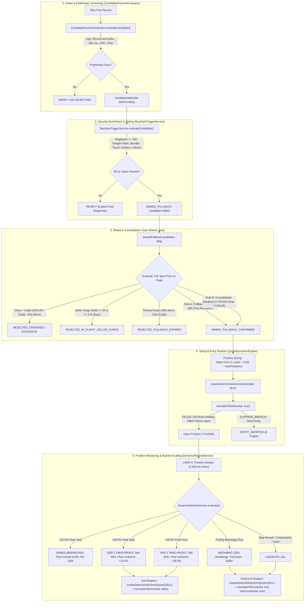

# NeXusTrade — Phase 12.94-D Milestone D.3.3: Source-Accurate PAPER Implementation Handoff

**Document ID**: `NXT-D3.3-PAPER-READINESS-ASSESSMENT-V3`  
**Location**: `docs/research-planning/phase-12.94d-milestone-d3-3-paper-readiness-assessment.md`  
**Related Closure Report**: [`audit/PHASE_12_94D_MILESTONE_D3_3_QUOTE_PILOT_003_CLOSURE_REPORT.md`](file:///u:/Projects/TopG/audit/PHASE_12_94D_MILESTONE_D3_3_QUOTE_PILOT_003_CLOSURE_REPORT.md)  
**Status**: **READ-ONLY ARCHITECTURAL SPECIFICATION & IMPLEMENTATION HANDOFF**  
**Execution Authority**: **THE OPERATOR PERSONALLY RUNS ALL LIVE MARKET-DATA, PAPER, SIMULATION SESSIONS, AND LONG TESTS. ZERO LIVE NETWORK CALLS OR TRADES ARE AUTHORIZED IN THIS ASSESSMENT.**

---

## 1. Actual Existing Strategy Lifecycle, Configurations & Call Sites

The production strategy implemented across [`backend/src/candidate-scanner/`](file:///u:/Projects/TopG/backend/src/candidate-scanner), [`backend/src/exits/`](file:///u:/Projects/TopG/backend/src/exits), and [`backend/src/scripts/paper-trading-daemon.ts`](file:///u:/Projects/TopG/backend/src/scripts/paper-trading-daemon.ts) does **not** execute an immediate market buy at admission followed by a fixed $+300\text{s}$ exit.

It operates as a multi-stage, state-machine driven engine with distinct market-timing confirmations, cohort-specific ratchets, multi-tier partial scaling, and moonbag lifecycle management.



### 1.1 Strategy Timing Parameters and Cohort Thresholds

All parameters are bound directly to active source code constants:

| Strategy Dimension                   | Micro-Cap Cohort                                                                                                                                                               | Established Cohort                                                                                                                                                               | Authoritative Call Site                                                                                                                                                                                                                       |
| :----------------------------------- | :----------------------------------------------------------------------------------------------------------------------------------------------------------------------------- | :------------------------------------------------------------------------------------------------------------------------------------------------------------------------------- | :-------------------------------------------------------------------------------------------------------------------------------------------------------------------------------------------------------------------------------------------- |
| **Cohort Definition Criteria**       | Default cohort for pools $< \$50\text{k}$ liq or age $< 1,800\text{s}$                                                                                                         | Liquidity $\ge \$50\text{k}$, live liq $\ge \$50\text{k}$, age $1,800\text{s}–7,200\text{s}$, holders $\ge 250$ (or viral runner)                                                | [`paper-trading-daemon.ts:1854-1869`](file:///u:/Projects/TopG/backend/src/scripts/paper-trading-daemon.ts#L1854-L1869)                                                                                                                       |
| **Retest Expiry Window**             | **90 seconds** (`90_000 ms`)                                                                                                                                                   | **120 seconds** (`120_000 ms`)                                                                                                                                                   | [`paper-trading-daemon.ts:1916`](file:///u:/Projects/TopG/backend/src/scripts/paper-trading-daemon.ts#L1916)                                                                                                                                  |
| **Rule A: Retest Pullback Discount** | $10\%\text{ to }15\%$ discount from peak (`0.85 <= spot/peak <= 0.90`) with flow absorption (`buys60s >= 1.25 * sells60s`)                                                     | $4\%\text{ to }10\%$ discount from peak (`0.90 <= spot/peak <= 0.96`) with flow absorption (`buys60s >= 1.15 * sells60s`)                                                        | [`paper-trading-daemon.ts:2002-2015`](file:///u:/Projects/TopG/backend/src/scripts/paper-trading-daemon.ts#L2002-L2015)                                                                                                                       |
| **Rule B: Consolidation Breakout**   | Max price drop **5%** from peak (`maxConsolidationDropPct = 0.05`), flow ratio $\ge 1.5\times$ (`minConsolidationFlowRatio = 1.5`), duration $\ge 30\text{s}$ or $\ge 3$ ticks | Max price drop **4%** from peak (`maxConsolidationDropPct = 0.04`), flow ratio $\ge 1.25\times$ (`minConsolidationFlowRatio = 1.25`), duration $\ge 30\text{s}$ or $\ge 3$ ticks | [`paper-trading-daemon.ts:2016-2032`](file:///u:/Projects/TopG/backend/src/scripts/paper-trading-daemon.ts#L2016-L2032)                                                                                                                       |
| **Rule C: Crater Drop Ceiling**      | Drop $> 15\%$ from peak (`maxCraterDropPct = 0.15`)                                                                                                                            | Drop $> 12\%$ if absorbing ($\ge 1.15\times$), $> 8\%$ if unabsorbed (`0.12 : 0.08`)                                                                                             | [`paper-trading-daemon.ts:1913-1947`](file:///u:/Projects/TopG/backend/src/scripts/paper-trading-daemon.ts#L1913-L1947)                                                                                                                       |
| **Rule E: In-Flight Seller Surge**   | $\text{sells60s} \ge 25$ and $\text{sells60s} \ge 2.5 \times \text{buys60s}$                                                                                                   | $\text{sells60s} \ge 25$ and $\text{sells60s} \ge 2.5 \times \text{buys60s}$                                                                                                     | [`paper-trading-daemon.ts:1949-1978`](file:///u:/Projects/TopG/backend/src/scripts/paper-trading-daemon.ts#L1949-L1978)                                                                                                                       |
| **Milestone 0: Breakeven Arming**    | $+10.0\%$ peak gain (`armedBreakevenThresholdBps: 1000`), locks floor to $+0.0\%$, **0% sold**                                                                                 | $+10.0\%$ peak gain (`armedBreakevenThresholdBps: 1000`), locks floor to $+0.0\%$, **0% sold**                                                                                   | [`DynamicRatchetTypes.ts:129-130, 146-147`](file:///u:/Projects/TopG/backend/src/exits/DynamicRatchetTypes.ts#L129-L147), [`DynamicRatchetService.ts:108-112`](file:///u:/Projects/TopG/backend/src/exits/DynamicRatchetService.ts#L108-L112) |
| **Milestone 1: Tier 1 Take-Profit**  | $+20.0\%$ peak gain (`tier1PeakThresholdBps: 2000`), sells **50% of position**, locks floor to $+10.0\%$ (`tier1LockedFloorBps: 1000`)                                         | $+20.0\%$ peak gain (`tier1PeakThresholdBps: 2000`), sells **50% of position**, locks floor to $+10.0\%$ (`tier1LockedFloorBps: 1000`)                                           | [`DynamicRatchetTypes.ts:131-132, 148-149`](file:///u:/Projects/TopG/backend/src/exits/DynamicRatchetTypes.ts#L131-L149), [`DynamicRatchetService.ts:114-152`](file:///u:/Projects/TopG/backend/src/exits/DynamicRatchetService.ts#L114-L152) |
| **Milestone 2: Tier 2 Take-Profit**  | $+48.5\%$ peak gain (`tier2PeakThresholdBps: 4850`), sells **25% of position** (cumulative 75% sold), locks floor to $+35.0\%$ (`tier2LockedFloorBps: 3500`)                   | $+48.5\%$ peak gain (`tier2PeakThresholdBps: 4850`), sells **25% of position** (cumulative 75% sold), locks floor to $+35.0\%$ (`tier2LockedFloorBps: 3500`)                     | [`DynamicRatchetTypes.ts:133-134, 150-151`](file:///u:/Projects/TopG/backend/src/exits/DynamicRatchetTypes.ts#L133-L151), [`DynamicRatchetService.ts:154-201`](file:///u:/Projects/TopG/backend/src/exits/DynamicRatchetService.ts#L154-L201) |
| **Moonbag Lifecycle**                | Remaining **25% of position** held under trailing moonbag ratchet (`nextPeakGainBps - trailBufferBps`, floor $\ge +35.0\%$, catastrophic floor $-2.0\%$)                       | Remaining **25% of position** held under trailing moonbag ratchet (`nextPeakGainBps - trailBufferBps`, floor $\ge +35.0\%$, catastrophic floor $-2.0\%$)                         | [`DynamicRatchetService.ts:203-216`](file:///u:/Projects/TopG/backend/src/exits/DynamicRatchetService.ts#L203-L216)                                                                                                                           |
| **Pre-Breakeven Stop**               | $-12.0\%$ (`preBreakevenStopBps: -1200`)                                                                                                                                       | $-10.0\%$ (`preBreakevenStopBps: -1000`)                                                                                                                                         | [`DynamicRatchetTypes.ts:122, 139`](file:///u:/Projects/TopG/backend/src/exits/DynamicRatchetTypes.ts#L122-L139)                                                                                                                              |
| **Catastrophic Disaster Floor**      | $-20.0\%$ (`catastrophicFloorBps: -2000`)                                                                                                                                      | $-18.0\%$ (`catastrophicFloorBps: -1800`)                                                                                                                                        | [`DynamicRatchetTypes.ts:121, 138`](file:///u:/Projects/TopG/backend/src/exits/DynamicRatchetTypes.ts#L121-L138)                                                                                                                              |
| **Position Monitor Loop Ticker**     | `pollIntervalMs = 1500 ms`                                                                                                                                                     | `pollIntervalMs = 1500 ms`                                                                                                                                                       | [`paper-trading-daemon.ts:575, 1238, 1514`](file:///u:/Projects/TopG/backend/src/scripts/paper-trading-daemon.ts#L575)                                                                                                                        |
| **Discovery / Scanning Loop**        | `scanIntervalMs = 5000 ms`                                                                                                                                                     | `scanIntervalMs = 5000 ms`                                                                                                                                                       | [`paper-trading-daemon.ts:956, 1529`](file:///u:/Projects/TopG/backend/src/scripts/paper-trading-daemon.ts#L956)                                                                                                                              |
| **Position Sizing Formula**          | `Math.min(1.0, ((cash - 0.05) / maxPositions))` capped dynamically                                                                                                             | `Math.min(1.0, ((cash - 0.05) / maxPositions))` capped dynamically                                                                                                               | [`paper-trading-daemon.ts:559-564, 2115-2128`](file:///u:/Projects/TopG/backend/src/scripts/paper-trading-daemon.ts#L559-L564)                                                                                                                |

### 1.2 Identification of the Single Execution Path and Small Extraction Needed

Currently, the entire retest and consolidation confirmation engine is embedded anonymously inside [`backend/src/scripts/paper-trading-daemon.ts:1870-2052`](file:///u:/Projects/TopG/backend/src/scripts/paper-trading-daemon.ts#L1870-L2052).

To eliminate code duplication and prevent divergence between the paper daemon and the research evaluator, this block will be extracted into a pure, standalone function:

```typescript
// Proposed Extraction: backend/src/candidate-scanner/RetestGateEvaluator.ts
export interface RetestGateInput {
  readonly candidate: WatchlistCandidateItem;
  readonly armed: ArmedPullbackState | undefined;
  readonly spotInfo: {
    readonly spotPriceSol: number;
    readonly spotPriceUsd?: number | null;
    readonly recentBuys60s: number;
    readonly recentSells60s: number;
    readonly liquidityUsd: number;
  };
  readonly isEstablished: boolean;
  readonly currentNowMs: number;
}

export type RetestGateDecision =
  | { readonly status: "ARMED_FIRST_TICK"; readonly state: ArmedPullbackState }
  | { readonly status: "WAITING"; readonly state: ArmedPullbackState; readonly reason: string }
  | {
      readonly status: "CONFIRMED";
      readonly confirmReason: "RETEST_PULLBACK_DISCOUNT" | "CONSOLIDATION_BREAKOUT";
    }
  | {
      readonly status: "REJECTED";
      readonly rejectReason:
        | "REJECTED_EXCESSIVE_PULLBACK"
        | "REJECTED_PULLBACK_CRATERED"
        | "REJECTED_IN_FLIGHT_SELLER_SURGE"
        | "REJECTED_PULLBACK_EXPIRED";
    };

export function evaluateRetestGate(input: RetestGateInput): RetestGateDecision;
```

This ensures that both [`paper-trading-daemon.ts`](file:///u:/Projects/TopG/backend/src/scripts/paper-trading-daemon.ts) and the research runner execute the exact same, single code path.

---

## 2. Evidence-Source Decision & Ground-Truth Analysis

### 2.1 Option A (Historical Fixtures): UNAVAILABLE for Live PAPER Evaluation

Option A is **explicitly marked UNAVAILABLE for live-data PAPER evaluation**:

- The authentic historical captures (such as the C3 Raydium AMM v4 pool genesis initialization records from August 2024) prove static on-chain account parameters (pool ID, AMM authority, vault accounts, mints, decimals).
- However, historical captures contain zero live data: no current reserves, no live spot price, no current 60s flow, no current holder distribution, and no ongoing LP lock/burn verification.
- Conflating historical genesis initialization with live market conditions violates provenance. Authentic historical fixtures support separately labeled offline regression replay, and **cannot substitute for live data in a forward evaluation**.

### 2.2 Option B (Metered Provider Adapter): Preserved Schema & Acquisition Gap

The only external security endpoint currently integrated in the codebase is RugCheck at [`BuyGateTriggerService.ts:412`](file:///u:/Projects/TopG/backend/src/candidate-scanner/BuyGateTriggerService.ts#L412):
`https://api.rugcheck.xyz/v1/tokens/{mintAddress}/report`

#### Verified Schema from Preserved Evidence

From [`BuyGateTriggerService.ts:421-428`](file:///u:/Projects/TopG/backend/src/candidate-scanner/BuyGateTriggerService.ts#L421-L428) and unit tests in [`BuyGateTriggerService.test.ts:104-114`](file:///u:/Projects/TopG/backend/src/candidate-scanner/BuyGateTriggerService.test.ts#L104-L114), the actual received payload is:

```typescript
interface RugCheckReportPayload {
  score?: number;
  score_normalised?: number;
  risks?: Array<{
    name?: string;
    value?: string;
    score?: number;
    level?: "danger" | "warn" | "info";
  }>;
  tokenMeta?: { mutable?: boolean };
  topHolders?: Array<{ pct?: number; address?: string }>;
  totalHolders?: number;
}
```

#### Defect 1: Unsafe Favorable Score Default

At [`BuyGateTriggerService.ts:430`](file:///u:/Projects/TopG/backend/src/candidate-scanner/BuyGateTriggerService.ts#L430):

```typescript
const rugScore = typeof data.score === "number" ? data.score : 0;
```

If RugCheck omits the `score` field, the code silently defaults `rugScore` to `0` (the safest possible score). This violates fail-closed integrity. Missing risk scores must be treated as `null` / `undefined` and rejected under strict gating.

#### Defect 2: LP Lock is NOT LP Burn

- An LP **lock** (tokens locked in a third-party vesting contract like Team Finance or Streamflow) can be unlocked, amended, or withdrawn upon lock expiry.
- An LP **burn** permanently sends LP tokens to an unspendable address (`11111111111111111111111111111111` or incinerator), mathematically destroying the ability to withdraw underlying reserves.
- Treating LP lock and LP burn as interchangeable violates strategy rules.

#### Defect 3: Missing LP Burn Provenance & Smallest Acquisition Gap

- Neither DexScreener (`pairs/solana/{pool}`) nor RugCheck (`/tokens/{mint}/report`) as integrated in this codebase provides a verified, authenticated `lpBurnPct` field. Guessing an unverified `markets` array without an authentic schema payload is unverified speculation.
- **The Smallest Remaining Acquisition Gap**:
  - The strategy's Stage 1 screening gate `ANTI_RUG_LP_SECURITY` requires `lpBurnPct >= 90.0%`.
  - The smallest remaining gap to satisfy this requirement without unmetered third-party APIs is reading the on-chain SPL token supply and burned-address balance for the pool's LP mint (`lpMint`), or obtaining an authenticated API payload with verified schema proving the burn.
  - Until that gap is closed with verified provenance, live candidates correctly fail closed at Stage 1 on `UNVERIFIED_LP_BURN_DATA` (or rejection on missing LP burn), preventing unsafe execution.

---

## 3. Correct Execution Attachment & Realism Accounting

The evaluation must bind directly to the real, tested exported functions in [`QuoteExecutionEngine.ts`](file:///u:/Projects/TopG/backend/src/execution/QuoteExecutionEngine.ts) and [`ExecutionFeeModel.ts`](file:///u:/Projects/TopG/backend/src/execution/ExecutionFeeModel.ts).

### 3.1 Verified Mint Decimals (Eliminating Hardcoded Defaults)

Token decimals cannot be hardcoded to 9:

- Canonical WSOL has 9 decimals (`WSOL_DECIMALS = 9`).
- RAY has 6 decimals (`RAY_DECIMALS = 6`).
- Pump tokens typically have 6 decimals; SPL tokens range from 0 to 18.
- `createDeterministicAmmQuote()` enforces `validateMintDecimals(params.tokenDecimals)`.
- Token decimals must be obtained from verified mint account data or candidate contracts.

### 3.2 Exact Argument Mapping for Entry & Exit Quotes

`createDeterministicAmmQuote()` internally executes `calculateAmmBuyQuote()` or `calculateAmmSellQuote()` using atomic integer arithmetic, and calculates `poolInternalFeeSol`.

```typescript
// 1. Entry Quote (BUY)
const entryQuote = createDeterministicAmmQuote({
  sessionId: sessionContext.sessionId,
  generationId: sessionContext.generationId,
  decisionEventId: `dec-buy-${candidate.mintAddress}-${currentNowMs}`,
  mintAddress: candidate.mintAddress,
  poolId: candidate.poolId,
  side: "BUY",
  tradeSizeSolOrTokens: dynamicSizeSol, // Dynamically sized SOL
  baseReserveTokens: verifiedBaseReserveTokens,
  quoteReserveSol: verifiedQuoteReserveSol,
  tokenDecimals: verifiedTokenDecimals, // e.g. 6 for RAY, 9 for WSOL
  quoteInitiatedMs: currentNowMs,
  contextSlot: currentSlot,
  quoteLatencyMs: 25,
  ttlMs: 15_000,
  dexFeeRate: 0.0025, // 25 bps Raydium swap fee
  maxSlippageBps: 25,
  simulatedRoutePlan: [
    {
      ammKey: candidate.poolId,
      label: "Synthetic AMM Pool",
      inputMint: WSOL_MINT,
      outputMint: candidate.mintAddress,
      feePct: 0.0025,
    },
  ],
});

// 2. Entry Fill Simulation (BUY)
const entryFill = simulateFill(entryQuote, {
  decisionTimestampMs: currentNowMs + 25, // >= quoteReceivedMs (zero-lookahead verified)
  decisionSlot: currentSlot,
  executionDelayMs: 150, // Modeled network propagation delay
  isNewAta: true, // Debits 2,039,280 lamports ATA rent deposit
  arrivalSlippageBps: 5, // Modeled arrival slippage
  sellabilityStatus: "FULLY_SELLABLE",
  computeUnits: 100_000,
  priorityFeeMicroLamports: 10_000,
});
```

```typescript
// 3. Partial Exit Quote (SELL - Tier 1 50% or Tier 2 25%)
const partialSellQuote = createDeterministicAmmQuote({
  sessionId: sessionContext.sessionId,
  generationId: sessionContext.generationId,
  decisionEventId: `dec-sell-t1-${candidate.mintAddress}-${currentNowMs}`,
  mintAddress: candidate.mintAddress,
  poolId: candidate.poolId,
  side: "SELL",
  tradeSizeSolOrTokens: tokensToLiquidate, // e.g. 50% of position tokens
  baseReserveTokens: updatedBaseReserveTokens,
  quoteReserveSol: updatedQuoteReserveSol,
  tokenDecimals: verifiedTokenDecimals,
  quoteInitiatedMs: currentNowMs,
  contextSlot: currentSlot,
  dexFeeRate: 0.0025,
  maxSlippageBps: 25,
});

// 4. Partial Exit Fill Simulation (SELL)
const partialSellFill = simulateFill(partialSellQuote, {
  decisionTimestampMs: currentNowMs + 25,
  decisionSlot: currentSlot,
  executionDelayMs: 150,
  closeAta: false, // CRITICAL: NEVER close ATA on partial exits!
  hasFundedAta: true,
  priorEntryCostSol: entryFill.filledSizeSol * 0.5, // Proportional cost basis
  arrivalSlippageBps: 5,
  sellabilityStatus: "FULLY_SELLABLE",
});

// 5. Final Full Liquidation Quote (SELL - Moonbag Stop / Session End)
const finalSellQuote = createDeterministicAmmQuote({
  ...baseParams,
  side: "SELL",
  tradeSizeSolOrTokens: remainingMoonbagTokens,
});

// 6. Final Full Liquidation Fill Simulation (SELL)
const finalSellFill = simulateFill(finalSellQuote, {
  decisionTimestampMs: currentNowMs + 25,
  decisionSlot: currentSlot,
  executionDelayMs: 150,
  closeAta: true, // CRITICAL: Close ATA ONLY on final full liquidation
  hasFundedAta: true, // Credits 2,039,280 lamports ATA rent refund
  priorEntryCostSol: remainingEntryCostSol,
  sellabilityStatus: "FULLY_SELLABLE",
});
```

### 3.3 State-Accurate ATA Accounting and Inventory Preservation

1. **ATA Creation & Funding**:
   - On BUY, `isNewAta: true` causes [`ExecutionFeeModel.calculateEntryFees()`](file:///u:/Projects/TopG/backend/src/execution/ExecutionFeeModel.ts#L61) to debit the mandatory Solana rent-exempt balance of **2,039,280 lamports** (0.00203928 SOL).
   - The position state records `hasFundedAta = true`.
2. **Partial Exits (Tier 1 50% & Tier 2 25%)**:
   - `closeAta` MUST BE `false`.
   - The token account remains open on-chain to hold remaining inventory.
   - `ataRentRefundLamports` is **0**. No rent refund is credited.
3. **Final Full Exit (Remaining Moonbag Liquidation)**:
   - `closeAta` is `true` and `hasFundedAta` is `true`.
   - `ataRentRefundLamports` of **2,039,280 lamports** is credited back to gross proceeds to yield net realized SOL.
4. **Preservation of Inventory on Failed Sell**:
   - If an exit fill fails due to `UNSELLABLE_NO_ROUTE`, `PREFLIGHT_SIMULATION_REJECTED`, or `SLIPPAGE_BREACH_REJECTED`, [`simulateFill()`](file:///u:/Projects/TopG/backend/src/execution/QuoteExecutionEngine.ts#L821) sets `remainingTokens = attemptedTokens`.
   - Unsold inventory remains preserved in the virtual wallet with conservative write-down. Tokens are never assumed sold or discarded.

### 3.4 Strict Distinction: Observed Inputs vs Modeled Execution Parameters

| Field / Parameter                       |    Classification     | Provenance & Handling                                                    |
| :-------------------------------------- | :-------------------: | :----------------------------------------------------------------------- |
| `mintAddress`                           |  **Observed Input**   | Cryptographically verified base58 Solana public key.                     |
| `poolAddress` (`ammKey`)                |  **Observed Input**   | Verified Raydium AMM v4 pool address.                                    |
| `tokenDecimals`                         |  **Observed Input**   | Mint account definition (e.g. 6 for RAY, 9 for WSOL).                    |
| `indicativePriceSol` (`priceNative`)    |  **Observed Input**   | Preserved from provider HTTP response against canonical WSOL.            |
| `contextSlot`                           |  **Observed Input**   | On-chain slot counter for freshness verification.                        |
| `baseReserveTokens` / `quoteReserveSol` |  **Observed Input**   | Verified atomic reserve balances when available.                         |
| `quoteLatencyMs`                        | **Modeled Parameter** | Modeled quote retrieval delay (default 25 ms).                           |
| `executionDelayMs`                      | **Modeled Parameter** | Modeled network transit and block inclusion latency (default 150 ms).    |
| `networkFeeLamports`                    | **Modeled Parameter** | Standard Solana transaction base fee (5,000 lamports = 0.000005 SOL).    |
| `priorityFeeLamports`                   | **Modeled Parameter** | Modeled priority compute fee (1,000 lamports).                           |
| `ataRentDepositLamports`                | **Modeled Parameter** | Solana protocol rent-exemption fee (2,039,280 lamports).                 |
| `arrivalSlippageBps`                    | **Modeled Parameter** | Modeled arrival execution slippage against constant-product curve.       |
| `sellabilityStatus`                     | **Modeled Parameter** | Preflight simulation status ("FULLY_SELLABLE" vs transfer restrictions). |

---

## 4. Feasible Request Budget & Pacing-Aware Scheduling

### 4.1 Withdrawal of Previous Arbitrary Figures

The previously proposed 25-request / 20-minute numbers are **withdrawn**. A feasible budget must be derived from the provider pacing constraints and the strategy's observation schedules.

### 4.2 Reconciling Provider Pacing ($\ge 2,500\text{ ms}$) with Strategy Scheduling

- **Provider Constraint**: [`GlobalResourceBudgetManager`](file:///u:/Projects/TopG/backend/src/research/prospective/GlobalResourceBudgetManager.ts) and DexScreener enforce a minimum interval of **2,500 ms** between consecutive outbound HTTP requests to the same host.
- **Strategy Ticker Schedule**:
  - Candidate Discovery / Scanning (`LOOP B`): runs every **5,000 ms** (`scanIntervalMs = 5000`). This naturally respects provider pacing ($5,000\text{ ms} \ge 2,500\text{ ms}$).
  - Position Monitoring (`LOOP A`): runs every **1,500 ms** (`pollIntervalMs = 1500`).
- **Pacing Conflict & Architectural Resolution**:
  - An un-cached outbound HTTP request on every 1,500 ms tick would violate the 2,500 ms provider pacing constraint and trigger rate limits.
  - **Resolution: Decoupled Spot Quoting with Explicit Caching**:
    - The outbound spot price fetch runs on an intentional, throttled schedule (e.g. every 10,000 ms or 15,000 ms).
    - The high-frequency 1,500 ms position monitor ticker evaluates against the **latest cached spot quote**, evaluating elapsed time, trigger breaches, and updating internal state only as new spot prices arrive.

### 4.3 Mathematical Derivation of Outbound Request Budgets

For a bounded evaluation session focused on a single target candidate:

| Lifecycle Phase             |          Active Duration          | Polling Cadence | Outbound HTTP Requests | Derivation Rationale                                                                                                                            |
| :-------------------------- | :-------------------------------: | :-------------: | :--------------------: | :---------------------------------------------------------------------------------------------------------------------------------------------- |
| **1. Intake & Discovery**   |         Instant ($t = 0$)         |  Single lookup  |     **1 request**      | Direct seeded pool query (`pairs/solana/{pool}`).                                                                                               |
| **2. Security Enrichment**  |          $t = 3\text{s}$          |  Single lookup  |     **1 request**      | Metered RugCheck report lookup (if active).                                                                                                     |
| **3. Retest & Arming**      | Up to 90s (Micro) or 120s (Estab) |    Every 10s    |  **9 to 12 requests**  | Micro-Cap: $90\text{s} / 10\text{s} = 9$; Estab: $120\text{s} / 10\text{s} = 12$. If confirmed earlier (e.g. at 30s), consumes only 3 requests. |
| **4. Position Monitoring**  |  Target 5m to 8m (300s to 480s)   |    Every 15s    | **20 to 32 requests**  | 5m position: $300\text{s} / 15\text{s} = 20$; 8m position: $480\text{s} / 15\text{s} = 32$. Strictly respects 2,500 ms pacing.                  |
| **5. Exit Execution Quote** |           Exit trigger            |  Single lookup  |     **1 request**      | Fresh quote upon ratchet breach or session cashout.                                                                                             |
| **6. Fail-Safe Buffer**     |           Finalization            |    On demand    |     **4 requests**     | Reserved capacity for clean session closure.                                                                                                    |

#### Concrete Budget Targets by Scenario

1. **Scenario 1: Screening Rejection or Unconfirmed Retest Expiry (No Trades)**:
   - Duration: Up to 150 seconds ($\sim 2.5$ minutes).
   - Budget: $1 \text{ (intake)} + 1 \text{ (security)} + 12 \text{ (retest)} + 4 \text{ (buffer)} =$ **18 requests max**.
2. **Scenario 2: Full Trade Lifecycle (Entry Confirmed + 5-Minute Position Hold)**:
   - Duration: Up to 450 seconds ($\sim 7.5$ minutes).
   - Budget: $1 \text{ (intake)} + 1 \text{ (security)} + 3 \text{ (quick retest)} + 20 \text{ (position monitor)} + 1 \text{ (exit)} + 4 \text{ (buffer)} =$ **30 requests max**.

Both scenarios are mathematically bounded, prevent provider throttling, and strictly honor global budget management.

---

## 5. Finite Implementation Checklist

| File / Component                                                     | Exact Change                                                                                                                                                                                                          | Required Input & Source                                          | Short Offline Verification                                                                      | Dependency Still Unresolved                       |
| :------------------------------------------------------------------- | :-------------------------------------------------------------------------------------------------------------------------------------------------------------------------------------------------------------------- | :--------------------------------------------------------------- | :---------------------------------------------------------------------------------------------- | :------------------------------------------------ |
| `backend/src/candidate-scanner/BuyGateTriggerService.ts`             | 1. Remove unsafe `rugScore = 0` fallback (line 430); require explicit numeric score.<br/>2. Disallow conflating LP lock with LP burn.<br/>3. Require verified `lpBurnPct`.                                            | RugCheck JSON payload from metered adapter.                      | `npx vitest run backend/src/candidate-scanner/BuyGateTriggerService.test.ts`                    | True on-chain LP mint burn balance acquisition.   |
| `backend/src/candidate-scanner/RetestGateEvaluator.ts` _(new)_       | Extract retest logic from `paper-trading-daemon.ts:1870-2052` into a pure, testable function (`evaluateRetestGate`) supporting both cohorts (90s/120s expiry, 4%/5% consolidation drop, flow ratios, crater ceiling). | Candidate item, peak price, spot price, 60s flow counts, cohort. | Dedicated unit test: `npx vitest run backend/src/candidate-scanner/RetestGateEvaluator.test.ts` | None (pure software extraction).                  |
| `backend/src/scripts/paper-trading-daemon.ts`                        | Replace inline retest block (lines 1870–2052) with call to `evaluateRetestGate()`. Bind position monitor loop to cached spot quoting to respect $\ge 2,500\text{ ms}$ pacing.                                         | Extracted helper and cached quote store.                         | Typecheck + unit tests: `npm run build`                                                         | None (pure refactoring).                          |
| `backend/src/research/prospective/LiveShadowProviders.ts`            | Implement throttled spot quote caching provider respecting $\ge 2,500\text{ ms}$ pacing for high-frequency consumption.                                                                                               | Provider budget manager + live DexScreener provider.             | `npx vitest run backend/src/research/prospective/LiveShadowProviders.test.ts`                   | None.                                             |
| `backend/src/execution/QuoteExecutionEngine.ts`                      | Ensure `createDeterministicAmmQuote()` and `simulateFill()` receive verified mint decimals, track ATA funding state across partial exits (`closeAta: false`), and refund only on final moonbag liquidation.           | Pool reserves, mint decimals, context slot, position ATA state.  | `npx vitest run backend/src/execution/ExecutionRealism.test.ts`                                 | On-chain reserve verification for candidate pool. |
| `backend/src/research/prospective/ProspectiveObservationRecorder.ts` | Add `simulated-fills.jsonl` writer for recording simulated fills with full fee breakdown, price impact, and realized PnL.                                                                                             | `SimulatedFillRecord` from `simulateFill()`.                     | `npx vitest run backend/src/research/prospective/ProspectiveDataIntegrity.test.ts`              | None.                                             |

---

## 6. Acceptance Criteria for Future Live Execution

Future live PAPER execution remains **ON HOLD**. When authorized by the auditor, an execution will be judged strictly by:

1. **Zero Gate Dilution**: All 11 buy gates evaluated against approved thresholds; no gates relaxed or bypassed.
2. **Zero Fabricated Inputs**: No default fallbacks (`lpBurnPct = 100`, `rugScore = 0`, hardcoded decimals); missing fields fail closed.
3. **Truthful Outcome Recording**: Non-trading outcomes (screening rejection, retest timeout) are recorded as valid, accepted results.
4. **Execution Realism Math**: Verified BigInt constant-product math, dynamic mint decimals, non-zero price impact, exact fee deductions (base fee + priority fee + ATA rent deposit/refund).
5. **Accurate ATA State Management**: Zero ATA refund on Tier 1 (50%) and Tier 2 (25%) partial sales; ATA closed and refunded only on final full liquidation; unsold inventory preserved on failed exits.
6. **Cryptographic Manifest Integrity**: Complete SHA-256 manifest and record digest verification across all output artifacts.
7. **Safety Invariants**: Virtual wallet balance strictly frozen at `7.9259 SOL` with zero balance mutations; zero unmetered network requests; zero on-chain transactions submitted.
