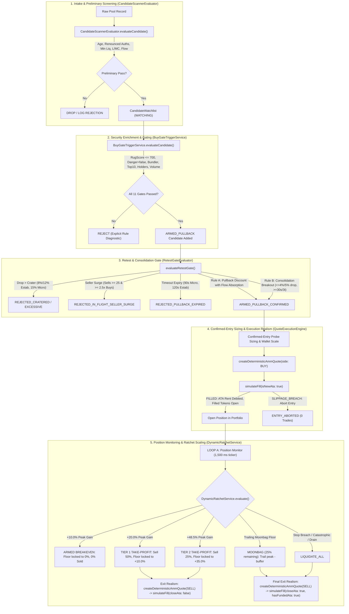

# NeXusTrade — Phase 12.94-D Milestone D.3.3: Source-Accurate PAPER Implementation Handoff

**Document ID**: `NXT-D3.3-PAPER-READINESS-ASSESSMENT-V4`  
**Location**: `docs/research-planning/phase-12.94d-milestone-d3-3-paper-readiness-assessment.md`  
**Related Closure Report**: [`audit/PHASE_12_94D_MILESTONE_D3_3_QUOTE_PILOT_003_CLOSURE_REPORT.md`](file:///u:/Projects/TopG/audit/PHASE_12_94D_MILESTONE_D3_3_QUOTE_PILOT_003_CLOSURE_REPORT.md)  
**Status**: **READ-ONLY ARCHITECTURAL SPECIFICATION & OFFLINE IMPLEMENTATION HANDOFF**  
**Execution Authority**: **THE OPERATOR PERSONALLY RUNS ALL LIVE MARKET-DATA, PAPER, SIMULATION SESSIONS, AND LONG TESTS. ZERO LIVE NETWORK CALLS OR TRADES ARE AUTHORIZED IN THIS ASSESSMENT.**

---

## 1. Actual Existing Strategy Lifecycle, Configurations & Call Sites

The production strategy implemented across [`backend/src/candidate-scanner/`](file:///u:/Projects/TopG/backend/src/candidate-scanner), [`backend/src/exits/`](file:///u:/Projects/TopG/backend/src/exits), and [`backend/src/scripts/paper-trading-daemon.ts`](file:///u:/Projects/TopG/backend/src/scripts/paper-trading-daemon.ts) does **not** execute an immediate market buy at admission followed by a fixed $+300\text{s}$ exit.

It operates as a multi-stage, state-machine driven engine with distinct market-timing confirmations, cohort-specific ratchets, multi-tier partial scaling, and moonbag lifecycle management.



### 1.1 Strategy Timing Parameters, Cohort Thresholds & Confirmed-Entry Sizing

All parameters are bound directly to active source code constants:

| Strategy Dimension                   | Micro-Cap Cohort                                                                                                                                                               | Established Cohort                                                                                                                                                               | Authoritative Call Site                                                                                                                                                                                                                       |
| :----------------------------------- | :----------------------------------------------------------------------------------------------------------------------------------------------------------------------------- | :------------------------------------------------------------------------------------------------------------------------------------------------------------------------------- | :-------------------------------------------------------------------------------------------------------------------------------------------------------------------------------------------------------------------------------------------- |
| **Cohort Definition Criteria**       | Default cohort for pools $< \$50\text{k}$ liq or age $< 1,800\text{s}$                                                                                                         | Liquidity $\ge \$50\text{k}$, live liq $\ge \$50\text{k}$, age $1,800\text{s}–7,200\text{s}$, holders $\ge 250$ (or viral runner)                                                | [`paper-trading-daemon.ts:1854-1869`](file:///u:/Projects/TopG/backend/src/scripts/paper-trading-daemon.ts#L1854-L1869)                                                                                                                       |
| **Retest Expiry Window**             | **90 seconds** (`90_000 ms`)                                                                                                                                                   | **120 seconds** (`120_000 ms`)                                                                                                                                                   | [`paper-trading-daemon.ts:1916`](file:///u:/Projects/TopG/backend/src/scripts/paper-trading-daemon.ts#L1916), [`RetestGateEvaluator.ts`](file:///u:/Projects/TopG/backend/src/candidate-scanner/RetestGateEvaluator.ts)                       |
| **Rule A: Retest Pullback Discount** | $10\%\text{ to }15\%$ discount from peak (`0.85 <= spot/peak <= 0.90`) with flow absorption (`buys60s >= 1.25 * sells60s`)                                                     | $4\%\text{ to }10\%$ discount from peak (`0.90 <= spot/peak <= 0.96`) with flow absorption (`buys60s >= 1.15 * sells60s`)                                                        | [`RetestGateEvaluator.ts`](file:///u:/Projects/TopG/backend/src/candidate-scanner/RetestGateEvaluator.ts)                                                                                                                                     |
| **Rule B: Consolidation Breakout**   | Max price drop **5%** from peak (`maxConsolidationDropPct = 0.05`), flow ratio $\ge 1.5\times$ (`minConsolidationFlowRatio = 1.5`), duration $\ge 30\text{s}$ or $\ge 3$ ticks | Max price drop **4%** from peak (`maxConsolidationDropPct = 0.04`), flow ratio $\ge 1.25\times$ (`minConsolidationFlowRatio = 1.25`), duration $\ge 30\text{s}$ or $\ge 3$ ticks | [`RetestGateEvaluator.ts`](file:///u:/Projects/TopG/backend/src/candidate-scanner/RetestGateEvaluator.ts)                                                                                                                                     |
| **Rule C: Crater Drop Ceiling**      | Drop $> 15\%$ from peak (`maxCraterDropPct = 0.15`)                                                                                                                            | Drop $> 12\%$ if absorbing ($\ge 1.15\times$), $> 8\%$ if unabsorbed (`0.12 : 0.08`)                                                                                             | [`RetestGateEvaluator.ts`](file:///u:/Projects/TopG/backend/src/candidate-scanner/RetestGateEvaluator.ts)                                                                                                                                     |
| **Rule E: In-Flight Seller Surge**   | $\text{sells60s} \ge 25$ and $\text{sells60s} \ge 2.5 \times \text{buys60s}$                                                                                                   | $\text{sells60s} \ge 25$ and $\text{sells60s} \ge 2.5 \times \text{buys60s}$                                                                                                     | [`RetestGateEvaluator.ts`](file:///u:/Projects/TopG/backend/src/candidate-scanner/RetestGateEvaluator.ts)                                                                                                                                     |
| **Milestone 0: Breakeven Arming**    | $+10.0\%$ peak gain (`armedBreakevenThresholdBps: 1000`), locks floor to $+0.0\%$, **0% sold**                                                                                 | $+10.0\%$ peak gain (`armedBreakevenThresholdBps: 1000`), locks floor to $+0.0\%$, **0% sold**                                                                                   | [`DynamicRatchetTypes.ts:129-130, 146-147`](file:///u:/Projects/TopG/backend/src/exits/DynamicRatchetTypes.ts#L129-L147), [`DynamicRatchetService.ts:108-112`](file:///u:/Projects/TopG/backend/src/exits/DynamicRatchetService.ts#L108-L112) |
| **Milestone 1: Tier 1 Take-Profit**  | $+20.0\%$ peak gain (`tier1PeakThresholdBps: 2000`), sells **50% of position**, locks floor to $+10.0\%$ (`tier1LockedFloorBps: 1000`)                                         | $+20.0\%$ peak gain (`tier1PeakThresholdBps: 2000`), sells **50% of position**, locks floor to $+10.0\%$ (`tier1LockedFloorBps: 1000`)                                           | [`DynamicRatchetTypes.ts:131-132, 148-149`](file:///u:/Projects/TopG/backend/src/exits/DynamicRatchetTypes.ts#L131-L149), [`DynamicRatchetService.ts:114-152`](file:///u:/Projects/TopG/backend/src/exits/DynamicRatchetService.ts#L114-L152) |
| **Milestone 2: Tier 2 Take-Profit**  | $+48.5\%$ peak gain (`tier2PeakThresholdBps: 4850`), sells **25% of position** (cumulative 75% sold), locks floor to $+35.0\%$ (`tier2LockedFloorBps: 3500`)                   | $+48.5\%$ peak gain (`tier2PeakThresholdBps: 4850`), sells **25% of position** (cumulative 75% sold), locks floor to $+35.0\%$ (`tier2LockedFloorBps: 3500`)                     | [`DynamicRatchetTypes.ts:133-134, 150-151`](file:///u:/Projects/TopG/backend/src/exits/DynamicRatchetTypes.ts#L133-L151), [`DynamicRatchetService.ts:154-201`](file:///u:/Projects/TopG/backend/src/exits/DynamicRatchetService.ts#L154-L201) |
| **Moonbag Lifecycle**                | Remaining **25% of position** held under trailing moonbag ratchet (`nextPeakGainBps - trailBufferBps`, floor $\ge +35.0\%$, catastrophic floor $-2.0\%$)                       | Remaining **25% of position** held under trailing moonbag ratchet (`nextPeakGainBps - trailBufferBps`, floor $\ge +35.0\%$, catastrophic floor $-2.0\%$)                         | [`DynamicRatchetService.ts:203-216`](file:///u:/Projects/TopG/backend/src/exits/DynamicRatchetService.ts#L203-L216)                                                                                                                           |
| **Pre-Breakeven Stop**               | $-12.0\%$ (`preBreakevenStopBps: -1200`)                                                                                                                                       | $-10.0\%$ (`preBreakevenStopBps: -1000`)                                                                                                                                         | [`DynamicRatchetTypes.ts:122, 139`](file:///u:/Projects/TopG/backend/src/exits/DynamicRatchetTypes.ts#L122-L139)                                                                                                                              |
| **Catastrophic Disaster Floor**      | $-20.0\%$ (`catastrophicFloorBps: -2000`)                                                                                                                                      | $-18.0\%$ (`catastrophicFloorBps: -1800`)                                                                                                                                        | [`DynamicRatchetTypes.ts:121, 138`](file:///u:/Projects/TopG/backend/src/exits/DynamicRatchetTypes.ts#L121-L138)                                                                                                                              |
| **Position Monitor Loop Ticker**     | `pollIntervalMs = 1500 ms`                                                                                                                                                     | `pollIntervalMs = 1500 ms`                                                                                                                                                       | [`paper-trading-daemon.ts:575, 1238, 1514`](file:///u:/Projects/TopG/backend/src/scripts/paper-trading-daemon.ts#L575)                                                                                                                        |
| **Discovery / Scanning Loop**        | `scanIntervalMs = 5000 ms`                                                                                                                                                     | `scanIntervalMs = 5000 ms`                                                                                                                                                       | [`paper-trading-daemon.ts:956, 1529`](file:///u:/Projects/TopG/backend/src/scripts/paper-trading-daemon.ts#L956)                                                                                                                              |

#### Actual Confirmed-Entry Sizing Path

Position sizing upon confirmed retest does **not** rely on a naive startup formula. It executes the calibrated probe sizing and risk-adjustment logic from [`paper-trading-daemon.ts:2088-2128`](file:///u:/Projects/TopG/backend/src/scripts/paper-trading-daemon.ts#L2088-L2128):

1. **Wallet Scale Factor**:
   $$\text{walletScale} = \min\left(1.25, \max\left(1.0, \frac{\text{currentCash}}{10.0}\right)\right)$$
2. **Calibrated Base Probe Size by Cohort**:
   - Established Base: $\min(0.65, \text{round}_{2}(0.50 \times \text{walletScale}))$
   - Micro-Cap Base: $\min(0.45, \text{round}_{2}(0.35 \times \text{walletScale}))$
3. **Risk Downsizing (Established Cohort)**:
   If `bundlerPct > 0.60` or `top10HolderPct > 0.30`, downsize `targetCohortSize` to $\min(0.35, \text{targetCohortSize})$.
4. **Portfolio Capital Ceiling & Gas Reserve**:
   $$\text{dynamicSize} = \max\left(0.10, \min\left(\text{targetCohortSize}, \frac{\text{currentPortfolioSol} - 0.05}{\text{maxOpenPositions}}\right)\right)$$

### 1.2 Implemented Retest Evaluator Extraction (`RetestGateEvaluator.ts`)

The retest evaluation logic previously embedded in [`backend/src/scripts/paper-trading-daemon.ts:1870-2052`](file:///u:/Projects/TopG/backend/src/scripts/paper-trading-daemon.ts#L1870-L2052) has been cleanly extracted into [`backend/src/candidate-scanner/RetestGateEvaluator.ts`](file:///u:/Projects/TopG/backend/src/candidate-scanner/RetestGateEvaluator.ts).

The pure function `evaluateRetestGate()` computes the decision without side effects:

- Evaluates first-tick arming, peak price updates, and tick counting.
- Enforces strict evaluation order: Rule C (crater drop) $\rightarrow$ Rule E (seller surge) $\rightarrow$ Rule D (timeout expiry) $\rightarrow$ Rule A (pullback discount) $\rightarrow$ Rule B (consolidation breakout).
- Preserves precedence: Rule A confirms with `RETEST_PULLBACK_DISCOUNT` over Rule B.
- Side effects (map updates, logging, telemetry via `recordTriggerRejection`, and watchlist state updates) remain in the caller.

---

## 2. Evidence-Source Decision, SPL Token Burn Accounting & Security Gaps

### 2.1 Option A (Historical Fixtures): UNAVAILABLE for Live PAPER Evaluation

Option A is **explicitly marked UNAVAILABLE for live-data PAPER evaluation**:

- The authentic historical captures (such as the C3 Raydium AMM v4 pool genesis initialization records from August 2024) prove static on-chain account parameters (pool ID, AMM authority, vault accounts, mints, decimals).
- However, historical captures contain zero live data: no current reserves, no live spot price, no current 60s flow, no current holder distribution, and no ongoing LP lock/burn verification.
- Conflating historical genesis initialization with live market conditions violates provenance. Authentic historical fixtures support separately labeled offline regression replay, and **cannot substitute for live data in a forward evaluation**.

### 2.2 LP Security & Protocol Accounting (Raydium AMM v4 Contract PROPOSED / UNAPPROVED)

The strategy's Stage 1 screening gate `ANTI_RUG_LP_SECURITY` requires $\text{lpBurnPct} \ge 90.0\%$.

#### Explicit Withdrawal of Unsupported LP Reduction Formula

The previously proposed formula:
$$\frac{L_{\text{initial}} - L_{\text{circulating}}}{L_{\text{initial}}} \times 100\%$$
is **formally withdrawn as unsound**.

In the official Raydium AMM v4 withdrawal implementation (`withdraw` instruction), liquidity redemptions burn LP tokens while returning the underlying base and quote token reserves from the pool vaults to the withdrawing liquidity providers. A formula that equates every reduction in LP tokens with burned or locked liquidity conflates routine withdrawal with true liquidity destruction.

#### Proposed Acquisition & Calculation Contract (Status: PROPOSED / UNAPPROVED)

The corrected acquisition contract has been formulated in [`phase-12.94d-milestone-d3-3-lp-security-acquisition-contract.md`](file:///u:/Projects/TopG/docs/research-planning/phase-12.94d-milestone-d3-3-lp-security-acquisition-contract.md), strictly narrowed to legacy Raydium AMM v4:

1. **Protocol-Tracked Denominator**: Raydium AMM v4 tracks `amm.lp_amount` directly in the 752-byte pool account at byte offset **720..728** (`lpReserve`). In official program source (`program/src/processor.rs`), `amm.lp_amount` ($L_{\text{protocol}}$) is the actual mathematical denominator used during liquidity withdrawals, rather than SPL mint supply.
2. **Distinct Lifecycle Mechanics**:
   - **Genesis Initialization**: Initial calculated liquidity is set in $L_{\text{protocol}}$, but an unminted minimum ($L_{\text{unminted}} = 10^6$ units) is withheld from minting. $L_{\text{protocol}} - S_{\text{current}} = L_{\text{unminted}}$ (fails 90% gate as expected).
   - **Normal Withdrawal**: Both $L_{\text{protocol}}$ and $S_{\text{current}}$ decrement by the redeemed amount. The difference $L_{\text{protocol}} - S_{\text{current}}$ remains constant; normal redemption does NOT generate protected liquidity.
   - **Direct SPL Burn**: Decrements $S_{\text{current}}$ while $L_{\text{protocol}}$ and vault reserves remain fixed. Because the AMM `withdraw` instruction divides by $L_{\text{protocol}}$, the remaining circulating supply can only redeem $\frac{S_{\text{current}}}{L_{\text{protocol}}}$ of vault reserves; the remaining fraction is permanently trapped.
3. **Smallest Defensible Calculation**:
   $$\text{lpBurnPct} = \frac{L_{\text{protocol}} - S_{\text{current}}}{L_{\text{protocol}}} \times 100\%$$
   where $L_{\text{protocol}} = \text{lpReserve}$ (offset 720..728) and $S_{\text{current}} = \text{lpMint.supply}$.
4. **Deferred Scope**: CPMM, Token-2022, third-party locker accounts, and unverified provider schemas are explicitly deferred.
5. **Approval Status**: **PROPOSED / UNAPPROVED**. No calculator is implemented and no parser is modified until formal auditor review. Candidates lacking verified evidence fail closed at Stage 1.

### 2.3 Corrected Security Score & Complete Malformed-Risk Validation

The implementation in [`BuyGateTriggerService.ts:402-520`](file:///u:/Projects/TopG/backend/src/candidate-scanner/BuyGateTriggerService.ts#L402-L520) has been fully hardened:

1. **Removed Favorable Fallback**: The silent `score ?? 0` default has been removed. An explicitly supplied, finite, non-negative number (`score >= 0`) is strictly required. Genuine observed zero scores are preserved.
2. **Complete Malformed-Risk Validation**:
   - `data.risks` must be an Array (`!Array.isArray(data.risks) -> return null;`).
   - Every risk entry is validated against the supported schema (`level: "danger" | "warn" | "info"`).
   - Null entries, primitives (e.g. `["danger"]`), missing severity fields (e.g. `[{}]`), incorrectly typed severity (e.g. `{ level: 123 }`), empty strings (`{ level: "" }`), and unsupported severity values (e.g. `{ level: "critical" }`) fail closed (`return null;`).
   - Genuine empty risk arrays (`[]`) and supported non-danger risks (`warn`, `info`) are preserved (`hasDangerRisk: false`).
   - Valid danger risks (`danger`) correctly set `hasDangerRisk: true`.
3. **Fail-Closed Final Eligibility**: When `fetchRugCheckMetrics()` returns `null` (due to missing score or malformed risk entries), `rugMetrics` is `null`. In the final security-qualified eligibility path (`requireVerifiedHolders: true`), `holdersCount === undefined` immediately triggers `REJECTED_RUGCHECK_UNINDEXED_OR_HOLDERS_UNKNOWN`, preventing unverified candidates from passing. Preliminary screening (`requireVerifiedHolders: false`) remains distinct.

---

## 3. Correct Execution Attachment & Realism Accounting

The evaluation binds directly to the real exported functions in [`QuoteExecutionEngine.ts`](file:///u:/Projects/TopG/backend/src/execution/QuoteExecutionEngine.ts) and [`ExecutionFeeModel.ts`](file:///u:/Projects/TopG/backend/src/execution/ExecutionFeeModel.ts).

### 3.1 Verified Mint Decimals (No Hardcoded 9)

Token decimals are dynamic:

- Canonical WSOL has 9 decimals (`WSOL_DECIMALS = 9`).
- RAY has 6 decimals (`RAY_DECIMALS = 6`).
- Pump tokens typically have 6 decimals; SPL tokens range from 0 to 18.
- `createDeterministicAmmQuote()` enforces `validateMintDecimals(params.tokenDecimals)`.
- Token decimals must be obtained from verified mint account data or candidate contracts.

### 3.2 Causally Sound Execution Mapping (Lookahead Guard Compliant)

According to [`QuoteExecutionEngine.ts:303`](file:///u:/Projects/TopG/backend/src/execution/QuoteExecutionEngine.ts#L303):

```typescript
if (quote.quoteInitiatedMs < decisionTimestampMs) {
  return { valid: false, reason: `[LOOKAHEAD_VIOLATION] ...` };
}
```

The market decision event occurs **at or before** quote initiation:
$$\text{decisionTimestampMs} \le \text{quoteInitiatedMs} < \text{quoteReceivedMs} < \text{fillTimestampMs} \le \text{validUntilMs}$$

```typescript
// 1. Decision occurs at currentNowMs
const decisionTimestampMs = currentNowMs;
const decisionSlot = currentSlot;

// 2. Entry Quote initiated at or after decision
const entryQuote = createDeterministicAmmQuote({
  sessionId: sessionContext.sessionId,
  generationId: sessionContext.generationId,
  decisionEventId: `dec-buy-${candidate.mintAddress}-${decisionTimestampMs}`,
  mintAddress: candidate.mintAddress,
  poolId: candidate.poolId,
  side: "BUY",
  tradeSizeSolOrTokens: dynamicSize, // Calibrated probe size
  baseReserveTokens: verifiedBaseReserveTokens,
  quoteReserveSol: verifiedQuoteReserveSol,
  tokenDecimals: verifiedTokenDecimals, // e.g. 6 for RAY
  quoteInitiatedMs: decisionTimestampMs, // Quote initiated at decision time
  contextSlot: decisionSlot,
  quoteLatencyMs: 25,
  ttlMs: 15_000,
  dexFeeRate: 0.0025,
  maxSlippageBps: 25,
});

// 3. Entry Fill Simulation (BUY)
const entryFill = simulateFill(entryQuote, {
  decisionTimestampMs, // decisionTimestampMs <= quoteInitiatedMs (Lookahead guard passed!)
  decisionSlot, // decisionSlot <= contextSlot (Slot freshness passed!)
  executionDelayMs: 150, // fillTimestampMs = quoteReceivedMs + 150ms
  isNewAta: true, // Debits 2,039,280 lamports ATA rent deposit
  arrivalSlippageBps: 5,
  sellabilityStatus: "FULLY_SELLABLE",
  computeUnits: 100_000,
  priorityFeeMicroLamports: 10_000,
});
```

### 3.3 State-Accurate ATA Accounting and Inventory Preservation

1. **ATA Creation & Funding**:
   - On BUY, `isNewAta: true` causes [`ExecutionFeeModel.calculateEntryFees()`](file:///u:/Projects/TopG/backend/src/execution/ExecutionFeeModel.ts#L61) to debit the mandatory Solana rent-exempt balance of **2,039,280 lamports** (0.00203928 SOL).
   - The position state records `hasFundedAta = true`.
2. **Partial Exits (Tier 1 50% & Tier 2 25%)**:
   - `closeAta` MUST BE `false`.
   - The token account remains open on-chain to hold remaining inventory.
   - `ataRentRefundLamports` is **0**. No rent refund is credited.
3. **Final Full Exit (Remaining Moonbag Liquidation)**:
   - `closeAta` is `true` and `hasFundedAta` is `true`.
   - `ataRentRefundLamports` of **2,039,280 lamports** is credited back to gross proceeds to yield net realized SOL.
4. **Preservation of Inventory on Failed Sell**:
   - If an exit fill fails due to `UNSELLABLE_NO_ROUTE`, `PREFLIGHT_SIMULATION_REJECTED`, or `SLIPPAGE_BREACH_REJECTED`, [`simulateFill()`](file:///u:/Projects/TopG/backend/src/execution/QuoteExecutionEngine.ts#L821) sets `remainingTokens = attemptedTokens`.
   - Unsold inventory remains preserved in the virtual wallet with conservative write-down. Tokens are never assumed sold or discarded.

### 3.4 Strict Distinction: Observed Inputs vs Modeled Execution Parameters

| Field / Parameter                       |    Classification     | Provenance & Handling                                                    |
| :-------------------------------------- | :-------------------: | :----------------------------------------------------------------------- |
| `mintAddress`                           |  **Observed Input**   | Cryptographically verified base58 Solana public key.                     |
| `poolAddress` (`ammKey`)                |  **Observed Input**   | Verified Raydium AMM v4 pool address.                                    |
| `tokenDecimals`                         |  **Observed Input**   | Mint account definition (e.g. 6 for RAY, 9 for WSOL).                    |
| `indicativePriceSol` (`priceNative`)    |  **Observed Input**   | Preserved from provider HTTP response against canonical WSOL.            |
| `contextSlot`                           |  **Observed Input**   | On-chain slot counter for freshness verification.                        |
| `baseReserveTokens` / `quoteReserveSol` |  **Observed Input**   | Verified atomic reserve balances when available.                         |
| `quoteLatencyMs`                        | **Modeled Parameter** | Modeled quote retrieval delay (default 25 ms).                           |
| `executionDelayMs`                      | **Modeled Parameter** | Modeled network transit and block inclusion latency (default 150 ms).    |
| `networkFeeLamports`                    | **Modeled Parameter** | Standard Solana transaction base fee (5,000 lamports = 0.000005 SOL).    |
| `priorityFeeLamports`                   | **Modeled Parameter** | Modeled priority compute fee (1,000 lamports).                           |
| `ataRentDepositLamports`                | **Modeled Parameter** | Solana protocol rent-exemption fee (2,039,280 lamports).                 |
| `arrivalSlippageBps`                    | **Modeled Parameter** | Modeled arrival execution slippage against constant-product curve.       |
| `sellabilityStatus`                     | **Modeled Parameter** | Preflight simulation status ("FULLY_SELLABLE" vs transfer restrictions). |

---

## 4. Feasible Request Budget & Pacing-Aware Scheduling

### 4.1 Internal Pacing Policy vs External Provider Limits

- **Configured Pacing Policy**: The project's [`GlobalResourceBudgetManager`](file:///u:/Projects/TopG/backend/src/research/prospective/GlobalResourceBudgetManager.ts) configures a minimum interval of **$\ge 2,500\text{ ms}$** between consecutive outbound HTTP requests to the same host. This is an internal, defensive rate-management invariant designed to prevent provider bans and burst congestion.
- **External Provider Ceilings**: Independently documented public provider limits (e.g. DexScreener's public documentation specifies 300 requests/minute = 5 req/s) are provider-side limits, not internal policies.

### 4.2 Observation Semantics of Cached Spot Quotes

- The position monitor loop runs at `pollIntervalMs = 1500 ms` (1.5s).
- Direct outbound HTTP requests on every 1.5s tick would violate the $\ge 2,500\text{ ms}$ pacing policy.
- Reusing a cached spot quote across 1,500 ms ticks allows the state machine to evaluate timeouts, duration thresholds, and ratchet logic without outbound network activity.
- **Crucial Clarification**: A cached quote reused across ticks is **not** a new market observation. Caching does **not** provide observation-frequency parity with true live market observations.

### 4.3 Mathematical Request Budget Derivation

| Lifecycle Phase             |          Active Duration          | Polling Cadence | Outbound HTTP Requests | Derivation Rationale                                                                       |
| :-------------------------- | :-------------------------------: | :-------------: | :--------------------: | :----------------------------------------------------------------------------------------- |
| **1. Intake & Discovery**   |         Instant ($t = 0$)         |  Single lookup  |     **1 request**      | Direct seeded pool query (`pairs/solana/{pool}`).                                          |
| **2. Security Enrichment**  |          $t = 3\text{s}$          |  Single lookup  |     **1 request**      | Metered RugCheck report lookup (if active).                                                |
| **3. Retest & Arming**      | Up to 120s (Estab) or 90s (Micro) |    Every 10s    |  **3 to 12 requests**  | Early 30s confirm: 3 requests; Full 120s retest: $120\text{s} / 10\text{s} = 12$ requests. |
| **4. Position Monitoring**  |  5-minute holding period (300s)   |    Every 15s    |    **20 requests**     | $300\text{s} / 15\text{s} = 20$ requests (respects $\ge 2,500\text{ ms}$ pacing).          |
| **5. Exit Execution Quote** |           Exit trigger            |  Single lookup  |     **1 request**      | Fresh quote upon ratchet breach or session cashout.                                        |
| **6. Fail-Safe Buffer**     |           Finalization            |    On demand    |     **4 requests**     | Reserved capacity for clean session closure.                                               |

#### Concrete Budget Outcomes by Scenario

1. **Scenario 1: Screening Rejection or Unconfirmed Retest Expiry (No Trades)**:
   - Budget: $1 \text{ (intake)} + 1 \text{ (security)} + 12 \text{ (full retest)} + 4 \text{ (buffer)} =$ **18 requests max**.
2. **Scenario 2: Early Confirmation (30s) + 5-Minute Position Hold**:
   - Budget: $1 \text{ (intake)} + 1 \text{ (security)} + 3 \text{ (early retest)} + 20 \text{ (position monitor)} + 1 \text{ (exit)} + 4 \text{ (buffer)} =$ **30 requests max**.
3. **Scenario 3: Full Retest (120s) + 5-Minute Position Hold**:
   - Budget: $1 \text{ (intake)} + 1 \text{ (security)} + 12 \text{ (full retest)} + 20 \text{ (position monitor)} + 1 \text{ (exit)} + 4 \text{ (buffer)} =$ **39 requests max**.

---

## 5. Remaining Acquisition Dependencies

LP burn is no longer an unverified hypothesis; it has been acquired and validated on-chain via the operator snapshot. The updated status of all acquisition dependencies is summarized below:

| Dimension                                   | Required Evidence / Threshold                                                                                                                                                                 | Existing Preserved Evidence                                                                                                                                                                                   | Status & Remaining Path                                                                                                                                                                                                                                                                                                                                                                    |
| :------------------------------------------ | :-------------------------------------------------------------------------------------------------------------------------------------------------------------------------------------------- | :------------------------------------------------------------------------------------------------------------------------------------------------------------------------------------------------------------ | :----------------------------------------------------------------------------------------------------------------------------------------------------------------------------------------------------------------------------------------------------------------------------------------------------------------------------------------------------------------------------------------- |
| **LP Security (`lpBurnPct`)**               | $\ge 90.0\%$ LP burn derived from on-chain accounts.                                                                                                                                          | **ACQUIRED & VALIDATED VIA BOUNDED CLIENT** (RAY/WSOL Reference Pair snapshot at `2026-10-27T06:35:11.779Z`, slot `461970878`).                                                                               | **ACQUISITION COMPLETED (Below Threshold)**: Verified $L = 362937054696$, $S = 362444613518$, $L - S = 492441178$, $0.135682\%$ inaccessible, 90% threshold: `false`. Sealed artifacts preserved at `data/research/snapshots/raydium-amm-v4-snapshot-AVs9TA4n-2026-10-27T06-35-11-779Z.json` and `-manifest.json`. Offline bridge implemented.                                             |
| **Verified Pool Reserves & Token Decimals** | Atomic base token reserve (`baseReserveTokens`), quote reserve (`quoteReserveSol`), and token decimals (`tokenDecimals`).                                                                     | DexScreener indicative spot price (`priceNative`); canonical WSOL (9 decimals); RAY (6 decimals). Validated vault balances captured in batch snapshot (**INCOMPLETE for executable AMM reserve accounting**). | **INCOMPLETE RESERVE ACCOUNTING**: Captured SPL token vault balances (`baseVault`, `quoteVault`) reflect raw token accounts but are strictly incomplete for executable AMM reserve accounting (omitting OpenOrders, unsettled PnL, protocol fees, and dynamic swap state). Full constant-product execution math requires verified total executable reserves, not raw vault balances alone. |
| **Security Metrics**                        | Risk score ($\le 700$), danger flags (`false`), verified holder count ($\ge 250$ established, $\ge 100$ micro), top 10 concentration ($\le 30\%$), bundler concentration ($\le 85\% / 50\%$). | RugCheck `/tokens/{mint}/report` response parser in `BuyGateTriggerService.ts`.                                                                                                                               | Live, metered RugCheck provider adapter registered under `GlobalResourceBudgetManager` with strict rate accounting.                                                                                                                                                                                                                                                                        |
| **Micro-Flow Observations**                 | 60-second rolling transaction counts (`recentBuys60s`, `recentSells60s`) to evaluate flow-absorption rules (1.15x / 1.25x / 1.5x) and anti-surge rules.                                       | DexScreener 5-minute transaction aggregates (`txns.m5.buys`, `txns.m5.sells`).                                                                                                                                | Sub-minute trade stream or websocket trade ingestion to derive authentic 60-second rolling buy/sell transaction counts.                                                                                                                                                                                                                                                                    |

---

## 6. Offline Implementation Status

The approved offline implementation items are completed:

1. **Retest Gate Evaluator Extraction**:
   - Implemented in [`backend/src/candidate-scanner/RetestGateEvaluator.ts`](file:///u:/Projects/TopG/backend/src/candidate-scanner/RetestGateEvaluator.ts).
   - Replaced inline decision block in [`backend/src/scripts/paper-trading-daemon.ts`](file:///u:/Projects/TopG/backend/src/scripts/paper-trading-daemon.ts).
   - 20 deterministic tests passing in [`backend/src/candidate-scanner/RetestGateEvaluator.test.ts`](file:///u:/Projects/TopG/backend/src/candidate-scanner/RetestGateEvaluator.test.ts).
2. **Missing Security Score & Risk Handling**:
   - Implemented in [`backend/src/candidate-scanner/BuyGateTriggerService.ts`](file:///u:/Projects/TopG/backend/src/candidate-scanner/BuyGateTriggerService.ts).
   - Validates explicit non-negative score, strict array type, supported risk severity (`danger`, `warn`, `info`), and fail-closed handling for malformed risk entries.
   - 54 deterministic tests passing in [`backend/src/candidate-scanner/BuyGateTriggerService.test.ts`](file:///u:/Projects/TopG/backend/src/candidate-scanner/BuyGateTriggerService.test.ts).
3. **Offline LP-Screening Bridge & Regression Fixture**:
   - Implemented in [`backend/src/candidate-scanner/LpScreeningBridge.ts`](file:///u:/Projects/TopG/backend/src/candidate-scanner/LpScreeningBridge.ts).
   - Regression fixture in [`backend/src/candidate-scanner/fixtures/CapturedRaydiumAmmV4SnapshotFixture.ts`](file:///u:/Projects/TopG/backend/src/candidate-scanner/fixtures/CapturedRaydiumAmmV4SnapshotFixture.ts) wrapping authentic operator results with unabbreviated authentic raw response strings and verified SHA-256 digests.
   - Uses retained `rawResponseBody` as authoritative source for acquisition revalidation; cryptographically checks `storedResponseSha256` and enforces `wireResponseSha256` equality on unredacted payloads.
   - Rejects discrepancies between retained `parsedJson` caches and decoded stored responses (`deepEqual`).
   - Detects and rejects context-slot disagreements between wrapper/diagnostic metadata and decoded payload slots (`INVALID_EVIDENCE`).
   - Returns structured `INVALID_EVIDENCE` failures (`pool: null`, `lpFilterPassed: false`) for malformed raw payloads without throwing unhandled exceptions.
   - Enforces asynchronous evaluation (`evaluateLpScreeningBridge`) for acquisition evidence, preventing bypasses via `evaluateLpScreeningBridgeSync`.
   - Binds evidence and authoritative quantities directly to decoded account states (`poolState.lpReserve` and `lpMintState.supply`), deriving authoritative inaccessible claims via `calculateAmmV4LpInaccessibleClaims`.
   - Rejects any inconsistency between decoded account states, requested identities, validation accounting summaries, and acquisition wrappers.
   - Requires explicit freshness policy (`STALE_EVIDENCE`; historical captures cannot qualify candidate).
   - Classifies validated percentage as `DERIVED` from account observations (`metricProvenance.lpBurnPct = "DERIVED"`).
   - Evaluates pure integer cross-multiplication (`100n * (L - S) >= 90n * L`).
   - Fails closed on missing/invalid/mismatched/stale evidence with `pool: null` (no numeric 0 placeholders returned for unavailable projections).
   - Bridges to `ScannedPoolRecord` and seamlessly integrates with `AntiRugEvaluator.evaluate()` and `CandidateScannerFilterEvaluation`.
   - 34 deterministic unit tests passing in [`backend/src/candidate-scanner/LpScreeningBridge.test.ts`](file:///u:/Projects/TopG/backend/src/candidate-scanner/LpScreeningBridge.test.ts) (covering all auditor reproduction cases).
4. **Guarded Candidate Intake Integration (`CandidateStreamEngine.ts`)**:
   - Implemented in [`backend/src/candidate-scanner/CandidateStreamEngine.ts`](file:///u:/Projects/TopG/backend/src/candidate-scanner/CandidateStreamEngine.ts).
   - Connects the accepted `LpScreeningBridge` to candidate intake via an injected resolver (`lpEvidenceResolver?: LpEvidenceResolver`) and explicit freshness policy (`lpFreshnessPolicy?: LpFreshnessPolicy`).
   - Implemented explicitly enabled validated-LP mode (`requireValidatedLp?: boolean`). In validated mode, candidates must pass the accepted asynchronous bridge before LP-dependent admission can proceed. Arbitrary gate/bridge overrides removed.
   - Immutable candidate snapshot captured before the first await (`snapshotScannedPoolRecord`, `snapshotPolicy`), guaranteeing that caller mutation during resolution cannot alter the original screening outcome.
   - Strict canonical identity extraction (`resolveCanonicalIdentities`): strips provider display prefix `dexscreener-` only when suffix is a valid 32-byte Solana base58 public key, and rejects illegal token mint substitutions as pool addresses.
   - Missing resolver, missing evidence, stale evidence, identity mismatch, invalid evidence, or unsupported protocol strictly fail closed. Calling synchronous `evaluatePool()` in validated mode immediately fails closed with `UNAVAILABLE` (`REJECTED_UNLOCKED_LP_RISK`), ensuring callers cannot bypass asynchronous cryptographic checks.
   - Contained bridge evaluation failures at the intake boundary: malformed acquisition/validation results (such as missing diagnostics objects) produce structured `INVALID_EVIDENCE` rejections with zero admissions without aborting the scan loop or terminating subsequent candidates.
   - Preserves unavailable LP semantics in callbacks via nullable LP decision view (`lpBurnPct: null`, `metricProvenance.lpBurnPct: "UNAVAILABLE"`), while keeping raw provider percentages clearly separated as `rawProviderLpBurnPct` and preserving candidate identity.
   - Preserves `DERIVED` provenance and the real 0.135682% measurement for observed below-threshold results (`AVAILABLE_BELOW_THRESHOLD`).
   - Passing the LP filter (`AVAILABLE_QUALIFIED`) only permits existing remaining checks to continue (`PAIR_MATURITY_WINDOW`, `ANTI_RUG_MINT_AUTHORITY`, `ANTI_RUG_FREEZE_AUTHORITY`, `LIQUIDITY_MARKET_CAP`, `ORGANIC_FLOW`). Candidate admitted only if all remaining checks pass.
   - 25 comprehensive deterministic unit tests passing in [`backend/src/candidate-scanner/CandidateStreamEngine.test.ts`](file:///u:/Projects/TopG/backend/src/candidate-scanner/CandidateStreamEngine.test.ts).
5. **Guarded Candidate Watchlist LP Eligibility & Deactivation (`CandidateWatchlistService.ts`)**:
   - Implemented in [`backend/src/candidate-scanner/CandidateWatchlistService.ts`](file:///u:/Projects/TopG/backend/src/candidate-scanner/CandidateWatchlistService.ts) and [`shared/src/phase12-dashboard-schemas.ts`](file:///u:/Projects/TopG/shared/src/phase12-dashboard-schemas.ts).
   - Removed stale fallback assignment `lpBurnPct: pool.lpBurnPct ?? existing.lpBurnPct` which previously substituted historical passing percentages into updates where current evidence was unavailable.
   - Enforces current LP eligibility checks before both new admission and existing-entry updates/reactivations. Missing (`null`), invalid, or below-threshold current LP data explicitly deactivates existing entries (`status: "DROPPED"`, `rejectionReason: "REJECTED_UNLOCKED_LP_RISK"`).
   - Prevents resurrection of `DROPPED` candidates when current LP is missing (`null`) even in the presence of strong bullish volume/flow (`buys5m >= 25`, ratio $\ge 1.8$).
   - Explicitly records current LP measurement (`lpBurnPct: pool.lpBurnPct`) on deactivated and updated items, preserving previous passing values strictly in separate historical context (`historicalLpBurnPct`).
   - Added active-watchlist accessors `getActiveWatchlist()` and `getActiveCandidates()` (aliasing `getActiveWatchingItems()`) to ensure complete exclusion of deactivated or non-qualifying entries.
   - 13 comprehensive unit tests passing in [`backend/src/candidate-scanner/CandidateWatchlistService.test.ts`](file:///u:/Projects/TopG/backend/src/candidate-scanner/CandidateWatchlistService.test.ts).
6. **Metered Raydium AMM v4 LP Evidence Adapter (`RaydiumAmmV4LpEvidenceAdapter.ts`) & Audit Hardening**:
   - Implemented in [`backend/src/candidate-scanner/RaydiumAmmV4LpEvidenceAdapter.ts`](file:///u:/Projects/TopG/backend/src/candidate-scanner/RaydiumAmmV4LpEvidenceAdapter.ts).
   - Composes the bounded 2-request acquisition client (`acquireRaydiumAmmV4Snapshot`) to `CandidateStreamEngine`'s injected `CandidateLpEvidenceResolver` interface.
   - Binds each acquisition strictly to the canonical candidate pool address and token mint with zero reference-pool fallback or substitution.
   - Requires an explicitly supplied transport; rejects instantiation without transport to prohibit accidental live networking.
   - Meters every actual outbound HTTP dispatch through a shared `GlobalResourceBudgetManager`, enforcing global ceilings, purpose reservations (`CANDIDATE_ENRICHMENT`), and provider pacing ($\ge 2,500\text{ ms}$) across candidates.
   - **Respects Unsuccessful Acquisition Results**: Storage failures (e.g. `EVIDENCE_STORAGE_FAILED`) or acquisition errors fail closed at the adapter boundary while preserving diagnostics, preventing failed acquisition results from qualifying candidates. Successfully acquired below-threshold measurements ($0.135682\% < 90\%$) remain available as below-threshold evidence (`AVAILABLE_BELOW_THRESHOLD`).
   - **Unified Effective Deadline**: Enforces one unified deadline covering initial shared pacing, acquisition execution, and transport-wrapper pacing waits. Checks remaining budget and AbortSignal cancellation before sleeping, recording, or dispatching each request. Insufficient time or cancellation prevents dispatch and admission.
   - **Reconciled Dispatch Accounting & Explicit Execution State**: Replaced error-message heuristics (`msg.includes("BUDGET_DENIED")`) and loose error labels with an explicit trusted wrapper contract (`TransportDispatchTracker`). Dispatch status is determined by explicit execution state transitions at the moment underlying transport invocation begins. Once transport invocation commences, attempts remain counted across transport rejection, gateway errors, timeouts, and response body read failures. Genuine pre-dispatch budget denials and deadline expirations before transport invocation remain uncounted and separately identified (`PRE_DISPATCH_BUDGET_DENIED` vs `Network error`). Underlying transport calls, shared budget manager attempts, and acquisition evidence `httpAttempts` agree consistently before evidence hashing and manifest sealing.
   - **Response-Body Timeout Lifetime & Stalled Stream Fail-Closed Protection**: Keeps timeout protection active through both transport invocation and complete response-body reading (`response.text()`). Timer cancellation occurs strictly in an outer cleanup block wrapping both transport invocation and payload stream consumption. A timed-out response body read aborts promptly via the request's `AbortController`, classifies the failure as a dispatched request error with attempt counted in evidence and budget, and fails closed without advancing to Request 2 or qualifying the candidate.
   - **CI Test Suite Isolation & Canonical Fixture Hygiene**: Resolved git-ignore exclusions for authentic operator snapshots in `data/research/snapshots/` to guarantee deterministic offline replay in fresh CI checkouts. Hardened synthetic test fixtures in `RaydiumLiveDiscoveryClient.test.ts` and `PilotLiveCollector.test.ts` to generate strictly valid 32-byte canonical Solana base58 public keys, preserving schema adapter contracts.
   - Preserves truthful provenance (`SYNTHETIC_FIXTURE` vs `CAPTURED_RPC`) and explicit freshness policies.
   - 22 comprehensive unit tests passing in [`backend/src/candidate-scanner/RaydiumAmmV4LpEvidenceAdapter.test.ts`](file:///u:/Projects/TopG/backend/src/candidate-scanner/RaydiumAmmV4LpEvidenceAdapter.test.ts).
7. **Authentic Rolling 60-Second Trade Flow Tracker (`RollingTradeFlowTracker.ts`) & Retest Gate Hardening**:
   - Implemented in [`backend/src/candidate-scanner/RollingTradeFlowTracker.ts`](file:///u:/Projects/TopG/backend/src/candidate-scanner/RollingTradeFlowTracker.ts) and [`backend/src/candidate-scanner/RetestGateEvaluator.ts`](file:///u:/Projects/TopG/backend/src/candidate-scanner/RetestGateEvaluator.ts).
   - Replaced naive estimation (dividing 5-minute totals by 5) with an authentic event-driven rolling trade flow tracker.
   - **Complete Window Coverage & Separation of Trade Time vs Observation Timeline**: Rejects recent-heartbeat false passes. Requires continuous observation checkpoints; silence intervals $\ge 15\text{s}$ are recorded as collection gaps. Ingesting delayed trade events populates candidate counts, but explicitly _does not update the observation timeline_ or fabricate stream coverage. Only source-supported checkpoints/completed ranges establish window completeness. Both endpoints of completed ranges are strictly validated against the current clock and allowed skew before any state mutation; invalid or future-dated ranges are rejected without advancing coverage or inserting invalid gaps.
   - **Strict Capacity Bounds on Events, Deduplication, and Gap Metadata**: Enforces storage capacity limits during ingestion. Never silently drops active-window events; records capacity loss and keeps flow coverage unavailable (`CAPACITY_LOSS`) until the affected interval has fully expired beyond the lookback window. Gap metadata is strictly bounded during insertion: coalesces overlapping intervals and conservatively merges closest adjacent intervals to enforce `maxGapsRetained` without discarding missing-data information or restoring false coverage. Merged diagnostic text is strictly capped to a documented 256-character bound (`MAX_STREAM_GAP_REASON_CHARS`) using a bounded unique set of reason codes on insertion and across all merge paths.
   - **Immutable Snapshotting, Configuration & Temporal Validation**: Snapshots and freezes accepted events and gap records (`Object.freeze`). Derives and validates canonical swap coordinates (`${signature}:${outerInstructionIndex}:${swapIndex}`), preventing double-counting with altered event IDs. Constructor strictly validates all options (rejecting `NaN`, `Infinity`, non-integers, and out-of-bounds parameters for `maxGapsRetained`, `maxDeduplicationKeys`, `retentionWindowMs`, `maxFutureSkewMs`, etc.). Ingestion enforces temporal coherence: rejects future-dated receipts (`FUTURE_DATED_RECEIPT_TIMESTAMP`), contradictory block times vs event timestamps (`CONTRADICTORY_TIMESTAMPS`), and event timestamps in the future relative to receipt timestamps.
   - **Strict Lookback Configuration**: Strategy-facing counts are strictly tied to an exact 60,000 ms window; non-60,000 ms configurations and invalid evaluation timestamps (`NaN`, non-integers) fail closed with explicit errors.
   - **Retest Boundary Enforcement**: Typed `FlowCoverageStatus` (`SUFFICIENT`, `WARM_UP`, `COLLECTION_GAP`, `STALE_DATA`, `CAPACITY_LOSS`, `PROCESSING_BACKLOG`, `UNINITIALIZED`). Requires trustworthy sufficient coverage and finite, non-negative integer counts before flow can support confirmation. Unverified legacy inputs fail closed (`WAITING`), while preserving protective crater drop ceilings (8% unabsorbed, 12% absorbed, 15% micro-cap) and timeout expirations.
   - 40 comprehensive unit tests passing in [`backend/src/candidate-scanner/RollingTradeFlowTracker.test.ts`](file:///u:/Projects/TopG/backend/src/candidate-scanner/RollingTradeFlowTracker.test.ts).
   - 20 unit tests passing in [`backend/src/candidate-scanner/RetestGateEvaluator.test.ts`](file:///u:/Projects/TopG/backend/src/candidate-scanner/RetestGateEvaluator.test.ts).
8. **Offline Raydium AMM v4 Swap Decoder & Normalization Adapter (`RaydiumAmmV4SwapDecoder.ts`) & Audit Hardening**:
   - Implemented in [`backend/src/candidate-scanner/RaydiumAmmV4SwapDecoder.ts`](file:///u:/Projects/TopG/backend/src/candidate-scanner/RaydiumAmmV4SwapDecoder.ts).
   - **Immutable Pinned Source Reference & Tag/Layout Matrix**: Pinned strictly to immutable official commit `91739d8d9f5cf347e0ce14ebe4d2bb7069fb31b6` (`raydium-io/raydium-amm` `program/src/processor.rs`). Enforces a strict layout matrix matching instruction tags to verified account counts:
     - Legacy tags 9 (`SwapBaseIn`) & 11 (`SwapBaseOut`): Exactly 17 accounts (`LEGACY_17_ACCOUNTS`: `amm: 1, baseVault: 4, quoteVault: 5, userSource: 14, userDestination: 15, userOwner: 16`) or 18 accounts (`LEGACY_18_ACCOUNTS_TARGET_ORDERS`: conditionally consumes optional `target_orders` at index 4, shifting all subsequent positions +1: `baseVault: 5, quoteVault: 6, userSource: 15, userDestination: 16, userOwner: 17`). Rejects 8-account layout with `UNSUPPORTED_LAYOUT`.
     - Clean V2 tags 16 (`SwapBaseInV2`) & 17 (`SwapBaseOutV2`): Exactly 8 accounts (`V2_8_ACCOUNTS`: `amm: 1, baseVault: 3, quoteVault: 4, userSource: 5, userDestination: 6, userOwner: 7`). Rejects 17 or 18-account layouts with `UNSUPPORTED_LAYOUT`.
   - **Invocation-Scoped Evidence Attribution & Subtree Partitioning**:
     - Inner instructions are grouped strictly by parent outer instruction index (`innerGroupsByParent = new Map<number, DecodableInstruction[]>()`), adhering strictly to Solana RPC structures (`https://solana.com/docs/rpc/json-structures#inner-instructions`). Reversing group order while preserving `group.index` does not alter swap reporting order or swap-to-transfer attribution.
     - Inner CPI swaps under a router/aggregator scope transfers strictly to the invocation subtree slice (`[innerIdx + 1 .. nextRaydiumIdx)`), preventing cross-invocation transfer pollution even when multiple swaps reuse identical user accounts.
     - Call-stack log ownership: `ray_log` events are attributed strictly to the currently executing program frame at the top of `activeStack`, not the nearest Raydium ancestor. Child program logs (e.g. child BUY log emitted inside Raydium SELL) are ignored and do not corrupt the Raydium frame.
     - Ambiguous trace rejection: multiple `ray_log`s in a single Raydium frame fail closed with `AMBIGUOUS_DIRECTION`. Unclosed frames at the end of logs fail closed with `INVOCATION_FAILED`.
     - Multi-way cross-validation: cross-checks applicable log type (tag 9/16 $\to$ logType 3, tag 11/17 $\to$ logType 4), direction (`PC2Coin` vs `Coin2PC`), exact in-amount, and exact out-amount across transfers, logs, and instruction parameters. Same-direction transfers reporting 200/180 vs log reporting 100/90 fails closed with `CONFLICTING_EVIDENCE`.
   - **Strict Input Validation & Non-Compacting Fail-Closed Semantics**:
     - `resolveTransactionAccounts`: null, undefined, non-string, or empty static/loaded account keys return `null` and fail closed with `MALFORMED_INSTRUCTION_DATA` without dropping, shifting, or compacting index positions (preventing synthetic BUY events from shifted keys).
     - Validates nested structures before processing: null instructions, null inner-instruction groups, null inner instructions, or non-string log messages return `MALFORMED_INSTRUCTION_DATA` without throwing exceptions and emit 0 events.
     - `decodeInstructionData`: validates byte arrays element-by-element (`Number.isInteger(b) && b >= 0 && b <= 255`). Rejects negative (e.g. `-240`), fractional, non-finite, or out-of-range values with `null` (never coerced to byte 16 `SwapBaseInV2`). Avoids heuristic base64 decoding on base58 failure.
     - `RaydiumAmmV4SwapNormalizationAdapter`: handles all malformed inputs cleanly without throwing exceptions.
   - **Proven Successful Execution**:
     - Requires explicit `meta` presence and explicit `meta.err === null`; missing or undefined `meta.err` fails closed with `TRANSACTION_NOT_SUCCESSFUL`.
     - Requires proven invocation success in execution logs (`Program 675k... success`); caught CPI errors fail closed with `INVOCATION_FAILED`. Inner CPI calls without log messages fail closed with `INVOCATION_FAILED`.
   - **Pool Boundary Validation & Context Freezing**:
     - `createTrackedRaydiumPoolContext`: `poolAddress` is mandatory and must be a canonical Solana Base58 key; rejects missing or invalid keys with zero fallback to vault accounts.
     - `validateTrackedPoolContext`: strictly validates mint consistency, vault differentiation, and orientation (`TOKEN_BASE_SOL_QUOTE`, `SOL_BASE_TOKEN_QUOTE`, `NON_SOL_PAIR`).
     - Adapter freezes context against caller mutation (`Object.freeze`).
     - Non-WSOL quote tokens leave `solAmount` undefined; non-WSOL quantities are never labeled as SOL.
   - **Malformed Payload & Temporal Integrity**:
     - Non-object or `null` payloads return structured `INVALID_PAYLOAD` without throwing.
     - Out-of-bounds instruction account indices fail closed with `MALFORMED_INSTRUCTION_DATA` without dropping or shifting positions.
     - Missing, non-finite, or non-positive `blockTime` fails closed with `MISSING_UPSTREAM_TIMESTAMP` without manufacturing time from receipt time.
   - **Fail-Closed Coverage Guarantee**: Normalization adapter bridges decoded events into `RollingTradeFlowTracker`; ingesting transactions strictly populates trade events and never fabricates stream checkpoints or advances window coverage.
   - 47 comprehensive unit tests passing in [`backend/src/candidate-scanner/RaydiumAmmV4SwapDecoder.test.ts`](file:///u:/Projects/TopG/backend/src/candidate-scanner/RaydiumAmmV4SwapDecoder.test.ts).
9. **Ubuntu CI Duplicate Decision ID Collision Resolution (`PilotLiveCollector.test.ts`)**:
   - In `makeCanonicalTestPubkey`, updated byte offset for writing test IDs from byte 0 to byte 2.
   - Eliminated identical 8-character Base58 prefixes (`3JEw2Z6V`) across distinct test mints (`pumpMint1` vs `pumpMint2`) that previously triggered duplicate decision event ID collisions (`evt-ds-${mint.slice(0, 8)}-${decisionEpochMs}`) and caused test timeouts on Ubuntu CI runners.
   - All 82 tests in [`backend/src/research/pilot/PilotLiveCollector.test.ts`](file:///u:/Projects/TopG/backend/src/research/pilot/PilotLiveCollector.test.ts) pass cleanly.
10. **Larger Changes Quarantined**:

- No live resolver connected, no daemon startup, no live network requests or operator market sessions.
- Unvalidated legacy behavior is not presented as PAPER-ready; validated-LP mode is required for the prospective PAPER path.
- Virtual wallet balance strictly frozen at 7.9259 SOL.

---

## 7. Remaining PAPER Integration Gaps

Before end-to-end PAPER execution can be scheduled or authorized, the following concrete integration gaps remain:

1. **Live Acquisition Wiring in Production Daemon**:
   - `CandidateStreamEngine.ts` intake integration with injected resolver, `RaydiumAmmV4LpEvidenceAdapter.ts`, and validated-LP mode is complete and verified offline.
   - Live daemon wiring in `paper-trading-daemon.ts` connecting the bounded 2-request acquisition client to live Solana RPC endpoints upon pool discovery while enforcing host pacing ($\ge 2,500\text{ ms}$) and global request ceilings remains pending authorization.
2. **Live Trade Stream Ingestion Wiring & Subscription Management**:
   - `RollingTradeFlowTracker.ts` dynamic windowing, complete coverage verification, and `RetestGateEvaluator.ts` flow gating are fully verified offline.
   - `RaydiumAmmV4SwapDecoder.ts` and `RaydiumAmmV4SwapNormalizationAdapter` decode and normalize transactions into immutable `TradeEvent` inputs offline without live connections.
   - Connecting the decoder to live trade sources (`logsSubscribe` or polling `getSignaturesForAddress`/`getTransaction`) with explicit observation checkpoints remains a separate integration step.
   - **Solana RPC Protocol Mechanics (`logsSubscribe` & `getTransaction`)**:
     - Official `logsSubscribe` delivers only `{ signature, err, logs }`; it does _not_ provide transaction instructions, compiled accounts, or `preTokenBalances` / `postTokenBalances`.
     - Therefore, for instruction- or balance-based decoding without log-only decoding, full transaction retrieval via `getTransaction` is _normal acquisition work for every transaction_, not an occasional fallback.
     - The zero-RPC alternative parsing base64-encoded `ray_log` events directly from `logs` is now supported by `parseRayLog` in `RaydiumAmmV4SwapDecoder.ts`, but live log subscription wiring remains separate.
   - **Request-Budget & Achievable Coverage under Existing Budget**:
     - The existing `GlobalResourceBudgetManager` enforces a shared provider pacing of $\ge 2,500\text{ ms}$ between RPC calls to the same host, alongside strict session request ceilings (25-50 requests).
     - At $2,500\text{ ms}$ pacing, a single RPC endpoint can fetch at most 24 transactions per minute.
     - _Throughput & Coverage Conditioning_: Live throughput estimates and complete 60-second coverage are strictly conditional on shared node traffic, overall block transaction volume, RPC retrieval success/error rates, and upstream source completeness. A low candidate swap rate alone does not guarantee coverage: if the pool is situated in dense blocks, or if network jitter/node rate-limiting occurs, retrieval failures or queue drops will trigger `COLLECTION_GAP`.
     - Consequently, active candidate pools experiencing $> 24\text{ trades/minute}$ cannot achieve complete 60-second coverage via `getTransaction` without inducing severe processing backlogs and quickly exhausting session request ceilings (e.g., a 50-request budget exhausted in 2 minutes).
     - Under existing constraints, complete coverage via `getTransaction` is achievable only for low-activity pools ($\le 10\text{ trades/min}$), or requires a dedicated high-throughput RPC tier without pacing limits, or a validated zero-RPC log-only parsing path.
   - **Current WebSocket Implementation vs Proposed Per-Candidate Subscriptions**:
     - The existing `SolanaWebSocketSubscriptionClient.ts` manages protocol-level subscriptions to program IDs (`RAYDIUM_AMM_V4_PROGRAM_ID`, `RAYDIUM_CPMM_PROGRAM_ID`).
     - Per-candidate pool subscriptions (`{ mentions: [candidatePoolId] }`) represent proposed work not yet implemented or wired in production.
   - **Swap-Side Attribution per Instruction/Account Context**:
     - In routed and multi-swap transactions (e.g., Jupiter routes), transaction-wide net token balances alone cannot correctly classify individual swaps.
     - Attribution must be resolved per instruction context: inspecting the specific instruction referencing the candidate pool, matching `poolCoinVault` (base) vs `poolPcVault` (quote) against user source/destination token accounts, or instruction `amountIn` / `minAmountOut`.
   - **Latency Characterization**:
     - In-memory rolling window recalculation: $< 1\text{ ms}$ on evaluation.
     - Live WebSocket notification latency and `getTransaction` round-trip delays are unmeasured assumptions and must be empirically profiled under real network conditions.
   - **Capabilities Still Missing for Live Execution**:
     - Live WebSocket per-candidate subscription management and stream reconnection handling.
     - Live transaction fetch transport wiring (`getTransaction`) or live `logsSubscribe` stream intake feeding `RaydiumAmmV4SwapDecoder.ts`.
     - Backlog monitoring and capacity reconciliation mechanisms for live trade streams.
