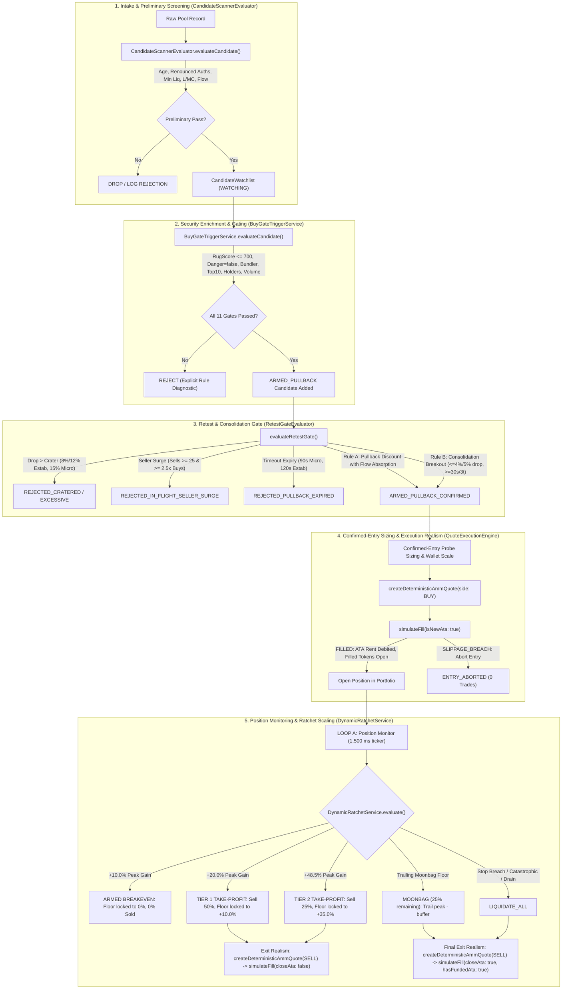

# NeXusTrade — Phase 12.94-D Milestone D.3.3: Source-Accurate PAPER Implementation Handoff

**Document ID**: `NXT-D3.3-PAPER-READINESS-ASSESSMENT-V10`  
**Location**: `docs/research-planning/phase-12.94d-milestone-d3-3-paper-readiness-assessment.md`  
**Related Closure Report**: [`audit/PHASE_12_94D_MILESTONE_D3_3_QUOTE_PILOT_003_CLOSURE_REPORT.md`](file:///u:/Projects/TopG/audit/PHASE_12_94D_MILESTONE_D3_3_QUOTE_PILOT_003_CLOSURE_REPORT.md)  
**Status**: **READ-ONLY ARCHITECTURAL SPECIFICATION & OFFLINE IMPLEMENTATION HANDOFF**  
**Execution Authority**: **THE OPERATOR PERSONALLY RUNS ALL LIVE MARKET-DATA, PAPER, SIMULATION SESSIONS, AND LONG TESTS. ZERO LIVE NETWORK CALLS OR TRADES ARE AUTHORIZED IN THIS ASSESSMENT.**

---

## 1. Actual Existing Strategy Lifecycle, Configurations & Call Sites

The production strategy implemented across [`backend/src/candidate-scanner/`](file:///u:/Projects/TopG/backend/src/candidate-scanner), [`backend/src/exits/`](file:///u:/Projects/TopG/backend/src/exits), and [`backend/src/scripts/paper-trading-daemon.ts`](file:///u:/Projects/TopG/backend/src/scripts/paper-trading-daemon.ts) does **not** execute an immediate market buy at admission followed by a fixed $+300\text{s}$ exit.

It operates as a multi-stage, state-machine driven engine with distinct market-timing confirmations, cohort-specific ratchets, multi-tier partial scaling, and moonbag lifecycle management.



### 1.1 Strategy Timing Parameters, Cohort Thresholds & Confirmed-Entry Sizing

All parameters are bound directly to active source code constants:

| Strategy Dimension                   | Micro-Cap Cohort                                                                                                                                                               | Established Cohort                                                                                                                                                               | Authoritative Call Site                                                                                                                                                                                                                       |
| :----------------------------------- | :----------------------------------------------------------------------------------------------------------------------------------------------------------------------------- | :------------------------------------------------------------------------------------------------------------------------------------------------------------------------------- | :-------------------------------------------------------------------------------------------------------------------------------------------------------------------------------------------------------------------------------------------- |
| **Cohort Definition Criteria**       | Default cohort for pools $< \$50\text{k}$ liq or age $< 1,800\text{s}$                                                                                                         | Liquidity $\ge \$50\text{k}$, live liq $\ge \$50\text{k}$, age $1,800\text{s}–7,200\text{s}$, holders $\ge 250$ (or viral runner)                                                | [`paper-trading-daemon.ts:1854-1869`](file:///u:/Projects/TopG/backend/src/scripts/paper-trading-daemon.ts#L1854-L1869)                                                                                                                       |
| **Retest Expiry Window**             | **90 seconds** (`90_000 ms`)                                                                                                                                                   | **120 seconds** (`120_000 ms`)                                                                                                                                                   | [`paper-trading-daemon.ts:1916`](file:///u:/Projects/TopG/backend/src/scripts/paper-trading-daemon.ts#L1916), [`RetestGateEvaluator.ts`](file:///u:/Projects/TopG/backend/src/candidate-scanner/RetestGateEvaluator.ts)                       |
| **Rule A: Retest Pullback Discount** | $10\%\text{ to }15\%$ discount from peak (`0.85 <= spot/peak <= 0.90`) with flow absorption (`buys60s >= 1.25 * sells60s`)                                                     | $4\%\text{ to }10\%$ discount from peak (`0.90 <= spot/peak <= 0.96`) with flow absorption (`buys60s >= 1.15 * sells60s`)                                                        | [`RetestGateEvaluator.ts`](file:///u:/Projects/TopG/backend/src/candidate-scanner/RetestGateEvaluator.ts)                                                                                                                                     |
| **Rule B: Consolidation Breakout**   | Max price drop **5%** from peak (`maxConsolidationDropPct = 0.05`), flow ratio $\ge 1.5\times$ (`minConsolidationFlowRatio = 1.5`), duration $\ge 30\text{s}$ or $\ge 3$ ticks | Max price drop **4%** from peak (`maxConsolidationDropPct = 0.04`), flow ratio $\ge 1.25\times$ (`minConsolidationFlowRatio = 1.25`), duration $\ge 30\text{s}$ or $\ge 3$ ticks | [`RetestGateEvaluator.ts`](file:///u:/Projects/TopG/backend/src/candidate-scanner/RetestGateEvaluator.ts)                                                                                                                                     |
| **Rule C: Crater Drop Ceiling**      | Drop $> 15\%$ from peak (`maxCraterDropPct = 0.15`)                                                                                                                            | Drop $> 12\%$ if absorbing ($\ge 1.15\times$), $> 8\%$ if unabsorbed (`0.12 : 0.08`)                                                                                             | [`RetestGateEvaluator.ts`](file:///u:/Projects/TopG/backend/src/candidate-scanner/RetestGateEvaluator.ts)                                                                                                                                     |
| **Rule E: In-Flight Seller Surge**   | $\text{sells60s} \ge 25$ and $\text{sells60s} \ge 2.5 \times \text{buys60s}$                                                                                                   | $\text{sells60s} \ge 25$ and $\text{sells60s} \ge 2.5 \times \text{buys60s}$                                                                                                     | [`RetestGateEvaluator.ts`](file:///u:/Projects/TopG/backend/src/candidate-scanner/RetestGateEvaluator.ts)                                                                                                                                     |
| **Milestone 0: Breakeven Arming**    | $+10.0\%$ peak gain (`armedBreakevenThresholdBps: 1000`), locks floor to $+0.0\%$, **0% sold**                                                                                 | $+10.0\%$ peak gain (`armedBreakevenThresholdBps: 1000`), locks floor to $+0.0\%$, **0% sold**                                                                                   | [`DynamicRatchetTypes.ts:129-130, 146-147`](file:///u:/Projects/TopG/backend/src/exits/DynamicRatchetTypes.ts#L129-L147), [`DynamicRatchetService.ts:108-112`](file:///u:/Projects/TopG/backend/src/exits/DynamicRatchetService.ts#L108-L112) |
| **Milestone 1: Tier 1 Take-Profit**  | $+20.0\%$ peak gain (`tier1PeakThresholdBps: 2000`), sells **50% of position**, locks floor to $+10.0\%$ (`tier1LockedFloorBps: 1000`)                                         | $+20.0\%$ peak gain (`tier1PeakThresholdBps: 2000`), sells **50% of position**, locks floor to $+10.0\%$ (`tier1LockedFloorBps: 1000`)                                           | [`DynamicRatchetTypes.ts:131-132, 148-149`](file:///u:/Projects/TopG/backend/src/exits/DynamicRatchetTypes.ts#L131-L149), [`DynamicRatchetService.ts:114-152`](file:///u:/Projects/TopG/backend/src/exits/DynamicRatchetService.ts#L114-L152) |
| **Milestone 2: Tier 2 Take-Profit**  | $+48.5\%$ peak gain (`tier2PeakThresholdBps: 4850`), sells **25% of position** (cumulative 75% sold), locks floor to $+35.0\%$ (`tier2LockedFloorBps: 3500`)                   | $+48.5\%$ peak gain (`tier2PeakThresholdBps: 4850`), sells **25% of position** (cumulative 75% sold), locks floor to $+35.0\%$ (`tier2LockedFloorBps: 3500`)                     | [`DynamicRatchetTypes.ts:133-134, 150-151`](file:///u:/Projects/TopG/backend/src/exits/DynamicRatchetTypes.ts#L133-L151), [`DynamicRatchetService.ts:154-201`](file:///u:/Projects/TopG/backend/src/exits/DynamicRatchetService.ts#L154-L201) |
| **Moonbag Lifecycle**                | Remaining **25% of position** held under trailing moonbag ratchet (`nextPeakGainBps - trailBufferBps`, floor $\ge +35.0\%$, catastrophic floor $-2.0\%$)                       | Remaining **25% of position** held under trailing moonbag ratchet (`nextPeakGainBps - trailBufferBps`, floor $\ge +35.0\%$, catastrophic floor $-2.0\%$)                         | [`DynamicRatchetService.ts:203-216`](file:///u:/Projects/TopG/backend/src/exits/DynamicRatchetService.ts#L203-L216)                                                                                                                           |
| **Pre-Breakeven Stop**               | $-12.0\%$ (`preBreakevenStopBps: -1200`)                                                                                                                                       | $-10.0\%$ (`preBreakevenStopBps: -1000`)                                                                                                                                         | [`DynamicRatchetTypes.ts:122, 139`](file:///u:/Projects/TopG/backend/src/exits/DynamicRatchetTypes.ts#L122-L139)                                                                                                                              |
| **Catastrophic Disaster Floor**      | $-20.0\%$ (`catastrophicFloorBps: -2000`)                                                                                                                                      | $-18.0\%$ (`catastrophicFloorBps: -1800`)                                                                                                                                        | [`DynamicRatchetTypes.ts:121, 138`](file:///u:/Projects/TopG/backend/src/exits/DynamicRatchetTypes.ts#L121-L138)                                                                                                                              |
| **Position Monitor Loop Ticker**     | `pollIntervalMs = 1500 ms`                                                                                                                                                     | `pollIntervalMs = 1500 ms`                                                                                                                                                       | [`paper-trading-daemon.ts:575, 1238, 1514`](file:///u:/Projects/TopG/backend/src/scripts/paper-trading-daemon.ts#L575)                                                                                                                        |
| **Discovery / Scanning Loop**        | `scanIntervalMs = 5000 ms`                                                                                                                                                     | `scanIntervalMs = 5000 ms`                                                                                                                                                       | [`paper-trading-daemon.ts:956, 1529`](file:///u:/Projects/TopG/backend/src/scripts/paper-trading-daemon.ts#L956)                                                                                                                              |

#### Actual Confirmed-Entry Sizing Path

Position sizing upon confirmed retest does **not** rely on a naive startup formula. It executes the calibrated probe sizing and risk-adjustment logic from [`paper-trading-daemon.ts:2088-2128`](file:///u:/Projects/TopG/backend/src/scripts/paper-trading-daemon.ts#L2088-L2128):

1. **Wallet Scale Factor**:
   $$\text{walletScale} = \min\left(1.25, \max\left(1.0, \frac{\text{currentCash}}{10.0}\right)\right)$$
2. **Calibrated Base Probe Size by Cohort**:
   - Established Base: $\min(0.65, \text{round}_{2}(0.50 \times \text{walletScale}))$
   - Micro-Cap Base: $\min(0.45, \text{round}_{2}(0.35 \times \text{walletScale}))$
3. **Risk Downsizing (Established Cohort)**:
   If `bundlerPct > 0.60` or `top10HolderPct > 0.30`, downsize `targetCohortSize` to $\min(0.35, \text{targetCohortSize})$.
4. **Portfolio Capital Ceiling & Gas Reserve**:
   $$\text{dynamicSize} = \max\left(0.10, \min\left(\text{targetCohortSize}, \frac{\text{currentPortfolioSol} - 0.05}{\text{maxOpenPositions}}\right)\right)$$

### 1.2 Implemented Retest Evaluator Extraction (`RetestGateEvaluator.ts`)

The retest evaluation logic previously embedded in [`backend/src/scripts/paper-trading-daemon.ts:1870-2052`](file:///u:/Projects/TopG/backend/src/scripts/paper-trading-daemon.ts#L1870-L2052) has been cleanly extracted into [`backend/src/candidate-scanner/RetestGateEvaluator.ts`](file:///u:/Projects/TopG/backend/src/candidate-scanner/RetestGateEvaluator.ts).

The pure function `evaluateRetestGate()` computes the decision without side effects:

- Evaluates first-tick arming, peak price updates, and tick counting.
- Enforces strict evaluation order: Rule C (crater drop) $\rightarrow$ Rule E (seller surge) $\rightarrow$ Rule D (timeout expiry) $\rightarrow$ Rule A (pullback discount) $\rightarrow$ Rule B (consolidation breakout).
- Preserves precedence: Rule A confirms with `RETEST_PULLBACK_DISCOUNT` over Rule B.
- Side effects (map updates, logging, telemetry via `recordTriggerRejection`, and watchlist state updates) remain in the caller.

---

## 2. Evidence-Source Decision, SPL Token Burn Accounting & Security Gaps

### 2.1 Option A (Historical Fixtures): UNAVAILABLE for Live PAPER Evaluation

Option A is **explicitly marked UNAVAILABLE for live-data PAPER evaluation**:

- The authentic historical captures (such as the C3 Raydium AMM v4 pool genesis initialization records from August 2024) prove static on-chain account parameters (pool ID, AMM authority, vault accounts, mints, decimals).
- However, historical captures contain zero live data: no current reserves, no live spot price, no current 60s flow, no current holder distribution, and no ongoing LP lock/burn verification.
- Conflating historical genesis initialization with live market conditions violates provenance. Authentic historical fixtures support separately labeled offline regression replay, and **cannot substitute for live data in a forward evaluation**.

### 2.2 LP Security & Protocol Accounting (Raydium AMM v4 Contract PROPOSED / UNAPPROVED)

The strategy's Stage 1 screening gate `ANTI_RUG_LP_SECURITY` requires $\text{lpBurnPct} \ge 90.0\%$.

#### Explicit Withdrawal of Unsupported LP Reduction Formula

The previously proposed formula:
$$\frac{L_{\text{initial}} - L_{\text{circulating}}}{L_{\text{initial}}} \times 100\%$$
is **formally withdrawn as unsound**.

In the official Raydium AMM v4 withdrawal implementation (`withdraw` instruction), liquidity redemptions burn LP tokens while returning the underlying base and quote token reserves from the pool vaults to the withdrawing liquidity providers. A formula that equates every reduction in LP tokens with burned or locked liquidity conflates routine withdrawal with true liquidity destruction.

#### Proposed Acquisition & Calculation Contract (Status: PROPOSED / UNAPPROVED)

The corrected acquisition contract has been formulated in [`phase-12.94d-milestone-d3-3-lp-security-acquisition-contract.md`](file:///u:/Projects/TopG/docs/research-planning/phase-12.94d-milestone-d3-3-lp-security-acquisition-contract.md), strictly narrowed to legacy Raydium AMM v4:

1. **Protocol-Tracked Denominator**: Raydium AMM v4 tracks `amm.lp_amount` directly in the 752-byte pool account at byte offset **720..728** (`lpReserve`). In official program source (`program/src/processor.rs`), `amm.lp_amount` ($L_{\text{protocol}}$) is the actual mathematical denominator used during liquidity withdrawals, rather than SPL mint supply.
2. **Distinct Lifecycle Mechanics**:
   - **Genesis Initialization**: Initial calculated liquidity is set in $L_{\text{protocol}}$, but an unminted minimum ($L_{\text{unminted}} = 10^6$ units) is withheld from minting. $L_{\text{protocol}} - S_{\text{current}} = L_{\text{unminted}}$ (fails 90% gate as expected).
   - **Normal Withdrawal**: Both $L_{\text{protocol}}$ and $S_{\text{current}}$ decrement by the redeemed amount. The difference $L_{\text{protocol}} - S_{\text{current}}$ remains constant; normal redemption does NOT generate protected liquidity.
   - **Direct SPL Burn**: Decrements $S_{\text{current}}$ while $L_{\text{protocol}}$ and vault reserves remain fixed. Because the AMM `withdraw` instruction divides by $L_{\text{protocol}}$, the remaining circulating supply can only redeem $\frac{S_{\text{current}}}{L_{\text{protocol}}}$ of vault reserves; the remaining fraction is permanently trapped.
3. **Smallest Defensible Calculation**:
   $$\text{lpBurnPct} = \frac{L_{\text{protocol}} - S_{\text{current}}}{L_{\text{protocol}}} \times 100\%$$
   where $L_{\text{protocol}} = \text{lpReserve}$ (offset 720..728) and $S_{\text{current}} = \text{lpMint.supply}$.
4. **Deferred Scope**: CPMM, Token-2022, third-party locker accounts, and unverified provider schemas are explicitly deferred.
5. **Approval Status**: **PROPOSED / UNAPPROVED**. No calculator is implemented and no parser is modified until formal auditor review. Candidates lacking verified evidence fail closed at Stage 1.

### 2.3 Corrected Security Score, Holder Integrity & Complete Concentration Validation

The implementation in [`BuyGateTriggerService.ts`](file:///u:/Projects/TopG/backend/src/candidate-scanner/BuyGateTriggerService.ts) has been fully hardened across parser and evaluation paths:

1. **Removed Favorable Fallback & Enforced Explicit Non-Negative Score**: The silent `score ?? 0` default has been removed. An explicitly supplied, finite, non-negative number (`score >= 0`) is strictly required. Genuine observed zero scores are preserved.
2. **Complete Malformed-Risk Validation**:
   - `data.risks` must be an Array (`!Array.isArray(data.risks) -> return null;`).
   - Every risk entry is validated against the supported schema (`level: "danger" | "warn" | "info"`).
   - Null entries, primitives (e.g. `["danger"]`), missing severity fields (e.g. `[{}]`), incorrectly typed severity (e.g. `{ level: 123 }`), empty strings (`{ level: "" }`), and unsupported severity values (e.g. `{ level: "critical" }`) fail closed (`return null;`).
   - Genuine empty risk arrays (`[]`) and supported non-danger risks (`warn`, `info`) are preserved (`hasDangerRisk: false`).
   - Valid danger risks (`danger`) correctly set `hasDangerRisk: true`.
3. **Safe Non-Negative Integer Holder Count Integrity**:
   - `totalHolders` must be a non-negative safe integer (`Number.isSafeInteger(h) && h >= 0`).
   - Fractional counts (e.g. `300.5`), negative values, and non-numeric representations fail closed (`holdersCount: undefined`).
   - Genuine observed zero holders (`holdersCount: 0`) is preserved.
4. **Strict Concentration Input Validation & Normalized Ranges**:
   - `topHolders`: Each inspected entry in the top-10 slice must be a non-null object with a valid, finite raw percentage in $[0, 100]$.
   - Malformed entries (such as `{}` or `{ pct: -10 }` or `{ pct: 150 }`) fail closed to `top10HolderPct: undefined`; malformed inputs never manufacture a false 0 concentration or negative value.
   - Genuine observed zero concentration (`pct: 0`) is preserved.
   - Normalized range is strictly enforced as $0.0 \le \text{top10HolderPct} \le 1.0$.
5. **Removal of Unsupported Provider Mappings for Bundler Concentration**:
   - The official RugCheck schema does not define a root `bundlerPct` field or establish an authoritative label-to-concentration mapping for free-text risk descriptions (e.g. `"Bundler transaction failure rate"` represents an operational failure rate, not ownership concentration).
   - Free-text label matching, string prefix parsing (`parseFloat`), and magnitude guessing are strictly removed.
   - Bundler concentration is not extracted from RugCheck reports and remains strictly unavailable (`bundlerPct: undefined`).
   - Final security qualification (`requireVerifiedHolders: true`) strictly fails closed with `BUNDLER_CONCENTRATION_UNKNOWN`.
   - Synthetic evaluator controls for Gate 11 logic remain separate from claims about verified provider responses.
6. **Fail-Closed Final Security Qualification (`requireVerifiedHolders: true`)**:
   - Requires valid evidence for all five required security metrics: `rugScore`, `hasDangerRisk`, `holdersCount`, `top10HolderPct`, and `bundlerPct`.
   - Missing or invalid metrics fail closed with explicit rejection reasons:
     - `holdersCount === undefined` or invalid: `REJECTED_RUGCHECK_UNINDEXED_OR_HOLDERS_UNKNOWN`.
     - `rugScore` or `hasDangerRisk` missing or invalid: `REJECTED_RUGCHECK_UNINDEXED_OR_HOLDERS_UNKNOWN`.
     - `top10HolderPct === undefined` or out of range: `TOP_10_CONCENTRATION_UNKNOWN`.
     - `bundlerPct === undefined` or out of range: `BUNDLER_CONCENTRATION_UNKNOWN`.
   - Threshold violations reject with their established codes: `INSUFFICIENT_HOLDERS_COUNT_FAILED`, `TOP_10_CONCENTRATION_FAILED`, `BUNDLER_CONCENTRATION_GATE_FAILED`.
   - Preliminary in-memory screening (`requireVerifiedHolders: false/undefined`) remains distinct, allowing un-enriched candidates to queue for observation without premature rejection.

---

## 3. Correct Execution Attachment & Realism Accounting

The evaluation binds directly to the real exported functions in [`QuoteExecutionEngine.ts`](file:///u:/Projects/TopG/backend/src/execution/QuoteExecutionEngine.ts) and [`ExecutionFeeModel.ts`](file:///u:/Projects/TopG/backend/src/execution/ExecutionFeeModel.ts).

### 3.1 Verified Mint Decimals (No Hardcoded 9)

Token decimals are dynamic:

- Canonical WSOL has 9 decimals (`WSOL_DECIMALS = 9`).
- RAY has 6 decimals (`RAY_DECIMALS = 6`).
- Pump tokens typically have 6 decimals; SPL tokens range from 0 to 18.
- `createDeterministicAmmQuote()` enforces `validateMintDecimals(params.tokenDecimals)`.
- Token decimals must be obtained from verified mint account data or candidate contracts.

### 3.2 Causally Sound Execution Mapping (Lookahead Guard Compliant)

According to [`QuoteExecutionEngine.ts:303`](file:///u:/Projects/TopG/backend/src/execution/QuoteExecutionEngine.ts#L303):

```typescript
if (quote.quoteInitiatedMs < decisionTimestampMs) {
  return { valid: false, reason: `[LOOKAHEAD_VIOLATION] ...` };
}
```

The market decision event occurs **at or before** quote initiation:
$$\text{decisionTimestampMs} \le \text{quoteInitiatedMs} < \text{quoteReceivedMs} < \text{fillTimestampMs} \le \text{validUntilMs}$$

```typescript
// 1. Decision occurs at currentNowMs
const decisionTimestampMs = currentNowMs;
const decisionSlot = currentSlot;

// 2. Entry Quote initiated at or after decision
const entryQuote = createDeterministicAmmQuote({
  sessionId: sessionContext.sessionId,
  generationId: sessionContext.generationId,
  decisionEventId: `dec-buy-${candidate.mintAddress}-${decisionTimestampMs}`,
  mintAddress: candidate.mintAddress,
  poolId: candidate.poolId,
  side: "BUY",
  tradeSizeSolOrTokens: dynamicSize, // Calibrated probe size
  baseReserveTokens: verifiedBaseReserveTokens,
  quoteReserveSol: verifiedQuoteReserveSol,
  tokenDecimals: verifiedTokenDecimals, // e.g. 6 for RAY
  quoteInitiatedMs: decisionTimestampMs, // Quote initiated at decision time
  contextSlot: decisionSlot,
  quoteLatencyMs: 25,
  ttlMs: 15_000,
  dexFeeRate: 0.0025,
  maxSlippageBps: 25,
});

// 3. Entry Fill Simulation (BUY)
const entryFill = simulateFill(entryQuote, {
  decisionTimestampMs, // decisionTimestampMs <= quoteInitiatedMs (Lookahead guard passed!)
  decisionSlot, // decisionSlot <= contextSlot (Slot freshness passed!)
  executionDelayMs: 150, // fillTimestampMs = quoteReceivedMs + 150ms
  isNewAta: true, // Debits 2,039,280 lamports ATA rent deposit
  arrivalSlippageBps: 5,
  sellabilityStatus: "FULLY_SELLABLE",
  computeUnits: 100_000,
  priorityFeeMicroLamports: 10_000,
});
```

### 3.3 State-Accurate ATA Accounting and Inventory Preservation

1. **ATA Creation & Funding**:
   - On BUY, `isNewAta: true` causes [`ExecutionFeeModel.calculateEntryFees()`](file:///u:/Projects/TopG/backend/src/execution/ExecutionFeeModel.ts#L61) to debit the mandatory Solana rent-exempt balance of **2,039,280 lamports** (0.00203928 SOL).
   - The position state records `hasFundedAta = true`.
2. **Partial Exits (Tier 1 50% & Tier 2 25%)**:
   - `closeAta` MUST BE `false`.
   - The token account remains open on-chain to hold remaining inventory.
   - `ataRentRefundLamports` is **0**. No rent refund is credited.
3. **Final Full Exit (Remaining Moonbag Liquidation)**:
   - `closeAta` is `true` and `hasFundedAta` is `true`.
   - `ataRentRefundLamports` of **2,039,280 lamports** is credited back to gross proceeds to yield net realized SOL.
4. **Preservation of Inventory on Failed Sell**:
   - If an exit fill fails due to `UNSELLABLE_NO_ROUTE`, `PREFLIGHT_SIMULATION_REJECTED`, or `SLIPPAGE_BREACH_REJECTED`, [`simulateFill()`](file:///u:/Projects/TopG/backend/src/execution/QuoteExecutionEngine.ts#L821) sets `remainingTokens = attemptedTokens`.
   - Unsold inventory remains preserved in the virtual wallet with conservative write-down. Tokens are never assumed sold or discarded.

### 3.4 Strict Distinction: Observed Inputs vs Modeled Execution Parameters

| Field / Parameter                       |    Classification     | Provenance & Handling                                                    |
| :-------------------------------------- | :-------------------: | :----------------------------------------------------------------------- |
| `mintAddress`                           |  **Observed Input**   | Cryptographically verified base58 Solana public key.                     |
| `poolAddress` (`ammKey`)                |  **Observed Input**   | Verified Raydium AMM v4 pool address.                                    |
| `tokenDecimals`                         |  **Observed Input**   | Mint account definition (e.g. 6 for RAY, 9 for WSOL).                    |
| `indicativePriceSol` (`priceNative`)    |  **Observed Input**   | Preserved from provider HTTP response against canonical WSOL.            |
| `contextSlot`                           |  **Observed Input**   | On-chain slot counter for freshness verification.                        |
| `baseReserveTokens` / `quoteReserveSol` |  **Observed Input**   | Verified atomic reserve balances when available.                         |
| `quoteLatencyMs`                        | **Modeled Parameter** | Modeled quote retrieval delay (default 25 ms).                           |
| `executionDelayMs`                      | **Modeled Parameter** | Modeled network transit and block inclusion latency (default 150 ms).    |
| `networkFeeLamports`                    | **Modeled Parameter** | Standard Solana transaction base fee (5,000 lamports = 0.000005 SOL).    |
| `priorityFeeLamports`                   | **Modeled Parameter** | Modeled priority compute fee (1,000 lamports).                           |
| `ataRentDepositLamports`                | **Modeled Parameter** | Solana protocol rent-exemption fee (2,039,280 lamports).                 |
| `arrivalSlippageBps`                    | **Modeled Parameter** | Modeled arrival execution slippage against constant-product curve.       |
| `sellabilityStatus`                     | **Modeled Parameter** | Preflight simulation status ("FULLY_SELLABLE" vs transfer restrictions). |

---

## 4. Feasible Request Budget & Pacing-Aware Scheduling

### 4.1 Internal Pacing Policy vs External Provider Limits

- **Configured Pacing Policy**: The project's [`GlobalResourceBudgetManager`](file:///u:/Projects/TopG/backend/src/research/prospective/GlobalResourceBudgetManager.ts) configures a minimum interval of **$\ge 2,500\text{ ms}$** between consecutive outbound HTTP requests to the same host. This is an internal, defensive rate-management invariant designed to prevent provider bans and burst congestion.
- **External Provider Ceilings**: Independently documented public provider limits (e.g. DexScreener's public documentation specifies 300 requests/minute = 5 req/s) are provider-side limits, not internal policies.

### 4.2 Observation Semantics of Cached Spot Quotes

- The position monitor loop runs at `pollIntervalMs = 1500 ms` (1.5s).
- Direct outbound HTTP requests on every 1.5s tick would violate the $\ge 2,500\text{ ms}$ pacing policy.
- Reusing a cached spot quote across 1,500 ms ticks allows the state machine to evaluate timeouts, duration thresholds, and ratchet logic without outbound network activity.
- **Crucial Clarification**: A cached quote reused across ticks is **not** a new market observation. Caching does **not** provide observation-frequency parity with true live market observations.

### 4.3 Mathematical Request Budget Derivation

| Lifecycle Phase             |          Active Duration          | Polling Cadence | Outbound HTTP Requests | Derivation Rationale                                                                       |
| :-------------------------- | :-------------------------------: | :-------------: | :--------------------: | :----------------------------------------------------------------------------------------- |
| **1. Intake & Discovery**   |         Instant ($t = 0$)         |  Single lookup  |     **1 request**      | Direct seeded pool query (`pairs/solana/{pool}`).                                          |
| **2. Security Enrichment**  |          $t = 3\text{s}$          |  Single lookup  |     **1 request**      | Metered RugCheck report lookup (if active).                                                |
| **3. Retest & Arming**      | Up to 120s (Estab) or 90s (Micro) |    Every 10s    |  **3 to 12 requests**  | Early 30s confirm: 3 requests; Full 120s retest: $120\text{s} / 10\text{s} = 12$ requests. |
| **4. Position Monitoring**  |  5-minute holding period (300s)   |    Every 15s    |    **20 requests**     | $300\text{s} / 15\text{s} = 20$ requests (respects $\ge 2,500\text{ ms}$ pacing).          |
| **5. Exit Execution Quote** |           Exit trigger            |  Single lookup  |     **1 request**      | Fresh quote upon ratchet breach or session cashout.                                        |
| **6. Fail-Safe Buffer**     |           Finalization            |    On demand    |     **4 requests**     | Reserved capacity for clean session closure.                                               |

#### Concrete Budget Outcomes by Scenario

1. **Scenario 1: Screening Rejection or Unconfirmed Retest Expiry (No Trades)**:
   - Budget: $1 \text{ (intake)} + 1 \text{ (security)} + 12 \text{ (full retest)} + 4 \text{ (buffer)} =$ **18 requests max**.
2. **Scenario 2: Early Confirmation (30s) + 5-Minute Position Hold**:
   - Budget: $1 \text{ (intake)} + 1 \text{ (security)} + 3 \text{ (early retest)} + 20 \text{ (position monitor)} + 1 \text{ (exit)} + 4 \text{ (buffer)} =$ **30 requests max**.
3. **Scenario 3: Full Retest (120s) + 5-Minute Position Hold**:
   - Budget: $1 \text{ (intake)} + 1 \text{ (security)} + 12 \text{ (full retest)} + 20 \text{ (position monitor)} + 1 \text{ (exit)} + 4 \text{ (buffer)} =$ **39 requests max**.

---

## 5. Remaining Acquisition Dependencies

LP burn is no longer an unverified hypothesis; it has been acquired and validated on-chain via the operator snapshot. The updated status of all acquisition dependencies is summarized below:

| Dimension                                   | Required Evidence / Threshold                                                                                                                                                                                            | Existing Preserved Evidence                                                                                                                                                                                                                                                   | Status & Remaining Path                                                                                                                                                                                                                                                                                                                                                                                                                                                                                                                                 |
| :------------------------------------------ | :----------------------------------------------------------------------------------------------------------------------------------------------------------------------------------------------------------------------- | :---------------------------------------------------------------------------------------------------------------------------------------------------------------------------------------------------------------------------------------------------------------------------- | :------------------------------------------------------------------------------------------------------------------------------------------------------------------------------------------------------------------------------------------------------------------------------------------------------------------------------------------------------------------------------------------------------------------------------------------------------------------------------------------------------------------------------------------------------ |
| **LP Security (`lpBurnPct`)**               | $\ge 90.0\%$ LP burn derived from on-chain accounts.                                                                                                                                                                     | **ACQUIRED & VALIDATED VIA BOUNDED CLIENT** (RAY/WSOL Reference Pair snapshot at `2026-10-27T06:35:11.779Z`, slot `461970878`).                                                                                                                                               | **ACQUISITION COMPLETED (Below Threshold)**: Verified $L = 362937054696$, $S = 362444613518$, $L - S = 492441178$, $0.135682\%$ inaccessible, 90% threshold: `false`. Sealed artifacts preserved at `data/research/snapshots/raydium-amm-v4-snapshot-AVs9TA4n-2026-10-27T06-35-11-779Z.json` and `-manifest.json`. Offline bridge implemented.                                                                                                                                                                                                          |
| **Verified Pool Reserves & Token Decimals** | Atomic base token reserve (`baseReserveTokens`), quote reserve (`quoteReserveSol`), and token decimals (`tokenDecimals`).                                                                                                | DexScreener indicative spot price (`priceNative`); canonical WSOL (9 decimals); RAY (6 decimals). Validated vault balances captured in batch snapshot (**INCOMPLETE for executable AMM reserve accounting**).                                                                 | **INCOMPLETE RESERVE ACCOUNTING**: Captured SPL token vault balances (`baseVault`, `quoteVault`) reflect raw token accounts but are strictly incomplete for executable AMM reserve accounting (omitting OpenOrders, unsettled PnL, protocol fees, and dynamic swap state). Full constant-product execution math requires verified total executable reserves, not raw vault balances alone.                                                                                                                                                              |
| **Security Metrics**                        | Risk score ($\le 700$), danger flags (`false`), verified holder count ($\ge 250$ established, $\ge 100$ micro non-negative safe integers), top 10 concentration ($\le 30\%$), bundler concentration ($\le 85\% / 50\%$). | RugCheck `/tokens/{mint}/report` response parser in `BuyGateTriggerService.ts` enforcing non-negative safe integer holders, strict top-10 concentration boundaries, and fail-closed concentration handling (`TOP_10_CONCENTRATION_UNKNOWN`, `BUNDLER_CONCENTRATION_UNKNOWN`). | **UNRESOLVED CONCENTRATION DEPENDENCY**: Standard RugCheck OpenAPI documentation does not define a root `bundlerPct` field or establish label-to-concentration mappings for risk descriptions (e.g. "Bundler transaction failure rate"). Unsupported extraction paths have been removed. Bundler concentration remains unavailable (`bundlerPct: undefined`) and fails closed with `BUNDLER_CONCENTRATION_UNKNOWN`, blocking live qualification until an authoritative provider with verified schema is integrated under `GlobalResourceBudgetManager`. |
| **Micro-Flow Observations**                 | 60-second rolling transaction counts (`recentBuys60s`, `recentSells60s`) to evaluate flow-absorption rules (1.15x / 1.25x / 1.5x) and anti-surge rules.                                                                  | DexScreener 5-minute transaction aggregates (`txns.m5.buys`, `txns.m5.sells`).                                                                                                                                                                                                | Sub-minute trade stream or websocket trade ingestion to derive authentic 60-second rolling buy/sell transaction counts.                                                                                                                                                                                                                                                                                                                                                                                                                                 |

---

## 6. Offline Implementation Status

The approved offline implementation items are completed:

1. **Retest Gate Evaluator Extraction**:
   - Implemented in [`backend/src/candidate-scanner/RetestGateEvaluator.ts`](file:///u:/Projects/TopG/backend/src/candidate-scanner/RetestGateEvaluator.ts).
   - Replaced inline decision block in [`backend/src/scripts/paper-trading-daemon.ts`](file:///u:/Projects/TopG/backend/src/scripts/paper-trading-daemon.ts).
   - 20 deterministic tests passing in [`backend/src/candidate-scanner/RetestGateEvaluator.test.ts`](file:///u:/Projects/TopG/backend/src/candidate-scanner/RetestGateEvaluator.test.ts).
2. **Missing Security Score, Holder Integrity & Concentration Input Hardening**:
   - Implemented in [`backend/src/candidate-scanner/BuyGateTriggerService.ts`](file:///u:/Projects/TopG/backend/src/candidate-scanner/BuyGateTriggerService.ts).
   - Validates explicit non-negative score, strict array type, supported risk severity (`danger`, `warn`, `info`), non-negative safe integer holder counts (rejecting fractional counts like `300.5`), and fail-closed handling for malformed risk entries and malformed holder concentration (`[{}]`, `[{ pct: -10 }]`, `[{ pct: 150 }]`).
   - Removed unsupported bundler extraction from RugCheck reports (rejecting risk label guessing, string prefix parsing, and undocumented root fields); leaves `bundlerPct: undefined` from provider responses.
   - Enforces fail-closed final security evaluation (`requireVerifiedHolders: true`) requiring valid evidence across all 5 required security metrics with explicit rejection codes (`REJECTED_RUGCHECK_UNINDEXED_OR_HOLDERS_UNKNOWN`, `TOP_10_CONCENTRATION_UNKNOWN`, `BUNDLER_CONCENTRATION_UNKNOWN`). Preliminary screening (`requireVerifiedHolders: false`) remains distinct.
   - 64 deterministic tests passing in [`backend/src/candidate-scanner/BuyGateTriggerService.test.ts`](file:///u:/Projects/TopG/backend/src/candidate-scanner/BuyGateTriggerService.test.ts).
3. **Offline LP-Screening Bridge & Regression Fixture**:
   - Implemented in [`backend/src/candidate-scanner/LpScreeningBridge.ts`](file:///u:/Projects/TopG/backend/src/candidate-scanner/LpScreeningBridge.ts).
   - Regression fixture in [`backend/src/candidate-scanner/fixtures/CapturedRaydiumAmmV4SnapshotFixture.ts`](file:///u:/Projects/TopG/backend/src/candidate-scanner/fixtures/CapturedRaydiumAmmV4SnapshotFixture.ts) wrapping authentic operator results with unabbreviated authentic raw response strings and verified SHA-256 digests.
   - Uses retained `rawResponseBody` as authoritative source for acquisition revalidation; cryptographically checks `storedResponseSha256` and enforces `wireResponseSha256` equality on unredacted payloads.
   - Rejects discrepancies between retained `parsedJson` caches and decoded stored responses (`deepEqual`).
   - Detects and rejects context-slot disagreements between wrapper/diagnostic metadata and decoded payload slots (`INVALID_EVIDENCE`).
   - Returns structured `INVALID_EVIDENCE` failures (`pool: null`, `lpFilterPassed: false`) for malformed raw payloads without throwing unhandled exceptions.
   - Enforces asynchronous evaluation (`evaluateLpScreeningBridge`) for acquisition evidence, preventing bypasses via `evaluateLpScreeningBridgeSync`.
   - Binds evidence and authoritative quantities directly to decoded account states (`poolState.lpReserve` and `lpMintState.supply`), deriving authoritative inaccessible claims via `calculateAmmV4LpInaccessibleClaims`.
   - Rejects any inconsistency between decoded account states, requested identities, validation accounting summaries, and acquisition wrappers.
   - Requires explicit freshness policy (`STALE_EVIDENCE`; historical captures cannot qualify candidate).
   - Classifies validated percentage as `DERIVED` from account observations (`metricProvenance.lpBurnPct = "DERIVED"`).
   - Evaluates pure integer cross-multiplication (`100n * (L - S) >= 90n * L`).
   - Fails closed on missing/invalid/mismatched/stale evidence with `pool: null` (no numeric 0 placeholders returned for unavailable projections).
   - Bridges to `ScannedPoolRecord` and seamlessly integrates with `AntiRugEvaluator.evaluate()` and `CandidateScannerFilterEvaluation`.
   - 34 deterministic unit tests passing in [`backend/src/candidate-scanner/LpScreeningBridge.test.ts`](file:///u:/Projects/TopG/backend/src/candidate-scanner/LpScreeningBridge.test.ts) (covering all auditor reproduction cases).
4. **Guarded Candidate Intake Integration (`CandidateStreamEngine.ts`)**:
   - Implemented in [`backend/src/candidate-scanner/CandidateStreamEngine.ts`](file:///u:/Projects/TopG/backend/src/candidate-scanner/CandidateStreamEngine.ts).
   - Connects the accepted `LpScreeningBridge` to candidate intake via an injected resolver (`lpEvidenceResolver?: LpEvidenceResolver`) and explicit freshness policy (`lpFreshnessPolicy?: LpFreshnessPolicy`).
   - Implemented explicitly enabled validated-LP mode (`requireValidatedLp?: boolean`). In validated mode, candidates must pass the accepted asynchronous bridge before LP-dependent admission can proceed. Arbitrary gate/bridge overrides removed.
   - Immutable candidate snapshot captured before the first await (`snapshotScannedPoolRecord`, `snapshotPolicy`), guaranteeing that caller mutation during resolution cannot alter the original screening outcome.
   - Strict canonical identity extraction (`resolveCanonicalIdentities`): strips provider display prefix `dexscreener-` only when suffix is a valid 32-byte Solana base58 public key, and rejects illegal token mint substitutions as pool addresses.
   - Missing resolver, missing evidence, stale evidence, identity mismatch, invalid evidence, or unsupported protocol strictly fail closed. Calling synchronous `evaluatePool()` in validated mode immediately fails closed with `UNAVAILABLE` (`REJECTED_UNLOCKED_LP_RISK`), ensuring callers cannot bypass asynchronous cryptographic checks.
   - Contained bridge evaluation failures at the intake boundary: malformed acquisition/validation results (such as missing diagnostics objects) produce structured `INVALID_EVIDENCE` rejections with zero admissions without aborting the scan loop or terminating subsequent candidates.
   - Preserves unavailable LP semantics in callbacks via nullable LP decision view (`lpBurnPct: null`, `metricProvenance.lpBurnPct: "UNAVAILABLE"`), while keeping raw provider percentages clearly separated as `rawProviderLpBurnPct` and preserving candidate identity.
   - Preserves `DERIVED` provenance and the real 0.135682% measurement for observed below-threshold results (`AVAILABLE_BELOW_THRESHOLD`).
   - Passing the LP filter (`AVAILABLE_QUALIFIED`) only permits existing remaining checks to continue (`PAIR_MATURITY_WINDOW`, `ANTI_RUG_MINT_AUTHORITY`, `ANTI_RUG_FREEZE_AUTHORITY`, `LIQUIDITY_MARKET_CAP`, `ORGANIC_FLOW`). Candidate admitted only if all remaining checks pass.
   - 25 comprehensive deterministic unit tests passing in [`backend/src/candidate-scanner/CandidateStreamEngine.test.ts`](file:///u:/Projects/TopG/backend/src/candidate-scanner/CandidateStreamEngine.test.ts).
5. **Guarded Candidate Watchlist LP Eligibility & Deactivation (`CandidateWatchlistService.ts`)**:
   - Implemented in [`backend/src/candidate-scanner/CandidateWatchlistService.ts`](file:///u:/Projects/TopG/backend/src/candidate-scanner/CandidateWatchlistService.ts) and [`shared/src/phase12-dashboard-schemas.ts`](file:///u:/Projects/TopG/shared/src/phase12-dashboard-schemas.ts).
   - Removed stale fallback assignment `lpBurnPct: pool.lpBurnPct ?? existing.lpBurnPct` which previously substituted historical passing percentages into updates where current evidence was unavailable.
   - Enforces current LP eligibility checks before both new admission and existing-entry updates/reactivations. Missing (`null`), invalid, or below-threshold current LP data explicitly deactivates existing entries (`status: "DROPPED"`, `rejectionReason: "REJECTED_UNLOCKED_LP_RISK"`).
   - Prevents resurrection of `DROPPED` candidates when current LP is missing (`null`) even in the presence of strong bullish volume/flow (`buys5m >= 25`, ratio $\ge 1.8$).
   - Explicitly records current LP measurement (`lpBurnPct: pool.lpBurnPct`) on deactivated and updated items, preserving previous passing values strictly in separate historical context (`historicalLpBurnPct`).
   - Added active-watchlist accessors `getActiveWatchlist()` and `getActiveCandidates()` (aliasing `getActiveWatchingItems()`) to ensure complete exclusion of deactivated or non-qualifying entries.
   - 13 comprehensive unit tests passing in [`backend/src/candidate-scanner/CandidateWatchlistService.test.ts`](file:///u:/Projects/TopG/backend/src/candidate-scanner/CandidateWatchlistService.test.ts).
6. **Metered Raydium AMM v4 LP Evidence Adapter (`RaydiumAmmV4LpEvidenceAdapter.ts`) & Audit Hardening**:
   - Implemented in [`backend/src/candidate-scanner/RaydiumAmmV4LpEvidenceAdapter.ts`](file:///u:/Projects/TopG/backend/src/candidate-scanner/RaydiumAmmV4LpEvidenceAdapter.ts).
   - Composes the bounded 2-request acquisition client (`acquireRaydiumAmmV4Snapshot`) to `CandidateStreamEngine`'s injected `CandidateLpEvidenceResolver` interface.
   - Binds each acquisition strictly to the canonical candidate pool address and token mint with zero reference-pool fallback or substitution.
   - Requires an explicitly supplied transport; rejects instantiation without transport to prohibit accidental live networking.
   - Meters every actual outbound HTTP dispatch through a shared `GlobalResourceBudgetManager`, enforcing global ceilings, purpose reservations (`CANDIDATE_ENRICHMENT`), and provider pacing ($\ge 2,500\text{ ms}$) across candidates.
   - **Respects Unsuccessful Acquisition Results**: Storage failures (e.g. `EVIDENCE_STORAGE_FAILED`) or acquisition errors fail closed at the adapter boundary while preserving diagnostics, preventing failed acquisition results from qualifying candidates. Successfully acquired below-threshold measurements ($0.135682\% < 90\%$) remain available as below-threshold evidence (`AVAILABLE_BELOW_THRESHOLD`).
   - **Unified Effective Deadline**: Enforces one unified deadline covering initial shared pacing, acquisition execution, and transport-wrapper pacing waits. Checks remaining budget and AbortSignal cancellation before sleeping, recording, or dispatching each request. Insufficient time or cancellation prevents dispatch and admission.
   - **Reconciled Dispatch Accounting & Explicit Execution State**: Replaced error-message heuristics (`msg.includes("BUDGET_DENIED")`) and loose error labels with an explicit trusted wrapper contract (`TransportDispatchTracker`). Dispatch status is determined by explicit execution state transitions at the moment underlying transport invocation begins. Once transport invocation commences, attempts remain counted across transport rejection, gateway errors, timeouts, and response body read failures. Genuine pre-dispatch budget denials and deadline expirations before transport invocation remain uncounted and separately identified (`PRE_DISPATCH_BUDGET_DENIED` vs `Network error`). Underlying transport calls, shared budget manager attempts, and acquisition evidence `httpAttempts` agree consistently before evidence hashing and manifest sealing.
   - **Response-Body Timeout Lifetime & Stalled Stream Fail-Closed Protection**: Keeps timeout protection active through both transport invocation and complete response-body reading (`response.text()`). Timer cancellation occurs strictly in an outer cleanup block wrapping both transport invocation and payload stream consumption. A timed-out response body read aborts promptly via the request's `AbortController`, classifies the failure as a dispatched request error with attempt counted in evidence and budget, and fails closed without advancing to Request 2 or qualifying the candidate.
   - **CI Test Suite Isolation & Canonical Fixture Hygiene**: Resolved git-ignore exclusions for authentic operator snapshots in `data/research/snapshots/` to guarantee deterministic offline replay in fresh CI checkouts. Hardened synthetic test fixtures in `RaydiumLiveDiscoveryClient.test.ts` and `PilotLiveCollector.test.ts` to generate strictly valid 32-byte canonical Solana base58 public keys, preserving schema adapter contracts.
   - Preserves truthful provenance (`SYNTHETIC_FIXTURE` vs `CAPTURED_RPC`) and explicit freshness policies.
   - 22 comprehensive unit tests passing in [`backend/src/candidate-scanner/RaydiumAmmV4LpEvidenceAdapter.test.ts`](file:///u:/Projects/TopG/backend/src/candidate-scanner/RaydiumAmmV4LpEvidenceAdapter.test.ts).
7. **Authentic Rolling 60-Second Trade Flow Tracker (`RollingTradeFlowTracker.ts`) & Retest Gate Hardening**:
   - Implemented in [`backend/src/candidate-scanner/RollingTradeFlowTracker.ts`](file:///u:/Projects/TopG/backend/src/candidate-scanner/RollingTradeFlowTracker.ts) and [`backend/src/candidate-scanner/RetestGateEvaluator.ts`](file:///u:/Projects/TopG/backend/src/candidate-scanner/RetestGateEvaluator.ts).
   - Replaced naive estimation (dividing 5-minute totals by 5) with an authentic event-driven rolling trade flow tracker.
   - **Complete Window Coverage & Separation of Trade Time vs Observation Timeline**: Rejects recent-heartbeat false passes. Requires continuous observation checkpoints; silence intervals $\ge 15\text{s}$ are recorded as collection gaps. Ingesting delayed trade events populates candidate counts, but explicitly _does not update the observation timeline_ or fabricate stream coverage. Only source-supported checkpoints/completed ranges establish window completeness. Both endpoints of completed ranges are strictly validated against the current clock and allowed skew before any state mutation; invalid or future-dated ranges are rejected without advancing coverage or inserting invalid gaps.
   - **Strict Capacity Bounds on Events, Deduplication, and Gap Metadata**: Enforces storage capacity limits during ingestion. Never silently drops active-window events; records capacity loss and keeps flow coverage unavailable (`CAPACITY_LOSS`) until the affected interval has fully expired beyond the lookback window. Gap metadata is strictly bounded during insertion: coalesces overlapping intervals and conservatively merges closest adjacent intervals to enforce `maxGapsRetained` without discarding missing-data information or restoring false coverage. Merged diagnostic text is strictly capped to a documented 256-character bound (`MAX_STREAM_GAP_REASON_CHARS`) using a bounded unique set of reason codes on insertion and across all merge paths.
   - **Immutable Snapshotting, Configuration & Temporal Validation**: Snapshots and freezes accepted events and gap records (`Object.freeze`). Derives and validates canonical swap coordinates (`${signature}:${outerInstructionIndex}:${swapIndex}`), preventing double-counting with altered event IDs. Constructor strictly validates all options (rejecting `NaN`, `Infinity`, non-integers, and out-of-bounds parameters for `maxGapsRetained`, `maxDeduplicationKeys`, `retentionWindowMs`, `maxFutureSkewMs`, etc.). Ingestion enforces temporal coherence: rejects future-dated receipts (`FUTURE_DATED_RECEIPT_TIMESTAMP`), contradictory block times vs event timestamps (`CONTRADICTORY_TIMESTAMPS`), and event timestamps in the future relative to receipt timestamps.
   - **Strict Lookback Configuration**: Strategy-facing counts are strictly tied to an exact 60,000 ms window; non-60,000 ms configurations and invalid evaluation timestamps (`NaN`, non-integers) fail closed with explicit errors.
   - **Retest Boundary Enforcement**: Typed `FlowCoverageStatus` (`SUFFICIENT`, `WARM_UP`, `COLLECTION_GAP`, `STALE_DATA`, `CAPACITY_LOSS`, `PROCESSING_BACKLOG`, `UNINITIALIZED`). Requires trustworthy sufficient coverage and finite, non-negative integer counts before flow can support confirmation. Unverified legacy inputs fail closed (`WAITING`), while preserving protective crater drop ceilings (8% unabsorbed, 12% absorbed, 15% micro-cap) and timeout expirations.
   - 40 comprehensive unit tests passing in [`backend/src/candidate-scanner/RollingTradeFlowTracker.test.ts`](file:///u:/Projects/TopG/backend/src/candidate-scanner/RollingTradeFlowTracker.test.ts).
   - 20 unit tests passing in [`backend/src/candidate-scanner/RetestGateEvaluator.test.ts`](file:///u:/Projects/TopG/backend/src/candidate-scanner/RetestGateEvaluator.test.ts).
8. **Offline Raydium AMM v4 Swap Decoder & Normalization Adapter (`RaydiumAmmV4SwapDecoder.ts`) & Audit Hardening**:
   - Implemented in [`backend/src/candidate-scanner/RaydiumAmmV4SwapDecoder.ts`](file:///u:/Projects/TopG/backend/src/candidate-scanner/RaydiumAmmV4SwapDecoder.ts).
   - **Immutable Pinned Source Reference & Tag/Layout Matrix**: Pinned strictly to immutable official commit `91739d8d9f5cf347e0ce14ebe4d2bb7069fb31b6` (`raydium-io/raydium-amm` `program/src/processor.rs`). Enforces a strict layout matrix matching instruction tags to verified account counts:
     - Legacy tags 9 (`SwapBaseIn`) & 11 (`SwapBaseOut`): Exactly 17 accounts (`LEGACY_17_ACCOUNTS`: `amm: 1, baseVault: 4, quoteVault: 5, userSource: 14, userDestination: 15, userOwner: 16`) or 18 accounts (`LEGACY_18_ACCOUNTS_TARGET_ORDERS`: conditionally consumes optional `target_orders` at index 4, shifting all subsequent positions +1: `baseVault: 5, quoteVault: 6, userSource: 15, userDestination: 16, userOwner: 17`). Rejects 8-account layout with `UNSUPPORTED_LAYOUT`.
     - Clean V2 tags 16 (`SwapBaseInV2`) & 17 (`SwapBaseOutV2`): Exactly 8 accounts (`V2_8_ACCOUNTS`: `amm: 1, baseVault: 3, quoteVault: 4, userSource: 5, userDestination: 6, userOwner: 7`). Rejects 17 or 18-account layouts with `UNSUPPORTED_LAYOUT`.
   - **Invocation-Scoped Evidence Attribution & Subtree Partitioning**:
     - Inner instructions are grouped strictly by parent outer instruction index (`innerGroupsByParent = new Map<number, DecodableInstruction[]>()`), adhering strictly to Solana RPC structures (`https://solana.com/docs/rpc/json-structures#inner-instructions`). Reversing group order while preserving `group.index` does not alter swap reporting order or swap-to-transfer attribution.
     - **Verified CPI Call-Tree Boundaries & Sibling Transfer Exclusion**: Inner CPI swaps under a router/aggregator isolate their invocation subtree using verified `stackHeight` (Solana CPI execution structure: `https://solana.com/docs/core/cpi/cpi-execution`) and log invocation depths/descendant counts (`resolveInvocationSubtree`), eliminating fragile "next Raydium instruction" heuristics. Later sibling instructions (such as a router transfer into the quote vault occurring after Raydium returns) are strictly excluded from the swap slice, preventing spurious `CONFLICTING_EVIDENCE` rejections. Discrepancies between `stackHeight` and logs fail closed with `CONFLICTING_EVIDENCE`; ambiguous or unresolvable call trees fail closed with `UNSUPPORTED_CALL_TREE`.
     - **Strict LIFO Call-Stack & Incomplete Trace Invalidation**: `parseInvocationFrames` enforces strict LIFO completion (`success` and `failed` logs must match the active stack top, preventing parent completions before child completions). Enforces depth invariants (depth $\ge 1$, empty stack starts at 1, nested invoke must be `top.depth + 1`). Any incomplete or inconsistent execution stack (depth 0, skipped depth transitions, or unclosed non-Raydium child frames at end of trace) invalidates all Raydium frames (`failed: true, success: false`), failing affected decodings closed with `INVOCATION_FAILED`.
     - Call-stack log ownership: `ray_log` events are attributed strictly to the currently executing program frame at the top of `activeStack`, not the nearest Raydium ancestor. Child program logs (e.g. child BUY log emitted inside Raydium SELL) are ignored and do not corrupt the Raydium frame.
     - Ambiguous trace rejection: multiple `ray_log`s in a single Raydium frame fail closed with `AMBIGUOUS_DIRECTION`. Unclosed frames at the end of logs fail closed with `INVOCATION_FAILED`.
     - Multi-way cross-validation: cross-checks applicable log type (tag 9/16 $\to$ logType 3, tag 11/17 $\to$ logType 4), direction (`PC2Coin` vs `Coin2PC`), exact in-amount, and exact out-amount across transfers, logs, and instruction parameters. Same-direction transfers reporting 200/180 vs log reporting 100/90 fails closed with `CONFLICTING_EVIDENCE`.
   - **Strict Input Validation & Non-Compacting Fail-Closed Semantics**:
     - `resolveTransactionAccounts`: null, undefined, non-string, or empty static/loaded account keys return `null` and fail closed with `MALFORMED_INSTRUCTION_DATA` without dropping, shifting, or compacting index positions (preventing synthetic BUY events from shifted keys).
     - Validates nested structures before processing: null instructions, null inner-instruction groups, null inner instructions, or non-string log messages return `MALFORMED_INSTRUCTION_DATA` without throwing exceptions and emit 0 events.
     - `decodeInstructionData`: validates byte arrays element-by-element (`Number.isInteger(b) && b >= 0 && b <= 255`). Rejects negative (e.g. `-240`), fractional, non-finite, or out-of-range values with `null` (never coerced to byte 16 `SwapBaseInV2`). Avoids heuristic base64 decoding on base58 failure.
     - `RaydiumAmmV4SwapNormalizationAdapter`: handles all malformed inputs cleanly without throwing exceptions.
   - **Proven Successful Execution**:
     - Requires explicit `meta` presence and explicit `meta.err === null`; missing or undefined `meta.err` fails closed with `TRANSACTION_NOT_SUCCESSFUL`.
     - Requires proven invocation success in execution logs (`Program 675k... success`); caught CPI errors fail closed with `INVOCATION_FAILED`. Inner CPI calls without log messages fail closed with `INVOCATION_FAILED`.
   - **Pool Boundary Validation & Context Freezing**:
     - `createTrackedRaydiumPoolContext`: `poolAddress` is mandatory and must be a canonical Solana Base58 key; rejects missing or invalid keys with zero fallback to vault accounts.
     - `validateTrackedPoolContext`: strictly validates mint consistency, vault differentiation, and orientation (`TOKEN_BASE_SOL_QUOTE`, `SOL_BASE_TOKEN_QUOTE`, `NON_SOL_PAIR`).
     - Adapter freezes context against caller mutation (`Object.freeze`).
     - Non-WSOL quote tokens leave `solAmount` undefined; non-WSOL quantities are never labeled as SOL.
   - **Malformed Payload & Temporal Integrity**:
     - Non-object or `null` payloads return structured `INVALID_PAYLOAD` without throwing.
     - Out-of-bounds instruction account indices fail closed with `MALFORMED_INSTRUCTION_DATA` without dropping or shifting positions.
     - Missing, non-finite, or non-positive `blockTime` fails closed with `MISSING_UPSTREAM_TIMESTAMP` without manufacturing time from receipt time.
   - **Fail-Closed Coverage Guarantee**: Normalization adapter bridges decoded events into `RollingTradeFlowTracker`; ingesting transactions strictly populates trade events and never fabricates stream checkpoints or advances window coverage.
   - 55 comprehensive unit tests passing in [`backend/src/candidate-scanner/RaydiumAmmV4SwapDecoder.test.ts`](file:///u:/Projects/TopG/backend/src/candidate-scanner/RaydiumAmmV4SwapDecoder.test.ts).
9. **Ubuntu CI Duplicate Decision ID Collision Resolution (`PilotLiveCollector.test.ts`)**:
   - In `makeCanonicalTestPubkey`, updated byte offset for writing test IDs from byte 0 to byte 2.
   - Eliminated identical 8-character Base58 prefixes (`3JEw2Z6V`) across distinct test mints (`pumpMint1` vs `pumpMint2`) that previously triggered duplicate decision event ID collisions (`evt-ds-${mint.slice(0, 8)}-${decisionEpochMs}`) and caused test timeouts on Ubuntu CI runners.
   - All 82 tests in [`backend/src/research/pilot/PilotLiveCollector.test.ts`](file:///u:/Projects/TopG/backend/src/research/pilot/PilotLiveCollector.test.ts) pass cleanly.
10. **Bounded Raydium AMM v4 Transaction Source Adapter (`RaydiumAmmV4TransactionSourceAdapter.ts`)**:
    - Implemented in [`backend/src/candidate-scanner/RaydiumAmmV4TransactionSourceAdapter.ts`](file:///u:/Projects/TopG/backend/src/candidate-scanner/RaydiumAmmV4TransactionSourceAdapter.ts).
    - **Independently Accepted at Commit `4fbe4be`**: All 42 unit and cancellation/deadline reproduction tests pass cleanly.
    - Connects injected transaction-signature notifications to bounded `getTransaction` retrieval, `RaydiumAmmV4SwapNormalizationAdapter` decoding, and `RollingTradeFlowTracker` ingestion strictly offline.
    - **Independent Audit Corrections (Findings 1 - 6 Resolved)**:
      1. _Immutable Identity Binding & Envelope Validation_:
         - Injected notifications are validated and deeply frozen on intake (`validateAndSnapshotNotification`), guaranteeing caller object mutation cannot alter fetched signatures.
         - Null, undefined, or non-object notifications fail closed with `INVALID_NOTIFICATION` without throwing.
         - Validates returned JSON-RPC transaction signature against requested signature (`RESPONSE_SIGNATURE_MISMATCH`).
         - Detects contradictory slot or blockTime metadata between notification and RPC response, failing closed with zero ingested events (`CONTRADICTORY_METADATA`).
      2. _Loss Preservation, Backlog Reporting & Partial Ingestion Accounting_:
         - Connects `TRANSACTION_NOT_FOUND` (`result: null`) directly to tracker collection gaps, invalidating false `SUFFICIENT` window coverage.
         - Buffers loss gaps occurring before tracker injection (`pendingGaps` buffer) and flushes them into the tracker on intake (`flushPendingGaps`).
         - Verifies that queue draining alone never erases recorded collection gaps.
         - Accurately classifies and reports partial ingestion failures (e.g. tracker capacity limits) with `PARTIAL_INGEST_FAILED`, `ok: false`, preserving actual ingested count and recording a collection gap.
      3. _Active Deduplication Protection & Workload Bounds_:
         - Partitions deduplication into `activeSignatures` (protected queued + in-flight set, immune to FIFO eviction) and `completedSignatures` (bounded FIFO historical cache up to `maxDeduplicationKeys`).
         - Enforces a unified active workload ceiling across direct and queued calls (`pendingQueue.length + inFlightCount < maxPendingQueueSize`), rejecting overflows fail-closed with `QUEUE_OVERFLOW`.
         - Preserves FIFO admission ordering across cancellation and enforces deadline expiry during admission wait.
      4. _Deadlines & Timeout Protection_:
         - Validates constructor and per-operation numeric options (rejecting `NaN`, non-integers, and ceiling violations).
         - Rechecks remaining deadline before dispatch AND immediately before tracker ingestion (post-body read).
         - Enforces `validateState` lifecycle and cancellation checks before dispatch and before tracker ingestion across both single-notification (`processNotification` / `processNextPending`) and batch (`processAllPending`) processing paths.
         - Aborts stalled response-body reads promptly via timeout controller (`REQUEST_TIMEOUT`, `httpAttempts: 1`).
      5. _Effective Pacing, Capacity Reservation & Transport Policy_:
         - Adapter enforces its own provider pacing ($\ge 2,500\text{ ms}$) regardless of budget manager spacing settings.
         - Routine trade retrieval defaults to purpose `CANDIDATE_ENRICHMENT`, strictly preserving reserved forward observation requests (`minReservedForwardRequests = 4`).
         - Sets `redirect: "error"` transport policy on fetch to prevent unmetered redirect loops.
      6. _Sanitized Diagnostics_:
         - Redacts endpoint API keys, secret URL paths, and query credentials to `[REDACTED]` across all diagnostics and error messages.
    - **Fail-Closed Coverage Guarantee**: Successful retrieval, an empty queue, or notification receipt alone NEVER establishes complete 60-second window coverage. Ingesting transactions strictly populates trade events and never fabricates stream checkpoints or advances window coverage (`status` remains non-`SUFFICIENT` without explicit observation checkpoints).
    - **Honest Throughput Disclosure**: Under $\ge 2,500\text{ ms}$ spacing, a single RPC provider sustains $\le 24\text{ transaction retrievals/min}$. Because multiple candidate swaps can occur within a single transaction, request capacity is measured in transaction retrievals, not individual trades. High-frequency pools with transaction arrival rates exceeding this ceiling cannot maintain complete coverage via paced `getTransaction` retrievals, as processing backlogs or queue drops will trigger `PROCESSING_BACKLOG` or `COLLECTION_GAP`. Paid providers, relaxed pacing, and unverified log-only parsing are not approved solutions.
    - 44 comprehensive unit tests passing in [`backend/src/candidate-scanner/RaydiumAmmV4TransactionSourceAdapter.test.ts`](file:///u:/Projects/TopG/backend/src/candidate-scanner/RaydiumAmmV4TransactionSourceAdapter.test.ts).

11. **Per-Candidate WebSocket Subscription Coordinator (`RaydiumCandidateSubscriptionCoordinator.ts`)**:
    - Implemented in [`backend/src/candidate-scanner/RaydiumCandidateSubscriptionCoordinator.ts`](file:///u:/Projects/TopG/backend/src/candidate-scanner/RaydiumCandidateSubscriptionCoordinator.ts).
    - Provides offline integration connecting per-candidate WebSocket subscription lifecycle handling to the accepted `RaydiumAmmV4TransactionSourceAdapter` and `RollingTradeFlowTracker`.
    - **Independently Accepted at Commit `cbf2cf5`**: All 30 focused unit and regression tests pass independently, including synthetic-proof separation and malformed-frame uncertainty reproductions. Production source completeness remains an unresolved readiness requirement; this acceptance does not authorize live execution.
    - **API Provider Strategy & Cost Roadmap Reference**: For the project-internal provider capability matrix, rate limits, credit usage, and free-first upgrade sequencing across DexScreener, RugCheck, Jupiter, Raydium, Helius, Solana RPC, Birdeye, QuickNode, Alchemy, and Solscan, see [`docs/research-planning/api-provider-capabilities-and-cost-roadmap.md`](file:///u:/Projects/TopG/docs/research-planning/api-provider-capabilities-and-cost-roadmap.md).
    - **Independent Review Hardening (Findings 1 - 5 & Two Remaining Corrections Resolved)**:
      1. _Immutable Candidate Snapshotting & Complete Binding Validation_:
         - Clones and freezes candidate pool context on intake; caller mutations after construction cannot cause program-wide subscriptions.
         - Enforces full 8-field comparison against adapter context (`poolId`, `candidateTokenMint`, `quoteTokenMint`, `baseVault`, `quoteVault`, `baseMint`, `quoteMint`, `orientation`) and tracker identifiers.
         - Exact candidate pool mentions only (`{ mentions: [candidatePoolId] }`); program-wide IDs fail closed.
         - Strictly requires injected transport (`ISolanaWebSocketTransport`); native WebSockets and default network calls are banned.
      2. _Subscription Lifecycle, Idempotency & Reconnection Gap Preservation_:
         - Manages connection lifecycle state machine: `DISCONNECTED` $\rightarrow$ `CONNECTING` $\rightarrow$ `SUBSCRIBING` $\rightarrow$ `SUBSCRIBED` $\rightarrow$ `CLOSED`.
         - Idempotent subscription initiation prevents duplicate `logsSubscribe` dispatches on repeated open events.
         - Connection epoch isolation rejects delayed messages or acknowledgments from prior transport generations.
         - Transport replacement and connection drops immediately record collection gaps in the tracker (`TRANSPORT_REPLACEMENT_INTERRUPTION`, `SUBSCRIPTION_DISCONNECT`).
      3. _Immediate Source Invalidation & Usable Flow Nulling_:
         - Disconnected or closed coordinator immediately invalidates usable flow across `evaluateFlow()`, `createRetestSpotInfo()`, and `getCoverageDiagnostic()`, returning `COLLECTION_GAP` and null buy/sell counts without waiting for a reconnect.
         - Preserves source loss without waiting for a reconnect.
      4. _Active-Source Contract Validation & Uncertainty Preservation_:
         - Validates JSON-RPC version (`'2.0'`), non-negative integer IDs, slot, context, err, logs, and base58 signature format.
         - Any active-source corruption—including unparseable JSON fragments, JSON `null` frames, non-object frames, non-string `logs` entries (e.g. `[null, 123]`), non-compliant `err` values (e.g. `err = 42`), or unrecognized active frames—immediately records a collection gap in the tracker to preserve collection uncertainty.
         - Identifiable unrelated subscriptions (`subId !== activeSubscriptionId`) continue to be dropped cleanly without recording candidate losses.
         - Draining pending adapter queue items or successfully processing subsequent work cannot erase recorded collection gaps or restore false coverage in the tracker.
      5. _Strict Separation of Synthetic Completeness Proofs & Production Evaluation_:
         - Explanatory text strings are flatly rejected as completeness proof (`UNTRUSTED_COMPLETENESS_PROOF`).
         - Default production configuration rejects synthetic completeness proofs (`SYNTHETIC_PROOFS_DISALLOWED`), requiring explicit offline opt-in (`allowSyntheticCompletenessProofs: true`).
         - Under default production configuration, `evaluateFlow()`, `createRetestSpotInfo()`, and `getCoverageDiagnostic()` retain unavailable flow counts (`isCoverageSufficient: false`, `recentBuys60s: null`, `recentSells60s: null`), preventing synthetic completeness from becoming usable production retest input.
         - Production source completeness via gapless block-range polling remains an explicit, unresolved readiness gap (`COMPLETENESS_MECHANISM_UNAVAILABLE`).
      6. _Resource Option Validation & Diagnostic Sanitization_:
         - Validates constructor options (rejecting `NaN`, negative, or non-integer budgets).
         - Sanitizes transport errors, close reasons, and URLs, redacting API keys, secrets, and credentials in `onLog`.
    - 30 comprehensive unit and regression tests passing in [`backend/src/candidate-scanner/RaydiumCandidateSubscriptionCoordinator.test.ts`](file:///u:/Projects/TopG/backend/src/candidate-scanner/RaydiumCandidateSubscriptionCoordinator.test.ts).

12. **Bounded Exact-Pool History Enumerator (`ExactPoolHistoryEnumerator.ts`)**:
    - Implemented in [`backend/src/candidate-scanner/ExactPoolHistoryEnumerator.ts`](file:///u:/Projects/TopG/backend/src/candidate-scanner/ExactPoolHistoryEnumerator.ts).
    - Specification: [`docs/research-planning/exact-pool-signature-reconciliation-spec.md`](file:///u:/Projects/TopG/docs/research-planning/exact-pool-signature-reconciliation-spec.md).
    - Provides an isolated offline helper discovering transaction signatures between witnessed on-chain boundaries for a single validated pool context (`TrackedRaydiumPoolContext`).
    - **Strictly Scoped First Patch**: Signature discovery only. Full transaction retrieval (`getTransaction`) and trade flow ingestion (`RollingTradeFlowTracker.ingestTrade`) remain separate integration work.
    - **Shared Resource Identity & Pacing**: Defaults to canonical provider identity `"SOLANA_RPC"` matching the transaction adapter. Accounts all queries strictly under `CANDIDATE_ENRICHMENT` via `GlobalResourceBudgetManager`, respecting the 10-enrichment cap (`maxEnrichmentAttempts = 10`), global ceiling (`maxTotalRequests = 50`), reserved forward quote capacity (`minReservedForwardRequests = 4`), and provider pacing ($\ge 2,500\text{ ms}$). Automatically handles recoverable pacing waits (`PROVIDER_PACING_NOT_MET`) within the operation deadline, re-checking admission after waiting. Quota and reservation denials remain terminal; zero unbudgeted retries or automatic budget resets.
    - **In-Flight Cancellation & Deadline Enforcement**: Races in-flight fetch promises against operation deadlines, caller signals, cancellation callbacks, and coordinator lifecycle transitions; discards late/stalled responses without mutating retained records.
    - **Post-Await State Validation & Frozen Control State**: Rechecks deadline, caller cancellation, lifecycle status, and connection epoch immediately post-await before inspecting or retaining records. Snapshots oldest record metadata into an immutable structure (`OldestRecordSnapshot`) to isolate pagination from caller mutations.
    - **Schema & Traversal Validation**: Validates canonical 64-byte Ed25519 signatures, requires documented `err` property (safely handling cyclic or non-serializable errors), preserves nullable `confirmationStatus` without string coercion, rejects contradictory `confirmationStatus` (`processed` under `confirmed`), rejects oversized pages exceeding `pageSize`, and rejects within-page and across-page slot ordering inversions and before-boundary violations.
    - **Capacity Bound & Immutable Deep-Freezing**: Checks `maxRetainedRecords` capacity before record insertion (ensuring partial failure results respect bounds) and deeply clones and freezes all retained metadata upon receipt.
    - **Evidence-Only Contract**: Returns immutable `HistoryEnumerationResult` with candidate provenance metadata (`candidatePoolId`, `connectionEpoch`) and permanently literal `isProductionCompletenessEstablished = false`. Does not advance persistent watermark cursors, clear tracker stream gaps, or enable production retest inputs. Production source completeness remains an unresolved readiness gap.
    - 44 comprehensive offline tests passing in [`backend/src/candidate-scanner/ExactPoolHistoryEnumerator.test.ts`](file:///u:/Projects/TopG/backend/src/candidate-scanner/ExactPoolHistoryEnumerator.test.ts).

13. **Bounded Exact-Pool Transaction Resolution Bridge (`ExactPoolTransactionResolutionBridge.ts`)**:
    - Implemented in [`backend/src/candidate-scanner/ExactPoolTransactionResolutionBridge.ts`](file:///u:/Projects/TopG/backend/src/candidate-scanner/ExactPoolTransactionResolutionBridge.ts).
    - Specification: [`docs/research-planning/exact-pool-signature-reconciliation-spec.md`](file:///u:/Projects/TopG/docs/research-planning/exact-pool-signature-reconciliation-spec.md).
    - Consumes witnessed history enumeration results and resolves discovered transaction signatures through the accepted `RaydiumAmmV4TransactionSourceAdapter` into decoded swaps and `RollingTradeFlowTracker` ingestion.
    - **Complete Immutable Candidate Binding & Provenance Validation**: Snapshots and freezes `poolContext` on intake. Enforces full 8-field identity comparison against adapter context (`poolId`, `candidateTokenMint`, `quoteTokenMint`, `baseVault`, `quoteVault`, `baseMint`, `quoteMint`, `orientation`). Verifies both tracker pool ID and token mint against candidate pool context. Explicitly requires a valid non-negative integer `connectionEpoch` on incoming enumeration results, rejecting mismatches or omissions fail-closed (`PROVENANCE_MISMATCH`) before any requests.
    - **Unwitnessed Anchor Rejection**: Strictly rejects enumeration results without a witnessed anchor (`UNWITNESSED_ANCHOR_REJECTED`) with zero outbound requests.
    - **Shared Resource Configuration & Ingestion Path**: Verifies that adapter shares the identical `GlobalResourceBudgetManager`, canonical `providerName="SOLANA_RPC"`, and `requestPurpose="CANDIDATE_ENRICHMENT"`. Resolves signatures exclusively via `adapter.processNotification()`; no duplicate or independent `getTransaction` queries. Preserves shared accounting, host pacing ($\ge 2,500\text{ ms}$), capacity reservation, and session ceilings. Request accounting is owned by the adapter.
    - **Pre-Dispatch & Pre-Ingestion Lifecycle/Cancellation Enforcement**: Checks caller cancellation, deadline, coordinator status, and connection epoch before dispatch after pacing waits and immediately before tracker swap ingestion (via injected `validateState` callback, forwarded through both single-notification and batch `processAllPending()` adapter paths). Disallows HTTP dispatch and tracker mutation after lifecycle invalidation. Preserves all work that actually occurred in aggregate counts (`totalIngestedSwaps`) even if final outcome is cancellation or lifecycle failure. Combines constructor and per-call cancellation probes so an un-aborted per-call signal cannot override an aborted constructor signal.
    - **Chronological Replay**: Dispatches discovered signatures in chronological (oldest-first) order from anchor forward to target.
    - **Conservative Duplicate Reporting**: Replaces unsupported prior-evidence success shortcuts with conservative `DUPLICATE_UNRESOLVED` classification. Any adapter `DUPLICATE_NOTIFICATION` outcome is classified as `DUPLICATE_UNRESOLVED` and counted in failed totals (`totalFailed++`, `totalDuplicatesUnresolved++`) without crediting recovery (`totalResolved` is not incremented, `totalDuplicatesResolved` remains 0). This prevents prior successful resolutions on one tracker from falsely resolving work for a fresh tracker instance, while preserving previously ingested work and accurate counts.
    - **Partial Ingestion & Error Preservation**: Preserves partial-ingestion counts (`PARTIAL_INGEST_FAILED`) without classifying decode failures, unavailable transactions, or budget exhaustion as successful recovery.
    - **Workload & Deadline Ceilings**: Enforces constructor ceilings for `maxTransactionsToProcess` and `operationDeadlineMs`. Validates per-call overrides as positive safe integers that may reduce limits (`Math.min`) but can never raise constructor ceilings. Zero automatic retries and no background polling.
    - **Production Completeness Separation**: Does not advance verified cursors, does not clear tracker stream gaps, does not call coverage-advancement methods, and permanently returns `isProductionCompletenessEstablished = false`.
    - 37 focused offline tests passing in [`backend/src/candidate-scanner/ExactPoolTransactionResolutionBridge.test.ts`](file:///u:/Projects/TopG/backend/src/candidate-scanner/ExactPoolTransactionResolutionBridge.test.ts).

14. **Exact-Pool Offline Reconciliation Integration Suite (`ExactPoolReconciliationIntegration.test.ts`)**:
    - Implemented in [`backend/src/candidate-scanner/ExactPoolReconciliationIntegration.test.ts`](file:///u:/Projects/TopG/backend/src/candidate-scanner/ExactPoolReconciliationIntegration.test.ts).
    - Verifies all 5 core components working together in an isolated, offline integration suite with one shared `GlobalResourceBudgetManager`:
      - `RaydiumCandidateSubscriptionCoordinator`
      - `ExactPoolHistoryEnumerator`
      - `ExactPoolTransactionResolutionBridge`
      - `RaydiumAmmV4TransactionSourceAdapter`
      - `RollingTradeFlowTracker`
    - **Scenario 1: Missed Transaction Recovery**:
      - Uses baseline anchor $A$, missed transaction $B$, and normally delivered WebSocket notification $C$.
      - Normal notification $C$ is ingested into the tracker.
      - Enumerator witnesses anchor $A$, freezes target $C$, and discovers signatures $[C, B]$.
      - Bridge resolves $B$ in chronological order, ingesting $B$'s swap into the same tracker (`tracker.getEventsCount() === 2`).
      - Resolving $C$ against the adapter's deduplication cache returns `DUPLICATE_NOTIFICATION`, which the bridge honestly classifies as `DUPLICATE_UNRESOLVED` without double-counting $C$ or manufacturing false `ALL_RESOLVED` (`outcome: "PARTIAL_RESOLUTION"`, `totalResolved: 1`, `totalDuplicatesUnresolved: 1`).
    - **Scenario 2: Lifecycle Isolation**:
      - Transport drops and connection-epoch increments immediately prevent stale recovery dispatch (`LIFECYCLE_CANCELLED`, 0 HTTP calls).
      - Mid-resolution disconnect strictly preserves all swaps completed before invalidation (`totalIngestedSwaps: 1`, `tracker.getEventsCount() === 1`).
      - Invalidation during in-flight fetch triggers the injected `validateState` callback, aborting ingestion before tracker mutation. Aligned fixture timestamps (`blockTime: 1700000040`) to verify guard-specific failure (`outcome: "PRE_DISPATCH_DEADLINE_EXCEEDED"`, `status: "LIFECYCLE_CANCELLED"`).
      - Positive control verifies that the identical valid payload ingests successfully when lifecycle remains active (`SUBSCRIBED`, `outcome: "ALL_RESOLVED"`).
    - **Scenario 3: Combined Resource Accounting**:
      - History enumeration and transaction retrieval consume from the same shared `GlobalResourceBudgetManager` instance, accounted 1-to-1 against `CANDIDATE_ENRICHMENT` for canonical provider identity `"SOLANA_RPC"`.
      - Shared provider pacing ($\ge 2,500\text{ ms}$) is strictly enforced across enumeration and retrieval.
      - Forward observation capacity is strictly preserved (`minReservedForwardRequests = 4`): enrichment budget exhaustion halts recovery fail-closed (`BUDGET_EXHAUSTED`, 0 outbound HTTP calls, forward reservation intact).
      - Exhausted total budget terminates fail-closed with zero network dispatches and zero retries.
    - **Scenario 4: Preserve Unavailable Production Coverage**:
      - Successful transaction recovery does not erase existing tracker stream/collection gaps (`tracker.getRecordedGaps().length === 1`).
      - Recovery does not advance persistent cursors or establish production completeness (`isProductionCompletenessEstablished = false` permanently).
      - Default coordinator completeness protections remain enabled (`allowSyntheticCompletenessProofs = false`), and production flow counts remain unavailable (`null` buys/sells/ratio across `getCoverageDiagnostic()`, `evaluateFlow()`, and `createRetestSpotInfo()`).
    - 12 comprehensive offline integration tests passing in [`backend/src/candidate-scanner/ExactPoolReconciliationIntegration.test.ts`](file:///u:/Projects/TopG/backend/src/candidate-scanner/ExactPoolReconciliationIntegration.test.ts).
    - Total candidate scanner offline tests: **369 passing tests** across 10 dedicated test suites (64 buy gate, 55 decoder, 44 adapter, 44 enumerator, 40 tracker, 37 bridge, 30 coordinator, 29 Solana Tracker bundler parser, 14 bundler capture tool, 12 reconciliation integration).

15. **Larger Changes Quarantined**:

- No live resolver connected, no daemon startup, no live network requests or operator market sessions.
- Unvalidated legacy behavior is not presented as PAPER-ready; validated-LP mode is required for the prospective PAPER path.
- Virtual wallet balance strictly frozen at 7.9259 SOL.

---

## 7. Remaining PAPER Integration Gaps

Before end-to-end PAPER execution can be scheduled or authorized, the following concrete integration gaps remain:

1. **Live Acquisition Wiring in Production Daemon**:
   - `CandidateStreamEngine.ts` intake integration with injected resolver, `RaydiumAmmV4LpEvidenceAdapter.ts`, and validated-LP mode is complete and verified offline.
   - Live daemon wiring in `paper-trading-daemon.ts` connecting the bounded 2-request acquisition client to live Solana RPC endpoints upon pool discovery while enforcing host pacing ($\ge 2,500\text{ ms}$) and global request ceilings remains pending authorization.
2. **Live Trade Stream Ingestion Wiring & Subscription Management**:
   - `RollingTradeFlowTracker.ts` dynamic windowing, complete coverage verification, and `RetestGateEvaluator.ts` flow gating are fully verified offline.
   - `RaydiumAmmV4SwapDecoder.ts` and `RaydiumAmmV4SwapNormalizationAdapter` decode and normalize transactions into immutable `TradeEvent` inputs offline without live connections.
   - `RaydiumAmmV4TransactionSourceAdapter.ts` provides bounded, paced, deduplicated retrieval from injected transaction notifications to tracker ingestion offline.
   - Connecting the adapter to live trade notification sources (`logsSubscribe` or polling `getSignaturesForAddress`/`getTransaction`) with explicit observation checkpoints remains a separate integration step.
   - **Solana RPC Protocol Mechanics (`logsSubscribe` & `getTransaction`)**:
     - Official `logsSubscribe` delivers only `{ signature, err, logs }`; it does _not_ provide transaction instructions, compiled accounts, or `preTokenBalances` / `postTokenBalances`.
     - Therefore, for instruction- or balance-based decoding without log-only decoding, full transaction retrieval via `getTransaction` is _normal acquisition work for every transaction_, not an occasional fallback.
   - **Explicit Unverification of Zero-RPC Log-Only Parsing Claims**:
     - While offline binary decoding of base64 `ray_log` slices is implemented via `parseRayLog` in `RaydiumAmmV4SwapDecoder.ts`, **zero-RPC log-only parsing is NOT a verified or accepted production acquisition path**.
     - Specifically, log-only parsing:
       1. _Lacks Authenticated Pool Address Binding_: The `ray_log` structure emits swap amounts and token account indices, but does NOT contain the pool account address itself. In transactions with multiple Raydium pools or routed multi-hop swaps, a `ray_log` cannot be bound to a specific candidate pool without transaction account keys from `getTransaction`.
       2. _Lacks Timestamp & Slot Provenance_: `logsSubscribe` notifications do not contain on-chain `blockTime` or validated slot provenance within the log payload.
       3. _Lacks Completeness & Ordering Guarantees_: Log streaming alone cannot prove complete 60-second window coverage or detect dropped notifications without sequence numbering or continuous observation heartbeats.
     - Therefore, full transaction retrieval via `getTransaction` remains the only verified acquisition path for Raydium AMM v4 swap decoding.
   - **Request-Budget & Achievable Coverage under Existing Budget**:
     - The existing `GlobalResourceBudgetManager` enforces a shared provider pacing of $\ge 2,500\text{ ms}$ between RPC calls to the same host, alongside strict session request ceilings (25-50 requests).
     - At $2,500\text{ ms}$ pacing, a single RPC endpoint can fetch at most 24 transactions per minute. Request capacity is strictly measured in transaction retrievals, not individual candidate swaps, since multiple swaps can occur within a single transaction.
     - _Throughput & Coverage Conditioning_: A low candidate trade rate (such as $\le 10\text{ trades/minute}$) does NOT independently guarantee complete 60-second coverage. Complete coverage is strictly conditional on four interdependent factors:
       1. _Source Completeness_: The upstream notification feed must capture all relevant pool transactions without silent drops.
       2. _Shared Request Demand_: Concurrent requests to the same provider (e.g., LP screening, metadata enrichment, other pools) consume the shared session budget and pacing intervals.
       3. _Retrieval Success_: Any RPC network failure, timeout, or transaction-not-found outcome immediately records a collection gap, invalidating coverage.
       4. _Processing Capacity_: Total active workload (queued plus in-flight retrievals) must remain strictly within adapter queue and deadline bounds without backlogging.
     - Active candidate pools where transaction arrival demand exceeds 24 transaction retrievals per minute will accumulate backlog and exhaust session request ceilings (e.g., a 50-request budget exhausted in ~2 minutes). Paid providers, relaxed host pacing, and unverified log-only parsing are not approved solutions; unverified shortcuts cannot bypass these architectural constraints.
   - **Per-Candidate WebSocket Subscriptions & Offline Coordinator Integration**:
     - `SolanaWebSocketSubscriptionClient.ts` manages protocol-level subscriptions to program IDs (`RAYDIUM_AMM_V4_PROGRAM_ID`, `RAYDIUM_CPMM_PROGRAM_ID`).
     - `RaydiumCandidateSubscriptionCoordinator.ts` connects per-candidate pool subscriptions (`{ mentions: [candidatePoolId] }`) to the accepted `RaydiumAmmV4TransactionSourceAdapter.ts` and `RollingTradeFlowTracker.ts` offline.
     - Program-wide subscriptions are strictly prohibited in the coordinator; all lifecycle states, connection epochs, and disconnect collection gaps (`SUBSCRIPTION_DISCONNECT`) are verified offline via deterministic mock transports and synthetic clocks.
   - **Latency Characterization**:
     - In-memory rolling window recalculation: $< 1\text{ ms}$ on evaluation.
     - Live WebSocket notification latency and `getTransaction` round-trip delays are unmeasured assumptions and must be empirically profiled under real network conditions.
   - **Capabilities & Verification Still Missing for Live Execution (Readiness Gaps)**:
     - **Production Source-Completeness Verification**: Explanatory text strings, open socket liveness, and empty queues do not prove source completeness. The production completeness mechanism (e.g., verified gapless block-range polling proving zero dropped candidate transactions across slots) remains unimplemented. The offline coordinator explicitly rejects production completeness mode with `COMPLETENESS_MECHANISM_UNAVAILABLE`, restricting advancement to clearly labeled synthetic fixtures with `isProductionCompletenessEstablished: false`. Full provider capability mapping, 1-minute metric non-equivalence analysis, and cost bounds are maintained in [`api-provider-capabilities-and-cost-roadmap.md`](file:///u:/Projects/TopG/docs/research-planning/api-provider-capabilities-and-cost-roadmap.md).
     - **Live Daemon Wiring**: Live daemon process supervisor wiring in `paper-trading-daemon.ts` connecting real WebSocket network transports to `RaydiumCandidateSubscriptionCoordinator.ts`.
     - **Live Transaction Fetch Transport Wiring**: Live transaction fetch transport wiring (`getTransaction`) feeding `RaydiumAmmV4TransactionSourceAdapter.ts`.
     - **Authoritative Security & Concentration Provider Acquisition**: Standard RugCheck reports do not define a root bundler concentration field or establish risk label-to-ownership concentration mappings; all unsupported extraction paths have been removed. Existing RugCheck parsing and Gate 11 wiring enforce risk score, danger flags, top-10 concentration, and holder floors, but unauthenticated public HTTP requests lack request budget guarantees, delivery SLAs, and cache freshness controls. A pure offline parser module (`SolanaTrackerBundlerParser.ts`, 29 tests) and bounded one-shot operator capture tool (`SolanaTrackerBundlerCaptureTool.ts`, 14 tests) have been implemented and verified offline to validate documented top-level fields (`total`, `balance`, `percentage`, `initialBalance`, `initialPercentage`, `wallets`) from Solana Tracker's `/tokens/{token}/bundlers` response against synthetic fixtures and an authenticated reference capture (`2026-11-06T04-30-37-645Z_4k3Dyjzvzp8eMZWUXbBCjEvwSkkk59S5iCNLY3QrkX6R`, HTTP 200, 179 ms). Operator account access and key entitlement for single-request capture are established; no new signup or repeat capture is needed. However, demonstrated capture access does not establish ongoing monthly quota durability or production suitability, and detection methodology, deployer attribution, Jito equivalence, and historical completeness across new token launches remain unverified unless supported by a specific primary source. A multi-day wallet sample does not independently establish how the provider detects bundles. The strategy's historical initial-supply intent from Phase 12.86 (blocking deployers bundling >50% of initial supply via Jito) is preserved; evaluating current holdings requires an operator strategy decision. In the absence of an authorized live integration, bundler concentration remains quarantined (`bundlerPct: undefined`), and live evaluation strictly fails closed with `BUNDLER_CONCENTRATION_UNKNOWN` under verified holder requirements. Gate 11 logic is verified independently via synthetic evaluator controls. Live security qualification remains held.
     - **Real Network Latency & Provider Capacity Validation**: Real network latency profiling and provider capacity validation under live market conditions.
3. **Candidate Flow Provider Seam & Prospective Paper Evaluation (Implemented Offline)**:
   - `CandidateFlowProvider.ts` introduces a side-effect-free candidate flow provider interface (`CandidateFlowProvider`), default fail-closed implementation (`UnavailableCandidateFlowProvider`), coordinator bridge (`CoordinatorCandidateFlowProvider`), and shared decision boundary snapshot validator (`validateAndSnapshotCandidateFlowResult`).
   - `paper-trading-daemon.ts` wires the provider seam via `setCandidateFlowProvider` / `getCandidateFlowProvider` and delegates candidate evaluation to `evaluateCandidateDecisionPoints`.
   - **Shared Decision Boundary Validation & Immutability**:
     - `validateAndSnapshotCandidateFlowResult` strictly validates and freezes every provider result before either candidate decision point consumes it.
     - Validates exact, case-sensitive pool address and token mint coordinates matching the requested candidate.
     - Enforces finite integer evaluation timestamps strictly matching the requested evaluation timestamp; stale data (e.g. 60s old) or future timestamps fail closed and are never relabeled as current.
     - Enforces field consistency between `isCoverageSufficient` and `flowCoverage === "SUFFICIENT"`.
     - Validates nonnegative safe-integer counts when coverage is sufficient, and strictly normalizes counts to `null` when coverage is not sufficient.
     - Safely contains `null`, `undefined`, malformed, or throwing provider results without uncaught errors.
     - Downstream decision points (Buy Gate and Retest Gate) receive the exact same validated, frozen snapshot.
   - **Unified Decision Points Bound to Flow**:
     - Candidate Buy Gate Gate 9 accepts `flowCoverage: FlowCoverageStatus` and `requireValidFlowCoverage: true`. When flow coverage is non-`SUFFICIENT` or counts are `null`, Gate 9 strictly fails closed with `shortFlowFailureReason = "REJECTED_UNAVAILABLE_FLOW_COVERAGE"`.
     - Five-minute derived counts (`buys5m / 5`) have been completely excised from the candidate decision path. Raw 5m metrics remain quarantined in `rawProviderMetrics` for historical reference only.
     - Retest Gate consumes the identical candidate-bound `RetestSpotInfo` structure constructed from verified flow via `buildRetestSpotInfo()`.
   - **Restoration of Pre-Extraction Liquidity Floor & Cohort Preservation**:
     - Restores pre-extraction liquidity floor ordering and behavior: the required liquidity floor is determined strictly using candidate discovery metrics and verified holder eligibility ($30,000 for Viral runner, $50,000 for Established, $20,000 for Micro-Cap).
     - Live spot liquidity is enforced against this floor (`liveLiqUsd < requiredLiveLiq -> INSUFFICIENT_LIVE_LIQUIDITY`). Insufficient liquidity strictly rejects and cannot reclassify the candidate to a lower tier (e.g. falling below $30k or $50k does not lower the floor to $20k).
     - When the floor check passes, subsequent retest cohort classification (`isEstablished: true` vs `false`) and retest crater drop limits are preserved.
   - **Protective Retest Behavior Preserved**:
     - Retest Gate evaluation logic remains unweakened: unavailable flow never produces `CONFIRMED`.
     - First-tick arming (`ARMED_FIRST_TICK`) and subsequent waiting (`WAITING`) are preserved with price protection and timeout expiry active.
     - Established cohort crater limits remain enforced: 8% drop ceiling under unverified flow vs. 12% drop ceiling under verified absorbing flow. Micro-Cap cohort preserves 15% crater limit and 90-second timeout.
   - **Legitimate Observed Zero Counts**:
     - A quiet but fully observed 60-second window correctly reports `recentBuys60s: 0` and `recentSells60s: 0` with `flowCoverage: "SUFFICIENT"`, cleanly distinguishing verified zero-flow from unavailable data (`null`).
   - **Module Import Hygiene & Deferred Credential Loading**:
     - Top-level `process.loadEnvFile()` calls have been excised from `paper-trading-daemon.ts` module evaluation and deferred to explicit daemon startup via `loadDaemonEnvironment()`.
     - Importing daemon modules in offline test suites performs zero filesystem credential reads and executes zero runtime work.
   - **Offline Acceptance Verification**:
     - Verified across 43 focused offline unit tests (`CandidateFlowProvider.test.ts`), passing all candidate scanner (631 tests) and daemon (77 tests) suites with zero live network requests or wallet modifications.
4. **Resolved Offline Position-Flow Integration & Selected Flow Policies**:
   - The active position exit-monitoring loop (`tickPosition` in `paper-trading-daemon.ts`) has been corrected offline to consume candidate-bound validated flow via `activeCandidateFlowProvider.getCandidateFlow()` bound to the exact pool and token mint, completely excising interpolated 5-minute DexScreener counts (`buys5m / 5`, `sells5m / 5`) from exit and scale-in decisions.
   - Extracted and exported `buildPositionMarketContext` in `paper-trading-daemon.ts`, unifying spot price evaluation, price-change detection, flow provider querying, provider exception containment, and strict interval evidence accounting.
   - Originating pool identity (`poolId`) is persisted on each `PaperPosition`. Legacy positions without pool identity retain unavailable flow (`COLLECTION_GAP`, null counts) fail-closed without inferring replacement pools.
   - Silent pool substitution in `fetchDexScreenerSpotInfo` is eliminated: supplying an `expectedPoolId` returns `null` if unmatched.
   - Provider exceptions are safely contained so valid price ticks reach independent price-based protective exits.
   - When flow is unavailable or insufficient, flow-dependent loss cuts (Rule A0 avalanche cut, Rule A0-cliff dump cut, Flow-Aware stop, Drawdown Health Check 2) are skipped; existing price protections (catastrophic hard floors, cohort pre-breakeven stops) and base drawdown grace timers remain active. Unknown flow cannot authorize scale-ins, viral-absorption exceptions, or extended grace. Ratio diagnostics report `null` without claiming observed sell pressure or buyer support.
   - `DynamicRatchetService` strictly requires explicit `isFlowSufficient === true` AND `flowCoverage === "SUFFICIENT"` plus valid non-negative safe-integer counts for flow-dependent decisions; missing flags or collection gaps with numeric counts cannot authorize extended grace and report `buySellRatio60s: null`.
   - Stagnation exits require continuous quiet evidence over at least 180 seconds via `ContinuousQuietIntervalTracker`, merging overlapping intervals without double-counting, rejecting out-of-order observations (`OUT_OF_ORDER_OBSERVATION`), and resetting on collection gaps, unobserved forward gaps (`UNOBSERVED_GAP`), outages, trades, or epoch changes.
   - Invented stagnation evidence is eliminated: absence of interval or epoch provenance resets tracker with `MISSING_INTERVAL_OR_EPOCH_PROVENANCE`, leaving `volumeStalled3m = false` without blocking price stops. Feedback dependency between `!volumeStalled3m` and `lastActivityMs` is eliminated.
   - Ordinary flow intervals are strictly validated as a complete tuple (`windowStartMs`, `windowEndMs`, `connectionEpoch`): requires safe-integer timestamps, non-negative epoch, exactly 60,000 ms span for 60s counts, $W_{\text{end}} \le T_{\text{eval}}$, and cutoff age $\le 15{,}000\text{ ms}$. Partial, malformed, stale, future, or oversized interval metadata fails closed without entering the quiet tracker. Full policy details documented in Section 8.13.5.
5. **Reaffirmation: Production Source Completeness Remains Unproven**:
   - The coordinator defaults to fail-closed `isCoverageSufficient: false` and `recentBuys60s: null` / `recentSells60s: null` under default production configuration.
   - Synthetic completeness proofs are strictly restricted to isolated offline test fixtures via explicit `allowSyntheticCompletenessProofs: true`. Explanatory text strings, open socket liveness, empty queues, or environment variable flags (`process.env`) cannot establish or bypass completeness.
   - Production source completeness via gapless block-range polling remains an explicit open readiness gap before live execution.

## 8. Empirical Transport Observations, Live v1 Decoding Verification & Keepalive Hypothesis

### 8.1 Verification of Sealed Operator Transport Captures

Two bounded operator transport captures executed at commit `6616751` have been independently verified with zero file alterations:

1. **Capture 1 (`2026-11-07T00-39-34.601Z_AVs9TA4nWDzfPJE9gGVNJMVhcQy3V9PGazuz33BfG2RA`)**:
   - **Duration**: 80,174 ms (completed cleanly through streaming and discovery phases).
   - **Ingress Telemetry**: 2 application messages, 1,828 application bytes, peak queue depth 1.
   - **HTTP RPC Calls**: 2 total HTTP requests (1 transaction retrieval and 1 history query).
   - **Outcome**: Successfully decoded one Solana Version 0 swap.
   - **Integrity**: Manifest file sizes, SHA-256 hashes, and entries digest verified. Offline decoder replay reproduced recorded results.

2. **Capture 2 (`2026-11-07T00-41-02.221Z_AVs9TA4nWDzfPJE9gGVNJMVhcQy3V9PGazuz33BfG2RA`)**:
   - **Duration**: 62,820 ms.
   - **Ingress Telemetry**: 4 application messages, 12,029 application bytes, peak queue depth 3.
   - **HTTP RPC Calls**: 3 total HTTP attempts (3 sampled transaction retrievals; zero history queries due to transport disconnect before discovery).
   - **Outcome**: Successfully retrieved and decoded one Solana Version 1 swap; correctly rejected two failed on-chain transactions; encountered upstream transport disconnect at 62.8s.
   - **Integrity**: Manifest file sizes, SHA-256 hashes, and entries digest verified. Offline decoder replay reproduced recorded results.

### 8.2 Milestone: Demonstrated Live Solana Version 1 Retrieval and Swap Decoding

Capture 2 successfully retrieved and decoded signature `gDZqEQSKcxE6a7oinmELh95Vk1dXMn2cauP1LP9vjuU8A3zR1HzyxUXzkoYWfKuKo1qwqvnAsFywnpZAWCQrqGk`:

- **Protocol Structure**: HTTP 200 response with `"version": 1`, inline account keys, empty address table lookups, and valid `transactionConfig`.
- **Decoding Outcome**: Successfully normalized and decoded as an authentic Raydium AMM v4 BUY transaction of 1,406,466 raw token units for 28,073,671 lamports.
- **Milestone Accepted**: Live on-chain Solana Version 1 transaction retrieval and swap decoding is established and verified offline against retained production RPC responses.

### 8.3 Critical Invariant: Successful HTTP Retrieval vs. Successful Swap Decoding

In Capture 2, all 3 sampled transaction requests returned HTTP 200 from the Solana JSON-RPC provider. However, only 1 transaction was admitted as a decoded swap:

- **Signatures `3xeGSTA...` and `5pUSEvo...`**: Returned HTTP 200 with `meta.err: {"InstructionError":[...]}`.
- **Fail-Closed Handling**: The decoder verified `meta.err !== null` and correctly rejected both transactions with `DECODE_FAILED [TRANSACTION_FAILED]`. Zero failed events mutated trade flow state.
- **Architectural Requirement**: Successful HTTP 200 transport retrieval must never be conflated with swap admission or trade ingestion. Transactions that failed on-chain are non-viable trades and must be fail-closed rejected to preserve tracker state integrity.

### 8.4 Empirical Upstream Idle Disconnection Hypothesis

Capture 2 failed at 62,820 ms with an upstream close code 1006 (`TypeError:`). Analysis of message timestamps reveals:

- **Last Message Received**: `1,794,012,065,043` ms epoch.
- **Transport Disconnect**: `1,794,012,125,041` ms epoch.
- **Idle Duration**: Exactly **59.998 seconds** of socket inactivity between the last incoming message and socket teardown.

In contrast, Capture 1 sustained intermittent traffic and remained connected for 80,174 ms without disconnection. This observation supports the **hypothesis** that upstream provider infrastructure or intermediate reverse proxies drop idle WebSocket connections near 60 seconds when no application traffic is exchanged. This remains an empirical hypothesis to be evaluated through controlled keepalive experiments, not a declared proven provider defect.

### 8.5 Smallest Optional, Probe-Only RFC 6455 Keepalive Experiment

To empirically test the 60-second idle disconnect hypothesis, a narrow, bounded keepalive experiment has been implemented and verified offline:

1. **Protocol Control Frames Only**:
   - Sends RFC 6455 PING control frames (opcode 0x9) eliciting standard PONG frames (opcode 0xA).
   - Zero JSON-RPC `"ping"` strings, zero synthetic RPC requests, and zero undocumented Node.js runtime internals.
2. **Native Default Preserved**:
   - Standard `NativeWebSocketTransport` remains untouched and default (`--transport native`).
   - The `ws` library client is strictly confined to the probe tool and opt-in via `--transport ws`.
3. **Decoupled Client Evaluation**:
   - Keepalive can be explicitly disabled on `ws` (`--keepalive false` or `--disable-keepalive`), allowing client library differences to be evaluated separately from heartbeat behavior.
4. **Bounded Operational Ceilings**:
   - Default spacing: 20 seconds after connection open (`--ping-interval-ms 20000`).
   - Maximum pings: At most 4 client PINGs during a 90-second run (`--max-pings 4`).
   - Payload: 8-byte big-endian epoch timestamp ($\le 125\text{ bytes}$).
   - Missing-PONG timeout: 10 seconds (`--pong-timeout-ms 10000`). If unacknowledged, fails closed with `TRANSPORT_ERROR` and `missingPongDetected: true`.
5. **Separated Control Telemetry**:
   - `TransportDiagnostics` records `clientPingsSentCount`, `clientPongsReceivedCount`, ping/pong timestamps, latency RTT (last, min, max), and control frame byte counts separately from application payload metrics.
6. **Strict Resource Disposal**:
   - Client sockets, intervals, and missing-PONG timeouts are forcefully cleaned up and terminated on all normal, timeout, error, and cancellation paths. Verified offline with authentic loopback servers under a strict 5-second deadline.

### 8.6 Verification of Keepalive Probe Captures & Queue Overflow Isolation

Two operator transport captures executed at commit `5eb023d` were independently verified with zero file alterations:

1. **Capture 1 (`2026-11-07T02-37-38.359Z_AVs9TA4nWDzfPJE9gGVNJMVhcQy3V9PGazuz33BfG2RA`)**:
   - **Command**: `--live --transport ws --keepalive true --duration-ms 90000 --max-queue-depth 10`.
   - **Duration**: 3,089 ms.
   - **Ingress Telemetry**: 13 inbound messages (1 subscription ack + 12 notification frames), 22,366 application bytes, 12 witnessed signatures.
   - **Queue Telemetry**: Peak queue depth reached 10; 1 queue rejection recorded; terminated with `QUEUE_LIMIT_EXCEEDED` (`status: "QUEUE_OVERFLOW"`).
   - **HTTP RPC Calls**: Two HTTP transaction requests—one completed HTTP-200 response containing an on-chain failure (`meta.err: {"InstructionError":[1,{"Custom":2}]}`), correctly rejected as `DECODE_FAILED [TRANSACTION_FAILED]`, and one request cancelled during shutdown. Zero history queries attempted.
   - **Keepalive Telemetry**: 0 client PINGs sent (`clientPingsSentCount: 0`). The 20-second heartbeat timer did not fire before termination at 3.089 seconds.
   - **Keepalive Assessment**: **INCONCLUSIVE / NOT EXERCISED**.

2. **Capture 2 (`2026-11-07T02-38-37.152Z_AVs9TA4nWDzfPJE9gGVNJMVhcQy3V9PGazuz33BfG2RA`)**:
   - **Command**: `--live --transport ws --keepalive true --duration-ms 90000 --max-queue-depth 10`.
   - **Duration**: 2,920 ms.
   - **Ingress Telemetry**: 13 inbound messages (1 subscription ack + 12 notification frames), 21,631 application bytes, 12 witnessed signatures.
   - **Queue Telemetry**: Peak queue depth reached 10; 1 queue rejection recorded; terminated with `QUEUE_LIMIT_EXCEEDED` (`status: "QUEUE_OVERFLOW"`).
   - **HTTP RPC Calls**: One HTTP transaction request; returned HTTP 200 with on-chain failure (`meta.err: {"InstructionError":[1,{"Custom":2}]}`), correctly rejected as `DECODE_FAILED [TRANSACTION_FAILED]`. Zero history queries attempted.
   - **Keepalive Telemetry**: 0 client PINGs sent (`clientPingsSentCount: 0`). Terminated at 2.920 seconds before first heartbeat.
   - **Keepalive Assessment**: **INCONCLUSIVE / NOT EXERCISED**.

#### Root Cause Analysis: Transaction Backlog Preemption

The authentic reference Raydium AMM v4 pool (`AVs9TA4n...`) experiences bursty high-frequency trading activity, generating multiple transaction log notifications per second. Because transaction retrieval is paced at $\ge 2,500\text{ ms}$ spacing under our configured pacing constraint (these captures did not demonstrate an API rate-limit response), incoming notifications accumulate faster than worker retrieval capacity ($12\text{ notifications in } \approx 3\text{ seconds}$ vs. $1\text{ retrieval per } 2.5\text{ seconds}$). The `maxQueueDepth: 10` safeguard functioned as designed by halting execution to prevent unbounded memory growth, but this queue overflow prematurely halted the probe before the 20-second RFC 6455 keepalive cycle could be exercised.

#### Architectural Remedy: Opt-In Transport-Only Mode (`--transport-only`)

To decouple connection liveness and keepalive characterization from transaction retrieval capacity without altering provider pacing or weakening queue safeguards:

1. **Zero HTTP RPC Dispatches**: Bypasses adapter queueing and history RPC pagination entirely (`totalHttpRequests: 0`, `transactionRetrievalsAttempted: 0`, `historyQueriesAttempted: 0`).
2. **Notification Recording Preserved**: Inbound WebSocket notifications are still received, parsed, and recorded in `wsWitnessedSignatures` and `wsWitnessedList` for discrepancy auditing.
3. **Full Observation Duration**: An empty retrieval queue does NOT cause early exit; the probe stream remains open for the full configured observation duration (`durationMs`), enabling all scheduled RFC 6455 PING/PONG cycles to execute.
4. **Telemetric Transparency**: Metadata and summary explicitly record `executionMode: "TRANSPORT_ONLY"`, `transportOnly: true`, `zeroHttpDispatchesEnforced: true`, and `tradeFlowTelemetry.flowCoverageStatus = "NOT_EVALUATED_TRANSPORT_ONLY"`.

### 8.7 Bounded Keepalive Objective Achieved (Capture 2026-11-07T03-37-10.713Z)

The bounded transport-only operator probe executed at commit `882d3d5` was independently verified with zero file alterations:

- **Directory**: `data/research/captures/transport-probe/2026-11-07T03-37-10.713Z_AVs9TA4nWDzfPJE9gGVNJMVhcQy3V9PGazuz33BfG2RA`
- **Command**: `--live --transport ws --keepalive true --transport-only --ping-interval-ms 20000 --max-pings 4 --pong-timeout-ms 10000 --max-control-frames 50 --max-control-bytes 4096 --duration-ms 90000 --max-messages 500 --max-bytes 2097152`
- **Duration**: 90,029 ms (clean `DURATION_EXPIRED` at the 90-second limit).
- **Ingress Telemetry**: 9 application messages (1 subscription acknowledgement + 8 transaction log notifications), 36,163 application bytes, 8 witnessed signatures.
- **Heartbeat Exchanges**: Exactly 4 RFC 6455 client PINGs dispatched and 4 matched PONGs acknowledged (`clientPingsSentCount: 4`, `matchedClientPongsCount: 4`, `missingPongDetected: false`).
- **Observed Keepalive RTT**: Latency range 35–150 ms (last: 53 ms, min: 35 ms, max: 150 ms).
- **Control Traffic Accounting**: 32 payload bytes sent / 32 received; 56 wire bytes sent / 40 received.
- **RPC Telemetry**: Strictly 0 HTTP requests dispatched (`totalHttpRequests: 0`, `transactionRetrievalsAttempted: 0`, `historyQueriesAttempted: 0`).
- **Queue Telemetry**: Zero backlog or overflow (`peakQueueDepth: 0`, `queueRejectionsCount: 0`).
- **Integrity**: Manifest file sizes, SHA-256 hashes, and entries digest verified. Virtual wallet hash unchanged.

#### Notification Timing & Idle Sustenance

The connection experienced ~71.6 seconds of total application idle time following subscription acknowledgement. During this idle window, the `ws` transport dispatched three periodic PING frames at $t = 20\text{ s}, 40\text{ s}, 60\text{ s}$, receiving matched PONG frames on each occasion. The connection successfully crossed the 60-second threshold where earlier native-client probes suffered upstream disconnects (at 59.998s). At $t \approx 71.9\text{ s}$, a burst of 8 notifications arrived in a tight 390 ms cluster (slots 466363873–466363875), followed by the fourth PING/PONG at $t = 80\text{ s}$.

#### Explicit Scope & Conclusion Boundaries

The bounded keepalive objective is recorded as **ACHIEVED** for this `ws`-client configuration. However, the following constraints remain strictly in effect:

1. **Single-Capture Limitation**: This single 90-second observation does not prove multi-hour reliability or definitively establish the root cause of previous native-client disconnections.
2. **Intentional Processing Omission**: Transaction retrieval and trade-flow evaluation were intentionally disabled (`transportOnly: true`). The 8 unretrieved signatures represent intentionally unpolled notifications, not demonstrated notification loss.
3. **Shutdown Boundaries**: Socket closure was initiated locally at the 90-second deadline; upstream peer close acknowledgement was not captured before process exit.
4. **Permanent Invariants**: `isProductionCompletenessEstablished` remains `false`, and Gate 11 bundler concentration remains fail-closed.
5. **Task Status**: The keepalive implementation task is closed. This evidence directory is sealed and preserved unchanged.

### 8.8 Offline Processing Capacity Assessment & Flow Provider Integration Proposal

Using existing codebase contracts, configuration parameters, and captured notification timestamps, the operational boundaries affecting transaction processing and prospective PAPER flow inputs are characterized:

#### 8.8.1 Component Ownership of Processing Constraints

The following source-backed matrix identifies which component owns each constraint, contrasting constructor/class defaults against diagnostic probe overrides and actual PAPER wiring status:

| Constraint / Parameter                                                        | Component & Source File                                                                                                                                                                                                     | Constructor / Class Default                                    | Diagnostic Probe Override                       | Actual PAPER Wiring Status                                                                             |
| :---------------------------------------------------------------------------- | :-------------------------------------------------------------------------------------------------------------------------------------------------------------------------------------------------------------------------- | :------------------------------------------------------------- | :---------------------------------------------- | :----------------------------------------------------------------------------------------------------- |
| **Active Workload Queue Ceiling (`maxPendingQueueSize`)**                     | `RaydiumAmmV4TransactionSourceAdapter`<br>([`RaydiumAmmV4TransactionSourceAdapter.ts`](file:///u:/Projects/TopG/backend/src/candidate-scanner/RaydiumAmmV4TransactionSourceAdapter.ts#L424))                                | `100`<br>(queued + in-flight operations)                       | `10`<br>(`MAX_QUEUE_DEPTH_LIMIT = 10`)          | **Unwired / Open Integration Gap**<br>(daemon does not instantiate or wire adapter)                    |
| **Diagnostic Transaction Sample Ceiling**                                     | `RaydiumTransportObservationProbe`<br>([`RaydiumTransportObservationProbe.ts`](file:///u:/Projects/TopG/backend/src/candidate-scanner/RaydiumTransportObservationProbe.ts#L95))                                             | N/A<br>(probe-specific diagnostic harness)                     | `5`<br>(`MAX_TRANSACTION_RETRIEVALS_LIMIT = 5`) | **N/A**<br>(not a component of continuous trading loop)                                                |
| **Global Budget: Total Request Ceiling (`maxTotalRequests`)**                 | `GlobalResourceBudgetManager`<br>([`GlobalResourceBudgetManager.ts`](file:///u:/Projects/TopG/backend/src/research/prospective/GlobalResourceBudgetManager.ts#L67))                                                         | `120`<br>(total provider request dispatches)                   | `11`<br>(probe session allocation ceiling)      | **Unwired / Open Integration Gap**<br>(daemon does not wire shared budget manager to RPC)              |
| **Global Budget: Enrichment Attempts Ceiling (`maxEnrichmentAttempts`)**      | `GlobalResourceBudgetManager`<br>([`GlobalResourceBudgetManager.ts`](file:///u:/Projects/TopG/backend/src/research/prospective/GlobalResourceBudgetManager.ts#L68))                                                         | `10`<br>(attempts allocated to enrichment)                     | `7`<br>(probe enrichment allocation ceiling)    | **Unwired / Open Integration Gap**<br>(daemon does not wire shared budget manager to RPC)              |
| **Global Budget: Forward Request Reservation (`minReservedForwardRequests`)** | `GlobalResourceBudgetManager`<br>([`GlobalResourceBudgetManager.ts`](file:///u:/Projects/TopG/backend/src/research/prospective/GlobalResourceBudgetManager.ts#L69))                                                         | `4`<br>(strictly reserved for forward quotes)                  | `4`<br>(retains 4 forward quote requests)       | **Unwired / Open Integration Gap**<br>(daemon does not wire shared budget manager to RPC)              |
| **Provider Request Spacing (Pacing Constraint)**                              | `GlobalResourceBudgetManager` & `RaydiumAmmV4TransactionSourceAdapter`<br>([`RaydiumAmmV4TransactionSourceAdapter.ts`](file:///u:/Projects/TopG/backend/src/candidate-scanner/RaydiumAmmV4TransactionSourceAdapter.ts#L50)) | $\ge 2,500\text{ ms}$ spacing<br>(`MIN_HOST_PACING_MS = 2500`) | $\ge 2,500\text{ ms}$ spacing<br>(unaltered)    | **Unwired for Transaction RPC**<br>(daemon paces DexScreener spot polling, but RPC adapter is unwired) |

> [!IMPORTANT]
> **Constraint Ownership & Limits Invariant**:
>
> 1. Diagnostic probe overrides (`maxQueueDepth: 10`, `maxTransactionRetrievals: 5`, `maxTotalRequests: 11`) and reusable component constructor defaults (`maxPendingQueueSize: 100`, `maxTotalRequests: 120`) are **NOT deployed PAPER configurations**. Live daemon supervisor wiring in [`backend/src/scripts/paper-trading-daemon.ts`](file:///u:/Projects/TopG/backend/src/scripts/paper-trading-daemon.ts) remains an open, documented integration gap.
> 2. These architectural and source-level observations **do NOT authorize changing any limits** (such as increasing queue sizes, relaxing pacing, raising request budgets, or modifying trading thresholds).

#### 8.8.2 Corrected Processing Capacity & Burst Analysis

1. **Configured Pacing-Imposed Upper Bound**:
   - The rate **$0.40\text{ request starts/second}$** ($\frac{1}{2,500\text{ ms}}$) is strictly a software upper bound imposed by our client-side configured 2,500 ms spacing constraint inside `GlobalResourceBudgetManager` and `RaydiumAmmV4TransactionSourceAdapter`.
   - This represents the theoretical maximum rate at which sequential HTTP requests can be initiated from a single client instance, _before_ accounting for upstream network round-trip latency ($RTT$), response-body streaming/read duration, or competing requests (e.g. metadata enrichment, pool discovery, forward quote requests) sharing the same host pacing interval.
   - It is **not** a demonstrated API entitlement, provider SLA, or upstream throughput limit.
2. **Transaction Retrievals (`getTransaction`) vs. Individual Swaps**:
   - Each HTTP request dispatches a single `getTransaction` call for a specific transaction signature.
   - A single transaction payload may contain zero, one, or multiple candidate swap instructions (e.g. multi-hop trades, aggregated swaps, or batch executions).
   - Furthermore, a retrieved transaction may fail on-chain (`meta.err !== null`), which our decoder strictly rejects (`TRANSACTION_FAILED`), resulting in zero ingested swaps despite a successful HTTP 200 retrieval.
   - Consequently, request processing capacity is measured strictly in terms of transaction retrieval request starts, not individual candidate swaps.
3. **Candidate Pool Transaction Velocity**:
   - We do not make the unsupported assumption that newly launched candidate tokens will naturally stay below $0.40\text{ tx/s}$. High-volatility launches, initial liquidity migrations, and bot activity frequently generate bursts exceeding $0.40\text{ tx/s}$.
4. **Theoretical Burst-Capacity Modeling**:
   - Burst absorption calculations must be explicitly treated as **theoretical models** that rely on idealized assumptions:
     - Zero initial queue backlog ($Q_0 = 0$).
     - Zero network latency for HTTP round-trip ($RTT = 0\text{ ms}$).
     - Zero competing requests sharing host pacing.
     - Strictly sequential notification arrivals.
   - Under these idealized assumptions, a queue of capacity $Q$ can absorb at most $Q + \lfloor \frac{\Delta t}{2500\text{ ms}} \rfloor$ notifications arriving over duration $\Delta t$.
5. **Sample Limit vs. Burst Ingestion in Capture `03-37-10.713Z`**:
   - In Capture `03-37-10.713Z`, 8 notifications arrived in a 390 ms cluster.
   - While these 8 notifications would fit into the probe's 10-slot queue ($8 \le 10$), they **cannot be fully processed** by the current 5-transaction diagnostic sample ceiling (`MAX_TRANSACTION_RETRIEVALS_LIMIT = 5`).
   - Queue accommodation alone does not establish full processing or complete coverage: after dispatching 5 transaction retrievals, the probe sample ceiling halts processing, leaving the remaining 3 notifications unretrieved. Queue fit must never be conflated with complete coverage or trade flow validity.

#### 8.8.3 Offline Integration Proposal: Strategy-Facing Candidate Flow Provider Seam

Rather than proposing any non-standard "lossy sampling mode" (which is rejected; `--transport-only` mode is already the accepted connection-characterization path), this proposal defines a single, implementation-sized offline integration step advancing the prospective PAPER architecture.

> [!NOTE]
> **Implementation Status: ACCEPTED & CLOSED**
> The strategy-facing flow integration seam proposed below was implemented in commit [`39e601b`](file:///u:/Projects/TopG/backend/src/candidate-scanner/CandidateFlowProvider.ts), hardened in [`995918a`](file:///u:/Projects/TopG/backend/src/candidate-scanner/CandidateFlowProvider.ts), and finalized and independently accepted in commit [`b75d0e8`](file:///u:/Projects/TopG/backend/src/candidate-scanner/CandidateFlowProvider.ts). See [Section 8.9](#89-acceptance-and-closure-of-candidate-flow-provider-integration-task) for full audit verification and task closure.

##### 1. Strategy-Facing Flow Integration Seam

- **Affected Files**:
  - [`backend/src/scripts/paper-trading-daemon.ts`](file:///u:/Projects/TopG/backend/src/scripts/paper-trading-daemon.ts)
  - [`backend/src/candidate-scanner/BuyGateTriggerService.ts`](file:///u:/Projects/TopG/backend/src/candidate-scanner/BuyGateTriggerService.ts)
  - [`backend/src/candidate-scanner/RetestGateEvaluator.ts`](file:///u:/Projects/TopG/backend/src/candidate-scanner/RetestGateEvaluator.ts)
  - [`backend/src/candidate-scanner/RaydiumCandidateSubscriptionCoordinator.ts`](file:///u:/Projects/TopG/backend/src/candidate-scanner/RaydiumCandidateSubscriptionCoordinator.ts)
- **Current Daemon Flow Inputs**:
  - In `paper-trading-daemon.ts` (lines 345–346 and 1830–1886), flow counts were previously interpolated from 5-minute DexScreener aggregates:
    $$\text{recentBuys60s} = \text{round}\left(\frac{\text{buys5m}}{5}\right), \quad \text{recentSells60s} = \text{round}\left(\frac{\text{sells5m}}{5}\right)$$
  - These linear estimates were passed directly to `BuyGateTriggerService.evaluateCandidate()` and `evaluateRetestGate()`, while `flowCoverage` remained undefined.
- **Architectural Seam**:
  - Define an injectable abstraction in `paper-trading-daemon.ts`:
    ```typescript
    export interface CandidateFlowProvider {
      getRetestSpotInfo(
        poolAddress: string,
        baseSpot: {
          readonly spotPriceSol: number;
          readonly spotPriceUsd?: number | null;
          readonly liquidityUsd?: number | null;
        },
        evaluationTimestampMs?: number,
      ): RetestSpotInfo;
    }
    ```
  - This bridges [`RaydiumCandidateSubscriptionCoordinator`](file:///u:/Projects/TopG/backend/src/candidate-scanner/RaydiumCandidateSubscriptionCoordinator.ts) and [`RollingTradeFlowTracker`](file:///u:/Projects/TopG/backend/src/candidate-scanner/RollingTradeFlowTracker.ts) via `coordinator.createRetestSpotInfo()` into the daemon's candidate evaluation loop.

##### 2. Existing vs. Missing Connections

- **Existing Connections**:
  - `RaydiumCandidateSubscriptionCoordinator.createRetestSpotInfo()` already exists and constructs a typed `RetestSpotInfo` overlay.
  - `RetestGateEvaluator.evaluateRetestGate()` already accepts `RetestSpotInfo` containing `recentBuys60s`, `recentSells60s`, and `flowCoverage`.
  - `isFlowValidAndSufficient(spotInfo)` already strictly validates that `flowCoverage === "SUFFICIENT"` and both buy/sell counts are non-null, finite, non-negative integers.
- **Missing Connections**:
  - `paper-trading-daemon.ts` does not instantiate, supervise, or query `RaydiumCandidateSubscriptionCoordinator`.
  - The daemon lacks an injectable flow provider seam, currently relying entirely on DexScreener 5-minute division.

##### 3. Unavailable Flow Nulling & Fail-Closed Invariants

- Under default production configuration, synthetic completeness proofs are strictly prohibited (`allowSyntheticCompletenessProofs: false`).
- Without an explicit offline test opt-in (`allowSyntheticCompletenessProofs: true`), `coordinator.createRetestSpotInfo()` strictly delegates to `evaluateFlow()`, which produces:
  - `recentBuys60s: null`
  - `recentSells60s: null`
  - `flowCoverage: "COLLECTION_GAP"` (or `"WARM_UP"` / `"UNINITIALIZED"`)
- When these null counts are supplied to `RetestGateEvaluator`:
  1. `isFlowValidAndSufficient(spotInfo)` returns `false`.
  2. `isFlowAbsorbing` returns `false`.
  3. The Retest Crater Drop ceiling for Established tokens strictly defaults to the unabsorbed 8% limit (`maxCraterDropPct = 0.08`), refusing the 12% absorption expansion.
  4. In-flight seller surge bypass (Rule E) cannot be evaluated and is not triggered.
  5. The evaluation strictly fails closed, preventing unverified or incomplete flow from admitting trades.

##### 4. Offline Acceptance Checks

1. **Unit Test: Injectable Seam Wiring**:
   - Assert that `paper-trading-daemon.ts` consumes `CandidateFlowProvider` when injected.
2. **Unit Test: Fail-Closed Default**:
   - Assert that an unattached flow provider or a default coordinator (`allowSyntheticCompletenessProofs: false`) yields `recentBuys60s: null`, `recentSells60s: null`, and non-`SUFFICIENT` coverage in `spotInfo`.
3. **Unit Test: Retest Gate Fail-Closed Guard**:
   - Assert that `evaluateRetestGate()` enforces the 8% crater drop ceiling and rejects candidate progression when flow counts are `null`.
4. **Unit Test: Synthetic Fixture Positive Control**:
   - Assert that only an explicit test harness with `allowSyntheticCompletenessProofs: true` and continuous synthetic checkpoints can produce `SUFFICIENT` coverage and non-null flow counts.

##### 5. Prerequisite Preventing Usable Production Flow

- **Production Source Completeness Remains Unproven**:
  - Live WebSocket feeds and single-stream subscriptions do not guarantee gapless block coverage or zero dropped notifications.
  - The production source-completeness mechanism (e.g. verified gapless block-range confirmation) remains unimplemented.
  - Therefore, completing this offline integration seam connects the architectural components and establishes fail-closed safety, but does **not** authorize live daemon activation or produce usable non-null production flow.

### 8.9 Acceptance and Closure of Candidate Flow Provider Integration Task

Independent review confirmed and accepted the strategy-facing candidate flow provider integration at commit [`b75d0e8`](file:///u:/Projects/TopG/backend/src/candidate-scanner/CandidateFlowProvider.ts).

#### 8.9.1 Verification Record & Audit Resolutions

All 708 candidate scanner and paper trading daemon tests passed cleanly, backend TypeScript compilation completed with zero errors, and ESLint passed with zero warnings.

The three defects identified during independent audit of commit `995918a` were verified as fully resolved:

1. **Shared Decision Boundary Validation & Snapshotting (`validateAndSnapshotCandidateFlowResult`)**:
   - [`CandidateFlowProvider.ts`](file:///u:/Projects/TopG/backend/src/candidate-scanner/CandidateFlowProvider.ts#L45-L125) strictly intercepts every result returned by an injected provider before evaluation in `evaluateCandidateDecisionPoints()`.
   - Validates identity matching (`poolAddress` and `tokenMint`), requires the returned `evaluationTimestampMs` to match the caller's requested `evaluationTimestampMs` **exactly** (`res.evaluationTimestampMs === evaluationTimestampMs`), and strictly enforces field consistency between `isCoverageSufficient` and `flowCoverage`. (The coordinator's internal provider performs an additional host-clock sanity check, but the shared decision boundary mandates exact equality, rejecting any timestamp skew).
   - Prevents inconsistent states (such as `isCoverageSufficient: false` paired with `flowCoverage: "SUFFICIENT"`), null results, and negative or non-integer buy/sell counts by immediately failing closed to safe defaults (`flowCoverage: "COLLECTION_GAP"`, `recentBuys60s: null`, `recentSells60s: null`).
2. **Restored Pre-Extraction Liquidity Floors**:
   - Restored the original pre-extraction liquidity floor logic ($20{,}000 USD / $30{,}000 USD / $50{,}000 USD depending on candidate token profile and DEX source).
   - In [`CandidateFlowProvider.ts`](file:///u:/Projects/TopG/backend/src/candidate-scanner/CandidateFlowProvider.ts#L170-L210), live pool liquidity is enforced directly against the appropriate discovery threshold without inadvertent downgrades or floor relaxation.
3. **Isolated Environment Variable Loading (`loadDaemonEnvironment`)**:
   - Excised top-level `process.loadEnvFile()` execution on module import in [`paper-trading-daemon.ts`](file:///u:/Projects/TopG/backend/src/scripts/paper-trading-daemon.ts).
   - Encapsulated environment loading into `loadDaemonEnvironment()`, executed strictly when `run()` is invoked for daemon startup. Unit and integration tests importing daemon symbols execute with zero side-effect environment mutations.

#### 8.9.2 Task Closure & Safety Invariant Preservation

- **Task Status**: The candidate flow integration correction task is formally **ACCEPTED and CLOSED**.
- **Preserved Production Defaults**: Production configuration retains unavailable counts (`recentBuys60s: null`, `recentSells60s: null`) and non-`SUFFICIENT` coverage (`flowCoverage: "COLLECTION_GAP"`).
- **Preserved Strategy Thresholds**: All Retest Gate evaluation thresholds (8% unabsorbed crater drop ceiling, 12% absorbed ceiling, minimum liquidity floors, 5-minute DexScreener fallbacks) remain unmodified.
- **Wallet Invariant**: The virtual wallet balance remains strictly frozen at 7.9259 SOL (SHA-256: `7F2C2353AC2F62CAC1BB98703742AB19C74AC5521635AF6F49BBE777AD020ED9`).

---

### 8.10 Smallest Production Source Coverage Implementation Proposal: Single Exact Pool 60-Second Window

> [!IMPORTANT]
> **Implementation Status: PROPOSAL UNDER REVIEW (NOT AUTHORIZED FOR CODE IMPLEMENTATION)**
> The accepted candidate-flow integration remains closed at commit `b75d0e8`. This section defines a revised, source-backed implementation proposal for offline planning and operator review only. Zero production proof modes, daemon wiring, or code changes are authorized under this step.

#### 8.10.1 Architecture Scope & Provider-Relative Assurance Model

##### 1. Provider-Relative Reconciliation vs. Independent Verification

Ordinary Solana JSON-RPC signature pagination (`getSignaturesForAddress`) does **not** provide cryptographic or ledger certainty. It queries an indexer maintained by an upstream RPC provider.

- **The Index Omission Counterexample**:
  An independent synthetic test demonstrated this fundamental limitation: a synthetic history page containing both boundary anchors ($A_{\text{prior}}$ and $A_{\text{post}}$) was provided to [`ExactPoolHistoryEnumerator`](file:///u:/Projects/TopG/backend/src/candidate-scanner/ExactPoolHistoryEnumerator.ts) with an intermediate transaction omitted. The enumerator returned `ANCHOR_WITNESSED`, correctly satisfying its enumeration contract (it verified the known anchor signature appeared in the page records), but it could not and did not detect that an intermediate transaction was missing from the upstream RPC index.
- **Contract Boundary**:
  The accepted enumerator will **not** be modified to disguise this limitation. Standard JSON-RPC pagination cannot independently verify ledger completeness without full block-level header verification and Merkle inclusion proofs, which are outside the capability of standard JSON-RPC endpoints.
- **Explicit RPC Correctness & Completeness Assumptions**:
  Reconciliation is therefore strictly **provider-relative**, operating under the explicit assumptions that:
  1. _Indexer Completeness_: The upstream RPC node's transaction index has indexed and returns every transaction signature that mentioned the pool address without omission.
  2. _Cursor Semantics_: The upstream RPC returns signatures in reverse chronological order respecting standard `before` pagination cursors.
  3. _Payload Integrity_: The RPC's `getTransaction` method returns unmodified transaction instructions and account keys corresponding to confirmed ledger state.
- **Policy Guard Against False Promotion**:
  Because standard RPC evidence remains provider-relative, this evidence **must NOT be promoted into production `SUFFICIENT` coverage** until an explicit operator acceptance policy has been separately reviewed and authorized. Under default production configuration, flow counts strictly remain `null` and coverage remains `"COLLECTION_GAP"`.

##### 2. Separation Invariant: Live Decision Support vs. Retrospective Recovery

> [!CAUTION]
> **Core Architectural Invariant: Retrospective Recovery Must Never Erase Live Collection Gaps**
>
> 1. In live candidate evaluation, trade admission requires **uninterrupted live stream observation** during the decision window.
> 2. If a collection gap, socket interruption, queue overflow, or buffer drop occurred during the live 60-second observation window, retrospective discovery and backfill of those transactions via RPC history creates an **audit record and post-mortem dataset**, but **NEVER erases the recorded collection gap for live decision support**.
> 3. For the affected candidate evaluation, `flowCoverage` must **permanently remain non-`SUFFICIENT`** (`"COLLECTION_GAP"`), and `recentBuys60s` / `recentSells60s` must **strictly remain `null`**.
> 4. An algorithmic trading agent cannot travel back in time: discovering missing transactions seconds or minutes after the decision point does not make the live decision safe.

##### 3. Explicit Rejection of False Coverage Proxies

The following conditions are explicitly rejected as sufficient coverage:

- **Socket Liveness (TCP/TLS Open)**: Proves client transport connectivity, not pubsub notification delivery.
- **Transport Heartbeats (PING/PONG)**: Proves connection hygiene, carrying zero application subscription delivery proof.
- **Empty Workload Queues ($Q = 0$)**: Proves local in-flight requests are drained, not that upstream notifications were delivered.
- **Sampled History ($k$ of $N$ txs)**: Partial sampling fails the requirement of complete volume aggregation.
- **Single Successful Retrieval**: Proves decoder compatibility, but provides zero guarantee of temporal completeness.

---

#### 8.10.2 Four-Dimensional Usable Time Contract & Watermarking

To prevent logical contradictions (such as requiring a future transaction to validate an immediate decision), the time contract strictly separates four distinct temporal concepts:

```
[--- 60-Second Verified Window ---]       [-- Observation Lag --]
T_watermark - 60s               T_watermark                     T_decision
==================================|-----------------------------|
(Verified Trade Events Occur Here) (No Unverified Lag Allowed > 15s)
```

##### 1. The Four Temporal Dimensions

1. **Decision Time ($T_{\text{decision}}$)**:
   - The local host wall-clock timestamp (integer milliseconds) at which the candidate retest gate is evaluated.
2. **Trade Event Time ($T_{\text{event}}$)**:
   - Derived from on-chain estimated `blockTime` in Unix epoch seconds.
   - Scaled to integer milliseconds: $T_{\text{event}} = \text{blockTime} \times 1{,}000\text{ ms}$.
   - _Precision Invariant_: Solana `blockTime` is an estimated timestamp in whole seconds; multiplying by 1,000 does **not** create millisecond precision. It retains 1-second resolution.
   - _Null-Time Uncertainty_: Transactions with null or missing `blockTime` represent temporal uncertainty and are strictly rejected with `MISSING_UPSTREAM_TIMESTAMP`.
3. **Verified Source Cutoff / Watermark ($T_{\text{watermark}}$)**:
   - The latest confirmed on-chain timestamp or stream checkpoint up to which the feed has confirmed observation or index continuity.
4. **Retrieval Time & Evidence Age ($\Delta t_{\text{age}}$)**:
   - Retrieval time ($T_{\text{retrieval}}$) is the host timestamp when an HTTP response is received.
   - Evidence age is the lag between the source watermark and the decision point:
     $$\Delta t_{\text{age}} = T_{\text{decision}} - T_{\text{watermark}}.$$

##### 2. Eliminating the Future-Transaction Requirement

The requirement that an on-chain transaction $A_{\text{post}}$ must have $\text{blockTime} \ge T_{\text{decision}}$ is explicitly rejected. For an immediate decision, or for a quiet candidate pool, requiring a future transaction to validate the present is impossible.

##### 3. Quiet & Zero-Transaction Windows and Source Cutoff Evidence

Candidate pools frequently experience periods of zero trading activity. However, silence, client PING/PONG heartbeats, and an empty history page alone do **not** prove that a 60-second observation window is complete:

- **Empty History Does Not Advance Watermarks**:
  An empty `getSignaturesForAddress` response indicates that zero signatures were returned for the target address; it does **not** advance the source watermark to local request or response time.
- **Explicit Source Cutoff Evidence**:
  Advancing the source cutoff watermark requires verified on-chain evidence with explicit provenance:
  1. _Source Method_: Must provide verified on-chain timestamps for `ON_CHAIN_BLOCK_TIME` (e.g. `getBlockTime` for a verified slot, `getBlock`, or `getSignaturesForAddress` from `result[0].blockTime`). Methods returning slot numbers alone (e.g. `getSlot`) are rejected because slot height is not a timestamp. Synthetic checkpoints require `SYNTHETIC_CHECKPOINT` under `SYNTHETIC_FIXTURE` provenance.
  2. _Response Field_: Exact JSON-RPC field extracted (e.g. `result` for `getBlockTime`, `result.blockTime` for `getBlock`, or `result[0].blockTime` for `getSignaturesForAddress`).
  3. _Commitment_: Explicitly `"confirmed"` or `"finalized"`.
  4. _Provenance_: Must be `"ON_CHAIN_BLOCK_TIME"` or `"SYNTHETIC_FIXTURE"`. Local host receipt time is never accepted as an on-chain ledger cutoff.
  5. _Telemetric Limitation_: A node's current slot or block time is provider-reported telemetry; it is **not** independent cryptographic proof that its address index is complete or unlagged. Missing cutoff evidence leaves the cutoff unavailable, failing closed with `MISSING_SOURCE_CUTOFF`.
- **Strict Causal Time Ordering**:
  Reconciliation evidence unavailable at decision time $T_{\text{decision}}$ is strictly rejected:
  $$T_{\text{cutoff}} \le T_{\text{decision}}, \quad T_{\text{retrieval}} \le T_{\text{decision}}, \quad \text{and} \quad T_{\text{obsEnd}} \le T_{\text{decision}}.$$
  Zero future look-ahead allowance is permitted. Clock uncertainty cannot be treated as verified future observation. Evidence retrieved or dated after $T_{\text{decision}}$ fails closed with `FUTURE_DATED_EVIDENCE`.
- **Warm-Up / Full Observation Span Requirement**:
  A verified quiet window spans:
  $$W_{\text{verified}} = [T_{\text{cutoff}} - 60{,}000\text{ ms}, T_{\text{cutoff}}].$$
  To verify zero transactions across this entire window, stream observation must span the entire requested interval:
  $$T_{\text{obsStart}} \le T_{\text{cutoff}} - 60{,}000\text{ ms} \quad \text{and} \quad T_{\text{obsEnd}} \ge T_{\text{cutoff}}.$$
  If observation started at $T = 0$ and the watermark is established at $T = 55\text{s}$, the requested window is $[-5\text{s}, 55\text{s}]$, leaving $[-5\text{s}, 0\text{s}]$ unobserved. This is a warm-up condition that must strictly return `WARM_UP` / incomplete coverage (`flowCoverage: "WARM_UP"`, counts `null`).
- **Genuinely Full Quiet Window**:
  When continuous observation spans the full 60-second window (e.g. observation from $0\text{s}$ to $65\text{s}$ with cutoff at $65\text{s}$ yielding $[5\text{s}, 65\text{s}]$), zero stream gaps exist, evidence freshness $\Delta t_{\text{age}} \le 15{,}000\text{ ms}$ is satisfied, and the address index confirms zero transactions, the valid provider-relative result is **zero buys and zero sells** (`recentBuys60s: 0, recentSells60s: 0, flowRatio: 1.0`).

##### 4. Bounded-Lag Window Contract (for Operator Review)

When evaluating live candidate micro-flow, the verified observation window spans:
$$W_{\text{verified}} = [T_{\text{watermark}} - 60{,}000\text{ ms}, T_{\text{watermark}}]$$
subject to a maximum allowable observation lag:
$$\Delta t_{\text{lag}} = T_{\text{decision}} - T_{\text{watermark}} \le \text{maxAllowedLagMs} \quad (\text{configured at } 15{,}000\text{ ms}).$$

- **Lag Invariant**: The strategy's rolling window is **NOT silently shifted**, and older evidence is **NOT relabeled as current**. If $\Delta t_{\text{lag}} > 15{,}000\text{ ms}$, the window is explicitly classified as `STALE_DATA` / insufficient, forcing counts to `null`.

---

#### 8.10.2 Component Reuse & Required Architectural Changes

The implementation strictly reuses the accepted Phase 12.94-D modules, adding only narrow, focused enhancements scoped exclusively to **one candidate pool and one 60-second window**:

| Component                                                                                                                                      | Role & Existing Validated Capability                                                                                                           | Required Architectural Changes for Single-Pool Coverage Step                                                                                                                                                           |
| :--------------------------------------------------------------------------------------------------------------------------------------------- | :--------------------------------------------------------------------------------------------------------------------------------------------- | :--------------------------------------------------------------------------------------------------------------------------------------------------------------------------------------------------------------------- |
| [`RaydiumCandidateSubscriptionCoordinator`](file:///u:/Projects/TopG/backend/src/candidate-scanner/RaydiumCandidateSubscriptionCoordinator.ts) | Manages WebSocket subscription lifecycle, routes frames to adapter, and issues `RetestSpotInfo` overlays. Rejects synthetic proofs by default. | 1. Implement single-pool provider-relative proof evaluation under a dedicated non-synthetic mode.<br>2. Consume single-pool proof to advance coverage only if authorized under reviewed acceptance policy.             |
| [`RollingTradeFlowTracker`](file:///u:/Projects/TopG/backend/src/candidate-scanner/RollingTradeFlowTracker.ts)                                 | Maintains 60s sliding window of buys/sells, enforces chronological order, and tracks immutable collection gaps.                                | 1. Enforce gap immutability: backfilled transaction ingestion cannot clear an active-window `StreamGap`.<br>2. Expose `hasGapsInWindow(startMs, endMs)` query to verify absence of collection gaps.                    |
| [`ExactPoolHistoryEnumerator`](file:///u:/Projects/TopG/backend/src/candidate-scanner/ExactPoolHistoryEnumerator.ts)                           | Traverses backward from frozen target signature to known anchor signature with strict Ed25519 validation and budget accounting.                | 1. Add window bounding helper: paginate backward until reaching a transaction with $\text{blockTime} \le T_{\text{eval}} - 60{,}000\text{ ms}$, establishing $A_{\text{prior}}$.<br>2. Retain all existing invariants. |
| [`ExactPoolTransactionResolutionBridge`](file:///u:/Projects/TopG/backend/src/candidate-scanner/ExactPoolTransactionResolutionBridge.ts)       | Resolves discovered signatures via adapter, decodes v0/v1 swaps, and ingests them into tracker. Enforces epoch and lifecycle isolation.        | 1. Wire resolution status into proof generator: if any transaction in the window fails resolution or decoding, resolution fails closed (`PARTIAL_RESOLVED`), blocking proof issuance.                                  |
| [`CandidateFlowProvider`](file:///u:/Projects/TopG/backend/src/candidate-scanner/CandidateFlowProvider.ts)                                     | Intercepts and validates provider results at the daemon decision boundary, enforcing fail-closed defaults.                                     | None required. The decision boundary validation implemented in commit `b75d0e8` already fully protects this seam.                                                                                                      |

##### What Existing Reconciliation Establishes vs. What Remains Missing

- **What Existing Reconciliation Establishes**:
  - Verifiable bounded signature enumeration between witnessed boundaries for one pool.
  - Multi-version transaction retrieval and decoding of v0 and v1 Raydium AMM swaps.
  - Strict 8-field candidate context binding and lifecycle isolation.
  - Shared resource accounting against `GlobalResourceBudgetManager`.
  - Immutable retention of stream gaps (reconciliation does not erase gaps).
- **What Remains Missing (Addressed by this Proposal)**:
  1. **Automated Window Anchoring**: Dynamically identifying $A_{\text{post}}$ and traversing to $A_{\text{prior}}$ at the candidate evaluation point.
  2. **Proof Issuance & Consumption**: Generating an immutable single-pool provider-relative proof and consuming it in `coordinator.advanceCoverage()` subject to operator acceptance policy.
  3. **Queue & Incremental Resolution Handling**: Distinguishing incremental in-stream resolution from post-window bursts, ensuring active backlogs fail closed with `PROCESSING_BACKLOG`.

---

#### 8.10.3 Source Contract Alignment & Ordering Invariants

##### 1. Versioned Transaction Compatibility

- In [`RaydiumAmmV4TransactionSourceAdapter.ts`](file:///u:/Projects/TopG/backend/src/candidate-scanner/RaydiumAmmV4TransactionSourceAdapter.ts#L456), the adapter explicitly defaults to:
  $$\text{maxSupportedTransactionVersion} = 1.$$
- This supports legacy, version-0, and version-1 Solana transactions without truncation or RPC rejection.

##### 2. Accepted Enumerator Cursor & Witnessing Semantics

- [`ExactPoolHistoryEnumerator`](file:///u:/Projects/TopG/backend/src/candidate-scanner/ExactPoolHistoryEnumerator.ts) operates strictly with:
  1. Head signature of the first RPC history page frozen as `frozenTargetSignature`.
  2. Backward traversal using standard `{ before: cursor }` pagination.
  3. Requiring the explicit appearance of `knownAnchorSignature` within returned records to establish `anchorWitnessed: true` and `outcome: "ANCHOR_WITNESSED"`.

##### 3. Swap Event Identity & Intra-Slot Micro-Ordering

- **Canonical Event Identity**:
  $$\text{eventId} = \text{derivedSwapKey} = \texttt{\$\{signature\}:\$\{outerInstructionIndex\}:\$\{swapIndex\}}.$$
- **Source of Instruction Indices**:
  - `outerInstructionIndex` and `swapIndex` are extracted directly by [`RaydiumAmmV4SwapDecoder`](file:///u:/Projects/TopG/backend/src/candidate-scanner/RaydiumAmmV4SwapDecoder.ts) from the transaction's instruction and inner instruction arrays.
- **Transaction Index & Micro-Ordering Uncertainty**:
  - Solana JSON-RPC `getTransaction` does **not** supply a `transactionIndex` (which is only exposed in block-level queries like `getBlock`).
  - Within [`RollingTradeFlowTracker`](file:///u:/Projects/TopG/backend/src/candidate-scanner/RollingTradeFlowTracker.ts), events are sorted chronologically by `eventTimestampMs` (`blockTimeSec * 1000`).
  - Between distinct transactions that share the exact same slot and `blockTime`, ordering is established by arrival sequence or reverse-chronological order from `getSignaturesForAddress`. This represents an **unresolved intra-slot micro-ordering uncertainty**, which does not affect total buy/sell counts but precludes microsecond transaction sequencing.

---

#### 8.10.4 Realistic Request Scheduling & Budget Feasibility

##### 1. Correcting the Feasibility Model: Incremental Resolution

The previous readiness assessment asserted that all transactions must be retrieved after the 60-second window closes, concluding an arbitrary 6 tx/min limit and proposing a candidate pre-filter. That conclusion was flawed:

- **Incremental Processing During Observation**:
  - In a live WebSocket subscription, transaction notifications arrive continuously throughout the 60-second window.
  - The adapter resolves transactions **incrementally as they arrive**.
  - At configured 2,500 ms host pacing, up to 24 sequential transaction retrievals can be dispatched and completed across a 60-second interval _prior to_ the decision point.
- **Deduplication & Zero Redundant Requests**:
  - Already-resolved transactions are stored in `RollingTradeFlowTracker` and deduplicated in `RaydiumAmmV4TransactionSourceAdapter`.
  - At decision time $T_{\text{decision}}$, already-resolved transactions require **zero additional duplicate HTTP requests**.
- **15-Second Inactivity Invariant**:
  - The tracker's 15-second inactivity threshold (`maxStreamInactivityMs = 15000`) is a **silence detection ceiling**, not a deadline requiring post-window batch resolution.

##### 2. Explicit Request Schedule & Demand Calculation

At the candidate evaluation point $T_{\text{decision}}$:

- Let $N$ be the total number of transactions that occurred in the pool during $[T_{\text{watermark}} - 60\text{s}, T_{\text{watermark}}]$.
- Let $K \le N$ be the number of transactions already incrementally resolved during observation.
- Let $U = N - K$ be the number of unresolved transactions (e.g. from a recent burst or queue backlog).
- Let $M$ be the number of watermark/boundary verification calls (typically $M = 1$ call to `getSignaturesForAddress`).

$$\text{Immediate Request Demand at Decision Point: } D = M + U \text{ requests}.$$
$$\text{Expected Resolution Duration: } T_{\text{resolution}} = D \times 2{,}500\text{ ms} + \sum_{i=1}^{D} RTT_i.$$

```
Burst Size (U unresolved txs)    Dispatch Demand (1 + U)    Minimum Resolution Duration (at 2.5s pacing)
--------------------------------------------------------------------------------------------------------
U = 0 unresolved (quiet / caught up)    1 request (page)           2.5s  (+ RTT)
U = 1 unresolved                        2 requests                 5.0s  (+ RTT)
U = 2 unresolved                        3 requests                 7.5s  (+ RTT)
U = 4 unresolved                        5 requests                 12.5s (+ RTT)
U = 6 unresolved                        7 requests                 17.5s (+ RTT) -> Exceeds 15s Freshness!
```

##### 3. Separation of Configured Client Limits from Provider Entitlements

- **Configured Client Limits**:
  - Client Pacing Throttle: $\ge 2{,}500\text{ ms}$ minimum spacing between HTTP request starts (`MIN_HOST_PACING_MS = 2500`).
  - Active Workload Queue Ceiling: Constructor default 100 in `RaydiumAmmV4TransactionSourceAdapter` (diagnostic probe used 10).
  - Shared Budget Ceiling: Constructor default 120 total requests, 10 enrichment attempts, 4 reserved forward requests in `GlobalResourceBudgetManager` (diagnostic probe used 11 total, 7 enrichment, 4 forward).
- **Upstream Provider Entitlements**:
  - Pacing $\ge 2{,}500\text{ ms}$ is strictly a client-side rate limiter to avoid HTTP 429 status codes; it is **not** an upstream SLA, contract entitlement, or physical limit.
  - Unauthenticated or free public RPC endpoints offer zero guaranteed capacity, variable round-trip latency ($RTT$), and may throttle or drop connections unpredictably.

##### 4. Non-Mutating Evaluation & Evidence Consistency Rigor

- **Terminal Evidence Outcome Validation**:
  - History enumeration and transaction resolution results must conclude with accepted terminal outcomes (`ANCHOR_WITNESSED` for history; `ALL_RESOLVED` for resolution).
  - Explicit failure evidence (`FETCH_ERROR`, `OPERATION_CANCELLED`, `BUDGET_EXHAUSTED`, `MAX_PAGES_EXHAUSTED`, `PARTIAL_RESOLUTION`) strictly takes precedence over optimistic flags or empty record arrays; failures never become verified quiet windows.
  - Cross-evidence consistency enforces matching candidate pool IDs, connection epochs, anchor signatures, and target signatures across supplied history and resolution results.
- **Complete Valid Event Set Per Transaction**:
  - Discovered transactions are normalized into a validated per-signature map before aggregation.
  - Directional trade event counts per transaction must exactly match decoder totals (`decodedEventsCount`). Missing events fail closed with `INSUFFICIENT_DIRECTIONAL_EVIDENCE`.
  - Explicit resolution failures (`FAILED_DECODE`, `PARTIAL_INGEST`) cannot be overridden by `alreadyResolvedSignatures` membership or trade event presence.
  - Filtering away invalid or foreign-pool trades cannot manufacture verified zero activity; genuinely zero-swap transactions require explicit decoder evidence (`decodedEventsCount: 0`).
  - Trade events must have valid finite integer timestamps within window bounds, satisfying strict causality ($T_{\text{event}} \le T_{\text{decision}}$, $T_{\text{receipt}} \le T_{\text{decision}}$); `NaN` timestamps and post-decision events fail closed.
  - **Resolution Completeness Invariant & Conflict Rejection**:
    - Each in-window discovered transaction requires explicit successful resolution evidence (`resRecord`) establishing its complete relevant event set. Removing a resolution receipt when trade events are supplied fails closed as `UNRESOLVED_TRANSACTIONS`; trade event presence or `alreadyResolvedSignatures` membership alone cannot establish completeness.
    - Contradictory resolution records across supplied evidence (e.g. `FAILED_DECODE` in `resolutionResult.perSignatureResults` alongside `RESOLVED` in `resolvedSignatures`, or mismatched slot/blockTime/eventsCount) are strictly rejected fail-closed with `CONTRADICTORY_EVIDENCE`. Prior or duplicate failures must never be overwritten or masked by success records.
- **Cutoff Content, Payload & Request Context Validation**:
  - `responseField` is strictly validated against the specific method's RPC schema (`result` for `getBlockTime`; `result[0].blockTime` for `getSignaturesForAddress`; `result.blockTime` for `getBlock`; `syntheticTimestampMs` for `SYNTHETIC_CHECKPOINT`). Arbitrary field names such as `"banana"` fail closed with `INVALID_SOURCE_CUTOFF`.
  - On-chain cutoffs (`ON_CHAIN_BLOCK_TIME`) strictly require both `responsePayload` and `requestContext`. The request context must bind to the queried entity (`slot` for block-level methods, `address` for address signatures), and the response payload must be valid JSON-RPC without error, slot/address aligned, and matching the cutoff timestamp. Missing payload or context fails closed with `INVALID_SOURCE_CUTOFF`. Synthetic checkpoints (`SYNTHETIC_FIXTURE`, `SYNTHETIC_CHECKPOINT`) remain strictly isolated without requiring RPC payloads.
- **Read-Only Tracker Consumption**:
  - The evaluator never invokes `tracker.evaluateWindow()` and never mutates caller tracker state (`gaps` and `events` counts remain identical before and after evaluation).
  - Stream inactivity at evaluation time is detected read-only against `tracker.getLastObservationTimestampMs()`, failing closed with `STREAM_GAP` without inserting gaps into caller state.
- **Accurate Request Accounting & Demand Preservation**:
  - The evaluator reports `actualRequestsDispatched` derived strictly from completed upstream acquisition receipts (e.g. history result `requestCount`, resolution receipts excluding cached duplicates and pre-dispatch denials).
  - Consolidated dispatch accounting: early-return and successful-result paths share the identical unified accounting rules (`computeActualRequestsDispatched()`).
  - Directional counting is strictly limited to the evaluated 60-second window, while `actualRequestsDispatched` counts all evidenced dispatches represented by the supplied acquisition receipts (including completed resolution requests for older boundary transactions outside the window during quiet windows).
  - Pre-dispatch denials (`PRE_DISPATCH_DEADLINE_EXCEEDED`, `PRE_DISPATCH_BUDGET_DENIED`, duplicate notifications) count as 0 dispatches.
  - Partial resolution receipts (where `totalProcessed > 0` but `perSignatureResults` is empty or missing records) strictly report `actualRequestsDispatched: null` (unknown) rather than producing a false definite count.
  - `ADAPTER_ERROR` without explicit post-dispatch adapter outcome or attempt evidence strictly reports `null` (unknown) rather than inferring an attempt from the broad status, while explicit post-dispatch adapter outcomes (e.g. `HTTP_ERROR`, `NETWORK_ERROR`) count as evidenced dispatches.
  - Raw fixture arrays without acquisition receipts report `actualRequestsDispatched: null` (unknown), never inventing dispatches because records exist.
  - Projected demand ($D = M + U$) and start-to-start pacing waits are calculated on an isolated snapshot. Known unresolved demand ($U > 0$) is preserved in `UNRESOLVED_TRANSACTIONS` results, never claiming sufficient capacity from placeholder zero values.
- **Input Snapshotting Invariant**:
  - Caller-owned input objects (`sourceCutoff`, `poolContext`) are deep-cloned prior to result creation, ensuring caller references remain unmutated and unfrozen.

---

#### 8.10.5 Two Synthetic Scenarios and Timelines

To illustrate how the four-dimensional time contract, incremental resolution, and queue state operate in practice, the following synthetic scenarios trace candidate evaluation and document the exact conclusions and unresolved uncertainties at each decision point.

##### Scenario A: Quiet Window & Warm-Up Boundary Cases

Candidate pools frequently experience periods of zero trading activity. The evaluator distinguishes incomplete warm-up from a genuinely full-duration quiet window:

###### 1. Flawed / Incomplete Window: Insufficient [-5s, 55s] Observation (Warm-Up Failure)

- **Timeline**:
  - Observation attached at host time $T = 0\text{s}$.
  - Cutoff query executed at $T = 55\text{s}$, returning cutoff evidence at $T_{\text{cutoff}} = 55\text{s}$.
  - The requested 60-second window ending at the cutoff is $W = [55\text{s} - 60\text{s}, 55\text{s}] = [-5\text{s}, 55\text{s}]$.
- **Evaluation**:
  - Because observation began at $T_{\text{obsStart}} = 0\text{s}$, the interval $[-5\text{s}, 0\text{s}]$ was unobserved.
  - An empty `getSignaturesForAddress` response does **not** advance the source watermark to local request or response time.
  - **Conclusion**: Fails closed with `status: "WARM_UP"`, `flowCoverage: "WARM_UP"`, counts remain `null`. Retest Gate enforces unabsorbed crater drop limit.

###### 2. Corrected Genuinely Full-Duration Quiet Window (Reconciled)

- **Timeline**:
  - Continuous WebSocket observation active from $T_{\text{obsStart}} = 0\text{s}$ through $T_{\text{obsEnd}} = 65\text{s}$ with zero dropped frames or queue overflows.
  - At $T = 65\text{s}$, on-chain source cutoff evidence is retrieved via `getBlockTime` for confirmed slot 280,000,200 ($T_{\text{cutoff}} = 65\text{s}$, commitment "confirmed", provenance "ON_CHAIN_BLOCK_TIME").
  - The requested 60-second window is $W = [65\text{s} - 60\text{s}, 65\text{s}] = [5\text{s}, 65\text{s}]$.
  - Entire window $[5\text{s}, 65\text{s}]$ is fully spanned by continuous observation ($T_{\text{obsStart}} = 0\text{s} \le 5\text{s}$ and $T_{\text{obsEnd}} = 65\text{s} \ge 65\text{s}$).
  - RPC history query confirms zero transactions were indexed for the pool during $[5\text{s}, 65\text{s}]$.
  - Candidate evaluation triggered at $T_{\text{decision}} = 66\text{s}$ ($\Delta t_{\text{age}} = 66\text{s} - 65\text{s} = 1\text{s} \le 15{,}000\text{ ms}$).

| Time ($T$)                         | Event / Subsystem Action                                                                                                            | Internal Queue State      | Evidence Freshness & Coverage State                                                                                         | Decision Point Conclusion & Uncertainty                                                                                                                                                                |
| :--------------------------------- | :---------------------------------------------------------------------------------------------------------------------------------- | :------------------------ | :-------------------------------------------------------------------------------------------------------------------------- | :----------------------------------------------------------------------------------------------------------------------------------------------------------------------------------------------------- |
| **$T = 0\text{s}$**                | Coordinator attaches WebSocket stream to target pool. Initial observation tracking begins.                                          | $Q = 0$, $K = 0$, $U = 0$ | Connection established; observation timeline open.                                                                          | Monitoring initiated.                                                                                                                                                                                  |
| **$T = 0\text{s} \to 65\text{s}$** | Continuous WebSocket connection maintained. Client PING/PONG heartbeats exchanged successfully. 0 logs received.                    | $Q = 0$, $K = 0$, $U = 0$ | Zero dropped frames; zero stream gaps.                                                                                      | Zero trades witnessed in stream.                                                                                                                                                                       |
| **$T = 65\text{s}$**               | Bridge receives verified source cutoff evidence (slot 280,000,200, $T_{\text{cutoff}} = 65\text{s}$). RPC confirms zero signatures. | $Q = 0$, $K = 0$, $U = 0$ | Window $[5\text{s}, 65\text{s}]$ verified. Age $\Delta t_{\text{age}} = 1\text{s}$.                                         | Verified on-chain cutoff fresh ($\le 15\text{s}$).                                                                                                                                                     |
| **$T = 66\text{s}$**               | Strategy triggers candidate evaluation at $T_{\text{decision}} = 66\text{s}$.                                                       | $Q = 0$, $K = 0$, $U = 0$ | Stream continuous; $\Delta t_{\text{age}} = 66\text{s} - 65\text{s} = 1\text{s} \le 15{,}000\text{ ms}$; no active backlog. | **Conclusion**: Valid quiet window. `recentBuys60s = 0`, `recentSells60s = 0`, `flowRatio = 1.0`. Retest Gate evaluates micro-flow with 0 buys / 0 sells under declared provider-relative assumptions. |

- **Unresolved Uncertainty at Decision Point ($T = 66\text{s}$)**:
  1. _Upstream Index Omission_: If the RPC node failed to index an on-chain transaction that actually occurred, neither the WebSocket stream nor `getSignaturesForAddress` witnessed it. The quiet-window conclusion is strictly provider-relative.
  2. _Intra-Second Timestamp Truncation_: Solana `blockTime` provides second-level resolution only; transactions occurring in the same second cannot be ordered with millisecond precision.
  3. _Telemetry Limitation_: Node current slot/time is provider-reported telemetry, not an independent proof that the address index is complete.

##### Scenario B: Burst Window with Processing Delay & Active Backlog

A candidate pool experiences moderate activity during the first 50 seconds, followed by a rapid burst of 4 transactions at $T = 52\text{s}$. The adapter resolves transactions incrementally at configured 2,500 ms pacing, leaving an active backlog when the candidate reaches the 60-second evaluation mark.

| Time ($T$)             | Event / Subsystem Action                                                                                         | Internal Queue State                               | Incremental Resolution State                                  | Decision Point Conclusion & Uncertainty                                                                                                                         |
| :--------------------- | :--------------------------------------------------------------------------------------------------------------- | :------------------------------------------------- | :------------------------------------------------------------ | :-------------------------------------------------------------------------------------------------------------------------------------------------------------- |
| **$T = 0\text{s}$**    | Coordinator attaches WebSocket stream to target pool.                                                            | $Q = 0$, $N = 0$, $K = 0$                          | Monitoring started.                                           | Clean stream baseline.                                                                                                                                          |
| **$T = 10\text{s}$**   | Tx 1 witnessed via WebSocket. Adapter begins retrieval.                                                          | $Q = 1 \to 0$ (active in-flight: 1)                | Retrieval dispatched for Tx 1.                                | Normal in-stream arrival.                                                                                                                                       |
| **$T = 12.6\text{s}$** | Tx 1 retrieved and decoded (Buy). Ingested into tracker.                                                         | $Q = 0$, $N = 1$, $K = 1$                          | Tx 1 resolved (`recentBuys60s = 1`).                          | Incremental processing caught up.                                                                                                                               |
| **$T = 25\text{s}$**   | Tx 2 witnessed via WebSocket. Adapter begins retrieval (paced $\ge 2.5\text{s}$ from Tx 1).                      | $Q = 1 \to 0$ (active in-flight: 1)                | Retrieval dispatched for Tx 2.                                | Normal in-stream arrival.                                                                                                                                       |
| **$T = 27.7\text{s}$** | Tx 2 retrieved and decoded (Sell). Ingested into tracker.                                                        | $Q = 0$, $N = 2$, $K = 2$                          | Tx 2 resolved (`recentSells60s = 1`).                         | Incremental processing caught up.                                                                                                                               |
| **$T = 52\text{s}$**   | Rapid burst: Tx 3, 4, 5, 6 arrive in quick succession ($N = 6$ total).                                           | $Q = 3$ pending, 1 in-flight                       | Tx 3 begins retrieval; Tx 4, 5, 6 queued.                     | Active backlog initiated ($Q > 0$).                                                                                                                             |
| **$T = 54.6\text{s}$** | Tx 3 retrieved and decoded (Buy, $K = 3$). Tx 4 starts retrieval.                                                | $Q = 2$ pending, 1 in-flight                       | Pacing enforced ($\ge 2.5\text{s}$).                          | Queue draining ($Q = 2$).                                                                                                                                       |
| **$T = 57.2\text{s}$** | Tx 4 retrieved and decoded (Buy, $K = 4$). Tx 5 starts retrieval.                                                | $Q = 1$ pending, 1 in-flight                       | Pacing enforced ($\ge 2.5\text{s}$).                          | Queue draining ($Q = 1$).                                                                                                                                       |
| **$T = 59.8\text{s}$** | Tx 5 retrieved and decoded (Sell, $K = 5$). Tx 6 starts retrieval.                                               | $Q = 0$ pending, 1 in-flight                       | Pacing enforced ($\ge 2.5\text{s}$).                          | Active workload $> 0$ ($U = 1$).                                                                                                                                |
| **$T = 60\text{s}$**   | **Candidate evaluation triggered at $T_{\text{decision}} = 60\text{s}$**. Tx 6 is currently in-flight ($U = 1$). | Active workload $= 1$ ($U = 1$ pending resolution) | Tracker detects active workload: `hasActiveBacklog === true`. | **Conclusion**: `flowCoverage = "PROCESSING_BACKLOG"`, `recentBuys60s = null`, `recentSells60s = null`. Evaluation fails closed; candidate progression blocked. |
| **$T = 62.4\text{s}$** | Tx 6 retrieved and decoded (Buy, $K = 6$). Adapter queue completely drains.                                      | $Q = 0$, $K = 6$, $U = 0$                          | All 6 transactions now resolved (`buys = 4, sells = 2`).      | Post-decision drain complete. Live evaluation was not delayed.                                                                                                  |

- **Unresolved Uncertainty at Decision Point ($T = 60\text{s}$)**:
  1. _Unresolved Burst Contents_: At $T = 60\text{s}$, whether unresolved Tx 6 was a Buy, a Sell, or a reverted transaction is unknown. The system refuses to evaluate on incomplete counts.
  2. _Intra-Slot Micro-Ordering_: Transactions 3 through 6 occurred in the exact same slot. Solana JSON-RPC `getTransaction` does not supply a `transactionIndex`; their relative execution sequence within the slot cannot be definitively ordered beyond arrival sequence.
  3. _Provider-Relative Completeness_: Standard RPC indexer completeness assumption remains unverified by independent cryptographic proof.

---

#### 8.10.6 Implementation Blueprint & Preserved Readiness Gaps

##### 1. Implemented & Affected Files for Single-Pool Coverage Step

1. [`backend/src/candidate-scanner/ExactPoolWindowReconciliationEvaluator.ts`](file:///u:/Projects/TopG/backend/src/candidate-scanner/ExactPoolWindowReconciliationEvaluator.ts) (Bounded Offline Evaluator Component):
   - Implements bounded provider-relative window reconciliation evaluator returning immutable `WindowReconciliationResult`.
   - Distinguishes warm-up from genuinely full-duration quiet windows; models accurate start-to-start pacing and credits incrementally resolved transactions.
   - Enforces production protection: `toCandidateFlowResult()` strictly defaults to unavailable counts (`recentBuys60s: null, recentSells60s: null, flowCoverage: "COLLECTION_GAP"`) under production configuration.
2. [`backend/src/candidate-scanner/ExactPoolWindowReconciliationEvaluator.test.ts`](file:///u:/Projects/TopG/backend/src/candidate-scanner/ExactPoolWindowReconciliationEvaluator.test.ts) (Comprehensive Acceptance Suite):
   - 32 offline acceptance and regression tests covering warm-up rejection, full quiet window, terminal enumeration outcome validation (fetch error, cancelled, capped), complete directional event validation (multi-event completeness, foreign-pool rejection, genuinely zero-swap reconciliation, NaN/post-decision rejection), missing resolution evidence fail-closed (`UNRESOLVED_TRANSACTIONS`), contradictory record rejection (`CONTRADICTORY_EVIDENCE`), cutoff content, payload, and request context validation (rejection of 'banana', mandatory payload and slot/address context binding for on-chain cutoffs, isolation of synthetic checkpoints), non-mutating accounting (read-only tracker preservation, consolidated dispatch accounting, counting boundary resolution requests during quiet windows, null propagation for partial receipts and unevidenced `ADAPTER_ERROR`, duplicate exclusion, unresolved demand preservation), index-omission limits, and production protection.
3. [`backend/src/candidate-scanner/ExactPoolHistoryEnumerator.ts`](file:///u:/Projects/TopG/backend/src/candidate-scanner/ExactPoolHistoryEnumerator.ts):
   - Preserves accepted enumeration and anchor-witnessing contract (`anchorWitnessed: true`, `{ before: cursor }`).
4. [`backend/src/candidate-scanner/ExactPoolTransactionResolutionBridge.ts`](file:///u:/Projects/TopG/backend/src/candidate-scanner/ExactPoolTransactionResolutionBridge.ts):
   - Provides transaction resolution and decoding bridge into tracker.
5. [`backend/src/candidate-scanner/CandidateFlowProvider.ts`](file:///u:/Projects/TopG/backend/src/candidate-scanner/CandidateFlowProvider.ts):
   - Shared decision boundary validation seam protecting daemon candidate evaluation.

##### 2. Preserved Readiness Gaps (Explicitly Kept Visible)

- **Gate 11 Bundler Concentration Safeguard**:
  - Remains strictly quarantined (`bundlerPct: undefined`) and fail-closed (`BUNDLER_CONCENTRATION_UNKNOWN`) until authoritative holder analysis or bundle detection is implemented.
- **Exit-Path Volume & Liquidity Estimation**:
  - Exit sizing and slippage modeling in `PositionLifecycleManager` still rely on 5-minute DexScreener volume and liquidity estimates. Single-pool 60-second micro-flow covers entry retest gating only; exit-path volume estimation remains an unresolved dependency.
- **Multi-Pool & Cluster-Wide Coverage**:
  - This proposal covers **one exact pool only**. It does not solve cluster-wide transaction ingestion or general market scanning.

##### 3. Single-Pool Integration Architecture & Verified Implementation

###### 1. Implemented Component Seams & Asynchronous Interfaces

- **Subscription Observation**: [`RaydiumCandidateSubscriptionCoordinator.ts`](file:///u:/Projects/TopG/backend/src/candidate-scanner/RaydiumCandidateSubscriptionCoordinator.ts) attaches an injected WebSocket transport (`{ mentions: [poolId] }`), manages connection epochs, and buffers live transaction notifications into [`RaydiumAmmV4TransactionSourceAdapter.ts`](file:///u:/Projects/TopG/backend/src/candidate-scanner/RaydiumAmmV4TransactionSourceAdapter.ts).
- **Asynchronous History Enumeration**: [`ExactPoolHistoryEnumerator.ts`](file:///u:/Projects/TopG/backend/src/candidate-scanner/ExactPoolHistoryEnumerator.ts) provides asynchronous `{ before: cursor }` pagination via `enumerate(): Promise<HistoryEnumerationResult>` until `knownAnchorSignature` is witnessed.
- **Asynchronous Transaction Resolution**: [`ExactPoolTransactionResolutionBridge.ts`](file:///u:/Projects/TopG/backend/src/candidate-scanner/ExactPoolTransactionResolutionBridge.ts) resolves discovered transactions chronological oldest-first via `resolve(historyResult): Promise<TransactionResolutionResult>`. Resolution intentionally ingests recovered trade events into [`RollingTradeFlowTracker.ts`](file:///u:/Projects/TopG/backend/src/candidate-scanner/RollingTradeFlowTracker.ts); stream gaps recorded in the tracker remain strictly immutable.
- **Read-Only Window Reconciliation**: [`ExactPoolWindowReconciliationEvaluator.ts`](file:///u:/Projects/TopG/backend/src/candidate-scanner/ExactPoolWindowReconciliationEvaluator.ts) evaluates the 4-dimensional temporal contract, validates evidence completeness, verifies boundary anchors, detects collection gaps/backlog read-only without mutating caller objects or tracker state, enforces acquisition-time causality, and reports accurate dispatch accounting (`WindowReconciliationResult`).
- **Orchestration Seam**: `reconcileCandidateWindow(sourceCutoff, options): Promise<WindowReconciliationResult>` on [`RaydiumCandidateSubscriptionCoordinator.ts`](file:///u:/Projects/TopG/backend/src/candidate-scanner/RaydiumCandidateSubscriptionCoordinator.ts):
  - Validates candidate pool and token mint identity binding.
  - Snapshots caller options and clones `sourceCutoff` pre-await, locking research window boundaries against caller mutation.
  - Enforces active `SUBSCRIBED` lifecycle pre-await.
  - Awaits `ExactPoolHistoryEnumerator.enumerate()` and records `historyRetrievedAtMs`.
  - Re-validates connection epoch and transport status post-enumeration await, failing closed if disconnected or epoch advanced.
  - Awaits `ExactPoolTransactionResolutionBridge.resolve()` and records `resolutionRetrievedAtMs` and `acquisitionCompletedAtMs`.
  - Re-validates connection epoch and transport status post-resolution await, failing closed if disconnected or epoch advanced.
  - Enforces acquisition-time causality: explicit `decisionTimestampMs` preceding any acquisition timestamp fails closed with `FUTURE_DATED_EVIDENCE`. When omitted, `decisionTimestampMs` defaults to `acquisitionCompletedAtMs`, evaluating after acquisition completes.
  - Evaluates the cutoff-anchored research window via `evaluateExactPoolWindowReconciliation`.
  - Exposes the immutable research result in `CandidateFlowCoverageDiagnostic.lastReconciliationResult`.
  - **Production Flow Isolation**: Synchronous production flow getters (`createRetestSpotInfo`, `evaluateFlow`) remain completely free of reconciliation or network dispatch, strictly failing closed with unavailable counts (`recentBuys60s: null, recentSells60s: null, flowCoverage: "COLLECTION_GAP"`).
- **Strict Collection-Gap Enforcement**:
  - All stream gaps recorded in `RollingTradeFlowTracker` (including `SOURCE_ADAPTER_LOSS:QUEUE_OVERFLOW` and `SOURCE_ADAPTER_LOSS:DECODE_FAILED`) strictly invalidate overlapping evaluation windows fail-closed with `STREAM_GAP`, `COLLECTION_GAP`, and null counts.
  - Blanket exemptions for adapter loss reasons are eliminated. Gap enforcement is never weakened to obtain `UNRESOLVED_TRANSACTIONS` instead of `STREAM_GAP`.
- **Duplicate Boundary Transaction Reuse Limitation**:
  - A second reconciliation of the same quiet fixture returns `UNRESOLVED_TRANSACTIONS` because the adapter reports the already-processed boundary transaction as `DUPLICATE_UNRESOLVED` under conservative duplicate policy.
  - Completeness cannot be inferred from bare signature membership; incremental reuse cannot guarantee the live request schedule without demonstrating complete, validated reusable resolution evidence.

###### 2. Four-Dimensional Coverage & Time Policy

- **Cutoff-Anchored Research Window**:
  - The evaluated window is $[T_{\text{cutoff}} - 60\text{s}, T_{\text{cutoff}}]$.
  - When $T_{\text{cutoff}}$ precedes $T_{\text{decision}}$, this window differs from the strategy's decision-time rolling window $[T_{\text{decision}} - 60\text{s}, T_{\text{decision}}]$ by the cutoff age $\Delta t_{\text{cutoffAge}} = T_{\text{decision}} - T_{\text{cutoff}}$.
  - This lag is explicitly labeled on both endpoints and cutoff age. It is **not** described as automatically preserving strategy semantics or correcting clock drift.
- **Estimated Ledger Timestamp**:
  - `blockTime` is treated as an RPC-reported estimated block-production timestamp per official Solana documentation ([`getBlockTime`](https://solana.com/docs/rpc/http/getblocktime)). It is not an authenticated or cryptographic ledger timestamp.
- **Decision Time ($T_{\text{decision}}$)**: Local host timestamp when evidence is available for evaluation ($T_{\text{decision}} \ge T_{\text{receipt}}$).
- **Retrieval Time ($T_{\text{receipt}}$)**: Local host timestamp when source cutoff evidence was received.
- **Freshness Ceiling**: $\Delta t_{\text{cutoffAge}} = T_{\text{decision}} - T_{\text{cutoff}} \le 15{,}000\text{ ms}$. Freshness is strictly measured from the source cutoff timestamp $T_{\text{cutoff}}$, not cutoff retrieval. If collection delays cause cutoff age to exceed $15\text{s}$, the evaluator terminates fail-closed with `STALE_DATA` without adjusting timestamps or advancing the cutoff.
- **Request Limits as Hard Bounds**:
  - Request limits are limits, not completeness guarantees. Sampling never yields `RECONCILED`.
  - Every required in-window transaction must be fully resolved or the evaluator terminates fail-closed with `UNRESOLVED_TRANSACTIONS`.
  - At minimum host pacing of $2{,}500\text{ ms}$, 7 sequential requests span $> 15\text{s}$; freshness is achievable only via incremental in-stream resolution during observation, leaving at most $D \le 3$ transactions to resolve post-cutoff.

###### 3. Verified Offline Integration Suite (14 Scenarios)

The offline single-pool integration suite ([`ExactPoolWindowReconciliationIntegration.test.ts`](file:///u:/Projects/TopG/backend/src/candidate-scanner/ExactPoolWindowReconciliationIntegration.test.ts)) provides 14 deterministic scenarios verified against synthetic clocks and mock transports:

1. **Complete Activity**: Burst of trades enumerated and resolved; reconciles to exact buy/sell counts and `SUFFICIENT` coverage in research diagnostic, while production flow remains strictly unavailable (`recentBuys60s: null`).
2. **Quiet Window**: Zero transactions in evaluated 60s window witnessed via prior anchor; reconciles with 0 buys, 0 sells, 100% flow ratio, and counts evidenced dispatches for older boundary transactions outside the window.
3. **Warm-Up Rejection**: Observation started $< 60\text{s}$ before cutoff terminates fail-closed with `WARM_UP` and null counts.
4. **Processing Backlog**: Active adapter transaction queue backlog terminates fail-closed with `PROCESSING_BACKLOG`.
5. **Disconnects & Gap Permanence**: Transport disconnect mid-window records immutable stream gap in tracker, failing closed with `STREAM_GAP` despite subsequent backfill.
6. **Collection Loss Gaps**: In-window transaction decode failure records adapter loss gap in tracker, failing closed with `STREAM_GAP` (collection loss) and unavailable counts.
7. **Stale Evidence**: Decision timestamp exceeding $15\text{s}$ limit from cutoff terminates fail-closed with `STALE_DATA`.
8. **Budget Exhaustion**: Quota exhaustion during enumeration/resolution terminates fail-closed with `BUDGET_EXHAUSTED`.
9. **Epoch Changes During Awaits**: Transport replacement and connection epoch advance during awaited operations strictly rejects invalidated results fail-closed (`STREAM_GAP`).
10. **Causality Violation**: Evidence retrieved after decision timestamp terminates fail-closed with `FUTURE_DATED_EVIDENCE`.
11. **Capped Collection Incomplete**: Bridge transaction limit leaving in-window transactions unresolved strictly fails closed with `UNRESOLVED_TRANSACTIONS` (sampling never yields `RECONCILED`).
12. **Overlapping Queue Overflow Gap**: Overlapping `SOURCE_ADAPTER_LOSS:QUEUE_OVERFLOW` gap in tracker strictly fails closed with `STREAM_GAP` despite successful history enumeration and resolution evidence.
13. **Delayed History Acquisition Causality**: History enumeration completing after explicit decision timestamp strictly fails closed with `FUTURE_DATED_EVIDENCE`.
14. **Delayed Resolution Acquisition Causality**: Transaction resolution completing after explicit decision timestamp strictly fails closed with `FUTURE_DATED_EVIDENCE`.

###### 4. Bounded Operator Diagnostic Tooling & Live Execution Plan

The isolated operator diagnostic path has been implemented by extending the existing transport observation probe (`RaydiumTransportObservationProbe.ts`) and CLI runner (`probe-raydium-transport.ts`) with the `--reconcile` flag. Default behavior (300s duration, 2 history queries, `reconcile: false`) is 100% preserved when `--reconcile` is omitted.

1. **Exact Operator Commands**:
   - **Zero-Network Dry-Run Validation** (Verified & Working):
     ```powershell
     node backend/node_modules/tsx/dist/cli.mjs backend/src/scripts/probe-raydium-transport.ts --reconcile --transport ws --keepalive --ping-interval-ms 20000 --max-pings 4 --pong-timeout-ms 10000 --max-control-frames 50 --max-control-bytes 4096 --dry-run
     ```
     Validates the planned execution parameters, request budget allocations, and target identity with strictly zero network calls or socket operations.
   - **Proposed Live Diagnostic Run** (_Pending Independent Operator Review & Explicit Authorization_):
     ```powershell
     node backend/node_modules/tsx/dist/cli.mjs backend/src/scripts/probe-raydium-transport.ts --reconcile --transport ws --keepalive --ping-interval-ms 20000 --max-pings 4 --pong-timeout-ms 10000 --max-control-frames 50 --max-control-bytes 4096 --live
     ```

2. **Fixed Pool & Token Scope**:
   - Fixed Raydium AMM v4 reference pool: `AVs9TA4nWDzfPJE9gGVNJMVhcQy3V9PGazuz33BfG2RA` (RAY/WSOL).
   - Candidate token mint: `4k3Dyjzvzp8eMZWUXbBCjEvwSkkk59S5iCNLY3QrkX6R` (RAY).
   - Quote token mint: `So11111111111111111111111111111111111111112` (WSOL).
   - Zero automatic pool substitution or alternate pool lookups.

3. **Complete Request Allocation & Shared Pacing**:
   - **Cutoff Acquisition**: Exactly 1 `getBlockTime` RPC query for latest confirmed slot via `SOLANA_RPC`.
   - **History Pagination**: Exactly 1 `getSignaturesForAddress` query (limit 20) with pagination cursor.
   - **Transaction Retrieval**: Up to 5 `getTransaction` queries for discovered in-window transactions.
   - **Total HTTP Attempts**: Hard ceiling $\le 7$ total attempts across all phases.
   - **Shared Budget Manager**: All requests share the single `GlobalResourceBudgetManager` instance on provider `"SOLANA_RPC"` with host pacing strictly $\ge 2{,}500\text{ ms}$. Ceilings are never silently increased.

4. **Observation Duration & Stopping Conditions**:
   - **Duration Ceiling**: 90 seconds (90,000 ms), with ~67.5s allocated to streaming observation and up to 22.5s reserved for post-acquisition cutoff, history pagination, and transaction resolution.
   - **Message Ceiling**: 500 incoming WebSocket messages.
   - **Payload Ceiling**: 2 MiB (2,097,152 bytes) application payload.
   - **Queue Depth Ceiling**: 10 pending notifications.
   - **HTTP Ceiling**: 7 total HTTP requests.
   - Reaching any ceiling immediately triggers clean settled termination and manifest sealing.

5. **Boundary Anchor & 60-Second Window Span**:
   - Streaming observation runs for $\ge 60\text{s}$ before cutoff acquisition, ensuring the observation window $[T_{\text{obs\_start}}, T_{\text{obs\_end}}]$ spans the evaluated cutoff-anchored research window $[T_{\text{cutoff}} - 60\text{s}, T_{\text{cutoff}}]$.
   - Earliest witnessed streaming notification establishes boundary anchor $S_{\text{anchor}}$.
   - History enumeration starts at the RPC head and uses `before` cursors for subsequent pages until $S_{\text{anchor}}$ is witnessed (it does not initially query `before: S_anchor`), verifying that the boundary anchor and oldest discovered signature precede or span the 60-second window ($T_{\text{anchor}} \le T_{\text{cutoff}} - 60\text{s}$).

6. **Subscription Notifications & Duplicate Resolution Limitation**:
   - Live stream notifications are ingested into the transaction adapter and hashed.
   - When history enumeration subsequently returns a signature already witnessed in the stream, the resolution bridge conservatively flags it as `DUPLICATE_UNRESOLVED` under conservative duplicate policy.
   - Evaluator strictly fails closed to `UNRESOLVED_TRANSACTIONS` rather than claiming optimistic recovery.

7. **Incomplete Capture & Stream Gap Preservation**:
   - Stream gaps (`SOURCE_ADAPTER_LOSS:QUEUE_OVERFLOW`, `PACING_WAIT_EXCEEDS_DEADLINE`, transport disconnects) strictly invalidate overlapping windows with `STREAM_GAP`.
   - Incomplete captures and diagnostic rejections (`UNRESOLVED_TRANSACTIONS`, `STREAM_GAP`, `STALE_DATA`) are preserved and sealed into the manifest; diagnostic failure is treated as authentic experimental evidence.

8. **Evidence Artifacts & Sealing**:
   - Output path: `data/research/captures/transport-probe/<timestamp>_<poolId>/`.
   - Sealed artifacts written before manifest finalization:
     1. `reconciliation-result.json`: Complete `WindowReconciliationResult` with provider assumptions, timestamps, flow counts, and diagnostic reason.
     2. `capture-metadata.json`: Probe configuration, execution timings, limits, and invariant attestations.
     3. `probe-summary.json`: Inbound message telemetry, queue metrics, and reconciliation outcome.
     4. `witnessed-signatures.json`: Array of all stream-witnessed signatures with slots and timings.
     5. `sampled-transactions.json`: Audit records for retrieved and decoded transactions.
     6. `capture-manifest.json`: Cryptographic manifest containing SHA-256 digests of all 5 evidence files and an entries digest.

9. **Strict Production Flow Separation & Frozen Virtual Wallet**:
   - `CandidateFlowProvider` production defaults remain permanently unavailable (`recentBuys60s: null, flowCoverage: "COLLECTION_GAP"`).
   - `isProductionCompletenessEstablished = false` permanently.
   - Gate 11 bundler concentration remains quarantined (`bundlerPct: undefined`) and fail-closed (`BUNDLER_CONCENTRATION_UNKNOWN`).
   - Virtual wallet strictly frozen at 7.9259 SOL (`7F2C2353AC2F62CAC1BB98703742AB19C74AC5521635AF6F49BBE777AD020ED9`), spending ceiling $0.00. Zero purchases, zero signing.

---

### 8.11 Invariant Preservation Reaffirmation

All Phase 12.94-D core safety boundaries and project invariants remain strictly enforced and unchanged:

- **Provider-Relative Completeness & Policy Guard**:
  - `isProductionCompletenessEstablished = false`. Single-stream WebSocket observation and RPC signature pagination do **not** establish cryptographic or independent ledger certainty. The synthetic counterexample demonstrating that intermediate omissions pass standard anchor pagination is acknowledged.
  - Evidence remains provider-relative and is **not promoted into production `SUFFICIENT` coverage** without explicit operator review and authorization.
- **Virtual Wallet State**:
  - Strictly frozen at 7.9259 SOL (SHA-256: `7F2C2353AC2F62CAC1BB98703742AB19C74AC5521635AF6F49BBE777AD020ED9`).
- **Spending Ceiling**:
  - Exactly \$0.00. Zero live trades, zero signing, zero purchases.
- **Gate 11 Concentration Safeguard**:
  - Quarantined (`bundlerPct: undefined`) and fail-closed (`BUNDLER_CONCENTRATION_UNKNOWN`).
- **Offline Discipline**:
  - All proposed verification is 100% offline using synthetic fixtures and unit test harnesses. No live network calls, no daemon activation, and no automated reruns.

---

### 8.12 Bounded Independent RPC Acquisition Offline Implementation (Silent-Stream Resolution)

#### 1. Motivation & Context

In operator diagnostic capture `2026-11-08T02-13-01.964Z_AVs9TA4nWDzfPJE9gGVNJMVhcQy3V9PGazuz33BfG2RA`, the probe established successful WebSocket transport connection and exchanged RFC 6455 PING/PONG heartbeats for 90 seconds. However, zero transaction notifications were delivered by the stream. Under the prior implementation, source-cutoff acquisition strictly depended on stream-observed slots (`latestObservedSlot ?? firstObservedSlot`). In a genuinely quiet or notification-delayed market, this caused `MISSING_SOURCE_CUTOFF` without attempting independent cutoff or history resolution.

#### 2. Five-Item Bounded Request Allocation ($\le 7$ Total HTTP Dispatches)

To allow autonomous bounded evaluation even when the WebSocket stream delivers zero notifications, the probe implements bounded independent RPC acquisition under a strictly budgeted 5-item request allocation:

1. **Bootstrap History Query ($T_0$)**: Exactly 1 `getSignaturesForAddress(address, { limit: 1 })` request dispatched immediately after subscription setup at $T_0$. This captures a pre-observation prior boundary anchor $S_{\text{anchor}}$ with slot and RPC-estimated `blockTime`. Pacing check ($\ge 2{,}500\text{ ms}$) and audit logging are strictly enforced.
2. **Confirmed Slot Acquisition**: Exactly 1 `getSlot({ commitment: "confirmed" })` request dispatched when stream slots are absent (`latestObservedSlot === 0 && firstObservedSlot === 0`).
3. **Block-Time Source Cutoff Acquisition**: Exactly 1 `getBlockTime(slot)` request fetching the RPC-reported estimated block production timestamp for the confirmed slot.
4. **Final History Enumeration Query**: Exactly 1 bounded `getSignaturesForAddress(address, { limit: 20 })` request starting from the RPC head to discover all pool transactions between the head and the bootstrap anchor.
5. **Shared Transaction Retrieval Allowance**: At most 3 `getTransaction` attempts shared across streaming and reconciliation ($3 - \text{transactionRetrievalsReserved}$).

**Global Ceiling & Pacing Enforcement**:

- Total HTTP dispatches across all phases are bounded by `maxTotalHttpAttempts = 7`.
- Reconcile mode defaults: `maxHistoryQueries = 2` (1 bootstrap + 1 enumeration), `maxTransactionRetrievals = 3`.
- Non-reconcile mode defaults: `maxHistoryQueries = 2`, `maxTransactionRetrievals = 5`.
- All HTTP requests share a single `GlobalResourceBudgetManager` instance on provider `"SOLANA_RPC"` and purpose `"CANDIDATE_ENRICHMENT"` with host pacing strictly $\ge 2{,}500\text{ ms}$.

#### 3. Anchor Witnessing & Fail-Closed Invariants

- **No `until: S_anchor`**: Reuses the accepted history enumerator's RPC-head pagination contract. Standard `getSignaturesForAddress` pagination starts at head and requires explicit in-page witnessing of $S_{\text{anchor}}$.
- **Boundary Anchor Timing**: If the bootstrap anchor timestamp is later than window start ($T_{\text{anchor}} > T_{\text{cutoff}} - 60\text{s}$), the boundary anchor is invalid and fails closed with `UNWITNESSED_PRIOR_ANCHOR`.
- **Empty Stream Handling**: When the stream yields zero notifications, the probe relies on the $T_0$ bootstrap anchor and acquired confirmed slot. If bootstrap history is empty or fails, it fails closed to `UNWITNESSED_PRIOR_ANCHOR`. If blockTime returns null or slot acquisition fails, it fails closed to `MISSING_SOURCE_CUTOFF`.
- **Evidence Sealing**: Partial or fail-closed reconciliation outputs are cryptographically sealed into `capture-manifest.json` with SHA-256 digests.

#### 4. Safety Invariants Preserved

- **Virtual Wallet**: Permanently frozen at 7.9259 SOL (SHA-256: `7F2C2353AC2F62CAC1BB98703742AB19C74AC5521635AF6F49BBE777AD020ED9`). Spending ceiling permanently \$0.00.
- **Production Isolation**: `isProductionCompletenessEstablished = false`. Gate 11 fail-closed.
- **Zero Live Network Calls**: Verified offline via synthetic Vitest harnesses and mock transports.

---

### 8.13 Isolated PAPER-Only Quiet-Window Qualification Policy & Conversion Adapter

#### 1. Motivation & Policy Scope

In operator capture `2026-11-08T05-21-24.315Z_AVs9TA4nWDzfPJE9gGVNJMVhcQy3V9PGazuz33BfG2RA`, independent acquisition completed four HTTP requests (bootstrap history, confirmed slot, block time, final history enumeration). The final enumeration witnessed the pre-observation bootstrap anchor $S_{\text{anchor}}$ with zero transactions newer than the anchor in the 60-second window. All 20 returned signatures predated the window.

Under prior default policy, zero stream transaction notifications generated `STREAM_GAP` via the derived heuristic `STREAM_INACTIVITY_AT_EVALUATION`, preventing qualification of genuinely quiet markets.

Following explicit operator review and approval, an isolated PAPER-only quiet-window qualification policy and conversion adapter were designed and implemented offline to support PAPER simulation without compromising live production safety.

#### 2. Isolated Qualification Criteria in `ExactPoolWindowReconciliationEvaluator`

Quiet-window qualification is governed by strict, fail-closed conditions:

1. **Explicit Opt-In & Environment Context**:
   - Requires explicit opt-in via `paperQuietStreamPolicy: { enabled: true, executionContext: "PAPER_SIMULATION" | "BACKTEST" }`.
   - Missing, disabled (`enabled: false`), or non-PAPER execution contexts (e.g. `"PRODUCTION"`) strictly fail closed to `STREAM_GAP` / `COLLECTION_GAP` with unavailable counts (`recentBuys60s: null, recentSells60s: null`).
   - Snapshots nested policy options before any awaits or asynchronous operations so caller mutation cannot alter authorization.
2. **Identity & Epoch Binding**:
   - Exact candidate pool and token mint identity binding (`VALID_POOL_CONTEXT`). Identity mismatches fail closed with `IDENTITY_MISMATCH`.
   - Evidence receipts are strictly bound to expected operation epoch (`connectionEpoch === expectedConnectionEpoch`). A valid non-negative safe-integer `expectedConnectionEpoch` is mandatory for quiet qualification; missing, invalid, or mismatched epochs fail closed to `IDENTITY_MISMATCH` with counts unavailable.
3. **Temporal Invariants & Freshness**:
   - Observation duration must span the 60-second window ($T_{\text{obs\_end}} \ge T_{\text{cutoff}}$ and $T_{\text{obs\_start}} \le T_{\text{cutoff}} - 60\text{s}$).
   - Source cutoff age must not exceed 15,000 ms ($\Delta t_{\text{cutoffAge}} = T_{\text{decision}} - T_{\text{cutoff}} \le 15{,}000\text{ ms}$). Older cutoffs fail closed with `STALE_DATA`.
4. **Boundary Anchor Witnessing & Enumeration Completeness**:
   - Final enumeration must complete with terminal outcome `ANCHOR_WITNESSED` and candidate-bound verified `anchorRecord`. Empty fixture arrays (`historyRecords: []`) cannot substitute for acquisition evidence.
   - The pre-observation anchor must precede or align with window start ($T_{\text{anchor}} \le T_{\text{cutoff}} - 60\text{s}$).
   - Zero signatures discovered newer than the anchor (`discoveredSignatures.length === 0`).
5. **Zero In-Window Transactions**:
   - No transactions in window (`signaturesInWindow.length === 0`).
   - If any signatures were discovered on-chain, the stream was not quiet and missed transactions; evaluation immediately fails closed to `STREAM_GAP`.
6. **Zero Processing Backlog & Origin-Distinguished Gap Handling**:
   - Zero active adapter transaction queue backlog (`hasActiveBacklog === false`).
   - All supplied or tracker-recorded overlapping collection gaps strictly fail closed immediately regardless of reason label (even if labeled `STREAM_INACTIVITY_AT_EVALUATION`).
   - Only the stream inactivity objection generated locally by the evaluation's own check ($T_{\text{windowEnd}} - T_{\text{lastObs}} > 15{,}000\text{ ms}$) may be deferred under the PAPER quiet stream policy.
7. **Qualification Result**:
   - Reconciles to `status = "RECONCILED"`, `flowCoverage = "SUFFICIENT"`, `recentBuys60s = 0`, `recentSells60s = 0`, and `flowRatio = 1.0`.
   - Retains declared provider/indexer assumptions and records explicit qualification reason (`paperQuietStreamQualified: true`, `paperQualificationReason`, `paperValidatedEpoch`).

#### 3. Isolated PAPER Conversion Adapter Architecture (`PaperReconciledCandidateFlowAdapter`)

To consume qualified quiet windows in PAPER simulation without modifying production safety boundaries:

- **Isolated Adapter**: Created [`backend/src/candidate-scanner/PaperReconciledCandidateFlowAdapter.ts`](file:///u:/Projects/TopG/backend/src/candidate-scanner/PaperReconciledCandidateFlowAdapter.ts).
- **Separation from Production Paths**:
  - `toCandidateFlowResult()` in `ExactPoolWindowReconciliationEvaluator.ts` remains untouched; in production mode it permanently returns `COLLECTION_GAP` and null counts.
  - `allowSyntheticCompletenessProofs` is strictly confined to unit test fixtures and is NOT used for PAPER operation.
  - Default `CandidateFlowProvider` and live daemon entrypoints remain completely isolated from PAPER qualification.
- **Conversion-Time Causality & Freshness Validation**:
  - Enforces `PAPER_SIMULATION` or `BACKTEST` execution context.
  - Validates positive finite integer conversion timestamps (`evaluationTimestampMs`).
  - Freshness parameter `maxAllowedEvidenceAgeMs` must be a positive finite integer $\le 15{,}000\text{ ms}$; rejects `NaN`, `Infinity`, negative, non-integer, or expanded ($> 15{,}000\text{ ms}$) limits.
  - Validates window structure ($T_{\text{windowEnd}} - T_{\text{windowStart}} = 60{,}000\text{ ms}$) and source cutoff consistency ($T_{\text{cutoff}} = T_{\text{windowEnd}}$ and $T_{\text{cutoff\_retrieved}} \le T_{\text{decision}}$) before date formatting.
  - Enforces conversion-time causality: rejects conversion earlier than original evaluation availability ($T_{\text{eval}} < T_{\text{decision}}$), window cutoff ($T_{\text{eval}} < T_{\text{windowEnd}}$), or cutoff retrieval ($T_{\text{eval}} < T_{\text{cutoff\_retrieved}}$).
- **Authorized Qualification & Provenance Retention**:
  - Strictly requires `paperQuietStreamQualified === true`, non-empty `paperQualificationReason`, status `RECONCILED`, and coverage `SUFFICIENT`.
  - Rejects contradictory flow counts (strictly requires `recentBuys60s === 0`, `recentSells60s === 0`, `flowRatio === 1.0`).
  - Strictly requires the evaluator's explicit `paperValidatedEpoch` (non-negative safe integer, preserving genuine epoch zero) without fallback to ad hoc history properties or default zeros.
  - Preserves complete structured qualification context (`paperQualificationContext`) in both `CandidateFlowResult` and `RetestSpotInfo` outputs:
    `executionContext`, `validatedEpoch`, `originalEvaluationTimestampMs`, `researchWindowSpan`, `cutoffAgeMs`, `qualificationReason`, `providerAssumptions`, and `unresolvedUncertainties`.
- **Honest Time-Basis Notice**:
  - Discloses that the evaluated window $[T_{\text{windowStart}}, T_{\text{windowEnd}}]$ is anchored to on-chain source cutoff time, lagging evaluation decision time by cutoff age $\Delta t$. It is distinct from a real-time sliding window $[T_{\text{decision}} - 60\text{s}, T_{\text{decision}}]$.

#### 4. Preserved Unknown Reporting & Dispatched Counting Integrity

Reporting across probe metadata and summaries enforces strict unknown preservation:

1. **Preserve Unknown Values**:
   - Quantities not established by evidence (e.g. `signaturesSinceAnchor`, `signaturesInWindow`, `reconciliationReceiptHttpRequests`, `sourceCutoff`) report as `null` / `"Unavailable"`, never fabricated or defaulted to 0.
   - Early returns before the counting stage preserve `windowSignaturesCount: null`.
2. **Purpose-Distinguished RPC Query Scope**:
   - `HistoryPageQueryParams` and audit records explicitly record `purpose: "BOOTSTRAP" | "ENUMERATION"`.
   - `bootstrapHistoryRecordsReturned` counts only successful bootstrap queries (`limit: 1`).
   - `finalPageHistoryRecordsReturned` counts only successful final enumeration queries.
   - `signaturesSinceAnchor` is numeric only when enumeration queries were dispatched and established `ANCHOR_WITNESSED`; otherwise preserved as `null`.
3. **Dispatched HTTP Request Separation**:
   - Whole-probe HTTP requests (including bootstrap, slot, block time, enumeration, retrievals) are tracked separately from reconciliation-receipt requests.

#### 5. Offline Position-Flow Correction & Continuous Stagnation Architecture

Following explicit operator review and policy selection (Policies 1 and 2), the position exit-monitoring flow architecture has been implemented and verified offline:

1. **Position Identity & Provider Seam Binding**:
   - Originating pool identity (`poolId`) is persisted on each `PaperPosition` upon acquisition.
   - Position trade flow is obtained through the existing provider seam via `activeCandidateFlowProvider.getCandidateFlow()`, bound to the exact pool address and token mint.
   - Extracted and exported `buildPositionMarketContext` in `paper-trading-daemon.ts`, unifying spot price evaluation, price-change detection, flow provider querying, provider exception containment, and strict interval evidence accounting.
   - Legacy positions lacking pool identity retain unavailable flow (`COLLECTION_GAP`, null counts) fail-closed without inferring or guessing replacement pools.
   - Provider exceptions are strictly contained within local `try/catch` handlers so valid price ticks reach independent price-based protective exits.
   - Interpolated 5-minute DexScreener counts (`buys5m / 5`, `sells5m / 5`) are completely excised from position exit evaluations and scale-in momentum checks.
   - Silent pool substitution in `fetchDexScreenerSpotInfo` is eliminated: when an `expectedPoolId` is supplied, absence of an exact match immediately returns `null` rather than falling back to `validSolPairs[0]`.

2. **Selected Unavailable-Flow Exit Behavior (Operator Policy 1)**:
   - Flow counts in `MarketEvaluationContext` are nullable (`number | null`). Unavailable flow is represented strictly as `null`, never substituted with `0`.
   - `DynamicRatchetService` strictly requires explicit `isFlowSufficient === true` AND `flowCoverage === "SUFFICIENT"` in addition to non-null valid safe-integer counts for flow-dependent decisions (Rule A0 emergency avalanche cut, Rule A0-cliff dump cut, Flow-Aware stop at -12.0%, Drawdown Health Check 2 unabsorbed sell pressure, Dynamic Grace Extension). When flow is unavailable or insufficient (e.g. `flowCoverage: "COLLECTION_GAP"` with numeric counts and omitted `isFlowSufficient`), these flow-dependent conditions are skipped.
   - Independent price protections evaluate without flow dependence:
     - Catastrophic disaster floor (-18.0% Established / -20.0% Micro-Cap).
     - Cohort-calibrated pre-breakeven stop (-10.0% Established / -12.0% Micro-Cap).
     - Locked profit floors, moonbag protections, and armed breakeven floors.
     - Probe quick-cut cuts unconfirmed positions at -12.0% because unknown flow cannot authorize viral-absorption exceptions.
     - Drawdown Health Check 1 (LP integrity) cuts on broken LP independently of flow.
   - When in drawdown at <= -8.0% with unavailable or insufficient flow, Health Check 2 is skipped and the base drawdown grace period timer applies (120s Established / 90s Micro-Cap). Insufficient flow cannot authorize grace extension to 180s; positions expire strictly at base grace with `DRAWDOWN_GRACE_EXPIRED`.
   - Ratio diagnostics (`buySellRatio60s`) report `null` whenever flow is not sufficient, even if numeric counts are supplied, without claiming observed sell pressure or buyer support.

3. **Continuous Stagnation Evidence & Provenance Invariants (Operator Policy 2)**:
   - Implemented `ContinuousQuietIntervalTracker.ts` to establish quiet coverage from actual interval endpoints covering at least 180 continuous seconds.
   - Merges contiguous and overlapping quiet windows without double-counting; repeated snapshots or sub-intervals cannot advance coverage.
   - Enforces strict monotonic progression: out-of-order or backward observations ($W_{\text{end}} < T_{\min}$ or $W_{\text{start}} < T_{\min}$) fail closed with `OUT_OF_ORDER_OBSERVATION`. Forward disjoint gaps ($W_{\text{start}} > T_{\max}$) reset the continuous span to $[W_{\text{start}}, W_{\text{end}}]$ with `UNOBSERVED_GAP`. Disjoint intervals can never bridge unobserved time or count uncovered periods.
   - **No Invented Stagnation Evidence**: excises all default endpoint and epoch substitutions (`currentNow`, `currentNow - 60_000`, `connectionEpoch = 0`). Missing interval or epoch metadata resets the tracker fail-closed with `MISSING_INTERVAL_OR_EPOCH_PROVENANCE`, leaving `volumeStalled3m = false`. Counts alone can never establish continuous stagnation coverage.
   - Continuity is bound strictly to the same pool address, token mint, and connection epoch.
   - Continuity breaks (resetting continuous quiet span to 0) on:
     - Any observed trade activity (`recentBuys60s > 0 || recentSells60s > 0`).
     - Collection gaps, feed outages, or non-sufficient coverage status (`flowCoverage !== "SUFFICIENT"`).
     - Unobserved temporal gaps ($W_{\text{start}} > T_{\max}$).
     - Identity or connection epoch changes.
     - Price changes (`Math.abs(spotPriceSol - prevPrice) > 1e-9`).
   - One quiet 60-second window yields 60s span and cannot establish 3-minute stagnation (`isStagnant3m() === false`).
   - The feedback dependency between `!volumeStalled3m` and `lastActivityMs` is eliminated; `hasTradeActivity` only reflects observed trades.
   - Both Rule C's volume condition and `STAGNANCY_TIMEOUT_EXIT` require `volumeStalled3m === true` (verified continuous 180s quiet evidence) and price inactivity, avoiding treating missing or unavailable data as market inactivity while ensuring missing continuity does not block independent price stops.

4. **Snapshot Provenance & Production Boundary Defense**:
   - `validateAndSnapshotCandidateFlowResult` validates options using a finite positive integer contract: `maxAllowedEvidenceAgeMs` must be a finite integer $\le 15{,}000\text{ ms}$; invalid limits or `NaN` fail closed with `INVALID_MAX_ALLOWED_AGE`.
   - Enforces consistent PAPER markers and qualification context: `paperQualificationContext` without `isPaperQualified: true` or vice versa fails closed with `INCONSISTENT_PAPER_QUALIFICATION`, never falling through to ordinary sufficient flow.
   - Clones and deeply freezes nested provenance objects (`researchWindowSpan`, `providerAssumptions`, `unresolvedUncertainties`, `paperQualificationContext`).
   - Recalculates research cutoff age at consumption time, ensuring mutual agreement between top-level `cutoffAgeMs` and nested `researchWindowSpan.cutoffAgeMs`.
   - Rejects stale evidence exceeding `maxAllowedEvidenceAgeMs` with `STALE_RECONCILIATION_EVIDENCE` (`STALE_DATA`) and rejects future-dated evidence ($T_{\text{eval}} < T_{\text{cutoff}}$ or $T_{\text{eval}} < T_{\text{orig}}$).
   - Rejects PAPER-qualified evidence in default/production mode with `PAPER_QUALIFIED_EVIDENCE_REJECTED_IN_PRODUCTION`.
   - **Ordinary Flow Interval Tuple Validation**: when interval metadata is supplied on ordinary flow, validates the complete interval/epoch tuple together (`windowStartMs`, `windowEndMs`, `connectionEpoch`): requires valid positive safe integers, non-negative epoch, exactly 60,000 ms duration for 60s counts, $W_{\text{end}} \le T_{\text{eval}}$, and cutoff age $\le 15{,}000\text{ ms}$. Partial, malformed, stale, future, or oversized interval metadata fails closed (`CandidateFlowProvider` returns fallback; `buildPositionMarketContext` resets quiet tracker with `INVALID_OR_STALE_INTERVAL_METADATA`).
   - Snapshots validated `windowStartMs`, `windowEndMs`, and `connectionEpoch` onto `CandidateFlowResult` for downstream consumption by position monitoring.
   - Scale-in momentum (`hasViralScaleInMomentum`) strictly requires verified sufficient flow (`isCoverageSufficient === true`, non-null counts $\ge 15$), preventing unknown or estimated flow from authorizing pyramiding.

#### 6. Core Invariants Frozen

- **Production Completeness Guard**: `isProductionCompletenessEstablished = false` permanently.
- **Gate 11 Bundler Concentration**: Quarantined (`bundlerPct: undefined`) and fail-closed (`BUNDLER_CONCENTRATION_UNKNOWN`).
- **Virtual Wallet**: Frozen at 7.9259 SOL (SHA-256: `7F2C2353AC2F62CAC1BB98703742AB19C74AC5521635AF6F49BBE777AD020ED9`), spending ceiling $0.00.
- **Offline Implementation Only**: No daemon wiring, CLI enablement, live execution, or automated trading.

---

### 8.14 Live Operator Candidate Diagnostic Run (Capture 2026-11-09T02-01-06-791Z) & Pre-Admission LP Rejection

#### 1. Verification of Sealed Operator Diagnostic Capture

On commit `b36b352eea7df3877e1fdad1bddfbb5fff0c495d`, the operator executed the standalone live candidate decision diagnostic (`candidate-decision-diagnostic.ts`) against the reference pair:

- **Capture Directory**: `data/research/diagnostics/candidate-decision-2026-11-09T02-01-06-791Z`
- **Target Pool Address**: `AVs9TA4nWDzfPJE9gGVNJMVhcQy3V9PGazuz33BfG2RA` (Raydium AMM v4 RAY/WSOL)
- **Candidate Token Mint**: `4k3Dyjzvzp8eMZWUXbBCjEvwSkkk59S5iCNLY3QrkX6R` (RAY)
- **Execution Mode**: `PAPER_SIMULATION`
- **Manifest SHA-256 Digest**: `c35bbe76b8c5c297d8553035758ca7e7dc597271e6eda12c109ded2dffc13d0e`
- **Manifest Integrity**: All 18 manifest-listed files match their recorded byte sizes and SHA-256 digests.
- **Dispatched Request Ledger**: Exactly 9 recorded HTTP attempts (eight Solana RPC requests plus one DexScreener request), all returning HTTP 200.
- **Provider Pacing Compliance**: Minimum recorded RPC dispatch spacing: **2,501 ms**, adhering to the $\ge 2{,}500\text{ ms}$ host pacing policy.
- **Elapsed Time**: From first dispatch ($T_0 = 1794189669283\text{ ms}$) through final HTTP response ($T_{\text{response}} = 1794189749676\text{ ms}$) to manifest generation ($T_{\text{manifest}} = 1794189749705\text{ ms}$), approximately **80.4 seconds** elapsed.
- **Virtual Wallet Invariant**: Virtual wallet balance remains frozen at **7.9259 SOL** (SHA-256: `7F2C2353AC2F62CAC1BB98703742AB19C74AC5521635AF6F49BBE777AD020ED9`), spending ceiling \$0.00.

#### 2. On-Chain Protocol LP Accounting & Correct Pre-Admission Rejection

1. **Protocol Accounting Revalidation**:
   - Raw account-batch revalidation passes structural and identity checks.
   - Decoded Raydium AMM v4 pool account byte offset 720..728 (`lpReserve`):
     $$L_{\text{protocol}} = 362{,}689{,}347{,}209$$
   - Decoded SPL LP mint supply (`supply`):
     $$S_{\text{current}} = 362{,}196{,}893{,}883$$
   - Inaccessible LP claims ($L_{\text{protocol}} - S_{\text{current}}$):
     $$\Delta L_{\text{inaccessible}} = 492{,}453{,}326$$
   - Derived inaccessible percentage:
     $$\text{lpBurnPct} = \frac{492{,}453{,}326}{362{,}689{,}347{,}209} \times 100\% = 0.135778\%$$
   - Existing 90% threshold check: **`false`** ($0.135778\% < 90.0\%$).
2. **Authority Evidence**:
   - `mintAuthority`: `null` (status `DISABLED`, `mintAuthorityRenounced: true`).
   - `freezeAuthority`: `null` (status `DISABLED`, `freezeAuthorityRenounced: true`).
3. **Diagnostic Outcome**:
   - Status: `PRE_ADMISSION_REJECTED`.
   - Message: `Pre-admission screening failed: REJECTED_UNLOCKED_LP_RISK`.
   - Downstream stages: Because pre-admission screening failed at Stage 1, the diagnostic terminated early as designed. RugCheck (request 10), Solana Tracker (request 11), and Buy Gate decision evaluations were not reached.
4. **Deterministic Offline Replay**:
   - `replayCandidateDecisionFromSealedEvidence` verified all 18 files from disk against `evidence-manifest.json` and reproduced `REJECTED_UNLOCKED_LP_RISK` without network dispatches.

#### 3. Observation & Production Completeness Boundaries

- **PAPER Quiet-Window Qualification**: The 60-second observation window and reconciliation completed with `paperQuietStreamQualified: true`, status `RECONCILED`, and `SUFFICIENT` flow under declared provider-relative assumptions (0 buys, 0 sells in 60s window).
- **Production Completeness Unproven**: In accordance with project policy, provider-relative RPC pagination does not establish production cryptographic certainty (`isProductionCompletenessEstablished = false`).
- **Keepalive & Observation Metadata**: In this early-return report, keepalive metrics and observation metadata are omitted from `diagnostic-report.json`; independently verified ping/pong counts are **not** claimed.

#### 4. Scope Delineation: Untested Diagnostic Stages vs. Subsequent Pipeline Stages

Because pre-admission screening rejected unlocked LP early at Stage 1, downstream evaluation stages were not exercised in live acquisition. The table below delineates what the standalone single-evaluation diagnostic exercises upon passing pre-admission screening versus subsequent runtime pipeline stages that require multi-tick observation, execution, or position management:

##### A. Standalone Diagnostic Scope (Single-Evaluation Path)

| Stage / Operation                               | Status in Capture 2026-11-09 | Source-Backed Functionality & Gates                                                                                                                                                                                                                                                                                                                                                        |
| :---------------------------------------------- | :--------------------------: | :----------------------------------------------------------------------------------------------------------------------------------------------------------------------------------------------------------------------------------------------------------------------------------------------------------------------------------------------------------------------------------------- |
| **Phase 6 Security Queries**                    | **NOT REACHED** (0 attempts) | Live `GET /tokens/{mint}/report` (RugCheck) and `GET /tokens/{mint}/bundlers` (Solana Tracker) via isolated HTTP requests.                                                                                                                                                                                                                                                                 |
| **Buy Gate 11: `BUNDLER_CONCENTRATION_GATE`**   |       **NOT REACHED**        | Evaluates composite security criteria in [`BuyGateTriggerService.ts`](file:///u:/Projects/TopG/backend/src/candidate-scanner/BuyGateTriggerService.ts#L357-L437): RugCheck score ($\le 700$), danger flag (`false`), top-10 concentration ($\le 30\%$), bundler concentration ($\le 50\%$ micro / $\le 85\%$ established), and verified holders ($\ge 100$ micro / $\ge 250$ established). |
| **Buy Gate 12: `ESTABLISHED_MACRO_TREND_GATE`** |       **NOT REACHED**        | Evaluated for established candidates only in [`BuyGateTriggerService.ts`](file:///u:/Projects/TopG/backend/src/candidate-scanner/BuyGateTriggerService.ts#L440-L450); checks 1h price change $\ge -15.0\%$ (`maxEstablishedMacroDrawdownPct: -15.0`).                                                                                                                                      |
| **Decision Point Evaluation**                   |       **NOT REACHED**        | Full `evaluateCandidateDecisionPoints` synthesis yielding `ARMED_FIRST_TICK` (or gate rejection).                                                                                                                                                                                                                                                                                          |
| **Complete Replay Evidence Sealing**            |       **NOT REACHED**        | Capturing and sealing all 23 replay manifest files (including bundler provenance, rugcheck report, and flow evaluation).                                                                                                                                                                                                                                                                   |

##### B. Subsequent Pipeline Stages (Outside Standalone Diagnostic Scope)

| Stage / Component                                                 | Scope Boundary & Runtime Responsibility                                                                                                                                          |
| :---------------------------------------------------------------- | :------------------------------------------------------------------------------------------------------------------------------------------------------------------------------- |
| **Retest Gate Evaluation (`RetestGateEvaluator`)**                | Multi-tick price monitoring requiring subsequent candle/tick feeds to evaluate pullback absorption (Rule A) or consolidation breakout (Rule B) vs invalidations (Rules C, D, E). |
| **Confirmed-Entry Sizing (`PositionSizer`)**                      | Determining trade size in SOL/tokens upon confirmed entry based on cohort base size, risk downsizing multipliers, and dynamic gas reservation.                                   |
| **Execution Realism Simulation (`simulateFill`)**                 | Simulating AMM quote generation and fill execution with ATA rent debit ($2{,}039{,}280\text{ lamports}$).                                                                        |
| **Position Monitoring & Ratchet Exits (`DynamicRatchetService`)** | Post-entry ticker monitoring, multi-tier partial take-profits, trailing moonbag protection, and catastrophic stop-loss enforcement.                                              |

---

### 8.15 Bounded Proposal for Untested Stages via Clean Single-Request Discovery and Accepted Diagnostic

#### 1. Candidate Evidence Review & Target Selection Policy

1. **RAY/WSOL Reference Pair Role**:
   - `AVs9TA4nWDzfPJE9gGVNJMVhcQy3V9PGazuz33BfG2RA` has definitively proven that the diagnostic runner accurately acquires live on-chain accounts, respects pacing ($\ge 2{,}501\text{ ms}$), derives protocol-exact LP claims ($0.135778\%$), rejects unlocked LP fail-closed without false-passing, and seals tamper-evident replay manifests.
   - However, because its LP is not locked or burned, it cannot progress past Stage 1 pre-admission screening.
2. **Review of Preserved Capture Evidence**:
   - Review of preserved capture evidence confirms that **no suitable verified candidate was identified in the reviewed evidence**.
   - No candidate with verified $\ge 90\%$ burned LP exists in current preserved project evidence.
   - In accordance with operator instructions, **no eligible candidate is invented**.
3. **Threshold Preservation Invariant**:
   - Selecting a new candidate must preserve all established threshold rules without relaxation:
     - LP Burn: $\ge 90.0\%$ protocol-derived inaccessible claims ($100n \times (L - S) \ge 90n \times L$).
     - Authorities: explicitly disabled (`mintAuthority: null`, `freezeAuthority: null`).
     - Liquidity: $\ge \$30{,}000$ (Micro-Cap) or $\ge \$50{,}000$ (Established).
     - L/MC Ratio: $\ge 0.08$ (Micro-Cap) or $\ge 0.04$ (Established).
     - Token Age: $\ge 300\text{s}$ (maturity window passed).
     - RugScore: $\le 700$, `hasDangerRisk: false`.
     - Top 10 Concentration: $\le 30.0\%$.
     - Bundler Concentration: $\le 50.0\%$ (Micro-Cap) or $\le 85.0\%$ (Established).
     - Verified Holders: $\ge 100$ (Micro-Cap) or $\ge 250$ (Established).

#### 2. Clean Single-Request Discovery Capture Specification

To identify an authentic candidate likely to pass on-chain pre-admission LP screening without legacy distortions:

##### A. Avoiding Legacy Discovery Projections and Request Fan-Out

The existing `fetchRawPools` implementation in [`CandidateStreamEngine.ts`](file:///u:/Projects/TopG/backend/src/candidate-scanner/CandidateStreamEngine.ts#L261-L360) exhibits significant architectural defects:

- It manufactures placeholder fields: assumed market cap ($\text{liquidityUsd} \times 4.5$), hardcoded 5-minute transaction counts (`txCount5m: 30`, `buys5m: 18`, `sells5m: 12`), and fabricated null authorities (`mintAuthority: null`, `freezeAuthority: null`).
- It applies favorable defaults to missing data: missing or non-numeric `burnPercent` defaults to `100` (100% burned), and if present, multiplies an already-percentage value by 100.
- It fans out across multiple external discovery endpoints (`fetchRaydiumPools`, `fetchRaydiumTopTradedPools`, `fetchDexScreenerPools`, `fetchDexScreenerRecentUpdates`, `fetchDexScreenerBoostedPools`).

The proposal replaces this entirely with an isolated, single-request capture and direct in-memory filter on the raw response without projections or starting candidate engine components.

##### B. Discovery Request Contract & Ceilings

- **HTTP Method**: Exactly one `GET` attempt.
- **Endpoint**: `https://api-v3.raydium.io/pools/info/list?poolType=standard&poolSortField=default&sortType=desc&pageSize=20&page=1`
- **Redirect Policy**: `redirect: "error"` (no redirects permitted).
- **Retry Allowance**: Exactly zero retries (fails closed on network or HTTP error).
- **Pagination Allowance**: Exactly zero pagination requests (single page only).
- **Follow-up Enrichment Allowance**: Exactly zero follow-up requests (no RPC, DexScreener, or RugCheck calls during discovery).
- **Active Network & Body Timeout**: Explicit `10,000 ms` deadline maintained through headers and full streaming body reading (`AbortSignal.timeout(10_000)` / active `AbortController`). Header arrival ($T_{\text{headers}}$) and body completion ($T_{\text{bodyCompleted}}$) are recorded separately.
- **Streaming Byte Ceiling**: Explicit `1,048,576 bytes` (1 MiB) retained-byte limit enforced while streaming. The stream cancels immediately upon observing $> 1\text{ MiB}$ without buffering the entire oversized response.
- **Provider Pacing**: Single standalone dispatch (0 ms queue pacing needed for a single request).

##### C. Source-Supported Units & Compatibility Rules

1. **`burnPercent` Units & Range**:
   - Official Raydium SDK V2 (`@raydium-io/raydium-sdk-v2`) and Raydium API v3 return `burnPercent` as a numeric value expressed in **percentage points** in the range $[0, 100]$ (e.g. `burnPercent: 100` indicates 100%, per [Raydium SDK Issue #83](https://github.com/raydium-io/raydium-sdk-V2/issues/83)).
   - The filter strictly requires a finite number in $[0, 100]$ before comparing against the 90% threshold (`reportedBurnPercent >= 90 && reportedBurnPercent <= 100`).
   - Out-of-range values ($> 100$ or $< 0$, such as `101`) fail closed with `BURN_PERCENT_OUT_OF_RANGE`. Values $< 90$ fail closed with `BURN_PERCENT_BELOW_90`.
   - Raw values and explicit units (`percentage_points_0_to_100`) are preserved in selection records.
   - If `burnPercent` is missing, `null`, `undefined`, NaN, or non-numeric, it remains unknown (`undefined`) and fails closed (`BURN_PERCENT_UNKNOWN`).
   - **Authoritative Boundary**: This indexer field is strictly a provisional discovery selection hint. The accepted on-chain account validator in `CandidateDecisionDiagnostic` and exact integer cross-multiplication ($100n \times (L - S) \ge 90n \times L$) remain solely authoritative.
2. **Raydium AMM v4 Program ID Identification**:
   - `poolType: "standard"` in Raydium API v3 covers both legacy AMM v4 and CPMM pools.
   - The accepted 752-byte account decoder (`LIQUIDITY_STATE_LAYOUT_V4`) requires legacy Raydium AMM v4. CPMM pools use a 637-byte layout and are incompatible.
   - The filter strictly requires reported `programId === "675kPX9MHTjS2zt1qfr1NYHuzeLXfQM9H24wFSUt1Mp8"`.
3. **Canonical 32-Byte Public Key Validator**:
   - Validates pool ID and token mints against the project's accepted canonical 32-byte public-key validator (`isCanonicalSolanaBase58` using `@solana/web3.js` `PublicKey`).
   - Malformed base58 strings and invalid length keys (such as 32 "2" characters, which decode to 23 bytes) fail closed (`INVALID_POOL_ID` / `INVALID_MINTS`).
   - Exactly one leg (`mintA.address` or `mintB.address`) must equal canonical WSOL (`So11111111111111111111111111111111111111112`), allowing either mintA or mintB orientation.
   - The opposite leg is the candidate token mint (must be a valid 32-byte public key different from WSOL).
   - Final ownership, layout, and executable state verification remains the on-chain diagnostic's responsibility.
4. **Pool Age (`openTime`) Handling**:
   - `openTime` is parsed consistently from numeric or decimal-string representations (e.g. `1714000000`, `"1714000000"`, `"1714000000.0"`).
   - Requires a positive safe integer (`Number.isSafeInteger(openTime) && openTime > 0`) before checking age ($T_{\text{retrieval}} - T_{\text{open}} \ge 300\text{s}$) and future timestamps ($T_{\text{open}} \le T_{\text{retrieval}}$).
   - Missing, zero, `null`, malformed, non-integer, negative, or future `openTime` values are rejected fail-closed and are not treated as observed pool age.
5. **Provisional Lead vs. Qualified Candidate Distinction**:
   - Passing this filter identifies an unverified **provisional discovery lead**, not a strategy-qualified candidate. Full qualification only occurs after on-chain LP, authority, quiet flow, and Buy Gate verification.

##### D. Output Directory, Failure Evidence & Sealed Manifest Contract

All discovery artifacts are written to a timestamped, project-local directory anchored strictly to `U:\Projects\TopG`:
`U:\Projects\TopG\data\research\discovery\raydium-standard-pools-<timestamp>\`

1. **Local Isolation & Overwrite Refusal**:
   - Path resolution is anchored strictly to `U:\Projects\TopG\data\research\discovery` without arbitrary environment-variable overrides in the operator command.
   - Before writing, the command verifies `!fs.existsSync(outDir)` and enforces that `outDir` resides strictly within `baseDir`. If the directory already exists, it refuses overwrite and aborts with `DESTINATION_EXISTS`.
2. **Deterministic Target Selection & Tie-Breaker**:
   - Qualifying pools are sorted by TVL descending (`b.tvl - a.tvl`).
   - For identical TVL values, a deterministic pool-ID lexical tie-breaker is applied (`a.poolId.localeCompare(b.poolId)`).
   - Selects at most one provisional target. Zero qualifying pools is a normal terminating result (`{ "hasTarget": false, "reason": "NO_QUALIFYING_POOLS_FOUND_WITHOUT_EXPANSION" }`).
3. **Distinct Failure Classification & Evidence Sealing**:
   - Validates that the response parses to a genuine non-null JSON object, `json.success === true`, and `Array.isArray(json.data?.data)`. Primitives, `null`, `false`, arrays, or invalid shapes fail closed.
   - Distinctly records failure categories: `HTTP_ERROR`, `TIMEOUT`, `OVERFLOW`, `JSON_PARSE_ERROR`, `PROVIDER_ERROR` (when `success !== true`), and `SCHEMA_ERROR` (when not a valid JSON object or missing `data.data` array).
   - Partial evidence is preserved across aborts, timeouts, or stream interruptions: accumulated bytes, observed/retained counts, and distinct digests (`retainedSha256` matching `raw-response.json` and `observedSha256` matching all streamed wire bytes).
   - Timestamps record header arrival as null if headers never arrived, distinguish completed-body time (`bodyCompletedAtIso`) from failure/end time (`endedAtIso`), and record HTTP-error body completion after reading.
   - Reader cancellation is bounded by a safe timeout race (`cancelReaderSafely`), and per-read abort event listeners are removed upon promise settlement.
   - On failure, writes `failure-report.json`, records failure status in `capture-metadata.json`, preserves retained wire bytes in `raw-response.json` (including partial bytes on timeout/stream error and the 1 MiB prefix on overflow), and seals all generated files in `manifest.json`.
4. **Preserved Artifact Catalog (Success Path)**:
   - `raw-response.json`: Exact byte-for-byte unprojected JSON response body returned by the Raydium API (or retained prefix).
   - `capture-metadata.json`: Dispatched URL, HTTP status, start/headers/body/ended timestamps, retained byte length, total observed bytes, retained SHA-256 digest (matching `raw-response.json`), and observed SHA-256 digest across all streamed wire bytes.
   - `selection-ledger.json`: Structured array of every pool in the response evaluated against the filter with pass/fail status and specific rejection reasons.
   - `provisional-target.json`: Deterministic selection of at most one provisional target, or `{ "hasTarget": false, "reason": "NO_QUALIFYING_POOLS_FOUND_WITHOUT_EXPANSION" }`.
   - `manifest.json`: Sealed list of all generated files with exact byte sizes and SHA-256 digests.

##### E. Copyable Operator Discovery Command (Pending Separate Approval)

> [!IMPORTANT]
> **READ-ONLY PROPOSAL — DO NOT EXECUTE**: The command below uses literal, non-expanding PowerShell syntax (`@' ... '@ | node`) to guarantee cross-platform portability without shell interpolation defects. It is provided for operator review and separate authorization. It does not run automatically.

```powershell
@'
const fs = require('fs');
const path = require('path');
const crypto = require('crypto');
const { createRequire } = require('module');

(async () => {
  const PROJECT_ROOT = 'U:/Projects/TopG';
  const WSOL = 'So11111111111111111111111111111111111111112';
  const AMM_V4_PROGRAM = '675kPX9MHTjS2zt1qfr1NYHuzeLXfQM9H24wFSUt1Mp8';
  const MAX_BYTES = 1048576; // 1 MiB retained-byte limit
  const TIMEOUT_MS = 10000;  // 10s total network deadline
  const URL = 'https://api-v3.raydium.io/pools/info/list?poolType=standard&poolSortField=default&sortType=desc&pageSize=20&page=1';

  // Load canonical 32-byte Solana public-key validator from project dependency
  let PublicKey;
  try {
    const req = createRequire(path.resolve(PROJECT_ROOT, 'backend/package.json'));
    PublicKey = req('@solana/web3.js').PublicKey;
  } catch {
    PublicKey = require('@solana/web3.js').PublicKey;
  }

  function isCanonicalSolanaBase58(val) {
    if (typeof val !== 'string') return false;
    const trimmed = val.trim();
    if (trimmed !== val || trimmed.length < 32 || trimmed.length > 44) return false;
    try {
      const pk = new PublicKey(val);
      return pk.toBytes().length === 32 && pk.toBase58() === val;
    } catch {
      return false;
    }
  }

  function parseOpenTime(raw) {
    if (typeof raw === 'number') {
      if (Number.isFinite(raw) && Number.isSafeInteger(raw) && raw > 0) {
        return raw;
      }
      return null;
    }
    if (typeof raw === 'string') {
      const trimmed = raw.trim();
      if (/^\d+(\.\d+)?$/.test(trimmed)) {
        const num = Number(trimmed);
        if (Number.isFinite(num) && Number.isSafeInteger(num) && num > 0) {
          return num;
        }
      }
      return null;
    }
    return null;
  }

  async function cancelReaderSafely(reader, reason, timeoutMs = 250) {
    if (!reader || typeof reader.cancel !== 'function') return;
    try {
      await Promise.race([
        reader.cancel(reason).catch(() => {}),
        new Promise((resolve) => setTimeout(resolve, timeoutMs)),
      ]);
    } catch {
      // ignore cancellation errors
    }
  }

  // Streaming reader enforcing timeout, byte ceiling, bounded cancellation, and partial evidence
  async function readBodyWithLimit(bodyStream, maxBytes, signal) {
    const reader = bodyStream.getReader();
    const retainedChunks = [];
    let retainedBytes = 0;
    let totalObservedBytes = 0;
    const observedHasher = crypto.createHash('sha256');
    let observedDigest = null;

    function getObservedDigest() {
      if (observedDigest === null) {
        try {
          observedDigest = observedHasher.digest('hex');
        } catch {
          observedDigest = null;
        }
      }
      return observedDigest;
    }

    function attachPartialEvidence(err) {
      const retainedBuffer = Buffer.concat(retainedChunks);
      err.retainedBuffer = retainedBuffer;
      err.totalObservedBytes = totalObservedBytes;
      err.retainedSha256 = crypto.createHash('sha256').update(retainedBuffer).digest('hex');
      err.observedSha256 = getObservedDigest();
      return err;
    }

    try {
      while (true) {
        if (signal?.aborted) {
          await cancelReaderSafely(reader, signal.reason);
          const err = new Error('Operation aborted');
          err.name = 'AbortError';
          throw attachPartialEvidence(err);
        }

        let abortListener = null;
        const readPromise = reader.read();
        const abortPromise = signal
          ? new Promise((_, reject) => {
              if (signal.aborted) {
                const err = new Error('Operation aborted');
                err.name = 'AbortError';
                reject(err);
                return;
              }
              abortListener = () => {
                const err = new Error('Operation aborted');
                err.name = 'AbortError';
                reject(err);
              };
              signal.addEventListener('abort', abortListener, { once: true });
            })
          : null;

        let readResult;
        try {
          readResult = abortPromise
            ? await Promise.race([readPromise, abortPromise])
            : await readPromise;
        } finally {
          if (signal && abortListener) {
            signal.removeEventListener('abort', abortListener);
          }
        }

        const { done, value } = readResult;
        if (done) break;

        if (value && value.byteLength > 0) {
          totalObservedBytes += value.byteLength;
          observedHasher.update(value);

          const remainingCapacity = maxBytes - retainedBytes;
          if (remainingCapacity > 0) {
            const toCopy = Math.min(value.byteLength, remainingCapacity);
            const chunkCopy = Buffer.alloc(toCopy);
            chunkCopy.set(value.subarray(0, toCopy));
            retainedChunks.push(chunkCopy);
            retainedBytes += toCopy;
          }

          if (totalObservedBytes > maxBytes) {
            await cancelReaderSafely(reader, new Error(`Response body size exceeded maximum limit of ${maxBytes} bytes.`));
            const overflowErr = new Error(`RESPONSE_OVERFLOW: Observed ${totalObservedBytes} bytes, exceeding ceiling of ${maxBytes} bytes`);
            overflowErr.name = 'ResponseTooLargeError';
            throw attachPartialEvidence(overflowErr);
          }
        }
      }
    } catch (err) {
      await cancelReaderSafely(reader, err);
      if (!err.retainedBuffer && err.totalObservedBytes === undefined) {
        attachPartialEvidence(err);
      }
      throw err;
    } finally {
      try {
        reader.releaseLock();
      } catch {
        // ignore if lock already released or stream closed
      }
    }

    const retainedBuffer = Buffer.concat(retainedChunks);
    return {
      retainedBuffer,
      totalObservedBytes,
      retainedSha256: crypto.createHash('sha256').update(retainedBuffer).digest('hex'),
      observedSha256: getObservedDigest(),
    };
  }

  // Setup timestamp and anchored output directory with overwrite prevention
  const tDispatch = Date.now();
  const timestampIso = new Date(tDispatch).toISOString();
  const dirTimestamp = timestampIso.replace(/[:.]/g, '-');
  const baseDir = path.resolve(PROJECT_ROOT, 'data/research/discovery');
  const outDir = path.resolve(baseDir, `raydium-standard-pools-${dirTimestamp}`);

  // Enforce boundary strictly within approved research directory
  if (!outDir.startsWith(baseDir + path.sep)) {
    throw new Error(`SECURITY_VIOLATION: Destination outside approved directory: ${outDir}`);
  }
  if (fs.existsSync(outDir)) {
    throw new Error(`DESTINATION_EXISTS: Refusing to overwrite existing directory: ${outDir}`);
  }
  fs.mkdirSync(outDir, { recursive: true });

  const controller = new AbortController();
  const timer = setTimeout(() => {
    controller.abort(new Error(`NETWORK_TIMEOUT: Exceeded ${TIMEOUT_MS}ms deadline`));
  }, TIMEOUT_MS);

  let tHeaders = null;
  let tBodyCompleted = null;
  let response = null;
  let bodyResult = null;
  let failureCategory = null;
  let failureMessage = null;
  let failureDetails = {};

  try {
    try {
      response = await fetch(URL, {
        method: 'GET',
        headers: { Accept: 'application/json' },
        redirect: 'error',
        signal: controller.signal,
      });
      tHeaders = Date.now();
    } catch (err) {
      // Headers were never received: keep tHeaders = null and tBodyCompleted = null
      if (err.name === 'AbortError' || controller.signal.aborted) {
        failureCategory = 'TIMEOUT';
        failureMessage = `Request timed out after ${TIMEOUT_MS}ms`;
      } else {
        failureCategory = 'NETWORK_ERROR';
        failureMessage = err.message || String(err);
      }
      throw err;
    }

    if (!response.ok) {
      failureCategory = 'HTTP_ERROR';
      failureMessage = `HTTP ${response.status} ${response.statusText}`;
      failureDetails.httpStatus = response.status;
      try {
        bodyResult = await readBodyWithLimit(response.body, MAX_BYTES, controller.signal);
        tBodyCompleted = Date.now();
      } catch (err) {
        if (err.retainedBuffer || err.totalObservedBytes !== undefined) {
          bodyResult = {
            retainedBuffer: err.retainedBuffer || Buffer.alloc(0),
            totalObservedBytes: err.totalObservedBytes || 0,
            retainedSha256: err.retainedSha256 || null,
            observedSha256: err.observedSha256 || null,
          };
        }
      }
      throw new Error(failureMessage);
    }

    // Stream and retain response body with byte ceiling and active timeout
    try {
      bodyResult = await readBodyWithLimit(response.body, MAX_BYTES, controller.signal);
      tBodyCompleted = Date.now();
    } catch (err) {
      if (err.retainedBuffer || err.totalObservedBytes !== undefined) {
        bodyResult = {
          retainedBuffer: err.retainedBuffer || Buffer.alloc(0),
          totalObservedBytes: err.totalObservedBytes || 0,
          retainedSha256: err.retainedSha256 || null,
          observedSha256: err.observedSha256 || null,
        };
      }
      if (err.name === 'ResponseTooLargeError') {
        failureCategory = 'OVERFLOW';
        failureMessage = err.message;
        failureDetails.observedBytes = err.totalObservedBytes;
        failureDetails.retainedBytes = err.retainedBuffer ? err.retainedBuffer.length : 0;
      } else if (err.name === 'AbortError' || controller.signal.aborted) {
        failureCategory = 'TIMEOUT';
        failureMessage = `Body streaming timed out after ${TIMEOUT_MS}ms`;
        failureDetails.observedBytes = bodyResult ? bodyResult.totalObservedBytes : 0;
        failureDetails.retainedBytes = bodyResult ? bodyResult.retainedBuffer.length : 0;
      } else {
        failureCategory = 'STREAM_READ_ERROR';
        failureMessage = err.message || String(err);
        failureDetails.observedBytes = bodyResult ? bodyResult.totalObservedBytes : 0;
        failureDetails.retainedBytes = bodyResult ? bodyResult.retainedBuffer.length : 0;
      }
      throw err;
    }
  } catch (err) {
    // failureCategory is already set above
  } finally {
    clearTimeout(timer);
  }

  // 1. Write raw response if any body bytes were received/retained
  if (bodyResult && bodyResult.retainedBuffer && bodyResult.retainedBuffer.length > 0) {
    fs.writeFileSync(path.join(outDir, 'raw-response.json'), bodyResult.retainedBuffer);
  }

  // 2. Parse JSON if body was successfully read
  let json = null;
  if (!failureCategory && bodyResult) {
    try {
      json = JSON.parse(bodyResult.retainedBuffer.toString('utf8'));
    } catch (parseErr) {
      failureCategory = 'JSON_PARSE_ERROR';
      failureMessage = `Failed to parse response as JSON: ${parseErr.message}`;
    }
  }

  // 3. Validate provider response object, success flag, and data array schema
  if (!failureCategory) {
    if (!json || typeof json !== 'object' || Array.isArray(json)) {
      failureCategory = 'SCHEMA_ERROR';
      failureMessage = 'Response body is not a valid JSON object';
    } else if (json.success !== true) {
      failureCategory = 'PROVIDER_ERROR';
      failureMessage = `Provider returned success: false (code: ${json.code ?? 'NONE'}, msg: ${json.msg ?? json.message ?? 'UNKNOWN'})`;
      failureDetails.providerPayload = { success: json.success, code: json.code, msg: json.msg };
    } else if (!json.data || typeof json.data !== 'object' || Array.isArray(json.data) || !Array.isArray(json.data.data)) {
      failureCategory = 'SCHEMA_ERROR';
      failureMessage = 'Provider response missing data.data array';
    }
  }

  // 4. Save capture metadata
  const tEnded = Date.now();
  const metadata = {
    url: URL,
    httpStatus: response ? response.status : null,
    dispatchedAtIso: new Date(tDispatch).toISOString(),
    headersReceivedAtIso: tHeaders ? new Date(tHeaders).toISOString() : null,
    bodyCompletedAtIso: tBodyCompleted ? new Date(tBodyCompleted).toISOString() : null,
    endedAtIso: new Date(tEnded).toISOString(),
    elapsedMs: tEnded - tDispatch,
    retainedByteLength: bodyResult && bodyResult.retainedBuffer ? bodyResult.retainedBuffer.length : 0,
    totalObservedBytes: bodyResult ? bodyResult.totalObservedBytes : 0,
    retainedSha256: bodyResult && bodyResult.retainedBuffer && bodyResult.retainedBuffer.length > 0 ? bodyResult.retainedSha256 : null,
    observedSha256: bodyResult && bodyResult.totalObservedBytes > 0 ? bodyResult.observedSha256 : null,
    status: failureCategory ? failureCategory : 'SUCCESS',
    ...(failureMessage ? { errorMessage: failureMessage } : {}),
  };
  fs.writeFileSync(path.join(outDir, 'capture-metadata.json'), JSON.stringify(metadata, null, 2));

  // 5. If failure, write failure report and seal manifest
  if (failureCategory) {
    const failureReport = {
      failureCategory,
      message: failureMessage,
      details: failureDetails,
      capturedAtIso: new Date().toISOString(),
    };
    fs.writeFileSync(path.join(outDir, 'failure-report.json'), JSON.stringify(failureReport, null, 2));

    const manifestFiles = fs.readdirSync(outDir).filter(f => f !== 'manifest.json').map(f => {
      const content = fs.readFileSync(path.join(outDir, f));
      return {
        path: f,
        byteLength: content.length,
        sha256: crypto.createHash('sha256').update(content).digest('hex'),
      };
    });
    fs.writeFileSync(path.join(outDir, 'manifest.json'), JSON.stringify({ generatedAtIso: new Date().toISOString(), outDir, status: failureCategory, files: manifestFiles }, null, 2));

    console.error(`[DISCOVERY_FAILED] Category: ${failureCategory}, Message: ${failureMessage}. Sealed evidence in: ${outDir}`);
    return;
  }

  // 6. Evaluate qualifying pools on successful response
  const pools = json.data.data;
  const retrievalSec = Math.floor((tBodyCompleted || Date.now()) / 1000);
  const ledger = [];
  const qualifying = [];

  for (const p of pools) {
    const reasons = [];
    const poolId = p?.id;
    const programId = p?.programId;
    const mintA = p?.mintA?.address;
    const mintB = p?.mintB?.address;
    const burnPercent = p?.burnPercent;
    const tvl = p?.tvl;
    const rawOpenTime = p?.openTime;

    if (!poolId || !isCanonicalSolanaBase58(poolId)) {
      reasons.push('INVALID_POOL_ID');
    }
    if (programId !== AMM_V4_PROGRAM) {
      reasons.push(`PROGRAM_MISMATCH_${programId || 'NONE'}`);
    }

    const hasMintA = mintA && isCanonicalSolanaBase58(mintA);
    const hasMintB = mintB && isCanonicalSolanaBase58(mintB);
    if (!hasMintA || !hasMintB) {
      reasons.push('INVALID_MINTS');
    } else {
      const isWSOL_A = mintA === WSOL;
      const isWSOL_B = mintB === WSOL;
      if ((isWSOL_A && isWSOL_B) || (!isWSOL_A && !isWSOL_B)) {
        reasons.push('NOT_EXACTLY_ONE_WSOL_LEG');
      }
    }

    if (burnPercent === null || burnPercent === undefined || typeof burnPercent !== 'number' || !Number.isFinite(burnPercent)) {
      reasons.push('BURN_PERCENT_UNKNOWN');
    } else if (burnPercent < 0 || burnPercent > 100) {
      reasons.push(`BURN_PERCENT_OUT_OF_RANGE_${burnPercent}`);
    } else if (burnPercent < 90) {
      reasons.push(`BURN_PERCENT_BELOW_90_${burnPercent}`);
    }

    if (typeof tvl !== 'number' || !Number.isFinite(tvl) || tvl < 30000) {
      reasons.push(`INSUFFICIENT_LIQUIDITY_TVL_${tvl}`);
    }

    const parsedOpenTime = parseOpenTime(rawOpenTime);
    if (parsedOpenTime === null) {
      reasons.push('OPEN_TIME_INVALID_OR_MISSING');
    } else if (parsedOpenTime > retrievalSec) {
      reasons.push('OPEN_TIME_IN_FUTURE');
    } else if (retrievalSec - parsedOpenTime < 300) {
      reasons.push(`POOL_AGE_UNDER_300S_${retrievalSec - parsedOpenTime}`);
    }

    const passed = reasons.length === 0;
    const candidateMint = mintA === WSOL ? mintB : mintA;
    const entry = {
      poolId: poolId || 'UNKNOWN',
      candidateMint: candidateMint || 'UNKNOWN',
      symbol: (mintA === WSOL ? p?.mintB?.symbol : p?.mintA?.symbol) || 'UNKNOWN',
      programId: programId || 'UNKNOWN',
      reportedBurnPercent: burnPercent,
      burnPercentUnits: 'percentage_points_0_to_100',
      tvl: typeof tvl === 'number' ? tvl : null,
      openTime: parsedOpenTime,
      ageSecondsAtRetrieval: parsedOpenTime ? retrievalSec - parsedOpenTime : null,
      passed,
      rejectionReasons: reasons,
    };
    ledger.push(entry);
    if (passed) qualifying.push(entry);
  }

  fs.writeFileSync(path.join(outDir, 'selection-ledger.json'), JSON.stringify(ledger, null, 2));

  // 7. Deterministic selection: highest TVL with poolId tie-breaker
  qualifying.sort((a, b) => {
    if (b.tvl !== a.tvl) {
      return (b.tvl || 0) - (a.tvl || 0);
    }
    return a.poolId.localeCompare(b.poolId);
  });
  const chosen = qualifying[0] || null;

  const targetPayload = chosen
    ? {
        hasTarget: true,
        selectionCriterion: 'HIGHEST_TVL_WITH_POOL_ID_TIEBREAKER',
        poolId: chosen.poolId,
        candidateMint: chosen.candidateMint,
        symbol: chosen.symbol,
        reportedBurnPercent: chosen.reportedBurnPercent,
        burnPercentUnits: chosen.burnPercentUnits,
        tvl: chosen.tvl,
        ageSecondsAtRetrieval: chosen.ageSecondsAtRetrieval,
        provisionalStatus: 'PROVISIONAL_DISCOVERY_LEAD_PENDING_ONCHAIN_VALIDATION',
      }
    : {
        hasTarget: false,
        reason: 'NO_QUALIFYING_POOLS_FOUND_WITHOUT_EXPANSION',
      };

  fs.writeFileSync(path.join(outDir, 'provisional-target.json'), JSON.stringify(targetPayload, null, 2));

  // 8. Seal manifest
  const manifestFiles = fs.readdirSync(outDir).filter(f => f !== 'manifest.json').map(f => {
    const content = fs.readFileSync(path.join(outDir, f));
    return {
      path: f,
      byteLength: content.length,
      sha256: crypto.createHash('sha256').update(content).digest('hex'),
    };
  });

  const manifest = {
    generatedAtIso: new Date().toISOString(),
    outDir,
    status: 'SUCCESS',
    files: manifestFiles,
  };
  fs.writeFileSync(path.join(outDir, 'manifest.json'), JSON.stringify(manifest, null, 2));

  console.log(`[DISCOVERY] Completed. Scanned ${pools.length} pools. Qualifying: ${qualifying.length}. Target selected: ${chosen ? chosen.poolId : 'NONE'}. Artifacts in: ${outDir}`);
})();
'@ | node
```

#### 3. Accepted Operator Discovery Capture Review (`raydium-standard-pools-2026-11-09T05-40-28-324Z`)

Independent offline verification confirms acceptance of the completed single-request discovery capture executed by the operator at `2026-11-09T05:40:28.324Z`:

- **Capture Directory**: `U:\Projects\TopG\data\research\discovery\raydium-standard-pools-2026-11-09T05-40-28-324Z`
- **Dispatched Request**: Exactly one `GET` request to `https://api-v3.raydium.io/pools/info/list?poolType=standard&poolSortField=default&sortType=desc&pageSize=20&page=1` with 0 redirects, 0 retries, and 0 follow-up enrichment calls.
- **Network Performance**: HTTP 200 returned; 315 ms recorded elapsed time from dispatch to body completion.
- **Wire Volume & Digest Parity**: Exactly 45,914 response bytes observed and retained. Observed and retained SHA-256 digests match identically: `e1329277776f9b4ace969deb2f0c9ad3e794e56270aeffcf4504ce4d8c587728`.
- **Manifest Integrity**: Sealed manifest at `manifest.json` with SHA-256 digest `7ffa7744ef789f110ea5c1e2bdcf790b421f8a68b7dc2ed1342ce9eb94496a37`. All four listed files match recorded sizes and SHA-256 hashes:
  - `capture-metadata.json` (630 bytes, SHA-256: `4f352b03306e83ff877ae468e84d4302d9a57f69c3a5c5d4c6554f6ab02497ea`)
  - `provisional-target.json` (83 bytes, SHA-256: `f9f5cc55029691aa0fb06aa02ed0ba48b90ed176ce34801b14a5be49480f3360`)
  - `raw-response.json` (45,914 bytes, SHA-256: `e1329277776f9b4ace969deb2f0c9ad3e794e56270aeffcf4504ce4d8c587728`)
  - `selection-ledger.json` (10,725 bytes, SHA-256: `f8def3351ecb1c5550700013c5f5daf0bc831dbfc0ca1631d2c58a40b85d4775`)
- **Standing Wallet Boundary**: Virtual wallet balance remains frozen at 7.9259 SOL with SHA-256 hash unchanged ($0.00 spend).
- **Returned Pool Population & Filter Breakdown (20 Total Records)**:
  - **15 CPMM Pools**: Rejected fail-closed for program mismatch (`PROGRAM_MISMATCH_CPMMoo8L3F4NbTegBCKVNunggL7H1ZpdTHKxQB5qKP1C`).
  - **2 Non-Qualifying AMM v4 Pools**:
    - `58oQChx4yWmvKdwLLZzBi4ChoCc2fqCUWBkwMihLYQo2` (USDC/WSOL, TVL $17,407,520.60): rejected for `BURN_PERCENT_BELOW_90_0` (0% burn).
    - `6UmmUiYoBjSrhakAobJw8BvkmJtDVxaeBtbt7rxWo1mg` (RAY/USDC, TVL $6,290,960.08): rejected for `NOT_EXACTLY_ONE_WSOL_LEG` and `BURN_PERCENT_BELOW_90_0.03` (0.03% burn).
  - **3 AMM v4 Unverified Leads with Unknown Age**:
    The following three pools satisfied AMM v4 program ID, single WSOL pairing, liquidity floor ($\ge \$30{,}000$), and reported indexer burn ($\ge 90\%$), but returned indexer `openTime: "0"`:
    1. **Fartcoin (`Fartcoin `)**: Pool `Bzc9NZfMqkXR6fz1DBph7BDf9BroyEf6pnzESP7v5iiw`, Mint `9BB6NFEcjBCtnNLFko2FqVQBq8HHM13kCyYcdQbgpump`, TVL $6,061,855.21, Reported Burn 99.78%.
    2. **ACT (`ACT`)**: Pool `B4PHSkL6CeZbxVqm1aUPQuVpc5ERFcaZj7u9dhtphmVX`, Mint `GJAFwWjJ3vnTsrQVabjBVK2TYB1YtRCQXRDfDgUnpump`, TVL $1,265,167.28, Reported Burn 99.98%.
    3. **swarms (`swarms`)**: Pool `HL4KFTfhZZMm7NGefszQxzJ3M6CaDWE7TesyuRuQYmMJ`, Mint `74SBV4zDXxTRgv1pEMoECskKBkZHc2yGPnc7GYVepump`, TVL $1,211,206.14, Reported Burn 99.73%.
- **Authoritative Preservation of Zero-Target Outcome**:
  - In accordance with the contract, `openTime: "0"` is rejected as non-positive (`OPEN_TIME_INVALID_OR_MISSING`).
  - Zero pools passed every discovery filter.
  - `provisional-target.json` correctly records `{ "hasTarget": false, "reason": "NO_QUALIFYING_POOLS_FOUND_WITHOUT_EXPANSION" }`.
  - The capture and its zero-target outcome are preserved unchanged.
  - The three leads are recorded strictly as **unverified leads with unknown age**. No age is substituted, and none are treated as strategy-qualified.

#### 4. Bounded Follow-Up Proposal on Highest-TVL Lead (Fartcoin)

To exercise the downstream verification pipeline and untested strategy stages without dispatching additional discovery requests or introducing a new capture framework, a bounded follow-up execution using the accepted standalone diagnostic runner is proposed on the highest-TVL provisional lead from this capture:

- **Target Candidate**: Fartcoin (`Fartcoin `)
- **Pool Address**: `Bzc9NZfMqkXR6fz1DBph7BDf9BroyEf6pnzESP7v5iiw`
- **Candidate Mint**: `9BB6NFEcjBCtnNLFko2FqVQBq8HHM13kCyYcdQbgpump`
- **Discovery TVL**: $6,061,855.21
- **Reported Burn Hint**: 99.78% (percentage points in $[0, 100]$)
- **Discovery Status**: Unverified lead with unknown age (indexer `openTime: "0"`).

##### A. Exact Copyable Operator Command (Pending Separate Approval)

> [!IMPORTANT]
> **READ-ONLY SPECIFICATION — DO NOT EXECUTE**: The follow-up command below uses the accepted runner (`backend/src/scripts/candidate-decision-diagnostic.ts`) targeting Fartcoin with a fresh timestamped output directory. It is provided for operator review and requires separate operator authorization before execution. Zero network calls or runs occur automatically.

```powershell
$TIMESTAMP = (Get-Date).ToUniversalTime().ToString("yyyy-MM-ddTHH-mm-ss-fffZ")
node backend/node_modules/tsx/dist/cli.mjs backend/src/scripts/candidate-decision-diagnostic.ts `
    --pool Bzc9NZfMqkXR6fz1DBph7BDf9BroyEf6pnzESP7v5iiw `
    --mint 9BB6NFEcjBCtnNLFko2FqVQBq8HHM13kCyYcdQbgpump `
    --rpc-url https://api.mainnet-beta.solana.com `
    --out-dir "data/research/diagnostics/candidate-decision-fartcoin-$TIMESTAMP" `
    --paper `
    --live
```

##### B. Resolution of Pair Age via Provider-Reported EXACT_PAIR Evidence

In the discovery indexer response, `openTime` was `"0"`, correctly failing the discovery age filter. In the follow-up diagnostic:

1. **Existing Market Data Endpoint**: In Phase 4, the runner dispatches exactly one metered `GET` request to DexScreener:
   `https://api.dexscreener.com/latest/dex/pairs/solana/Bzc9NZfMqkXR6fz1DBph7BDf9BroyEf6pnzESP7v5iiw`
2. **Provider-Reported `pairCreatedAt`**: The runner reads `pair.pairCreatedAt` directly from the DexScreener response payload as provider-reported evidence.
3. **Strict Validation (No Favorable Defaults)**:
   - Requires `typeof pair.pairCreatedAt === "number" && Number.isFinite(pair.pairCreatedAt) && pair.pairCreatedAt > 0`.
   - Missing, non-numeric, or non-positive timestamps fail closed immediately with `INCOMPLETE_MARKET_INPUTS` ("Missing or non-finite pairCreatedAt timestamp").
   - The unknown discovery age is never defaulted to 0, assumed mature, or substituted with a favorable placeholder.
4. **Provider-Reported Age Calculation**:
   `assetAgeSeconds = Math.max(0, Math.floor((clock - pair.pairCreatedAt) / 1000))`
   This value is passed directly as provider-reported timing evidence to the strategy evaluator and Gate 1 (`MATURITY_GATE`).

##### C. Stages Exercised & Non-Arming Gate Rejection Expectations

Execution through subsequent phases is strictly **conditional**: resource limits, evidence freshness timeouts, unavailable data, or pre-admission validation failures may terminate execution at any point before security enrichment or gate evaluation:

1. **Phase 1: Bootstrap & Prior Anchor (2 Solana RPC dispatches)**:
   - `POOL_LAYOUT` (1 dispatch): Acquires raw 752-byte pool account for `Bzc9NZfMqkXR6fz1DBph7BDf9BroyEf6pnzESP7v5iiw`. Confirms AMM v4 program ownership and extracts base/quote vaults and LP mint.
   - `PRIOR_ANCHOR` (1 dispatch): Fetches initial transaction signature via `getSignaturesForAddress`.
2. **Phase 2: Live Observation Window (0 HTTP, 1 WebSocket transport, 65-second span)**:
   - Subscribes to live pool account log notifications (`logsSubscribe`) with keepalive pings/pongs and strict resource limits:
     - **Keepalive Schedule**: 20-second ping interval, 10-second pong timeout, maximum 4 client pings.
     - **Stream Limits**: 50 incoming messages, 1 MiB payload ceiling, and 10 pending notifications (halts on queue overflow).
     - **Control Frame Limits**: Maximum 50 control frames, 4,096 bytes control frame payload ceiling.
   - **Notification Nature & Flow Qualification**: `logsSubscribe` notifications deliver raw log events, not automatically verified swaps. If notifications arrive, they represent active or incomplete flow, which remains unavailable for quiet qualification, causing quiet qualification to fail (`ACTIVE_FLOW`).
3. **Phase 3: Independent Cutoff & History Enumeration (3 Solana RPC dispatches)**:
   - Captures independent on-chain cutoff via `getSlot` (1 dispatch) and `getBlockTime` (1 dispatch).
   - Dispatches `HISTORY_ENUMERATION` (1 dispatch) for one bounded page of up to 20 records and reconciles against the prior anchor. Up to 3 shared `getTransaction` decodings are budgeted across processing and reconciliation.
4. **Phase 4: Market Data & Age Evidence (1 DexScreener HTTP dispatch)**:
   - Resolves provider-reported `pairCreatedAt` and derives `assetAgeSeconds`.
   - Validates spot price native, actual market cap (FDV non-substitutable), and 5m volume.
5. **Phase 5: Pre-Admission Screening (3 Solana RPC dispatches)**:
   - Refreshes the pool account (`LP_REFRESH`, 1 dispatch).
   - Batches the pool account, LP mint, base vault, and quote vault (`LP_REFRESH`, 1 dispatch). It does not enumerate arbitrary lock/burn accounts. Derives protocol inaccessible claims via exact integer cross-multiplication: $100n \times (L - S) \ge 90n \times L$.
   - Revalidates candidate mint account (`CANDIDATE_MINT`, 1 dispatch via `jsonParsed`), verifying `mintAuthority === null` and `freezeAuthority === null`.
6. **Phase 6: Downstream Security & Strategy Decision Gates (2 HTTP dispatches, conditional on Phase 5)**:
   - _Entered only if Phase 5 passes_ (LP burn $\ge 90.0\%$ and authorities renounced):
     - Dispatches live `RUGCHECK_REPORT` (1 dispatch) and `SOLANA_TRACKER_BUNDLERS` (1 dispatch).
     - Evaluates Gate 11 (`BUNDLER_CONCENTRATION_GATE`), Gate 12 (`ESTABLISHED_MACRO_TREND_GATE`), and all pre-buy conditions.
   - **Expected Non-Arming Rejection Modes (No First-Tick Arming Promised)**:
     - **Mature Pool Rejection**: If provider-reported `assetAgeSeconds` exceeds the cohort ceiling (e.g. 7,200s / 2 hours for established runner), Gate 1 rejects with `MATURITY_GATE_FAILED`.
     - **Observation Active Flow**: Inbound notifications or unverified swaps during the 65s window disqualify the quiet path.
     - **On-Chain LP Deficit**: If on-chain accounts derive $< 90\%$ burn, Phase 5 rejects with `REJECTED_UNLOCKED_LP_RISK`.
     - **Bundler Concentration**: Bundler limits remain cohort-dependent: 50% for micro-cap / 85% for established (not 20%). Exceeding the threshold rejects with `BUNDLER_CONCENTRATION_GATE_FAILED`.
     - **Security Risks**: RugCheck danger risks or score $> 700$ reject at downstream gates.
     - _Conclusion_: Termination or rejection at any stage represents an authentic, informative execution of the diagnostic verification machinery.

##### D. Bounded Request Allocation on Passing Quiet Path (11 Total Dispatches)

| Phase                         | Purpose                              | Provider          | Method | Dispatched |
| :---------------------------- | :----------------------------------- | :---------------- | :----: | :--------: |
| **Phase 1: Bootstrap**        | `POOL_LAYOUT`                        | Solana RPC        |  POST  |     1      |
|                               | `PRIOR_ANCHOR`                       | Solana RPC        |  POST  |     1      |
| **Phase 2: Observation**      | 65-second observation span           | WebSocket / Quiet |   —    |     0      |
| **Phase 3: Cutoff & History** | `GET_SLOT`                           | Solana RPC        |  POST  |     1      |
|                               | `GET_BLOCK_TIME`                     | Solana RPC        |  POST  |     1      |
|                               | `HISTORY_ENUMERATION`                | Solana RPC        |  POST  |     1      |
| **Phase 4: Market Data**      | `EXACT_PAIR` (Provider Pair Age)     | DexScreener       |  GET   |     1      |
| **Phase 5: Pre-Admission**    | `LP_REFRESH` (single pool account)   | Solana RPC        |  POST  |     1      |
|                               | `LP_REFRESH` (batch pool/LP/vaults)  | Solana RPC        |  POST  |     1      |
|                               | `CANDIDATE_MINT` (`jsonParsed` auth) | Solana RPC        |  POST  |     1      |
| **Phase 6: Security**         | `RUGCHECK_REPORT`                    | RugCheck          |  GET   |     1      |
|                               | `SOLANA_TRACKER_BUNDLERS`            | Solana Tracker    |  GET   |     1      |
| **Total Dispatched Requests** |                                      |                   |        |   **11**   |

##### E. Preserved Ceilings & Safety Invariants

- **HTTP Request Ceiling**: Maximum 14 dispatched attempts strictly enforced by `GlobalResourceBudgetManager` (quiet path requires at most 11; shared budget covers up to 3 `getTransaction` decodings where needed).
- **Network Timeout**: 90-second overall diagnostic deadline (`AbortSignal.timeout(90_000)`).
- **RPC Host Pacing**: Minimum 2,500 ms spacing between sequential Solana RPC calls strictly enforced.
- **WebSocket Limits**: Single connection with keepalive scheduler (20s ping interval, 10s pong timeout, maximum 4 client pings), 50 incoming messages, 1 MiB payload ceiling, 10 pending notifications queue ceiling, and control frame limits (max 50 frames, 4,096 bytes).
- **Spending Ceiling**: Exactly **$0.00**; standing wallet balance remains frozen at 7.9259 SOL.
- **Standalone Isolation**: Single exact pool/mint; zero background trading daemons, zero position tracking, zero order routing, and zero automated retries or follow-ups.
- **Authorization Boundary**: The command is presented for review only; execution is held pending explicit operator authorization.

---

### 8.16 Fartcoin Follow-Up Diagnostic Runs (Two Captures), Failed-Capture Replay Correction & RugCheck Size Proposal

The operator ran the §8.15.4 follow-up command twice against the same exact pool and mint on runtime `b36b352eea7df3877e1fdad1bddfbb5fff0c495d`. **Both runs are recorded here; the first run's failure is not superseded by the second.** Both capture directories are preserved unchanged (all 48 files, including both manifests, re-hashed identically before and after the offline replay check below).

- **Pool**: `Bzc9NZfMqkXR6fz1DBph7BDf9BroyEf6pnzESP7v5iiw` (Raydium AMM v4, orientation `SOL_BASE_TOKEN_QUOTE`)
- **Mint**: `9BB6NFEcjBCtnNLFko2FqVQBq8HHM13kCyYcdQbgpump` (Fartcoin)
- **Execution context**: `PAPER_SIMULATION`

#### 1. Run Record

| Item                             | Run 1 — `candidate-decision-fartcoin-2026-11-09T05-54-10-245Z`              | Run 2 — `candidate-decision-fartcoin-2026-11-09T05-59-59-714Z`                |
| :------------------------------- | :-------------------------------------------------------------------------- | :---------------------------------------------------------------------------- |
| Manifest file SHA-256            | `51829a258a77e6839d27c0e806a2180a622031d518d8834230721df5b16ac2bb`          | `69861fdce92d04217e52b8a1aa8d3beb84f2cbef17475efd72187fc45889f920`            |
| Manifest-listed files verified   | 23 / 23 (sizes and SHA-256)                                                 | 23 / 23 (sizes and SHA-256)                                                   |
| Recorded HTTP attempts           | **12** (includes 1 `TRANSACTION_DECODING`)                                  | **11**                                                                        |
| Observation stream               | Non-quiet: 1 signature newer than the witnessed anchor (`3aFt8NNc…`)        | Quiet: 0 notifications; 0 signatures newer than the anchor                    |
| Flow evaluation                  | `COLLECTION_GAP`, counts `null`, `NON_QUIET_STREAM_UNVERIFIED_COMPLETENESS` | `RECONCILED` / `SUFFICIENT`, PAPER quiet-qualified, 0 buys / 0 sells, epoch 1 |
| History enumeration              | 20 rows returned; 1 new signature since anchor                              | 20 rows returned; 0 new signatures since anchor                               |
| Keepalive / observation metadata | **Not recorded** in the failure report (unknown)                            | 3 client pings, 3 matched pongs, 0 unmatched; 67,581 ms observation           |
| Terminal outcome                 | **`STALE_DATA`** — cutoff age 15,142 ms > 15,000 ms at decision recheck     | **`BUY_GATE_REJECTED`**, primary reason **`MATURITY_WINDOW_GATE_FAILED`**     |
| Buy Gate decision                | **Not evaluated** (terminated before decision)                              | Evaluated at recorded decision time `1794204082618` (cutoff age 14,618 ms)    |

Combined recorded HTTP attempts across both runs: **23** (12 + 11). Every attempt returned HTTP 200; both `RUGCHECK_REPORT` attempts were then rejected locally (§8.16.3).

#### 2. Acquisition Completed in Both Runs

- **LP (raw account revalidation)**: both runs derive $100n \times (L - S) \ge 90n \times L$ from the raw pool/LP-mint accounts with **99.786359%** inaccessible LP claims — passes the unchanged ≥ 90% rule.
- **Authorities**: `mintAuthority` and `freezeAuthority` explicitly `null` (`DISABLED`) in both runs.
- **Solana Tracker bundler proxy**: retrieval, strict parsing and the approved PAPER proxy mapping succeeded in both runs (`QUALIFIED_PAPER_PROXY`, `PAPER_PROXY_UNVERIFIED_LAUNCH_ALLOCATION`): `initialPercentage` 0.05072% → `bundlerPct = 0.0005072` (fraction), held separately from current holdings (≈ 1.178%). Provider accuracy, deployer attribution, Jito equivalence and launch-history completeness remain **unverified**.
- **RugCheck**: **not validated in either run** (§8.16.3). Score, danger risks, top-10 concentration and holder count are unavailable, so Gate 11 (`BUNDLER_CONCENTRATION_GATE`) could not pass even though the bundler proxy itself is within the micro-cap 50% ceiling.

#### 3. RugCheck Outcome (Both Runs)

Both runs received HTTP 200 and then locally rejected the body:

`RESPONSE_TOO_LARGE: Response body (1064960 bytes) exceeded maximum allowed limit of 1048576 bytes`

- **1,064,960 bytes is the count observed when reading stopped**, not the complete response size. `readBoundedStream` cancels the stream on the first chunk that crosses the ceiling, and the count is post-decoding (after any transparent content decoding), so the true size is unknown and only a lower bound is established.
- The partial body was discarded: each sealed `responses/*-rugcheck-report.json` is 0 bytes, and `evidence/rugcheck-report.json` records `{ "rugMetrics": null, "rawRugCheck": null }`. No partial parse occurred and no favorable value was substituted.

#### 4. Run 2 Decision Interpretation

- **Maturity**: provider-reported `pairCreatedAt` gives `assetAgeSeconds = 64,972,286`. This already exceeds the **established-cohort age ceiling (7,200 s)**, so Fartcoin cannot classify as an established runner regardless of holders. It was evaluated under the non-established window `300s <= Age <= 900s` and failed. **Missing holder data (RugCheck unavailable) is an additional, independent limitation**, not the cause of the maturity failure.
- **Other recorded gate results** (informational; maturity is the primary reason): `DEPTH_BALANCE_GATE` failed (L/MC 0.0538 vs `15% <= L/MC <= 55%`), `FLOW_ABSORPTION_GATE`, `VOLUME_SURGE_GATE` (vol5m $0.08), `MIN_SELLS_GATE` and `BUNDLER_CONCENTRATION_GATE` failed; liquidity, wash-trading, sell-congestion, short-horizon and dev-disposal gates passed. Gate 12 was not applicable (non-established).
- **Freshness margin**: the decision passed with a cutoff age of 14,618 ms — a 382 ms margin. Run 1 failed by 142 ms. The **15,000 ms ceiling is preserved and was not adjusted** to make either run pass.

Cutoff age at each request's completion (ms after the on-chain source cutoff):

| Request (Phase 3 →)                         |              Run 1 |      Run 2 |
| :------------------------------------------ | -----------------: | ---------: |
| `GET_SLOT`                                  |              1,214 |        885 |
| `GET_BLOCK_TIME`                            |              3,637 |      3,301 |
| `HISTORY_ENUMERATION`                       |              6,155 |      5,821 |
| `EXACT_PAIR`                                |              6,321 |      5,931 |
| `LP_REFRESH` (pool)                         |              8,649 |      8,327 |
| `LP_REFRESH` (batch)                        |             11,222 |     10,930 |
| `CANDIDATE_MINT`                            |             13,707 |     13,402 |
| `RUGCHECK_REPORT` (998 / 928 ms, truncated) |             14,706 |     14,331 |
| `SOLANA_TRACKER_BUNDLERS`                   |             15,114 |     14,596 |
| Decision recheck                            | **15,142** (stale) | **14,618** |

The 2,500 ms RPC pacing chain consumes ~13.4–13.7 s of the 15 s budget before any security query, so the freshness ceiling is near-binding for this runner sequence.

#### 5. Failed-Capture Replay Correction (Offline Implementation)

**Defect**: `replayCandidateDecisionFromSealedEvidence` ignored the sealed report's terminal status. For Run 1 it re-evaluated a new Buy Gate decision using the _earlier_ Phase 2 flow snapshot timestamp (`1794203724159`, cutoff age ≈ 6.2 s), bypassing the `STALE_DATA` failure recorded at the later decision recheck. It also fabricated observation metadata (`cutoff − 60 s` start, cutoff-retrieval end, `notificationsReceived: 0`), substituted `discoveredAt`, and reported `historyRecordsCount` from a `records` field that the sealed history summary does not have (always 0).

**Correction** in [`CandidateDecisionDiagnostic.ts`](file:///u:/Projects/TopG/backend/src/candidate-scanner/CandidateDecisionDiagnostic.ts):

1. **Integrity verification is unchanged and runs first**: manifest schema, duplicate paths, required-file coverage, unlisted-file rejection, size/SHA-256 verification, LP identity binding, and raw LP/authority pre-admission recomputation. Results now carry `integrityVerified: true` only after all of these pass.
2. **Recorded terminations are preserved**: when the sealed report records `ok: false`, replay returns that exact `status` and message with `replayMode: "RECORDED_TERMINATION_PRESERVED"`, `recordedTermination`, and **no `decisionResult`**. A report without a boolean `ok` and non-empty `status` fails closed (`REPLAY_RECORDED_OUTCOME_UNKNOWN`).
3. **Completed decisions replay at the recorded decision time**: the decision timestamp is taken from the recorded `decisionResult.flowResult.evaluationTimestampMs`. The replayed flow snapshot must carry the same timestamp (`REPLAY_DECISION_TIME_MISMATCH` otherwise), and the cutoff age at that time is rechecked against the same 15,000 ms ceiling (`REPLAY_STALE_DATA` otherwise). The previous fallback to the cutoff timestamp is removed. Results carry `replayMode: "DECISION_REEVALUATED"`, `recordedDecision`, and `matchesRecordedDecision`.
4. **No fabricated metadata**: observation start/end/duration, notification count and keepalive stats are passed through only when recorded; otherwise they are `null` with `NOT_RECORDED_IN_SEALED_REPORT`. Epochs are reported only as recorded (`historyConnectionEpoch`, `flowConnectionEpoch`), never defaulted.
5. **History counts**: `historyRecordsCount` is replaced by `historyEnumerationRowsReturned` (counted from verified `HISTORY_ENUMERATION` response files; `null` with an `UNAVAILABLE` basis otherwise) and `newSignaturesSinceAnchor` (from `discoveredSignatures`, only for `ANCHOR_WITNESSED`).
6. **`discoveredAt`** is non-semantic for decision evaluation and was never sealed. Replay supplies the recorded decision time and labels it in `auditMetadata.syntheticReplayContext.discoveredAt` as `NON_SEMANTIC_SYNTHETIC`.

**Offline replay of the two sealed captures** (read-only, no network):

| Capture | Replay result                                                                                                                                                                                                                                 |
| :------ | :-------------------------------------------------------------------------------------------------------------------------------------------------------------------------------------------------------------------------------------------- |
| Run 1   | `ok: false`, `status: STALE_DATA`, `RECORDED_TERMINATION_PRESERVED`, 23 files verified, no decision; observation/keepalive `null` (not recorded); `COLLECTION_GAP`; 20 rows returned, 1 new signature since anchor                            |
| Run 2   | `ok: true`, `BUY_GATE_REJECTED` / `MATURITY_WINDOW_GATE_FAILED` at recorded time `1794204082618`, `matchesRecordedDecision: true`, 23 files verified; observation and 3/3 keepalive recorded; 20 rows returned, 0 new signatures since anchor |

**Offline regressions** (`CandidateDecisionDiagnostic.test.ts`, R1–R5) generate synthetic captures with mock transports and a synthetic clock under the ignored `.tmp/test-diagnostics/` directory. They need no operator captures, credentials or network:

- R1: a non-quiet capture made stale by a synthetic 15.5 s RugCheck delay keeps `STALE_DATA` without a decision, even though its earlier flow snapshot was within 15 s of the cutoff.
- R2: missing observation/keepalive metadata stays `null` for both a failed report and a re-sealed completed report.
- R3: returned enumeration rows come from the verified response and differ from new signatures since the anchor; when that response is absent, the row count is `null`.
- R4: a completed `MATURITY_WINDOW_GATE_FAILED` rejection replays at the recorded decision time with recorded metadata passed through and a labeled synthetic `discoveredAt`.
- R5: an earlier flow timestamp, or a decision time more than 15 s after the cutoff, fails closed without a decision.

#### 6. RugCheck Handling — Bounded Proposal (Not Implemented)

**Required fields** (existing strict validator `BuyGateTriggerService.fetchRugCheckMetrics`): `score` (finite, ≥ 0), `risks[]` with `level ∈ {danger, warn, info}`, `topHolders[0..9].pct`, `totalHolders`. No other endpoint is proposed, and no favorable default is introduced.

**Current constraints**:

- A single 1 MiB ceiling applies to every HTTP purpose (`createBoundedFetchTransport(…, 1024 * 1024)` in the diagnostic constructor).
- The per-request timeout is 10 s within the 90 s overall deadline.
- `RUGCHECK_REPORT` is dispatched only after LP and authority pre-admission pass, after the paced RPC chain.

**Freshness is the binding constraint, not only bytes.** Even truncated at ~1 MiB, RugCheck completed at a cutoff age of 14.3–14.7 s. A larger ceiling alone would most likely turn "RugCheck unavailable" into `STALE_DATA` for this token under the unchanged 15,000 ms ceiling.

**Smallest bounded proposal** (for operator decision):

1. **RugCheck-only byte ceiling**: give `RUGCHECK_REPORT` its own bounded transport at **4 MiB** of decoded bytes. All other purposes stay at 1 MiB, and overflow remains fail-closed `RESPONSE_TOO_LARGE`. Peak retained memory is bounded by the 4 MiB buffer plus one JSON parse of at most 4 MiB.
2. **No timeout increase**: keep the 10 s per-request limit and the 90 s deadline. The effective limit is the freshness budget anyway.
3. **Sequencing within existing budgets**: dispatch `RUGCHECK_REPORT` as soon as the LP batch establishes ≥ 90% inaccessible LP, overlapping the ~2.5 s pacing wait before `CANDIDATE_MINT`. Today it waits until after the authority check. This removes the RugCheck download from the cutoff-age chain. The trade-off is that RugCheck becomes conditional on LP passing only, so an authority rejection would still spend one request (still within the 14-attempt ceiling). Its own retrieval age remains checked at decision time against 15,000 ms.
4. **Honest overflow evidence**: on overflow, record `observedBytesAtStop` as a labeled lower bound, plus `Content-Length` / `Content-Encoding` response headers when present. This establishes the declared size without another request. Never parse a truncated prefix: partial evidence remains unavailable and Gate 11 still fails closed.
5. **Sealing and replay**: keep the raw body only in the sealed response file, with the validated metrics plus a digest reference in `evidence/rugcheck-report.json`, to avoid duplicating up to 4 MiB. Replay should recompute RugCheck metrics from the verified raw response with the same validator, as it already does for LP and authorities. Today it trusts the stored derived `rugMetrics`.
6. **Acceptance (offline)**: synthetic bodies of 1.5 MiB and 3.9 MiB parse; 4 MiB + 1 byte rejects; a truncated stream never yields metrics; a slow body that pushes cutoff age past 15,000 ms still ends `STALE_DATA`; non-RugCheck purposes still reject above 1 MiB.

If the body exceeds 4 MiB, the run stays fail-closed and the recorded headers or lower bound inform a separate operator decision. No automatic escalation is proposed. Separately, the production daemon path calls `fetchRugCheckMetrics` with an unbounded `res.json()` and a 3.5 s timeout. That is outside this task and noted for review only.

#### 7. Boundaries Carried Forward

- **PAPER proxy isolation**: Solana Tracker proxy consumption (`adaptPaperBundlerSnapshot`) occurs only in the explicitly approved `PAPER_SIMULATION` / `BACKTEST` diagnostic path. Default production and daemon Gate 11 handling remain quarantined: RugCheck-derived `bundlerPct` is always `undefined`, so `BUNDLER_CONCENTRATION_UNKNOWN` applies. §8.13.6's frozen invariant remains true for those paths; the diagnostic's proxy use is the approved research exception.
- **Freshness**: the 15,000 ms ceiling is unchanged in the runner, the PAPER adapter and replay.
- **Untested stages**: retest confirmation (`RetestGateEvaluator`), sizing (`PositionSizer`), fills (`simulateFill`), positions and exits (`DynamicRatchetService`) remain **untested** against live evidence. Neither run armed a first tick.
- **Documentation discrepancies (recorded, not changed in code)**: §8.15.4.C anticipated `MATURITY_GATE_FAILED`, but the runtime gate is `MATURITY_WINDOW_GATE` / `MATURITY_WINDOW_GATE_FAILED`. The §8.15.1 threshold summary (liquidity ≥ $30,000 micro, L/MC ≥ 0.08 / 0.04, holders ≥ 100 / 250) differs from the requirements recorded by the runtime in Run 2 (liquidity ≥ $20,000, `15% <= L/MC <= 55%`, `Holders >= 350`). The sealed runtime values are authoritative for these captures. No strategy threshold was changed.
- **Virtual wallet**: `U:\Projects\TopG\.tmp\virtual-wallet.json` remains 7.9259 SOL with SHA-256 `7F2C2353AC2F62CAC1BB98703742AB19C74AC5521635AF6F49BBE777AD020ED9`, re-verified unchanged. Spending ceiling $0.00.
- **No network activity** was performed for this correction: no provider requests, RPC, sockets, captures, reruns, daemons or trades.

---

### 8.17 Pre-Admission Replay Preservation & Opt-In RugCheck Diagnostic Handling (Offline Implementation)

Independent review of `b8d2819` accepted the §8.16 replay correction. This section records two further offline changes. **Neither is enabled by default, wired into production or daemon paths, or exercised live.**

#### 1. Valid Pre-Admission Rejections Are Preserved in Replay

**Defect**: the RAY/WSOL capture `candidate-decision-2026-11-09T02-01-06-791Z` (§8.14) recorded `PRE_ADMISSION_REJECTED`, but replay returned `REPLAY_PRE_ADMISSION_FAILED` without `integrityVerified` or `replayMode`. The LP qualification check (≥ 90%) ran before recorded-termination preservation, so valid below-threshold evidence was treated as a replay failure.

**Correction** (`replayCandidateDecisionFromSealedEvidence`):

1. **Integrity and binding first (unchanged)**: manifest schema and coverage, hashes and sizes, and LP identity binding. Every result after file verification now carries `integrityVerified: true`.
2. **Structural validation of raw evidence (fail-closed, distinct statuses)**: missing raw pool/LP-mint state, LP accounting that cannot be computed (`REPLAY_LP_EVIDENCE_INVALID`), and a missing or unparseable mint account (`REPLAY_MINT_EVIDENCE_INVALID`). These were previously reported as `REPLAY_PRE_ADMISSION_FAILED`.
3. **Strategy qualification recomputed from raw evidence**: LP ≥ 90% via exact integer accounting, and both authorities `DISABLED`. The result is reported as `recomputedPreAdmission` and is **applied only after the recorded outcome is read**:
   - **Recorded termination** (`ok: false`): the recorded pre-admission result must agree with the recomputation. A recorded `PRE_ADMISSION_REJECTED` requires a recorded failed screening with the same rejection reason. On agreement the termination is preserved (`RECORDED_TERMINATION_PRESERVED`) and no decision is evaluated. A contradiction fails closed with `REPLAY_PRE_ADMISSION_MISMATCH`.
   - **Recorded decision** (`ok: true`): pre-admission must pass on recomputation; otherwise `REPLAY_PRE_ADMISSION_FAILED`, as before.

**Sealed captures replayed offline** (read-only; all 67 files under `data/research/diagnostics/` re-hashed identically):

| Capture                         | Replay                                                                                                                                                              |
| :------------------------------ | :------------------------------------------------------------------------------------------------------------------------------------------------------------------ |
| RAY/WSOL `…02-01-06-791Z`       | `PRE_ADMISSION_REJECTED`, `RECORDED_TERMINATION_PRESERVED`, `integrityVerified: true`, 18/18 files; recomputed LP 0.135778%, `REJECTED_UNLOCKED_LP_RISK`            |
| Fartcoin Run 1 `…05-54-10-245Z` | `STALE_DATA` preserved (unchanged from §8.16)                                                                                                                       |
| Fartcoin Run 2 `…05-59-59-714Z` | `BUY_GATE_REJECTED` / `MATURITY_WINDOW_GATE_FAILED` at `1794204082618`, `matchesRecordedDecision: true`; recomputed RugCheck `REQUEST_NOT_OK` (metrics unavailable) |

**Regression R6** (synthetic, portable): a correctly sealed below-threshold rejection preserves `PRE_ADMISSION_REJECTED`. Unsealed tampering still fails integrity. A re-sealed raw edit that contradicts the recorded rejection fails with `REPLAY_PRE_ADMISSION_MISMATCH`. Missing raw LP state fails structurally with `REPLAY_LP_EVIDENCE_INVALID`.

#### 2. Explicit RugCheck Diagnostic Opt-Ins

Both opt-ins exist only on the standalone diagnostic (`CandidateDecisionDiagnostic` options and the isolated CLI). There is **no environment-based enablement**, and the production and daemon paths are not wired.

| Opt-in                                 | Option / CLI flag                                       | Accepted values               | Default (unchanged)                         |
| :------------------------------------- | :------------------------------------------------------ | :---------------------------- | :------------------------------------------ |
| RugCheck-only decoded-response ceiling | `rugCheckMaxResponseBytes` / `--rugcheck-max-bytes <n>` | integer 1 … 4,194,304 (4 MiB) | shared 1,048,576-byte (1 MiB) ceiling       |
| Overlapped RugCheck retrieval          | `overlapRugCheckWithMintPacing` / `--overlap-rugcheck`  | flag / boolean                | serial retrieval after pre-admission passes |

- **Validation before any network activity**: invalid values (0, negative, non-integer, `NaN`, > 4 MiB, non-numeric strings, a non-boolean overlap) throw `[DIAGNOSTIC_INVALID_ARG]` at construction or `[CLI_INVALID_ARG]` in the CLI.
- **Strict CLI parsing**: the CLI now parses strictly, so a misspelled opt-in fails instead of silently falling back to defaults.
- **Dry-run is zero-network**: the dry-run prints the effective RugCheck ceiling, retrieval mode, unchanged limits and the overlap trade-off, and makes no network calls. `.env` (RPC URL, API keys) is now loaded only after the dry-run exit.
- **Non-RugCheck purposes always keep the 1 MiB ceiling.** The RugCheck ceiling is a decoded **response-byte ceiling**, not a process memory limit (§8.17.4).

**Overlap behaviour.** When opted in and validated LP evidence passes the unchanged 90% rule, `RUGCHECK_REPORT` is dispatched immediately, before `CANDIDATE_MINT`. The candidate-mint request then waits its normal 2,500 ms Solana RPC pacing while RugCheck runs. The RugCheck result is consumed only after authority validation passes; its own retrieval time is still rechecked against 15,000 ms at the decision.

- **Trade-off**: early retrieval can spend one RugCheck request before an authority rejection. That request is recorded and sealed but never consumed, and **overlap never admits a candidate**. Default serial mode spends no RugCheck request on such a rejection. If LP is below 90%, overlap never starts.
- **Cancellation and settlement**: authority rejection, mint failure, deadline, timeout, HTTP 429 and any exception now go through `finishWithFailureSettled`. It aborts the overlapped request through its own controller (linked to the overall abort signal) and waits up to 2,000 ms for it to settle. Settlement is effectively immediate because the dispatch races its abort signal. If the bound ever elapsed, the run would end with the explicit status `EARLY_RUGCHECK_UNSETTLED`.
- **Sealing guard**: sealing refuses to proceed while an overlapped request is pending (`[EARLY_RUGCHECK_PENDING]`). Every dispatched attempt is recorded exactly once, with its own response file; a request aborted before dispatch is never counted.
- **Preserved**: ≤ 14 HTTP attempts, ≤ 3 shared transaction retrievals, provider pacing (2,500 ms Solana RPC spacing enforced by the unchanged budget manager), 10 s per request, 90 s overall, 15,000 ms freshness checks, one request per purpose (guarded by `[RUGCHECK_SINGLE_REQUEST_VIOLATION]`), no retries or escalation, and all strategy thresholds and authority requirements.

#### 3. RugCheck Evidence and Replay

- **Body-size evidence** (`responseBodyMetadata`, recorded on the `RUGCHECK_REPORT` ledger record in all modes):
  - `ceilingBytes`
  - `bodyStatus`: `COMPLETE` / `OVER_LIMIT` / `INCOMPLETE`
  - `retainedBytes` and `retainedSha256`: the complete body, or only the truncated prefix when over the limit
  - `observedBytesAtStopLowerBound`: over-limit only; a **lower bound**, not the body size
  - `declaredContentLength` and `declaredContentEncoding`: provider-declared headers, verbatim. They are **metadata, not proof** of the complete decoded size: Content-Length describes the encoded transfer and may be absent.
  - The shared bounded transport now throws a typed `BoundedResponseTooLargeError` with these fields; its message is unchanged.
- **No metrics from truncated or invalid bodies**: over-limit, transport-incomplete (abort, timeout, stall), non-JSON (including complete transfers of a truncated document) and validator-rejected bodies stay unavailable. A truncated prefix is never sealed or parsed.
- **Single sealed payload**: the complete sanitized response is sealed once, in its `responses/NN-rugcheck-report.json`. `evidence/rugcheck-report.json` now holds only the derived metrics, `validationStatus`, `responseFile`, `wireDigestSha256`, `responseBodyMetadata`, `retrievalMode` and `retrievedAtMs`. It no longer duplicates the raw report (the previous `rawRugCheck` field).
- **Shared strict validation**: the validation inside `BuyGateTriggerService.fetchRugCheckMetrics` was extracted unchanged into the synchronous `BuyGateTriggerService.validateRugCheckReportPayload`. Live retrieval, the diagnostic and replay all call it, and the public `fetchRugCheckMetrics` API and behaviour are unchanged.
- **Replay recomputation**: replay recomputes RugCheck metrics from the verified sealed response (`recomputedRugCheck`) instead of trusting stored derived metrics. Sealed derived metrics that disagree fail closed with `REPLAY_RUGCHECK_EVIDENCE_MISMATCH`.

#### 4. Memory Accounting at the 4 MiB Ceiling (Estimate, Not Measured)

The ceiling bounds decoded response bytes only. For one RugCheck response at the cap, transient memory includes:

- the bounded reader's chunks and their concatenation, plus the array-buffer copy (≈ 3 × 4 MiB);
- the decoded text (4–8 MiB, depending on string representation);
- the parsed object graph (typically several times the text size);
- the redacted deep copy made at sealing, the indented JSON serialization, and the buffer used for hashing.

Recorded responses are held until sealing. A realistic peak is tens of MiB (order 50–100 MiB worst case) for this request alone — within default Node heap limits, but **not** 4 MiB.

**Redaction fix found during this work**: the shared redaction pattern `/([a-zA-Z0-9]+:\/\/)…@/g` (`SolanaTrackerBundlerCaptureTool.redactSensitiveText`, applied to every sealed response) backtracked quadratically on long alphanumeric runs. A synthetic 3.9 MiB report stalled sealing; extrapolated from measurements, about 3 hours at 4 MiB. It is now anchored with a lookbehind `(?<![a-zA-Z0-9])`, which produces identical matches (verified on representative inputs) and redacts 4 MiB adversarial strings in about 40 ms. No previously sealed capture was affected: neither Fartcoin run sealed a RugCheck body.

#### 5. Offline Coverage (Synthetic Mocks, No Network)

`CandidateDecisionDiagnostic.test.ts` O1–O9:

- **O1 – Default unchanged**: a complete 1.5 MiB report stays unavailable under the shared 1 MiB ceiling with serial retrieval; the prefix and lower bound are recorded, no prefix is sealed, and replay matches.
- **O2 – Opt-in success**: 1.5 MiB and 3.9 MiB valid reports succeed only with the 4 MiB opt-in. The sealed payload is complete, derived evidence stays under 8 KiB, and replay recomputes `AVAILABLE`.
- **O3 – Still unavailable under the opt-in**: over 4 MiB, truncated JSON, a missing risk list, and a stalled body (serial and overlapped) are all unavailable. The stalled stream is cancelled and its signal aborted.
- **O4 – Other purposes**: a 1.5 MiB DexScreener response still fails at 1 MiB under the opt-in.
- **O5 – Overlap accounting**: RugCheck is dispatched after the LP batch and before `CANDIDATE_MINT`, with the mint still paced ≥ 2,500 ms. There are 11 attempts, the ledger is consistent, and replay matches.
- **O6 – Overlap with authority rejection**: an in-flight RugCheck is aborted, settled and recorded once before sealing; a completed one is recorded but not consumed; serial mode spends none; LP below 90% never starts it.
- **O7 – Freshness**: stale evidence still fails at 15,000 ms with both opt-ins.
- **O8 / O9 – Option validation**: invalid options fail before any network activity, and a CLI dry-run with both opt-ins makes zero network calls.

#### 6. Remaining Live-Verification Prerequisites

1. **Operator authorization** for any live run using the opt-ins. Nothing activates them automatically.
2. **Actual RugCheck body size is still unknown.** The only evidence is a lower bound of 1,064,960 decoded bytes (§8.16.3). A live run may still exceed 4 MiB and end unavailable; no automatic escalation exists.
3. **The live freshness budget is unproven.** Overlap removes the RugCheck download from the cutoff-age chain, but decision cutoff age still depends on live RPC and Solana Tracker latency against the unchanged 15,000 ms ceiling.
4. **Live cancellation is unproven.** Cancellation behaviour against the real provider (aborted request accounting) is verified offline only.
5. **The candidate cannot arm.** Fartcoin still fails `MATURITY_WINDOW_GATE` (age ≫ 7,200 s), so a Fartcoin run can verify RugCheck retrieval, sizing and the overlap timeline only. Retest, sizing, fills, positions and exits remain untested.
6. **The daemon path is unchanged.** It still calls `fetchRugCheckMetrics` with an unbounded `res.json()` and a 3.5 s timeout. That is outside this scope and noted for review.

#### 6a. Overlapped RugCheck Fatal-Stop Correction (Review of `b6138b0`)

**Defect**: with overlap enabled, an immediate RugCheck HTTP 429 was recorded, but nothing stopped the run until Phase 5 awaited the RugCheck result. `CANDIDATE_MINT` still dispatched after its pacing wait, spending an extra request.

**Correction** (`CandidateDecisionDiagnostic.ts`; serial defaults, limits, pacing, freshness and thresholds unchanged):

- **Dispatch-wide stop on HTTP 429**: the first 429 on any request is kept as a fatal stop. Every later dispatch attempt is refused before counting and again after any pacing wait (`[DISPATCH_STOPPED] …`), so nothing is counted, sent or recorded.
- **Supervisor propagation**: if the overlapped RugCheck request rejects (HTTP 429, request timeout, or a deadline/budget refusal), the run's overall abort signal fires immediately. That wakes a `CANDIDATE_MINT` waiting for pacing and aborts one already in flight, which is then recorded exactly once with an aborted error. No sealing happens while work is pending (unchanged guard).
  - Rejections caused by the run's own cancellation, or by an already-aborted overall signal (overall deadline), are not treated as new causes.
  - Ordinary unavailable RugCheck data (HTTP errors, over-limit, truncated, malformed) does not reject and keeps its existing fail-closed behaviour.
- **Cause preserved through finalization**: the overlapped failure is kept as the run's original stop cause and reported first, with the same status mapping as serial mode: HTTP 429 → `UNHANDLED_EXCEPTION` with `[HTTP_429_RATE_LIMITED] RUGCHECK_REPORT …`; request timeout → `OVERALL_DIAGNOSTIC_TIMEOUT` with `[OPERATION_TIMEOUT] RUGCHECK_REPORT …`. If another terminal path was already concluding, it is appended as `superseded …`.
- **Overall deadline**: the overall timer aborts the overall signal, which aborts the linked overlapped request. Classification stays `OVERALL_DIAGNOSTIC_TIMEOUT`, as in serial mode.

**Regressions** (synthetic; external process timeouts):

- **O10 – 429 during the mint pacing wait** (the wait takes real synthetic time): there are zero mock-network calls after the 429, no `CANDIDATE_MINT` or Solana Tracker attempt, every record was dispatched before the 429 completed, and the ledger is consistent. Replay fails closed with `INCOMPLETE_MANIFEST_COVERAGE`, because mint-account evidence was never acquired; the required-evidence rule is unchanged.
- **O11 – 429 while `CANDIDATE_MINT` is in flight**: the mint is aborted, settled and recorded once, and the original 429 cause is preserved.
- **O12 – RugCheck request timeout during pacing**: the run stops with the timeout cause, and no mint is dispatched.
- **Unchanged coverage still passes**: successful overlap (O5), authority rejection (O6) and serial 429 (test 3).

#### 7. Proposed Operator Command (Pending Separate Review — Not Executed)

> [!IMPORTANT]
> **READ-ONLY SPECIFICATION — DO NOT EXECUTE WITHOUT SEPARATE OPERATOR AUTHORIZATION.** The dry-run makes no network calls and loads no credentials. The live command uses both opt-ins on the accepted Fartcoin pool to verify complete RugCheck retrieval and the overlapped timeline. It is expected to end in a rejection, not a buy.

```powershell
$TIMESTAMP = (Get-Date).ToUniversalTime().ToString("yyyy-MM-ddTHH-mm-ss-fffZ")
$OUT = "data/research/diagnostics/candidate-decision-fartcoin-rugcheck-optin-$TIMESTAMP"
# 1. Zero-network preflight (prints effective ceiling, retrieval mode, limits, trade-off)
node backend/node_modules/tsx/dist/cli.mjs backend/src/scripts/candidate-decision-diagnostic.ts `
    --pool Bzc9NZfMqkXR6fz1DBph7BDf9BroyEf6pnzESP7v5iiw `
    --mint 9BB6NFEcjBCtnNLFko2FqVQBq8HHM13kCyYcdQbgpump `
    --paper --dry-run --rugcheck-max-bytes 4194304 --overlap-rugcheck
# 2. Live run (only after separate authorization)
node backend/node_modules/tsx/dist/cli.mjs backend/src/scripts/candidate-decision-diagnostic.ts `
    --pool Bzc9NZfMqkXR6fz1DBph7BDf9BroyEf6pnzESP7v5iiw `
    --mint 9BB6NFEcjBCtnNLFko2FqVQBq8HHM13kCyYcdQbgpump `
    --rpc-url https://api.mainnet-beta.solana.com `
    --out-dir $OUT `
    --paper --live --rugcheck-max-bytes 4194304 --overlap-rugcheck
```

**Boundaries unchanged**: the virtual wallet `U:\Projects\TopG\.tmp\virtual-wallet.json` remains 7.9259 SOL (SHA-256 `7F2C2353AC2F62CAC1BB98703742AB19C74AC5521635AF6F49BBE777AD020ED9`) with a $0.00 spending ceiling. No provider requests, RPC, sockets, captures, reruns, daemons, trades or threshold changes were performed for this work.

---

### 8.18 Accepted RugCheck Opt-In Capture (Retrieval and Timing Objective Closed) & Next Blocker

The operator ran the approved diagnostic on `0356bb62f42dfe55df838a519b39e291c3311adf` with `--paper --rugcheck-max-bytes 4194304 --overlap-rugcheck`, after a zero-network dry run. Independent review and a read-only verification here agree. **No further Fartcoin captures are needed for this objective.**

- **Capture**: `data/research/diagnostics/candidate-decision-fartcoin-rugcheck-optin-2026-11-09T08-36-08-553Z`
- **Manifest SHA-256**: `6b932ed27d8b09302dc9ec1d14104a299cccfe261a4f9489039cd20372bcbf4d`. All 23 entries and the report file verify; there are no unlisted files.

#### 1. Requests and Timing

- **Requests**: 11 HTTP attempts, all HTTP 200, each recorded once with its own sealed response file. There were 0 transaction retrievals, 1 RugCheck request and 1 Solana Tracker request.
- **Pacing and duration**: the minimum Solana RPC dispatch spacing was 2,507 ms. First dispatch to last completion took 80,630 ms, inside the 90 s limit.
- **Overlap**: `RUGCHECK_REPORT` was dispatched 3 ms after the LP batch completed and took 1,030 ms. It finished **1,432 ms before** `CANDIDATE_MINT` was dispatched, so the download fell entirely inside the pacing wait.
- **Freshness**: the cutoff age at decision was **13,426 ms**, a margin of **1,574 ms** under the unchanged 15,000 ms ceiling. The serial Run 2 (§8.16) had 14,618 ms and a 382 ms margin.
- **Observation**: 67,561 ms, 0 notifications, 3 client pings and 3 matched pongs, `ANCHOR_WITNESSED` with 0 signatures newer than the anchor.

#### 2. Security Evidence (Complete Retrieval vs Provider-Reported Values)

- **RugCheck retrieval was complete.** `bodyStatus: COMPLETE`, with **2,007,984 decoded bytes** retained under the 4 MiB ceiling. The retained digest equals the wire digest `c22bfd3a…4f78`.
  - The provider declared `Content-Encoding: gzip` and sent no `Content-Length`. That is metadata only and does not establish size.
  - The sealed `responses/09-rugcheck-report.json` is **2,774,061 bytes**. It is the redacted, re-serialized (indented) JSON, not the wire bytes, which is why it is larger than the decoded body.
  - The derived `evidence/rugcheck-report.json` is 834 bytes and references the sealed response instead of duplicating it.
- **RugCheck metrics** (provider-reported; validated with the shared strict validator and reproduced by replay): score 1; no `danger` risks; `totalHolders` 587,075; top-ten concentration 33.670597%, the sum of the provider-reported `topHolders[0..9].pct`.
- **Raw-account revalidation**: 99.786359% inaccessible LP claims; mint and freeze authorities `DISABLED`.
- **Solana Tracker**: `QUALIFIED_PAPER_PROXY` / `PAPER_PROXY_UNVERIFIED_LAUNCH_ALLOCATION`. Initial allocation 0.05072% (proxy), current holdings ≈ 1.1607%. Provider accuracy and attribution remain unverified.
- **Flow**: PAPER quiet-window qualification (0 buys, 0 sells) under the declared provider-relative assumptions. **This does not establish active-pool coverage or production completeness** (`isProductionCompletenessEstablished = false`).

#### 3. Decision and Replay

- **Decision**: `BUY_GATE_REJECTED`, primary reason **`MATURITY_WINDOW_GATE_FAILED`**. The age is 64,981,655 s, past the 7,200 s established ceiling, so the candidate was evaluated as non-established.
- **Gate 11**: it now rejects on observed evidence, not on missing data. Top-ten concentration is 33.67%, above the unchanged 30% ceiling; score, danger, holders and the bundler proxy pass.
- **Other failed gates**: depth balance, flow absorption, volume surge and minimum sells. The DexScreener 5-minute volume and transaction counts were all 0.
- **Replay**: `DECISION_REEVALUATED` at `1794213450426`, `matchesRecordedDecision: true`, recomputed RugCheck `AVAILABLE` with identical metrics, 23/23 files verified.
- **Unchanged**: the earlier 67 diagnostic files and the standing wallet.

#### 4. Next Blocker for a Bounded PAPER Run (Source Assessment)

1. **Quiet coverage cannot produce an entry.** Both retest confirmation rules require verified `recentBuys60s > 0` with `SUFFICIENT` coverage (`RetestGateEvaluator.ts`: Rule A pullback absorption and Rule B consolidation). A quiet 0/0 window can at most reach `ARMED_FIRST_TICK`. Confirmation, sizing, fills, positions and ratchet exits therefore all depend on **active-window** flow coverage.
2. **Active-window reconciliation exists but is discarded.** `ExactPoolWindowReconciliationEvaluator` already returns `RECONCILED` with buy/sell counts when every in-window enumerated signature has an explicit resolution record. Three places drop it:
   - `toCandidateFlowResult` returns `COLLECTION_GAP` outside synthetic proofs;
   - `PaperReconciledCandidateFlowAdapter` accepts only 0/0 counts;
   - the diagnostic maps any notification to `NON_QUIET_STREAM_UNVERIFIED_COMPLETENESS`.
3. **Retrieval budget is a live constraint (corrected in §8.19).** An armable micro-cap's five-minute DexScreener totals (`Sells5m ≥ 15`, `Buys/Sells ≥ 1.5`) imply at least 37.5 swaps over five minutes. ~~That implies ≈ 7.5 per minute and ≈ 19 s of RPC time per minute.~~ **Correction**: five-minute totals do not establish a minimum transaction rate in any particular 60-second window, nor an equivalent number of unique RPC retrievals. Swaps can cluster, and one transaction can contain several swaps. What does hold: each in-window signature needs its own resolution, and the diagnostic allows 3 shared retrievals within 14 HTTP attempts.
4. **The daemon path is wired but unreachable.** It already has retest via `evaluateCandidateDecisionPoints` with armed state, inline cohort sizing, and `PaperTradingDaemon` with `DynamicRatchetService` exits. But its flow provider is `UnavailableCandidateFlowProvider` (nothing calls `setCandidateFlowProvider`), so the Buy Gate rejects with `REJECTED_UNAVAILABLE_FLOW_COVERAGE`. Its Gate 11 remains quarantined (`BUNDLER_CONCENTRATION_UNKNOWN`), and its RugCheck fetch is unbounded. Daemon integration should follow, not precede, active-window qualification.

**Recommended next task**: offline, opt-in, PAPER-only **active-window flow qualification**. A fully reconciled 60 s window with non-zero verified counts should reach PAPER decisions through the existing isolated adapter and diagnostic, under an explicit transaction-resolution budget. Defaults and the production and daemon paths stay unchanged. Live verification is deferred to a separate budget decision.

---

### 8.19 Opt-In PAPER Active-Window Flow Qualification (Offline Implementation)

**Scope**: operator-approved offline development. The policy accepts provider-relative RPC-index completeness assumptions for isolated PAPER research only. It does **not** establish cryptographic completeness or production readiness, and it does not authorize live execution. No retrieval budget was added; the RugCheck opt-ins and their defaults are unchanged.

#### 1. Boundary and Provenance

- **Explicit opt-in at every layer**, PAPER_SIMULATION or BACKTEST only; there is no environment variable.
  - **Evaluator**: `paperActiveWindowPolicy`.
  - **Adapter**: `allowActiveWindowQualification`.
  - **Diagnostic**: `paperActiveWindowFlow`.
  - **CLI**: `--paper-active-window`, which requires `--paper`. A non-PAPER request is rejected before any network activity.
- **Defaults stay quiet-only.** The active opt-in does not grant quiet-window qualification.
- **Unchanged**: the production conversion guard (`toCandidateFlowResult`), synthetic-proof restrictions, `isProductionCompletenessEstablished = false`, and daemon wiring.
- **Distinct provenance**:
  - The evaluator reports `paperActiveWindowQualified` and `paperQualificationKind: "ACTIVE_WINDOW"`, versus `"QUIET_WINDOW"` for quiet windows.
  - The adapter and consumption-side snapshot carry `qualificationKind`. Quiet (or legacy) contexts still require 0/0 counts; active contexts require verified non-negative integer counts.
  - Provider assumptions and unresolved uncertainties are preserved.

#### 2. Qualification

The existing checks are unchanged:

- identity and causality;
- the 15,000 ms freshness ceiling at evaluation, conversion and consumption;
- full observation span;
- non-waivable recorded gaps;
- no backlog;
- `ANCHOR_WITNESSED` with a prior boundary;
- explicit `RESOLVED` evidence for every in-window signature, with matching slot and blockTime;
- candidate-bound, de-duplicated decoded events whose count matches each resolution.

The active policy additionally requires:

- a real `historyResult` receipt;
- a valid `expectedConnectionEpoch` equal to the history (and resolution) epoch;
- a transaction slot on every counted event.

Under the active policy, only the _locally generated_ evaluation-time inactivity heuristic is deferred, and only when every in-window signature has explicit resolution evidence. Recorded stream gaps still fail closed, so backfill cannot erase them. Missing, failed, unsupported, budget-denied, stale, future-dated or over-budget evidence stays unavailable with null counts. A failed decode is never turned into a zero.

#### 3. Diagnostic Path, Evidence and Replay

- **Resolution records**: each stream decode result becomes a resolution record. It is `RESOLVED` only when the decode succeeded and the slot and blockTime were read from that transaction's own `getTransaction` response. All decodes use the unchanged 3 shared retrievals and 14 HTTP attempts; pacing, timeouts and stream limits are unchanged.
- **Sealing**: each transaction response is sealed once under `responses/`. `evidence/active-window-evidence.json` links each signature to its response file, resolution, recorded gaps, workload and epoch.
- **Replay** of an `ACTIVE_WINDOW` capture uses only raw evidence:
  - it re-decodes every verified sealed transaction with the existing decoder;
  - rebuilds the resolutions and events;
  - re-runs the evaluator and adapter at the recorded times;
  - and requires the recorded counts to be reproduced before replaying the decision.
- **Replay failure statuses**:
  - `REPLAY_ACTIVE_WINDOW_MISMATCH` when re-decoding does not reproduce the recorded counts;
  - `REPLAY_ACTIVE_WINDOW_EVIDENCE_INVALID` when evidence is missing or incomplete.
- **Pre-existing redaction**: sealing redaction replaces `uiTokenAmount` objects with `[REDACTED]`. The decoder does not read them; re-decoding the real sealed Fartcoin Run 1 transaction offline reproduced its one SELL.
- **Defect fixed (decode request id)**: the diagnostic re-issued each stream `getTransaction` with its own `diag-N` JSON-RPC id. The transaction adapter requires its own id, so **every stream decode failed with `RPC_ID_MISMATCH`**. Fartcoin Run 1's live response carried `diag-3`. The adapter's id is now forwarded on the wire, so the provider's genuine echo satisfies the existing check. Default outcomes are unchanged, because non-quiet windows without the opt-in remain `COLLECTION_GAP`.

#### 4. Offline Verification (Synthetic Clocks and Labelled Synthetic Inputs)

`PaperActiveWindowQualification.test.ts` (A1–A7) and `CandidateDecisionDiagnostic.test.ts` (W1–W4) use a new version-controlled fixture, `fixtures/SyntheticRaydiumSwapTransactionFixture.ts`.

- **A1 – Qualification**: a fully resolved 2-buy / 1-sell window qualifies with `ACTIVE_WINDOW` provenance; the production guard still returns `COLLECTION_GAP`.
- **A2 – Retest**: through the existing decision path, the first tick arms and an armed 12% pullback reaches **`RETEST_CONFIRMED`** (`RETEST_PULLBACK_DISCOUNT`). A quiet 0/0 window stays `RETEST_WAITING`.
- **A3 – Other gates still bind**: a failed RugCheck score gate still produces `BUY_GATE_REJECTED` despite qualified flow.
- **A4–A6 – Fail-safe cases**: missing, failed, budget-denied or incomplete resolutions; foreign identity, slot or epoch mismatch; recorded gaps; backlog; stale or future evidence; exhausted enumeration; and stale conversion all fail closed. Duplicate events count once.
- **A7 – Protection**: production, default and quiet-only boundaries hold, including a forged quiet-kind context with non-zero counts.
- **W1 – End to end**: the diagnostic qualifies two stream-decoded BUYs (2/3 retrievals, 13/14 HTTP attempts), arms, and seals linked evidence. Replay re-decodes and reproduces the result. A re-sealed BUY→SELL tamper gives `REPLAY_ACTIVE_WINDOW_MISMATCH`; removed evidence gives `REPLAY_ACTIVE_WINDOW_EVIDENCE_INVALID`.
- **W2 – Budget exhaustion**: four notifications against three retrievals leave a backlog and stay unavailable.
- **W3 – Default unchanged**: without the opt-in, the existing `NON_QUIET_STREAM_UNVERIFIED_COMPLETENESS` behaviour is kept.
- **W4 – Rejection before network**: non-PAPER and CLI misuse are rejected before any network activity.

All four sealed historical captures replay with unchanged results, and all 91 diagnostic files are byte-identical.

#### 5. Remaining Live-Verification Prerequisites

1. **Operator authorization** for any live run with `--paper-active-window`. Nothing enables it automatically.
2. **The 3-retrieval budget bounds what can qualify.** A live window qualifies only when every notification during the ~65 s observation is decoded within the 3 shared retrievals and every in-window signature was among them. Busier windows end as backlog or unresolved (fail-closed). Any larger budget is a separate operator decision.
3. **Live provider behaviour is unverified**: the corrected decode-id path, enumeration completeness against the 20-record single page, and stream delivery of every in-window signature.
4. **Freshness margin**: decodes add paced RPC calls before the cutoff, while post-cutoff evidence must still fit the unchanged 15,000 ms ceiling.
5. **Downstream remains unexercised live**: confirmation still needs a second evaluation tick, which the single-evaluation diagnostic does not perform. Sizing, fills, positions, exits and daemon wiring remain untested against live evidence.

**Boundaries**: the virtual wallet remains 7.9259 SOL (SHA-256 `7F2C2353AC2F62CAC1BB98703742AB19C74AC5521635AF6F49BBE777AD020ED9`), $0.00 spend. No provider calls, RPC, sockets, captures or daemon execution were performed.

---

### 8.20 Architecture-Check Correction & Replay Qualification Consistency (Review of `b1293fa`)

#### 1. Architecture Check

- **Failure**: CI reported `candidate-scanner: FORBIDDEN_TYPE_EDGE backend/src/candidate-scanner/BuyGateTriggerService.ts ./RetestGateEvaluator.js`, and it reproduced locally. The `import type { FlowCoverageStatus }` edge predates this milestone's work; it was introduced in `995918a`.
- **Correction**: the dependency is intended, so `backend/src/candidate-scanner/RetestGateEvaluator.ts` was added **only** to the candidate-scanner group's `typeFiles`. It is not added to `files` (no runtime traversal), `capabilities` or `external`.
  - The checker does not traverse type-only edges.
  - A runtime import of the module would traverse into it and fail with `FORBIDDEN_MODULE`.
- **Regressions** in `scripts/architecture-check.test.mjs`:
  - a fixture showing that a typeFiles-only module accepts type imports but rejects runtime imports;
  - a repository-policy test pinning this exact permission.
- **Out of scope**: the Node action-runtime deprecation notices (warnings) and workflow or dependency upgrades.

#### 2. Replay Qualification Consistency

**Defect**: replay chose its verification path from the saved `qualificationKind`. A synthetically re-sealed W1 capture whose `flow-evaluation.json` was relabelled `QUIET_WINDOW` with 0/0 counts replayed as `ok: true` / `ARMED_FIRST_TICK` / `matchesRecordedDecision: true`, without re-decoding anything.

**Correction** (completed-decision replays, before the decision is re-evaluated):

1. **All sealed flow records must agree.** The flow-evaluation file, the report's flow and the decision's flow must match on qualification kind, coverage and counts (timestamps excluded); otherwise `REPLAY_FLOW_RECORDS_INCONSISTENT`.
2. **The path is selected from raw sealed evidence.** Replay derives in-window signatures (history and cutoff), signatures since the anchor, recorded notifications and transaction-retrieval records. A label never selects the path.
   - **Quiet claims** (including legacy contexts without a kind) require 0/0 counts and no raw activity; unknown notification metadata is allowed only as unknown. Otherwise `REPLAY_FLOW_QUALIFICATION_CONTRADICTED`.
   - **Active claims** require ≥ 1 in-window signature. Sealed transactions are always re-decoded, and the counts must reproduce.
   - **Unqualified claims** may carry no coverage or counts. If raw evidence shows in-window activity and the active-window evidence was sealed, the transactions are re-decoded. A window that would qualify, with keepalive satisfied as recorded, cannot be presented as unavailable.
3. **The optional evidence file never implies active qualification.** A genuine quiet capture made with the active option enabled replays on the quiet path.

**Regressions** (W2, W5, W6; synthetic). The following all fail closed, with no decision replayed:

- active-to-quiet relabelling of the flow file alone;
- a consistent relabel of all records;
- removing the active marker;
- a downgrade to unqualified;
- conflicting counts;
- relabelling after deleting the optional evidence.

These still replay successfully:

- a valid active capture (re-decoded);
- a legitimately unqualified active capture (budget exhausted);
- a quiet capture made with the option enabled;
- all four historical captures, including their quiet results and recorded `STALE_DATA` / `PRE_ADMISSION_REJECTED` terminations.

**Residual limit**: a capture whose raw evidence (history, ledger and transaction responses) was itself consistently forged and re-sealed remains undetectable offline. File integrity proves only that sealed files are unchanged since sealing.

**CI status**: the checks above were verified locally only. GitHub CI results remain pending an operator push or run. Budgets, thresholds, production guards, daemon isolation, historical captures and the standing wallet are unchanged.

---

### 8.21 Active-Option Fartcoin Capture: Valid Quiet Window (Active-Window Objective Still Open)

The operator ran the approved diagnostic on `85bded8018e8a2d4d86e57e3f1f2028e5177ee09` with `--paper --paper-active-window --rugcheck-max-bytes 4194304 --overlap-rugcheck`, after a zero-network dry run. A read-only verification here agrees with the independent review.

- **Capture**: `data/research/diagnostics/candidate-decision-fartcoin-active-2026-11-09T10-40-54-516Z`
- **Manifest SHA-256**: `781c52f77dad11d538d0e4e4859ad6c6ab01d6201c3a4ca2ff5c92ce1c096c5e`. All 24 listed files verify; there are no unlisted files.
- **Requests**: 11 HTTP attempts, all HTTP 200, each recorded once. Minimum Solana RPC spacing was 2,504 ms. First dispatch to last completion took 80,535 ms.
- **Window: quiet.**
  - 0 notifications, 0 signatures since the witnessed anchor, 0 transaction retrievals.
  - The sealed active-window evidence holds 0 resolutions and 0 pending workload. Its single recorded gap (`COORDINATOR_CLOSED`) falls about 5.5 s _after_ the cutoff, outside the window.
  - Qualification is **`QUIET_WINDOW`**, not `ACTIVE_WINDOW`.
  - Keepalive: 3 client pings, 3 matched pongs.
- **Timing**: decision cutoff age 13,321 ms, a margin of 1,679 ms under the unchanged 15,000 ms ceiling. The overlapped RugCheck request took 1,023 ms and finished 1,437 ms before `CANDIDATE_MINT` was dispatched.
- **Security evidence**:
  - RugCheck: complete, 2,008,582 decoded bytes; metrics recomputed as `AVAILABLE` on replay.
  - Raw-account validation: 99.786359% inaccessible LP claims; mint and freeze authorities `DISABLED`.
- **Decision**: `BUY_GATE_REJECTED` / `MATURITY_WINDOW_GATE_FAILED` (age 64,989,141 s). DexScreener's five-minute snapshot reported 0 buys, 2 sells and $5.59 volume. Replay (`DECISION_REEVALUATED`) matches. The earlier captures (91 files) and the standing wallet are unchanged.

**Interpretation**: a valid quiet-window result with the active option enabled. It is **not** live active-window qualification, and it does **not** validate the corrected stream-decode request-id path, because no transaction was retrieved. Production completeness remains unverified.

**Next step (proposal only; requires separate operator approval)**: one diagnostic on a supported lead with higher historical turnover, using the reviewed command and unchanged limits. The provisional target is ACT (`B4PHSkL6CeZbxVqm1aUPQuVpc5ERFcaZj7u9dhtphmVX`), with at most one optional exact-pair activity check beforehand.

#### ACT Precheck and Diagnostic (Second Quiet Capture)

- **Precheck**: `data/research/prechecks/act-exact-pair-2026-11-09T17-19-13-796Z`, manifest `495a004a…10f1`.
  - One GET, HTTP 200, 3,256 decoded bytes.
  - Identity verified: Solana, Raydium, the exact pool, ACT (base) and WSOL (quote).
  - Provider-reported five-minute activity: 1 buy, 9 sells, $1,019.18.
  - `pairCreatedAt` is provider-reported only. The discovery capture's `openTime: "0"` does not establish the pool's age.
- **Diagnostic**: `data/research/diagnostics/candidate-decision-act-active-2026-11-09T17-44-49-220Z`, manifest `07b56856de11cb314697de2cd3409c9bbf1953863f193472e9916f20546178d4`.
  - All 24 listed files verify; there are no unlisted files.
  - 11 HTTP attempts, all HTTP 200; minimum RPC spacing 2,503 ms.
  - **0 notifications, 0 signatures since the witnessed anchor, 0 transaction retrievals → `QUIET_WINDOW`.**
  - Keepalive: 3/3 pongs.
  - Cutoff age at decision: 13,204 ms (margin 1,796 ms).
  - Raw-account validation: 99.981423% inaccessible LP claims; mint and freeze authorities `DISABLED`.
  - RugCheck: complete (208,746 decoded bytes); score 11,619, danger risk present, top-ten concentration 81.45115%.
  - Decision: `BUY_GATE_REJECTED` / `MATURITY_WINDOW_GATE_FAILED`. Gate 11 also fails, on observed evidence. Replay matches.
  - The wallet and earlier captures are unchanged.
- **Timing caveat**: the precheck completed 1,536,517 ms (~25.6 min) before the diagnostic's first dispatch. Its five-minute counts did not describe activity immediately before the observation. No arrival probability is assigned without a validated model.

**Status**: live active-window qualification and the corrected stream-decode request-id path remain **untested**. A precheck-to-diagnostic wrapper with a ≤ 30 s freshness gate has been prepared for review only (`.tmp/runbooks/act-precheck-and-diagnostic.ps1`). It allows at most 15 HTTP attempts in total: 1 precheck plus at most 14 diagnostic requests. The 1–15 five-minute range remains a heuristic only.

#### ACT Precheck-to-Diagnostic Sequences (Executed Twice; the Second Was an Unplanned Repeat)

Both sequences used the reviewed wrapper and are preserved. Each made 1 precheck and 11 diagnostic requests, 24 HTTP requests in total, all HTTP 200. All four manifests and their listed files verify, with no unlisted files.

| Item                                                 | Sequence 1 (planned)                                                            | Sequence 2 (unplanned repeat)                                                   |
| :--------------------------------------------------- | :------------------------------------------------------------------------------ | :------------------------------------------------------------------------------ |
| Precheck                                             | `act-exact-pair-2026-11-09T18-48-15-832Z` (manifest `62cf9b8a…`)                | `act-exact-pair-2026-11-09T19-20-02-553Z` (manifest `df2c861a…`)                |
| Provider-reported 5 min                              | 4 buys, 0 sells, $135.62                                                        | 0 buys, 13 sells, $619.56                                                       |
| Diagnostic                                           | `candidate-decision-act-active-2026-11-09T18-48-14-799Z` (manifest `cf7248ba…`) | `candidate-decision-act-active-2026-11-09T19-20-01-484Z` (manifest `281166c0…`) |
| Precheck completion → first dispatch                 | 909 ms                                                                          | 841 ms                                                                          |
| Notifications / since-anchor signatures / retrievals | 0 / 0 / 0                                                                       | 0 / 0 / 0                                                                       |
| Qualification                                        | `QUIET_WINDOW`                                                                  | `QUIET_WINDOW`                                                                  |
| Keepalive; minimum RPC spacing                       | 3/3 pongs; 2,506 ms                                                             | 3/3 pongs; 2,501 ms                                                             |
| Cutoff age at decision                               | 12,651 ms                                                                       | 12,095 ms                                                                       |
| Decision / replay                                    | `BUY_GATE_REJECTED` / `MATURITY_WINDOW_GATE_FAILED`; replay matches             | same; replay matches                                                            |

The wallet is unchanged.

#### Timing Assessment from Retained Evidence (Read-Only)

Each diagnostic's `HISTORY_ENUMERATION` page holds the 20 most recent pool signatures at query time. The anchor is row 0, since no newer signature existed. Times below are on-chain blockTimes.

- **Sequence 1**: rows at 18:45:09, 18:45:18, 18:45:26 and 18:45:55 (anchor). Before them is a 333 s gap, then 16 rows within 55 s around 18:38:41–18:39:36. 8 of the 20 rows are failed transactions. The observation ran 18:48:19–18:49:27 and the window 18:48:25–18:49:25: no pool signature between 18:45:55 and the history query at 18:49:29, at least 214 s.
- **Sequence 2**: 15 rows within 30 s (19:17:10–19:17:40, anchor last), preceded by gaps of 146 s and more; 1 failed row. The observation ran 19:20:06–19:21:13 and the window 19:20:12–19:21:12: no signature from 19:17:40 to the history query at 19:21:16, at least 216 s.
- **Earlier 17:44 ACT capture**: anchor at 17:42:49, preceded by 19 rows within the same second (17:40:50), 17 of them failed.

**What this establishes**:

- In each case the pool's most recent signature preceded the observation by about 2.3–2.5 minutes. Nothing was indexed through the window or the history query. Each precheck's five-minute count was explained by clusters that had already ended before the observation began.
- The same-second groups, ≤ 30 s clusters, multi-minute gaps, and the high share of failed transactions in two pages are consistent with **bursty, clustered activity** in these samples.

**What remains unknown**:

- activity older than each 20-row page, which spans only about 4–9 minutes;
- whether any row is a candidate-bound swap (rows were not decoded; `err` shows only failure);
- intra-second ordering;
- the provider-relative completeness of the address index.

Four short samples from one pool on one day support no general rate, no arrival probability, and no inference of a provider or stream defect.

**Implication**: a backward-looking five-minute aggregate does not target activity during the following 65 s observation. A cluster like 19:17:10–40 (15 signatures, including failed ones that also require resolution) would exceed 3 retrievals. Live active-window qualification and the corrected decode-id path remain **untested**.

#### RAY/WSOL Decode Diagnostic (Live Acquisition and Independent Re-Decoding Evidence)

- **Capture**: `data/research/diagnostics/candidate-decision-ray-active-2026-11-09T19-38-42-111Z`, manifest `29d29145ba39b846f228ae188cf58099a1952b725b10f56c4a5ca4a8d8129647`. All 7 listed files verify; there are no unlisted files.
- **Requests**: 5 HTTP attempts, all HTTP 200 (`POOL_LAYOUT`, `PRIOR_ANCHOR`, three `TRANSACTION_DECODING` at +5.0 s, +7.5 s and +10.0 s); minimum RPC spacing 2,500 ms. The 3 transaction retrievals exhausted the shared retrieval cap.
- **Echoed ids**: all three sealed transaction responses echo JSON-RPC id `1`, the adapter's expected id. This is evidence that the corrected id forwarding was active. The outgoing request id itself was not sealed by that build.
- **Independent offline re-decoding** of the sealed responses:
  - `2wFhQ99L…` (slot 467437817): one candidate-bound RAY **BUY**.
  - `4M6d5JsS…` (slot 467437834): one candidate-bound RAY **BUY**.
  - `4wfCxFpR…` (slot 467437834): `meta.err = InstructionError [1, Custom 30]`, rejected by the decoder as **failed on-chain** (`TRANSACTION_FAILED`).
- **Termination**: `STREAM_QUEUE_LIMIT_EXCEEDED`, with the pending queue reaching 10 after the third retrieval (+10.0 s) and before sealing (+37.4 s); notification timestamps were not retained (corrected in §8.23). Cutoff, history and LP screening were never reached. The observation, keepalive and per-signature adapter outcomes were not recorded by that build.
- **Replay**: full replay is **unavailable** and fails closed with `INCOMPLETE_MANIFEST_COVERAGE`, because the required later-stage evidence was never acquired. This is **not** a successful replay of the original termination; the recorded `STREAM_QUEUE_LIMIT_EXCEEDED` is preserved only in the sealed report. Nothing is synthesized. The wallet is unchanged.
- **Historical evidence check** (independent review of `160fc12`): all manifest-listed files across **9 diagnostic captures (199 files in total)** verify, and the frozen wallet hash matches.

**Classification**: verified live acquisition plus independent re-decoding. It is **not** complete-window qualification, and it does **not** prove the original runtime's ingestion outcome.

**Telemetry correction (offline)**: `run()` now captures the stream state **before coordinator cleanup**. A failure report now carries:

- the actual observation start and stop times (`cutoffTimestampMs: null` when the cutoff was not acquired);
- notifications;
- keepalive metrics.

`evidence/stream-telemetry.json` (failure paths only) records:

- queue, in-flight and workload counts;
- connection epoch;
- recorded gaps captured before the cleanup-generated `COORDINATOR_CLOSED` gap;
- per-signature adapter outcome, decoded and ingested counts;
- each signature's linked sealed response and outgoing and echoed JSON-RPC ids;
- on-chain error status;
- a classification: `CANDIDATE_BOUND_SWAPS`, `NO_CANDIDATE_SWAPS`, `ONCHAIN_FAILED`, `RETRIEVAL_OR_DECODE_FAILED`, `NO_ADAPTER_RESULT` or `NOT_DISPATCHED`;
- the stages not reached.

Every Solana RPC ledger record now carries `rpcRequestId` and the observed `rpcResponseId`. Budgets, queue ceiling and thresholds are unchanged. Historical captures are not rewritten.

**Capacity finding**:

- **Request budget**: with 11 base requests, the 14-request ceiling leaves exactly 3 retrievals.
- **Freshness (measured margins)**: the five quiet runs reached decision at cutoff ages of 13,426, 13,321, 13,204, 12,651 and 12,095 ms, leaving margins of 1,574–2,905 ms under the 15,000 ms ceiling. One post-cutoff retrieval adds at least the 2,500 ms Solana RPC pacing plus its latency, delaying every later paced request. It would have exceeded the ceiling in four of these runs and fit only narrowly in the run with the largest margin (2,905 ms), and only if its latency stayed under about 400 ms. Post-cutoff retrieval capacity is therefore marginal and run-dependent, not universally impossible.
- **What can qualify**: under these measured margins, a qualifying active window realistically needs at most 3 notifications across the whole ~65 s observation, decoded before the cutoff. A known failed transaction still consumes one HTTP attempt and one retrieval.
- **Observed bursts exceed this**: RAY reached at least 13 notifications before its stop (timing within the run not retained; corrected in §8.23); ACT showed 15 signatures in 30 s.
- **Failed transactions also block qualification**: the existing adapter treats an on-chain-failed transaction as a decode failure, recording a loss gap and an unresolved signature. Any window containing one cannot qualify, even though a failed transaction executes no swap. Failed rows made up 1 of 3 RAY retrievals and 1–17 of 20 rows in the ACT history pages.

Any higher ceiling, or a change in failed-transaction semantics, remains a separate proposal.

**Telemetry corrections (offline, review of `160fc12`)**:

- **Exception-path timing**: when an exception bypasses explicit cleanup (for example, `getSlot` stalling until its request timeout after observation), the outer catch now snapshots the stream state before the `finally` cleanup. Telemetry separates the observation-loop end (`OBSERVATION_LOOP_END`), any explicit stream stop, the exception capture after the failing request settled, and sealing. The report keeps the observation start and end; the cutoff stays `null`, because that stage never completed. The original timeout cause and exactly-once accounting are unchanged.
- **Strict error status**: `onChainErrorStatus` is `NONE` only for an explicit `meta.err: null`, and `PRESENT` only for a well-formed reported error (non-empty string or object). Missing `err`, `meta: null` or malformed values stay `UNKNOWN`. Decoder rejection and unavailable-flow behaviour are unchanged.

### 8.22 PAPER Failed-Transaction Handling (Offline Implementation, Operator-Approved)

This section supersedes the "failed transactions also block qualification" finding in §8.21, **only under the explicit PAPER active-window opt-in**. Default, production and daemon behaviour are unchanged, and no live capture has exercised this path yet.

#### 1. Validated Evidence Required

A decoder `TRANSACTION_FAILED` result, or a telemetry `PRESENT` label, is **not** sufficient on its own, because the decoder returns that failure before its later checks. `ValidatedFailedTransactionEvidence.ts` accepts a failed transaction as zero committed swaps only when **all** of the following hold:

- **Response**: the adapter's existing JSON-RPC checks pass (version `2.0`, expected id, no `error`, non-null `result`, exact requested signature). Notification slot and blockTime contradictions are still rejected first.
- **Decoder classification**: the shared decoder classifies the exact payload as `TRANSACTION_FAILED` for the candidate pool context, which also validates the pool context, slot and supported version (legacy, 0 or 1).
- **Structure** (json-encoded `getTransaction` format; completed in §8.22a after review of `f5bb456`):
  - a valid signature list whose first entry is the requested signature, with no duplicates;
  - a three-field header whose signer count matches the signatures, which leaves the fee payer a writable signer (`numReadonlySignedAccounts < numRequiredSignatures`), and whose signer plus readonly-unsigned counts fit inside the static keys;
  - static and loaded account addresses that are canonical 32-byte Base58, unique, and at most 256 in total;
  - a canonical 32-byte Base58 `recentBlockhash`;
  - outer instructions whose program is a static, non-fee-payer key, whose account indices are in range, whose data is canonically Base58-encoded, and whose `stackHeight` (if present) is 1 or `null`;
  - version and lookup relationships:
    - legacy messages carry no lookups, `transactionConfig` or loaded addresses;
    - version 0 requires `addressTableLookups` whose writable and readonly index counts equal `meta.loadedAddresses`;
    - version 1 (SIMD-0385) carries inline keys only, with no loaded addresses and only a known integer `transactionConfig`;
    - unknown transaction, message, header or instruction fields are rejected.

  This is not cryptographic signature verification and not a general transaction framework.

- **Timestamps**: a safe-integer slot and a positive integer `blockTime`. Neither is ever manufactured.
- **Candidate binding**: the transaction references the candidate pool and the Raydium AMM v4 program.
- **Recognized error**: `meta.err` is a recognized Solana `TransactionError` representation:
  - a known unit-variant string; or
  - a single-key `InstructionError` `[index, error]` pair, where the index is a valid outer instruction and the error is a known unit variant, `{Custom: u32}` or legacy `{BorshIoError: string}`; or
  - `DuplicateInstruction`, `InsufficientFundsForRent` or `ProgramExecutionTemporarilyRestricted`, with in-range indices.

  The deprecated `meta.status`, when present, must be exactly `{Err: <same error>}`.

- **Rejected**: empty objects, arbitrary strings or objects, malformed or unsupported `InstructionError` values, missing or `null` metadata, and contradictory identities, timestamps or status. All stay unavailable.

The genuine sealed RAY failure (`InstructionError [1, Custom 30]`, version 1, matching `status.Err`) validates offline (read-only check).

#### 2. Distinct Classification

- **Adapter**: under `paperFailedTransactionPolicy: { enabled: true, executionContext: PAPER_SIMULATION | BACKTEST }` (any other value throws at construction), a validated failure returns the new outcome `KNOWN_FAILED_TRANSACTION`.
  - It carries zero decoded and ingested events and **no decode-loss gap**.
  - It keeps the raw response body and hash, plus the decoder's reason and message and the validated error.
  - No trade event is manufactured.
  - Every other decode failure, and any failure that does not validate, keeps `DECODE_FAILED`, its loss gap and the rejection reason.
  - Existing disconnect, overflow, epoch and other gaps are untouched.
- **Resolution record**: `RESOLVED_FAILED_TRANSACTION`. This is distinct from `RESOLVED`, which means executed and decoded.
- **Evaluator**: accepts that status **only** under the PAPER active-window opt-in, with complete evidence:
  - outcome `KNOWN_FAILED_TRANSACTION` and 0/0 counts;
  - the supported policy, with signature, slot and blockTime matching the record;
  - a recognized, self-consistent error;
  - **frozen history** `err` equal to the validated error, otherwise `IDENTITY_MISMATCH`.

  The existing slot, blockTime and epoch identity checks and all gap, backlog, freshness and budget checks still apply. A trade event attributed to a failed signature fails closed.

- **Failed-only windows**:
  - remain **non-quiet** `ACTIVE_WINDOW` activity with 0 buys and 0 sells;
  - keep the existing 0/0 `flowRatio` convention (1.0), so no favourable ratio is invented;
  - **cannot confirm a retest**, because the existing retest rules require verified buys > 0.
- **Mixed windows**: count only decoded swaps.

#### 3. Sealing and Replay

- **Sealed evidence**: `active-window-evidence.json` seals `failedTransactionPolicy: PAPER_VALIDATED_FAILED_TRANSACTION_ZERO_SWAPS_V1`. Each resolution carries its status, a classification (`KNOWN_FAILED_TRANSACTION_ZERO_COMMITTED_SWAPS`, `EXECUTED_DECODED` or `UNRESOLVED`), the validated failure evidence and its `responseFile` link.
- **Replay re-derivation**: replay re-derives eligibility from the raw sealed response:
  - a verified JSON-RPC envelope (version `2.0`, no error, `id` equal to the sealed ledger `rpcRequestId` and `rpcResponseId`);
  - the same full validation;
  - a cross-check of the sealed resolution records against the re-derivation (completed in §8.22a; at `f5bb456` only status, response link and canonical error were compared, and other contradictions were ignored).

  Removing the policy reverts to the legacy interpretation, which cannot reproduce the recorded flow.

- **Historical captures** carry no policy and keep their original interpretation. Replay results for all 9 captures are identical before and after this change.

#### 4. Unchanged Limits

- **Request ceilings**: 14 HTTP attempts and 3 shared transaction retrievals. Each failed transaction still consumes one HTTP attempt and one retrieval.
- **Stream and timing limits**:
  - queue limit 10;
  - 2,500 ms RPC pacing;
  - 90 s deadline;
  - 15,000 ms freshness.
- **Other limits**: strategy thresholds, the production guard and daemon isolation.
- **Capacity**: the §8.21 finding stands. Bursts larger than 3 retrievals still exhaust the budget, and such windows stay unavailable.

#### 5. Offline Coverage (Synthetic, Portable Fixtures)

All coverage uses `buildSyntheticFailedTransactionResult` (version-controlled), synthetic clocks and in-memory transports:

- **Validator**: recognized and rejected error representations; metadata, identity, timestamp, version, structure and pool-binding defects.
- **Adapter**:
  - the opt-in versus default paths;
  - unvalidated failures;
  - id, signature, slot and blockTime contradictions;
  - exhausted budget with no dispatch;
  - policy construction guards.
- **Evaluator (F1–F5)**:
  - failed-only and mixed windows;
  - retest non-confirmation;
  - missing opt-in, production context and incomplete or forged evidence;
  - history, slot, time and epoch mismatches;
  - gaps, backlog, staleness and exhausted enumeration.
- **Diagnostic (F6–F10)**:
  - mixed and failed-only sealing and replay;
  - raw-response, sealed-label and sealed-field tamper variants, each with its asserted failure reason (§8.22a);
  - no opt-in;
  - failed transactions exhausting the 3 retrievals;
  - structurally malformed failed transactions staying unavailable (F10).

#### 8.22a Review Corrections (Review of `f5bb456`)

An independent review reproduced two gaps in `f5bb456`. §8.22 as first written overstated the verified behaviour in both areas, and has been corrected above.

1. **Structural validation was incomplete.** Starting from the genuine sealed RAY failure, each of these mutations was still accepted:
   - `numReadonlySignedAccounts = 255`;
   - `numReadonlyUnsignedAccounts = 255`;
   - `accountKeys[0] = "invalid_key!"`;
   - instruction data `"%%%"`;
   - a removed `recentBlockhash`.

   A synthetic diagnostic with the impossible signed-account header even reached `ARMED_FIRST_TICK` with `isPaperQualified: true`.

   - **Fix**: the structural checks listed in §8.22.1 now run, reusing `isCanonicalSolanaBase58` and the decoder's `decodeInstructionData`. Each of the five mutations is rejected with an explicit reason, as are several adjacent cases (a short blockhash, the fee payer used as a program, version/lookup mismatches, unknown fields).
   - **Real data**: the genuine sealed RAY failure (version 1, `transactionConfig`, `stackHeight: 1`) still validates (read-only check).
   - **Fixture**: the synthetic failed-transaction fixture was rebuilt with deterministic canonical 32-byte addresses, a recent blockhash, a consistent header, and Raydium as a static, non-fee-payer program. Validation was not weakened to accommodate placeholders.
   - **Diagnostic (F10)**: with each mutation, the window stays `ACTIVE_WINDOW_UNQUALIFIED` (no counts). The transaction is sealed as `FAILED_DECODE` / `UNRESOLVED`, the retrieval still counts, and replay reproduces the unavailable decision.

2. **Replay ignored contradictory sealed fields.** On a synthetic failed-only capture with recalculated manifest hashes, each of these still replayed as `ok` with a matching decision:
   - a classification changed to `EXECUTED_DECODED`;
   - `knownFailedTransaction.slot = 1`;
   - event counts set to 99;
   - `onChainError = {}`.

   The earlier statement that saved labels "are never trusted" was true only in the sense that replay did not _use_ them; it did not _reject_ contradictions.

   - **Fix**: under the policy, every sealed record's classification must equal the classification of its own status, and failure evidence must appear exactly on `RESOLVED_FAILED_TRANSACTION` records.
   - **Resolved signatures**: for every signature either side claims as resolved, the following must equal the raw-response re-derivation, otherwise replay fails with `REPLAY_ACTIVE_WINDOW_EVIDENCE_INVALID` and an explicit reason:
     - status and response link;
     - adapter outcome, slot and `blockTime`;
     - decoded and ingested event counts;
     - the complete failure evidence (policy, classification, identity, error, variant, decoder reason and message).
   - **Regressions**: the four reviewer cases, plus tampering with the policy, slot, `blockTime` and adapter outcome, removed failure evidence, an executed record's count (F6), a failed record's count on an unqualified capture (F9), and an unresolved record relabelled as executed (F10).
   - **Legacy captures**: captures without the policy keep their original interpretation. Replay results for all 9 historical captures are again identical before and after.

Limits, PAPER boundaries, budgets, pacing, freshness, thresholds and the wallet are unchanged. No live capture has exercised this path.

### 8.23 Bounded Capacity Proposal for a Complete Active 60-Second Window (Offline Analysis; Implemented Offline in §8.23a)

This section was written as a proposal for review. The operator then approved an offline implementation, recorded in §8.23a, and the claims below were corrected after review (RAY rate, timing estimate, coverage wording). The failed-transaction policy and the 20/9 profile have not been run live, and no capture was made. All figures come from the 9 sealed diagnostic captures, the 3 ACT prechecks, their request ledgers, and source (`CandidateDecisionDiagnostic.ts`, `RaydiumAmmV4TransactionSourceAdapter.ts`, `ExactPoolWindowReconciliationEvaluator.ts`).

#### 1. Recommended Configuration (PAPER active-window opt-in only)

| Limit                                                                              | Current     | Proposed                                                                          | Changes? |
| ---------------------------------------------------------------------------------- | ----------- | --------------------------------------------------------------------------------- | -------- |
| Total HTTP attempts per run (all providers)                                        | 14          | **20**                                                                            | yes      |
| Transaction retrievals (`TRANSACTION_DECODING`)                                    | 3           | **9**                                                                             | yes      |
| Base requests (8 Solana RPC + DexScreener + RugCheck + Solana Tracker)             | 11          | 11                                                                                | no       |
| Pending queue / active workload ceiling (stop at ≥ 10)                             | 10          | 10                                                                                | no       |
| Stream notification budget                                                         | 50          | 50                                                                                | no       |
| Observation loop                                                                   | 65 s        | 65 s                                                                              | no       |
| Pre-cutoff drain after the loop (new, bounded)                                     | none        | **≤ 2 retrieval slots; `GET_SLOT` dispatched ≤ 5.0 s after the nominal loop end** | yes      |
| Retrievals after `GET_SLOT` (post-cutoff)                                          | 0           | 0                                                                                 | no       |
| Solana RPC pacing                                                                  | 2,500 ms    | 2,500 ms                                                                          | no       |
| Per-request timeout / overall deadline                                             | 10 s / 90 s | 10 s / 90 s                                                                       | no       |
| Cutoff-to-decision freshness                                                       | 15,000 ms   | 15,000 ms                                                                         | no       |
| History page (`limit 20`, 1 page)                                                  | 20          | 20                                                                                | no       |
| Strategy thresholds, production guard, daemon isolation, failed-transaction policy | —           | —                                                                                 | no       |

- **Why 9**: 9 is the largest retrieval budget at which the unchanged queue ceiling can never be what rejects a run. Any run with ≥ 10 notifications already exceeds the retrieval budget, so the queue limit and the budget reject the same runs. Raising the queue would add no processable windows at this budget.
- **Scope**: default runs, quiet runs and historical replays keep 14/3.
- **Sealing**: the new limits are sealed in `active-window-evidence.json`, and replay must take its budget from that sealed value instead of the current hard-coded 14.
- **Retrievals**: a failed transaction still consumes one retrieval and one HTTP attempt.

#### 2. Request Allocation and Timing Schedule

The baseline timings below are **measured**, from the five current-build runs with overlapped RugCheck (ACT ×3, Fartcoin active, Fartcoin RugCheck opt-in). The schedule assumes the same accepted RugCheck options (4 MiB ceiling, overlap).

| Step                                                                      | Provider                    | Offset from run start                   |
| ------------------------------------------------------------------------- | --------------------------- | --------------------------------------- |
| `POOL_LAYOUT`                                                             | Solana RPC                  | 0.0 s                                   |
| `PRIOR_ANCHOR`                                                            | Solana RPC                  | 2.5 s                                   |
| Observation start (subscription acknowledged)                             | WebSocket                   | ≈ 2.7 s                                 |
| ≤ 9 `TRANSACTION_DECODING`, only on notification, FIFO, ≥ 2.5 s apart     | Solana RPC                  | ≈ 5.0–70.2 s                            |
| Nominal loop end                                                          | —                           | ≈ 67.7 s                                |
| Drain (≤ 2 slots) only while notifications are pending and budget remains | Solana RPC                  | ≤ 70.2 s                                |
| `GET_SLOT` = t_G (cutoff ≈ t_G ± 1 s)                                     | Solana RPC                  | 67.6–67.8 s measured; ≤ 72.9 s proposed |
| `GET_BLOCK_TIME`                                                          | Solana RPC                  | t_G + 2.5 s                             |
| `HISTORY_ENUMERATION` ‖ `EXACT_PAIR`                                      | Solana RPC ‖ DexScreener    | t_G + 5.0 s                             |
| `LP_REFRESH`                                                              | Solana RPC                  | t_G + 7.5 s                             |
| `LP_REFRESH` ‖ `RUGCHECK_REPORT` (≤ 1.03 s measured)                      | Solana RPC ‖ RugCheck       | t_G + 10.1 s                            |
| `CANDIDATE_MINT` → `SOLANA_TRACKER_BUNDLERS` (≤ 0.41 s measured)          | Solana RPC → Solana Tracker | t_G + 12.6 s                            |
| Last request complete / decision                                          | —                           | t_G + 12.82–12.99 s measured            |

**Request totals**: at most 17 paced Solana RPC requests (8 base + 9 retrievals) plus 3 other providers, for **≤ 20 in total**.

**Freshness**: unchanged.

- The post-cutoff chain is identical, so the measured cutoff age at the last request is 12.09–13.40 s (margin 1.60–2.91 s).
- The drain happens before `GET_SLOT`, and no retrieval occurs after it, so the drain cannot consume freshness margin.
- One post-cutoff retrieval (≥ 2.5 s) would exceed the ceiling in four of the five runs. The non-overlapped Fartcoin run at 05:54 reached 15.11 s and failed `STALE_DATA`, which shows the ceiling is real.

**Deadline**:

- Measured last completion at 80.51–80.75 s, leaving 9.2 s of slack.
- **Illustrative estimate, not a worst-case guarantee**: `GET_SLOT` at its latest (about 72.9 s) plus the slowest measured post-`GET_SLOT` chain (14.05 s, an earlier non-overlapped build) gives about **86.9 s**, under 90 s.
- **What the estimate excludes**:
  - setup before `POOL_LAYOUT`;
  - response parsing, decoding and reconciliation time;
  - evidence finalization and sealing, which take place after the last request;
  - provider latency beyond the measured samples.

  None of these is bounded by measurement here. The enforced guarantees are the ones the implementation checks: the 90 s overall deadline (the run stops with `OVERALL_DIAGNOSTIC_TIMEOUT`), the `GET_SLOT` dispatch deadline, and the 15,000 ms cutoff freshness check.

- A third drain slot would leave about 0.6 s, so it is excluded.

#### 3. Measured Rates (Observations) vs Assumptions

**Observations (sealed evidence)**:

- **Retrieval service**:
  - Solana RPC dispatches are strictly serialized at 2,500–2,590 ms.
  - Retrieval latency is 54–113 ms (4 samples) and all Solana RPC latency is 36–300 ms.
  - The service rate is therefore set by pacing: ≤ 0.4 retrievals/s, or ≤ 25 retrieval slots in 65 s.
- **Notification lag** (block time to retrieval dispatch, unqueued): 0.1, 1.4 and 1.6 s.
- **Live observation windows** (about 65 s each):
  - **All 6 runs with a recorded notification count had 0 notifications** (ACT ×3, Fartcoin ×3).
  - The earlier-build Fartcoin 05:54 run retrieved 1 transaction (≥ 1 notification).
  - The earlier-build RAY 02:01 run did not record notifications.
  - RAY/WSOL at 19:38: 3 retrievals were dispatched at about +5.0, +7.5 and +10.0 s, and the run stopped with `STREAM_QUEUE_LIMIT_EXCEEDED` (pending queue of 10). The manifest was sealed at about +37.4 s, and notification timestamps were not retained. The evidence therefore establishes only **at least 13 notifications before the stop (by about +37 s)**. It does **not** establish 13 notifications in 10 s, and it supports no sustained-rate conclusion.
- **History pages** (each the 20 most recent signatures, provider-relative):
  - maximum 13–19 signatures in 10 s for busy pages (ACT 17:40, Fartcoin 05:5x and 10:39);
  - covered spans of 93–972 s;
  - failed share 25–44% (ACT 35/80 unique rows, Fartcoin 11/41, RAY 5/20).
- **65-second span counts**: these are sliding spans fully inside each page's covered span (2,132 overlapping spans):

  | Signatures in the span | Share of all spans |
  | ---------------------- | ------------------ |
  | 0                      | 49%                |
  | 1–3                    | 29%                |
  | 4–6                    | 12%                |
  | 7–9                    | 2%                 |
  | 10–14                  | 6%                 |
  | 15+                    | 1%                 |

  Descriptively, among the non-empty sampled spans, 58% held ≤ 3 signatures and 86% held ≤ 9. These are statistics of biased historical samples, **not** forecasts or success probabilities for future windows.

- **Five-minute summaries do not predict the next window**: ACT prechecks reported `txns5m` of 10, 4 and 13, yet the following windows had 0 notifications. DexScreener swap counts (≤ 13 per 5 min) also differ from on-chain pool signatures, which include failed and non-swap transactions.

**Assumptions (not established)**:

- **Sampling bias**: the overlapping spans are correlated, and pages end at their newest row, so they exclude the quiet tail before each cutoff and overstate activity. Live windows were quieter: only 1 of the 7 observations with known activity was non-empty. The 58% and 86% figures describe the sample only and must not be read as expected pass rates.
- **Arrival model for the tail estimate**: Poisson arrivals. Real activity is bursty.
- **Tail exposure**: about 2 s (the `GET_SLOT` flight, confirmed block-time granularity and the 0.1–1.6 s notification lag). This is derived, not measured as a distribution.

#### 4. Burst and Backlog Capacity (Proposed Configuration)

- **Processing rule**: `GET_SLOT` must follow the last retrieval by 2,500 ms and come ≤ 5.0 s after the loop end (observation +65.0 s), so the last retrieval is dispatched by observation +67.5 s. A burst of B ≤ 9 notifications starting at observation offset τ is therefore fully retrieved if τ + 2.5·B ≤ 67.5 s. This is conservative: it allows up to 2.5 s of slot alignment. The latest onsets are:

  | Burst size B | Latest onset τ |
  | ------------ | -------------- |
  | 1            | 65.0 s         |
  | 3            | 60.0 s         |
  | 5            | 55.0 s         |
  | 9            | 45.0 s         |

  Peak workload is ≤ 9, below the unchanged ceiling. Retrieval utilization stays ≤ 22.5 s of 65 s (35%).

- **Must reject (fail closed, never zero counts)**:
  1. The 10th notification: retrieval budget exhausted, or the pending/workload ceiling reached. The window is unqualified.
  2. Notifications still pending after the 2 drain slots: `GET_SLOT` is not issued with an unresolved backlog, and the window is unqualified.
  3. An in-window signature notified after `GET_SLOT` dispatch (the tail), or missing from the stream: `UNRESOLVED_TRANSACTIONS`. As an illustration only (assuming Poisson arrivals and about 2 s of exposure, neither measured), 1 − e^(−2k/65) gives about 9% at k = 3 and about 24% at k = 9.
  4. More than 19 signatures after the anchor before `HISTORY_ENUMERATION`: the anchor is not witnessed.
  5. A recorded gap, epoch change, missing pong, stale cutoff (> 15 s) or the 90 s deadline.
- **Observed bursts are out of scope at 2,500 ms pacing**:
  - **ACT/Fartcoin bursts (19 in 10 s)**: these leave 15 pending after 10 s, which exceeds the queue. Clearing them would need a queue of ≥ 16, ≥ 19 retrievals (≥ 30 HTTP attempts in total) and 47.5 s of drain, and only if the burst began within about the first 20 s.
  - **Sustained rates above the service rate**: any sustained arrival rate above the 0.4/s pacing-limited service rate grows the backlog without bound, for any budget or queue size. The sealed evidence does not show that RAY/WSOL (or any sealed pool) sustains such a rate.
  - **Conclusion**: no existing component can complete such windows within unchanged pacing and freshness. Post-cutoff resolution through the existing bridge breaks the 15 s ceiling. These windows correctly stay unqualified, and the proposal does not target them. No paid provider is assumed.

#### 5. Fixed Target and Pass/Fail Criteria

**Target**: ACT/WSOL Raydium AMM v4 pool `B4PHSkL6CeZbxVqm1aUPQuVpc5ERFcaZj7u9dhtphmVX` (mint `GJAFwWjJ3vnTsrQVabjBVK2TYB1YtRCQXRDfDgUnpump`).

- It has 3 verified quiet captures, sealed history with sparse activity, and a high failed-transaction share that exercises the accepted failed-transaction path.
- Run it with the PAPER active-window opt-in and the accepted RugCheck options.
- Make at most **5 separately authorized operator runs**, stopping at the first pass, with no automatic reruns. A quiet result is a valid non-result, not a defect.
- RAY/WSOL is not the target. Its only active capture overflowed the unchanged queue during observation, and its notification rate is unknown.

**PASS (complete active-window qualification)** requires all of:

1. **Limits held**:
   - totalAttempts ≤ 20 and transactionDecodeAttempts ≤ 9;
   - every Solana RPC dispatch ≥ 2,500 ms after the previous one;
   - no `TRANSACTION_DECODING` after `GET_SLOT`;
   - `GET_SLOT` ≤ 5.0 s after the nominal loop end;
   - run completion ≤ 90 s.
2. **Window resolved**:
   - ≥ 1 notification and ≥ 1 in-window history signature;
   - every in-window signature resolved as `RESOLVED` or validated `RESOLVED_FAILED_TRANSACTION`;
   - no pending workload, no recorded stream gap other than the post-evaluation `COORDINATOR_CLOSED` gap, consistent epoch, satisfied keepalive, anchor witnessed.
3. **Qualified flow**: `isPaperQualified: true`, `qualificationKind: ACTIVE_WINDOW`, non-null buy/sell counts, and cutoff age at decision ≤ 15,000 ms.
4. **Independent replay**: `integrityVerified`, full manifest coverage, `DECISION_REEVALUATED`, `ok`, `matchesRecordedDecision`. The re-decoded flow reproduces the recorded buys and sells; `redecodedTransactions` equals the sealed retrieval count; and every sealed resolution field agrees with its re-derivation (§8.22a).

**Valid non-results (fail closed; not defects)**: a quiet window; budget, queue or drain exhaustion; an unresolved tail; a stale cutoff; an unwitnessed anchor.

**Defects (block acceptance)**: any qualified flow despite an unresolved signature, gap or backlog; any post-cutoff retrieval; any limit or pacing violation; any replay mismatch or unverifiable file.

**Implementation**: completed offline after operator approval; see §8.23a. The 86.9 s figure is not tested as a bound. The tests check the enforced deadlines instead.

#### 8.23a Offline Implementation of the 20/9 Capacity Profile (Operator-Approved; Not Run Live)

**Profile selection** (`CandidateDecisionDiagnostic.ts`):

| Profile                    | Selected by                     | HTTP attempts | Retrievals         | Drain | GET_SLOT window                  | Observation / deadline   |
| -------------------------- | ------------------------------- | ------------- | ------------------ | ----- | -------------------------------- | ------------------------ |
| `DEFAULT_14_3`             | every run without the opt-in    | 14            | 3                  | —     | legacy (unbounded)               | configurable             |
| `PAPER_ACTIVE_WINDOW_20_9` | PAPER active-window opt-in only | 20            | 9 (drain included) | ≤ 2   | ≤ 5,000 ms after the nominal end | fixed 65,000 / 90,000 ms |

- Both profiles keep a queue ceiling of 10, 2,500 ms pacing and 15,000 ms freshness, and strategy thresholds are unchanged.
- The 20/9 profile rejects any other observation duration or overall deadline at construction.
- The selected profile is sealed in every new report (`capacityProfile`). An opted-in run that observes a quiet window reports 20/9, and stream telemetry reports the profile's retrieval cap. Nothing reverts to 14/3.
- The default profile keeps the existing observation loop unchanged.

**Bounded schedule (20/9 only)**:

- **Nominal end**: fixed at observation start + 65,000 ms. The `GET_SLOT` dispatch deadline is the nominal end + 5,000 ms.
- **Retrieval gate**: before each retrieval, the gate projects the paced dispatch time from the last recorded Solana RPC dispatch. It refuses the retrieval when:
  - all 9 retrievals are used (the run stops with `TRANSACTION_RETRIEVAL_BUDGET_EXHAUSTED`);
  - the projected dispatch plus one 2,500 ms pacing interval would pass the `GET_SLOT` deadline (the `GET_SLOT` pacing reserve);
  - a drain retrieval (projected within 250 ms of the nominal end or later) would exceed the 2-retrieval drain allowance.
- **Observation phase**: only observation-phase retrievals are dispatched. The inner loop can no longer extend observation.
- **In-flight work**: each retrieval's pacing wait, request and ingestion are bounded by the `GET_SLOT` deadline through the adapter's existing per-operation deadline.
- **Boundary crossing**: a retrieval dispatched before the nominal end that completes after it is recorded as a boundary-crossing retrieval. It counts once against the 9 and grants no drain allowance.
- **Drain phase**: after the loop, remaining notifications are retrieved within the allowance. `GET_SLOT` is then dispatched only once the backlog is empty and its pacing slot has arrived, re-checking for notifications that arrived during the pacing wait.
- **Explicit unavailable results**: a backlog that cannot be resolved stops with `PRE_CUTOFF_BACKLOG_REMAINING`. Work ending after the deadline stops with `CUTOFF_DISPATCH_WINDOW_EXCEEDED`, and so does a `GET_SLOT` dispatch, pacing wait included, that would pass the deadline. A defensive drain-count check stops with `PRE_CUTOFF_DRAIN_LIMIT_EXCEEDED`. Pacing is never bypassed, and no cutoff is acquired with a backlog.
- **After `GET_SLOT`**: no retrieval is dispatched. A later in-window signature stays unresolved and blocks qualification.
- **Unchanged**: first-cause reporting, exactly-once accounting, keepalive, epoch and gap checks, cancellation settlement, and the rule against sealing while work is pending. The transaction-source adapter was inspected and not changed.

**Sealing and replay**:

- **Sealed schedule**: the report seals `observationSchedule`:
  - the nominal end and the `GET_SLOT` deadline;
  - drain and boundary-crossing retrieval counts;
  - the `GET_SLOT` dispatch time;
  - the count of retrievals at or after `GET_SLOT`;
  - the stop reason.

  The active-window evidence also names the profile.

- **Replay checks** (`REPLAY_CAPACITY_EVIDENCE_INVALID` on any failure; as corrected in §8.23b, since at `af1e3ba` several of these checks were incomplete):
  - only the two exact profile definitions are accepted;
  - the 20/9 profile requires a PAPER or BACKTEST capture, and the active-window evidence must name the same profile;
  - ledger totals and retrieval counts must match their records and stay within the selected ceilings, or within 14/3 when no profile is sealed;
  - every ledger record needs valid integer timestamps; Solana RPC requests must be sequential and ≥ 2,500 ms apart in dispatch order;
  - a completed bounded capture must carry exactly one `GET_SLOT` record, dispatched no earlier than the nominal end;
  - every schedule count is re-derived from the ledger (malformed records are rejected, not skipped) and must match;
  - the nominal end must equal the observation start + 65,000 ms;
  - drain retrievals ≤ 2, no retrieval at or after `GET_SLOT`, `GET_SLOT` by its deadline;
  - a stop reason must match the recorded status.
- **Active-window recomputation** uses the validated profile's budget.
- **Historical captures** carry no profile and keep the legacy interpretation, which still enforces 14/3 and the timing rules. All 9 replay identically to the pre-feature baseline.

**CLI**: the dry-run prints the selected profile and its limits. The final summary reports attempts against the run's own profile.

**Offline coverage** (synthetic clock, mocked transports, portable fixtures; `CandidateDecisionDiagnostic.test.ts`):

- **C1, profile selection**: default 14/3 versus opt-in 20/9; construction guards; a quiet opted-in run reports 20/9 and replays.
- **C2, capacity**: nine resolvable transactions use exactly 20 attempts and 9 retrievals, qualify, and replay re-decodes all nine.
- **W2, over budget**: 10 notifications, including 3 validated failed transactions that each consume a retrieval, stop with `TRANSACTION_RETRIEVAL_BUDGET_EXHAUSTED` before the cutoff.
- **C3, drain**: 2 drain retrievals, with `GET_SLOT` dispatched exactly at its deadline after the pacing wait.
- **C4, backlog**: a third backlog notification stops with `PRE_CUTOFF_BACKLOG_REMAINING`.
- **C5, boundary crossing**: a retrieval completing after the nominal end counts once and creates no extra drain allowance.
- **C6, slow response**: a drain response past the deadline is bounded as `REQUEST_TIMEOUT` and stops with `CUTOFF_DISPATCH_WINDOW_EXCEEDED`.
- **F9, late tail**: a late in-window signature after `GET_SLOT` stays unresolved with zero retrievals afterwards. The same test checks 11 profile, ledger and timing tampering cases, each rejected with its reason.
- **C7, stale cutoff**: `STALE_DATA` under 20/9.
- **C8, disconnect**: a `SUBSCRIPTION_DISCONNECT` gap keeps the window unqualified.
- **Every bounded run**: Solana RPC dispatches stay ≥ 2,500 ms apart.
- **C2 (stripped profile), C9 (timing tampering), C10 (90 s deadline)**: see §8.23b.

Not covered by a dedicated test: the defensive `PRE_CUTOFF_DRAIN_LIMIT_EXCEEDED` branch, which needs real-time sleep overshoot to trigger. (At `af1e3ba`, this note also excused the missing 90 s deadline test by pointing at the existing timeout tests; that test now exists as C10, §8.23b.)

**Not done**: no provider call, socket, live capture, operator run, daemon activation, position, order, wallet change or push.

#### 8.23b Replay Validation Corrections (Review of `af1e3ba`)

An independent review reproduced two replay gaps at `af1e3ba`. §8.23a overstated replay strictness in both areas and has been corrected above.

1. **Removing the profile bypassed the ceilings.** A valid 20/9 capture (20 attempts, 9 retrievals) with `capacityProfile`, `observationSchedule` and the active-window `capacityProfile` removed still replayed as `ok` with a matching decision. The profile-absent branch returned before any ledger check.
   - **Fix**: when no profile is sealed, the legacy interpretation now enforces the default 14/3 ceilings, plus the timing rules below. The stripped capture fails with an explicit "exceed DEFAULT_14_3 (legacy interpretation)" reason (C2).
   - **History**: genuine historical captures are within 14/3 and satisfy the timing rules, so all 9 still replay identically.
2. **Missing or contradictory timing evidence was accepted.** On a quiet 20/9 capture, each of these still replayed successfully:
   - a deleted `GET_SLOT` dispatch time;
   - a deleted `GET_SLOT` completion time (each with the schedule set to `null`);
   - `GET_BLOCK_TIME` dispatched 1 ms after `GET_SLOT`.

   Schedule derivation had silently filtered out malformed records.
   - **Fix**: every ledger record must have safe-integer, positive dispatch and completion times, with completion ≥ dispatch. Malformed records are rejected, and the derivation no longer filters.
   - **Solana ordering**: Solana RPC requests, sorted by dispatch time, must be sequential (each dispatched at or after the previous completion) and ≥ 2,500 ms apart.
   - **Bounded captures**: a completed bounded capture must have exactly one `GET_SLOT` record, dispatched no earlier than the nominal end, and no retrieval may predate observation.
   - **Unchanged**: the drain allowance, cutoff window and no-retrieval-after-`GET_SLOT` checks remain.
   - **Regressions (C9)**: the three reviewer cases plus a removed `GET_SLOT`, completion before dispatch, a fractional timestamp, overlapping Solana requests, `GET_SLOT` before the nominal end, and a legacy capture violating spacing. Each fails with its asserted reason after manifest recalculation.

3. **Source-side spacing guarantee.** The budget manager paces from its own recording point, which for stream retrievals lies inside the adapter and can precede the ledger dispatch time by a few ms. Live captures could therefore have failed the replay spacing check by about 1 ms. Solana RPC dispatches now also wait for ledger-level spacing (≥ 2,500 ms after the previous recorded Solana dispatch) before dispatching. This never shortens pacing, and it never waits under synthetic clocks.
4. **90 s overall deadline (C10).** With a synthetic clock (no real waiting), a 20 s post-cutoff history response pushes the run past its fixed 90,000 ms deadline. The test checks that:
   - the run stops with `OVERALL_DIAGNOSTIC_TIMEOUT`;
   - nothing is dispatched at or after the deadline, and no later stage is attempted;
   - there is no qualified flow or decision;
   - the `GET_SLOT` evidence is within its window and no bounded stop is claimed;
   - artifacts are sealed without error, and replay of the partial capture fails closed (`INCOMPLETE_MANIFEST_COVERAGE`).

Limits, pacing, thresholds, the wallet and historical evidence are unchanged. Nothing has run live.

### 8.24 ACT/WSOL 20/9 Capture: Incomplete Active Observation Stopped by the Local Queue Ceiling

**Classification**: an **incomplete active observation**. Two transactions were decoded successfully, but the run stopped at the local queue ceiling before any cutoff, so no 60-second window was evaluated.

- It is **not** a completed active-window test.
- It is **not** a quiet result.
- It is **not** a strategy rejection, because no strategy decision was made.
- It is **not** a provider rate limit: all 4 requests returned HTTP 200, and there was no 429.

**Capture**: `data/research/diagnostics/candidate-decision-act-capacity-24949a4`, manifest `dd276d32c712f66669c335224dbed7ba3a5c69885127be9b3807c7aa54229dd5`, made at commit `24949a4`. One operator run; the authorization is consumed and the run was not repeated.

#### Verified (read-only, offline)

- **Integrity**: all 7 listed files verify, plus the manifest (8 files); there are no unlisted files. All 10 diagnostic captures (207 files) verify, the 9 earlier captures replay identically, and the wallet hash is unchanged.
- **Profile**: `PAPER_ACTIVE_WINDOW_20_9` (exact definition), `PAPER_SIMULATION`.
- **Requests**: 4 of 20 attempts, all HTTP 200 and all Solana RPC: `POOL_LAYOUT`, `PRIOR_ANCHOR`, and 2 `TRANSACTION_DECODING` (2 of 9 retrievals).
  - **Gaps between dispatches**: 2,514, 15,310 and 24,363 ms.
  - **Ids**: each retrieval echoed its request id (1).
  - **Not reached**: no `GET_SLOT`, drain, history enumeration, security enrichment or decision.
- **Observation**: started at run +2.687 s and stopped at observation +41.169 s with `STREAM_QUEUE_LIMIT_EXCEEDED`.
  - 12 notifications, all routed: no duplicates, unrelated messages, overflows, stale-epoch messages or disconnect gaps.
  - Pending queue 10, in-flight 0, workload 10, epoch 1, no recorded gaps before cleanup.
  - Keepalive: 2 pings, 2 matched pongs.
  - Telemetry was sealed at observation +41.606 s.
- **Sealed schedule**: nominal end and `GET_SLOT` deadline recorded; 0 drain retrievals; `GET_SLOT` not dispatched. The stop reason in the schedule is `null`, because this was a stream-limit stop rather than a bounded-drain stop; the queue stop is recorded as the run status and in telemetry.
- **Transactions**: both retrievals (slots 467511401 and 467511522, legacy, `meta.err: null`) independently re-decode as one candidate-bound **ACT SELL** each. Telemetry records 1 decoded and 1 ingested event for each.
- **Replay**: full replay fails closed with `INCOMPLETE_MANIFEST_COVERAGE`, because the later-stage evidence was never acquired. This is not a successful replay.

#### Evidenced Arrival Bounds

The adapter queue is FIFO (`push`/`shift`). Times below are from observation start. **Correction (review of `ced5199`)**: the lower bounds rely on provider-reported block timestamps, which are whole seconds and estimated on-chain. They also assume those timestamps align with the local clock that recorded observation start and dispatch times. They are therefore assumption-dependent inferences, not measured receipt times. The upper bounds (dispatch times and the stop time) are local measurements.

| Notification        | Evidence                                             | Arrival bound          |
| ------------------- | ---------------------------------------------------- | ---------------------- |
| #1 (`3m71…`)        | block time +13.249 s; retrieval dispatched +15.137 s | +13.249 to +15.137 s   |
| #2 (`49a4…`)        | block time +39.249 s; retrieval dispatched +39.500 s | +39.249 to +39.500 s   |
| #3–#12 (10 pending) | queued after #2 (FIFO); pending at the stop          | after #2, by +41.169 s |

- **Between #1 and #2**: no notification arrived; otherwise it would have preceded #2.
- **The burst (inferred)**: under the block-timestamp and clock-alignment assumptions above, at least 11 notifications (#2–#12) arrived within about 1.92 s. This is not a measured receipt interval. What is measured locally is that all 11 were received by +41.169 s and that #2 was received by +39.500 s. Receipt timestamps were not retained.
- **Unknown**: individual arrival times within these bounds, any arrivals after +41.169 s, and the eventual complete window.

#### Why the Queue Stopped Before the Retrieval Allowance Was Used

- **Pacing**: after the retrieval at +39.500 s, the next Solana dispatch could not occur before +42.000 s. During the burst (+39.249 to +41.169 s), no more than that one retrieval was possible, so the backlog reached 10 and the unchanged ceiling (stop at ≥ 10 pending or active workload) ended the run. 7 of the 9 retrievals were unused.
- **The budget would also have rejected it**: by design the queue ceiling is the retrieval cap + 1 (§8.23). 12 notifications already exceed 9 retrievals, so continuing would have ended in `TRANSACTION_RETRIEVAL_BUDGET_EXHAUSTED` rather than a complete window.
- **A larger queue alone cannot help**: it cannot resolve more than 9 relevant transactions, and it does not raise retrieval throughput.

#### Queue and Retrieval Capacity Together (Evidence-Bound)

- **Pacing ceiling for this run**: after +39.5 s, paced retrieval slots fall at +42.0, +44.5, …, +67.0 s (the last retrieval must leave the 2,500 ms `GET_SLOT` pacing slot inside the unchanged 5 s cutoff window). That is 11 slots, so this run could have resolved **at most 13 transactions in total**, whatever the budget or queue size.
- **What clearing the observed backlog needed**: the 10 pending would have needed slots +42.0 to +64.5 s, which needs **≥ 12 retrievals** and a queue that does not stop at 10 pending.
- **What remains unknown**: whether any further notification arrived after +41.169 s. With 12 retrievals, even one more arrival would make the window unavailable.

#### Recommendation for the Next Bounded Step (Not Implemented)

- **Smallest justified combination**: if the operator wants a profile that would not have stopped on this observed set, raise both limits together, under the opt-in only:
  - **12 retrievals** (the observed count);
  - **a queue ceiling of 13** (retrieval cap + 1, so the queue never rejects a run the budget would accept);
  - **23 HTTP attempts** (11 base + 12).
- **Unchanged**: 65 s observation, ≤ 2 drain retrievals, `GET_SLOT` within 5 s of the nominal end, 2,500 ms pacing, 15,000 ms freshness, the 90 s deadline and strategy thresholds.
- **Paced schedule for the observed case**: retrievals at +42.0 to +64.5 s, then `GET_SLOT` at ≥ +67.0 s, inside the window. The post-cutoff chain is unchanged (12.8–13.0 s measured), giving an illustrative completion around run +83 s. This holds **only if** responses stay as fast as measured and **no further notification** arrives after +41.169 s. It is not a guarantee, and no limit guarantees a complete future window.
- **Not justified by the evidence**: more than 13 retrievals cannot help a burst arriving at this point, and the evidence does not show that 12 suffices for any future window.
- **Decision**: whether to implement this narrow change offline, or to keep 20/9 and treat such bursts as unavailable, is the operator's decision. No new infrastructure milestone or provider is implied.

No source, dependency, configuration or evidence changes were made. No network call, socket, capture, rerun, daemon, trade or wallet change occurred.

### 8.25 Separately Selected PAPER_ACTIVE_WINDOW_23_12 Profile (Offline Implementation; Not Run Live)

The operator approved a separately selected profile. It extends the existing collector, with no new evidence framework, provider or infrastructure.

| Profile                     | Selection                                                                                                                                           | HTTP | Retrievals (drain incl.) | Queue/workload ceiling |
| --------------------------- | --------------------------------------------------------------------------------------------------------------------------------------------------- | ---- | ------------------------ | ---------------------- |
| `DEFAULT_14_3`              | runs without the active-window opt-in (unchanged)                                                                                                   | 14   | 3                        | 10                     |
| `PAPER_ACTIVE_WINDOW_20_9`  | the active-window opt-in alone (unchanged)                                                                                                          | 20   | 9                        | 10                     |
| `PAPER_ACTIVE_WINDOW_23_12` | explicit `paperCapacityProfile` / `--paper-capacity-profile PAPER_ACTIVE_WINDOW_23_12`, plus the active-window opt-in and PAPER_SIMULATION/BACKTEST | 23   | 12                       | 13                     |

- **Timing limits** are identical for both PAPER profiles: 65 s nominal observation, ≤ 2 drain retrievals, `GET_SLOT` within 5 s of the nominal end, no retrieval after `GET_SLOT`, ≥ 2,500 ms pacing, 15,000 ms freshness and the 90 s deadline. Response limits, keepalive, epoch and gap checks, and strategy thresholds are unchanged.
- **Selection validation**: unsupported, non-string or incompatible selections are rejected. That covers an unknown id, `DEFAULT_14_3`, a missing opt-in, a production context, and a non-default observation duration or deadline. The constructor and the CLI share the same validator. The CLI rejects before the dry-run exit, environment loading or any network activity. No environment variable selects a profile.
- **Dry-run output**: names the selected profile and its request, retrieval and queue ceilings.
- **Queue ceiling**: the selected ceiling now drives the adapter's `maxPendingQueueSize`, the queue/workload stop check and its message, and telemetry. No hard-coded 10 remains outside the two existing profile definitions.
- **Unchanged**: scheduling, bounded drain, cancellation settlement, first-cause reporting, exactly-once accounting and the rule against sealing while work is pending all reuse the accepted mechanism.
- **Replay**:
  - the allowlist is extended explicitly with the exact 23/12 definition;
  - all accepted ledger, pacing, drain, cutoff, resolution and raw-response checks still apply;
  - the workload recorded at evaluation must be below the sealed profile's queue ceiling;
  - removing the profile fields still applies the legacy 14/3 ceilings;
  - relabelled, altered, inconsistent or over-budget captures fail closed;
  - all 10 sealed captures remain byte-identical, and the 9 earlier captures replay identically to the pre-feature baseline.

**Offline coverage** (SYNTHETIC arrivals and payloads; not a replay of measured notification arrivals):

- **D1, selection**: default and 20/9 unchanged; valid explicit 23/12; invalid ids, the opt-in requirement and the context requirement; CLI rejection and dry-run output; no environment-variable selection.
- **D2, capacity and replay**: 12 resolvable transactions within exactly 23 attempts qualify and replay. Nine tampering cases are rejected with their reasons: profile removal (legacy 14/3), consistent relabelling as 20/9, altered queue and request ceilings, a contradictory active-evidence profile, workload at the ceiling, a 1 ms pacing violation, an altered retrieval count, and an altered drain count.
- **D3, two-then-ten burst**: a synthetic schedule inspired by the §8.24 shape (one notification, then one followed by ten more within 0.6 s). With immediate synthetic responses it drains within the unchanged schedule: 12 retrievals at run +16.55 s, +42.55 s, then +45.05 to +67.55 s (one drain retrieval), and `GET_SLOT` at +70.05 s. It qualifies and replays. The identical schedule under 20/9 stops with `STREAM_QUEUE_LIMIT_EXCEEDED` at ceiling 10.
- **D4, over budget**: 13 notifications, including 3 validated failed transactions that each consume a retrieval, stop with `TRANSACTION_RETRIEVAL_BUDGET_EXHAUSTED` after 12 retrievals. A burst of 13 stops with `STREAM_QUEUE_LIMIT_EXCEEDED` at ceiling 13.
- **D5, mixed**: 12 transactions, 4 of them validated failures, use 12 retrievals, count only the 8 swaps, and replay.
- **D6, unavailable outcomes under 23/12**: a slow drain response (`CUTOFF_DISPATCH_WINDOW_EXCEEDED`), drain exhaustion (`PRE_CUTOFF_BACKLOG_REMAINING`), the 90 s deadline (`OVERALL_DIAGNOSTIC_TIMEOUT`) and a late in-window arrival after `GET_SLOT` (unqualified, with no retrieval afterwards) all remain unavailable.

**Limits of this evidence**: D3 shows that the schedule can absorb a two-then-ten burst _when responses are fast and no further notifications arrive_. It does not show that 23/12 completes any real future window. The §8.24 arrival interval remains an assumption-dependent inference.

Nothing has run live, and no evidence or wallet state changed.

### 8.26 ACT/WSOL 23/12 Capture: Quiet Window, Separate Strategy Rejection

**Classification**:

- **Flow**: a **quiet result**, qualified as `QUIET_WINDOW` under the declared provider-relative PAPER assumptions.
- **Strategy**: a separate **strategy rejection**, `BUY_GATE_REJECTED` / `MATURITY_WINDOW_GATE_FAILED`.

It is **not** live validation of burst capacity, drain handling, queue ceiling 13 or known failed transactions. None of these occurred: 0 notifications, 0 retrievals. No position, retest, fill or exit was exercised.

**Capture**: `data/research/diagnostics/candidate-decision-act-capacity-dee358e`, manifest `b01d051bc43b640a781ce7925edcda5418f2fa27a7be162e5a908191f6039fae`, commit `dee358e`. One operator run; its authorization is consumed and it was not repeated.

#### Verified (read-only, offline)

- **Integrity**: all 24 listed files verify, plus the manifest (25 files), with nothing unlisted. All 11 diagnostic captures (232 files) verify, the 9 earliest captures and the `24949a4` capture replay unchanged, and the wallet hash is unchanged.
- **Profile**: the sealed `PAPER_ACTIVE_WINDOW_23_12` matches the exact definition (23 / 12 / queue 13, timing limits unchanged), in a PAPER_SIMULATION capture. The active-window evidence names the same profile, and the failed-transaction policy is sealed.
- **Requests**: 11 of 23, all HTTP 200, with echoed Solana RPC ids. 0 of 12 retrievals.
  - **Pacing**: Solana RPC requests are sequential, with a minimum spacing of 2,501 ms.
  - **RugCheck** (corrected in §8.27): the 855 ms request was dispatched 2 ms after the second `LP_REFRESH` response had completed. It overlapped the Solana pacing wait before `CANDIDATE_MINT`, not any Solana RPC request.
- **Observation and cutoff timing**:
  - Observation started at run +2.642 s.
  - 0 notifications, 0 backlog, 0 drain and 0 boundary-crossing retrievals.
  - `GET_SLOT` was dispatched 8 ms after the fixed nominal end (4,992 ms before its deadline), with no retrieval after it.
  - The cutoff was 1,929 ms before the recorded observation end.
  - Keepalive: 3 pings, 3 matched pongs.
- **Freshness and deadline**:
  - Cutoff age at evaluation: 12,341 ms (margin 2,659 ms).
  - Last request completed at run +80.609 s; the manifest was generated at run +80.847 s, within 90 s.
- **Window**:
  - History `ANCHOR_WITNESSED`, epoch 1, 0 signatures since the anchor, 0 in-window. The newest history row is 250 s before the cutoff.
  - The only recorded gap is the post-evaluation `COORDINATOR_CLOSED`.
  - Flow: `SUFFICIENT`, 0 buys / 0 sells, `isPaperQualified: true`, `QUIET_WINDOW`.
- **Security evidence (recomputed from raw responses)**:
  - Derived LP inaccessibility 99.981423% (passes the unchanged rule).
  - Mint and freeze authorities explicitly disabled (`null`).
  - RugCheck score 11,621 with danger risk present, top-10 holders 81.4%, 136,125 holders.
  - Solana Tracker initial fraction 0.0007387 and current-holdings fraction 0.010572737752393688. These are kept separate, provider-reported and unverified.
- **Strategy decision**: `BUY_GATE_REJECTED`. The first failing gate is `MATURITY_WINDOW_GATE` (asset age far beyond 300–900 s). The rejection is not marginal: `DEPTH_BALANCE_GATE`, `FLOW_ABSORPTION_GATE`, `VOLUME_SURGE_GATE`, `MIN_SELLS_GATE` and `BUNDLER_CONCENTRATION_GATE` also fail. ACT's rejection stands, and no threshold is relaxed.
- **Replay**: `DECISION_REEVALUATED`, integrity verified (24 files), `ok`. It matches the recorded decision (`MATURITY_WINDOW_GATE_FAILED` at the recorded decision time). The quiet claim agrees with the raw activity: 0 in-window signatures, 0 since the anchor, 0 notifications, 0 retrievals.

#### PAPER Integration Status (Source Inspection, No Execution)

**Implemented but not validated live**:

- active-window qualification;
- the bounded drain;
- queue ceiling 13;
- validated failed transactions;
- `RETEST_CONFIRMED` through `evaluateCandidateDecisionPoints` (offline synthetic tests only);
- the exit-side flow path in `buildPositionMarketContext`, which already validates flow with `executionContext: "PAPER_SIMULATION"`;
- position fills and exits under qualified flow.

**Missing integration** (the daemon cannot currently enter on qualified flow):

1. **Entry decision context**:
   - **Where**: in `backend/src/scripts/paper-trading-daemon.ts`, the entry call `evaluateCandidateDecisionPoints({...})` (about line 1989) passes no `executionContext`.
   - **Effect**: `validateAndSnapshotCandidateFlowResult` therefore treats any PAPER-qualified flow as production evidence and replaces it with `PAPER_QUALIFIED_EVIDENCE_REJECTED_IN_PRODUCTION` (collection gap). With `requireValidFlowCoverage: true`, the buy gate's short-horizon flow check then fails.
   - **Consequence**: the exit path and the entry path disagree on context.
2. **No PAPER flow provider is installed**:
   - The daemon's `activeCandidateFlowProvider` defaults to `UnavailableCandidateFlowProvider` (`NO_FLOW_PROVIDER_CONFIGURED`).
   - `setCandidateFlowProvider` has no caller anywhere in the source.
   - The diagnostic's qualification is a one-shot sealed run (about 80 s per qualified window). The daemon needs per-candidate flow no older than 15 s at each tick, and a retest confirmation needs a second fresh window within the existing 90 s / 120 s expiry. This is a design question for a later task, not a threshold change.

#### Recommendation: Smallest Next Task (Not Implemented)

Make the daemon's entry decision PAPER-context-aware:

- **Change**: pass `executionContext: "PAPER_SIMULATION"` in the `evaluateCandidateDecisionPoints` call in `paper-trading-daemon.ts`, matching the exit path.
- **Offline regressions**:
  - a stub provider's valid PAPER-qualified flow now reaches the existing buy/retest gates in the daemon's decision path;
  - the default `UnavailableCandidateFlowProvider` still yields no entry;
  - PAPER evidence stays rejected in a production context.
- **Unchanged**: thresholds, providers and network behaviour.

This removes a concrete, verified blocker but is **not sufficient on its own**: until a PAPER flow provider is installed (item 2), a short operator-run PAPER session still cannot arm or enter any candidate. No identical ACT run is proposed.

### 8.27 PAPER Daemon Entry Decision Context Corrected (Offline; Provider Integration Still Missing)

An independent source review confirmed the §8.26 entry-context defect. Using the sealed ACT flow at its recorded evaluation time, validation rejects it without an execution context, accepts it with `PAPER_SIMULATION`, and still rejects it in `PRODUCTION`. The operator approved the narrow correction, which is implemented offline.

**Change** (`backend/src/scripts/paper-trading-daemon.ts`):

- **New boundary**: an import-safe, exported `evaluatePaperDaemonEntryDecision(params)`. It calls `evaluateCandidateDecisionPoints` with `executionContext: "PAPER_SIMULATION"`, matching the exit path (`buildPositionMarketContext`).
  - The parameter type omits `executionContext`.
  - At runtime the PAPER context is applied last, so a caller cannot replace it.
- **Call site**: the daemon's entry decision now goes through this function, with the same candidate, spot, RugCheck metrics, active provider, armed state, time, buy-gate service and `requireVerifiedHolders: true`.
- **Unchanged**:
  - The generic `evaluateCandidateDecisionPoints` and `validateAndSnapshotCandidateFlowResult` keep their fail-closed default. Without a context, or in `PRODUCTION`, PAPER-qualified evidence is still replaced by `PAPER_QUALIFIED_EVIDENCE_REJECTED_IN_PRODUCTION`.
  - No missing context is globally defaulted to PAPER.
  - Every admission gate, threshold, freshness limit (15 s), retest rule and exit rule is unchanged.
  - No runtime provider is installed, and nothing is activated by environment.
  - The standalone diagnostic is not wired into the daemon, and no historical capture is used as current data.

**Offline regressions** (`backend/src/paper/PaperTradingDaemon.test.ts`, "PAPER daemon entry decision context"; SYNTHETIC candidate, price, security and flow inputs, synthetic clock):

| Test  | Shows                                                                                                                                                                                                                                           |
| ----- | ----------------------------------------------------------------------------------------------------------------------------------------------------------------------------------------------------------------------------------------------- |
| EC-01 | Fresh, candidate-bound PAPER active-window flow (cutoff age 4 s) passes the daemon boundary. It triggers the existing buy gate (`ARMED_FIRST_TICK`) and, from an armed pullback state, reaches `RETEST_CONFIRMED` (`RETEST_PULLBACK_DISCOUNT`). |
| EC-02 | The same inputs through the generic evaluator without a context, or with `PRODUCTION`, yield `PAPER_QUALIFIED_EVIDENCE_REJECTED_IN_PRODUCTION` and `BUY_GATE_REJECTED`. This is the corrected defect.                                           |
| EC-03 | Valid PAPER flow alone does not admit: a failing security gate or unverified holders give `BUY_GATE_REJECTED`, and live liquidity below the floor gives `INSUFFICIENT_LIVE_LIQUIDITY`.                                                          |
| EC-04 | The default `UnavailableCandidateFlowProvider`, or an omitted provider, cannot arm or confirm, with or without an armed state.                                                                                                                  |
| EC-05 | Stale (15,001 ms), future-dated, wrong-pool, wrong-mint, wrong-timestamp and `BACKTEST`-provenance PAPER evidence all stay unavailable, with their specific reasons, and cannot arm or confirm.                                                 |
| EC-06 | The generic validator still rejects PAPER-qualified evidence with no options, empty options and `PRODUCTION`, and accepts it only with `PAPER_SIMULATION`.                                                                                      |
| EC-07 | A cast `PRODUCTION` context cannot override the daemon boundary. A provider injected with `setCandidateFlowProvider` is read through the daemon's accessor. The original module provider is restored after every test.                          |

- **Mutation check**: removing the context from the helper makes EC-01, EC-03, EC-05 and EC-07 fail.
- **Test safety**: no test starts `run()`, a daemon loop, a provider call, a socket, a wallet operation or a session.

**Remaining blocker (not addressed here)**: the daemon still has no PAPER flow provider.

- `activeCandidateFlowProvider` defaults to `UnavailableCandidateFlowProvider`, and only tests call `setCandidateFlowProvider`.
- The diagnostic's qualification is a one-shot sealed run of about 80 s per window. The daemon needs per-candidate flow no older than 15 s at each tick, and a retest confirmation needs a second fresh window within the 90 s / 120 s expiry.
- Until a provider design reconciles these, a PAPER session still cannot arm or enter any candidate. That is a separate design task. It must not be solved by relaxing freshness or thresholds, or by treating sealed captures as current flow.

**Correction to §8.26**: the RugCheck request did not overlap `LP_REFRESH`. It was dispatched 2 ms after the second `LP_REFRESH` response had completed, and its 855 ms ran during the Solana pacing wait before `CANDIDATE_MINT`. §8.26 has been amended accordingly.

**Verification**: the affected suites pass: PaperTradingDaemon 95/95, CandidateFlowProvider 54/54, MarketTelemetry 33/33 and PaperActiveWindowQualification 12/12. The backend typecheck, ESLint and Prettier checks on the changed files pass. Each ran under an external 60 s limit. Sealed captures and the wallet hash are unchanged.

### 8.28 Design: Minimal Fresh PAPER Flow for the Daemon (Offline Proposal; Not Implemented)

Independent review accepted `4edf171` (§8.27). This section proposes how the existing daemon could receive fresh PAPER flow for **one** operator-named candidate pool and mint. It is documentation only:

- no provider is installed or activated;
- no source, threshold, freshness policy, strategy rule or production default changes;
- every limit below is a proposal for review.

#### Why the Standalone Diagnostic Cannot Run per Tick (Traced)

- **Duration and cost**: one diagnostic run takes about 80 s and 11–23 requests, including security checks the daemon already performs separately.
- **Teardown and warm-up**: each run closes its subscription (`coordinator.close()`) after history enumeration. A new subscription therefore needs a fresh 60 s warm-up, so the diagnostic produces at most one window per run.
- **Quiet rule**: the diagnostic's quiet rule requires zero notifications over the whole run, which a long-lived subscription cannot meet.
- **Private internals**: its paced dispatcher (`dispatchMeteredRequest`), ledger guard and keepalive checks are private to `CandidateDecisionDiagnostic`. Sealing also writes files.

The design therefore reuses the **components**, not the diagnostic.

#### Components Reused and How They Fit

| Component                                                           | Use                                                                                                | Compatibility facts traced from source                                                                                                                                                                                                                                                                                                                                                                                                                                                                                                                                                                       |
| ------------------------------------------------------------------- | -------------------------------------------------------------------------------------------------- | ------------------------------------------------------------------------------------------------------------------------------------------------------------------------------------------------------------------------------------------------------------------------------------------------------------------------------------------------------------------------------------------------------------------------------------------------------------------------------------------------------------------------------------------------------------------------------------------------------------ |
| `CandidateFlowProvider.getCandidateFlow(target, T)`                 | The synchronous read. No `getFlowSnapshot()` exists; the existing method is kept.                  | Must return `evaluationTimestampMs === T`, or the validator returns `TIMESTAMP_MISMATCH`.                                                                                                                                                                                                                                                                                                                                                                                                                                                                                                                    |
| `PaperReconciledCandidateFlowAdapter.convertCandidateFlow`          | Called **at read time** on a stored reconciliation result. It is pure: no I/O and no mutation.     | Recomputes `cutoffAgeMs = T − windowEndMs` from the original cutoff. Rejects `T` earlier than the cutoff, the original evaluation or the cutoff retrieval, and an age over 15,000 ms. Active windows need `allowActiveWindowQualification: true`.                                                                                                                                                                                                                                                                                                                                                            |
| `RaydiumCandidateSubscriptionCoordinator`                           | One long-lived `logsSubscribe` for the pool.                                                       | `attachTransport` increments the epoch. A resubscribe after a disconnect records a `SUBSCRIPTION_DISCONNECT` gap. `maxNotificationsBudget` closes the coordinator when exceeded. Retrievals run only when the caller invokes `processNextPending`.                                                                                                                                                                                                                                                                                                                                                           |
| `RaydiumAmmV4TransactionSourceAdapter`                              | Retrievals, with `paperFailedTransactionPolicy` (PAPER_SIMULATION).                                | Queue overflow is recorded as capacity loss. `getActiveWorkload()` supplies the backlog input.                                                                                                                                                                                                                                                                                                                                                                                                                                                                                                               |
| `RollingTradeFlowTracker`                                           | Decoded events and gaps.                                                                           | Retains 180 s of events and gaps by default, which covers a 60 s window.                                                                                                                                                                                                                                                                                                                                                                                                                                                                                                                                     |
| `ExactPoolHistoryEnumerator`                                        | One page (`pageSize 20`, `maxPages 1`), as in the diagnostic.                                      | Only `ANCHOR_WITNESSED` is accepted. More than 19 newer signatures means the anchor is not witnessed, so the window is unavailable.                                                                                                                                                                                                                                                                                                                                                                                                                                                                          |
| `ExactPoolWindowReconciliationEvaluator`                            | Unchanged, with both PAPER policies enabled.                                                       | <ul><li>**Rejects**: observation starting after window start (`WARM_UP`); any recorded gap that intersects the window; backlog at evaluation (`PROCESSING_BACKLOG`); an anchor not witnessed at or before window start; any in-window signature without explicit resolution; mismatched slot or block time.</li><li>**Quiet qualification** needs zero signatures since the anchor.</li><li>**Active qualification** needs every in-window signature resolved. Validated failed transactions (`RESOLVED_FAILED_TRANSACTION`) count as zero swaps; any other failure leaves the window unavailable.</li></ul> |
| `buildStreamResolutionRecords` (exported from the diagnostic)       | Builds per-signature resolution records from the stream results of the current epoch.              | Each resolution is reused across overlapping windows, so a signature is retrieved once.                                                                                                                                                                                                                                                                                                                                                                                                                                                                                                                      |
| `GlobalResourceBudgetManager`                                       | One instance per provider session: `maxTotalRequests` = session cap, `minProviderSpacingMs: 2500`. | Already shared by the adapter and enumerator in the diagnostic. It is never recreated, so counters cannot be reset.                                                                                                                                                                                                                                                                                                                                                                                                                                                                                          |
| `MeteredWebSocketTransport` (`RaydiumTransportObservationProbe.ts`) | Transport, with ping/pong.                                                                         | The diagnostic's keepalive check is inline. The provider needs the same rule: a missing matching pong is treated as a disconnect.                                                                                                                                                                                                                                                                                                                                                                                                                                                                            |

#### 1. Asynchronous Collection Separate from Synchronous Reads

- **New module**: `backend/src/candidate-scanner/PaperRollingCandidateFlowProvider.ts`, with class `PaperRollingCandidateFlowProvider implements CandidateFlowProvider`. It is import-inert, and the constructor performs no I/O.
- **Constructor inputs**: one `target` (pool and mint), `executionContext: "PAPER_SIMULATION"`, injected Solana RPC and WebSocket transport factories, `clock`, `sleep`, and the limits below.
- **`start(signal): Promise<StopReport>`**: the only path that dispatches requests. It runs the collection loop until it is stopped, cancelled or out of budget.
- **`stop(reason)`**: aborts the loop, closes the coordinator and withdraws all snapshots.
- **`getCandidateFlow(target, T)`**: synchronous. It performs no requests, timers, promises or mutation of collection state.
  - **Identity**: the pool and mint must match exactly.
  - **Snapshot selection**: from the at most two retained snapshots, it selects the newest whose publication time ≤ `T`. A snapshot published after `T` is never used.
  - **Conversion**: it returns `adapter.convertCandidateFlow(snapshot.result, target, T, { executionContext: "PAPER_SIMULATION", maxAllowedEvidenceAgeMs: 15_000, allowActiveWindowQualification: true })`.
  - **No usable snapshot**: it returns an explicit unavailable result (`PROVIDER_NOT_STARTED`, `WARMING_UP`, `NO_PUBLISHED_SNAPSHOT`, `EPOCH_INVALIDATED` or `PROVIDER_STOPPED:<reason>`).
- **Unchanged downstream**: the daemon's `validateAndSnapshotCandidateFlowResult` then validates the result again under the PAPER context fixed in §8.27.

#### 2. Warm-Up, Refresh Cadence and Publication (Paced Schedule)

Measured inputs, from the 9 sealed captures that reached a cutoff:

- **Cutoff skew**: the cutoff (`getBlockTime` of the `GET_SLOT` slot) fell between −1,067 and +733 ms of `GET_SLOT` dispatch.
- **Cutoff age at history completion**: 4,340–6,155 ms.
- **Latency**: Solana RPC latency was at most 300 ms (median about 70 ms).

All Solana RPC requests share one 2,500 ms dispatch-to-dispatch pacing (the daemon itself makes no Solana RPC calls). **S** is the time the subscription is confirmed.

**Setup and first window (quiet or active)**:

| Step                     | Dispatch      | Notes                                                                                                                       |
| ------------------------ | ------------- | --------------------------------------------------------------------------------------------------------------------------- |
| `POOL_LAYOUT`            | run +0        | Once per session; derives the `TrackedRaydiumPoolContext` with `parseRaydiumAmmV4Account` and `validateTrackedPoolContext`. |
| `PRIOR_ANCHOR`           | run +2.5 s    | One signature, before observation.                                                                                          |
| Subscribe, ack → S       | ≈ run +2.6 s  | Observation starts at S (measured 2.642 s).                                                                                 |
| Retrievals (active only) | ≥ 2.5 s apart | Drained before `GET_SLOT`; at most 4 per cycle.                                                                             |
| `GET_SLOT`               | S + 65.0 s    | The unchanged nominal end. Sent only with an empty backlog.                                                                 |
| `GET_BLOCK_TIME`         | + 2.5 s       | Gives cutoff C₁ ∈ S + [63.9, 65.7] s, so window start ≥ S + 3.9 s, after S.                                                 |
| `HISTORY_ENUMERATION`    | + 5.0 s       | Anchor witnessed within one page of 20.                                                                                     |
| Evaluate, then publish   | ≈ + 5.1–5.3 s | Cutoff age at publication 4.3–6.2 s. Valid until C₁ + 15.0 s, i.e. about 8.8–10.7 s of use.                                 |

**Steady state**:

- **Refresh**: each refresh repeats `GET_SLOT` → `GET_BLOCK_TIME` → `HISTORY` (3 requests).
- **Anchor advance**: the anchor advances to the newest signature in the previous page with block time ≤ the new window start (otherwise the prior anchor is kept). This keeps the anchor within one page without extra pages.
- **Cycle length**: with N new signatures to retrieve, the cycle is 7.5 + 2.5·N s.
- **Coverage**: the next publication falls at `GET_SLOT_k + 12.6 + 2.5·N` s, and snapshot k expires at `GET_SLOT_k + 13.9…15.7` s.

| New signatures per cycle (N)                          | Cycle  | Coverage between snapshots                                                                                                                                                   |
| ----------------------------------------------------- | ------ | ---------------------------------------------------------------------------------------------------------------------------------------------------------------------------- |
| 0 (quiet, or active with already-resolved signatures) | 7.5 s  | Continuous only under favourable latency and cutoff timing (overlap ≥ 1.1 s at ≤ 300 ms latency and the measured skew range); not guaranteed                                 |
| 1                                                     | 10.0 s | Can already introduce a gap (up to 1.2 s at the measured skew, wider with slower responses); under §8.29 the new notification also withdraws the current snapshot on arrival |
| 2                                                     | 12.5 s | Gap 1.9–3.7 s each cycle                                                                                                                                                     |
| 3                                                     | 15.0 s | Gap 4.4–6.2 s each cycle                                                                                                                                                     |
| 4 (cap)                                               | 17.5 s | Gap 6.9–8.7 s each cycle                                                                                                                                                     |

- **During a gap**: the previous snapshot expires naturally (`STALE_RECONCILIATION_EVIDENCE`), and nothing replaces its timestamps.
- **Late notifications**: a notification received between `GET_SLOT` and evaluation leaves backlog. That refresh then publishes nothing (`PROCESSING_BACKLOG`, unchanged). In pools with arrivals every few seconds, many refreshes will not publish.
- **Sustained throughput**: limited to fewer than one new signature per 2.5 s minus refresh overhead (`cycle = 7.5 / (1 − 2.5·λ)` for λ < 0.4 per s).

These figures assume latencies stay within the measured range. They are estimates, not guarantees.

**Correction (§8.29)**: quiet continuity is conditional on response latency and cutoff timing, not assured. One new retrieval per cycle can already introduce a gap. Under the implemented withdrawal rule, any new unaccounted notification also withdraws the current snapshot immediately, so active pools are unavailable from each new swap until the next publishable refresh.

#### 3. Immutable, Candidate-Bound Snapshots

- **What is published**: only a `RECONCILED` result that qualifies under the PAPER quiet or active policy, deep-frozen with its original `sourceCutoff`, window, epoch, anchor, provider assumptions, unresolved uncertainties and `decisionTimestampMs` (its publication time).
- **Freshness**: it is never re-stamped. Freshness is re-derived at each read from the original cutoff by the existing adapter and validator.
- **Unavailable outcomes**: missing, stale (> 15,000 ms), future-dated, wrong-pool, wrong-mint, wrong-context and unqualified evidence all stay unavailable with their existing reasons.
- **Failed refreshes**: a failed refresh publishes nothing. **Corrected (§8.29)**: a failed refresh alone does not keep earlier snapshots usable when it reveals contradicting evidence. A delayed signature, unresolved transaction, recorded gap or epoch change withdraws every affected snapshot immediately, before its 15 s freshness expires, with no fallback to another affected snapshot.
- **Retention**: at most the two newest snapshots, so a read whose `T` precedes the newest publication can still use the previous one causally.

#### 4. Lifecycle, Cancellation, Reconnects, Backlog and Gaps

- **Start and stop**: `start` is called explicitly, never by import or by a read. Stopping or aborting cancels the pacing wait and any in-flight request (per-request timeout 5,000 ms, proposed), closes the coordinator and keepalive, and withdraws every snapshot. The `start` promise settles with a stop report. No timers remain.
- **Disconnect, missing pong or epoch change**:
  - **Immediately**: all snapshots are withdrawn (`EPOCH_INVALIDATED`), resolutions from the previous epoch are discarded, and observation start resets to the new subscription confirmation.
  - **Before the next snapshot**: a full 60 s warm-up, plus one new `PRIOR_ANCHOR`.
  - **Recorded gaps stay**: the coordinator's recorded gap remains in the tracker, so any window that intersects it fails.
  - **Proposed limit**: at most one reconnect per session; a second disconnect stops the provider.
- **Backlog**:
  - **`GET_SLOT` gating**: `GET_SLOT` is sent only when the queue and in-flight work are empty. If the per-cycle retrieval cap is reached with work still pending, that cycle skips its refresh and keeps draining. The backlog is never discarded.
  - **Queue ceiling**: 13, the approved 23/12 ceiling. Overflow is recorded as capacity loss and fails the affected windows.
  - **Evaluation**: `hasActiveBacklog = adapter.getActiveWorkload() > 0`.
- **Failed transactions**:
  - **Validated**: known failed transactions (`KNOWN_FAILED_TRANSACTION` → `RESOLVED_FAILED_TRANSACTION`) consume a retrieval and count zero swaps, only under the PAPER active-window opt-in with `checkKnownFailedTransactionRecord`.
  - **Everything else**: retrieval, decode and malformed-error failures leave the window unavailable.

#### 5. Retest Feasibility with the Current Caller (Unchanged Strategy)

- **Cadence**: the daemon evaluates a candidate at most every ~5 s (Loop B `scanIntervalMs`, plus its network calls).
- **Disarm on unavailable flow**: on every tick, the buy gate requires sufficient 60 s flow. If flow is unavailable on any tick, the result is `BUY_GATE_REJECTED`, and the caller **deletes the armed state**. The next tick with fresh flow re-arms from scratch, with a new `armedAtMs` and peak. An armed candidate therefore survives only if **every** tick from arming to confirmation reads a valid snapshot.
- **Quiet windows**: they can pass the short-horizon gate (0/0) but can **never confirm**, because both retest rules require buys > 0. Confirmation needs an active window.
- **What is feasible unchanged (corrected in §8.29)**: active-window retests are possible only under favourable timing; continuous availability is not guaranteed.
  - **Rule A (pullback)**: can confirm on the second tick, about 5 s after arming, when both ticks read the same still-fresh active snapshot and no new notification arrives in between.
  - **Rule B (consolidation, ≥ 3 ticks or 30 s)** and waits approaching 90 s / 120 s: need fresh flow on every tick. Any new swap withdraws the current snapshot, and refresh gaps can recur, so a tick landing in either disarms the candidate.
- **No change proposed here**: treating unavailable flow while armed as "wait" instead of "disarm" would be a strategy and caller change. It requires a separate, explicit decision.

#### 6. Request Budgets (Proposed; Subject to Review)

| Scope       | Proposed limit                                                                                                                                |
| ----------- | --------------------------------------------------------------------------------------------------------------------------------------------- |
| Pacing      | 2,500 ms between all Solana RPC dispatches (unchanged)                                                                                        |
| Per refresh | Exactly 1 `GET_SLOT` + 1 `GET_BLOCK_TIME` + 1 history page (20 records); no retrieval between `GET_SLOT` and evaluation                       |
| Per cycle   | ≤ 4 retrievals before `GET_SLOT`                                                                                                              |
| Per epoch   | 1 `PRIOR_ANCHOR`; `POOL_LAYOUT` once per session                                                                                              |
| Session     | One candidate; subscription lifetime ≤ 600 s; ≤ 60 notifications/retrievals (`maxNotificationsBudget`); ≤ 1 reconnect; `maxTotalRequests` 300 |

- **Arithmetic (planning estimate, not a guarantee)**: a fully quiet 600 s session uses about 2 + 3 × 72 = 218 requests (the §8.29 virtual-clock simulation used 2 + 3 × 71 = 215). Retrievals add at most 60, and a reconnect adds 1 anchor, for at most about 279, under the cap of 300. These limits cover this provider only, not the daemon's separate API activity, and are not approved for live execution.
- **Exhaustion**: reaching any limit stops refreshing and closes the subscription. All later reads are unavailable with an explicit reason (for example `PROVIDER_BUDGET_EXHAUSTED`). Nothing is reset or renewed automatically.

#### Smallest Necessary Patch (For Later Approval)

1. **`PaperRollingCandidateFlowProvider.ts` (new)**: the class above.
   - **Request path**: an internal paced RPC wrapper over the injected fetch, recording on the session `GlobalResourceBudgetManager`.
   - **Keepalive**: the same rule as the diagnostic.
   - **Anchor advance and snapshot store**: as described above.
   - **Reuse**: no existing module changes, apart from optionally moving `buildStreamResolutionRecords` unchanged into a small shared module, so the provider need not import the diagnostic.
2. **Daemon wiring (separate approval)**:
   - an explicit CLI selection of one pool and mint (no environment variable);
   - `setCandidateFlowProvider(provider)`;
   - `provider.start(signal)` tied to daemon termination, and `provider.stop()` in shutdown.
3. **Decision time basis (review item)**:
   - **Problem**: Loop B captures `currentNow` once, before its network calls, so a candidate's flow freshness is judged at a time earlier than its price fetch.
   - **Change**: pass a timestamp taken immediately before `evaluatePaperDaemonEntryDecision`.
   - **Effect**: freshness is measured at the actual decision moment. (Qualified in §8.30: this rejects evidence that expired during the retrievals and also admits a newer snapshot published before the decision; thresholds are unchanged.)

#### Focused Offline Tests (Synthetic Clock, Injected Transport and RPC)

1. **Reads are inert**:
   - thousands of `getCandidateFlow` calls make zero RPC calls, socket sends or timers;
   - reads before `start` are unavailable;
   - import is inert.
2. **Warm-up schedule**:
   - the exact dispatch order and times from the table;
   - the minimum Solana spacing is ≥ 2,500 ms;
   - unavailable before first publication;
   - available up to cutoff + 15,000 ms and stale at + 15,001 ms.
3. **Quiet continuity**: reads every 500 ms for 120 s stay available, with cutoff skews spanning the measured −1,067 to +733 ms and 300 ms latency.
4. **Active windows**:
   - retrievals happen before `GET_SLOT`;
   - a resolution is reused across overlapping windows, with one retrieval per signature;
   - counts are exact;
   - validated failed transactions count zero swaps, and invalid ones leave the window unavailable.
5. **Gaps**: with two new signatures per cycle, reads inside the computed gaps are stale. Every available read keeps its original `windowEndMs`, with `cutoffAgeMs = T − cutoff`.
6. **Backlog**:
   - a notification after `GET_SLOT` means no publication for that refresh;
   - when the per-cycle cap is reached, the refresh is skipped but the backlog is kept.
7. **Reconnect and missing pong**: snapshots are withdrawn at once, the gap is recorded, previous-epoch resolutions are not reused, and the 60 s warm-up is required again.
8. **Budgets**: the session cap, the notification budget and the reconnect limit each stop the provider with an explicit reason and no counter reset.
9. **Cancellation**: `stop` during a pacing wait or an in-flight request makes no further dispatch, closes everything and settles `start`.
10. **Anchor advance**: the anchor is chosen at or before the new window start, and more than 19 newer signatures make the window unavailable.
11. **Identity and context**: another pool or mint is unavailable, and the generic production path still rejects the evidence.
12. **Daemon boundary**: the provider injected through `setCandidateFlowProvider` arms through `evaluatePaperDaemonEntryDecision`. A read inside a gap yields `BUY_GATE_REJECTED`, which documents the current disarm behaviour.

#### Not Proposed

- Any change to thresholds, the 15 s freshness limit, pacing, the 90 s / 120 s expiries, buy or retest rules, production defaults or evaluator rules.
- Extra history pages.
- Post-cutoff retrievals.
- Environment-based activation.
- Using sealed captures as current flow.
- An identical ACT run.

### 8.29 Isolated PAPER Rolling Flow Provider (Offline Implementation; Not Installed)

The operator approved an offline implementation of the §8.28 design, with corrections. These are applied here, and §8.28 is amended where its claims were too strong.

- **Not installed**: the provider is not installed in the daemon, and nothing enables it at runtime (no CLI flag, environment variable or daemon call).
- **Nothing ran live**: no network, socket, daemon, capture, wallet or session activity took place.

#### Implementation

- **Class**: `backend/src/candidate-scanner/PaperRollingCandidateFlowProvider.ts`, `PaperRollingCandidateFlowProvider implements CandidateFlowProvider`. It is bound to one fixed pool and mint, with `executionContext: "PAPER_SIMULATION"` only.
- **Reuse, unchanged**:
  - `RaydiumCandidateSubscriptionCoordinator`, `RaydiumAmmV4TransactionSourceAdapter` (with the PAPER failed-transaction policy) and `RollingTradeFlowTracker`;
  - `ExactPoolHistoryEnumerator` (one page of 20) and `evaluateExactPoolWindowReconciliation` (both PAPER policies);
  - `PaperReconciledCandidateFlowAdapter` and `buildStreamResolutionRecords`;
  - the existing pool-layout parser.
  - No existing source file changed.
- **Inert import and construction**: transports and limits are injected and mandatory (no default networking, no default limits). Collection starts only with `start(signal)`, which may be called once.
- **Pure reads**: `getCandidateFlow(target, T)` performs no I/O, timers, promises or collection-state mutation.
  - **Selection**: it takes the newest snapshot published at or before `T`.
  - **Conversion**: it converts the snapshot through the existing PAPER adapter at `T`. Freshness is therefore re-derived from the **original** cutoff against the unchanged 15,000 ms limit, and nothing is re-stamped.
  - **When unavailable**: an explicit reason (not started, warming up, withdrawn, stopped, identity mismatch).
  - **Shared snapshots**: two eligible ticks can read the same still-fresh snapshot.
- **Immutable results**: published reconciliation results are deep-frozen. Withdrawal is tracked separately and never rewrites them.

#### Withdrawal of Contradicted Evidence (Correction 1)

A failed refresh no longer leaves earlier snapshots usable when contradicting evidence appears. Every affected snapshot is withdrawn at once and is never served again, even if it is still within its 15 s freshness. Reads do not fall back to another snapshot.

| Evidence                                                                    | Rule (existing slot, window and epoch rules)                                                                                  | Withdrawal reason                                                                                               |
| --------------------------------------------------------------------------- | ----------------------------------------------------------------------------------------------------------------------------- | --------------------------------------------------------------------------------------------------------------- |
| Stream notification for a signature absent from the snapshot's history page | Its block time is unknown on arrival, so it cannot be excluded from the window. Local receipt time is never used.             | `DELAYED_SIGNATURE_AT_OR_BEFORE_CUTOFF_SLOT` (slot ≤ cutoff slot) or `UNACCOUNTED_SIGNATURE_BLOCK_TIME_UNKNOWN` |
| Later history page reveals an unaccounted signature                         | Excluded only if its slot is after the cutoff slot **and** its known block time is after the window end; otherwise withdrawn. | `DELAYED_SIGNATURE_IN_HISTORY`                                                                                  |
| Retrieval that does not resolve                                             | Withdraws every snapshot that does not already account for the signature.                                                     | `UNRESOLVED_TRANSACTION:<outcome>`                                                                              |
| Any newly recorded or merged tracker gap                                    | Gap times are local, so intersection cannot be safely excluded; all snapshots are withdrawn.                                  | `RECORDED_GAP:<reason>`                                                                                         |
| Disconnect, coordinator state change, missing pong, epoch change            | All snapshots are withdrawn; previous-epoch resolutions are discarded; a full warm-up is required.                            | `EPOCH_INVALIDATED:<reason>`                                                                                    |
| Stop, cancellation, lifetime or ceiling                                     | All snapshots are withdrawn.                                                                                                  | `PROVIDER_STOPPED:<reason>`                                                                                     |

**Publication** also requires:

- no gap recorded and no notification received between `GET_SLOT` and evaluation;
- an empty backlog at evaluation;
- an unchanged epoch;
- a successful PAPER conversion at the publication time.

**Consequence**: in an active pool, each new swap withdraws the current snapshot until the next publishable refresh.

#### Cycles, Skipped Refreshes and Limits (Correction 3)

- **Cycle**: a cycle starts when the previous one ends, or when a subscription is confirmed.
  - It allows at most `maxRetrievalsPerCycle` retrievals, then one refresh: `GET_SLOT` → `GET_BLOCK_TIME` → one history page → evaluate → publish or not.
  - If the allowance is used with work still pending, the cycle ends as `REFRESH_SKIPPED_RETRIEVAL_ALLOWANCE_EXHAUSTED`. The backlog is kept, and the next cycle starts at once.
  - If backlog appears during the `GET_SLOT` pacing wait, no `GET_SLOT` is dispatched and the cycle continues.
  - The first `GET_SLOT` of each epoch is not sent before subscription confirmation + 65,000 ms.
- **Dispatcher**:
  - **Serialized**: one dispatcher for all Solana RPC, with no overlap.
  - **Pacing**: at least `rpcPacingMs` (≥ 2,500 ms) dispatch-to-dispatch.
  - **Accounting**: every actual dispatch is counted exactly once, in the session ledger and in the shared budget alike. Admission by the adapter or history enumerator is checked but never counted; a refused request is never counted.
  - **Refusals**: a ceiling, the lifetime deadline, the first 429 or a redirect stops the provider instead of retrying. Caller cancellation and stop are rechecked immediately before each dispatch.
- **No resets**: counters are never reset, and reconnects do not extend the deadline.
- **Offline test configuration only**: the values below are not approved for live execution, and they cover this provider only, not the daemon's separate API activity.

| Limit                      | Test value                                               | Basis                                                              |
| -------------------------- | -------------------------------------------------------- | ------------------------------------------------------------------ |
| Lifetime                   | 600,000 ms from `start()`                                | absolute; includes setup and reconnects                            |
| Shared HTTP attempts       | 300                                                      | all purposes                                                       |
| Notifications / retrievals | 60 / 60                                                  | the coordinator closes beyond 60 notifications                     |
| Reconnects                 | 1                                                        | a second loss stops the provider                                   |
| Retrievals per cycle       | 4                                                        |                                                                    |
| Queue ceiling              | 13                                                       | overflow is recorded as a gap                                      |
| RPC pacing                 | 2,500 ms                                                 | unchanged                                                          |
| Per-request timeout        | 5,000 ms                                                 | headers and body together; injected timer (virtual in tests)       |
| Response body              | 65,536 decoded bytes                                     | declared length checked first; streamed read cancelled on overflow |
| Subscription ack timeout   | 5,000 ms                                                 |                                                                    |
| Keepalive                  | ping every 20,000 ms; pong timeout 10,000 ms; ≤ 32 pings | 600 s / 20 s = 30 pings, not the diagnostic's 4                    |
| WebSocket data messages    | 80                                                       | ≤ 2 acks + 60 notifications, plus margin for unrelated frames      |
| WebSocket data bytes       | 1,048,576                                                |                                                                    |
| WebSocket control frames   | 80                                                       | ≤ 32 pongs plus occasional server pings                            |

**Request arithmetic (planning estimate)**: a quiet 600 s session uses 2 + 3 per refresh. The simulated run used 215 (71 refreshes), under the 218 estimate.

#### Execution-Boundary Corrections (Review of `c446002`)

Independent review found four boundary defects. All four are corrected in the provider only. The shared `GlobalResourceBudgetManager`, the adapter, the enumerator, the evaluator, strategy rules, freshness, pacing and snapshot invalidation are unchanged.

1. **Absolute lifetime during operations**:
   - **Before**: the deadline was checked only between operations. A mocked 2.25 s `getBlockTime` response carried a 72 s session to 74.25 s.
   - **Now**: an injected deadline timer fires at the original deadline, even while a subscription ack, pacing wait, request or body read is pending. At expiry it withdraws snapshots, aborts pending work and refuses further dispatches.
   - **Bounded waits**: every wait is capped at the deadline, cleanup is synchronous, and all provider timers are cleared. The original deadline and the first stop cause are preserved.
   - **Keepalive**: now timer-driven. A missing pong withdraws snapshots and aborts in-flight epoch work at the pong timeout, independent of any pending RPC.
2. **First 429 is terminal**:
   - **Before**: the provider relied on the shared manager's three-consecutive-429 halt, and one 429 was followed by six more requests.
   - **Now**: the first 429 is latched when headers arrive, without reading the body. It withdraws snapshots, cancels pending work and refuses every later dispatch.
3. **Bounded responses, no redirects**:
   - **Bodies**: read with the existing `readBoundedStream` under a finite decoded-byte ceiling. A declared `Content-Length` above it is rejected first, and the stream is cancelled on overflow, timeout or stop.
   - **Redirects**: requests use `redirect: "manual"`. Any redirect is rejected without being followed and stops collection.
   - **Retries**: none.
4. **Admission and dispatch accounting**:
   - **Before**: the adapter and enumerator could increment the shared budget before the dispatcher refused a cancelled request (4 ledger dispatches against 5 budget attempts).
   - **Now**: a provider-local `PaperRollingDispatchBudget` subclass treats their `recordRequestAttempt()` as admission only, and the dispatcher counts each actual dispatch exactly once. Aggregate ceilings are unchanged, and nothing is reset.

#### Offline Verification

`PaperRollingCandidateFlowProvider.test.ts` (R1–R15) uses a synthetic chain:

- a deterministic virtual scheduler: every provider wait, timeout and mocked latency is a virtual timer, fired one at a time;
- a slot-to-block-time mapping with configurable skew;
- response latency;
- delayed notifications and delayed history indexing;
- in-memory WebSocket mocks with ping/pong.

| Test | Shows                                                                                                                                                                                                                                                                                                                   |
| ---- | ----------------------------------------------------------------------------------------------------------------------------------------------------------------------------------------------------------------------------------------------------------------------------------------------------------------------- |
| R1   | Inert construction and reads (1,000 reads: zero fetches, zero transports); limit and context validation; `start` only once                                                                                                                                                                                              |
| R2   | Exact warm-up schedule; repeated fresh quiet reads with `cutoffAgeMs = T − original cutoff ≤ 15 s`; two ticks 5 s apart read the same snapshot; other pool/mint unavailable; production and context-less validation still reject PAPER evidence                                                                         |
| R3   | Conditional continuity: continuous at 100 ms latency and no skew. With −2 s skew and 600 ms latency, reads between snapshots are `STALE`, and the daemon boundary arms on fresh flow, then returns `BUY_GATE_REJECTED` in a gap (the caller's disarm)                                                                   |
| R4   | Active window: 3 retrievals, all before `GET_SLOT`, one per signature; exact 2/1 counts; a favourable Rule A retest (`ARMED_FIRST_TICK` → `RETEST_CONFIRMED`) on two ticks of one snapshot; later windows age into a genuine `QUIET_WINDOW` with the anchor advanced to the last swap                                   |
| R5   | Delayed notification inside a published window: withdrawn at its delivery time while still nominally fresh, with the frozen result byte-identical; a never-notified, late-indexed transaction: withdrawn when history reveals it, and the next window is unresolved; a corrupt active frame: recorded gap withdraws all |
| R6   | A burst of 6: 4 retrievals, the refresh is skipped, the backlog is kept and drained, then 3/3 is published; a notification during refresh blocks publication; a validated failed transaction counts zero swaps; a malformed one leaves the window unavailable                                                           |
| R7   | Disconnect: immediate `EPOCH_INVALIDATED`, a second `PRIOR_ANCHOR`, ≥ 65 s re-warm-up, fresh again only afterwards; a second disconnect gives `RECONNECT_CEILING_REACHED`. Ledger sequence contiguous, deadline unchanged. Missing pongs end each epoch, then the reconnect ceiling                                     |
| R8   | HTTP (12), notification (5), retrieval (3) and WebSocket-message (3) ceilings each stop once with an explicit reason; at the HTTP ceiling the ledger and budget manager both read 12                                                                                                                                    |
| R9   | Simulated 600 s lifetime: `LIFETIME_EXPIRED`; every dispatch before the deadline; spacing ≥ 2,500 ms with no overlap; concurrency 1; exact accounting; matched pongs; everything withdrawn and closed afterwards                                                                                                        |
| R10  | `stop()` aborts a hung in-flight `GET_SLOT`; an external `AbortSignal` stops at its time; all transports closed                                                                                                                                                                                                         |
| R11  | Lifetime enforced inside operations: a 2.25 s `getBlockTime` is aborted at exactly 72,000 ms; a deadline inside a pacing wait sends nothing more; an unacknowledged reconnect stops at 70,000 ms; a stalled body is aborted and cancelled at the deadline; published snapshots are withdrawn at the deadline itself     |
| R12  | A missing pong during a 9 s `GET_SLOT` withdraws snapshots and aborts that request at the pong timeout, not at its own 5 s timeout                                                                                                                                                                                      |
| R13  | The first 429 (with a never-ending body) stops at its headers with 3 dispatches and 3 fetches; a retrieval 429 also stops; the shared manager still needs three consecutive 429s                                                                                                                                        |
| R14  | Oversized body rejected (not terminal; the next refresh publishes); declared oversize rejected at headers; a 3-chunk streamed body assembled; a stalled body times out after exactly 5,000 ms and is cancelled; a 302 is not followed and stops collection                                                              |
| R15  | Admission is not counted; a stop injected inside the adapter's and the enumerator's admission dispatches nothing more, settles, and leaves ledger, budget and fetch counts equal                                                                                                                                        |

- **Shared invariants (every test)**: ≥ 2,500 ms spacing, no overlap, contiguous ledger, every dispatch before the deadline, budget attempts equal to ledger dispatches, and no provider timer left after stop.
- **Mutation checks**: disabling each withdrawal rule (notification, history, gap) makes R5 fail. Removing the deadline timer makes R11 fail, the 429 latch R13, the body ceiling or the manual-redirect rule R14, and the epoch abort on a missing pong R12. Counting admissions as dispatches makes R2–R5, among others, fail.
- **Results**:
  - Provider suite 15/15, `CandidateFlowProvider` 54/54, `PaperActiveWindowQualification` 12/12 and `PaperTradingDaemon` 95/95.
  - The backend typecheck, ESLint and Prettier checks pass.
  - Each command ran under an external 60 s limit; none is left running.
  - All 11 captures verify, and the wallet hash is unchanged.

**Limits of this evidence**:

- **Synthetic inputs**: arrivals, latencies and skews are synthetic, and nothing is validated live.
- **History re-check range**: it covers only signatures newer than the advanced anchor. Older late-indexed signatures are caught only by their notifications.
- **Body cancellation**: cancelling a body uses the existing `boundedCancel` helper, which waits at most 500 ms of wall-clock time for an unresponsive stream.
- **Non-epoch requests**: `POOL_LAYOUT` and `PRIOR_ANCHOR` are not aborted by epoch loss. They remain bounded by the request timeout, the deadline and stop.
- **Live behaviour**: real WebSocket, HTTP and timer behaviour (as opposed to the mocks) is untested.

#### Remaining Integration Gaps (Separate Prerequisites Before Daemon Activation)

1. **Decision time basis**: Loop B judged freshness at its loop-start `currentNow`, before the candidate's price and RugCheck fetches. **Corrected offline in §8.30**: the decision time is now read after those retrievals, immediately before evaluation.
2. **PAPER security-provider integration**:
   - **Current state**: the daemon's entry security inputs come from its own RugCheck fetch.
   - **Not yet integrated**: the validated PAPER security evidence used by the diagnostic (LP inaccessibility, mint and freeze authority, bundler provenance). This was not traced or changed here and remains a separate prerequisite.
3. **Provider installation**: an explicit CLI selection of one pool and mint, `setCandidateFlowProvider`, and `start`/`stop` tied to daemon termination. This needs separate approval.
4. **Live limits**: none of the test values above is approved for live use.
5. **Strategy unchanged**: disarming on unavailable flow, the retest rules, thresholds and the 15 s freshness limit are unchanged. Continuous availability for 90/120 s retests is not expected in active pools.

### 8.30 PAPER Entry Decision Time Corrected (Offline; Provider Still Not Installed)

Independent review accepted the §8.29 execution-boundary corrections at `3ffafa2`. The rolling provider remains uninstalled, and its test limits remain unapproved for live use. This section corrects the first remaining integration gap from §8.29.

- **Nothing ran live**: no provider was installed, and no network call, socket, daemon run, capture, position, order or wallet change took place.

#### Defect

`runDiscoveryAndRadarLoop` reads `currentNow` once per iteration, before the raw-pool scan, the Birdeye poll, the DexScreener spot-price fetch and the RugCheck fetch. It then passed that loop-start value to `evaluatePaperDaemonEntryDecision` as `currentNowMs`.

- **Effect**: evidence was judged at a time earlier than the decision itself. A snapshot that was fresh at loop start but older than 15 s by the time of the decision was accepted.
- **Second effect**: a snapshot published while the inputs were being retrieved could not be read, because the read time preceded its publication.
- **Retest expiry**: the 90/120 s expiry was also measured from the loop-start time.

#### Correction

- **Extracted path**: a new exported, import-safe helper, `retrieveAndEvaluatePaperDaemonEntry` in `paper-trading-daemon.ts`, now contains the daemon's per-candidate entry path. The loop calls it with the real retrievals (`fetchDexScreenerSpotInfo`, `BuyGateTriggerService.fetchRugCheckMetrics`) and `clock: nowMs`.
  1. It retrieves the spot price. A missing or non-positive price returns `NO_ACTIVE_DEX_PAIR` before any RugCheck retrieval, clock read or flow read.
  2. It reports a usable price to the existing preliminary-observation hook, as before.
  3. It retrieves the RugCheck metrics.
  4. It reads the existing armed state (after the retrievals, as before).
  5. It reads the clock **once**, immediately before evaluation, and returns that value as `decisionNowMs`.
- **One timestamp**: `decisionNowMs` is the time used for the candidate-flow read, its PAPER validation, the buy gate and the retest gate, including retest expiry and the `armedAtMs` of a newly armed candidate.
- **Records describing the decision**: the live-liquidity, buy-gate and retest rejections, the simulated buy (`processScannedPool`), `recordExecutedBuy`, the `EXECUTED_BUY` decision record and the buy log line now use `decisionNowMs`.
- **Unchanged times**:
  - **Acquisition-derived fields** keep their times: the preliminary market observation, the `NO_ACTIVE_DEX_PAIR` rejection (no entry decision is made), and the fallback pool record's `fetchedAt`, `openTimeSec` and `poolOpenTimeMs`.
  - **Evidence** is never re-stamped. Freshness is still derived from each snapshot's own cutoff against the unchanged 15,000 ms limit. Acquisition, cutoff and publication times are preserved.
  - **Loop scheduling** is unchanged: the scan interval, warm-up, cooldown, observation-duration check and the 120 s armed-state prune still use the loop-start time.
- **Strategy unchanged**: the `PAPER_SIMULATION` context, the 15 s freshness limit, the 90/120 s retest expiry, disarming on `BUY_GATE_REJECTED` and every threshold are unchanged. The correction is not simply stricter. Judged at the actual decision time, evidence that expired during the retrievals is rejected, and a newer snapshot that became causally available before the decision can be used. The thresholds and limits are unchanged.

#### Offline Verification

`PaperTradingDaemon.test.ts` adds DT-01 to DT-05. They exercise the helper the daemon calls, with:

- an injected virtual clock;
- mocked spot-price and RugCheck retrievals that advance the clock by their latency;
- a synthetic provider with the rolling provider's read semantics: the newest snapshot published at or before the read time, converted from its original cutoff.

Each test also evaluates the same inputs at the loop-start time, to show the pre-correction outcome.

| Test  | Shows                                                                                                                                                                                                                                                                                                                                                                                                                                            |
| ----- | ------------------------------------------------------------------------------------------------------------------------------------------------------------------------------------------------------------------------------------------------------------------------------------------------------------------------------------------------------------------------------------------------------------------------------------------------ |
| DT-01 | A snapshot 10 s old at loop start is fresh there, but after 6.5 s of retrievals (16.5 s old) it is `STALE_RECONCILIATION_EVIDENCE` and the buy gate rejects, with and without an armed state. The order is spot price, observation, RugCheck, armed state, then clock, and the provider is read at that clock value. The snapshot's cutoff is unchanged. At the decision time, an age of exactly 15,000 ms is accepted and 15,001 ms is rejected |
| DT-02 | Nothing is published at loop start (`COLLECTION_GAP`). A snapshot published during the RugCheck retrieval is read at the decision time: sufficient and PAPER-qualified, with the original cutoff and a 2 s age derived from it. It confirms an armed retest, and a new arming starts at the decision time                                                                                                                                        |
| DT-03 | Armed 88 s before loop start, the retest confirms at loop start. After 2.5 s of retrievals (90.5 s) it is `RETEST_REJECTED` (`RetestTimeout`, `REJECTED_PULLBACK_EXPIRED`, 90,000 ms) with fresh flow. At the decision time, exactly 90,000 ms still confirms and 90,001 ms expires                                                                                                                                                              |
| DT-04 | The default provider, no publication, a provider exception, another pool, `BACKTEST` provenance and a cutoff after the decision time all stay unavailable (null counts, `BUY_GATE_REJECTED`). A null, zero or missing spot price stops before RugCheck, the clock and the flow read. The generic path, without a context or with `PRODUCTION`, still rejects a fresh PAPER snapshot read at the decision time                                    |
| DT-05 | Source check of the real call site: the loop calls the helper once with `clock: nowMs` and the real retrievals, no longer fetches those inputs itself, no longer passes `currentNowMs: currentNow`, and its decision records use `decisionNowMs`                                                                                                                                                                                                 |

- **Mutation checks** (source restored byte-identical afterwards):
  - Reading the clock before the retrievals makes DT-01 to DT-04 fail.
  - Passing the loop-start time from the call site makes DT-05 fail.
  - Recording the simulated buy at the loop-start time makes DT-05 fail.
- **Results**:
  - `PaperTradingDaemon` 100/100 (95 existing plus 5 new), `CandidateFlowProvider` 54/54, `PaperRollingCandidateFlowProvider` 15/15 and `PaperActiveWindowQualification` 12/12.
  - The backend typecheck, ESLint and Prettier checks pass.
  - Each command ran under an external 60 s limit; none is left running.
  - All 11 captures verify, and the wallet hash is unchanged.

**Limits of this evidence**:

- **Synthetic inputs**: the clock, latencies and snapshots are synthetic. Real fetch latencies are not measured here.
- **Wiring check**: DT-05 checks the call site's source text. The loop itself is not run, because that would require the daemon.
- **Scope**: the exit path (`buildPositionMarketContext`) and the other loops were not changed.

#### Remaining Prerequisites Before Daemon Activation

1. **PAPER security-provider integration**: the daemon's entry security inputs still come from its own RugCheck fetch. The validated PAPER security evidence used by the diagnostic (LP inaccessibility, mint and freeze authority, bundler provenance) is not integrated. **Offline composition added in §8.31; not installed.**
2. **Provider installation**: an explicit CLI selection of one pool and mint, `setCandidateFlowProvider`, and `start`/`stop` tied to daemon termination. This needs separate approval.
3. **Live limits**: none of the §8.29 test values is approved for live use.
4. **Strategy unchanged**: continuous availability for 90/120 s retests is still not expected in active pools.

### 8.31 Isolated PAPER Candidate Security Context (Offline Composition; Not Installed)

Independent review accepted the decision-time correction at `3cb0feb`. This section adds the smallest offline composition of the accepted security-evidence components. It is not installed or activated in the daemon.

- **Nothing ran live**: no network call, socket, daemon run, capture, position, order or wallet change took place, and no sealed file was modified.
- **Daemon unchanged**: the daemon path and default production handling are unchanged.

#### Composition

`backend/src/candidate-scanner/PaperCandidateSecurityContext.ts` exports `evaluatePaperCandidateSecurityContext`. It takes supplied evidence, an exact target (pool and mint) and an explicit decision time, and returns the existing screening and gate inputs with provenance.

- **PAPER boundary**: it requires `executionContext: "PAPER_SIMULATION"`. Any other value (`PRODUCTION`, `BACKTEST`, missing or miscased) evaluates nothing and returns `EXECUTION_CONTEXT_PROHIBITED`.
- **No I/O**: the module makes no provider requests and uses no timers, files, sockets or environment variables. Construction is a plain call.
  - **Async**: the result is a promise only because the accepted LP bridge revalidates acquisition evidence asynchronously.
- **Components reused, unchanged** (no validation is reimplemented):

| Evidence                  | Accepted component                                                                                                                                                          | Binding                                      |
| ------------------------- | --------------------------------------------------------------------------------------------------------------------------------------------------------------------------- | -------------------------------------------- |
| LP                        | `evaluateLpScreeningBridge` (Raydium AMM v4 LP accounting)                                                                                                                  | exact pool and mint (pool-specific)          |
| Mint and freeze authority | the composition's transport, JSON-RPC 2.0 and account-structure checks, then `parseSolanaRpcMintAccountResponse` and `evaluateAuthorityEvidence` on the raw jsonParsed info | requested mint account                       |
| RugCheck                  | `BuyGateTriggerService.validateRugCheckReportPayload`                                                                                                                       | requested mint, and the payload's own `mint` |
| Bundler proxy             | `parseSolanaTrackerBundlersResponse`, then `adaptPaperBundlerSnapshot`                                                                                                      | requested mint                               |

- **Token-level evidence**: authority, RugCheck and bundler results carry no pool provenance.
- **Policy**: one fixed policy, `PAPER_SECURITY_CONTEXT_POLICY`, applies the existing explicit 15,000 ms decision-time limit. This is the limit the diagnostic applies to LP, mint-account, RugCheck and bundler evidence, and the bundler adapter's own limit.
  - **No skew**: LP clock-skew tolerance is set to 0, so future-dated LP evidence stays unavailable. The bridge's 5 s default would have accepted it.
  - **Causality**: token-level evidence retrieved after the decision time is `FUTURE_DATED_EVIDENCE`.
- **Provenance preserved**:
  - **LP**: the bridge result unchanged (raw integer accounting, context slot, retrieval time, evidence origin).
  - **Mint account**: requested mint, retrieval time, age, HTTP status, request id, token program, parser and the validated context slot.
  - **RugCheck**: requested mint, retrieval time, age and HTTP status.
  - **Bundler**: the adapter's full provenance, including `PROVIDER_REPORTED_UNVERIFIED`, `PAPER_PROXY_UNVERIFIED_LAUNCH_ALLOCATION` and every unverified flag.
  - Supplied evidence is never mutated or re-stamped.

#### Mint-Account Evidence Validation (Review of `af97863`)

Independent review of `af97863` found that a successful mint parse was treated as sufficient evidence. Four reproduced mutations still returned `AVAILABLE`, passed both authority checks and passed pre-admission:

- a non-null RPC error alongside the result;
- `result.context.slot = -1`;
- `result.value.executable = true`;
- missing `jsonrpc` and `id`.

**Correction**: the accepted parser is unchanged. The composition now validates the surrounding evidence before calling it.

- **Evidence shape**: `PaperMintAccountEvidence` now carries `httpStatus`, `bodyComplete` and `expectedRequestId` alongside the requested mint, retrieval time and response.
- **Checks, in order** (each failure leaves authorities unavailable with an explicit status, and pre-admission fails):

| Check                                                                                                                                                                                                    | Failure status                                                                                             |
| -------------------------------------------------------------------------------------------------------------------------------------------------------------------------------------------------------- | ---------------------------------------------------------------------------------------------------------- |
| Request mint, retrieval time and the 15 s decision-time freshness (unchanged)                                                                                                                            | `REQUEST_IDENTITY_MISMATCH`, `INVALID_RETRIEVAL_TIME`, `FUTURE_DATED_EVIDENCE`, `STALE_RETRIEVAL_EVIDENCE` |
| `httpStatus` a safe integer and `bodyComplete` a boolean                                                                                                                                                 | `INVALID_TRANSPORT_METADATA`                                                                               |
| `expectedRequestId` a non-negative safe integer or non-empty string                                                                                                                                      | `INVALID_REQUEST_METADATA`                                                                                 |
| HTTP 2xx, then a complete body                                                                                                                                                                           | `REQUEST_NOT_OK`, `RESPONSE_INCOMPLETE`                                                                    |
| A single JSON object with `jsonrpc: "2.0"`                                                                                                                                                               | `RESPONSE_NOT_JSON`, `JSON_RPC_VERSION_INVALID`                                                            |
| `id` present and strictly equal to the expected id (no type coercion)                                                                                                                                    | `JSON_RPC_ID_MISSING`, `JSON_RPC_ID_MISMATCH`                                                              |
| No `error` member (any value, including `null`)                                                                                                                                                          | `JSON_RPC_CONTRADICTORY_ERROR_AND_RESULT` with a result, otherwise `JSON_RPC_ERROR`                        |
| `result` an object                                                                                                                                                                                       | `JSON_RPC_RESULT_MISSING`                                                                                  |
| `result.context.slot` a non-negative safe integer                                                                                                                                                        | `CONTEXT_SLOT_INVALID`                                                                                     |
| Account present                                                                                                                                                                                          | `MINT_ACCOUNT_NOT_FOUND`                                                                                   |
| `executable` exactly `false`                                                                                                                                                                             | `MINT_ACCOUNT_EXECUTABLE` (true) or `MINT_ACCOUNT_STRUCTURE_INVALID`                                       |
| Safe non-negative `lamports`, string `owner`, jsonParsed `data.parsed` with `type: "mint"` and an `info` object, and a `data.program` label matching a supported owner (`spl-token` or `spl-token-2022`) | `MINT_ACCOUNT_STRUCTURE_INVALID`                                                                           |
| The accepted parser (owner program, mint fields)                                                                                                                                                         | its own categories, e.g. `SOLANA_RPC_UNSUPPORTED_OWNER`                                                    |

- **Authorities**: still evaluated from the validated raw `info` with `evaluateAuthorityEvidence`. Omitted authorities stay unknown; only a validated, explicitly observed `null` is `DISABLED`.
- **Provenance**: the result's provenance adds the HTTP status, the request id and the validated slot (now always a number).
- **Fixtures**: the synthetic fixture module adds `syntheticMintAccountEvidence`, with explicitly synthetic request and transport metadata (HTTP 200, complete body, request id 1). No historical capture was given metadata, and no sealed file changed.
- **Unchanged**: LP, RugCheck and bundler semantics, all thresholds and the daemon.

**Regression (S-11)**: every case below leaves both authority checks failed with null evaluations and no provenance. Pre-admission fails, while LP, RugCheck and bundler results are unaffected.

- **The four reproduced mutations**: contradictory error and result, slot −1, executable account, and missing `jsonrpc` and `id`.
- **Envelope**: missing `id`; wrong numeric id; the same number as a string; `null` id; `jsonrpc: "1.0"`; an error-only response; `error: null` with a result; missing result; a batch array.
- **Slot**: missing, fractional, string, or no context.
- **Account structure**: missing `executable`, negative lamports, non-mint parsed type, or a program label contradicting the owner.
- **Transport and request metadata**: HTTP 500 and 429; an incomplete body; an expected id the response does not echo; missing `httpStatus`, `bodyComplete`, `expectedRequestId`, `requestedMint` or `retrievedAtMs`; an empty expected id.
- **Valid controls**: a string request id echoed exactly, slot 0 and a Token-2022 mint are accepted, and an omitted authority in a valid envelope is still `OMITTED`.

**Mutation checks** (source restored byte-identical afterwards): ignoring the error member, the slot rule, the executable rule, the version check, the id check, the HTTP status check or the completeness check each makes S-11 fail. Skipping the whole envelope check makes S-03 and S-11 fail.

#### Preserved Security Semantics

- **LP**: admission uses the bridge's exact integer comparison against the unchanged 90% threshold. Below-threshold LP is reported as observed (not unavailable) and fails pre-admission.
- **Authorities**: only an explicitly observed `null` is `DISABLED`.
  - A missing field is `OMITTED` (unknown), even though the parser's normalized state treats it as disabled.
  - Base64-layout responses carry no raw jsonParsed info, so authorities stay unavailable (`MINT_ACCOUNT_STRUCTURE_INVALID`).
  - Pre-admission reasons and their order (LP, then freeze, then mint) are the diagnostic's.
- **RugCheck**: metrics come only from a 2xx response with a complete JSON body whose request and payload mint both match, and which the accepted validator accepts. RugCheck never supplies `bundlerPct`.
- **Bundler**: `bundlerPct` is the normalized `initialPercentage`. Current holdings are returned separately and never used for Gate 11.
- **No favourable defaults**: an unavailable metric is absent from `gateInputs.rugMetrics`, and `gateInputs.lpBurnPct` is null.
- **No admission**: `evidenceBoundary.strategyGateAdmitted` is always false. Every other gate still applies.

#### Offline Verification

`PaperCandidateSecurityContext.test.ts` (S-01 to S-11) uses only version-controlled fixtures:

- the existing synthetic and captured Raydium LP fixtures;
- the sanitized 2026-11-06 Solana Tracker capture, used only as an explicitly dated replay at its original retrieval time;
- a new labelled synthetic fixture module (`fixtures/SyntheticPaperSecurityEvidenceFixture.ts`) for mint-account and RugCheck responses;
- a synthetic clock and synthetic candidate context.

The tests exercise the existing scanner LP screening (`projectBridgedLpPool` and `AntiRugEvaluator`) and the actual Gate 11 evaluator through the daemon's entry boundary (`evaluatePaperDaemonEntryDecision`).

| Test | Shows                                                                                                                                                                                                                                                                                                                                                                                                            |
| ---- | ---------------------------------------------------------------------------------------------------------------------------------------------------------------------------------------------------------------------------------------------------------------------------------------------------------------------------------------------------------------------------------------------------------------- |
| S-01 | Valid composition: 98.5% LP with raw integers, slot and retrieval time; both authorities `DISABLED` with slot and age; validated RugCheck metrics; bundler proxy 0.0000756 with current holdings 0.0005904 kept separately and every disclosure. Results are frozen and the input is unchanged. Scanner LP screening passes, Gate 11 passes and the buy gate arms. Acquisition evidence gives the same LP result |
| S-02 | Exactly 90% qualifies; one more circulating LP unit does not (`REJECTED_UNLOCKED_LP_RISK`, also in the scanner). Dated replay of the captured RAY/WSOL LP (0.135682%) is below threshold. Missing LP is unavailable with null `lpBurnPct`                                                                                                                                                                        |
| S-03 | Omitted, active and textual-placeholder authorities, base64 layout, wrong owner, account not found, another requested account and missing evidence all fail pre-admission with the diagnostic's reasons                                                                                                                                                                                                          |
| S-04 | Missing, HTTP 429, truncated, non-JSON, payload-mint-missing, other-mint and invalid RugCheck responses give no metrics, and Gate 11 rejects (`REJECTED_RUGCHECK_UNINDEXED_OR_HOLDERS_UNKNOWN`). A validated report without holders or top holders leaves those metrics absent                                                                                                                                   |
| S-05 | Initial 40%/current 60% gives a proxy of 0.4 (passes); initial 60%/current 10% gives 0.6 (`BUNDLER_CONCENTRATION_GATE_FAILED`). Missing initial, or a failed, truncated or other-mint response, gives `BUNDLER_CONCENTRATION_UNKNOWN`                                                                                                                                                                            |
| S-06 | Another pool with the same mint: LP `IDENTITY_MISMATCH`, while token-level evidence still applies without pool provenance. Another mint: nothing is usable. Invalid targets evaluate nothing                                                                                                                                                                                                                     |
| S-07 | All evidence aged exactly 15,000 ms is accepted; 15,001 ms is stale for each kind; 1 ms future-dated is rejected for each kind; original retrieval times are preserved; invalid decision and retrieval times are rejected                                                                                                                                                                                        |
| S-08 | Six prohibited contexts evaluate nothing, and the RugCheck validator is never called                                                                                                                                                                                                                                                                                                                             |
| S-09 | Favourable security inputs are still rejected by the flow gates (no verified flow) and by the live-liquidity floor                                                                                                                                                                                                                                                                                               |
| S-10 | No fetch or timer is used during evaluation, and the module source contains no fetch, timer, environment, file or socket use                                                                                                                                                                                                                                                                                     |
| S-11 | Mint-account transport, JSON-RPC 2.0 envelope, context slot and account structure are validated before the parser, including the four reproduced mutations; valid controls still pass                                                                                                                                                                                                                            |

- **Mutation checks** (source restored byte-identical afterwards), each failing the expected tests:
  - treating an omitted authority as disabled (S-03);
  - using current holdings as the proxy (S-01, S-04, S-05);
  - restoring the 5 s LP skew (S-01, S-07);
  - dropping the RugCheck payload-mint check (S-04);
  - extending token freshness by 1 ms (S-07);
  - prohibiting only `PRODUCTION` (S-08);
  - defaulting missing holders to 0 (S-04);
  - accepting a truncated body (S-04, S-05).
- **Results**:
  - New suite 11/11.
  - `LpScreeningBridge`, `PaperSolanaTrackerBundlerAdapter`, `BuyGateTriggerService`, `SolanaRpcMintAccountParser`, `CandidateFlowProvider`, `PaperTradingDaemon`, `CandidateStreamEngine` and `CandidateDecisionDiagnostic` all pass.
  - The backend typecheck, ESLint and Prettier checks pass, each under an external 60 s limit with the installed local tools. None is left running.
  - All 11 captures verify, and the wallet hash is unchanged.

**Limits of this evidence**:

- **Synthetic inputs**: the mint-account and RugCheck inputs are synthetic. The bundler payload is a dated historical replay, and live provider responses are not exercised.
- **Completeness is supplied**: HTTP status, body completeness and the mint request id are supplied by the caller. Enforcing response-size limits and recording these values belongs to the future retrieval code.

#### Exact Remaining Wiring Points (Not Implemented)

1. **Scanner LP mode**: the daemon constructs `CandidateStreamEngine` (`paper-trading-daemon.ts`, `new CandidateStreamEngine({ ... })` in `run`) without `requireValidatedLp`, `lpEvidenceResolver` or `lpFreshnessPolicy`.
   - **Effect**: scanner pre-screening still uses provider-reported LP percentages and the pool record's authority fields.
   - **Needed**: enabling the existing validated-LP mode (`CandidateStreamEngine`'s `requireValidatedLp` branch) requires an LP evidence resolver that performs Raydium account retrieval, which is network work needing approval.
2. **Direct RugCheck retrieval** (the entry-side connection is now available offline as an injectable path, §8.32; the daemon still uses this fetch): the entry path still calls `BuyGateTriggerService.fetchRugCheckMetrics` through `retrieveAndEvaluatePaperDaemonEntry`'s `fetchRugCheckMetrics` retrieval. That fetch:
   - records no retrieval time or HTTP status;
   - has no response-size limit;
   - does not bind the payload's `mint`;
   - has no decision-time freshness check.
   - **Consequence**: it never supplies `bundlerPct`, so under `requireVerifiedHolders: true` the daemon's Gate 11 currently always rejects: with `BUNDLER_CONCENTRATION_UNKNOWN` once the earlier RugCheck checks pass (the case S-05 shows with a missing proxy).
   - **Needed**: replace it with retrievals of the mint account, RugCheck report and Solana Tracker bundlers that record request identity, retrieval time, status and completeness. Then call `evaluatePaperCandidateSecurityContext` inside the entry helper at the same `decisionNowMs` used for flow. Pass `gateInputs.rugMetrics` as `rugMetrics`, use `gateInputs.lpBurnPct` for the candidate, and refuse entry when `preAdmission.passed` is false.
3. **Budgets and credentials**: the additional per-candidate requests (RPC mint account, RugCheck, Solana Tracker) need pacing and budget limits and the Solana Tracker key's handling. None is approved.
4. **Provider installation and live limits**: still separate prerequisites (§8.29, §8.30).

#### Remaining Prerequisites Before Daemon Activation

1. **Security wiring**: the scanner LP-mode and entry-path wiring points above, including the new retrievals and their budgets.
2. **Provider installation**: an explicit CLI selection of one pool and mint, `setCandidateFlowProvider`, and `start`/`stop` tied to daemon termination. This needs separate approval.
3. **Live limits**: none of the §8.29 test values is approved for live use.
4. **Strategy unchanged**: continuous availability for 90/120 s retests is still not expected in active pools.

### 8.32 PAPER Entry Components Connected Offline (Injectable; Not Installed)

Independent review accepted the mint-response correction at `b158626`. This section connects the accepted security composition (§8.31) and the rolling flow provider (§8.29) to the existing PAPER entry-decision path for one fixed candidate, offline.

- **Nothing ran live**: no real provider call, socket, daemon run, capture, position, order or wallet change took place, and no sealed file changed.
- **Daemon default unchanged**: the daemon passes no security path and installs no provider. There is no CLI flag, environment variable or automatic start.

#### Connection

`retrieveAndEvaluatePaperDaemonEntry` (in `paper-trading-daemon.ts`) accepts an optional, explicitly injected `security` path: `{ executionContext: "PAPER_SIMULATION", loadEvidence(target) }`. The loader supplies evidence (supplied evidence or a mock); this patch adds no acquisition.

With the path, the helper:

1. retrieves the spot price, as before (a missing price still returns `NO_ACTIVE_DEX_PAIR`);
2. loads security evidence for the exact pool and mint, instead of calling the direct RugCheck retrieval (a loader failure is `SECURITY_EVIDENCE_LOAD_FAILED`);
3. reads the clock and runs `evaluatePaperCandidateSecurityContext` at that time. Any context other than `PAPER_SIMULATION` is `SECURITY_CONTEXT_NOT_EVALUATED:EXECUTION_CONTEXT_PROHIBITED`;
4. **enforces pre-admission**: a failed LP, freeze or mint precondition returns `SECURITY_REJECTED` (`PRE_ADMISSION_REJECTED:<reason>`). No flow read, buy gate or retest gate is reached, so neither arming nor confirmation can happen, whatever the separately available Gate 11 inputs;
5. reads the armed state and the clock again for the **final decision time**. The security validation was awaited, so `findPaperSecurityEvidenceExpiredAt` rechecks every component that supplied evidence against the unchanged 15 s policy at this final time. Any expiry is `SECURITY_EVIDENCE_EXPIRED_AT_DECISION:<components>`;
6. passes only validated inputs to the unchanged gates:
   - the candidate's `lpBurnPct` is the validated LP value (the provider-reported value is replaced);
   - `rugMetrics` are the composition's gate inputs (unavailable metrics are absent, `bundlerPct` only from the PAPER proxy);
   - the flow read, its PAPER validation and the buy and retest gates all use the same final decision time.

- **Returned**: the decision with the security context and its evaluation time. Original retrieval, cutoff and publication times are preserved. `SECURITY_REJECTED` carries the reason and the context.
- **Call site**: the loop handles `SECURITY_REJECTED` fail-closed (disarm and record the rejection), but it is unreachable there because no path is injected.
- **Freshness recheck**: freshness is monotonic in time. A context evaluated earlier is valid at a later final time exactly when each contributing retrieval is still within the limit. A final time earlier than the evaluation time rejects every component.
- **Test support**: the rolling provider's virtual scheduler and in-memory HTTP and WebSocket mocks moved unchanged into `PaperRollingCandidateFlowProvider.test-support.ts`, shared by its own suite (still 15/15) and the integration suite. The synthetic fixture module adds a synthetic Solana Tracker payload, because the historical capture cannot be re-dated to the synthetic chain's clock.

#### Offline Verification

`backend/src/paper/PaperDaemonEntryIntegration.test.ts` (I-01 to I-07) runs:

- the actual `PaperRollingCandidateFlowProvider` over a synthetic active chain (two buys and one sell) with mocked transports and virtual time;
- the actual security composition over synthetic evidence from a mocked loader with virtual latency;
- the helper with mocked spot retrieval, and the existing buy and retest evaluators.

Entries are launched relative to the first tick at which a fresh active window is readable. Decisions are returned only; nothing is bought.

| Test | Shows                                                                                                                                                                                                                                                                                                                                                                                                                                                                                                     |
| ---- | --------------------------------------------------------------------------------------------------------------------------------------------------------------------------------------------------------------------------------------------------------------------------------------------------------------------------------------------------------------------------------------------------------------------------------------------------------------------------------------------------------- |
| I-01 | Valid security and a qualified active window: `ARMED_FIRST_TICK`, then `RETEST_CONFIRMED` (`RETEST_PULLBACK_DISCOUNT`) 5 s later, with the arming time equal to the first decision time. The final time is the clock after both awaited retrievals (+500 ms), the flow read uses it, and its window end is that of a published, unwithdrawn snapshot. The gates receive the validated LP (98.5, not the placeholder 100) and the composition's metrics, and the direct RugCheck retrieval is never called |
| I-02 | An active mint authority (with and without an armed state), below-threshold LP and an omitted freeze authority are rejected at pre-admission, although the Gate 11 inputs are favourable. No gate or flow read is reached                                                                                                                                                                                                                                                                                 |
| I-03 | Stale security (all components 15,001 ms old) fails pre-admission. Stale RugCheck alone fails Gate 11. Warm-up flow and flow withdrawn by a disconnect during the awaited spot retrieval both give `BUY_GATE_REJECTED`                                                                                                                                                                                                                                                                                    |
| I-04 | Evidence 14 s old at evaluation, with 2 s of awaited validation reported by the injected clock, is rejected at the final time (`LP,MINT_ACCOUNT,RUGCHECK,BUNDLER`). With 1 s (15 s total) it arms. Flow fresh at launch but stopped during the spot retrieval is unavailable at the final time                                                                                                                                                                                                            |
| I-05 | Empty evidence, a failing loader, a mint account for another mint, a candidate for another mint and a `PRODUCTION` security context are rejected. The generic production path rejects the provider's fresh PAPER flow, a read for another mint is unavailable, and the provider refuses `PRODUCTION`, `BACKTEST` and missing contexts at construction                                                                                                                                                     |
| I-06 | With valid security and flow, `MIN_LIQUIDITY_GATE` still rejects (Gate 11 passes), and the live-liquidity floor still rejects                                                                                                                                                                                                                                                                                                                                                                             |
| I-07 | 500 reads and 5 entry decisions during collection add no request or transport, and global `fetch` is never called. After stop, flow is `PAPER_ROLLING_FLOW_STOPPED`, an entry is rejected, no further request is made, and no provider timer remains                                                                                                                                                                                                                                                      |

- **Mutation checks** (sources restored byte-identical afterwards), each failing the expected tests:
  - rechecking at the security evaluation time instead of the final time (I-04);
  - not enforcing pre-admission (I-02, I-03, I-05);
  - keeping the provider's LP placeholder for the gates (I-01);
  - using the direct RugCheck retrieval alongside the security path (I-01, I-03, I-04, I-06, I-07);
  - evaluating the entry at the security evaluation time (I-04);
  - disabling the final-time expiry recheck (I-04).
- **Results**:
  - Integration suite 7/7, `PaperTradingDaemon` 100/100, `PaperCandidateSecurityContext` 11/11, `PaperRollingCandidateFlowProvider` 15/15.
  - `CandidateFlowProvider` 54/54, `PaperActiveWindowQualification` 12/12, `LpScreeningBridge` 34/34, `PaperSolanaTrackerBundlerAdapter` 23/23, `BuyGateTriggerService` 64/64, `SolanaRpcMintAccountParser` 6/6, `CandidateStreamEngine` 25/25 and `CandidateDecisionDiagnostic` 95/95 (446 in all).
  - The backend typecheck, ESLint and Prettier checks pass, each under an external limit with the installed local tools. None is left running.
  - All 11 captures verify, and the wallet hash is unchanged.

**Limits of this evidence**:

- **Synthetic inputs**: the chain, candidate, prices and security evidence are synthetic, and the transports are mocks.
- **Simulated validation time**: in I-04, elapsed validation time is reported by the injected clock, because the composition does no timed work in virtual time.
- **Not exercised here**: the daemon loop, its scheduling and its other loops.

#### Completed Offline Versus Remaining Operational Work

| Item                                                                                                           | State                                                                                                                                                                                                                             |
| -------------------------------------------------------------------------------------------------------------- | --------------------------------------------------------------------------------------------------------------------------------------------------------------------------------------------------------------------------------- |
| Entry decision context (`PAPER_SIMULATION`)                                                                    | Done (§8.27)                                                                                                                                                                                                                      |
| Rolling flow provider with bounded execution                                                                   | Done offline, not installed (§8.29)                                                                                                                                                                                               |
| Actual decision time                                                                                           | Done (§8.30)                                                                                                                                                                                                                      |
| Security composition with validated mint-account evidence                                                      | Done offline (§8.31)                                                                                                                                                                                                              |
| Flow and security connected to the entry and retest evaluators, with pre-admission and final-time revalidation | Done offline as an injectable path (§8.32)                                                                                                                                                                                        |
| **Bounded acquisition**                                                                                        | **Remaining**: retrieval of the mint account, RugCheck report, Solana Tracker bundlers and Raydium LP accounts that records request identity, request id, retrieval time, HTTP status and completeness under response-size limits |
| **Shared request accounting and pacing**                                                                       | **Remaining**: one budget and pacing model across those requests, the rolling provider's RPC and the daemon's existing API activity (DexScreener, Birdeye), with the Solana Tracker key's handling                                |
| **Validated scanner LP mode**                                                                                  | **Remaining**: `CandidateStreamEngine` with `requireValidatedLp`, an LP evidence resolver and an LP freshness policy                                                                                                              |
| **Lifecycle installation**                                                                                     | **Remaining**: explicit selection of one pool and mint, `setCandidateFlowProvider`, injecting the security path at the call site, and provider `start`/`stop` tied to daemon termination                                          |
| **Live-limit approval**                                                                                        | **Remaining**: none of the §8.29 test limits, or limits for the new acquisitions, is approved for live use                                                                                                                        |

The strategy is unchanged: continuous availability for 90/120 s retests is still not expected in active pools.

### 8.33 Bounded Security-Evidence Retrieval on One Shared Request Session (Offline; Not Installed)

Independent review accepted the offline entry integration at `1befecc`. This section adds a bounded security-evidence loader for one fixed pool and mint. It shares one request-accounting boundary, and the Solana pacing, with the rolling flow provider.

- **Nothing ran live**: no real network call, socket, daemon run, capture, position, order or wallet change took place. No environment file or credential was inspected, and no sealed file changed.
- **Not installed**: the daemon's default path is unchanged. There is no runtime installation, CLI activation, automatic collection or rerun.

#### One Request-Accounting Boundary

`backend/src/candidate-scanner/PaperRequestSession.ts` is the rolling provider's dispatcher, extracted with its accepted rules:

- serialization;
- dispatch-to-dispatch pacing;
- count-once accounting;
- an absolute deadline;
- stop on the first 429 at its headers;
- redirects rejected and never followed;
- bounded body reads with bounded cancellation;
- a per-request timeout.

It adds only what sharing needs:

- **Lanes**: `SOLANA_RPC`, `RUGCHECK`, `SOLANA_TRACKER` and `DEXSCREENER`. Each has its own explicit attempt ceiling, pacing and response-size limit. Each lane is serialized; different lanes may run concurrently. Solana pacing must be at least 2,500 ms.
- **One session ceiling**: a single HTTP-attempt ceiling and ledger across every lane and owner (`FLOW`, `SECURITY`, `SPOT`), never reset between refreshes or loads.
- **Count once**: only an actual dispatch is counted, in the ledger and the shared budget alike. Admission checks, refusals and cancellations before dispatch are never counted. Callers' `recordRequestAttempt()` (the LP adapter, the transaction adapter, the history enumerator) is admission only.
- **Session-wide stops**: the first 429, any redirect, the session deadline, the shared ceiling or a budget denial stops the session, and every owner is told once. A lane ceiling refuses only that lane.
- **Ledger**: for each request it records:
  - sequence, lane, owner and purpose;
  - requested identity and JSON-RPC id;
  - dispatch and completion times;
  - HTTP status and body completeness;
  - any error.

  It never records URLs or headers, so credentials cannot appear in it. A status already received from the headers is kept when the body then times out.

- **Inert until opened**: construction makes no request. Requests are possible only after an explicit `open()`, and only under `PAPER_SIMULATION`. Transport, clock, timers and every limit are injected, with no defaults.

**Rolling provider**: `PaperRollingCandidateFlowProvider` now dispatches through a session.

- **Private session**: built from its own limits, with only the Solana lane enabled. This is exactly the previous behaviour, and R1 to R15 pass unchanged.
- **Shared session**: injected as `requestSession`, in place of `fetchFn`. The provider follows the session's stop. A stopped or unopened session is now a terminal refusal for the provider instead of being retried; without that, a missed stop would spin.
- **Status**: the provider's ledger is its own share, with a `sessionSeq` field and `sessionHttpAttempts`.
- **Budget class**: `PaperRollingDispatchBudget` is re-exported as the session's budget class.

#### Bounded Security-Evidence Loader

`backend/src/candidate-scanner/PaperCandidateSecurityEvidenceLoader.ts` returns `PaperCandidateSecurityEvidence` for one fixed pool and mint. Its `load(target)` fits `PaperDaemonEntrySecurityPath.loadEvidence`. It reuses the accepted components and validates nothing itself:

| Component       | Request (session lane)                                                           | Reused component                                                                         |
| --------------- | -------------------------------------------------------------------------------- | ---------------------------------------------------------------------------------------- |
| LP              | pool account, then the account batch (Solana)                                    | `RaydiumAmmV4LpEvidenceAdapter` with the session's budget and a session-routed transport |
| Mint account    | jsonParsed `getAccountInfo`, with a session-wide JSON-RPC id (Solana)            | — (validated later by the composition)                                                   |
| RugCheck report | GET `/v1/tokens/<mint>/report` (RugCheck)                                        | —                                                                                        |
| Bundlers        | GET `/tokens/<mint>/bundlers` with the injected key as a header (Solana Tracker) | —                                                                                        |

- **Recorded evidence**: each component records its requested identity, request id, original retrieval time, HTTP status and body completeness.
  - **Retrieval time**: the dispatch time (request initiation), which is the conservative choice.
  - **Partial bodies**: a body that was not read completely is never parsed. Its payload is null, and the composition reports `RESPONSE_INCOMPLETE`.
- **Boundaries**: import and construction are inert.
  - **Construction requires**: `PAPER_SIMULATION`, a canonical fixed target, a session instance, explicit URLs, a truthful LP evidence origin and explicit limits.
  - **`load()` refuses**: another target, a concurrent load, the load ceiling and a cancelled loader.
  - **Cancellation**: `cancelLoads()` stops pending requests from being sent.
  - **Status**: reads never acquire. The credential appears only in the outgoing request header, never in evidence, status or ledger.
- **Spot price**: in the combined test path the spot request is a session-routed `DEXSCREENER` dispatch, so it is counted in the same ledger.

#### Request-Budget Configuration (Offline Test Only; Not Approved)

| Limit                             | Test value                                                |
| --------------------------------- | --------------------------------------------------------- |
| Session lifetime                  | 600,000 ms from `open()`                                  |
| Session HTTP attempts (all lanes) | 330                                                       |
| Per-request timeout               | 5,000 ms                                                  |
| Solana RPC lane                   | 315 attempts; 2,500 ms pacing; 64 KiB bodies              |
| RugCheck lane                     | 5 attempts; 5,000 ms pacing; 256 KiB bodies               |
| Solana Tracker lane               | 5 attempts; 5,000 ms pacing; 256 KiB bodies               |
| DexScreener (spot) lane           | 5 attempts; 1,000 ms pacing; 64 KiB bodies                |
| Flow provider (its own share)     | §8.29 test limits: 300 attempts, 60 retrievals, and so on |
| Loader                            | 3 loads; LP acquisition bound 30,000 ms                   |

- **Per load**: at most 3 Solana, 1 RugCheck and 1 Solana Tracker request.
- **Not approved**: none of these values is approved for live use.

#### Offline Verification

`backend/src/paper/PaperSessionEvidenceIntegration.test.ts` (B-01 to B-07) shares one session between three users:

- the actual rolling provider;
- the actual loader;
- a session-routed spot mock.

Everything runs on the shared virtual scheduler with in-memory transports, synthetic responses and a synthetic key. To support this, the shared test harness gained optional hooks: a shared session, Solana RPC result overrides, and other synthetic hosts.

| Test | Shows                                                                                                                                                                                                                                                                                                                                                                                                                                                                                                                                             |
| ---- | ------------------------------------------------------------------------------------------------------------------------------------------------------------------------------------------------------------------------------------------------------------------------------------------------------------------------------------------------------------------------------------------------------------------------------------------------------------------------------------------------------------------------------------------------- |
| B-01 | Valid evidence (LP 98.5% via the actual acquisition, authorities, RugCheck, bundler) reaches the composition and the entry helper, and pre-admission passes. Flow, security and spot requests share one ledger, and security Solana requests are paced inside a flow refresh with no overlap. The ledger and evidence record identity, ids, times, status and completeness, and transport calls equal ledger dispatches. The key is sent only as a header. **Finding**: the decision is `BUY_GATE_REJECTED` because the flow is stale (see below) |
| B-02 | No request before `open()`, from construction, or from status reads, flow reads or re-evaluating loaded evidence during collection. Prohibited contexts, invalid targets and limits, and a below-2,500 ms Solana pacing are rejected. A load for another target throws                                                                                                                                                                                                                                                                            |
| B-03 | A shared ceiling of 6 stops the session and the provider after exactly 6 sends. A RugCheck lane ceiling of 0 refuses only that lane, is not counted, and leaves flow running                                                                                                                                                                                                                                                                                                                                                                      |
| B-04 | The first 429 stops the session and the provider at its time, with nothing sent after it. A 70 s session stops both exactly at the deadline, and a request in flight is aborted at it. A loader-only session stops at its own deadline with nothing else pending. A loader cancellation sends nothing more and leaves flow unaffected                                                                                                                                                                                                             |
| B-05 | An oversized RugCheck body (`RESPONSE_TOO_LARGE`) and a stalled bundler body (`REQUEST_TIMED_OUT`) give `RESPONSE_INCOMPLETE`, and a RugCheck report for another mint gives `PAYLOAD_MINT_MISMATCH`. A redirect is not followed and stops the session                                                                                                                                                                                                                                                                                             |
| B-06 | Slow synthetic Solana responses (4.9 s) hold the shared lane: the load takes more than 15 s, the RugCheck and bundler evidence (dispatched at its start) is stale, and the final decision rejects                                                                                                                                                                                                                                                                                                                                                 |
| B-07 | After stop: no collection, request or timer remains (session, provider and scheduler), and a later load sends nothing (`REQUEST_SESSION_STOPPED`)                                                                                                                                                                                                                                                                                                                                                                                                 |

Every test also checks the shared invariants:

- a contiguous ledger;
- budget attempts equal to ledger dispatches;
- each lane's pacing, with no Solana overlap;
- every dispatch before the deadline.

**Finding: loading evidence during the entry path makes active flow stale under the current limits.**

- **Cause**: the load's three Solana requests are paced into the middle of a flow refresh (between `GET_SLOT` and `GET_BLOCK_TIME`). That delays the next publication past the final decision.
- **Measured effect**: across thirteen launch times (0 to 15 s after the first fresh active window), the load took 10.4 to 14.9 s. In every case the newest snapshot at the final decision was more than 15 s old, and the decision correctly rejected it.
- **Security evidence**: stayed just within its 15 s limit.
- **Consequence**: with 2,500 ms shared Solana pacing, in-path loading cannot coexist with fresh active-window flow. Arming with fresh flow and valid security was shown (I-01) only with a fast mocked loader.
- **Open design decision** (not approved; nothing changed here):
  - loading evidence ahead of the decision and reusing it while still fresh;
  - a separately budgeted Solana allowance for security requests;
  - accepting that entries can arm only in quieter refresh phases.

- **Mutation checks** (sources restored byte-identical afterwards), each failing the expected tests:
  - disabling lane pacing (R2 to R15, B-01 to B-06);
  - counting refused requests (R7, R15, B-01 to B-05);
  - not stopping on the first 429 (R13, B-04);
  - following redirects (R14, B-05);
  - removing the session deadline timer (B-04);
  - unbounded bodies (R14, B-05);
  - the loader marking incomplete bodies complete (B-05);
  - the loader ignoring cancellation (B-04);
  - the provider ignoring the shared session's stop (R13, R14, B-04).
- **Results**: 475 tests in 14 suites pass:

| Suite                                   | Passed  |
| --------------------------------------- | ------- |
| `PaperSessionEvidenceIntegration` (new) | 7/7     |
| `PaperDaemonEntryIntegration`           | 7/7     |
| `PaperTradingDaemon`                    | 100/100 |
| `PaperCandidateSecurityContext`         | 11/11   |
| `PaperRollingCandidateFlowProvider`     | 15/15   |
| `CandidateFlowProvider`                 | 54/54   |
| `PaperActiveWindowQualification`        | 12/12   |
| `LpScreeningBridge`                     | 34/34   |
| `RaydiumAmmV4LpEvidenceAdapter`         | 22/22   |
| `PaperSolanaTrackerBundlerAdapter`      | 23/23   |
| `BuyGateTriggerService`                 | 64/64   |
| `SolanaRpcMintAccountParser`            | 6/6     |
| `CandidateStreamEngine`                 | 25/25   |
| `CandidateDecisionDiagnostic`           | 95/95   |

The backend typecheck, ESLint and Prettier checks pass, each under an external limit with the installed local tools. None is left running. All 11 captures verify, and the wallet hash is unchanged.

**Limits of this evidence**:

- **Synthetic inputs**: transports, responses, timings and the key are synthetic.
- **Acquisition's own timer**: the accepted snapshot acquisition keeps its own real-time request timer as a backstop. It is cleared on every path, and the session's injected timeout governs.
- **Acquisition's own count**: it may count a session-refused request in its own record. The session ledger is authoritative, and such an acquisition fails, leaving LP unavailable.
- **Legacy traffic is outside the session**: the daemon's existing requests are not routed through it. These are:
  - Raydium pool scans and Birdeye trending polls;
  - DexScreener enrichment, the watchlist poller and radar sampling;
  - the preliminary and position-loop spot fetches;
  - the direct RugCheck fetch;
  - the Smart Money probe.

  **Before installation**, the fixed-candidate PAPER mode should disable discovery, Birdeye polling, watchlist polling and radar sampling (a fixed candidate does not need them). It should route its one spot request through the session's `DEXSCREENER` lane and its security evidence through this loader, so that every request is in the one ledger. Anything retained must get its own explicit lane and ceiling.

#### Completed Versus Remaining

| Item                                                                                         | State                                                                                                                                                                                                                                                                             |
| -------------------------------------------------------------------------------------------- | --------------------------------------------------------------------------------------------------------------------------------------------------------------------------------------------------------------------------------------------------------------------------------- |
| One request-accounting boundary (ledger, ceiling, Solana pacing) shared by flow and security | Done offline (§8.33)                                                                                                                                                                                                                                                              |
| Bounded security-evidence retrieval reusing the accepted components                          | Done offline (§8.33)                                                                                                                                                                                                                                                              |
| Entry path with pre-admission and final-time revalidation                                    | Done offline (§8.32)                                                                                                                                                                                                                                                              |
| **In-path loading versus fresh active flow**                                                 | **Remaining design decision** (finding above)                                                                                                                                                                                                                                     |
| **Legacy traffic**                                                                           | **Remaining**: disable or account the daemon's discovery, polling and spot traffic in the fixed-candidate mode                                                                                                                                                                    |
| **Validated scanner LP mode**                                                                | **Remaining**: `CandidateStreamEngine` with `requireValidatedLp`, an LP evidence resolver and an LP freshness policy                                                                                                                                                              |
| **Lifecycle wiring**                                                                         | **Remaining**: explicit selection of one pool and mint; opening and stopping the session with the daemon; `setCandidateFlowProvider` with the shared session; injecting the loader as the security path; obtaining the Solana Tracker key through the existing configuration path |
| **Live approval**                                                                            | **Remaining**: none of the session, lane, loader or flow limits is approved for live use                                                                                                                                                                                          |
