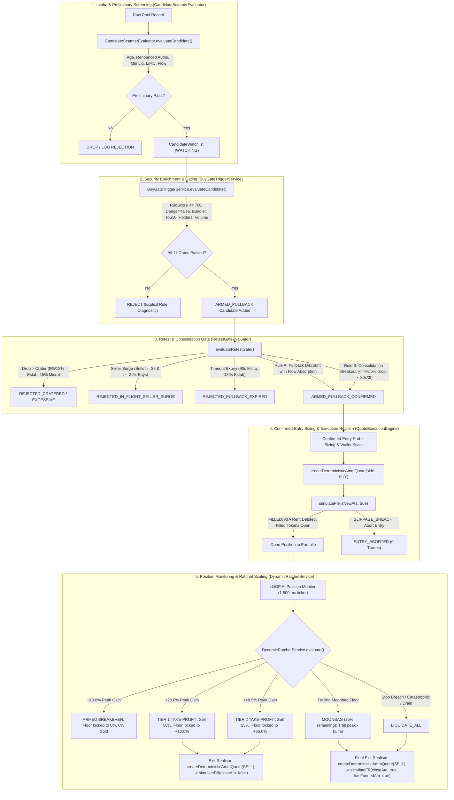

# NeXusTrade — Phase 12.94-D Milestone D.3.3: Source-Accurate PAPER Implementation Handoff

**Document ID**: `NXT-D3.3-PAPER-READINESS-ASSESSMENT-V10`  
**Location**: `docs/research-planning/phase-12.94d-milestone-d3-3-paper-readiness-assessment.md`  
**Related Closure Report**: [`audit/PHASE_12_94D_MILESTONE_D3_3_QUOTE_PILOT_003_CLOSURE_REPORT.md`](file:///u:/Projects/TopG/audit/PHASE_12_94D_MILESTONE_D3_3_QUOTE_PILOT_003_CLOSURE_REPORT.md)  
**Status**: **READ-ONLY ARCHITECTURAL SPECIFICATION & OFFLINE IMPLEMENTATION HANDOFF**  
**Execution Authority**: **THE OPERATOR PERSONALLY RUNS ALL LIVE MARKET-DATA, PAPER, SIMULATION SESSIONS, AND LONG TESTS. ZERO LIVE NETWORK CALLS OR TRADES ARE AUTHORIZED IN THIS ASSESSMENT.**

---

## 1. Actual Existing Strategy Lifecycle, Configurations & Call Sites

The production strategy implemented across [`backend/src/candidate-scanner/`](file:///u:/Projects/TopG/backend/src/candidate-scanner), [`backend/src/exits/`](file:///u:/Projects/TopG/backend/src/exits), and [`backend/src/scripts/paper-trading-daemon.ts`](file:///u:/Projects/TopG/backend/src/scripts/paper-trading-daemon.ts) does **not** execute an immediate market buy at admission followed by a fixed $+300\text{s}$ exit.

It operates as a multi-stage, state-machine driven engine with distinct market-timing confirmations, cohort-specific ratchets, multi-tier partial scaling, and moonbag lifecycle management.



### 1.1 Strategy Timing Parameters, Cohort Thresholds & Confirmed-Entry Sizing

All parameters are bound directly to active source code constants:

| Strategy Dimension                   | Micro-Cap Cohort                                                                                                                                                               | Established Cohort                                                                                                                                                               | Authoritative Call Site                                                                                                                                                                                                                       |
| :----------------------------------- | :----------------------------------------------------------------------------------------------------------------------------------------------------------------------------- | :------------------------------------------------------------------------------------------------------------------------------------------------------------------------------- | :-------------------------------------------------------------------------------------------------------------------------------------------------------------------------------------------------------------------------------------------- |
| **Cohort Definition Criteria**       | Default cohort for pools $< \$50\text{k}$ liq or age $< 1,800\text{s}$                                                                                                         | Liquidity $\ge \$50\text{k}$, live liq $\ge \$50\text{k}$, age $1,800\text{s}–7,200\text{s}$, holders $\ge 250$ (or viral runner)                                                | [`paper-trading-daemon.ts:1854-1869`](file:///u:/Projects/TopG/backend/src/scripts/paper-trading-daemon.ts#L1854-L1869)                                                                                                                       |
| **Retest Expiry Window**             | **90 seconds** (`90_000 ms`)                                                                                                                                                   | **120 seconds** (`120_000 ms`)                                                                                                                                                   | [`paper-trading-daemon.ts:1916`](file:///u:/Projects/TopG/backend/src/scripts/paper-trading-daemon.ts#L1916), [`RetestGateEvaluator.ts`](file:///u:/Projects/TopG/backend/src/candidate-scanner/RetestGateEvaluator.ts)                       |
| **Rule A: Retest Pullback Discount** | $10\%\text{ to }15\%$ discount from peak (`0.85 <= spot/peak <= 0.90`) with flow absorption (`buys60s >= 1.25 * sells60s`)                                                     | $4\%\text{ to }10\%$ discount from peak (`0.90 <= spot/peak <= 0.96`) with flow absorption (`buys60s >= 1.15 * sells60s`)                                                        | [`RetestGateEvaluator.ts`](file:///u:/Projects/TopG/backend/src/candidate-scanner/RetestGateEvaluator.ts)                                                                                                                                     |
| **Rule B: Consolidation Breakout**   | Max price drop **5%** from peak (`maxConsolidationDropPct = 0.05`), flow ratio $\ge 1.5\times$ (`minConsolidationFlowRatio = 1.5`), duration $\ge 30\text{s}$ or $\ge 3$ ticks | Max price drop **4%** from peak (`maxConsolidationDropPct = 0.04`), flow ratio $\ge 1.25\times$ (`minConsolidationFlowRatio = 1.25`), duration $\ge 30\text{s}$ or $\ge 3$ ticks | [`RetestGateEvaluator.ts`](file:///u:/Projects/TopG/backend/src/candidate-scanner/RetestGateEvaluator.ts)                                                                                                                                     |
| **Rule C: Crater Drop Ceiling**      | Drop $> 15\%$ from peak (`maxCraterDropPct = 0.15`)                                                                                                                            | Drop $> 12\%$ if absorbing ($\ge 1.15\times$), $> 8\%$ if unabsorbed (`0.12 : 0.08`)                                                                                             | [`RetestGateEvaluator.ts`](file:///u:/Projects/TopG/backend/src/candidate-scanner/RetestGateEvaluator.ts)                                                                                                                                     |
| **Rule E: In-Flight Seller Surge**   | $\text{sells60s} \ge 25$ and $\text{sells60s} \ge 2.5 \times \text{buys60s}$                                                                                                   | $\text{sells60s} \ge 25$ and $\text{sells60s} \ge 2.5 \times \text{buys60s}$                                                                                                     | [`RetestGateEvaluator.ts`](file:///u:/Projects/TopG/backend/src/candidate-scanner/RetestGateEvaluator.ts)                                                                                                                                     |
| **Milestone 0: Breakeven Arming**    | $+10.0\%$ peak gain (`armedBreakevenThresholdBps: 1000`), locks floor to $+0.0\%$, **0% sold**                                                                                 | $+10.0\%$ peak gain (`armedBreakevenThresholdBps: 1000`), locks floor to $+0.0\%$, **0% sold**                                                                                   | [`DynamicRatchetTypes.ts:129-130, 146-147`](file:///u:/Projects/TopG/backend/src/exits/DynamicRatchetTypes.ts#L129-L147), [`DynamicRatchetService.ts:108-112`](file:///u:/Projects/TopG/backend/src/exits/DynamicRatchetService.ts#L108-L112) |
| **Milestone 1: Tier 1 Take-Profit**  | $+20.0\%$ peak gain (`tier1PeakThresholdBps: 2000`), sells **50% of position**, locks floor to $+10.0\%$ (`tier1LockedFloorBps: 1000`)                                         | $+20.0\%$ peak gain (`tier1PeakThresholdBps: 2000`), sells **50% of position**, locks floor to $+10.0\%$ (`tier1LockedFloorBps: 1000`)                                           | [`DynamicRatchetTypes.ts:131-132, 148-149`](file:///u:/Projects/TopG/backend/src/exits/DynamicRatchetTypes.ts#L131-L149), [`DynamicRatchetService.ts:114-152`](file:///u:/Projects/TopG/backend/src/exits/DynamicRatchetService.ts#L114-L152) |
| **Milestone 2: Tier 2 Take-Profit**  | $+48.5\%$ peak gain (`tier2PeakThresholdBps: 4850`), sells **25% of position** (cumulative 75% sold), locks floor to $+35.0\%$ (`tier2LockedFloorBps: 3500`)                   | $+48.5\%$ peak gain (`tier2PeakThresholdBps: 4850`), sells **25% of position** (cumulative 75% sold), locks floor to $+35.0\%$ (`tier2LockedFloorBps: 3500`)                     | [`DynamicRatchetTypes.ts:133-134, 150-151`](file:///u:/Projects/TopG/backend/src/exits/DynamicRatchetTypes.ts#L133-L151), [`DynamicRatchetService.ts:154-201`](file:///u:/Projects/TopG/backend/src/exits/DynamicRatchetService.ts#L154-L201) |
| **Moonbag Lifecycle**                | Remaining **25% of position** held under trailing moonbag ratchet (`nextPeakGainBps - trailBufferBps`, floor $\ge +35.0\%$, catastrophic floor $-2.0\%$)                       | Remaining **25% of position** held under trailing moonbag ratchet (`nextPeakGainBps - trailBufferBps`, floor $\ge +35.0\%$, catastrophic floor $-2.0\%$)                         | [`DynamicRatchetService.ts:203-216`](file:///u:/Projects/TopG/backend/src/exits/DynamicRatchetService.ts#L203-L216)                                                                                                                           |
| **Pre-Breakeven Stop**               | $-12.0\%$ (`preBreakevenStopBps: -1200`)                                                                                                                                       | $-10.0\%$ (`preBreakevenStopBps: -1000`)                                                                                                                                         | [`DynamicRatchetTypes.ts:122, 139`](file:///u:/Projects/TopG/backend/src/exits/DynamicRatchetTypes.ts#L122-L139)                                                                                                                              |
| **Catastrophic Disaster Floor**      | $-20.0\%$ (`catastrophicFloorBps: -2000`)                                                                                                                                      | $-18.0\%$ (`catastrophicFloorBps: -1800`)                                                                                                                                        | [`DynamicRatchetTypes.ts:121, 138`](file:///u:/Projects/TopG/backend/src/exits/DynamicRatchetTypes.ts#L121-L138)                                                                                                                              |
| **Position Monitor Loop Ticker**     | `pollIntervalMs = 1500 ms`                                                                                                                                                     | `pollIntervalMs = 1500 ms`                                                                                                                                                       | [`paper-trading-daemon.ts:575, 1238, 1514`](file:///u:/Projects/TopG/backend/src/scripts/paper-trading-daemon.ts#L575)                                                                                                                        |
| **Discovery / Scanning Loop**        | `scanIntervalMs = 5000 ms`                                                                                                                                                     | `scanIntervalMs = 5000 ms`                                                                                                                                                       | [`paper-trading-daemon.ts:956, 1529`](file:///u:/Projects/TopG/backend/src/scripts/paper-trading-daemon.ts#L956)                                                                                                                              |

#### Actual Confirmed-Entry Sizing Path

Position sizing upon confirmed retest does **not** rely on a naive startup formula. It executes the calibrated probe sizing and risk-adjustment logic from [`paper-trading-daemon.ts:2088-2128`](file:///u:/Projects/TopG/backend/src/scripts/paper-trading-daemon.ts#L2088-L2128):

1. **Wallet Scale Factor**:
   $$\text{walletScale} = \min\left(1.25, \max\left(1.0, \frac{\text{currentCash}}{10.0}\right)\right)$$
2. **Calibrated Base Probe Size by Cohort**:
   - Established Base: $\min(0.65, \text{round}_{2}(0.50 \times \text{walletScale}))$
   - Micro-Cap Base: $\min(0.45, \text{round}_{2}(0.35 \times \text{walletScale}))$
3. **Risk Downsizing (Established Cohort)**:
   If `bundlerPct > 0.60` or `top10HolderPct > 0.30`, downsize `targetCohortSize` to $\min(0.35, \text{targetCohortSize})$.
4. **Portfolio Capital Ceiling & Gas Reserve**:
   $$\text{dynamicSize} = \max\left(0.10, \min\left(\text{targetCohortSize}, \frac{\text{currentPortfolioSol} - 0.05}{\text{maxOpenPositions}}\right)\right)$$

### 1.2 Implemented Retest Evaluator Extraction (`RetestGateEvaluator.ts`)

The retest evaluation logic previously embedded in [`backend/src/scripts/paper-trading-daemon.ts:1870-2052`](file:///u:/Projects/TopG/backend/src/scripts/paper-trading-daemon.ts#L1870-L2052) has been cleanly extracted into [`backend/src/candidate-scanner/RetestGateEvaluator.ts`](file:///u:/Projects/TopG/backend/src/candidate-scanner/RetestGateEvaluator.ts).

The pure function `evaluateRetestGate()` computes the decision without side effects:

- Evaluates first-tick arming, peak price updates, and tick counting.
- Enforces strict evaluation order: Rule C (crater drop) $\rightarrow$ Rule E (seller surge) $\rightarrow$ Rule D (timeout expiry) $\rightarrow$ Rule A (pullback discount) $\rightarrow$ Rule B (consolidation breakout).
- Preserves precedence: Rule A confirms with `RETEST_PULLBACK_DISCOUNT` over Rule B.
- Side effects (map updates, logging, telemetry via `recordTriggerRejection`, and watchlist state updates) remain in the caller.

---

## 2. Evidence-Source Decision, SPL Token Burn Accounting & Security Gaps

### 2.1 Option A (Historical Fixtures): UNAVAILABLE for Live PAPER Evaluation

Option A is **explicitly marked UNAVAILABLE for live-data PAPER evaluation**:

- The authentic historical captures (such as the C3 Raydium AMM v4 pool genesis initialization records from August 2024) prove static on-chain account parameters (pool ID, AMM authority, vault accounts, mints, decimals).
- However, historical captures contain zero live data: no current reserves, no live spot price, no current 60s flow, no current holder distribution, and no ongoing LP lock/burn verification.
- Conflating historical genesis initialization with live market conditions violates provenance. Authentic historical fixtures support separately labeled offline regression replay, and **cannot substitute for live data in a forward evaluation**.

### 2.2 LP Security & Protocol Accounting (Raydium AMM v4 Contract PROPOSED / UNAPPROVED)

The strategy's Stage 1 screening gate `ANTI_RUG_LP_SECURITY` requires $\text{lpBurnPct} \ge 90.0\%$.

#### Explicit Withdrawal of Unsupported LP Reduction Formula

The previously proposed formula:
$$\frac{L_{\text{initial}} - L_{\text{circulating}}}{L_{\text{initial}}} \times 100\%$$
is **formally withdrawn as unsound**.

In the official Raydium AMM v4 withdrawal implementation (`withdraw` instruction), liquidity redemptions burn LP tokens while returning the underlying base and quote token reserves from the pool vaults to the withdrawing liquidity providers. A formula that equates every reduction in LP tokens with burned or locked liquidity conflates routine withdrawal with true liquidity destruction.

#### Proposed Acquisition & Calculation Contract (Status: PROPOSED / UNAPPROVED)

The corrected acquisition contract has been formulated in [`phase-12.94d-milestone-d3-3-lp-security-acquisition-contract.md`](file:///u:/Projects/TopG/docs/research-planning/phase-12.94d-milestone-d3-3-lp-security-acquisition-contract.md), strictly narrowed to legacy Raydium AMM v4:

1. **Protocol-Tracked Denominator**: Raydium AMM v4 tracks `amm.lp_amount` directly in the 752-byte pool account at byte offset **720..728** (`lpReserve`). In official program source (`program/src/processor.rs`), `amm.lp_amount` ($L_{\text{protocol}}$) is the actual mathematical denominator used during liquidity withdrawals, rather than SPL mint supply.
2. **Distinct Lifecycle Mechanics**:
   - **Genesis Initialization**: Initial calculated liquidity is set in $L_{\text{protocol}}$, but an unminted minimum ($L_{\text{unminted}} = 10^6$ units) is withheld from minting. $L_{\text{protocol}} - S_{\text{current}} = L_{\text{unminted}}$ (fails 90% gate as expected).
   - **Normal Withdrawal**: Both $L_{\text{protocol}}$ and $S_{\text{current}}$ decrement by the redeemed amount. The difference $L_{\text{protocol}} - S_{\text{current}}$ remains constant; normal redemption does NOT generate protected liquidity.
   - **Direct SPL Burn**: Decrements $S_{\text{current}}$ while $L_{\text{protocol}}$ and vault reserves remain fixed. Because the AMM `withdraw` instruction divides by $L_{\text{protocol}}$, the remaining circulating supply can only redeem $\frac{S_{\text{current}}}{L_{\text{protocol}}}$ of vault reserves; the remaining fraction is permanently trapped.
3. **Smallest Defensible Calculation**:
   $$\text{lpBurnPct} = \frac{L_{\text{protocol}} - S_{\text{current}}}{L_{\text{protocol}}} \times 100\%$$
   where $L_{\text{protocol}} = \text{lpReserve}$ (offset 720..728) and $S_{\text{current}} = \text{lpMint.supply}$.
4. **Deferred Scope**: CPMM, Token-2022, third-party locker accounts, and unverified provider schemas are explicitly deferred.
5. **Approval Status**: **PROPOSED / UNAPPROVED**. No calculator is implemented and no parser is modified until formal auditor review. Candidates lacking verified evidence fail closed at Stage 1.

### 2.3 Corrected Security Score, Holder Integrity & Complete Concentration Validation

The implementation in [`BuyGateTriggerService.ts`](file:///u:/Projects/TopG/backend/src/candidate-scanner/BuyGateTriggerService.ts) has been fully hardened across parser and evaluation paths:

1. **Removed Favorable Fallback & Enforced Explicit Non-Negative Score**: The silent `score ?? 0` default has been removed. An explicitly supplied, finite, non-negative number (`score >= 0`) is strictly required. Genuine observed zero scores are preserved.
2. **Complete Malformed-Risk Validation**:
   - `data.risks` must be an Array (`!Array.isArray(data.risks) -> return null;`).
   - Every risk entry is validated against the supported schema (`level: "danger" | "warn" | "info"`).
   - Null entries, primitives (e.g. `["danger"]`), missing severity fields (e.g. `[{}]`), incorrectly typed severity (e.g. `{ level: 123 }`), empty strings (`{ level: "" }`), and unsupported severity values (e.g. `{ level: "critical" }`) fail closed (`return null;`).
   - Genuine empty risk arrays (`[]`) and supported non-danger risks (`warn`, `info`) are preserved (`hasDangerRisk: false`).
   - Valid danger risks (`danger`) correctly set `hasDangerRisk: true`.
3. **Safe Non-Negative Integer Holder Count Integrity**:
   - `totalHolders` must be a non-negative safe integer (`Number.isSafeInteger(h) && h >= 0`).
   - Fractional counts (e.g. `300.5`), negative values, and non-numeric representations fail closed (`holdersCount: undefined`).
   - Genuine observed zero holders (`holdersCount: 0`) is preserved.
4. **Strict Concentration Input Validation & Normalized Ranges**:
   - `topHolders`: Each inspected entry in the top-10 slice must be a non-null object with a valid, finite raw percentage in $[0, 100]$.
   - Malformed entries (such as `{}` or `{ pct: -10 }` or `{ pct: 150 }`) fail closed to `top10HolderPct: undefined`; malformed inputs never manufacture a false 0 concentration or negative value.
   - Genuine observed zero concentration (`pct: 0`) is preserved.
   - Normalized range is strictly enforced as $0.0 \le \text{top10HolderPct} \le 1.0$.
5. **Removal of Unsupported Provider Mappings for Bundler Concentration**:
   - The official RugCheck schema does not define a root `bundlerPct` field or establish an authoritative label-to-concentration mapping for free-text risk descriptions (e.g. `"Bundler transaction failure rate"` represents an operational failure rate, not ownership concentration).
   - Free-text label matching, string prefix parsing (`parseFloat`), and magnitude guessing are strictly removed.
   - Bundler concentration is not extracted from RugCheck reports and remains strictly unavailable (`bundlerPct: undefined`).
   - Final security qualification (`requireVerifiedHolders: true`) strictly fails closed with `BUNDLER_CONCENTRATION_UNKNOWN`.
   - Synthetic evaluator controls for Gate 11 logic remain separate from claims about verified provider responses.
6. **Fail-Closed Final Security Qualification (`requireVerifiedHolders: true`)**:
   - Requires valid evidence for all five required security metrics: `rugScore`, `hasDangerRisk`, `holdersCount`, `top10HolderPct`, and `bundlerPct`.
   - Missing or invalid metrics fail closed with explicit rejection reasons:
     - `holdersCount === undefined` or invalid: `REJECTED_RUGCHECK_UNINDEXED_OR_HOLDERS_UNKNOWN`.
     - `rugScore` or `hasDangerRisk` missing or invalid: `REJECTED_RUGCHECK_UNINDEXED_OR_HOLDERS_UNKNOWN`.
     - `top10HolderPct === undefined` or out of range: `TOP_10_CONCENTRATION_UNKNOWN`.
     - `bundlerPct === undefined` or out of range: `BUNDLER_CONCENTRATION_UNKNOWN`.
   - Threshold violations reject with their established codes: `INSUFFICIENT_HOLDERS_COUNT_FAILED`, `TOP_10_CONCENTRATION_FAILED`, `BUNDLER_CONCENTRATION_GATE_FAILED`.
   - Preliminary in-memory screening (`requireVerifiedHolders: false/undefined`) remains distinct, allowing un-enriched candidates to queue for observation without premature rejection.

---

## 3. Correct Execution Attachment & Realism Accounting

The evaluation binds directly to the real exported functions in [`QuoteExecutionEngine.ts`](file:///u:/Projects/TopG/backend/src/execution/QuoteExecutionEngine.ts) and [`ExecutionFeeModel.ts`](file:///u:/Projects/TopG/backend/src/execution/ExecutionFeeModel.ts).

### 3.1 Verified Mint Decimals (No Hardcoded 9)

Token decimals are dynamic:

- Canonical WSOL has 9 decimals (`WSOL_DECIMALS = 9`).
- RAY has 6 decimals (`RAY_DECIMALS = 6`).
- Pump tokens typically have 6 decimals; SPL tokens range from 0 to 18.
- `createDeterministicAmmQuote()` enforces `validateMintDecimals(params.tokenDecimals)`.
- Token decimals must be obtained from verified mint account data or candidate contracts.

### 3.2 Causally Sound Execution Mapping (Lookahead Guard Compliant)

According to [`QuoteExecutionEngine.ts:303`](file:///u:/Projects/TopG/backend/src/execution/QuoteExecutionEngine.ts#L303):

```typescript
if (quote.quoteInitiatedMs < decisionTimestampMs) {
  return { valid: false, reason: `[LOOKAHEAD_VIOLATION] ...` };
}
```

The market decision event occurs **at or before** quote initiation:
$$\text{decisionTimestampMs} \le \text{quoteInitiatedMs} < \text{quoteReceivedMs} < \text{fillTimestampMs} \le \text{validUntilMs}$$

```typescript
// 1. Decision occurs at currentNowMs
const decisionTimestampMs = currentNowMs;
const decisionSlot = currentSlot;

// 2. Entry Quote initiated at or after decision
const entryQuote = createDeterministicAmmQuote({
  sessionId: sessionContext.sessionId,
  generationId: sessionContext.generationId,
  decisionEventId: `dec-buy-${candidate.mintAddress}-${decisionTimestampMs}`,
  mintAddress: candidate.mintAddress,
  poolId: candidate.poolId,
  side: "BUY",
  tradeSizeSolOrTokens: dynamicSize, // Calibrated probe size
  baseReserveTokens: verifiedBaseReserveTokens,
  quoteReserveSol: verifiedQuoteReserveSol,
  tokenDecimals: verifiedTokenDecimals, // e.g. 6 for RAY
  quoteInitiatedMs: decisionTimestampMs, // Quote initiated at decision time
  contextSlot: decisionSlot,
  quoteLatencyMs: 25,
  ttlMs: 15_000,
  dexFeeRate: 0.0025,
  maxSlippageBps: 25,
});

// 3. Entry Fill Simulation (BUY)
const entryFill = simulateFill(entryQuote, {
  decisionTimestampMs, // decisionTimestampMs <= quoteInitiatedMs (Lookahead guard passed!)
  decisionSlot, // decisionSlot <= contextSlot (Slot freshness passed!)
  executionDelayMs: 150, // fillTimestampMs = quoteReceivedMs + 150ms
  isNewAta: true, // Debits 2,039,280 lamports ATA rent deposit
  arrivalSlippageBps: 5,
  sellabilityStatus: "FULLY_SELLABLE",
  computeUnits: 100_000,
  priorityFeeMicroLamports: 10_000,
});
```

### 3.3 State-Accurate ATA Accounting and Inventory Preservation

1. **ATA Creation & Funding**:
   - On BUY, `isNewAta: true` causes [`ExecutionFeeModel.calculateEntryFees()`](file:///u:/Projects/TopG/backend/src/execution/ExecutionFeeModel.ts#L61) to debit the mandatory Solana rent-exempt balance of **2,039,280 lamports** (0.00203928 SOL).
   - The position state records `hasFundedAta = true`.
2. **Partial Exits (Tier 1 50% & Tier 2 25%)**:
   - `closeAta` MUST BE `false`.
   - The token account remains open on-chain to hold remaining inventory.
   - `ataRentRefundLamports` is **0**. No rent refund is credited.
3. **Final Full Exit (Remaining Moonbag Liquidation)**:
   - `closeAta` is `true` and `hasFundedAta` is `true`.
   - `ataRentRefundLamports` of **2,039,280 lamports** is credited back to gross proceeds to yield net realized SOL.
4. **Preservation of Inventory on Failed Sell**:
   - If an exit fill fails due to `UNSELLABLE_NO_ROUTE`, `PREFLIGHT_SIMULATION_REJECTED`, or `SLIPPAGE_BREACH_REJECTED`, [`simulateFill()`](file:///u:/Projects/TopG/backend/src/execution/QuoteExecutionEngine.ts#L821) sets `remainingTokens = attemptedTokens`.
   - Unsold inventory remains preserved in the virtual wallet with conservative write-down. Tokens are never assumed sold or discarded.

### 3.4 Strict Distinction: Observed Inputs vs Modeled Execution Parameters

| Field / Parameter                       |    Classification     | Provenance & Handling                                                    |
| :-------------------------------------- | :-------------------: | :----------------------------------------------------------------------- |
| `mintAddress`                           |  **Observed Input**   | Cryptographically verified base58 Solana public key.                     |
| `poolAddress` (`ammKey`)                |  **Observed Input**   | Verified Raydium AMM v4 pool address.                                    |
| `tokenDecimals`                         |  **Observed Input**   | Mint account definition (e.g. 6 for RAY, 9 for WSOL).                    |
| `indicativePriceSol` (`priceNative`)    |  **Observed Input**   | Preserved from provider HTTP response against canonical WSOL.            |
| `contextSlot`                           |  **Observed Input**   | On-chain slot counter for freshness verification.                        |
| `baseReserveTokens` / `quoteReserveSol` |  **Observed Input**   | Verified atomic reserve balances when available.                         |
| `quoteLatencyMs`                        | **Modeled Parameter** | Modeled quote retrieval delay (default 25 ms).                           |
| `executionDelayMs`                      | **Modeled Parameter** | Modeled network transit and block inclusion latency (default 150 ms).    |
| `networkFeeLamports`                    | **Modeled Parameter** | Standard Solana transaction base fee (5,000 lamports = 0.000005 SOL).    |
| `priorityFeeLamports`                   | **Modeled Parameter** | Modeled priority compute fee (1,000 lamports).                           |
| `ataRentDepositLamports`                | **Modeled Parameter** | Solana protocol rent-exemption fee (2,039,280 lamports).                 |
| `arrivalSlippageBps`                    | **Modeled Parameter** | Modeled arrival execution slippage against constant-product curve.       |
| `sellabilityStatus`                     | **Modeled Parameter** | Preflight simulation status ("FULLY_SELLABLE" vs transfer restrictions). |

---

## 4. Feasible Request Budget & Pacing-Aware Scheduling

### 4.1 Internal Pacing Policy vs External Provider Limits

- **Configured Pacing Policy**: The project's [`GlobalResourceBudgetManager`](file:///u:/Projects/TopG/backend/src/research/prospective/GlobalResourceBudgetManager.ts) configures a minimum interval of **$\ge 2,500\text{ ms}$** between consecutive outbound HTTP requests to the same host. This is an internal, defensive rate-management invariant designed to prevent provider bans and burst congestion.
- **External Provider Ceilings**: Independently documented public provider limits (e.g. DexScreener's public documentation specifies 300 requests/minute = 5 req/s) are provider-side limits, not internal policies.

### 4.2 Observation Semantics of Cached Spot Quotes

- The position monitor loop runs at `pollIntervalMs = 1500 ms` (1.5s).
- Direct outbound HTTP requests on every 1.5s tick would violate the $\ge 2,500\text{ ms}$ pacing policy.
- Reusing a cached spot quote across 1,500 ms ticks allows the state machine to evaluate timeouts, duration thresholds, and ratchet logic without outbound network activity.
- **Crucial Clarification**: A cached quote reused across ticks is **not** a new market observation. Caching does **not** provide observation-frequency parity with true live market observations.

### 4.3 Mathematical Request Budget Derivation

| Lifecycle Phase             |          Active Duration          | Polling Cadence | Outbound HTTP Requests | Derivation Rationale                                                                       |
| :-------------------------- | :-------------------------------: | :-------------: | :--------------------: | :----------------------------------------------------------------------------------------- |
| **1. Intake & Discovery**   |         Instant ($t = 0$)         |  Single lookup  |     **1 request**      | Direct seeded pool query (`pairs/solana/{pool}`).                                          |
| **2. Security Enrichment**  |          $t = 3\text{s}$          |  Single lookup  |     **1 request**      | Metered RugCheck report lookup (if active).                                                |
| **3. Retest & Arming**      | Up to 120s (Estab) or 90s (Micro) |    Every 10s    |  **3 to 12 requests**  | Early 30s confirm: 3 requests; Full 120s retest: $120\text{s} / 10\text{s} = 12$ requests. |
| **4. Position Monitoring**  |  5-minute holding period (300s)   |    Every 15s    |    **20 requests**     | $300\text{s} / 15\text{s} = 20$ requests (respects $\ge 2,500\text{ ms}$ pacing).          |
| **5. Exit Execution Quote** |           Exit trigger            |  Single lookup  |     **1 request**      | Fresh quote upon ratchet breach or session cashout.                                        |
| **6. Fail-Safe Buffer**     |           Finalization            |    On demand    |     **4 requests**     | Reserved capacity for clean session closure.                                               |

#### Concrete Budget Outcomes by Scenario

1. **Scenario 1: Screening Rejection or Unconfirmed Retest Expiry (No Trades)**:
   - Budget: $1 \text{ (intake)} + 1 \text{ (security)} + 12 \text{ (full retest)} + 4 \text{ (buffer)} =$ **18 requests max**.
2. **Scenario 2: Early Confirmation (30s) + 5-Minute Position Hold**:
   - Budget: $1 \text{ (intake)} + 1 \text{ (security)} + 3 \text{ (early retest)} + 20 \text{ (position monitor)} + 1 \text{ (exit)} + 4 \text{ (buffer)} =$ **30 requests max**.
3. **Scenario 3: Full Retest (120s) + 5-Minute Position Hold**:
   - Budget: $1 \text{ (intake)} + 1 \text{ (security)} + 12 \text{ (full retest)} + 20 \text{ (position monitor)} + 1 \text{ (exit)} + 4 \text{ (buffer)} =$ **39 requests max**.

---

## 5. Remaining Acquisition Dependencies

LP burn is no longer an unverified hypothesis; it has been acquired and validated on-chain via the operator snapshot. The updated status of all acquisition dependencies is summarized below:

| Dimension                                   | Required Evidence / Threshold                                                                                                                                                                                            | Existing Preserved Evidence                                                                                                                                                                                                                                                   | Status & Remaining Path                                                                                                                                                                                                                                                                                                                                                                                                                                                                                                                                 |
| :------------------------------------------ | :----------------------------------------------------------------------------------------------------------------------------------------------------------------------------------------------------------------------- | :---------------------------------------------------------------------------------------------------------------------------------------------------------------------------------------------------------------------------------------------------------------------------- | :------------------------------------------------------------------------------------------------------------------------------------------------------------------------------------------------------------------------------------------------------------------------------------------------------------------------------------------------------------------------------------------------------------------------------------------------------------------------------------------------------------------------------------------------------ |
| **LP Security (`lpBurnPct`)**               | $\ge 90.0\%$ LP burn derived from on-chain accounts.                                                                                                                                                                     | **ACQUIRED & VALIDATED VIA BOUNDED CLIENT** (RAY/WSOL Reference Pair snapshot at `2026-10-27T06:35:11.779Z`, slot `461970878`).                                                                                                                                               | **ACQUISITION COMPLETED (Below Threshold)**: Verified $L = 362937054696$, $S = 362444613518$, $L - S = 492441178$, $0.135682\%$ inaccessible, 90% threshold: `false`. Sealed artifacts preserved at `data/research/snapshots/raydium-amm-v4-snapshot-AVs9TA4n-2026-10-27T06-35-11-779Z.json` and `-manifest.json`. Offline bridge implemented.                                                                                                                                                                                                          |
| **Verified Pool Reserves & Token Decimals** | Atomic base token reserve (`baseReserveTokens`), quote reserve (`quoteReserveSol`), and token decimals (`tokenDecimals`).                                                                                                | DexScreener indicative spot price (`priceNative`); canonical WSOL (9 decimals); RAY (6 decimals). Validated vault balances captured in batch snapshot (**INCOMPLETE for executable AMM reserve accounting**).                                                                 | **INCOMPLETE RESERVE ACCOUNTING**: Captured SPL token vault balances (`baseVault`, `quoteVault`) reflect raw token accounts but are strictly incomplete for executable AMM reserve accounting (omitting OpenOrders, unsettled PnL, protocol fees, and dynamic swap state). Full constant-product execution math requires verified total executable reserves, not raw vault balances alone.                                                                                                                                                              |
| **Security Metrics**                        | Risk score ($\le 700$), danger flags (`false`), verified holder count ($\ge 250$ established, $\ge 100$ micro non-negative safe integers), top 10 concentration ($\le 30\%$), bundler concentration ($\le 85\% / 50\%$). | RugCheck `/tokens/{mint}/report` response parser in `BuyGateTriggerService.ts` enforcing non-negative safe integer holders, strict top-10 concentration boundaries, and fail-closed concentration handling (`TOP_10_CONCENTRATION_UNKNOWN`, `BUNDLER_CONCENTRATION_UNKNOWN`). | **UNRESOLVED CONCENTRATION DEPENDENCY**: Standard RugCheck OpenAPI documentation does not define a root `bundlerPct` field or establish label-to-concentration mappings for risk descriptions (e.g. "Bundler transaction failure rate"). Unsupported extraction paths have been removed. Bundler concentration remains unavailable (`bundlerPct: undefined`) and fails closed with `BUNDLER_CONCENTRATION_UNKNOWN`, blocking live qualification until an authoritative provider with verified schema is integrated under `GlobalResourceBudgetManager`. |
| **Micro-Flow Observations**                 | 60-second rolling transaction counts (`recentBuys60s`, `recentSells60s`) to evaluate flow-absorption rules (1.15x / 1.25x / 1.5x) and anti-surge rules.                                                                  | DexScreener 5-minute transaction aggregates (`txns.m5.buys`, `txns.m5.sells`).                                                                                                                                                                                                | Sub-minute trade stream or websocket trade ingestion to derive authentic 60-second rolling buy/sell transaction counts.                                                                                                                                                                                                                                                                                                                                                                                                                                 |

---

## 6. Offline Implementation Status

The approved offline implementation items are completed:

1. **Retest Gate Evaluator Extraction**:
   - Implemented in [`backend/src/candidate-scanner/RetestGateEvaluator.ts`](file:///u:/Projects/TopG/backend/src/candidate-scanner/RetestGateEvaluator.ts).
   - Replaced inline decision block in [`backend/src/scripts/paper-trading-daemon.ts`](file:///u:/Projects/TopG/backend/src/scripts/paper-trading-daemon.ts).
   - 20 deterministic tests passing in [`backend/src/candidate-scanner/RetestGateEvaluator.test.ts`](file:///u:/Projects/TopG/backend/src/candidate-scanner/RetestGateEvaluator.test.ts).
2. **Missing Security Score, Holder Integrity & Concentration Input Hardening**:
   - Implemented in [`backend/src/candidate-scanner/BuyGateTriggerService.ts`](file:///u:/Projects/TopG/backend/src/candidate-scanner/BuyGateTriggerService.ts).
   - Validates explicit non-negative score, strict array type, supported risk severity (`danger`, `warn`, `info`), non-negative safe integer holder counts (rejecting fractional counts like `300.5`), and fail-closed handling for malformed risk entries and malformed holder concentration (`[{}]`, `[{ pct: -10 }]`, `[{ pct: 150 }]`).
   - Removed unsupported bundler extraction from RugCheck reports (rejecting risk label guessing, string prefix parsing, and undocumented root fields); leaves `bundlerPct: undefined` from provider responses.
   - Enforces fail-closed final security evaluation (`requireVerifiedHolders: true`) requiring valid evidence across all 5 required security metrics with explicit rejection codes (`REJECTED_RUGCHECK_UNINDEXED_OR_HOLDERS_UNKNOWN`, `TOP_10_CONCENTRATION_UNKNOWN`, `BUNDLER_CONCENTRATION_UNKNOWN`). Preliminary screening (`requireVerifiedHolders: false`) remains distinct.
   - 64 deterministic tests passing in [`backend/src/candidate-scanner/BuyGateTriggerService.test.ts`](file:///u:/Projects/TopG/backend/src/candidate-scanner/BuyGateTriggerService.test.ts).
3. **Offline LP-Screening Bridge & Regression Fixture**:
   - Implemented in [`backend/src/candidate-scanner/LpScreeningBridge.ts`](file:///u:/Projects/TopG/backend/src/candidate-scanner/LpScreeningBridge.ts).
   - Regression fixture in [`backend/src/candidate-scanner/fixtures/CapturedRaydiumAmmV4SnapshotFixture.ts`](file:///u:/Projects/TopG/backend/src/candidate-scanner/fixtures/CapturedRaydiumAmmV4SnapshotFixture.ts) wrapping authentic operator results with unabbreviated authentic raw response strings and verified SHA-256 digests.
   - Uses retained `rawResponseBody` as authoritative source for acquisition revalidation; cryptographically checks `storedResponseSha256` and enforces `wireResponseSha256` equality on unredacted payloads.
   - Rejects discrepancies between retained `parsedJson` caches and decoded stored responses (`deepEqual`).
   - Detects and rejects context-slot disagreements between wrapper/diagnostic metadata and decoded payload slots (`INVALID_EVIDENCE`).
   - Returns structured `INVALID_EVIDENCE` failures (`pool: null`, `lpFilterPassed: false`) for malformed raw payloads without throwing unhandled exceptions.
   - Enforces asynchronous evaluation (`evaluateLpScreeningBridge`) for acquisition evidence, preventing bypasses via `evaluateLpScreeningBridgeSync`.
   - Binds evidence and authoritative quantities directly to decoded account states (`poolState.lpReserve` and `lpMintState.supply`), deriving authoritative inaccessible claims via `calculateAmmV4LpInaccessibleClaims`.
   - Rejects any inconsistency between decoded account states, requested identities, validation accounting summaries, and acquisition wrappers.
   - Requires explicit freshness policy (`STALE_EVIDENCE`; historical captures cannot qualify candidate).
   - Classifies validated percentage as `DERIVED` from account observations (`metricProvenance.lpBurnPct = "DERIVED"`).
   - Evaluates pure integer cross-multiplication (`100n * (L - S) >= 90n * L`).
   - Fails closed on missing/invalid/mismatched/stale evidence with `pool: null` (no numeric 0 placeholders returned for unavailable projections).
   - Bridges to `ScannedPoolRecord` and seamlessly integrates with `AntiRugEvaluator.evaluate()` and `CandidateScannerFilterEvaluation`.
   - 34 deterministic unit tests passing in [`backend/src/candidate-scanner/LpScreeningBridge.test.ts`](file:///u:/Projects/TopG/backend/src/candidate-scanner/LpScreeningBridge.test.ts) (covering all auditor reproduction cases).
4. **Guarded Candidate Intake Integration (`CandidateStreamEngine.ts`)**:
   - Implemented in [`backend/src/candidate-scanner/CandidateStreamEngine.ts`](file:///u:/Projects/TopG/backend/src/candidate-scanner/CandidateStreamEngine.ts).
   - Connects the accepted `LpScreeningBridge` to candidate intake via an injected resolver (`lpEvidenceResolver?: LpEvidenceResolver`) and explicit freshness policy (`lpFreshnessPolicy?: LpFreshnessPolicy`).
   - Implemented explicitly enabled validated-LP mode (`requireValidatedLp?: boolean`). In validated mode, candidates must pass the accepted asynchronous bridge before LP-dependent admission can proceed. Arbitrary gate/bridge overrides removed.
   - Immutable candidate snapshot captured before the first await (`snapshotScannedPoolRecord`, `snapshotPolicy`), guaranteeing that caller mutation during resolution cannot alter the original screening outcome.
   - Strict canonical identity extraction (`resolveCanonicalIdentities`): strips provider display prefix `dexscreener-` only when suffix is a valid 32-byte Solana base58 public key, and rejects illegal token mint substitutions as pool addresses.
   - Missing resolver, missing evidence, stale evidence, identity mismatch, invalid evidence, or unsupported protocol strictly fail closed. Calling synchronous `evaluatePool()` in validated mode immediately fails closed with `UNAVAILABLE` (`REJECTED_UNLOCKED_LP_RISK`), ensuring callers cannot bypass asynchronous cryptographic checks.
   - Contained bridge evaluation failures at the intake boundary: malformed acquisition/validation results (such as missing diagnostics objects) produce structured `INVALID_EVIDENCE` rejections with zero admissions without aborting the scan loop or terminating subsequent candidates.
   - Preserves unavailable LP semantics in callbacks via nullable LP decision view (`lpBurnPct: null`, `metricProvenance.lpBurnPct: "UNAVAILABLE"`), while keeping raw provider percentages clearly separated as `rawProviderLpBurnPct` and preserving candidate identity.
   - Preserves `DERIVED` provenance and the real 0.135682% measurement for observed below-threshold results (`AVAILABLE_BELOW_THRESHOLD`).
   - Passing the LP filter (`AVAILABLE_QUALIFIED`) only permits existing remaining checks to continue (`PAIR_MATURITY_WINDOW`, `ANTI_RUG_MINT_AUTHORITY`, `ANTI_RUG_FREEZE_AUTHORITY`, `LIQUIDITY_MARKET_CAP`, `ORGANIC_FLOW`). Candidate admitted only if all remaining checks pass.
   - 25 comprehensive deterministic unit tests passing in [`backend/src/candidate-scanner/CandidateStreamEngine.test.ts`](file:///u:/Projects/TopG/backend/src/candidate-scanner/CandidateStreamEngine.test.ts).
5. **Guarded Candidate Watchlist LP Eligibility & Deactivation (`CandidateWatchlistService.ts`)**:
   - Implemented in [`backend/src/candidate-scanner/CandidateWatchlistService.ts`](file:///u:/Projects/TopG/backend/src/candidate-scanner/CandidateWatchlistService.ts) and [`shared/src/phase12-dashboard-schemas.ts`](file:///u:/Projects/TopG/shared/src/phase12-dashboard-schemas.ts).
   - Removed stale fallback assignment `lpBurnPct: pool.lpBurnPct ?? existing.lpBurnPct` which previously substituted historical passing percentages into updates where current evidence was unavailable.
   - Enforces current LP eligibility checks before both new admission and existing-entry updates/reactivations. Missing (`null`), invalid, or below-threshold current LP data explicitly deactivates existing entries (`status: "DROPPED"`, `rejectionReason: "REJECTED_UNLOCKED_LP_RISK"`).
   - Prevents resurrection of `DROPPED` candidates when current LP is missing (`null`) even in the presence of strong bullish volume/flow (`buys5m >= 25`, ratio $\ge 1.8$).
   - Explicitly records current LP measurement (`lpBurnPct: pool.lpBurnPct`) on deactivated and updated items, preserving previous passing values strictly in separate historical context (`historicalLpBurnPct`).
   - Added active-watchlist accessors `getActiveWatchlist()` and `getActiveCandidates()` (aliasing `getActiveWatchingItems()`) to ensure complete exclusion of deactivated or non-qualifying entries.
   - 13 comprehensive unit tests passing in [`backend/src/candidate-scanner/CandidateWatchlistService.test.ts`](file:///u:/Projects/TopG/backend/src/candidate-scanner/CandidateWatchlistService.test.ts).
6. **Metered Raydium AMM v4 LP Evidence Adapter (`RaydiumAmmV4LpEvidenceAdapter.ts`) & Audit Hardening**:
   - Implemented in [`backend/src/candidate-scanner/RaydiumAmmV4LpEvidenceAdapter.ts`](file:///u:/Projects/TopG/backend/src/candidate-scanner/RaydiumAmmV4LpEvidenceAdapter.ts).
   - Composes the bounded 2-request acquisition client (`acquireRaydiumAmmV4Snapshot`) to `CandidateStreamEngine`'s injected `CandidateLpEvidenceResolver` interface.
   - Binds each acquisition strictly to the canonical candidate pool address and token mint with zero reference-pool fallback or substitution.
   - Requires an explicitly supplied transport; rejects instantiation without transport to prohibit accidental live networking.
   - Meters every actual outbound HTTP dispatch through a shared `GlobalResourceBudgetManager`, enforcing global ceilings, purpose reservations (`CANDIDATE_ENRICHMENT`), and provider pacing ($\ge 2,500\text{ ms}$) across candidates.
   - **Respects Unsuccessful Acquisition Results**: Storage failures (e.g. `EVIDENCE_STORAGE_FAILED`) or acquisition errors fail closed at the adapter boundary while preserving diagnostics, preventing failed acquisition results from qualifying candidates. Successfully acquired below-threshold measurements ($0.135682\% < 90\%$) remain available as below-threshold evidence (`AVAILABLE_BELOW_THRESHOLD`).
   - **Unified Effective Deadline**: Enforces one unified deadline covering initial shared pacing, acquisition execution, and transport-wrapper pacing waits. Checks remaining budget and AbortSignal cancellation before sleeping, recording, or dispatching each request. Insufficient time or cancellation prevents dispatch and admission.
   - **Reconciled Dispatch Accounting & Explicit Execution State**: Replaced error-message heuristics (`msg.includes("BUDGET_DENIED")`) and loose error labels with an explicit trusted wrapper contract (`TransportDispatchTracker`). Dispatch status is determined by explicit execution state transitions at the moment underlying transport invocation begins. Once transport invocation commences, attempts remain counted across transport rejection, gateway errors, timeouts, and response body read failures. Genuine pre-dispatch budget denials and deadline expirations before transport invocation remain uncounted and separately identified (`PRE_DISPATCH_BUDGET_DENIED` vs `Network error`). Underlying transport calls, shared budget manager attempts, and acquisition evidence `httpAttempts` agree consistently before evidence hashing and manifest sealing.
   - **Response-Body Timeout Lifetime & Stalled Stream Fail-Closed Protection**: Keeps timeout protection active through both transport invocation and complete response-body reading (`response.text()`). Timer cancellation occurs strictly in an outer cleanup block wrapping both transport invocation and payload stream consumption. A timed-out response body read aborts promptly via the request's `AbortController`, classifies the failure as a dispatched request error with attempt counted in evidence and budget, and fails closed without advancing to Request 2 or qualifying the candidate.
   - **CI Test Suite Isolation & Canonical Fixture Hygiene**: Resolved git-ignore exclusions for authentic operator snapshots in `data/research/snapshots/` to guarantee deterministic offline replay in fresh CI checkouts. Hardened synthetic test fixtures in `RaydiumLiveDiscoveryClient.test.ts` and `PilotLiveCollector.test.ts` to generate strictly valid 32-byte canonical Solana base58 public keys, preserving schema adapter contracts.
   - Preserves truthful provenance (`SYNTHETIC_FIXTURE` vs `CAPTURED_RPC`) and explicit freshness policies.
   - 22 comprehensive unit tests passing in [`backend/src/candidate-scanner/RaydiumAmmV4LpEvidenceAdapter.test.ts`](file:///u:/Projects/TopG/backend/src/candidate-scanner/RaydiumAmmV4LpEvidenceAdapter.test.ts).
7. **Authentic Rolling 60-Second Trade Flow Tracker (`RollingTradeFlowTracker.ts`) & Retest Gate Hardening**:
   - Implemented in [`backend/src/candidate-scanner/RollingTradeFlowTracker.ts`](file:///u:/Projects/TopG/backend/src/candidate-scanner/RollingTradeFlowTracker.ts) and [`backend/src/candidate-scanner/RetestGateEvaluator.ts`](file:///u:/Projects/TopG/backend/src/candidate-scanner/RetestGateEvaluator.ts).
   - Replaced naive estimation (dividing 5-minute totals by 5) with an authentic event-driven rolling trade flow tracker.
   - **Complete Window Coverage & Separation of Trade Time vs Observation Timeline**: Rejects recent-heartbeat false passes. Requires continuous observation checkpoints; silence intervals $\ge 15\text{s}$ are recorded as collection gaps. Ingesting delayed trade events populates candidate counts, but explicitly _does not update the observation timeline_ or fabricate stream coverage. Only source-supported checkpoints/completed ranges establish window completeness. Both endpoints of completed ranges are strictly validated against the current clock and allowed skew before any state mutation; invalid or future-dated ranges are rejected without advancing coverage or inserting invalid gaps.
   - **Strict Capacity Bounds on Events, Deduplication, and Gap Metadata**: Enforces storage capacity limits during ingestion. Never silently drops active-window events; records capacity loss and keeps flow coverage unavailable (`CAPACITY_LOSS`) until the affected interval has fully expired beyond the lookback window. Gap metadata is strictly bounded during insertion: coalesces overlapping intervals and conservatively merges closest adjacent intervals to enforce `maxGapsRetained` without discarding missing-data information or restoring false coverage. Merged diagnostic text is strictly capped to a documented 256-character bound (`MAX_STREAM_GAP_REASON_CHARS`) using a bounded unique set of reason codes on insertion and across all merge paths.
   - **Immutable Snapshotting, Configuration & Temporal Validation**: Snapshots and freezes accepted events and gap records (`Object.freeze`). Derives and validates canonical swap coordinates (`${signature}:${outerInstructionIndex}:${swapIndex}`), preventing double-counting with altered event IDs. Constructor strictly validates all options (rejecting `NaN`, `Infinity`, non-integers, and out-of-bounds parameters for `maxGapsRetained`, `maxDeduplicationKeys`, `retentionWindowMs`, `maxFutureSkewMs`, etc.). Ingestion enforces temporal coherence: rejects future-dated receipts (`FUTURE_DATED_RECEIPT_TIMESTAMP`), contradictory block times vs event timestamps (`CONTRADICTORY_TIMESTAMPS`), and event timestamps in the future relative to receipt timestamps.
   - **Strict Lookback Configuration**: Strategy-facing counts are strictly tied to an exact 60,000 ms window; non-60,000 ms configurations and invalid evaluation timestamps (`NaN`, non-integers) fail closed with explicit errors.
   - **Retest Boundary Enforcement**: Typed `FlowCoverageStatus` (`SUFFICIENT`, `WARM_UP`, `COLLECTION_GAP`, `STALE_DATA`, `CAPACITY_LOSS`, `PROCESSING_BACKLOG`, `UNINITIALIZED`). Requires trustworthy sufficient coverage and finite, non-negative integer counts before flow can support confirmation. Unverified legacy inputs fail closed (`WAITING`), while preserving protective crater drop ceilings (8% unabsorbed, 12% absorbed, 15% micro-cap) and timeout expirations.
   - 40 comprehensive unit tests passing in [`backend/src/candidate-scanner/RollingTradeFlowTracker.test.ts`](file:///u:/Projects/TopG/backend/src/candidate-scanner/RollingTradeFlowTracker.test.ts).
   - 20 unit tests passing in [`backend/src/candidate-scanner/RetestGateEvaluator.test.ts`](file:///u:/Projects/TopG/backend/src/candidate-scanner/RetestGateEvaluator.test.ts).
8. **Offline Raydium AMM v4 Swap Decoder & Normalization Adapter (`RaydiumAmmV4SwapDecoder.ts`) & Audit Hardening**:
   - Implemented in [`backend/src/candidate-scanner/RaydiumAmmV4SwapDecoder.ts`](file:///u:/Projects/TopG/backend/src/candidate-scanner/RaydiumAmmV4SwapDecoder.ts).
   - **Immutable Pinned Source Reference & Tag/Layout Matrix**: Pinned strictly to immutable official commit `91739d8d9f5cf347e0ce14ebe4d2bb7069fb31b6` (`raydium-io/raydium-amm` `program/src/processor.rs`). Enforces a strict layout matrix matching instruction tags to verified account counts:
     - Legacy tags 9 (`SwapBaseIn`) & 11 (`SwapBaseOut`): Exactly 17 accounts (`LEGACY_17_ACCOUNTS`: `amm: 1, baseVault: 4, quoteVault: 5, userSource: 14, userDestination: 15, userOwner: 16`) or 18 accounts (`LEGACY_18_ACCOUNTS_TARGET_ORDERS`: conditionally consumes optional `target_orders` at index 4, shifting all subsequent positions +1: `baseVault: 5, quoteVault: 6, userSource: 15, userDestination: 16, userOwner: 17`). Rejects 8-account layout with `UNSUPPORTED_LAYOUT`.
     - Clean V2 tags 16 (`SwapBaseInV2`) & 17 (`SwapBaseOutV2`): Exactly 8 accounts (`V2_8_ACCOUNTS`: `amm: 1, baseVault: 3, quoteVault: 4, userSource: 5, userDestination: 6, userOwner: 7`). Rejects 17 or 18-account layouts with `UNSUPPORTED_LAYOUT`.
   - **Invocation-Scoped Evidence Attribution & Subtree Partitioning**:
     - Inner instructions are grouped strictly by parent outer instruction index (`innerGroupsByParent = new Map<number, DecodableInstruction[]>()`), adhering strictly to Solana RPC structures (`https://solana.com/docs/rpc/json-structures#inner-instructions`). Reversing group order while preserving `group.index` does not alter swap reporting order or swap-to-transfer attribution.
     - **Verified CPI Call-Tree Boundaries & Sibling Transfer Exclusion**: Inner CPI swaps under a router/aggregator isolate their invocation subtree using verified `stackHeight` (Solana CPI execution structure: `https://solana.com/docs/core/cpi/cpi-execution`) and log invocation depths/descendant counts (`resolveInvocationSubtree`), eliminating fragile "next Raydium instruction" heuristics. Later sibling instructions (such as a router transfer into the quote vault occurring after Raydium returns) are strictly excluded from the swap slice, preventing spurious `CONFLICTING_EVIDENCE` rejections. Discrepancies between `stackHeight` and logs fail closed with `CONFLICTING_EVIDENCE`; ambiguous or unresolvable call trees fail closed with `UNSUPPORTED_CALL_TREE`.
     - **Strict LIFO Call-Stack & Incomplete Trace Invalidation**: `parseInvocationFrames` enforces strict LIFO completion (`success` and `failed` logs must match the active stack top, preventing parent completions before child completions). Enforces depth invariants (depth $\ge 1$, empty stack starts at 1, nested invoke must be `top.depth + 1`). Any incomplete or inconsistent execution stack (depth 0, skipped depth transitions, or unclosed non-Raydium child frames at end of trace) invalidates all Raydium frames (`failed: true, success: false`), failing affected decodings closed with `INVOCATION_FAILED`.
     - Call-stack log ownership: `ray_log` events are attributed strictly to the currently executing program frame at the top of `activeStack`, not the nearest Raydium ancestor. Child program logs (e.g. child BUY log emitted inside Raydium SELL) are ignored and do not corrupt the Raydium frame.
     - Ambiguous trace rejection: multiple `ray_log`s in a single Raydium frame fail closed with `AMBIGUOUS_DIRECTION`. Unclosed frames at the end of logs fail closed with `INVOCATION_FAILED`.
     - Multi-way cross-validation: cross-checks applicable log type (tag 9/16 $\to$ logType 3, tag 11/17 $\to$ logType 4), direction (`PC2Coin` vs `Coin2PC`), exact in-amount, and exact out-amount across transfers, logs, and instruction parameters. Same-direction transfers reporting 200/180 vs log reporting 100/90 fails closed with `CONFLICTING_EVIDENCE`.
   - **Strict Input Validation & Non-Compacting Fail-Closed Semantics**:
     - `resolveTransactionAccounts`: null, undefined, non-string, or empty static/loaded account keys return `null` and fail closed with `MALFORMED_INSTRUCTION_DATA` without dropping, shifting, or compacting index positions (preventing synthetic BUY events from shifted keys).
     - Validates nested structures before processing: null instructions, null inner-instruction groups, null inner instructions, or non-string log messages return `MALFORMED_INSTRUCTION_DATA` without throwing exceptions and emit 0 events.
     - `decodeInstructionData`: validates byte arrays element-by-element (`Number.isInteger(b) && b >= 0 && b <= 255`). Rejects negative (e.g. `-240`), fractional, non-finite, or out-of-range values with `null` (never coerced to byte 16 `SwapBaseInV2`). Avoids heuristic base64 decoding on base58 failure.
     - `RaydiumAmmV4SwapNormalizationAdapter`: handles all malformed inputs cleanly without throwing exceptions.
   - **Proven Successful Execution**:
     - Requires explicit `meta` presence and explicit `meta.err === null`; missing or undefined `meta.err` fails closed with `TRANSACTION_NOT_SUCCESSFUL`.
     - Requires proven invocation success in execution logs (`Program 675k... success`); caught CPI errors fail closed with `INVOCATION_FAILED`. Inner CPI calls without log messages fail closed with `INVOCATION_FAILED`.
   - **Pool Boundary Validation & Context Freezing**:
     - `createTrackedRaydiumPoolContext`: `poolAddress` is mandatory and must be a canonical Solana Base58 key; rejects missing or invalid keys with zero fallback to vault accounts.
     - `validateTrackedPoolContext`: strictly validates mint consistency, vault differentiation, and orientation (`TOKEN_BASE_SOL_QUOTE`, `SOL_BASE_TOKEN_QUOTE`, `NON_SOL_PAIR`).
     - Adapter freezes context against caller mutation (`Object.freeze`).
     - Non-WSOL quote tokens leave `solAmount` undefined; non-WSOL quantities are never labeled as SOL.
   - **Malformed Payload & Temporal Integrity**:
     - Non-object or `null` payloads return structured `INVALID_PAYLOAD` without throwing.
     - Out-of-bounds instruction account indices fail closed with `MALFORMED_INSTRUCTION_DATA` without dropping or shifting positions.
     - Missing, non-finite, or non-positive `blockTime` fails closed with `MISSING_UPSTREAM_TIMESTAMP` without manufacturing time from receipt time.
   - **Fail-Closed Coverage Guarantee**: Normalization adapter bridges decoded events into `RollingTradeFlowTracker`; ingesting transactions strictly populates trade events and never fabricates stream checkpoints or advances window coverage.
   - 55 comprehensive unit tests passing in [`backend/src/candidate-scanner/RaydiumAmmV4SwapDecoder.test.ts`](file:///u:/Projects/TopG/backend/src/candidate-scanner/RaydiumAmmV4SwapDecoder.test.ts).
9. **Ubuntu CI Duplicate Decision ID Collision Resolution (`PilotLiveCollector.test.ts`)**:
   - In `makeCanonicalTestPubkey`, updated byte offset for writing test IDs from byte 0 to byte 2.
   - Eliminated identical 8-character Base58 prefixes (`3JEw2Z6V`) across distinct test mints (`pumpMint1` vs `pumpMint2`) that previously triggered duplicate decision event ID collisions (`evt-ds-${mint.slice(0, 8)}-${decisionEpochMs}`) and caused test timeouts on Ubuntu CI runners.
   - All 82 tests in [`backend/src/research/pilot/PilotLiveCollector.test.ts`](file:///u:/Projects/TopG/backend/src/research/pilot/PilotLiveCollector.test.ts) pass cleanly.
10. **Bounded Raydium AMM v4 Transaction Source Adapter (`RaydiumAmmV4TransactionSourceAdapter.ts`)**:
    - Implemented in [`backend/src/candidate-scanner/RaydiumAmmV4TransactionSourceAdapter.ts`](file:///u:/Projects/TopG/backend/src/candidate-scanner/RaydiumAmmV4TransactionSourceAdapter.ts).
    - **Independently Accepted at Commit `4fbe4be`**: All 42 unit and cancellation/deadline reproduction tests pass cleanly.
    - Connects injected transaction-signature notifications to bounded `getTransaction` retrieval, `RaydiumAmmV4SwapNormalizationAdapter` decoding, and `RollingTradeFlowTracker` ingestion strictly offline.
    - **Independent Audit Corrections (Findings 1 - 6 Resolved)**:
      1. _Immutable Identity Binding & Envelope Validation_:
         - Injected notifications are validated and deeply frozen on intake (`validateAndSnapshotNotification`), guaranteeing caller object mutation cannot alter fetched signatures.
         - Null, undefined, or non-object notifications fail closed with `INVALID_NOTIFICATION` without throwing.
         - Validates returned JSON-RPC transaction signature against requested signature (`RESPONSE_SIGNATURE_MISMATCH`).
         - Detects contradictory slot or blockTime metadata between notification and RPC response, failing closed with zero ingested events (`CONTRADICTORY_METADATA`).
      2. _Loss Preservation, Backlog Reporting & Partial Ingestion Accounting_:
         - Connects `TRANSACTION_NOT_FOUND` (`result: null`) directly to tracker collection gaps, invalidating false `SUFFICIENT` window coverage.
         - Buffers loss gaps occurring before tracker injection (`pendingGaps` buffer) and flushes them into the tracker on intake (`flushPendingGaps`).
         - Verifies that queue draining alone never erases recorded collection gaps.
         - Accurately classifies and reports partial ingestion failures (e.g. tracker capacity limits) with `PARTIAL_INGEST_FAILED`, `ok: false`, preserving actual ingested count and recording a collection gap.
      3. _Active Deduplication Protection & Workload Bounds_:
         - Partitions deduplication into `activeSignatures` (protected queued + in-flight set, immune to FIFO eviction) and `completedSignatures` (bounded FIFO historical cache up to `maxDeduplicationKeys`).
         - Enforces a unified active workload ceiling across direct and queued calls (`pendingQueue.length + inFlightCount < maxPendingQueueSize`), rejecting overflows fail-closed with `QUEUE_OVERFLOW`.
         - Preserves FIFO admission ordering across cancellation and enforces deadline expiry during admission wait.
      4. _Deadlines & Timeout Protection_:
         - Validates constructor and per-operation numeric options (rejecting `NaN`, non-integers, and ceiling violations).
         - Rechecks remaining deadline before dispatch AND immediately before tracker ingestion (post-body read).
         - Enforces `validateState` lifecycle and cancellation checks before dispatch and before tracker ingestion across both single-notification (`processNotification` / `processNextPending`) and batch (`processAllPending`) processing paths.
         - Aborts stalled response-body reads promptly via timeout controller (`REQUEST_TIMEOUT`, `httpAttempts: 1`).
      5. _Effective Pacing, Capacity Reservation & Transport Policy_:
         - Adapter enforces its own provider pacing ($\ge 2,500\text{ ms}$) regardless of budget manager spacing settings.
         - Routine trade retrieval defaults to purpose `CANDIDATE_ENRICHMENT`, strictly preserving reserved forward observation requests (`minReservedForwardRequests = 4`).
         - Sets `redirect: "error"` transport policy on fetch to prevent unmetered redirect loops.
      6. _Sanitized Diagnostics_:
         - Redacts endpoint API keys, secret URL paths, and query credentials to `[REDACTED]` across all diagnostics and error messages.
    - **Fail-Closed Coverage Guarantee**: Successful retrieval, an empty queue, or notification receipt alone NEVER establishes complete 60-second window coverage. Ingesting transactions strictly populates trade events and never fabricates stream checkpoints or advances window coverage (`status` remains non-`SUFFICIENT` without explicit observation checkpoints).
    - **Honest Throughput Disclosure**: Under $\ge 2,500\text{ ms}$ spacing, a single RPC provider sustains $\le 24\text{ transaction retrievals/min}$. Because multiple candidate swaps can occur within a single transaction, request capacity is measured in transaction retrievals, not individual trades. High-frequency pools with transaction arrival rates exceeding this ceiling cannot maintain complete coverage via paced `getTransaction` retrievals, as processing backlogs or queue drops will trigger `PROCESSING_BACKLOG` or `COLLECTION_GAP`. Paid providers, relaxed pacing, and unverified log-only parsing are not approved solutions.
    - 44 comprehensive unit tests passing in [`backend/src/candidate-scanner/RaydiumAmmV4TransactionSourceAdapter.test.ts`](file:///u:/Projects/TopG/backend/src/candidate-scanner/RaydiumAmmV4TransactionSourceAdapter.test.ts).

11. **Per-Candidate WebSocket Subscription Coordinator (`RaydiumCandidateSubscriptionCoordinator.ts`)**:
    - Implemented in [`backend/src/candidate-scanner/RaydiumCandidateSubscriptionCoordinator.ts`](file:///u:/Projects/TopG/backend/src/candidate-scanner/RaydiumCandidateSubscriptionCoordinator.ts).
    - Provides offline integration connecting per-candidate WebSocket subscription lifecycle handling to the accepted `RaydiumAmmV4TransactionSourceAdapter` and `RollingTradeFlowTracker`.
    - **Independently Accepted at Commit `cbf2cf5`**: All 30 focused unit and regression tests pass independently, including synthetic-proof separation and malformed-frame uncertainty reproductions. Production source completeness remains an unresolved readiness requirement; this acceptance does not authorize live execution.
    - **API Provider Strategy & Cost Roadmap Reference**: For the project-internal provider capability matrix, rate limits, credit usage, and free-first upgrade sequencing across DexScreener, RugCheck, Jupiter, Raydium, Helius, Solana RPC, Birdeye, QuickNode, Alchemy, and Solscan, see [`docs/research-planning/api-provider-capabilities-and-cost-roadmap.md`](file:///u:/Projects/TopG/docs/research-planning/api-provider-capabilities-and-cost-roadmap.md).
    - **Independent Review Hardening (Findings 1 - 5 & Two Remaining Corrections Resolved)**:
      1. _Immutable Candidate Snapshotting & Complete Binding Validation_:
         - Clones and freezes candidate pool context on intake; caller mutations after construction cannot cause program-wide subscriptions.
         - Enforces full 8-field comparison against adapter context (`poolId`, `candidateTokenMint`, `quoteTokenMint`, `baseVault`, `quoteVault`, `baseMint`, `quoteMint`, `orientation`) and tracker identifiers.
         - Exact candidate pool mentions only (`{ mentions: [candidatePoolId] }`); program-wide IDs fail closed.
         - Strictly requires injected transport (`ISolanaWebSocketTransport`); native WebSockets and default network calls are banned.
      2. _Subscription Lifecycle, Idempotency & Reconnection Gap Preservation_:
         - Manages connection lifecycle state machine: `DISCONNECTED` $\rightarrow$ `CONNECTING` $\rightarrow$ `SUBSCRIBING` $\rightarrow$ `SUBSCRIBED` $\rightarrow$ `CLOSED`.
         - Idempotent subscription initiation prevents duplicate `logsSubscribe` dispatches on repeated open events.
         - Connection epoch isolation rejects delayed messages or acknowledgments from prior transport generations.
         - Transport replacement and connection drops immediately record collection gaps in the tracker (`TRANSPORT_REPLACEMENT_INTERRUPTION`, `SUBSCRIPTION_DISCONNECT`).
      3. _Immediate Source Invalidation & Usable Flow Nulling_:
         - Disconnected or closed coordinator immediately invalidates usable flow across `evaluateFlow()`, `createRetestSpotInfo()`, and `getCoverageDiagnostic()`, returning `COLLECTION_GAP` and null buy/sell counts without waiting for a reconnect.
         - Preserves source loss without waiting for a reconnect.
      4. _Active-Source Contract Validation & Uncertainty Preservation_:
         - Validates JSON-RPC version (`'2.0'`), non-negative integer IDs, slot, context, err, logs, and base58 signature format.
         - Any active-source corruption—including unparseable JSON fragments, JSON `null` frames, non-object frames, non-string `logs` entries (e.g. `[null, 123]`), non-compliant `err` values (e.g. `err = 42`), or unrecognized active frames—immediately records a collection gap in the tracker to preserve collection uncertainty.
         - Identifiable unrelated subscriptions (`subId !== activeSubscriptionId`) continue to be dropped cleanly without recording candidate losses.
         - Draining pending adapter queue items or successfully processing subsequent work cannot erase recorded collection gaps or restore false coverage in the tracker.
      5. _Strict Separation of Synthetic Completeness Proofs & Production Evaluation_:
         - Explanatory text strings are flatly rejected as completeness proof (`UNTRUSTED_COMPLETENESS_PROOF`).
         - Default production configuration rejects synthetic completeness proofs (`SYNTHETIC_PROOFS_DISALLOWED`), requiring explicit offline opt-in (`allowSyntheticCompletenessProofs: true`).
         - Under default production configuration, `evaluateFlow()`, `createRetestSpotInfo()`, and `getCoverageDiagnostic()` retain unavailable flow counts (`isCoverageSufficient: false`, `recentBuys60s: null`, `recentSells60s: null`), preventing synthetic completeness from becoming usable production retest input.
         - Production source completeness via gapless block-range polling remains an explicit, unresolved readiness gap (`COMPLETENESS_MECHANISM_UNAVAILABLE`).
      6. _Resource Option Validation & Diagnostic Sanitization_:
         - Validates constructor options (rejecting `NaN`, negative, or non-integer budgets).
         - Sanitizes transport errors, close reasons, and URLs, redacting API keys, secrets, and credentials in `onLog`.
    - 30 comprehensive unit and regression tests passing in [`backend/src/candidate-scanner/RaydiumCandidateSubscriptionCoordinator.test.ts`](file:///u:/Projects/TopG/backend/src/candidate-scanner/RaydiumCandidateSubscriptionCoordinator.test.ts).

12. **Bounded Exact-Pool History Enumerator (`ExactPoolHistoryEnumerator.ts`)**:
    - Implemented in [`backend/src/candidate-scanner/ExactPoolHistoryEnumerator.ts`](file:///u:/Projects/TopG/backend/src/candidate-scanner/ExactPoolHistoryEnumerator.ts).
    - Specification: [`docs/research-planning/exact-pool-signature-reconciliation-spec.md`](file:///u:/Projects/TopG/docs/research-planning/exact-pool-signature-reconciliation-spec.md).
    - Provides an isolated offline helper discovering transaction signatures between witnessed on-chain boundaries for a single validated pool context (`TrackedRaydiumPoolContext`).
    - **Strictly Scoped First Patch**: Signature discovery only. Full transaction retrieval (`getTransaction`) and trade flow ingestion (`RollingTradeFlowTracker.ingestTrade`) remain separate integration work.
    - **Shared Resource Identity & Pacing**: Defaults to canonical provider identity `"SOLANA_RPC"` matching the transaction adapter. Accounts all queries strictly under `CANDIDATE_ENRICHMENT` via `GlobalResourceBudgetManager`, respecting the 10-enrichment cap (`maxEnrichmentAttempts = 10`), global ceiling (`maxTotalRequests = 50`), reserved forward quote capacity (`minReservedForwardRequests = 4`), and provider pacing ($\ge 2,500\text{ ms}$). Automatically handles recoverable pacing waits (`PROVIDER_PACING_NOT_MET`) within the operation deadline, re-checking admission after waiting. Quota and reservation denials remain terminal; zero unbudgeted retries or automatic budget resets.
    - **In-Flight Cancellation & Deadline Enforcement**: Races in-flight fetch promises against operation deadlines, caller signals, cancellation callbacks, and coordinator lifecycle transitions; discards late/stalled responses without mutating retained records.
    - **Post-Await State Validation & Frozen Control State**: Rechecks deadline, caller cancellation, lifecycle status, and connection epoch immediately post-await before inspecting or retaining records. Snapshots oldest record metadata into an immutable structure (`OldestRecordSnapshot`) to isolate pagination from caller mutations.
    - **Schema & Traversal Validation**: Validates canonical 64-byte Ed25519 signatures, requires documented `err` property (safely handling cyclic or non-serializable errors), preserves nullable `confirmationStatus` without string coercion, rejects contradictory `confirmationStatus` (`processed` under `confirmed`), rejects oversized pages exceeding `pageSize`, and rejects within-page and across-page slot ordering inversions and before-boundary violations.
    - **Capacity Bound & Immutable Deep-Freezing**: Checks `maxRetainedRecords` capacity before record insertion (ensuring partial failure results respect bounds) and deeply clones and freezes all retained metadata upon receipt.
    - **Evidence-Only Contract**: Returns immutable `HistoryEnumerationResult` with candidate provenance metadata (`candidatePoolId`, `connectionEpoch`) and permanently literal `isProductionCompletenessEstablished = false`. Does not advance persistent watermark cursors, clear tracker stream gaps, or enable production retest inputs. Production source completeness remains an unresolved readiness gap.
    - 44 comprehensive offline tests passing in [`backend/src/candidate-scanner/ExactPoolHistoryEnumerator.test.ts`](file:///u:/Projects/TopG/backend/src/candidate-scanner/ExactPoolHistoryEnumerator.test.ts).

13. **Bounded Exact-Pool Transaction Resolution Bridge (`ExactPoolTransactionResolutionBridge.ts`)**:
    - Implemented in [`backend/src/candidate-scanner/ExactPoolTransactionResolutionBridge.ts`](file:///u:/Projects/TopG/backend/src/candidate-scanner/ExactPoolTransactionResolutionBridge.ts).
    - Specification: [`docs/research-planning/exact-pool-signature-reconciliation-spec.md`](file:///u:/Projects/TopG/docs/research-planning/exact-pool-signature-reconciliation-spec.md).
    - Consumes witnessed history enumeration results and resolves discovered transaction signatures through the accepted `RaydiumAmmV4TransactionSourceAdapter` into decoded swaps and `RollingTradeFlowTracker` ingestion.
    - **Complete Immutable Candidate Binding & Provenance Validation**: Snapshots and freezes `poolContext` on intake. Enforces full 8-field identity comparison against adapter context (`poolId`, `candidateTokenMint`, `quoteTokenMint`, `baseVault`, `quoteVault`, `baseMint`, `quoteMint`, `orientation`). Verifies both tracker pool ID and token mint against candidate pool context. Explicitly requires a valid non-negative integer `connectionEpoch` on incoming enumeration results, rejecting mismatches or omissions fail-closed (`PROVENANCE_MISMATCH`) before any requests.
    - **Unwitnessed Anchor Rejection**: Strictly rejects enumeration results without a witnessed anchor (`UNWITNESSED_ANCHOR_REJECTED`) with zero outbound requests.
    - **Shared Resource Configuration & Ingestion Path**: Verifies that adapter shares the identical `GlobalResourceBudgetManager`, canonical `providerName="SOLANA_RPC"`, and `requestPurpose="CANDIDATE_ENRICHMENT"`. Resolves signatures exclusively via `adapter.processNotification()`; no duplicate or independent `getTransaction` queries. Preserves shared accounting, host pacing ($\ge 2,500\text{ ms}$), capacity reservation, and session ceilings. Request accounting is owned by the adapter.
    - **Pre-Dispatch & Pre-Ingestion Lifecycle/Cancellation Enforcement**: Checks caller cancellation, deadline, coordinator status, and connection epoch before dispatch after pacing waits and immediately before tracker swap ingestion (via injected `validateState` callback, forwarded through both single-notification and batch `processAllPending()` adapter paths). Disallows HTTP dispatch and tracker mutation after lifecycle invalidation. Preserves all work that actually occurred in aggregate counts (`totalIngestedSwaps`) even if final outcome is cancellation or lifecycle failure. Combines constructor and per-call cancellation probes so an un-aborted per-call signal cannot override an aborted constructor signal.
    - **Chronological Replay**: Dispatches discovered signatures in chronological (oldest-first) order from anchor forward to target.
    - **Conservative Duplicate Reporting**: Replaces unsupported prior-evidence success shortcuts with conservative `DUPLICATE_UNRESOLVED` classification. Any adapter `DUPLICATE_NOTIFICATION` outcome is classified as `DUPLICATE_UNRESOLVED` and counted in failed totals (`totalFailed++`, `totalDuplicatesUnresolved++`) without crediting recovery (`totalResolved` is not incremented, `totalDuplicatesResolved` remains 0). This prevents prior successful resolutions on one tracker from falsely resolving work for a fresh tracker instance, while preserving previously ingested work and accurate counts.
    - **Partial Ingestion & Error Preservation**: Preserves partial-ingestion counts (`PARTIAL_INGEST_FAILED`) without classifying decode failures, unavailable transactions, or budget exhaustion as successful recovery.
    - **Workload & Deadline Ceilings**: Enforces constructor ceilings for `maxTransactionsToProcess` and `operationDeadlineMs`. Validates per-call overrides as positive safe integers that may reduce limits (`Math.min`) but can never raise constructor ceilings. Zero automatic retries and no background polling.
    - **Production Completeness Separation**: Does not advance verified cursors, does not clear tracker stream gaps, does not call coverage-advancement methods, and permanently returns `isProductionCompletenessEstablished = false`.
    - 37 focused offline tests passing in [`backend/src/candidate-scanner/ExactPoolTransactionResolutionBridge.test.ts`](file:///u:/Projects/TopG/backend/src/candidate-scanner/ExactPoolTransactionResolutionBridge.test.ts).

14. **Exact-Pool Offline Reconciliation Integration Suite (`ExactPoolReconciliationIntegration.test.ts`)**:
    - Implemented in [`backend/src/candidate-scanner/ExactPoolReconciliationIntegration.test.ts`](file:///u:/Projects/TopG/backend/src/candidate-scanner/ExactPoolReconciliationIntegration.test.ts).
    - Verifies all 5 core components working together in an isolated, offline integration suite with one shared `GlobalResourceBudgetManager`:
      - `RaydiumCandidateSubscriptionCoordinator`
      - `ExactPoolHistoryEnumerator`
      - `ExactPoolTransactionResolutionBridge`
      - `RaydiumAmmV4TransactionSourceAdapter`
      - `RollingTradeFlowTracker`
    - **Scenario 1: Missed Transaction Recovery**:
      - Uses baseline anchor $A$, missed transaction $B$, and normally delivered WebSocket notification $C$.
      - Normal notification $C$ is ingested into the tracker.
      - Enumerator witnesses anchor $A$, freezes target $C$, and discovers signatures $[C, B]$.
      - Bridge resolves $B$ in chronological order, ingesting $B$'s swap into the same tracker (`tracker.getEventsCount() === 2`).
      - Resolving $C$ against the adapter's deduplication cache returns `DUPLICATE_NOTIFICATION`, which the bridge honestly classifies as `DUPLICATE_UNRESOLVED` without double-counting $C$ or manufacturing false `ALL_RESOLVED` (`outcome: "PARTIAL_RESOLUTION"`, `totalResolved: 1`, `totalDuplicatesUnresolved: 1`).
    - **Scenario 2: Lifecycle Isolation**:
      - Transport drops and connection-epoch increments immediately prevent stale recovery dispatch (`LIFECYCLE_CANCELLED`, 0 HTTP calls).
      - Mid-resolution disconnect strictly preserves all swaps completed before invalidation (`totalIngestedSwaps: 1`, `tracker.getEventsCount() === 1`).
      - Invalidation during in-flight fetch triggers the injected `validateState` callback, aborting ingestion before tracker mutation. Aligned fixture timestamps (`blockTime: 1700000040`) to verify guard-specific failure (`outcome: "PRE_DISPATCH_DEADLINE_EXCEEDED"`, `status: "LIFECYCLE_CANCELLED"`).
      - Positive control verifies that the identical valid payload ingests successfully when lifecycle remains active (`SUBSCRIBED`, `outcome: "ALL_RESOLVED"`).
    - **Scenario 3: Combined Resource Accounting**:
      - History enumeration and transaction retrieval consume from the same shared `GlobalResourceBudgetManager` instance, accounted 1-to-1 against `CANDIDATE_ENRICHMENT` for canonical provider identity `"SOLANA_RPC"`.
      - Shared provider pacing ($\ge 2,500\text{ ms}$) is strictly enforced across enumeration and retrieval.
      - Forward observation capacity is strictly preserved (`minReservedForwardRequests = 4`): enrichment budget exhaustion halts recovery fail-closed (`BUDGET_EXHAUSTED`, 0 outbound HTTP calls, forward reservation intact).
      - Exhausted total budget terminates fail-closed with zero network dispatches and zero retries.
    - **Scenario 4: Preserve Unavailable Production Coverage**:
      - Successful transaction recovery does not erase existing tracker stream/collection gaps (`tracker.getRecordedGaps().length === 1`).
      - Recovery does not advance persistent cursors or establish production completeness (`isProductionCompletenessEstablished = false` permanently).
      - Default coordinator completeness protections remain enabled (`allowSyntheticCompletenessProofs = false`), and production flow counts remain unavailable (`null` buys/sells/ratio across `getCoverageDiagnostic()`, `evaluateFlow()`, and `createRetestSpotInfo()`).
    - 12 comprehensive offline integration tests passing in [`backend/src/candidate-scanner/ExactPoolReconciliationIntegration.test.ts`](file:///u:/Projects/TopG/backend/src/candidate-scanner/ExactPoolReconciliationIntegration.test.ts).
    - Total candidate scanner offline tests: **369 passing tests** across 10 dedicated test suites (64 buy gate, 55 decoder, 44 adapter, 44 enumerator, 40 tracker, 37 bridge, 30 coordinator, 29 Solana Tracker bundler parser, 14 bundler capture tool, 12 reconciliation integration).

15. **Larger Changes Quarantined**:

- No live resolver connected, no daemon startup, no live network requests or operator market sessions.
- Unvalidated legacy behavior is not presented as PAPER-ready; validated-LP mode is required for the prospective PAPER path.
- Virtual wallet balance strictly frozen at 7.9259 SOL.

---

## 7. Remaining PAPER Integration Gaps

Before end-to-end PAPER execution can be scheduled or authorized, the following concrete integration gaps remain:

1. **Live Acquisition Wiring in Production Daemon**:
   - `CandidateStreamEngine.ts` intake integration with injected resolver, `RaydiumAmmV4LpEvidenceAdapter.ts`, and validated-LP mode is complete and verified offline.
   - Live daemon wiring in `paper-trading-daemon.ts` connecting the bounded 2-request acquisition client to live Solana RPC endpoints upon pool discovery while enforcing host pacing ($\ge 2,500\text{ ms}$) and global request ceilings remains pending authorization.
2. **Live Trade Stream Ingestion Wiring & Subscription Management**:
   - `RollingTradeFlowTracker.ts` dynamic windowing, complete coverage verification, and `RetestGateEvaluator.ts` flow gating are fully verified offline.
   - `RaydiumAmmV4SwapDecoder.ts` and `RaydiumAmmV4SwapNormalizationAdapter` decode and normalize transactions into immutable `TradeEvent` inputs offline without live connections.
   - `RaydiumAmmV4TransactionSourceAdapter.ts` provides bounded, paced, deduplicated retrieval from injected transaction notifications to tracker ingestion offline.
   - Connecting the adapter to live trade notification sources (`logsSubscribe` or polling `getSignaturesForAddress`/`getTransaction`) with explicit observation checkpoints remains a separate integration step.
   - **Solana RPC Protocol Mechanics (`logsSubscribe` & `getTransaction`)**:
     - Official `logsSubscribe` delivers only `{ signature, err, logs }`; it does _not_ provide transaction instructions, compiled accounts, or `preTokenBalances` / `postTokenBalances`.
     - Therefore, for instruction- or balance-based decoding without log-only decoding, full transaction retrieval via `getTransaction` is _normal acquisition work for every transaction_, not an occasional fallback.
   - **Explicit Unverification of Zero-RPC Log-Only Parsing Claims**:
     - While offline binary decoding of base64 `ray_log` slices is implemented via `parseRayLog` in `RaydiumAmmV4SwapDecoder.ts`, **zero-RPC log-only parsing is NOT a verified or accepted production acquisition path**.
     - Specifically, log-only parsing:
       1. _Lacks Authenticated Pool Address Binding_: The `ray_log` structure emits swap amounts and token account indices, but does NOT contain the pool account address itself. In transactions with multiple Raydium pools or routed multi-hop swaps, a `ray_log` cannot be bound to a specific candidate pool without transaction account keys from `getTransaction`.
       2. _Lacks Timestamp & Slot Provenance_: `logsSubscribe` notifications do not contain on-chain `blockTime` or validated slot provenance within the log payload.
       3. _Lacks Completeness & Ordering Guarantees_: Log streaming alone cannot prove complete 60-second window coverage or detect dropped notifications without sequence numbering or continuous observation heartbeats.
     - Therefore, full transaction retrieval via `getTransaction` remains the only verified acquisition path for Raydium AMM v4 swap decoding.
   - **Request-Budget & Achievable Coverage under Existing Budget**:
     - The existing `GlobalResourceBudgetManager` enforces a shared provider pacing of $\ge 2,500\text{ ms}$ between RPC calls to the same host, alongside strict session request ceilings (25-50 requests).
     - At $2,500\text{ ms}$ pacing, a single RPC endpoint can fetch at most 24 transactions per minute. Request capacity is strictly measured in transaction retrievals, not individual candidate swaps, since multiple swaps can occur within a single transaction.
     - _Throughput & Coverage Conditioning_: A low candidate trade rate (such as $\le 10\text{ trades/minute}$) does NOT independently guarantee complete 60-second coverage. Complete coverage is strictly conditional on four interdependent factors:
       1. _Source Completeness_: The upstream notification feed must capture all relevant pool transactions without silent drops.
       2. _Shared Request Demand_: Concurrent requests to the same provider (e.g., LP screening, metadata enrichment, other pools) consume the shared session budget and pacing intervals.
       3. _Retrieval Success_: Any RPC network failure, timeout, or transaction-not-found outcome immediately records a collection gap, invalidating coverage.
       4. _Processing Capacity_: Total active workload (queued plus in-flight retrievals) must remain strictly within adapter queue and deadline bounds without backlogging.
     - Active candidate pools where transaction arrival demand exceeds 24 transaction retrievals per minute will accumulate backlog and exhaust session request ceilings (e.g., a 50-request budget exhausted in ~2 minutes). Paid providers, relaxed host pacing, and unverified log-only parsing are not approved solutions; unverified shortcuts cannot bypass these architectural constraints.
   - **Per-Candidate WebSocket Subscriptions & Offline Coordinator Integration**:
     - `SolanaWebSocketSubscriptionClient.ts` manages protocol-level subscriptions to program IDs (`RAYDIUM_AMM_V4_PROGRAM_ID`, `RAYDIUM_CPMM_PROGRAM_ID`).
     - `RaydiumCandidateSubscriptionCoordinator.ts` connects per-candidate pool subscriptions (`{ mentions: [candidatePoolId] }`) to the accepted `RaydiumAmmV4TransactionSourceAdapter.ts` and `RollingTradeFlowTracker.ts` offline.
     - Program-wide subscriptions are strictly prohibited in the coordinator; all lifecycle states, connection epochs, and disconnect collection gaps (`SUBSCRIPTION_DISCONNECT`) are verified offline via deterministic mock transports and synthetic clocks.
   - **Latency Characterization**:
     - In-memory rolling window recalculation: $< 1\text{ ms}$ on evaluation.
     - Live WebSocket notification latency and `getTransaction` round-trip delays are unmeasured assumptions and must be empirically profiled under real network conditions.
   - **Capabilities & Verification Still Missing for Live Execution (Readiness Gaps)**:
     - **Production Source-Completeness Verification**: Explanatory text strings, open socket liveness, and empty queues do not prove source completeness. The production completeness mechanism (e.g., verified gapless block-range polling proving zero dropped candidate transactions across slots) remains unimplemented. The offline coordinator explicitly rejects production completeness mode with `COMPLETENESS_MECHANISM_UNAVAILABLE`, restricting advancement to clearly labeled synthetic fixtures with `isProductionCompletenessEstablished: false`. Full provider capability mapping, 1-minute metric non-equivalence analysis, and cost bounds are maintained in [`api-provider-capabilities-and-cost-roadmap.md`](file:///u:/Projects/TopG/docs/research-planning/api-provider-capabilities-and-cost-roadmap.md).
     - **Live Daemon Wiring**: Live daemon process supervisor wiring in `paper-trading-daemon.ts` connecting real WebSocket network transports to `RaydiumCandidateSubscriptionCoordinator.ts`.
     - **Live Transaction Fetch Transport Wiring**: Live transaction fetch transport wiring (`getTransaction`) feeding `RaydiumAmmV4TransactionSourceAdapter.ts`.
     - **Authoritative Security & Concentration Provider Acquisition**: Standard RugCheck reports do not define a root bundler concentration field or establish risk label-to-ownership concentration mappings; all unsupported extraction paths have been removed. Existing RugCheck parsing and Gate 11 wiring enforce risk score, danger flags, top-10 concentration, and holder floors, but unauthenticated public HTTP requests lack request budget guarantees, delivery SLAs, and cache freshness controls. A pure offline parser module (`SolanaTrackerBundlerParser.ts`, 29 tests) and bounded one-shot operator capture tool (`SolanaTrackerBundlerCaptureTool.ts`, 14 tests) have been implemented and verified offline to validate documented top-level fields (`total`, `balance`, `percentage`, `initialBalance`, `initialPercentage`, `wallets`) from Solana Tracker's `/tokens/{token}/bundlers` response against synthetic fixtures and an authenticated reference capture (`2026-11-06T04-30-37-645Z_4k3Dyjzvzp8eMZWUXbBCjEvwSkkk59S5iCNLY3QrkX6R`, HTTP 200, 179 ms). Operator account access and key entitlement for single-request capture are established; no new signup or repeat capture is needed. However, demonstrated capture access does not establish ongoing monthly quota durability or production suitability, and detection methodology, deployer attribution, Jito equivalence, and historical completeness across new token launches remain unverified unless supported by a specific primary source. A multi-day wallet sample does not independently establish how the provider detects bundles. The strategy's historical initial-supply intent from Phase 12.86 (blocking deployers bundling >50% of initial supply via Jito) is preserved; evaluating current holdings requires an operator strategy decision. In the absence of an authorized live integration, bundler concentration remains quarantined (`bundlerPct: undefined`), and live evaluation strictly fails closed with `BUNDLER_CONCENTRATION_UNKNOWN` under verified holder requirements. Gate 11 logic is verified independently via synthetic evaluator controls. Live security qualification remains held.
     - **Real Network Latency & Provider Capacity Validation**: Real network latency profiling and provider capacity validation under live market conditions.
3. **Candidate Flow Provider Seam & Prospective Paper Evaluation (Implemented Offline)**:
   - `CandidateFlowProvider.ts` introduces a side-effect-free candidate flow provider interface (`CandidateFlowProvider`), default fail-closed implementation (`UnavailableCandidateFlowProvider`), coordinator bridge (`CoordinatorCandidateFlowProvider`), and shared decision boundary snapshot validator (`validateAndSnapshotCandidateFlowResult`).
   - `paper-trading-daemon.ts` wires the provider seam via `setCandidateFlowProvider` / `getCandidateFlowProvider` and delegates candidate evaluation to `evaluateCandidateDecisionPoints`.
   - **Shared Decision Boundary Validation & Immutability**:
     - `validateAndSnapshotCandidateFlowResult` strictly validates and freezes every provider result before either candidate decision point consumes it.
     - Validates exact, case-sensitive pool address and token mint coordinates matching the requested candidate.
     - Enforces finite integer evaluation timestamps strictly matching the requested evaluation timestamp; stale data (e.g. 60s old) or future timestamps fail closed and are never relabeled as current.
     - Enforces field consistency between `isCoverageSufficient` and `flowCoverage === "SUFFICIENT"`.
     - Validates nonnegative safe-integer counts when coverage is sufficient, and strictly normalizes counts to `null` when coverage is not sufficient.
     - Safely contains `null`, `undefined`, malformed, or throwing provider results without uncaught errors.
     - Downstream decision points (Buy Gate and Retest Gate) receive the exact same validated, frozen snapshot.
   - **Unified Decision Points Bound to Flow**:
     - Candidate Buy Gate Gate 9 accepts `flowCoverage: FlowCoverageStatus` and `requireValidFlowCoverage: true`. When flow coverage is non-`SUFFICIENT` or counts are `null`, Gate 9 strictly fails closed with `shortFlowFailureReason = "REJECTED_UNAVAILABLE_FLOW_COVERAGE"`.
     - Five-minute derived counts (`buys5m / 5`) have been completely excised from the candidate decision path. Raw 5m metrics remain quarantined in `rawProviderMetrics` for historical reference only.
     - Retest Gate consumes the identical candidate-bound `RetestSpotInfo` structure constructed from verified flow via `buildRetestSpotInfo()`.
   - **Restoration of Pre-Extraction Liquidity Floor & Cohort Preservation**:
     - Restores pre-extraction liquidity floor ordering and behavior: the required liquidity floor is determined strictly using candidate discovery metrics and verified holder eligibility ($30,000 for Viral runner, $50,000 for Established, $20,000 for Micro-Cap).
     - Live spot liquidity is enforced against this floor (`liveLiqUsd < requiredLiveLiq -> INSUFFICIENT_LIVE_LIQUIDITY`). Insufficient liquidity strictly rejects and cannot reclassify the candidate to a lower tier (e.g. falling below $30k or $50k does not lower the floor to $20k).
     - When the floor check passes, subsequent retest cohort classification (`isEstablished: true` vs `false`) and retest crater drop limits are preserved.
   - **Protective Retest Behavior Preserved**:
     - Retest Gate evaluation logic remains unweakened: unavailable flow never produces `CONFIRMED`.
     - First-tick arming (`ARMED_FIRST_TICK`) and subsequent waiting (`WAITING`) are preserved with price protection and timeout expiry active.
     - Established cohort crater limits remain enforced: 8% drop ceiling under unverified flow vs. 12% drop ceiling under verified absorbing flow. Micro-Cap cohort preserves 15% crater limit and 90-second timeout.
   - **Legitimate Observed Zero Counts**:
     - A quiet but fully observed 60-second window correctly reports `recentBuys60s: 0` and `recentSells60s: 0` with `flowCoverage: "SUFFICIENT"`, cleanly distinguishing verified zero-flow from unavailable data (`null`).
   - **Module Import Hygiene & Deferred Credential Loading**:
     - Top-level `process.loadEnvFile()` calls have been excised from `paper-trading-daemon.ts` module evaluation and deferred to explicit daemon startup via `loadDaemonEnvironment()`.
     - Importing daemon modules in offline test suites performs zero filesystem credential reads and executes zero runtime work.
   - **Offline Acceptance Verification**:
     - Verified across 43 focused offline unit tests (`CandidateFlowProvider.test.ts`), passing all candidate scanner (631 tests) and daemon (77 tests) suites with zero live network requests or wallet modifications.
4. **Resolved Offline Position-Flow Integration & Selected Flow Policies**:
   - The active position exit-monitoring loop (`tickPosition` in `paper-trading-daemon.ts`) has been corrected offline to consume candidate-bound validated flow via `activeCandidateFlowProvider.getCandidateFlow()` bound to the exact pool and token mint, completely excising interpolated 5-minute DexScreener counts (`buys5m / 5`, `sells5m / 5`) from exit and scale-in decisions.
   - Extracted and exported `buildPositionMarketContext` in `paper-trading-daemon.ts`, unifying spot price evaluation, price-change detection, flow provider querying, provider exception containment, and strict interval evidence accounting.
   - Originating pool identity (`poolId`) is persisted on each `PaperPosition`. Legacy positions without pool identity retain unavailable flow (`COLLECTION_GAP`, null counts) fail-closed without inferring replacement pools.
   - Silent pool substitution in `fetchDexScreenerSpotInfo` is eliminated: supplying an `expectedPoolId` returns `null` if unmatched.
   - Provider exceptions are safely contained so valid price ticks reach independent price-based protective exits.
   - When flow is unavailable or insufficient, flow-dependent loss cuts (Rule A0 avalanche cut, Rule A0-cliff dump cut, Flow-Aware stop, Drawdown Health Check 2) are skipped; existing price protections (catastrophic hard floors, cohort pre-breakeven stops) and base drawdown grace timers remain active. Unknown flow cannot authorize scale-ins, viral-absorption exceptions, or extended grace. Ratio diagnostics report `null` without claiming observed sell pressure or buyer support.
   - `DynamicRatchetService` strictly requires explicit `isFlowSufficient === true` AND `flowCoverage === "SUFFICIENT"` plus valid non-negative safe-integer counts for flow-dependent decisions; missing flags or collection gaps with numeric counts cannot authorize extended grace and report `buySellRatio60s: null`.
   - Stagnation exits require continuous quiet evidence over at least 180 seconds via `ContinuousQuietIntervalTracker`, merging overlapping intervals without double-counting, rejecting out-of-order observations (`OUT_OF_ORDER_OBSERVATION`), and resetting on collection gaps, unobserved forward gaps (`UNOBSERVED_GAP`), outages, trades, or epoch changes.
   - Invented stagnation evidence is eliminated: absence of interval or epoch provenance resets tracker with `MISSING_INTERVAL_OR_EPOCH_PROVENANCE`, leaving `volumeStalled3m = false` without blocking price stops. Feedback dependency between `!volumeStalled3m` and `lastActivityMs` is eliminated.
   - Ordinary flow intervals are strictly validated as a complete tuple (`windowStartMs`, `windowEndMs`, `connectionEpoch`): requires safe-integer timestamps, non-negative epoch, exactly 60,000 ms span for 60s counts, $W_{\text{end}} \le T_{\text{eval}}$, and cutoff age $\le 15{,}000\text{ ms}$. Partial, malformed, stale, future, or oversized interval metadata fails closed without entering the quiet tracker. Full policy details documented in Section 8.13.5.
5. **Reaffirmation: Production Source Completeness Remains Unproven**:
   - The coordinator defaults to fail-closed `isCoverageSufficient: false` and `recentBuys60s: null` / `recentSells60s: null` under default production configuration.
   - Synthetic completeness proofs are strictly restricted to isolated offline test fixtures via explicit `allowSyntheticCompletenessProofs: true`. Explanatory text strings, open socket liveness, empty queues, or environment variable flags (`process.env`) cannot establish or bypass completeness.
   - Production source completeness via gapless block-range polling remains an explicit open readiness gap before live execution.

## 8. Empirical Transport Observations, Live v1 Decoding Verification & Keepalive Hypothesis

### 8.1 Verification of Sealed Operator Transport Captures

Two bounded operator transport captures executed at commit `6616751` have been independently verified with zero file alterations:

1. **Capture 1 (`2026-11-07T00-39-34.601Z_AVs9TA4nWDzfPJE9gGVNJMVhcQy3V9PGazuz33BfG2RA`)**:
   - **Duration**: 80,174 ms (completed cleanly through streaming and discovery phases).
   - **Ingress Telemetry**: 2 application messages, 1,828 application bytes, peak queue depth 1.
   - **HTTP RPC Calls**: 2 total HTTP requests (1 transaction retrieval and 1 history query).
   - **Outcome**: Successfully decoded one Solana Version 0 swap.
   - **Integrity**: Manifest file sizes, SHA-256 hashes, and entries digest verified. Offline decoder replay reproduced recorded results.

2. **Capture 2 (`2026-11-07T00-41-02.221Z_AVs9TA4nWDzfPJE9gGVNJMVhcQy3V9PGazuz33BfG2RA`)**:
   - **Duration**: 62,820 ms.
   - **Ingress Telemetry**: 4 application messages, 12,029 application bytes, peak queue depth 3.
   - **HTTP RPC Calls**: 3 total HTTP attempts (3 sampled transaction retrievals; zero history queries due to transport disconnect before discovery).
   - **Outcome**: Successfully retrieved and decoded one Solana Version 1 swap; correctly rejected two failed on-chain transactions; encountered upstream transport disconnect at 62.8s.
   - **Integrity**: Manifest file sizes, SHA-256 hashes, and entries digest verified. Offline decoder replay reproduced recorded results.

### 8.2 Milestone: Demonstrated Live Solana Version 1 Retrieval and Swap Decoding

Capture 2 successfully retrieved and decoded signature `gDZqEQSKcxE6a7oinmELh95Vk1dXMn2cauP1LP9vjuU8A3zR1HzyxUXzkoYWfKuKo1qwqvnAsFywnpZAWCQrqGk`:

- **Protocol Structure**: HTTP 200 response with `"version": 1`, inline account keys, empty address table lookups, and valid `transactionConfig`.
- **Decoding Outcome**: Successfully normalized and decoded as an authentic Raydium AMM v4 BUY transaction of 1,406,466 raw token units for 28,073,671 lamports.
- **Milestone Accepted**: Live on-chain Solana Version 1 transaction retrieval and swap decoding is established and verified offline against retained production RPC responses.

### 8.3 Critical Invariant: Successful HTTP Retrieval vs. Successful Swap Decoding

In Capture 2, all 3 sampled transaction requests returned HTTP 200 from the Solana JSON-RPC provider. However, only 1 transaction was admitted as a decoded swap:

- **Signatures `3xeGSTA...` and `5pUSEvo...`**: Returned HTTP 200 with `meta.err: {"InstructionError":[...]}`.
- **Fail-Closed Handling**: The decoder verified `meta.err !== null` and correctly rejected both transactions with `DECODE_FAILED [TRANSACTION_FAILED]`. Zero failed events mutated trade flow state.
- **Architectural Requirement**: Successful HTTP 200 transport retrieval must never be conflated with swap admission or trade ingestion. Transactions that failed on-chain are non-viable trades and must be fail-closed rejected to preserve tracker state integrity.

### 8.4 Empirical Upstream Idle Disconnection Hypothesis

Capture 2 failed at 62,820 ms with an upstream close code 1006 (`TypeError:`). Analysis of message timestamps reveals:

- **Last Message Received**: `1,794,012,065,043` ms epoch.
- **Transport Disconnect**: `1,794,012,125,041` ms epoch.
- **Idle Duration**: Exactly **59.998 seconds** of socket inactivity between the last incoming message and socket teardown.

In contrast, Capture 1 sustained intermittent traffic and remained connected for 80,174 ms without disconnection. This observation supports the **hypothesis** that upstream provider infrastructure or intermediate reverse proxies drop idle WebSocket connections near 60 seconds when no application traffic is exchanged. This remains an empirical hypothesis to be evaluated through controlled keepalive experiments, not a declared proven provider defect.

### 8.5 Smallest Optional, Probe-Only RFC 6455 Keepalive Experiment

To empirically test the 60-second idle disconnect hypothesis, a narrow, bounded keepalive experiment has been implemented and verified offline:

1. **Protocol Control Frames Only**:
   - Sends RFC 6455 PING control frames (opcode 0x9) eliciting standard PONG frames (opcode 0xA).
   - Zero JSON-RPC `"ping"` strings, zero synthetic RPC requests, and zero undocumented Node.js runtime internals.
2. **Native Default Preserved**:
   - Standard `NativeWebSocketTransport` remains untouched and default (`--transport native`).
   - The `ws` library client is strictly confined to the probe tool and opt-in via `--transport ws`.
3. **Decoupled Client Evaluation**:
   - Keepalive can be explicitly disabled on `ws` (`--keepalive false` or `--disable-keepalive`), allowing client library differences to be evaluated separately from heartbeat behavior.
4. **Bounded Operational Ceilings**:
   - Default spacing: 20 seconds after connection open (`--ping-interval-ms 20000`).
   - Maximum pings: At most 4 client PINGs during a 90-second run (`--max-pings 4`).
   - Payload: 8-byte big-endian epoch timestamp ($\le 125\text{ bytes}$).
   - Missing-PONG timeout: 10 seconds (`--pong-timeout-ms 10000`). If unacknowledged, fails closed with `TRANSPORT_ERROR` and `missingPongDetected: true`.
5. **Separated Control Telemetry**:
   - `TransportDiagnostics` records `clientPingsSentCount`, `clientPongsReceivedCount`, ping/pong timestamps, latency RTT (last, min, max), and control frame byte counts separately from application payload metrics.
6. **Strict Resource Disposal**:
   - Client sockets, intervals, and missing-PONG timeouts are forcefully cleaned up and terminated on all normal, timeout, error, and cancellation paths. Verified offline with authentic loopback servers under a strict 5-second deadline.

### 8.6 Verification of Keepalive Probe Captures & Queue Overflow Isolation

Two operator transport captures executed at commit `5eb023d` were independently verified with zero file alterations:

1. **Capture 1 (`2026-11-07T02-37-38.359Z_AVs9TA4nWDzfPJE9gGVNJMVhcQy3V9PGazuz33BfG2RA`)**:
   - **Command**: `--live --transport ws --keepalive true --duration-ms 90000 --max-queue-depth 10`.
   - **Duration**: 3,089 ms.
   - **Ingress Telemetry**: 13 inbound messages (1 subscription ack + 12 notification frames), 22,366 application bytes, 12 witnessed signatures.
   - **Queue Telemetry**: Peak queue depth reached 10; 1 queue rejection recorded; terminated with `QUEUE_LIMIT_EXCEEDED` (`status: "QUEUE_OVERFLOW"`).
   - **HTTP RPC Calls**: Two HTTP transaction requests—one completed HTTP-200 response containing an on-chain failure (`meta.err: {"InstructionError":[1,{"Custom":2}]}`), correctly rejected as `DECODE_FAILED [TRANSACTION_FAILED]`, and one request cancelled during shutdown. Zero history queries attempted.
   - **Keepalive Telemetry**: 0 client PINGs sent (`clientPingsSentCount: 0`). The 20-second heartbeat timer did not fire before termination at 3.089 seconds.
   - **Keepalive Assessment**: **INCONCLUSIVE / NOT EXERCISED**.

2. **Capture 2 (`2026-11-07T02-38-37.152Z_AVs9TA4nWDzfPJE9gGVNJMVhcQy3V9PGazuz33BfG2RA`)**:
   - **Command**: `--live --transport ws --keepalive true --duration-ms 90000 --max-queue-depth 10`.
   - **Duration**: 2,920 ms.
   - **Ingress Telemetry**: 13 inbound messages (1 subscription ack + 12 notification frames), 21,631 application bytes, 12 witnessed signatures.
   - **Queue Telemetry**: Peak queue depth reached 10; 1 queue rejection recorded; terminated with `QUEUE_LIMIT_EXCEEDED` (`status: "QUEUE_OVERFLOW"`).
   - **HTTP RPC Calls**: One HTTP transaction request; returned HTTP 200 with on-chain failure (`meta.err: {"InstructionError":[1,{"Custom":2}]}`), correctly rejected as `DECODE_FAILED [TRANSACTION_FAILED]`. Zero history queries attempted.
   - **Keepalive Telemetry**: 0 client PINGs sent (`clientPingsSentCount: 0`). Terminated at 2.920 seconds before first heartbeat.
   - **Keepalive Assessment**: **INCONCLUSIVE / NOT EXERCISED**.

#### Root Cause Analysis: Transaction Backlog Preemption

The authentic reference Raydium AMM v4 pool (`AVs9TA4n...`) experiences bursty high-frequency trading activity, generating multiple transaction log notifications per second. Because transaction retrieval is paced at $\ge 2,500\text{ ms}$ spacing under our configured pacing constraint (these captures did not demonstrate an API rate-limit response), incoming notifications accumulate faster than worker retrieval capacity ($12\text{ notifications in } \approx 3\text{ seconds}$ vs. $1\text{ retrieval per } 2.5\text{ seconds}$). The `maxQueueDepth: 10` safeguard functioned as designed by halting execution to prevent unbounded memory growth, but this queue overflow prematurely halted the probe before the 20-second RFC 6455 keepalive cycle could be exercised.

#### Architectural Remedy: Opt-In Transport-Only Mode (`--transport-only`)

To decouple connection liveness and keepalive characterization from transaction retrieval capacity without altering provider pacing or weakening queue safeguards:

1. **Zero HTTP RPC Dispatches**: Bypasses adapter queueing and history RPC pagination entirely (`totalHttpRequests: 0`, `transactionRetrievalsAttempted: 0`, `historyQueriesAttempted: 0`).
2. **Notification Recording Preserved**: Inbound WebSocket notifications are still received, parsed, and recorded in `wsWitnessedSignatures` and `wsWitnessedList` for discrepancy auditing.
3. **Full Observation Duration**: An empty retrieval queue does NOT cause early exit; the probe stream remains open for the full configured observation duration (`durationMs`), enabling all scheduled RFC 6455 PING/PONG cycles to execute.
4. **Telemetric Transparency**: Metadata and summary explicitly record `executionMode: "TRANSPORT_ONLY"`, `transportOnly: true`, `zeroHttpDispatchesEnforced: true`, and `tradeFlowTelemetry.flowCoverageStatus = "NOT_EVALUATED_TRANSPORT_ONLY"`.

### 8.7 Bounded Keepalive Objective Achieved (Capture 2026-11-07T03-37-10.713Z)

The bounded transport-only operator probe executed at commit `882d3d5` was independently verified with zero file alterations:

- **Directory**: `data/research/captures/transport-probe/2026-11-07T03-37-10.713Z_AVs9TA4nWDzfPJE9gGVNJMVhcQy3V9PGazuz33BfG2RA`
- **Command**: `--live --transport ws --keepalive true --transport-only --ping-interval-ms 20000 --max-pings 4 --pong-timeout-ms 10000 --max-control-frames 50 --max-control-bytes 4096 --duration-ms 90000 --max-messages 500 --max-bytes 2097152`
- **Duration**: 90,029 ms (clean `DURATION_EXPIRED` at the 90-second limit).
- **Ingress Telemetry**: 9 application messages (1 subscription acknowledgement + 8 transaction log notifications), 36,163 application bytes, 8 witnessed signatures.
- **Heartbeat Exchanges**: Exactly 4 RFC 6455 client PINGs dispatched and 4 matched PONGs acknowledged (`clientPingsSentCount: 4`, `matchedClientPongsCount: 4`, `missingPongDetected: false`).
- **Observed Keepalive RTT**: Latency range 35–150 ms (last: 53 ms, min: 35 ms, max: 150 ms).
- **Control Traffic Accounting**: 32 payload bytes sent / 32 received; 56 wire bytes sent / 40 received.
- **RPC Telemetry**: Strictly 0 HTTP requests dispatched (`totalHttpRequests: 0`, `transactionRetrievalsAttempted: 0`, `historyQueriesAttempted: 0`).
- **Queue Telemetry**: Zero backlog or overflow (`peakQueueDepth: 0`, `queueRejectionsCount: 0`).
- **Integrity**: Manifest file sizes, SHA-256 hashes, and entries digest verified. Virtual wallet hash unchanged.

#### Notification Timing & Idle Sustenance

The connection experienced ~71.6 seconds of total application idle time following subscription acknowledgement. During this idle window, the `ws` transport dispatched three periodic PING frames at $t = 20\text{ s}, 40\text{ s}, 60\text{ s}$, receiving matched PONG frames on each occasion. The connection successfully crossed the 60-second threshold where earlier native-client probes suffered upstream disconnects (at 59.998s). At $t \approx 71.9\text{ s}$, a burst of 8 notifications arrived in a tight 390 ms cluster (slots 466363873–466363875), followed by the fourth PING/PONG at $t = 80\text{ s}$.

#### Explicit Scope & Conclusion Boundaries

The bounded keepalive objective is recorded as **ACHIEVED** for this `ws`-client configuration. However, the following constraints remain strictly in effect:

1. **Single-Capture Limitation**: This single 90-second observation does not prove multi-hour reliability or definitively establish the root cause of previous native-client disconnections.
2. **Intentional Processing Omission**: Transaction retrieval and trade-flow evaluation were intentionally disabled (`transportOnly: true`). The 8 unretrieved signatures represent intentionally unpolled notifications, not demonstrated notification loss.
3. **Shutdown Boundaries**: Socket closure was initiated locally at the 90-second deadline; upstream peer close acknowledgement was not captured before process exit.
4. **Permanent Invariants**: `isProductionCompletenessEstablished` remains `false`, and Gate 11 bundler concentration remains fail-closed.
5. **Task Status**: The keepalive implementation task is closed. This evidence directory is sealed and preserved unchanged.

### 8.8 Offline Processing Capacity Assessment & Flow Provider Integration Proposal

Using existing codebase contracts, configuration parameters, and captured notification timestamps, the operational boundaries affecting transaction processing and prospective PAPER flow inputs are characterized:

#### 8.8.1 Component Ownership of Processing Constraints

The following source-backed matrix identifies which component owns each constraint, contrasting constructor/class defaults against diagnostic probe overrides and actual PAPER wiring status:

| Constraint / Parameter                                                        | Component & Source File                                                                                                                                                                                                     | Constructor / Class Default                                    | Diagnostic Probe Override                       | Actual PAPER Wiring Status                                                                             |
| :---------------------------------------------------------------------------- | :-------------------------------------------------------------------------------------------------------------------------------------------------------------------------------------------------------------------------- | :------------------------------------------------------------- | :---------------------------------------------- | :----------------------------------------------------------------------------------------------------- |
| **Active Workload Queue Ceiling (`maxPendingQueueSize`)**                     | `RaydiumAmmV4TransactionSourceAdapter`<br>([`RaydiumAmmV4TransactionSourceAdapter.ts`](file:///u:/Projects/TopG/backend/src/candidate-scanner/RaydiumAmmV4TransactionSourceAdapter.ts#L424))                                | `100`<br>(queued + in-flight operations)                       | `10`<br>(`MAX_QUEUE_DEPTH_LIMIT = 10`)          | **Unwired / Open Integration Gap**<br>(daemon does not instantiate or wire adapter)                    |
| **Diagnostic Transaction Sample Ceiling**                                     | `RaydiumTransportObservationProbe`<br>([`RaydiumTransportObservationProbe.ts`](file:///u:/Projects/TopG/backend/src/candidate-scanner/RaydiumTransportObservationProbe.ts#L95))                                             | N/A<br>(probe-specific diagnostic harness)                     | `5`<br>(`MAX_TRANSACTION_RETRIEVALS_LIMIT = 5`) | **N/A**<br>(not a component of continuous trading loop)                                                |
| **Global Budget: Total Request Ceiling (`maxTotalRequests`)**                 | `GlobalResourceBudgetManager`<br>([`GlobalResourceBudgetManager.ts`](file:///u:/Projects/TopG/backend/src/research/prospective/GlobalResourceBudgetManager.ts#L67))                                                         | `120`<br>(total provider request dispatches)                   | `11`<br>(probe session allocation ceiling)      | **Unwired / Open Integration Gap**<br>(daemon does not wire shared budget manager to RPC)              |
| **Global Budget: Enrichment Attempts Ceiling (`maxEnrichmentAttempts`)**      | `GlobalResourceBudgetManager`<br>([`GlobalResourceBudgetManager.ts`](file:///u:/Projects/TopG/backend/src/research/prospective/GlobalResourceBudgetManager.ts#L68))                                                         | `10`<br>(attempts allocated to enrichment)                     | `7`<br>(probe enrichment allocation ceiling)    | **Unwired / Open Integration Gap**<br>(daemon does not wire shared budget manager to RPC)              |
| **Global Budget: Forward Request Reservation (`minReservedForwardRequests`)** | `GlobalResourceBudgetManager`<br>([`GlobalResourceBudgetManager.ts`](file:///u:/Projects/TopG/backend/src/research/prospective/GlobalResourceBudgetManager.ts#L69))                                                         | `4`<br>(strictly reserved for forward quotes)                  | `4`<br>(retains 4 forward quote requests)       | **Unwired / Open Integration Gap**<br>(daemon does not wire shared budget manager to RPC)              |
| **Provider Request Spacing (Pacing Constraint)**                              | `GlobalResourceBudgetManager` & `RaydiumAmmV4TransactionSourceAdapter`<br>([`RaydiumAmmV4TransactionSourceAdapter.ts`](file:///u:/Projects/TopG/backend/src/candidate-scanner/RaydiumAmmV4TransactionSourceAdapter.ts#L50)) | $\ge 2,500\text{ ms}$ spacing<br>(`MIN_HOST_PACING_MS = 2500`) | $\ge 2,500\text{ ms}$ spacing<br>(unaltered)    | **Unwired for Transaction RPC**<br>(daemon paces DexScreener spot polling, but RPC adapter is unwired) |

> [!IMPORTANT]
> **Constraint Ownership & Limits Invariant**:
>
> 1. Diagnostic probe overrides (`maxQueueDepth: 10`, `maxTransactionRetrievals: 5`, `maxTotalRequests: 11`) and reusable component constructor defaults (`maxPendingQueueSize: 100`, `maxTotalRequests: 120`) are **NOT deployed PAPER configurations**. Live daemon supervisor wiring in [`backend/src/scripts/paper-trading-daemon.ts`](file:///u:/Projects/TopG/backend/src/scripts/paper-trading-daemon.ts) remains an open, documented integration gap.
> 2. These architectural and source-level observations **do NOT authorize changing any limits** (such as increasing queue sizes, relaxing pacing, raising request budgets, or modifying trading thresholds).

#### 8.8.2 Corrected Processing Capacity & Burst Analysis

1. **Configured Pacing-Imposed Upper Bound**:
   - The rate **$0.40\text{ request starts/second}$** ($\frac{1}{2,500\text{ ms}}$) is strictly a software upper bound imposed by our client-side configured 2,500 ms spacing constraint inside `GlobalResourceBudgetManager` and `RaydiumAmmV4TransactionSourceAdapter`.
   - This represents the theoretical maximum rate at which sequential HTTP requests can be initiated from a single client instance, _before_ accounting for upstream network round-trip latency ($RTT$), response-body streaming/read duration, or competing requests (e.g. metadata enrichment, pool discovery, forward quote requests) sharing the same host pacing interval.
   - It is **not** a demonstrated API entitlement, provider SLA, or upstream throughput limit.
2. **Transaction Retrievals (`getTransaction`) vs. Individual Swaps**:
   - Each HTTP request dispatches a single `getTransaction` call for a specific transaction signature.
   - A single transaction payload may contain zero, one, or multiple candidate swap instructions (e.g. multi-hop trades, aggregated swaps, or batch executions).
   - Furthermore, a retrieved transaction may fail on-chain (`meta.err !== null`), which our decoder strictly rejects (`TRANSACTION_FAILED`), resulting in zero ingested swaps despite a successful HTTP 200 retrieval.
   - Consequently, request processing capacity is measured strictly in terms of transaction retrieval request starts, not individual candidate swaps.
3. **Candidate Pool Transaction Velocity**:
   - We do not make the unsupported assumption that newly launched candidate tokens will naturally stay below $0.40\text{ tx/s}$. High-volatility launches, initial liquidity migrations, and bot activity frequently generate bursts exceeding $0.40\text{ tx/s}$.
4. **Theoretical Burst-Capacity Modeling**:
   - Burst absorption calculations must be explicitly treated as **theoretical models** that rely on idealized assumptions:
     - Zero initial queue backlog ($Q_0 = 0$).
     - Zero network latency for HTTP round-trip ($RTT = 0\text{ ms}$).
     - Zero competing requests sharing host pacing.
     - Strictly sequential notification arrivals.
   - Under these idealized assumptions, a queue of capacity $Q$ can absorb at most $Q + \lfloor \frac{\Delta t}{2500\text{ ms}} \rfloor$ notifications arriving over duration $\Delta t$.
5. **Sample Limit vs. Burst Ingestion in Capture `03-37-10.713Z`**:
   - In Capture `03-37-10.713Z`, 8 notifications arrived in a 390 ms cluster.
   - While these 8 notifications would fit into the probe's 10-slot queue ($8 \le 10$), they **cannot be fully processed** by the current 5-transaction diagnostic sample ceiling (`MAX_TRANSACTION_RETRIEVALS_LIMIT = 5`).
   - Queue accommodation alone does not establish full processing or complete coverage: after dispatching 5 transaction retrievals, the probe sample ceiling halts processing, leaving the remaining 3 notifications unretrieved. Queue fit must never be conflated with complete coverage or trade flow validity.

#### 8.8.3 Offline Integration Proposal: Strategy-Facing Candidate Flow Provider Seam

Rather than proposing any non-standard "lossy sampling mode" (which is rejected; `--transport-only` mode is already the accepted connection-characterization path), this proposal defines a single, implementation-sized offline integration step advancing the prospective PAPER architecture.

> [!NOTE]
> **Implementation Status: ACCEPTED & CLOSED**
> The strategy-facing flow integration seam proposed below was implemented in commit [`39e601b`](file:///u:/Projects/TopG/backend/src/candidate-scanner/CandidateFlowProvider.ts), hardened in [`995918a`](file:///u:/Projects/TopG/backend/src/candidate-scanner/CandidateFlowProvider.ts), and finalized and independently accepted in commit [`b75d0e8`](file:///u:/Projects/TopG/backend/src/candidate-scanner/CandidateFlowProvider.ts). See [Section 8.9](#89-acceptance-and-closure-of-candidate-flow-provider-integration-task) for full audit verification and task closure.

##### 1. Strategy-Facing Flow Integration Seam

- **Affected Files**:
  - [`backend/src/scripts/paper-trading-daemon.ts`](file:///u:/Projects/TopG/backend/src/scripts/paper-trading-daemon.ts)
  - [`backend/src/candidate-scanner/BuyGateTriggerService.ts`](file:///u:/Projects/TopG/backend/src/candidate-scanner/BuyGateTriggerService.ts)
  - [`backend/src/candidate-scanner/RetestGateEvaluator.ts`](file:///u:/Projects/TopG/backend/src/candidate-scanner/RetestGateEvaluator.ts)
  - [`backend/src/candidate-scanner/RaydiumCandidateSubscriptionCoordinator.ts`](file:///u:/Projects/TopG/backend/src/candidate-scanner/RaydiumCandidateSubscriptionCoordinator.ts)
- **Current Daemon Flow Inputs**:
  - In `paper-trading-daemon.ts` (lines 345–346 and 1830–1886), flow counts were previously interpolated from 5-minute DexScreener aggregates:
    $$\text{recentBuys60s} = \text{round}\left(\frac{\text{buys5m}}{5}\right), \quad \text{recentSells60s} = \text{round}\left(\frac{\text{sells5m}}{5}\right)$$
  - These linear estimates were passed directly to `BuyGateTriggerService.evaluateCandidate()` and `evaluateRetestGate()`, while `flowCoverage` remained undefined.
- **Architectural Seam**:
  - Define an injectable abstraction in `paper-trading-daemon.ts`:
    ```typescript
    export interface CandidateFlowProvider {
      getRetestSpotInfo(
        poolAddress: string,
        baseSpot: {
          readonly spotPriceSol: number;
          readonly spotPriceUsd?: number | null;
          readonly liquidityUsd?: number | null;
        },
        evaluationTimestampMs?: number,
      ): RetestSpotInfo;
    }
    ```
  - This bridges [`RaydiumCandidateSubscriptionCoordinator`](file:///u:/Projects/TopG/backend/src/candidate-scanner/RaydiumCandidateSubscriptionCoordinator.ts) and [`RollingTradeFlowTracker`](file:///u:/Projects/TopG/backend/src/candidate-scanner/RollingTradeFlowTracker.ts) via `coordinator.createRetestSpotInfo()` into the daemon's candidate evaluation loop.

##### 2. Existing vs. Missing Connections

- **Existing Connections**:
  - `RaydiumCandidateSubscriptionCoordinator.createRetestSpotInfo()` already exists and constructs a typed `RetestSpotInfo` overlay.
  - `RetestGateEvaluator.evaluateRetestGate()` already accepts `RetestSpotInfo` containing `recentBuys60s`, `recentSells60s`, and `flowCoverage`.
  - `isFlowValidAndSufficient(spotInfo)` already strictly validates that `flowCoverage === "SUFFICIENT"` and both buy/sell counts are non-null, finite, non-negative integers.
- **Missing Connections**:
  - `paper-trading-daemon.ts` does not instantiate, supervise, or query `RaydiumCandidateSubscriptionCoordinator`.
  - The daemon lacks an injectable flow provider seam, currently relying entirely on DexScreener 5-minute division.

##### 3. Unavailable Flow Nulling & Fail-Closed Invariants

- Under default production configuration, synthetic completeness proofs are strictly prohibited (`allowSyntheticCompletenessProofs: false`).
- Without an explicit offline test opt-in (`allowSyntheticCompletenessProofs: true`), `coordinator.createRetestSpotInfo()` strictly delegates to `evaluateFlow()`, which produces:
  - `recentBuys60s: null`
  - `recentSells60s: null`
  - `flowCoverage: "COLLECTION_GAP"` (or `"WARM_UP"` / `"UNINITIALIZED"`)
- When these null counts are supplied to `RetestGateEvaluator`:
  1. `isFlowValidAndSufficient(spotInfo)` returns `false`.
  2. `isFlowAbsorbing` returns `false`.
  3. The Retest Crater Drop ceiling for Established tokens strictly defaults to the unabsorbed 8% limit (`maxCraterDropPct = 0.08`), refusing the 12% absorption expansion.
  4. In-flight seller surge bypass (Rule E) cannot be evaluated and is not triggered.
  5. The evaluation strictly fails closed, preventing unverified or incomplete flow from admitting trades.

##### 4. Offline Acceptance Checks

1. **Unit Test: Injectable Seam Wiring**:
   - Assert that `paper-trading-daemon.ts` consumes `CandidateFlowProvider` when injected.
2. **Unit Test: Fail-Closed Default**:
   - Assert that an unattached flow provider or a default coordinator (`allowSyntheticCompletenessProofs: false`) yields `recentBuys60s: null`, `recentSells60s: null`, and non-`SUFFICIENT` coverage in `spotInfo`.
3. **Unit Test: Retest Gate Fail-Closed Guard**:
   - Assert that `evaluateRetestGate()` enforces the 8% crater drop ceiling and rejects candidate progression when flow counts are `null`.
4. **Unit Test: Synthetic Fixture Positive Control**:
   - Assert that only an explicit test harness with `allowSyntheticCompletenessProofs: true` and continuous synthetic checkpoints can produce `SUFFICIENT` coverage and non-null flow counts.

##### 5. Prerequisite Preventing Usable Production Flow

- **Production Source Completeness Remains Unproven**:
  - Live WebSocket feeds and single-stream subscriptions do not guarantee gapless block coverage or zero dropped notifications.
  - The production source-completeness mechanism (e.g. verified gapless block-range confirmation) remains unimplemented.
  - Therefore, completing this offline integration seam connects the architectural components and establishes fail-closed safety, but does **not** authorize live daemon activation or produce usable non-null production flow.

### 8.9 Acceptance and Closure of Candidate Flow Provider Integration Task

Independent review confirmed and accepted the strategy-facing candidate flow provider integration at commit [`b75d0e8`](file:///u:/Projects/TopG/backend/src/candidate-scanner/CandidateFlowProvider.ts).

#### 8.9.1 Verification Record & Audit Resolutions

All 708 candidate scanner and paper trading daemon tests passed cleanly, backend TypeScript compilation completed with zero errors, and ESLint passed with zero warnings.

The three defects identified during independent audit of commit `995918a` were verified as fully resolved:

1. **Shared Decision Boundary Validation & Snapshotting (`validateAndSnapshotCandidateFlowResult`)**:
   - [`CandidateFlowProvider.ts`](file:///u:/Projects/TopG/backend/src/candidate-scanner/CandidateFlowProvider.ts#L45-L125) strictly intercepts every result returned by an injected provider before evaluation in `evaluateCandidateDecisionPoints()`.
   - Validates identity matching (`poolAddress` and `tokenMint`), requires the returned `evaluationTimestampMs` to match the caller's requested `evaluationTimestampMs` **exactly** (`res.evaluationTimestampMs === evaluationTimestampMs`), and strictly enforces field consistency between `isCoverageSufficient` and `flowCoverage`. (The coordinator's internal provider performs an additional host-clock sanity check, but the shared decision boundary mandates exact equality, rejecting any timestamp skew).
   - Prevents inconsistent states (such as `isCoverageSufficient: false` paired with `flowCoverage: "SUFFICIENT"`), null results, and negative or non-integer buy/sell counts by immediately failing closed to safe defaults (`flowCoverage: "COLLECTION_GAP"`, `recentBuys60s: null`, `recentSells60s: null`).
2. **Restored Pre-Extraction Liquidity Floors**:
   - Restored the original pre-extraction liquidity floor logic ($20{,}000 USD / $30{,}000 USD / $50{,}000 USD depending on candidate token profile and DEX source).
   - In [`CandidateFlowProvider.ts`](file:///u:/Projects/TopG/backend/src/candidate-scanner/CandidateFlowProvider.ts#L170-L210), live pool liquidity is enforced directly against the appropriate discovery threshold without inadvertent downgrades or floor relaxation.
3. **Isolated Environment Variable Loading (`loadDaemonEnvironment`)**:
   - Excised top-level `process.loadEnvFile()` execution on module import in [`paper-trading-daemon.ts`](file:///u:/Projects/TopG/backend/src/scripts/paper-trading-daemon.ts).
   - Encapsulated environment loading into `loadDaemonEnvironment()`, executed strictly when `run()` is invoked for daemon startup. Unit and integration tests importing daemon symbols execute with zero side-effect environment mutations.

#### 8.9.2 Task Closure & Safety Invariant Preservation

- **Task Status**: The candidate flow integration correction task is formally **ACCEPTED and CLOSED**.
- **Preserved Production Defaults**: Production configuration retains unavailable counts (`recentBuys60s: null`, `recentSells60s: null`) and non-`SUFFICIENT` coverage (`flowCoverage: "COLLECTION_GAP"`).
- **Preserved Strategy Thresholds**: All Retest Gate evaluation thresholds (8% unabsorbed crater drop ceiling, 12% absorbed ceiling, minimum liquidity floors, 5-minute DexScreener fallbacks) remain unmodified.
- **Wallet Invariant**: The virtual wallet balance remains strictly frozen at 7.9259 SOL (SHA-256: `7F2C2353AC2F62CAC1BB98703742AB19C74AC5521635AF6F49BBE777AD020ED9`).

---

### 8.10 Smallest Production Source Coverage Implementation Proposal: Single Exact Pool 60-Second Window

> [!IMPORTANT]
> **Implementation Status: PROPOSAL UNDER REVIEW (NOT AUTHORIZED FOR CODE IMPLEMENTATION)**
> The accepted candidate-flow integration remains closed at commit `b75d0e8`. This section defines a revised, source-backed implementation proposal for offline planning and operator review only. Zero production proof modes, daemon wiring, or code changes are authorized under this step.

#### 8.10.1 Architecture Scope & Provider-Relative Assurance Model

##### 1. Provider-Relative Reconciliation vs. Independent Verification

Ordinary Solana JSON-RPC signature pagination (`getSignaturesForAddress`) does **not** provide cryptographic or ledger certainty. It queries an indexer maintained by an upstream RPC provider.

- **The Index Omission Counterexample**:
  An independent synthetic test demonstrated this fundamental limitation: a synthetic history page containing both boundary anchors ($A_{\text{prior}}$ and $A_{\text{post}}$) was provided to [`ExactPoolHistoryEnumerator`](file:///u:/Projects/TopG/backend/src/candidate-scanner/ExactPoolHistoryEnumerator.ts) with an intermediate transaction omitted. The enumerator returned `ANCHOR_WITNESSED`, correctly satisfying its enumeration contract (it verified the known anchor signature appeared in the page records), but it could not and did not detect that an intermediate transaction was missing from the upstream RPC index.
- **Contract Boundary**:
  The accepted enumerator will **not** be modified to disguise this limitation. Standard JSON-RPC pagination cannot independently verify ledger completeness without full block-level header verification and Merkle inclusion proofs, which are outside the capability of standard JSON-RPC endpoints.
- **Explicit RPC Correctness & Completeness Assumptions**:
  Reconciliation is therefore strictly **provider-relative**, operating under the explicit assumptions that:
  1. _Indexer Completeness_: The upstream RPC node's transaction index has indexed and returns every transaction signature that mentioned the pool address without omission.
  2. _Cursor Semantics_: The upstream RPC returns signatures in reverse chronological order respecting standard `before` pagination cursors.
  3. _Payload Integrity_: The RPC's `getTransaction` method returns unmodified transaction instructions and account keys corresponding to confirmed ledger state.
- **Policy Guard Against False Promotion**:
  Because standard RPC evidence remains provider-relative, this evidence **must NOT be promoted into production `SUFFICIENT` coverage** until an explicit operator acceptance policy has been separately reviewed and authorized. Under default production configuration, flow counts strictly remain `null` and coverage remains `"COLLECTION_GAP"`.

##### 2. Separation Invariant: Live Decision Support vs. Retrospective Recovery

> [!CAUTION]
> **Core Architectural Invariant: Retrospective Recovery Must Never Erase Live Collection Gaps**
>
> 1. In live candidate evaluation, trade admission requires **uninterrupted live stream observation** during the decision window.
> 2. If a collection gap, socket interruption, queue overflow, or buffer drop occurred during the live 60-second observation window, retrospective discovery and backfill of those transactions via RPC history creates an **audit record and post-mortem dataset**, but **NEVER erases the recorded collection gap for live decision support**.
> 3. For the affected candidate evaluation, `flowCoverage` must **permanently remain non-`SUFFICIENT`** (`"COLLECTION_GAP"`), and `recentBuys60s` / `recentSells60s` must **strictly remain `null`**.
> 4. An algorithmic trading agent cannot travel back in time: discovering missing transactions seconds or minutes after the decision point does not make the live decision safe.

##### 3. Explicit Rejection of False Coverage Proxies

The following conditions are explicitly rejected as sufficient coverage:

- **Socket Liveness (TCP/TLS Open)**: Proves client transport connectivity, not pubsub notification delivery.
- **Transport Heartbeats (PING/PONG)**: Proves connection hygiene, carrying zero application subscription delivery proof.
- **Empty Workload Queues ($Q = 0$)**: Proves local in-flight requests are drained, not that upstream notifications were delivered.
- **Sampled History ($k$ of $N$ txs)**: Partial sampling fails the requirement of complete volume aggregation.
- **Single Successful Retrieval**: Proves decoder compatibility, but provides zero guarantee of temporal completeness.

---

#### 8.10.2 Four-Dimensional Usable Time Contract & Watermarking

To prevent logical contradictions (such as requiring a future transaction to validate an immediate decision), the time contract strictly separates four distinct temporal concepts:

```
[--- 60-Second Verified Window ---]       [-- Observation Lag --]
T_watermark - 60s               T_watermark                     T_decision
==================================|-----------------------------|
(Verified Trade Events Occur Here) (No Unverified Lag Allowed > 15s)
```

##### 1. The Four Temporal Dimensions

1. **Decision Time ($T_{\text{decision}}$)**:
   - The local host wall-clock timestamp (integer milliseconds) at which the candidate retest gate is evaluated.
2. **Trade Event Time ($T_{\text{event}}$)**:
   - Derived from on-chain estimated `blockTime` in Unix epoch seconds.
   - Scaled to integer milliseconds: $T_{\text{event}} = \text{blockTime} \times 1{,}000\text{ ms}$.
   - _Precision Invariant_: Solana `blockTime` is an estimated timestamp in whole seconds; multiplying by 1,000 does **not** create millisecond precision. It retains 1-second resolution.
   - _Null-Time Uncertainty_: Transactions with null or missing `blockTime` represent temporal uncertainty and are strictly rejected with `MISSING_UPSTREAM_TIMESTAMP`.
3. **Verified Source Cutoff / Watermark ($T_{\text{watermark}}$)**:
   - The latest confirmed on-chain timestamp or stream checkpoint up to which the feed has confirmed observation or index continuity.
4. **Retrieval Time & Evidence Age ($\Delta t_{\text{age}}$)**:
   - Retrieval time ($T_{\text{retrieval}}$) is the host timestamp when an HTTP response is received.
   - Evidence age is the lag between the source watermark and the decision point:
     $$\Delta t_{\text{age}} = T_{\text{decision}} - T_{\text{watermark}}.$$

##### 2. Eliminating the Future-Transaction Requirement

The requirement that an on-chain transaction $A_{\text{post}}$ must have $\text{blockTime} \ge T_{\text{decision}}$ is explicitly rejected. For an immediate decision, or for a quiet candidate pool, requiring a future transaction to validate the present is impossible.

##### 3. Quiet & Zero-Transaction Windows and Source Cutoff Evidence

Candidate pools frequently experience periods of zero trading activity. However, silence, client PING/PONG heartbeats, and an empty history page alone do **not** prove that a 60-second observation window is complete:

- **Empty History Does Not Advance Watermarks**:
  An empty `getSignaturesForAddress` response indicates that zero signatures were returned for the target address; it does **not** advance the source watermark to local request or response time.
- **Explicit Source Cutoff Evidence**:
  Advancing the source cutoff watermark requires verified on-chain evidence with explicit provenance:
  1. _Source Method_: Must provide verified on-chain timestamps for `ON_CHAIN_BLOCK_TIME` (e.g. `getBlockTime` for a verified slot, `getBlock`, or `getSignaturesForAddress` from `result[0].blockTime`). Methods returning slot numbers alone (e.g. `getSlot`) are rejected because slot height is not a timestamp. Synthetic checkpoints require `SYNTHETIC_CHECKPOINT` under `SYNTHETIC_FIXTURE` provenance.
  2. _Response Field_: Exact JSON-RPC field extracted (e.g. `result` for `getBlockTime`, `result.blockTime` for `getBlock`, or `result[0].blockTime` for `getSignaturesForAddress`).
  3. _Commitment_: Explicitly `"confirmed"` or `"finalized"`.
  4. _Provenance_: Must be `"ON_CHAIN_BLOCK_TIME"` or `"SYNTHETIC_FIXTURE"`. Local host receipt time is never accepted as an on-chain ledger cutoff.
  5. _Telemetric Limitation_: A node's current slot or block time is provider-reported telemetry; it is **not** independent cryptographic proof that its address index is complete or unlagged. Missing cutoff evidence leaves the cutoff unavailable, failing closed with `MISSING_SOURCE_CUTOFF`.
- **Strict Causal Time Ordering**:
  Reconciliation evidence unavailable at decision time $T_{\text{decision}}$ is strictly rejected:
  $$T_{\text{cutoff}} \le T_{\text{decision}}, \quad T_{\text{retrieval}} \le T_{\text{decision}}, \quad \text{and} \quad T_{\text{obsEnd}} \le T_{\text{decision}}.$$
  Zero future look-ahead allowance is permitted. Clock uncertainty cannot be treated as verified future observation. Evidence retrieved or dated after $T_{\text{decision}}$ fails closed with `FUTURE_DATED_EVIDENCE`.
- **Warm-Up / Full Observation Span Requirement**:
  A verified quiet window spans:
  $$W_{\text{verified}} = [T_{\text{cutoff}} - 60{,}000\text{ ms}, T_{\text{cutoff}}].$$
  To verify zero transactions across this entire window, stream observation must span the entire requested interval:
  $$T_{\text{obsStart}} \le T_{\text{cutoff}} - 60{,}000\text{ ms} \quad \text{and} \quad T_{\text{obsEnd}} \ge T_{\text{cutoff}}.$$
  If observation started at $T = 0$ and the watermark is established at $T = 55\text{s}$, the requested window is $[-5\text{s}, 55\text{s}]$, leaving $[-5\text{s}, 0\text{s}]$ unobserved. This is a warm-up condition that must strictly return `WARM_UP` / incomplete coverage (`flowCoverage: "WARM_UP"`, counts `null`).
- **Genuinely Full Quiet Window**:
  When continuous observation spans the full 60-second window (e.g. observation from $0\text{s}$ to $65\text{s}$ with cutoff at $65\text{s}$ yielding $[5\text{s}, 65\text{s}]$), zero stream gaps exist, evidence freshness $\Delta t_{\text{age}} \le 15{,}000\text{ ms}$ is satisfied, and the address index confirms zero transactions, the valid provider-relative result is **zero buys and zero sells** (`recentBuys60s: 0, recentSells60s: 0, flowRatio: 1.0`).

##### 4. Bounded-Lag Window Contract (for Operator Review)

When evaluating live candidate micro-flow, the verified observation window spans:
$$W_{\text{verified}} = [T_{\text{watermark}} - 60{,}000\text{ ms}, T_{\text{watermark}}]$$
subject to a maximum allowable observation lag:
$$\Delta t_{\text{lag}} = T_{\text{decision}} - T_{\text{watermark}} \le \text{maxAllowedLagMs} \quad (\text{configured at } 15{,}000\text{ ms}).$$

- **Lag Invariant**: The strategy's rolling window is **NOT silently shifted**, and older evidence is **NOT relabeled as current**. If $\Delta t_{\text{lag}} > 15{,}000\text{ ms}$, the window is explicitly classified as `STALE_DATA` / insufficient, forcing counts to `null`.

---

#### 8.10.2 Component Reuse & Required Architectural Changes

The implementation strictly reuses the accepted Phase 12.94-D modules, adding only narrow, focused enhancements scoped exclusively to **one candidate pool and one 60-second window**:

| Component                                                                                                                                      | Role & Existing Validated Capability                                                                                                           | Required Architectural Changes for Single-Pool Coverage Step                                                                                                                                                           |
| :--------------------------------------------------------------------------------------------------------------------------------------------- | :--------------------------------------------------------------------------------------------------------------------------------------------- | :--------------------------------------------------------------------------------------------------------------------------------------------------------------------------------------------------------------------- |
| [`RaydiumCandidateSubscriptionCoordinator`](file:///u:/Projects/TopG/backend/src/candidate-scanner/RaydiumCandidateSubscriptionCoordinator.ts) | Manages WebSocket subscription lifecycle, routes frames to adapter, and issues `RetestSpotInfo` overlays. Rejects synthetic proofs by default. | 1. Implement single-pool provider-relative proof evaluation under a dedicated non-synthetic mode.<br>2. Consume single-pool proof to advance coverage only if authorized under reviewed acceptance policy.             |
| [`RollingTradeFlowTracker`](file:///u:/Projects/TopG/backend/src/candidate-scanner/RollingTradeFlowTracker.ts)                                 | Maintains 60s sliding window of buys/sells, enforces chronological order, and tracks immutable collection gaps.                                | 1. Enforce gap immutability: backfilled transaction ingestion cannot clear an active-window `StreamGap`.<br>2. Expose `hasGapsInWindow(startMs, endMs)` query to verify absence of collection gaps.                    |
| [`ExactPoolHistoryEnumerator`](file:///u:/Projects/TopG/backend/src/candidate-scanner/ExactPoolHistoryEnumerator.ts)                           | Traverses backward from frozen target signature to known anchor signature with strict Ed25519 validation and budget accounting.                | 1. Add window bounding helper: paginate backward until reaching a transaction with $\text{blockTime} \le T_{\text{eval}} - 60{,}000\text{ ms}$, establishing $A_{\text{prior}}$.<br>2. Retain all existing invariants. |
| [`ExactPoolTransactionResolutionBridge`](file:///u:/Projects/TopG/backend/src/candidate-scanner/ExactPoolTransactionResolutionBridge.ts)       | Resolves discovered signatures via adapter, decodes v0/v1 swaps, and ingests them into tracker. Enforces epoch and lifecycle isolation.        | 1. Wire resolution status into proof generator: if any transaction in the window fails resolution or decoding, resolution fails closed (`PARTIAL_RESOLVED`), blocking proof issuance.                                  |
| [`CandidateFlowProvider`](file:///u:/Projects/TopG/backend/src/candidate-scanner/CandidateFlowProvider.ts)                                     | Intercepts and validates provider results at the daemon decision boundary, enforcing fail-closed defaults.                                     | None required. The decision boundary validation implemented in commit `b75d0e8` already fully protects this seam.                                                                                                      |

##### What Existing Reconciliation Establishes vs. What Remains Missing

- **What Existing Reconciliation Establishes**:
  - Verifiable bounded signature enumeration between witnessed boundaries for one pool.
  - Multi-version transaction retrieval and decoding of v0 and v1 Raydium AMM swaps.
  - Strict 8-field candidate context binding and lifecycle isolation.
  - Shared resource accounting against `GlobalResourceBudgetManager`.
  - Immutable retention of stream gaps (reconciliation does not erase gaps).
- **What Remains Missing (Addressed by this Proposal)**:
  1. **Automated Window Anchoring**: Dynamically identifying $A_{\text{post}}$ and traversing to $A_{\text{prior}}$ at the candidate evaluation point.
  2. **Proof Issuance & Consumption**: Generating an immutable single-pool provider-relative proof and consuming it in `coordinator.advanceCoverage()` subject to operator acceptance policy.
  3. **Queue & Incremental Resolution Handling**: Distinguishing incremental in-stream resolution from post-window bursts, ensuring active backlogs fail closed with `PROCESSING_BACKLOG`.

---

#### 8.10.3 Source Contract Alignment & Ordering Invariants

##### 1. Versioned Transaction Compatibility

- In [`RaydiumAmmV4TransactionSourceAdapter.ts`](file:///u:/Projects/TopG/backend/src/candidate-scanner/RaydiumAmmV4TransactionSourceAdapter.ts#L456), the adapter explicitly defaults to:
  $$\text{maxSupportedTransactionVersion} = 1.$$
- This supports legacy, version-0, and version-1 Solana transactions without truncation or RPC rejection.

##### 2. Accepted Enumerator Cursor & Witnessing Semantics

- [`ExactPoolHistoryEnumerator`](file:///u:/Projects/TopG/backend/src/candidate-scanner/ExactPoolHistoryEnumerator.ts) operates strictly with:
  1. Head signature of the first RPC history page frozen as `frozenTargetSignature`.
  2. Backward traversal using standard `{ before: cursor }` pagination.
  3. Requiring the explicit appearance of `knownAnchorSignature` within returned records to establish `anchorWitnessed: true` and `outcome: "ANCHOR_WITNESSED"`.

##### 3. Swap Event Identity & Intra-Slot Micro-Ordering

- **Canonical Event Identity**:
  $$\text{eventId} = \text{derivedSwapKey} = \texttt{\$\{signature\}:\$\{outerInstructionIndex\}:\$\{swapIndex\}}.$$
- **Source of Instruction Indices**:
  - `outerInstructionIndex` and `swapIndex` are extracted directly by [`RaydiumAmmV4SwapDecoder`](file:///u:/Projects/TopG/backend/src/candidate-scanner/RaydiumAmmV4SwapDecoder.ts) from the transaction's instruction and inner instruction arrays.
- **Transaction Index & Micro-Ordering Uncertainty**:
  - Solana JSON-RPC `getTransaction` does **not** supply a `transactionIndex` (which is only exposed in block-level queries like `getBlock`).
  - Within [`RollingTradeFlowTracker`](file:///u:/Projects/TopG/backend/src/candidate-scanner/RollingTradeFlowTracker.ts), events are sorted chronologically by `eventTimestampMs` (`blockTimeSec * 1000`).
  - Between distinct transactions that share the exact same slot and `blockTime`, ordering is established by arrival sequence or reverse-chronological order from `getSignaturesForAddress`. This represents an **unresolved intra-slot micro-ordering uncertainty**, which does not affect total buy/sell counts but precludes microsecond transaction sequencing.

---

#### 8.10.4 Realistic Request Scheduling & Budget Feasibility

##### 1. Correcting the Feasibility Model: Incremental Resolution

The previous readiness assessment asserted that all transactions must be retrieved after the 60-second window closes, concluding an arbitrary 6 tx/min limit and proposing a candidate pre-filter. That conclusion was flawed:

- **Incremental Processing During Observation**:
  - In a live WebSocket subscription, transaction notifications arrive continuously throughout the 60-second window.
  - The adapter resolves transactions **incrementally as they arrive**.
  - At configured 2,500 ms host pacing, up to 24 sequential transaction retrievals can be dispatched and completed across a 60-second interval _prior to_ the decision point.
- **Deduplication & Zero Redundant Requests**:
  - Already-resolved transactions are stored in `RollingTradeFlowTracker` and deduplicated in `RaydiumAmmV4TransactionSourceAdapter`.
  - At decision time $T_{\text{decision}}$, already-resolved transactions require **zero additional duplicate HTTP requests**.
- **15-Second Inactivity Invariant**:
  - The tracker's 15-second inactivity threshold (`maxStreamInactivityMs = 15000`) is a **silence detection ceiling**, not a deadline requiring post-window batch resolution.

##### 2. Explicit Request Schedule & Demand Calculation

At the candidate evaluation point $T_{\text{decision}}$:

- Let $N$ be the total number of transactions that occurred in the pool during $[T_{\text{watermark}} - 60\text{s}, T_{\text{watermark}}]$.
- Let $K \le N$ be the number of transactions already incrementally resolved during observation.
- Let $U = N - K$ be the number of unresolved transactions (e.g. from a recent burst or queue backlog).
- Let $M$ be the number of watermark/boundary verification calls (typically $M = 1$ call to `getSignaturesForAddress`).

$$\text{Immediate Request Demand at Decision Point: } D = M + U \text{ requests}.$$
$$\text{Expected Resolution Duration: } T_{\text{resolution}} = D \times 2{,}500\text{ ms} + \sum_{i=1}^{D} RTT_i.$$

```
Burst Size (U unresolved txs)    Dispatch Demand (1 + U)    Minimum Resolution Duration (at 2.5s pacing)
--------------------------------------------------------------------------------------------------------
U = 0 unresolved (quiet / caught up)    1 request (page)           2.5s  (+ RTT)
U = 1 unresolved                        2 requests                 5.0s  (+ RTT)
U = 2 unresolved                        3 requests                 7.5s  (+ RTT)
U = 4 unresolved                        5 requests                 12.5s (+ RTT)
U = 6 unresolved                        7 requests                 17.5s (+ RTT) -> Exceeds 15s Freshness!
```

##### 3. Separation of Configured Client Limits from Provider Entitlements

- **Configured Client Limits**:
  - Client Pacing Throttle: $\ge 2{,}500\text{ ms}$ minimum spacing between HTTP request starts (`MIN_HOST_PACING_MS = 2500`).
  - Active Workload Queue Ceiling: Constructor default 100 in `RaydiumAmmV4TransactionSourceAdapter` (diagnostic probe used 10).
  - Shared Budget Ceiling: Constructor default 120 total requests, 10 enrichment attempts, 4 reserved forward requests in `GlobalResourceBudgetManager` (diagnostic probe used 11 total, 7 enrichment, 4 forward).
- **Upstream Provider Entitlements**:
  - Pacing $\ge 2{,}500\text{ ms}$ is strictly a client-side rate limiter to avoid HTTP 429 status codes; it is **not** an upstream SLA, contract entitlement, or physical limit.
  - Unauthenticated or free public RPC endpoints offer zero guaranteed capacity, variable round-trip latency ($RTT$), and may throttle or drop connections unpredictably.

##### 4. Non-Mutating Evaluation & Evidence Consistency Rigor

- **Terminal Evidence Outcome Validation**:
  - History enumeration and transaction resolution results must conclude with accepted terminal outcomes (`ANCHOR_WITNESSED` for history; `ALL_RESOLVED` for resolution).
  - Explicit failure evidence (`FETCH_ERROR`, `OPERATION_CANCELLED`, `BUDGET_EXHAUSTED`, `MAX_PAGES_EXHAUSTED`, `PARTIAL_RESOLUTION`) strictly takes precedence over optimistic flags or empty record arrays; failures never become verified quiet windows.
  - Cross-evidence consistency enforces matching candidate pool IDs, connection epochs, anchor signatures, and target signatures across supplied history and resolution results.
- **Complete Valid Event Set Per Transaction**:
  - Discovered transactions are normalized into a validated per-signature map before aggregation.
  - Directional trade event counts per transaction must exactly match decoder totals (`decodedEventsCount`). Missing events fail closed with `INSUFFICIENT_DIRECTIONAL_EVIDENCE`.
  - Explicit resolution failures (`FAILED_DECODE`, `PARTIAL_INGEST`) cannot be overridden by `alreadyResolvedSignatures` membership or trade event presence.
  - Filtering away invalid or foreign-pool trades cannot manufacture verified zero activity; genuinely zero-swap transactions require explicit decoder evidence (`decodedEventsCount: 0`).
  - Trade events must have valid finite integer timestamps within window bounds, satisfying strict causality ($T_{\text{event}} \le T_{\text{decision}}$, $T_{\text{receipt}} \le T_{\text{decision}}$); `NaN` timestamps and post-decision events fail closed.
  - **Resolution Completeness Invariant & Conflict Rejection**:
    - Each in-window discovered transaction requires explicit successful resolution evidence (`resRecord`) establishing its complete relevant event set. Removing a resolution receipt when trade events are supplied fails closed as `UNRESOLVED_TRANSACTIONS`; trade event presence or `alreadyResolvedSignatures` membership alone cannot establish completeness.
    - Contradictory resolution records across supplied evidence (e.g. `FAILED_DECODE` in `resolutionResult.perSignatureResults` alongside `RESOLVED` in `resolvedSignatures`, or mismatched slot/blockTime/eventsCount) are strictly rejected fail-closed with `CONTRADICTORY_EVIDENCE`. Prior or duplicate failures must never be overwritten or masked by success records.
- **Cutoff Content, Payload & Request Context Validation**:
  - `responseField` is strictly validated against the specific method's RPC schema (`result` for `getBlockTime`; `result[0].blockTime` for `getSignaturesForAddress`; `result.blockTime` for `getBlock`; `syntheticTimestampMs` for `SYNTHETIC_CHECKPOINT`). Arbitrary field names such as `"banana"` fail closed with `INVALID_SOURCE_CUTOFF`.
  - On-chain cutoffs (`ON_CHAIN_BLOCK_TIME`) strictly require both `responsePayload` and `requestContext`. The request context must bind to the queried entity (`slot` for block-level methods, `address` for address signatures), and the response payload must be valid JSON-RPC without error, slot/address aligned, and matching the cutoff timestamp. Missing payload or context fails closed with `INVALID_SOURCE_CUTOFF`. Synthetic checkpoints (`SYNTHETIC_FIXTURE`, `SYNTHETIC_CHECKPOINT`) remain strictly isolated without requiring RPC payloads.
- **Read-Only Tracker Consumption**:
  - The evaluator never invokes `tracker.evaluateWindow()` and never mutates caller tracker state (`gaps` and `events` counts remain identical before and after evaluation).
  - Stream inactivity at evaluation time is detected read-only against `tracker.getLastObservationTimestampMs()`, failing closed with `STREAM_GAP` without inserting gaps into caller state.
- **Accurate Request Accounting & Demand Preservation**:
  - The evaluator reports `actualRequestsDispatched` derived strictly from completed upstream acquisition receipts (e.g. history result `requestCount`, resolution receipts excluding cached duplicates and pre-dispatch denials).
  - Consolidated dispatch accounting: early-return and successful-result paths share the identical unified accounting rules (`computeActualRequestsDispatched()`).
  - Directional counting is strictly limited to the evaluated 60-second window, while `actualRequestsDispatched` counts all evidenced dispatches represented by the supplied acquisition receipts (including completed resolution requests for older boundary transactions outside the window during quiet windows).
  - Pre-dispatch denials (`PRE_DISPATCH_DEADLINE_EXCEEDED`, `PRE_DISPATCH_BUDGET_DENIED`, duplicate notifications) count as 0 dispatches.
  - Partial resolution receipts (where `totalProcessed > 0` but `perSignatureResults` is empty or missing records) strictly report `actualRequestsDispatched: null` (unknown) rather than producing a false definite count.
  - `ADAPTER_ERROR` without explicit post-dispatch adapter outcome or attempt evidence strictly reports `null` (unknown) rather than inferring an attempt from the broad status, while explicit post-dispatch adapter outcomes (e.g. `HTTP_ERROR`, `NETWORK_ERROR`) count as evidenced dispatches.
  - Raw fixture arrays without acquisition receipts report `actualRequestsDispatched: null` (unknown), never inventing dispatches because records exist.
  - Projected demand ($D = M + U$) and start-to-start pacing waits are calculated on an isolated snapshot. Known unresolved demand ($U > 0$) is preserved in `UNRESOLVED_TRANSACTIONS` results, never claiming sufficient capacity from placeholder zero values.
- **Input Snapshotting Invariant**:
  - Caller-owned input objects (`sourceCutoff`, `poolContext`) are deep-cloned prior to result creation, ensuring caller references remain unmutated and unfrozen.

---

#### 8.10.5 Two Synthetic Scenarios and Timelines

To illustrate how the four-dimensional time contract, incremental resolution, and queue state operate in practice, the following synthetic scenarios trace candidate evaluation and document the exact conclusions and unresolved uncertainties at each decision point.

##### Scenario A: Quiet Window & Warm-Up Boundary Cases

Candidate pools frequently experience periods of zero trading activity. The evaluator distinguishes incomplete warm-up from a genuinely full-duration quiet window:

###### 1. Flawed / Incomplete Window: Insufficient [-5s, 55s] Observation (Warm-Up Failure)

- **Timeline**:
  - Observation attached at host time $T = 0\text{s}$.
  - Cutoff query executed at $T = 55\text{s}$, returning cutoff evidence at $T_{\text{cutoff}} = 55\text{s}$.
  - The requested 60-second window ending at the cutoff is $W = [55\text{s} - 60\text{s}, 55\text{s}] = [-5\text{s}, 55\text{s}]$.
- **Evaluation**:
  - Because observation began at $T_{\text{obsStart}} = 0\text{s}$, the interval $[-5\text{s}, 0\text{s}]$ was unobserved.
  - An empty `getSignaturesForAddress` response does **not** advance the source watermark to local request or response time.
  - **Conclusion**: Fails closed with `status: "WARM_UP"`, `flowCoverage: "WARM_UP"`, counts remain `null`. Retest Gate enforces unabsorbed crater drop limit.

###### 2. Corrected Genuinely Full-Duration Quiet Window (Reconciled)

- **Timeline**:
  - Continuous WebSocket observation active from $T_{\text{obsStart}} = 0\text{s}$ through $T_{\text{obsEnd}} = 65\text{s}$ with zero dropped frames or queue overflows.
  - At $T = 65\text{s}$, on-chain source cutoff evidence is retrieved via `getBlockTime` for confirmed slot 280,000,200 ($T_{\text{cutoff}} = 65\text{s}$, commitment "confirmed", provenance "ON_CHAIN_BLOCK_TIME").
  - The requested 60-second window is $W = [65\text{s} - 60\text{s}, 65\text{s}] = [5\text{s}, 65\text{s}]$.
  - Entire window $[5\text{s}, 65\text{s}]$ is fully spanned by continuous observation ($T_{\text{obsStart}} = 0\text{s} \le 5\text{s}$ and $T_{\text{obsEnd}} = 65\text{s} \ge 65\text{s}$).
  - RPC history query confirms zero transactions were indexed for the pool during $[5\text{s}, 65\text{s}]$.
  - Candidate evaluation triggered at $T_{\text{decision}} = 66\text{s}$ ($\Delta t_{\text{age}} = 66\text{s} - 65\text{s} = 1\text{s} \le 15{,}000\text{ ms}$).

| Time ($T$)                         | Event / Subsystem Action                                                                                                            | Internal Queue State      | Evidence Freshness & Coverage State                                                                                         | Decision Point Conclusion & Uncertainty                                                                                                                                                                |
| :--------------------------------- | :---------------------------------------------------------------------------------------------------------------------------------- | :------------------------ | :-------------------------------------------------------------------------------------------------------------------------- | :----------------------------------------------------------------------------------------------------------------------------------------------------------------------------------------------------- |
| **$T = 0\text{s}$**                | Coordinator attaches WebSocket stream to target pool. Initial observation tracking begins.                                          | $Q = 0$, $K = 0$, $U = 0$ | Connection established; observation timeline open.                                                                          | Monitoring initiated.                                                                                                                                                                                  |
| **$T = 0\text{s} \to 65\text{s}$** | Continuous WebSocket connection maintained. Client PING/PONG heartbeats exchanged successfully. 0 logs received.                    | $Q = 0$, $K = 0$, $U = 0$ | Zero dropped frames; zero stream gaps.                                                                                      | Zero trades witnessed in stream.                                                                                                                                                                       |
| **$T = 65\text{s}$**               | Bridge receives verified source cutoff evidence (slot 280,000,200, $T_{\text{cutoff}} = 65\text{s}$). RPC confirms zero signatures. | $Q = 0$, $K = 0$, $U = 0$ | Window $[5\text{s}, 65\text{s}]$ verified. Age $\Delta t_{\text{age}} = 1\text{s}$.                                         | Verified on-chain cutoff fresh ($\le 15\text{s}$).                                                                                                                                                     |
| **$T = 66\text{s}$**               | Strategy triggers candidate evaluation at $T_{\text{decision}} = 66\text{s}$.                                                       | $Q = 0$, $K = 0$, $U = 0$ | Stream continuous; $\Delta t_{\text{age}} = 66\text{s} - 65\text{s} = 1\text{s} \le 15{,}000\text{ ms}$; no active backlog. | **Conclusion**: Valid quiet window. `recentBuys60s = 0`, `recentSells60s = 0`, `flowRatio = 1.0`. Retest Gate evaluates micro-flow with 0 buys / 0 sells under declared provider-relative assumptions. |

- **Unresolved Uncertainty at Decision Point ($T = 66\text{s}$)**:
  1. _Upstream Index Omission_: If the RPC node failed to index an on-chain transaction that actually occurred, neither the WebSocket stream nor `getSignaturesForAddress` witnessed it. The quiet-window conclusion is strictly provider-relative.
  2. _Intra-Second Timestamp Truncation_: Solana `blockTime` provides second-level resolution only; transactions occurring in the same second cannot be ordered with millisecond precision.
  3. _Telemetry Limitation_: Node current slot/time is provider-reported telemetry, not an independent proof that the address index is complete.

##### Scenario B: Burst Window with Processing Delay & Active Backlog

A candidate pool experiences moderate activity during the first 50 seconds, followed by a rapid burst of 4 transactions at $T = 52\text{s}$. The adapter resolves transactions incrementally at configured 2,500 ms pacing, leaving an active backlog when the candidate reaches the 60-second evaluation mark.

| Time ($T$)             | Event / Subsystem Action                                                                                         | Internal Queue State                               | Incremental Resolution State                                  | Decision Point Conclusion & Uncertainty                                                                                                                         |
| :--------------------- | :--------------------------------------------------------------------------------------------------------------- | :------------------------------------------------- | :------------------------------------------------------------ | :-------------------------------------------------------------------------------------------------------------------------------------------------------------- |
| **$T = 0\text{s}$**    | Coordinator attaches WebSocket stream to target pool.                                                            | $Q = 0$, $N = 0$, $K = 0$                          | Monitoring started.                                           | Clean stream baseline.                                                                                                                                          |
| **$T = 10\text{s}$**   | Tx 1 witnessed via WebSocket. Adapter begins retrieval.                                                          | $Q = 1 \to 0$ (active in-flight: 1)                | Retrieval dispatched for Tx 1.                                | Normal in-stream arrival.                                                                                                                                       |
| **$T = 12.6\text{s}$** | Tx 1 retrieved and decoded (Buy). Ingested into tracker.                                                         | $Q = 0$, $N = 1$, $K = 1$                          | Tx 1 resolved (`recentBuys60s = 1`).                          | Incremental processing caught up.                                                                                                                               |
| **$T = 25\text{s}$**   | Tx 2 witnessed via WebSocket. Adapter begins retrieval (paced $\ge 2.5\text{s}$ from Tx 1).                      | $Q = 1 \to 0$ (active in-flight: 1)                | Retrieval dispatched for Tx 2.                                | Normal in-stream arrival.                                                                                                                                       |
| **$T = 27.7\text{s}$** | Tx 2 retrieved and decoded (Sell). Ingested into tracker.                                                        | $Q = 0$, $N = 2$, $K = 2$                          | Tx 2 resolved (`recentSells60s = 1`).                         | Incremental processing caught up.                                                                                                                               |
| **$T = 52\text{s}$**   | Rapid burst: Tx 3, 4, 5, 6 arrive in quick succession ($N = 6$ total).                                           | $Q = 3$ pending, 1 in-flight                       | Tx 3 begins retrieval; Tx 4, 5, 6 queued.                     | Active backlog initiated ($Q > 0$).                                                                                                                             |
| **$T = 54.6\text{s}$** | Tx 3 retrieved and decoded (Buy, $K = 3$). Tx 4 starts retrieval.                                                | $Q = 2$ pending, 1 in-flight                       | Pacing enforced ($\ge 2.5\text{s}$).                          | Queue draining ($Q = 2$).                                                                                                                                       |
| **$T = 57.2\text{s}$** | Tx 4 retrieved and decoded (Buy, $K = 4$). Tx 5 starts retrieval.                                                | $Q = 1$ pending, 1 in-flight                       | Pacing enforced ($\ge 2.5\text{s}$).                          | Queue draining ($Q = 1$).                                                                                                                                       |
| **$T = 59.8\text{s}$** | Tx 5 retrieved and decoded (Sell, $K = 5$). Tx 6 starts retrieval.                                               | $Q = 0$ pending, 1 in-flight                       | Pacing enforced ($\ge 2.5\text{s}$).                          | Active workload $> 0$ ($U = 1$).                                                                                                                                |
| **$T = 60\text{s}$**   | **Candidate evaluation triggered at $T_{\text{decision}} = 60\text{s}$**. Tx 6 is currently in-flight ($U = 1$). | Active workload $= 1$ ($U = 1$ pending resolution) | Tracker detects active workload: `hasActiveBacklog === true`. | **Conclusion**: `flowCoverage = "PROCESSING_BACKLOG"`, `recentBuys60s = null`, `recentSells60s = null`. Evaluation fails closed; candidate progression blocked. |
| **$T = 62.4\text{s}$** | Tx 6 retrieved and decoded (Buy, $K = 6$). Adapter queue completely drains.                                      | $Q = 0$, $K = 6$, $U = 0$                          | All 6 transactions now resolved (`buys = 4, sells = 2`).      | Post-decision drain complete. Live evaluation was not delayed.                                                                                                  |

- **Unresolved Uncertainty at Decision Point ($T = 60\text{s}$)**:
  1. _Unresolved Burst Contents_: At $T = 60\text{s}$, whether unresolved Tx 6 was a Buy, a Sell, or a reverted transaction is unknown. The system refuses to evaluate on incomplete counts.
  2. _Intra-Slot Micro-Ordering_: Transactions 3 through 6 occurred in the exact same slot. Solana JSON-RPC `getTransaction` does not supply a `transactionIndex`; their relative execution sequence within the slot cannot be definitively ordered beyond arrival sequence.
  3. _Provider-Relative Completeness_: Standard RPC indexer completeness assumption remains unverified by independent cryptographic proof.

---

#### 8.10.6 Implementation Blueprint & Preserved Readiness Gaps

##### 1. Implemented & Affected Files for Single-Pool Coverage Step

1. [`backend/src/candidate-scanner/ExactPoolWindowReconciliationEvaluator.ts`](file:///u:/Projects/TopG/backend/src/candidate-scanner/ExactPoolWindowReconciliationEvaluator.ts) (Bounded Offline Evaluator Component):
   - Implements bounded provider-relative window reconciliation evaluator returning immutable `WindowReconciliationResult`.
   - Distinguishes warm-up from genuinely full-duration quiet windows; models accurate start-to-start pacing and credits incrementally resolved transactions.
   - Enforces production protection: `toCandidateFlowResult()` strictly defaults to unavailable counts (`recentBuys60s: null, recentSells60s: null, flowCoverage: "COLLECTION_GAP"`) under production configuration.
2. [`backend/src/candidate-scanner/ExactPoolWindowReconciliationEvaluator.test.ts`](file:///u:/Projects/TopG/backend/src/candidate-scanner/ExactPoolWindowReconciliationEvaluator.test.ts) (Comprehensive Acceptance Suite):
   - 32 offline acceptance and regression tests covering warm-up rejection, full quiet window, terminal enumeration outcome validation (fetch error, cancelled, capped), complete directional event validation (multi-event completeness, foreign-pool rejection, genuinely zero-swap reconciliation, NaN/post-decision rejection), missing resolution evidence fail-closed (`UNRESOLVED_TRANSACTIONS`), contradictory record rejection (`CONTRADICTORY_EVIDENCE`), cutoff content, payload, and request context validation (rejection of 'banana', mandatory payload and slot/address context binding for on-chain cutoffs, isolation of synthetic checkpoints), non-mutating accounting (read-only tracker preservation, consolidated dispatch accounting, counting boundary resolution requests during quiet windows, null propagation for partial receipts and unevidenced `ADAPTER_ERROR`, duplicate exclusion, unresolved demand preservation), index-omission limits, and production protection.
3. [`backend/src/candidate-scanner/ExactPoolHistoryEnumerator.ts`](file:///u:/Projects/TopG/backend/src/candidate-scanner/ExactPoolHistoryEnumerator.ts):
   - Preserves accepted enumeration and anchor-witnessing contract (`anchorWitnessed: true`, `{ before: cursor }`).
4. [`backend/src/candidate-scanner/ExactPoolTransactionResolutionBridge.ts`](file:///u:/Projects/TopG/backend/src/candidate-scanner/ExactPoolTransactionResolutionBridge.ts):
   - Provides transaction resolution and decoding bridge into tracker.
5. [`backend/src/candidate-scanner/CandidateFlowProvider.ts`](file:///u:/Projects/TopG/backend/src/candidate-scanner/CandidateFlowProvider.ts):
   - Shared decision boundary validation seam protecting daemon candidate evaluation.

##### 2. Preserved Readiness Gaps (Explicitly Kept Visible)

- **Gate 11 Bundler Concentration Safeguard**:
  - Remains strictly quarantined (`bundlerPct: undefined`) and fail-closed (`BUNDLER_CONCENTRATION_UNKNOWN`) until authoritative holder analysis or bundle detection is implemented.
- **Exit-Path Volume & Liquidity Estimation**:
  - Exit sizing and slippage modeling in `PositionLifecycleManager` still rely on 5-minute DexScreener volume and liquidity estimates. Single-pool 60-second micro-flow covers entry retest gating only; exit-path volume estimation remains an unresolved dependency.
- **Multi-Pool & Cluster-Wide Coverage**:
  - This proposal covers **one exact pool only**. It does not solve cluster-wide transaction ingestion or general market scanning.

##### 3. Single-Pool Integration Architecture & Verified Implementation

###### 1. Implemented Component Seams & Asynchronous Interfaces

- **Subscription Observation**: [`RaydiumCandidateSubscriptionCoordinator.ts`](file:///u:/Projects/TopG/backend/src/candidate-scanner/RaydiumCandidateSubscriptionCoordinator.ts) attaches an injected WebSocket transport (`{ mentions: [poolId] }`), manages connection epochs, and buffers live transaction notifications into [`RaydiumAmmV4TransactionSourceAdapter.ts`](file:///u:/Projects/TopG/backend/src/candidate-scanner/RaydiumAmmV4TransactionSourceAdapter.ts).
- **Asynchronous History Enumeration**: [`ExactPoolHistoryEnumerator.ts`](file:///u:/Projects/TopG/backend/src/candidate-scanner/ExactPoolHistoryEnumerator.ts) provides asynchronous `{ before: cursor }` pagination via `enumerate(): Promise<HistoryEnumerationResult>` until `knownAnchorSignature` is witnessed.
- **Asynchronous Transaction Resolution**: [`ExactPoolTransactionResolutionBridge.ts`](file:///u:/Projects/TopG/backend/src/candidate-scanner/ExactPoolTransactionResolutionBridge.ts) resolves discovered transactions chronological oldest-first via `resolve(historyResult): Promise<TransactionResolutionResult>`. Resolution intentionally ingests recovered trade events into [`RollingTradeFlowTracker.ts`](file:///u:/Projects/TopG/backend/src/candidate-scanner/RollingTradeFlowTracker.ts); stream gaps recorded in the tracker remain strictly immutable.
- **Read-Only Window Reconciliation**: [`ExactPoolWindowReconciliationEvaluator.ts`](file:///u:/Projects/TopG/backend/src/candidate-scanner/ExactPoolWindowReconciliationEvaluator.ts) evaluates the 4-dimensional temporal contract, validates evidence completeness, verifies boundary anchors, detects collection gaps/backlog read-only without mutating caller objects or tracker state, enforces acquisition-time causality, and reports accurate dispatch accounting (`WindowReconciliationResult`).
- **Orchestration Seam**: `reconcileCandidateWindow(sourceCutoff, options): Promise<WindowReconciliationResult>` on [`RaydiumCandidateSubscriptionCoordinator.ts`](file:///u:/Projects/TopG/backend/src/candidate-scanner/RaydiumCandidateSubscriptionCoordinator.ts):
  - Validates candidate pool and token mint identity binding.
  - Snapshots caller options and clones `sourceCutoff` pre-await, locking research window boundaries against caller mutation.
  - Enforces active `SUBSCRIBED` lifecycle pre-await.
  - Awaits `ExactPoolHistoryEnumerator.enumerate()` and records `historyRetrievedAtMs`.
  - Re-validates connection epoch and transport status post-enumeration await, failing closed if disconnected or epoch advanced.
  - Awaits `ExactPoolTransactionResolutionBridge.resolve()` and records `resolutionRetrievedAtMs` and `acquisitionCompletedAtMs`.
  - Re-validates connection epoch and transport status post-resolution await, failing closed if disconnected or epoch advanced.
  - Enforces acquisition-time causality: explicit `decisionTimestampMs` preceding any acquisition timestamp fails closed with `FUTURE_DATED_EVIDENCE`. When omitted, `decisionTimestampMs` defaults to `acquisitionCompletedAtMs`, evaluating after acquisition completes.
  - Evaluates the cutoff-anchored research window via `evaluateExactPoolWindowReconciliation`.
  - Exposes the immutable research result in `CandidateFlowCoverageDiagnostic.lastReconciliationResult`.
  - **Production Flow Isolation**: Synchronous production flow getters (`createRetestSpotInfo`, `evaluateFlow`) remain completely free of reconciliation or network dispatch, strictly failing closed with unavailable counts (`recentBuys60s: null, recentSells60s: null, flowCoverage: "COLLECTION_GAP"`).
- **Strict Collection-Gap Enforcement**:
  - All stream gaps recorded in `RollingTradeFlowTracker` (including `SOURCE_ADAPTER_LOSS:QUEUE_OVERFLOW` and `SOURCE_ADAPTER_LOSS:DECODE_FAILED`) strictly invalidate overlapping evaluation windows fail-closed with `STREAM_GAP`, `COLLECTION_GAP`, and null counts.
  - Blanket exemptions for adapter loss reasons are eliminated. Gap enforcement is never weakened to obtain `UNRESOLVED_TRANSACTIONS` instead of `STREAM_GAP`.
- **Duplicate Boundary Transaction Reuse Limitation**:
  - A second reconciliation of the same quiet fixture returns `UNRESOLVED_TRANSACTIONS` because the adapter reports the already-processed boundary transaction as `DUPLICATE_UNRESOLVED` under conservative duplicate policy.
  - Completeness cannot be inferred from bare signature membership; incremental reuse cannot guarantee the live request schedule without demonstrating complete, validated reusable resolution evidence.

###### 2. Four-Dimensional Coverage & Time Policy

- **Cutoff-Anchored Research Window**:
  - The evaluated window is $[T_{\text{cutoff}} - 60\text{s}, T_{\text{cutoff}}]$.
  - When $T_{\text{cutoff}}$ precedes $T_{\text{decision}}$, this window differs from the strategy's decision-time rolling window $[T_{\text{decision}} - 60\text{s}, T_{\text{decision}}]$ by the cutoff age $\Delta t_{\text{cutoffAge}} = T_{\text{decision}} - T_{\text{cutoff}}$.
  - This lag is explicitly labeled on both endpoints and cutoff age. It is **not** described as automatically preserving strategy semantics or correcting clock drift.
- **Estimated Ledger Timestamp**:
  - `blockTime` is treated as an RPC-reported estimated block-production timestamp per official Solana documentation ([`getBlockTime`](https://solana.com/docs/rpc/http/getblocktime)). It is not an authenticated or cryptographic ledger timestamp.
- **Decision Time ($T_{\text{decision}}$)**: Local host timestamp when evidence is available for evaluation ($T_{\text{decision}} \ge T_{\text{receipt}}$).
- **Retrieval Time ($T_{\text{receipt}}$)**: Local host timestamp when source cutoff evidence was received.
- **Freshness Ceiling**: $\Delta t_{\text{cutoffAge}} = T_{\text{decision}} - T_{\text{cutoff}} \le 15{,}000\text{ ms}$. Freshness is strictly measured from the source cutoff timestamp $T_{\text{cutoff}}$, not cutoff retrieval. If collection delays cause cutoff age to exceed $15\text{s}$, the evaluator terminates fail-closed with `STALE_DATA` without adjusting timestamps or advancing the cutoff.
- **Request Limits as Hard Bounds**:
  - Request limits are limits, not completeness guarantees. Sampling never yields `RECONCILED`.
  - Every required in-window transaction must be fully resolved or the evaluator terminates fail-closed with `UNRESOLVED_TRANSACTIONS`.
  - At minimum host pacing of $2{,}500\text{ ms}$, 7 sequential requests span $> 15\text{s}$; freshness is achievable only via incremental in-stream resolution during observation, leaving at most $D \le 3$ transactions to resolve post-cutoff.

###### 3. Verified Offline Integration Suite (14 Scenarios)

The offline single-pool integration suite ([`ExactPoolWindowReconciliationIntegration.test.ts`](file:///u:/Projects/TopG/backend/src/candidate-scanner/ExactPoolWindowReconciliationIntegration.test.ts)) provides 14 deterministic scenarios verified against synthetic clocks and mock transports:

1. **Complete Activity**: Burst of trades enumerated and resolved; reconciles to exact buy/sell counts and `SUFFICIENT` coverage in research diagnostic, while production flow remains strictly unavailable (`recentBuys60s: null`).
2. **Quiet Window**: Zero transactions in evaluated 60s window witnessed via prior anchor; reconciles with 0 buys, 0 sells, 100% flow ratio, and counts evidenced dispatches for older boundary transactions outside the window.
3. **Warm-Up Rejection**: Observation started $< 60\text{s}$ before cutoff terminates fail-closed with `WARM_UP` and null counts.
4. **Processing Backlog**: Active adapter transaction queue backlog terminates fail-closed with `PROCESSING_BACKLOG`.
5. **Disconnects & Gap Permanence**: Transport disconnect mid-window records immutable stream gap in tracker, failing closed with `STREAM_GAP` despite subsequent backfill.
6. **Collection Loss Gaps**: In-window transaction decode failure records adapter loss gap in tracker, failing closed with `STREAM_GAP` (collection loss) and unavailable counts.
7. **Stale Evidence**: Decision timestamp exceeding $15\text{s}$ limit from cutoff terminates fail-closed with `STALE_DATA`.
8. **Budget Exhaustion**: Quota exhaustion during enumeration/resolution terminates fail-closed with `BUDGET_EXHAUSTED`.
9. **Epoch Changes During Awaits**: Transport replacement and connection epoch advance during awaited operations strictly rejects invalidated results fail-closed (`STREAM_GAP`).
10. **Causality Violation**: Evidence retrieved after decision timestamp terminates fail-closed with `FUTURE_DATED_EVIDENCE`.
11. **Capped Collection Incomplete**: Bridge transaction limit leaving in-window transactions unresolved strictly fails closed with `UNRESOLVED_TRANSACTIONS` (sampling never yields `RECONCILED`).
12. **Overlapping Queue Overflow Gap**: Overlapping `SOURCE_ADAPTER_LOSS:QUEUE_OVERFLOW` gap in tracker strictly fails closed with `STREAM_GAP` despite successful history enumeration and resolution evidence.
13. **Delayed History Acquisition Causality**: History enumeration completing after explicit decision timestamp strictly fails closed with `FUTURE_DATED_EVIDENCE`.
14. **Delayed Resolution Acquisition Causality**: Transaction resolution completing after explicit decision timestamp strictly fails closed with `FUTURE_DATED_EVIDENCE`.

###### 4. Bounded Operator Diagnostic Tooling & Live Execution Plan

The isolated operator diagnostic path has been implemented by extending the existing transport observation probe (`RaydiumTransportObservationProbe.ts`) and CLI runner (`probe-raydium-transport.ts`) with the `--reconcile` flag. Default behavior (300s duration, 2 history queries, `reconcile: false`) is 100% preserved when `--reconcile` is omitted.

1. **Exact Operator Commands**:
   - **Zero-Network Dry-Run Validation** (Verified & Working):
     ```powershell
     node backend/node_modules/tsx/dist/cli.mjs backend/src/scripts/probe-raydium-transport.ts --reconcile --transport ws --keepalive --ping-interval-ms 20000 --max-pings 4 --pong-timeout-ms 10000 --max-control-frames 50 --max-control-bytes 4096 --dry-run
     ```
     Validates the planned execution parameters, request budget allocations, and target identity with strictly zero network calls or socket operations.
   - **Proposed Live Diagnostic Run** (_Pending Independent Operator Review & Explicit Authorization_):
     ```powershell
     node backend/node_modules/tsx/dist/cli.mjs backend/src/scripts/probe-raydium-transport.ts --reconcile --transport ws --keepalive --ping-interval-ms 20000 --max-pings 4 --pong-timeout-ms 10000 --max-control-frames 50 --max-control-bytes 4096 --live
     ```

2. **Fixed Pool & Token Scope**:
   - Fixed Raydium AMM v4 reference pool: `AVs9TA4nWDzfPJE9gGVNJMVhcQy3V9PGazuz33BfG2RA` (RAY/WSOL).
   - Candidate token mint: `4k3Dyjzvzp8eMZWUXbBCjEvwSkkk59S5iCNLY3QrkX6R` (RAY).
   - Quote token mint: `So11111111111111111111111111111111111111112` (WSOL).
   - Zero automatic pool substitution or alternate pool lookups.

3. **Complete Request Allocation & Shared Pacing**:
   - **Cutoff Acquisition**: Exactly 1 `getBlockTime` RPC query for latest confirmed slot via `SOLANA_RPC`.
   - **History Pagination**: Exactly 1 `getSignaturesForAddress` query (limit 20) with pagination cursor.
   - **Transaction Retrieval**: Up to 5 `getTransaction` queries for discovered in-window transactions.
   - **Total HTTP Attempts**: Hard ceiling $\le 7$ total attempts across all phases.
   - **Shared Budget Manager**: All requests share the single `GlobalResourceBudgetManager` instance on provider `"SOLANA_RPC"` with host pacing strictly $\ge 2{,}500\text{ ms}$. Ceilings are never silently increased.

4. **Observation Duration & Stopping Conditions**:
   - **Duration Ceiling**: 90 seconds (90,000 ms), with ~67.5s allocated to streaming observation and up to 22.5s reserved for post-acquisition cutoff, history pagination, and transaction resolution.
   - **Message Ceiling**: 500 incoming WebSocket messages.
   - **Payload Ceiling**: 2 MiB (2,097,152 bytes) application payload.
   - **Queue Depth Ceiling**: 10 pending notifications.
   - **HTTP Ceiling**: 7 total HTTP requests.
   - Reaching any ceiling immediately triggers clean settled termination and manifest sealing.

5. **Boundary Anchor & 60-Second Window Span**:
   - Streaming observation runs for $\ge 60\text{s}$ before cutoff acquisition, ensuring the observation window $[T_{\text{obs\_start}}, T_{\text{obs\_end}}]$ spans the evaluated cutoff-anchored research window $[T_{\text{cutoff}} - 60\text{s}, T_{\text{cutoff}}]$.
   - Earliest witnessed streaming notification establishes boundary anchor $S_{\text{anchor}}$.
   - History enumeration starts at the RPC head and uses `before` cursors for subsequent pages until $S_{\text{anchor}}$ is witnessed (it does not initially query `before: S_anchor`), verifying that the boundary anchor and oldest discovered signature precede or span the 60-second window ($T_{\text{anchor}} \le T_{\text{cutoff}} - 60\text{s}$).

6. **Subscription Notifications & Duplicate Resolution Limitation**:
   - Live stream notifications are ingested into the transaction adapter and hashed.
   - When history enumeration subsequently returns a signature already witnessed in the stream, the resolution bridge conservatively flags it as `DUPLICATE_UNRESOLVED` under conservative duplicate policy.
   - Evaluator strictly fails closed to `UNRESOLVED_TRANSACTIONS` rather than claiming optimistic recovery.

7. **Incomplete Capture & Stream Gap Preservation**:
   - Stream gaps (`SOURCE_ADAPTER_LOSS:QUEUE_OVERFLOW`, `PACING_WAIT_EXCEEDS_DEADLINE`, transport disconnects) strictly invalidate overlapping windows with `STREAM_GAP`.
   - Incomplete captures and diagnostic rejections (`UNRESOLVED_TRANSACTIONS`, `STREAM_GAP`, `STALE_DATA`) are preserved and sealed into the manifest; diagnostic failure is treated as authentic experimental evidence.

8. **Evidence Artifacts & Sealing**:
   - Output path: `data/research/captures/transport-probe/<timestamp>_<poolId>/`.
   - Sealed artifacts written before manifest finalization:
     1. `reconciliation-result.json`: Complete `WindowReconciliationResult` with provider assumptions, timestamps, flow counts, and diagnostic reason.
     2. `capture-metadata.json`: Probe configuration, execution timings, limits, and invariant attestations.
     3. `probe-summary.json`: Inbound message telemetry, queue metrics, and reconciliation outcome.
     4. `witnessed-signatures.json`: Array of all stream-witnessed signatures with slots and timings.
     5. `sampled-transactions.json`: Audit records for retrieved and decoded transactions.
     6. `capture-manifest.json`: Cryptographic manifest containing SHA-256 digests of all 5 evidence files and an entries digest.

9. **Strict Production Flow Separation & Frozen Virtual Wallet**:
   - `CandidateFlowProvider` production defaults remain permanently unavailable (`recentBuys60s: null, flowCoverage: "COLLECTION_GAP"`).
   - `isProductionCompletenessEstablished = false` permanently.
   - Gate 11 bundler concentration remains quarantined (`bundlerPct: undefined`) and fail-closed (`BUNDLER_CONCENTRATION_UNKNOWN`).
   - Virtual wallet strictly frozen at 7.9259 SOL (`7F2C2353AC2F62CAC1BB98703742AB19C74AC5521635AF6F49BBE777AD020ED9`), spending ceiling $0.00. Zero purchases, zero signing.

---

### 8.11 Invariant Preservation Reaffirmation

All Phase 12.94-D core safety boundaries and project invariants remain strictly enforced and unchanged:

- **Provider-Relative Completeness & Policy Guard**:
  - `isProductionCompletenessEstablished = false`. Single-stream WebSocket observation and RPC signature pagination do **not** establish cryptographic or independent ledger certainty. The synthetic counterexample demonstrating that intermediate omissions pass standard anchor pagination is acknowledged.
  - Evidence remains provider-relative and is **not promoted into production `SUFFICIENT` coverage** without explicit operator review and authorization.
- **Virtual Wallet State**:
  - Strictly frozen at 7.9259 SOL (SHA-256: `7F2C2353AC2F62CAC1BB98703742AB19C74AC5521635AF6F49BBE777AD020ED9`).
- **Spending Ceiling**:
  - Exactly \$0.00. Zero live trades, zero signing, zero purchases.
- **Gate 11 Concentration Safeguard**:
  - Quarantined (`bundlerPct: undefined`) and fail-closed (`BUNDLER_CONCENTRATION_UNKNOWN`).
- **Offline Discipline**:
  - All proposed verification is 100% offline using synthetic fixtures and unit test harnesses. No live network calls, no daemon activation, and no automated reruns.

---

### 8.12 Bounded Independent RPC Acquisition Offline Implementation (Silent-Stream Resolution)

#### 1. Motivation & Context

In operator diagnostic capture `2026-11-08T02-13-01.964Z_AVs9TA4nWDzfPJE9gGVNJMVhcQy3V9PGazuz33BfG2RA`, the probe established successful WebSocket transport connection and exchanged RFC 6455 PING/PONG heartbeats for 90 seconds. However, zero transaction notifications were delivered by the stream. Under the prior implementation, source-cutoff acquisition strictly depended on stream-observed slots (`latestObservedSlot ?? firstObservedSlot`). In a genuinely quiet or notification-delayed market, this caused `MISSING_SOURCE_CUTOFF` without attempting independent cutoff or history resolution.

#### 2. Five-Item Bounded Request Allocation ($\le 7$ Total HTTP Dispatches)

To allow autonomous bounded evaluation even when the WebSocket stream delivers zero notifications, the probe implements bounded independent RPC acquisition under a strictly budgeted 5-item request allocation:

1. **Bootstrap History Query ($T_0$)**: Exactly 1 `getSignaturesForAddress(address, { limit: 1 })` request dispatched immediately after subscription setup at $T_0$. This captures a pre-observation prior boundary anchor $S_{\text{anchor}}$ with slot and RPC-estimated `blockTime`. Pacing check ($\ge 2{,}500\text{ ms}$) and audit logging are strictly enforced.
2. **Confirmed Slot Acquisition**: Exactly 1 `getSlot({ commitment: "confirmed" })` request dispatched when stream slots are absent (`latestObservedSlot === 0 && firstObservedSlot === 0`).
3. **Block-Time Source Cutoff Acquisition**: Exactly 1 `getBlockTime(slot)` request fetching the RPC-reported estimated block production timestamp for the confirmed slot.
4. **Final History Enumeration Query**: Exactly 1 bounded `getSignaturesForAddress(address, { limit: 20 })` request starting from the RPC head to discover all pool transactions between the head and the bootstrap anchor.
5. **Shared Transaction Retrieval Allowance**: At most 3 `getTransaction` attempts shared across streaming and reconciliation ($3 - \text{transactionRetrievalsReserved}$).

**Global Ceiling & Pacing Enforcement**:

- Total HTTP dispatches across all phases are bounded by `maxTotalHttpAttempts = 7`.
- Reconcile mode defaults: `maxHistoryQueries = 2` (1 bootstrap + 1 enumeration), `maxTransactionRetrievals = 3`.
- Non-reconcile mode defaults: `maxHistoryQueries = 2`, `maxTransactionRetrievals = 5`.
- All HTTP requests share a single `GlobalResourceBudgetManager` instance on provider `"SOLANA_RPC"` and purpose `"CANDIDATE_ENRICHMENT"` with host pacing strictly $\ge 2{,}500\text{ ms}$.

#### 3. Anchor Witnessing & Fail-Closed Invariants

- **No `until: S_anchor`**: Reuses the accepted history enumerator's RPC-head pagination contract. Standard `getSignaturesForAddress` pagination starts at head and requires explicit in-page witnessing of $S_{\text{anchor}}$.
- **Boundary Anchor Timing**: If the bootstrap anchor timestamp is later than window start ($T_{\text{anchor}} > T_{\text{cutoff}} - 60\text{s}$), the boundary anchor is invalid and fails closed with `UNWITNESSED_PRIOR_ANCHOR`.
- **Empty Stream Handling**: When the stream yields zero notifications, the probe relies on the $T_0$ bootstrap anchor and acquired confirmed slot. If bootstrap history is empty or fails, it fails closed to `UNWITNESSED_PRIOR_ANCHOR`. If blockTime returns null or slot acquisition fails, it fails closed to `MISSING_SOURCE_CUTOFF`.
- **Evidence Sealing**: Partial or fail-closed reconciliation outputs are cryptographically sealed into `capture-manifest.json` with SHA-256 digests.

#### 4. Safety Invariants Preserved

- **Virtual Wallet**: Permanently frozen at 7.9259 SOL (SHA-256: `7F2C2353AC2F62CAC1BB98703742AB19C74AC5521635AF6F49BBE777AD020ED9`). Spending ceiling permanently \$0.00.
- **Production Isolation**: `isProductionCompletenessEstablished = false`. Gate 11 fail-closed.
- **Zero Live Network Calls**: Verified offline via synthetic Vitest harnesses and mock transports.

---

### 8.13 Isolated PAPER-Only Quiet-Window Qualification Policy & Conversion Adapter

#### 1. Motivation & Policy Scope

In operator capture `2026-11-08T05-21-24.315Z_AVs9TA4nWDzfPJE9gGVNJMVhcQy3V9PGazuz33BfG2RA`, independent acquisition completed four HTTP requests (bootstrap history, confirmed slot, block time, final history enumeration). The final enumeration witnessed the pre-observation bootstrap anchor $S_{\text{anchor}}$ with zero transactions newer than the anchor in the 60-second window. All 20 returned signatures predated the window.

Under prior default policy, zero stream transaction notifications generated `STREAM_GAP` via the derived heuristic `STREAM_INACTIVITY_AT_EVALUATION`, preventing qualification of genuinely quiet markets.

Following explicit operator review and approval, an isolated PAPER-only quiet-window qualification policy and conversion adapter were designed and implemented offline to support PAPER simulation without compromising live production safety.

#### 2. Isolated Qualification Criteria in `ExactPoolWindowReconciliationEvaluator`

Quiet-window qualification is governed by strict, fail-closed conditions:

1. **Explicit Opt-In & Environment Context**:
   - Requires explicit opt-in via `paperQuietStreamPolicy: { enabled: true, executionContext: "PAPER_SIMULATION" | "BACKTEST" }`.
   - Missing, disabled (`enabled: false`), or non-PAPER execution contexts (e.g. `"PRODUCTION"`) strictly fail closed to `STREAM_GAP` / `COLLECTION_GAP` with unavailable counts (`recentBuys60s: null, recentSells60s: null`).
   - Snapshots nested policy options before any awaits or asynchronous operations so caller mutation cannot alter authorization.
2. **Identity & Epoch Binding**:
   - Exact candidate pool and token mint identity binding (`VALID_POOL_CONTEXT`). Identity mismatches fail closed with `IDENTITY_MISMATCH`.
   - Evidence receipts are strictly bound to expected operation epoch (`connectionEpoch === expectedConnectionEpoch`). A valid non-negative safe-integer `expectedConnectionEpoch` is mandatory for quiet qualification; missing, invalid, or mismatched epochs fail closed to `IDENTITY_MISMATCH` with counts unavailable.
3. **Temporal Invariants & Freshness**:
   - Observation duration must span the 60-second window ($T_{\text{obs\_end}} \ge T_{\text{cutoff}}$ and $T_{\text{obs\_start}} \le T_{\text{cutoff}} - 60\text{s}$).
   - Source cutoff age must not exceed 15,000 ms ($\Delta t_{\text{cutoffAge}} = T_{\text{decision}} - T_{\text{cutoff}} \le 15{,}000\text{ ms}$). Older cutoffs fail closed with `STALE_DATA`.
4. **Boundary Anchor Witnessing & Enumeration Completeness**:
   - Final enumeration must complete with terminal outcome `ANCHOR_WITNESSED` and candidate-bound verified `anchorRecord`. Empty fixture arrays (`historyRecords: []`) cannot substitute for acquisition evidence.
   - The pre-observation anchor must precede or align with window start ($T_{\text{anchor}} \le T_{\text{cutoff}} - 60\text{s}$).
   - Zero signatures discovered newer than the anchor (`discoveredSignatures.length === 0`).
5. **Zero In-Window Transactions**:
   - No transactions in window (`signaturesInWindow.length === 0`).
   - If any signatures were discovered on-chain, the stream was not quiet and missed transactions; evaluation immediately fails closed to `STREAM_GAP`.
6. **Zero Processing Backlog & Origin-Distinguished Gap Handling**:
   - Zero active adapter transaction queue backlog (`hasActiveBacklog === false`).
   - All supplied or tracker-recorded overlapping collection gaps strictly fail closed immediately regardless of reason label (even if labeled `STREAM_INACTIVITY_AT_EVALUATION`).
   - Only the stream inactivity objection generated locally by the evaluation's own check ($T_{\text{windowEnd}} - T_{\text{lastObs}} > 15{,}000\text{ ms}$) may be deferred under the PAPER quiet stream policy.
7. **Qualification Result**:
   - Reconciles to `status = "RECONCILED"`, `flowCoverage = "SUFFICIENT"`, `recentBuys60s = 0`, `recentSells60s = 0`, and `flowRatio = 1.0`.
   - Retains declared provider/indexer assumptions and records explicit qualification reason (`paperQuietStreamQualified: true`, `paperQualificationReason`, `paperValidatedEpoch`).

#### 3. Isolated PAPER Conversion Adapter Architecture (`PaperReconciledCandidateFlowAdapter`)

To consume qualified quiet windows in PAPER simulation without modifying production safety boundaries:

- **Isolated Adapter**: Created [`backend/src/candidate-scanner/PaperReconciledCandidateFlowAdapter.ts`](file:///u:/Projects/TopG/backend/src/candidate-scanner/PaperReconciledCandidateFlowAdapter.ts).
- **Separation from Production Paths**:
  - `toCandidateFlowResult()` in `ExactPoolWindowReconciliationEvaluator.ts` remains untouched; in production mode it permanently returns `COLLECTION_GAP` and null counts.
  - `allowSyntheticCompletenessProofs` is strictly confined to unit test fixtures and is NOT used for PAPER operation.
  - Default `CandidateFlowProvider` and live daemon entrypoints remain completely isolated from PAPER qualification.
- **Conversion-Time Causality & Freshness Validation**:
  - Enforces `PAPER_SIMULATION` or `BACKTEST` execution context.
  - Validates positive finite integer conversion timestamps (`evaluationTimestampMs`).
  - Freshness parameter `maxAllowedEvidenceAgeMs` must be a positive finite integer $\le 15{,}000\text{ ms}$; rejects `NaN`, `Infinity`, negative, non-integer, or expanded ($> 15{,}000\text{ ms}$) limits.
  - Validates window structure ($T_{\text{windowEnd}} - T_{\text{windowStart}} = 60{,}000\text{ ms}$) and source cutoff consistency ($T_{\text{cutoff}} = T_{\text{windowEnd}}$ and $T_{\text{cutoff\_retrieved}} \le T_{\text{decision}}$) before date formatting.
  - Enforces conversion-time causality: rejects conversion earlier than original evaluation availability ($T_{\text{eval}} < T_{\text{decision}}$), window cutoff ($T_{\text{eval}} < T_{\text{windowEnd}}$), or cutoff retrieval ($T_{\text{eval}} < T_{\text{cutoff\_retrieved}}$).
- **Authorized Qualification & Provenance Retention**:
  - Strictly requires `paperQuietStreamQualified === true`, non-empty `paperQualificationReason`, status `RECONCILED`, and coverage `SUFFICIENT`.
  - Rejects contradictory flow counts (strictly requires `recentBuys60s === 0`, `recentSells60s === 0`, `flowRatio === 1.0`).
  - Strictly requires the evaluator's explicit `paperValidatedEpoch` (non-negative safe integer, preserving genuine epoch zero) without fallback to ad hoc history properties or default zeros.
  - Preserves complete structured qualification context (`paperQualificationContext`) in both `CandidateFlowResult` and `RetestSpotInfo` outputs:
    `executionContext`, `validatedEpoch`, `originalEvaluationTimestampMs`, `researchWindowSpan`, `cutoffAgeMs`, `qualificationReason`, `providerAssumptions`, and `unresolvedUncertainties`.
- **Honest Time-Basis Notice**:
  - Discloses that the evaluated window $[T_{\text{windowStart}}, T_{\text{windowEnd}}]$ is anchored to on-chain source cutoff time, lagging evaluation decision time by cutoff age $\Delta t$. It is distinct from a real-time sliding window $[T_{\text{decision}} - 60\text{s}, T_{\text{decision}}]$.

#### 4. Preserved Unknown Reporting & Dispatched Counting Integrity

Reporting across probe metadata and summaries enforces strict unknown preservation:

1. **Preserve Unknown Values**:
   - Quantities not established by evidence (e.g. `signaturesSinceAnchor`, `signaturesInWindow`, `reconciliationReceiptHttpRequests`, `sourceCutoff`) report as `null` / `"Unavailable"`, never fabricated or defaulted to 0.
   - Early returns before the counting stage preserve `windowSignaturesCount: null`.
2. **Purpose-Distinguished RPC Query Scope**:
   - `HistoryPageQueryParams` and audit records explicitly record `purpose: "BOOTSTRAP" | "ENUMERATION"`.
   - `bootstrapHistoryRecordsReturned` counts only successful bootstrap queries (`limit: 1`).
   - `finalPageHistoryRecordsReturned` counts only successful final enumeration queries.
   - `signaturesSinceAnchor` is numeric only when enumeration queries were dispatched and established `ANCHOR_WITNESSED`; otherwise preserved as `null`.
3. **Dispatched HTTP Request Separation**:
   - Whole-probe HTTP requests (including bootstrap, slot, block time, enumeration, retrievals) are tracked separately from reconciliation-receipt requests.

#### 5. Offline Position-Flow Correction & Continuous Stagnation Architecture

Following explicit operator review and policy selection (Policies 1 and 2), the position exit-monitoring flow architecture has been implemented and verified offline:

1. **Position Identity & Provider Seam Binding**:
   - Originating pool identity (`poolId`) is persisted on each `PaperPosition` upon acquisition.
   - Position trade flow is obtained through the existing provider seam via `activeCandidateFlowProvider.getCandidateFlow()`, bound to the exact pool address and token mint.
   - Extracted and exported `buildPositionMarketContext` in `paper-trading-daemon.ts`, unifying spot price evaluation, price-change detection, flow provider querying, provider exception containment, and strict interval evidence accounting.
   - Legacy positions lacking pool identity retain unavailable flow (`COLLECTION_GAP`, null counts) fail-closed without inferring or guessing replacement pools.
   - Provider exceptions are strictly contained within local `try/catch` handlers so valid price ticks reach independent price-based protective exits.
   - Interpolated 5-minute DexScreener counts (`buys5m / 5`, `sells5m / 5`) are completely excised from position exit evaluations and scale-in momentum checks.
   - Silent pool substitution in `fetchDexScreenerSpotInfo` is eliminated: when an `expectedPoolId` is supplied, absence of an exact match immediately returns `null` rather than falling back to `validSolPairs[0]`.

2. **Selected Unavailable-Flow Exit Behavior (Operator Policy 1)**:
   - Flow counts in `MarketEvaluationContext` are nullable (`number | null`). Unavailable flow is represented strictly as `null`, never substituted with `0`.
   - `DynamicRatchetService` strictly requires explicit `isFlowSufficient === true` AND `flowCoverage === "SUFFICIENT"` in addition to non-null valid safe-integer counts for flow-dependent decisions (Rule A0 emergency avalanche cut, Rule A0-cliff dump cut, Flow-Aware stop at -12.0%, Drawdown Health Check 2 unabsorbed sell pressure, Dynamic Grace Extension). When flow is unavailable or insufficient (e.g. `flowCoverage: "COLLECTION_GAP"` with numeric counts and omitted `isFlowSufficient`), these flow-dependent conditions are skipped.
   - Independent price protections evaluate without flow dependence:
     - Catastrophic disaster floor (-18.0% Established / -20.0% Micro-Cap).
     - Cohort-calibrated pre-breakeven stop (-10.0% Established / -12.0% Micro-Cap).
     - Locked profit floors, moonbag protections, and armed breakeven floors.
     - Probe quick-cut cuts unconfirmed positions at -12.0% because unknown flow cannot authorize viral-absorption exceptions.
     - Drawdown Health Check 1 (LP integrity) cuts on broken LP independently of flow.
   - When in drawdown at <= -8.0% with unavailable or insufficient flow, Health Check 2 is skipped and the base drawdown grace period timer applies (120s Established / 90s Micro-Cap). Insufficient flow cannot authorize grace extension to 180s; positions expire strictly at base grace with `DRAWDOWN_GRACE_EXPIRED`.
   - Ratio diagnostics (`buySellRatio60s`) report `null` whenever flow is not sufficient, even if numeric counts are supplied, without claiming observed sell pressure or buyer support.

3. **Continuous Stagnation Evidence & Provenance Invariants (Operator Policy 2)**:
   - Implemented `ContinuousQuietIntervalTracker.ts` to establish quiet coverage from actual interval endpoints covering at least 180 continuous seconds.
   - Merges contiguous and overlapping quiet windows without double-counting; repeated snapshots or sub-intervals cannot advance coverage.
   - Enforces strict monotonic progression: out-of-order or backward observations ($W_{\text{end}} < T_{\min}$ or $W_{\text{start}} < T_{\min}$) fail closed with `OUT_OF_ORDER_OBSERVATION`. Forward disjoint gaps ($W_{\text{start}} > T_{\max}$) reset the continuous span to $[W_{\text{start}}, W_{\text{end}}]$ with `UNOBSERVED_GAP`. Disjoint intervals can never bridge unobserved time or count uncovered periods.
   - **No Invented Stagnation Evidence**: excises all default endpoint and epoch substitutions (`currentNow`, `currentNow - 60_000`, `connectionEpoch = 0`). Missing interval or epoch metadata resets the tracker fail-closed with `MISSING_INTERVAL_OR_EPOCH_PROVENANCE`, leaving `volumeStalled3m = false`. Counts alone can never establish continuous stagnation coverage.
   - Continuity is bound strictly to the same pool address, token mint, and connection epoch.
   - Continuity breaks (resetting continuous quiet span to 0) on:
     - Any observed trade activity (`recentBuys60s > 0 || recentSells60s > 0`).
     - Collection gaps, feed outages, or non-sufficient coverage status (`flowCoverage !== "SUFFICIENT"`).
     - Unobserved temporal gaps ($W_{\text{start}} > T_{\max}$).
     - Identity or connection epoch changes.
     - Price changes (`Math.abs(spotPriceSol - prevPrice) > 1e-9`).
   - One quiet 60-second window yields 60s span and cannot establish 3-minute stagnation (`isStagnant3m() === false`).
   - The feedback dependency between `!volumeStalled3m` and `lastActivityMs` is eliminated; `hasTradeActivity` only reflects observed trades.
   - Both Rule C's volume condition and `STAGNANCY_TIMEOUT_EXIT` require `volumeStalled3m === true` (verified continuous 180s quiet evidence) and price inactivity, avoiding treating missing or unavailable data as market inactivity while ensuring missing continuity does not block independent price stops.

4. **Snapshot Provenance & Production Boundary Defense**:
   - `validateAndSnapshotCandidateFlowResult` validates options using a finite positive integer contract: `maxAllowedEvidenceAgeMs` must be a finite integer $\le 15{,}000\text{ ms}$; invalid limits or `NaN` fail closed with `INVALID_MAX_ALLOWED_AGE`.
   - Enforces consistent PAPER markers and qualification context: `paperQualificationContext` without `isPaperQualified: true` or vice versa fails closed with `INCONSISTENT_PAPER_QUALIFICATION`, never falling through to ordinary sufficient flow.
   - Clones and deeply freezes nested provenance objects (`researchWindowSpan`, `providerAssumptions`, `unresolvedUncertainties`, `paperQualificationContext`).
   - Recalculates research cutoff age at consumption time, ensuring mutual agreement between top-level `cutoffAgeMs` and nested `researchWindowSpan.cutoffAgeMs`.
   - Rejects stale evidence exceeding `maxAllowedEvidenceAgeMs` with `STALE_RECONCILIATION_EVIDENCE` (`STALE_DATA`) and rejects future-dated evidence ($T_{\text{eval}} < T_{\text{cutoff}}$ or $T_{\text{eval}} < T_{\text{orig}}$).
   - Rejects PAPER-qualified evidence in default/production mode with `PAPER_QUALIFIED_EVIDENCE_REJECTED_IN_PRODUCTION`.
   - **Ordinary Flow Interval Tuple Validation**: when interval metadata is supplied on ordinary flow, validates the complete interval/epoch tuple together (`windowStartMs`, `windowEndMs`, `connectionEpoch`): requires valid positive safe integers, non-negative epoch, exactly 60,000 ms duration for 60s counts, $W_{\text{end}} \le T_{\text{eval}}$, and cutoff age $\le 15{,}000\text{ ms}$. Partial, malformed, stale, future, or oversized interval metadata fails closed (`CandidateFlowProvider` returns fallback; `buildPositionMarketContext` resets quiet tracker with `INVALID_OR_STALE_INTERVAL_METADATA`).
   - Snapshots validated `windowStartMs`, `windowEndMs`, and `connectionEpoch` onto `CandidateFlowResult` for downstream consumption by position monitoring.
   - Scale-in momentum (`hasViralScaleInMomentum`) strictly requires verified sufficient flow (`isCoverageSufficient === true`, non-null counts $\ge 15$), preventing unknown or estimated flow from authorizing pyramiding.

#### 6. Core Invariants Frozen

- **Production Completeness Guard**: `isProductionCompletenessEstablished = false` permanently.
- **Gate 11 Bundler Concentration**: Quarantined (`bundlerPct: undefined`) and fail-closed (`BUNDLER_CONCENTRATION_UNKNOWN`).
- **Virtual Wallet**: Frozen at 7.9259 SOL (SHA-256: `7F2C2353AC2F62CAC1BB98703742AB19C74AC5521635AF6F49BBE777AD020ED9`), spending ceiling $0.00.
- **Offline Implementation Only**: No daemon wiring, CLI enablement, live execution, or automated trading.

---

### 8.14 Live Operator Candidate Diagnostic Run (Capture 2026-11-09T02-01-06-791Z) & Pre-Admission LP Rejection

#### 1. Verification of Sealed Operator Diagnostic Capture

On commit `b36b352eea7df3877e1fdad1bddfbb5fff0c495d`, the operator executed the standalone live candidate decision diagnostic (`candidate-decision-diagnostic.ts`) against the reference pair:

- **Capture Directory**: `data/research/diagnostics/candidate-decision-2026-11-09T02-01-06-791Z`
- **Target Pool Address**: `AVs9TA4nWDzfPJE9gGVNJMVhcQy3V9PGazuz33BfG2RA` (Raydium AMM v4 RAY/WSOL)
- **Candidate Token Mint**: `4k3Dyjzvzp8eMZWUXbBCjEvwSkkk59S5iCNLY3QrkX6R` (RAY)
- **Execution Mode**: `PAPER_SIMULATION`
- **Manifest SHA-256 Digest**: `c35bbe76b8c5c297d8553035758ca7e7dc597271e6eda12c109ded2dffc13d0e`
- **Manifest Integrity**: All 18 manifest-listed files match their recorded byte sizes and SHA-256 digests.
- **Dispatched Request Ledger**: Exactly 9 recorded HTTP attempts (eight Solana RPC requests plus one DexScreener request), all returning HTTP 200.
- **Provider Pacing Compliance**: Minimum recorded RPC dispatch spacing: **2,501 ms**, adhering to the $\ge 2{,}500\text{ ms}$ host pacing policy.
- **Elapsed Time**: From first dispatch ($T_0 = 1794189669283\text{ ms}$) through final HTTP response ($T_{\text{response}} = 1794189749676\text{ ms}$) to manifest generation ($T_{\text{manifest}} = 1794189749705\text{ ms}$), approximately **80.4 seconds** elapsed.
- **Virtual Wallet Invariant**: Virtual wallet balance remains frozen at **7.9259 SOL** (SHA-256: `7F2C2353AC2F62CAC1BB98703742AB19C74AC5521635AF6F49BBE777AD020ED9`), spending ceiling \$0.00.

#### 2. On-Chain Protocol LP Accounting & Correct Pre-Admission Rejection

1. **Protocol Accounting Revalidation**:
   - Raw account-batch revalidation passes structural and identity checks.
   - Decoded Raydium AMM v4 pool account byte offset 720..728 (`lpReserve`):
     $$L_{\text{protocol}} = 362{,}689{,}347{,}209$$
   - Decoded SPL LP mint supply (`supply`):
     $$S_{\text{current}} = 362{,}196{,}893{,}883$$
   - Inaccessible LP claims ($L_{\text{protocol}} - S_{\text{current}}$):
     $$\Delta L_{\text{inaccessible}} = 492{,}453{,}326$$
   - Derived inaccessible percentage:
     $$\text{lpBurnPct} = \frac{492{,}453{,}326}{362{,}689{,}347{,}209} \times 100\% = 0.135778\%$$
   - Existing 90% threshold check: **`false`** ($0.135778\% < 90.0\%$).
2. **Authority Evidence**:
   - `mintAuthority`: `null` (status `DISABLED`, `mintAuthorityRenounced: true`).
   - `freezeAuthority`: `null` (status `DISABLED`, `freezeAuthorityRenounced: true`).
3. **Diagnostic Outcome**:
   - Status: `PRE_ADMISSION_REJECTED`.
   - Message: `Pre-admission screening failed: REJECTED_UNLOCKED_LP_RISK`.
   - Downstream stages: Because pre-admission screening failed at Stage 1, the diagnostic terminated early as designed. RugCheck (request 10), Solana Tracker (request 11), and Buy Gate decision evaluations were not reached.
4. **Deterministic Offline Replay**:
   - `replayCandidateDecisionFromSealedEvidence` verified all 18 files from disk against `evidence-manifest.json` and reproduced `REJECTED_UNLOCKED_LP_RISK` without network dispatches.

#### 3. Observation & Production Completeness Boundaries

- **PAPER Quiet-Window Qualification**: The 60-second observation window and reconciliation completed with `paperQuietStreamQualified: true`, status `RECONCILED`, and `SUFFICIENT` flow under declared provider-relative assumptions (0 buys, 0 sells in 60s window).
- **Production Completeness Unproven**: In accordance with project policy, provider-relative RPC pagination does not establish production cryptographic certainty (`isProductionCompletenessEstablished = false`).
- **Keepalive & Observation Metadata**: In this early-return report, keepalive metrics and observation metadata are omitted from `diagnostic-report.json`; independently verified ping/pong counts are **not** claimed.

#### 4. Scope Delineation: Untested Diagnostic Stages vs. Subsequent Pipeline Stages

Because pre-admission screening rejected unlocked LP early at Stage 1, downstream evaluation stages were not exercised in live acquisition. The table below delineates what the standalone single-evaluation diagnostic exercises upon passing pre-admission screening versus subsequent runtime pipeline stages that require multi-tick observation, execution, or position management:

##### A. Standalone Diagnostic Scope (Single-Evaluation Path)

| Stage / Operation                               | Status in Capture 2026-11-09 | Source-Backed Functionality & Gates                                                                                                                                                                                                                                                                                                                                                        |
| :---------------------------------------------- | :--------------------------: | :----------------------------------------------------------------------------------------------------------------------------------------------------------------------------------------------------------------------------------------------------------------------------------------------------------------------------------------------------------------------------------------- |
| **Phase 6 Security Queries**                    | **NOT REACHED** (0 attempts) | Live `GET /tokens/{mint}/report` (RugCheck) and `GET /tokens/{mint}/bundlers` (Solana Tracker) via isolated HTTP requests.                                                                                                                                                                                                                                                                 |
| **Buy Gate 11: `BUNDLER_CONCENTRATION_GATE`**   |       **NOT REACHED**        | Evaluates composite security criteria in [`BuyGateTriggerService.ts`](file:///u:/Projects/TopG/backend/src/candidate-scanner/BuyGateTriggerService.ts#L357-L437): RugCheck score ($\le 700$), danger flag (`false`), top-10 concentration ($\le 30\%$), bundler concentration ($\le 50\%$ micro / $\le 85\%$ established), and verified holders ($\ge 100$ micro / $\ge 250$ established). |
| **Buy Gate 12: `ESTABLISHED_MACRO_TREND_GATE`** |       **NOT REACHED**        | Evaluated for established candidates only in [`BuyGateTriggerService.ts`](file:///u:/Projects/TopG/backend/src/candidate-scanner/BuyGateTriggerService.ts#L440-L450); checks 1h price change $\ge -15.0\%$ (`maxEstablishedMacroDrawdownPct: -15.0`).                                                                                                                                      |
| **Decision Point Evaluation**                   |       **NOT REACHED**        | Full `evaluateCandidateDecisionPoints` synthesis yielding `ARMED_FIRST_TICK` (or gate rejection).                                                                                                                                                                                                                                                                                          |
| **Complete Replay Evidence Sealing**            |       **NOT REACHED**        | Capturing and sealing all 23 replay manifest files (including bundler provenance, rugcheck report, and flow evaluation).                                                                                                                                                                                                                                                                   |

##### B. Subsequent Pipeline Stages (Outside Standalone Diagnostic Scope)

| Stage / Component                                                 | Scope Boundary & Runtime Responsibility                                                                                                                                          |
| :---------------------------------------------------------------- | :------------------------------------------------------------------------------------------------------------------------------------------------------------------------------- |
| **Retest Gate Evaluation (`RetestGateEvaluator`)**                | Multi-tick price monitoring requiring subsequent candle/tick feeds to evaluate pullback absorption (Rule A) or consolidation breakout (Rule B) vs invalidations (Rules C, D, E). |
| **Confirmed-Entry Sizing (`PositionSizer`)**                      | Determining trade size in SOL/tokens upon confirmed entry based on cohort base size, risk downsizing multipliers, and dynamic gas reservation.                                   |
| **Execution Realism Simulation (`simulateFill`)**                 | Simulating AMM quote generation and fill execution with ATA rent debit ($2{,}039{,}280\text{ lamports}$).                                                                        |
| **Position Monitoring & Ratchet Exits (`DynamicRatchetService`)** | Post-entry ticker monitoring, multi-tier partial take-profits, trailing moonbag protection, and catastrophic stop-loss enforcement.                                              |

---

### 8.15 Bounded Proposal for Untested Stages via Clean Single-Request Discovery and Accepted Diagnostic

#### 1. Candidate Evidence Review & Target Selection Policy

1. **RAY/WSOL Reference Pair Role**:
   - `AVs9TA4nWDzfPJE9gGVNJMVhcQy3V9PGazuz33BfG2RA` has definitively proven that the diagnostic runner accurately acquires live on-chain accounts, respects pacing ($\ge 2{,}501\text{ ms}$), derives protocol-exact LP claims ($0.135778\%$), rejects unlocked LP fail-closed without false-passing, and seals tamper-evident replay manifests.
   - However, because its LP is not locked or burned, it cannot progress past Stage 1 pre-admission screening.
2. **Review of Preserved Capture Evidence**:
   - Review of preserved capture evidence confirms that **no suitable verified candidate was identified in the reviewed evidence**.
   - No candidate with verified $\ge 90\%$ burned LP exists in current preserved project evidence.
   - In accordance with operator instructions, **no eligible candidate is invented**.
3. **Threshold Preservation Invariant**:
   - Selecting a new candidate must preserve all established threshold rules without relaxation:
     - LP Burn: $\ge 90.0\%$ protocol-derived inaccessible claims ($100n \times (L - S) \ge 90n \times L$).
     - Authorities: explicitly disabled (`mintAuthority: null`, `freezeAuthority: null`).
     - Liquidity: $\ge \$30{,}000$ (Micro-Cap) or $\ge \$50{,}000$ (Established).
     - L/MC Ratio: $\ge 0.08$ (Micro-Cap) or $\ge 0.04$ (Established).
     - Token Age: $\ge 300\text{s}$ (maturity window passed).
     - RugScore: $\le 700$, `hasDangerRisk: false`.
     - Top 10 Concentration: $\le 30.0\%$.
     - Bundler Concentration: $\le 50.0\%$ (Micro-Cap) or $\le 85.0\%$ (Established).
     - Verified Holders: $\ge 100$ (Micro-Cap) or $\ge 250$ (Established).

#### 2. Clean Single-Request Discovery Capture Specification

To identify an authentic candidate likely to pass on-chain pre-admission LP screening without legacy distortions:

##### A. Avoiding Legacy Discovery Projections and Request Fan-Out

The existing `fetchRawPools` implementation in [`CandidateStreamEngine.ts`](file:///u:/Projects/TopG/backend/src/candidate-scanner/CandidateStreamEngine.ts#L261-L360) exhibits significant architectural defects:

- It manufactures placeholder fields: assumed market cap ($\text{liquidityUsd} \times 4.5$), hardcoded 5-minute transaction counts (`txCount5m: 30`, `buys5m: 18`, `sells5m: 12`), and fabricated null authorities (`mintAuthority: null`, `freezeAuthority: null`).
- It applies favorable defaults to missing data: missing or non-numeric `burnPercent` defaults to `100` (100% burned), and if present, multiplies an already-percentage value by 100.
- It fans out across multiple external discovery endpoints (`fetchRaydiumPools`, `fetchRaydiumTopTradedPools`, `fetchDexScreenerPools`, `fetchDexScreenerRecentUpdates`, `fetchDexScreenerBoostedPools`).

The proposal replaces this entirely with an isolated, single-request capture and direct in-memory filter on the raw response without projections or starting candidate engine components.

##### B. Discovery Request Contract & Ceilings

- **HTTP Method**: Exactly one `GET` attempt.
- **Endpoint**: `https://api-v3.raydium.io/pools/info/list?poolType=standard&poolSortField=default&sortType=desc&pageSize=20&page=1`
- **Redirect Policy**: `redirect: "error"` (no redirects permitted).
- **Retry Allowance**: Exactly zero retries (fails closed on network or HTTP error).
- **Pagination Allowance**: Exactly zero pagination requests (single page only).
- **Follow-up Enrichment Allowance**: Exactly zero follow-up requests (no RPC, DexScreener, or RugCheck calls during discovery).
- **Active Network & Body Timeout**: Explicit `10,000 ms` deadline maintained through headers and full streaming body reading (`AbortSignal.timeout(10_000)` / active `AbortController`). Header arrival ($T_{\text{headers}}$) and body completion ($T_{\text{bodyCompleted}}$) are recorded separately.
- **Streaming Byte Ceiling**: Explicit `1,048,576 bytes` (1 MiB) retained-byte limit enforced while streaming. The stream cancels immediately upon observing $> 1\text{ MiB}$ without buffering the entire oversized response.
- **Provider Pacing**: Single standalone dispatch (0 ms queue pacing needed for a single request).

##### C. Source-Supported Units & Compatibility Rules

1. **`burnPercent` Units & Range**:
   - Official Raydium SDK V2 (`@raydium-io/raydium-sdk-v2`) and Raydium API v3 return `burnPercent` as a numeric value expressed in **percentage points** in the range $[0, 100]$ (e.g. `burnPercent: 100` indicates 100%, per [Raydium SDK Issue #83](https://github.com/raydium-io/raydium-sdk-V2/issues/83)).
   - The filter strictly requires a finite number in $[0, 100]$ before comparing against the 90% threshold (`reportedBurnPercent >= 90 && reportedBurnPercent <= 100`).
   - Out-of-range values ($> 100$ or $< 0$, such as `101`) fail closed with `BURN_PERCENT_OUT_OF_RANGE`. Values $< 90$ fail closed with `BURN_PERCENT_BELOW_90`.
   - Raw values and explicit units (`percentage_points_0_to_100`) are preserved in selection records.
   - If `burnPercent` is missing, `null`, `undefined`, NaN, or non-numeric, it remains unknown (`undefined`) and fails closed (`BURN_PERCENT_UNKNOWN`).
   - **Authoritative Boundary**: This indexer field is strictly a provisional discovery selection hint. The accepted on-chain account validator in `CandidateDecisionDiagnostic` and exact integer cross-multiplication ($100n \times (L - S) \ge 90n \times L$) remain solely authoritative.
2. **Raydium AMM v4 Program ID Identification**:
   - `poolType: "standard"` in Raydium API v3 covers both legacy AMM v4 and CPMM pools.
   - The accepted 752-byte account decoder (`LIQUIDITY_STATE_LAYOUT_V4`) requires legacy Raydium AMM v4. CPMM pools use a 637-byte layout and are incompatible.
   - The filter strictly requires reported `programId === "675kPX9MHTjS2zt1qfr1NYHuzeLXfQM9H24wFSUt1Mp8"`.
3. **Canonical 32-Byte Public Key Validator**:
   - Validates pool ID and token mints against the project's accepted canonical 32-byte public-key validator (`isCanonicalSolanaBase58` using `@solana/web3.js` `PublicKey`).
   - Malformed base58 strings and invalid length keys (such as 32 "2" characters, which decode to 23 bytes) fail closed (`INVALID_POOL_ID` / `INVALID_MINTS`).
   - Exactly one leg (`mintA.address` or `mintB.address`) must equal canonical WSOL (`So11111111111111111111111111111111111111112`), allowing either mintA or mintB orientation.
   - The opposite leg is the candidate token mint (must be a valid 32-byte public key different from WSOL).
   - Final ownership, layout, and executable state verification remains the on-chain diagnostic's responsibility.
4. **Pool Age (`openTime`) Handling**:
   - `openTime` is parsed consistently from numeric or decimal-string representations (e.g. `1714000000`, `"1714000000"`, `"1714000000.0"`).
   - Requires a positive safe integer (`Number.isSafeInteger(openTime) && openTime > 0`) before checking age ($T_{\text{retrieval}} - T_{\text{open}} \ge 300\text{s}$) and future timestamps ($T_{\text{open}} \le T_{\text{retrieval}}$).
   - Missing, zero, `null`, malformed, non-integer, negative, or future `openTime` values are rejected fail-closed and are not treated as observed pool age.
5. **Provisional Lead vs. Qualified Candidate Distinction**:
   - Passing this filter identifies an unverified **provisional discovery lead**, not a strategy-qualified candidate. Full qualification only occurs after on-chain LP, authority, quiet flow, and Buy Gate verification.

##### D. Output Directory, Failure Evidence & Sealed Manifest Contract

All discovery artifacts are written to a timestamped, project-local directory anchored strictly to `U:\Projects\TopG`:
`U:\Projects\TopG\data\research\discovery\raydium-standard-pools-<timestamp>\`

1. **Local Isolation & Overwrite Refusal**:
   - Path resolution is anchored strictly to `U:\Projects\TopG\data\research\discovery` without arbitrary environment-variable overrides in the operator command.
   - Before writing, the command verifies `!fs.existsSync(outDir)` and enforces that `outDir` resides strictly within `baseDir`. If the directory already exists, it refuses overwrite and aborts with `DESTINATION_EXISTS`.
2. **Deterministic Target Selection & Tie-Breaker**:
   - Qualifying pools are sorted by TVL descending (`b.tvl - a.tvl`).
   - For identical TVL values, a deterministic pool-ID lexical tie-breaker is applied (`a.poolId.localeCompare(b.poolId)`).
   - Selects at most one provisional target. Zero qualifying pools is a normal terminating result (`{ "hasTarget": false, "reason": "NO_QUALIFYING_POOLS_FOUND_WITHOUT_EXPANSION" }`).
3. **Distinct Failure Classification & Evidence Sealing**:
   - Validates that the response parses to a genuine non-null JSON object, `json.success === true`, and `Array.isArray(json.data?.data)`. Primitives, `null`, `false`, arrays, or invalid shapes fail closed.
   - Distinctly records failure categories: `HTTP_ERROR`, `TIMEOUT`, `OVERFLOW`, `JSON_PARSE_ERROR`, `PROVIDER_ERROR` (when `success !== true`), and `SCHEMA_ERROR` (when not a valid JSON object or missing `data.data` array).
   - Partial evidence is preserved across aborts, timeouts, or stream interruptions: accumulated bytes, observed/retained counts, and distinct digests (`retainedSha256` matching `raw-response.json` and `observedSha256` matching all streamed wire bytes).
   - Timestamps record header arrival as null if headers never arrived, distinguish completed-body time (`bodyCompletedAtIso`) from failure/end time (`endedAtIso`), and record HTTP-error body completion after reading.
   - Reader cancellation is bounded by a safe timeout race (`cancelReaderSafely`), and per-read abort event listeners are removed upon promise settlement.
   - On failure, writes `failure-report.json`, records failure status in `capture-metadata.json`, preserves retained wire bytes in `raw-response.json` (including partial bytes on timeout/stream error and the 1 MiB prefix on overflow), and seals all generated files in `manifest.json`.
4. **Preserved Artifact Catalog (Success Path)**:
   - `raw-response.json`: Exact byte-for-byte unprojected JSON response body returned by the Raydium API (or retained prefix).
   - `capture-metadata.json`: Dispatched URL, HTTP status, start/headers/body/ended timestamps, retained byte length, total observed bytes, retained SHA-256 digest (matching `raw-response.json`), and observed SHA-256 digest across all streamed wire bytes.
   - `selection-ledger.json`: Structured array of every pool in the response evaluated against the filter with pass/fail status and specific rejection reasons.
   - `provisional-target.json`: Deterministic selection of at most one provisional target, or `{ "hasTarget": false, "reason": "NO_QUALIFYING_POOLS_FOUND_WITHOUT_EXPANSION" }`.
   - `manifest.json`: Sealed list of all generated files with exact byte sizes and SHA-256 digests.

##### E. Copyable Operator Discovery Command (Pending Separate Approval)

> [!IMPORTANT]
> **READ-ONLY PROPOSAL — DO NOT EXECUTE**: The command below uses literal, non-expanding PowerShell syntax (`@' ... '@ | node`) to guarantee cross-platform portability without shell interpolation defects. It is provided for operator review and separate authorization. It does not run automatically.

```powershell
@'
const fs = require('fs');
const path = require('path');
const crypto = require('crypto');
const { createRequire } = require('module');

(async () => {
  const PROJECT_ROOT = 'U:/Projects/TopG';
  const WSOL = 'So11111111111111111111111111111111111111112';
  const AMM_V4_PROGRAM = '675kPX9MHTjS2zt1qfr1NYHuzeLXfQM9H24wFSUt1Mp8';
  const MAX_BYTES = 1048576; // 1 MiB retained-byte limit
  const TIMEOUT_MS = 10000;  // 10s total network deadline
  const URL = 'https://api-v3.raydium.io/pools/info/list?poolType=standard&poolSortField=default&sortType=desc&pageSize=20&page=1';

  // Load canonical 32-byte Solana public-key validator from project dependency
  let PublicKey;
  try {
    const req = createRequire(path.resolve(PROJECT_ROOT, 'backend/package.json'));
    PublicKey = req('@solana/web3.js').PublicKey;
  } catch {
    PublicKey = require('@solana/web3.js').PublicKey;
  }

  function isCanonicalSolanaBase58(val) {
    if (typeof val !== 'string') return false;
    const trimmed = val.trim();
    if (trimmed !== val || trimmed.length < 32 || trimmed.length > 44) return false;
    try {
      const pk = new PublicKey(val);
      return pk.toBytes().length === 32 && pk.toBase58() === val;
    } catch {
      return false;
    }
  }

  function parseOpenTime(raw) {
    if (typeof raw === 'number') {
      if (Number.isFinite(raw) && Number.isSafeInteger(raw) && raw > 0) {
        return raw;
      }
      return null;
    }
    if (typeof raw === 'string') {
      const trimmed = raw.trim();
      if (/^\d+(\.\d+)?$/.test(trimmed)) {
        const num = Number(trimmed);
        if (Number.isFinite(num) && Number.isSafeInteger(num) && num > 0) {
          return num;
        }
      }
      return null;
    }
    return null;
  }

  async function cancelReaderSafely(reader, reason, timeoutMs = 250) {
    if (!reader || typeof reader.cancel !== 'function') return;
    try {
      await Promise.race([
        reader.cancel(reason).catch(() => {}),
        new Promise((resolve) => setTimeout(resolve, timeoutMs)),
      ]);
    } catch {
      // ignore cancellation errors
    }
  }

  // Streaming reader enforcing timeout, byte ceiling, bounded cancellation, and partial evidence
  async function readBodyWithLimit(bodyStream, maxBytes, signal) {
    const reader = bodyStream.getReader();
    const retainedChunks = [];
    let retainedBytes = 0;
    let totalObservedBytes = 0;
    const observedHasher = crypto.createHash('sha256');
    let observedDigest = null;

    function getObservedDigest() {
      if (observedDigest === null) {
        try {
          observedDigest = observedHasher.digest('hex');
        } catch {
          observedDigest = null;
        }
      }
      return observedDigest;
    }

    function attachPartialEvidence(err) {
      const retainedBuffer = Buffer.concat(retainedChunks);
      err.retainedBuffer = retainedBuffer;
      err.totalObservedBytes = totalObservedBytes;
      err.retainedSha256 = crypto.createHash('sha256').update(retainedBuffer).digest('hex');
      err.observedSha256 = getObservedDigest();
      return err;
    }

    try {
      while (true) {
        if (signal?.aborted) {
          await cancelReaderSafely(reader, signal.reason);
          const err = new Error('Operation aborted');
          err.name = 'AbortError';
          throw attachPartialEvidence(err);
        }

        let abortListener = null;
        const readPromise = reader.read();
        const abortPromise = signal
          ? new Promise((_, reject) => {
              if (signal.aborted) {
                const err = new Error('Operation aborted');
                err.name = 'AbortError';
                reject(err);
                return;
              }
              abortListener = () => {
                const err = new Error('Operation aborted');
                err.name = 'AbortError';
                reject(err);
              };
              signal.addEventListener('abort', abortListener, { once: true });
            })
          : null;

        let readResult;
        try {
          readResult = abortPromise
            ? await Promise.race([readPromise, abortPromise])
            : await readPromise;
        } finally {
          if (signal && abortListener) {
            signal.removeEventListener('abort', abortListener);
          }
        }

        const { done, value } = readResult;
        if (done) break;

        if (value && value.byteLength > 0) {
          totalObservedBytes += value.byteLength;
          observedHasher.update(value);

          const remainingCapacity = maxBytes - retainedBytes;
          if (remainingCapacity > 0) {
            const toCopy = Math.min(value.byteLength, remainingCapacity);
            const chunkCopy = Buffer.alloc(toCopy);
            chunkCopy.set(value.subarray(0, toCopy));
            retainedChunks.push(chunkCopy);
            retainedBytes += toCopy;
          }

          if (totalObservedBytes > maxBytes) {
            await cancelReaderSafely(reader, new Error(`Response body size exceeded maximum limit of ${maxBytes} bytes.`));
            const overflowErr = new Error(`RESPONSE_OVERFLOW: Observed ${totalObservedBytes} bytes, exceeding ceiling of ${maxBytes} bytes`);
            overflowErr.name = 'ResponseTooLargeError';
            throw attachPartialEvidence(overflowErr);
          }
        }
      }
    } catch (err) {
      await cancelReaderSafely(reader, err);
      if (!err.retainedBuffer && err.totalObservedBytes === undefined) {
        attachPartialEvidence(err);
      }
      throw err;
    } finally {
      try {
        reader.releaseLock();
      } catch {
        // ignore if lock already released or stream closed
      }
    }

    const retainedBuffer = Buffer.concat(retainedChunks);
    return {
      retainedBuffer,
      totalObservedBytes,
      retainedSha256: crypto.createHash('sha256').update(retainedBuffer).digest('hex'),
      observedSha256: getObservedDigest(),
    };
  }

  // Setup timestamp and anchored output directory with overwrite prevention
  const tDispatch = Date.now();
  const timestampIso = new Date(tDispatch).toISOString();
  const dirTimestamp = timestampIso.replace(/[:.]/g, '-');
  const baseDir = path.resolve(PROJECT_ROOT, 'data/research/discovery');
  const outDir = path.resolve(baseDir, `raydium-standard-pools-${dirTimestamp}`);

  // Enforce boundary strictly within approved research directory
  if (!outDir.startsWith(baseDir + path.sep)) {
    throw new Error(`SECURITY_VIOLATION: Destination outside approved directory: ${outDir}`);
  }
  if (fs.existsSync(outDir)) {
    throw new Error(`DESTINATION_EXISTS: Refusing to overwrite existing directory: ${outDir}`);
  }
  fs.mkdirSync(outDir, { recursive: true });

  const controller = new AbortController();
  const timer = setTimeout(() => {
    controller.abort(new Error(`NETWORK_TIMEOUT: Exceeded ${TIMEOUT_MS}ms deadline`));
  }, TIMEOUT_MS);

  let tHeaders = null;
  let tBodyCompleted = null;
  let response = null;
  let bodyResult = null;
  let failureCategory = null;
  let failureMessage = null;
  let failureDetails = {};

  try {
    try {
      response = await fetch(URL, {
        method: 'GET',
        headers: { Accept: 'application/json' },
        redirect: 'error',
        signal: controller.signal,
      });
      tHeaders = Date.now();
    } catch (err) {
      // Headers were never received: keep tHeaders = null and tBodyCompleted = null
      if (err.name === 'AbortError' || controller.signal.aborted) {
        failureCategory = 'TIMEOUT';
        failureMessage = `Request timed out after ${TIMEOUT_MS}ms`;
      } else {
        failureCategory = 'NETWORK_ERROR';
        failureMessage = err.message || String(err);
      }
      throw err;
    }

    if (!response.ok) {
      failureCategory = 'HTTP_ERROR';
      failureMessage = `HTTP ${response.status} ${response.statusText}`;
      failureDetails.httpStatus = response.status;
      try {
        bodyResult = await readBodyWithLimit(response.body, MAX_BYTES, controller.signal);
        tBodyCompleted = Date.now();
      } catch (err) {
        if (err.retainedBuffer || err.totalObservedBytes !== undefined) {
          bodyResult = {
            retainedBuffer: err.retainedBuffer || Buffer.alloc(0),
            totalObservedBytes: err.totalObservedBytes || 0,
            retainedSha256: err.retainedSha256 || null,
            observedSha256: err.observedSha256 || null,
          };
        }
      }
      throw new Error(failureMessage);
    }

    // Stream and retain response body with byte ceiling and active timeout
    try {
      bodyResult = await readBodyWithLimit(response.body, MAX_BYTES, controller.signal);
      tBodyCompleted = Date.now();
    } catch (err) {
      if (err.retainedBuffer || err.totalObservedBytes !== undefined) {
        bodyResult = {
          retainedBuffer: err.retainedBuffer || Buffer.alloc(0),
          totalObservedBytes: err.totalObservedBytes || 0,
          retainedSha256: err.retainedSha256 || null,
          observedSha256: err.observedSha256 || null,
        };
      }
      if (err.name === 'ResponseTooLargeError') {
        failureCategory = 'OVERFLOW';
        failureMessage = err.message;
        failureDetails.observedBytes = err.totalObservedBytes;
        failureDetails.retainedBytes = err.retainedBuffer ? err.retainedBuffer.length : 0;
      } else if (err.name === 'AbortError' || controller.signal.aborted) {
        failureCategory = 'TIMEOUT';
        failureMessage = `Body streaming timed out after ${TIMEOUT_MS}ms`;
        failureDetails.observedBytes = bodyResult ? bodyResult.totalObservedBytes : 0;
        failureDetails.retainedBytes = bodyResult ? bodyResult.retainedBuffer.length : 0;
      } else {
        failureCategory = 'STREAM_READ_ERROR';
        failureMessage = err.message || String(err);
        failureDetails.observedBytes = bodyResult ? bodyResult.totalObservedBytes : 0;
        failureDetails.retainedBytes = bodyResult ? bodyResult.retainedBuffer.length : 0;
      }
      throw err;
    }
  } catch (err) {
    // failureCategory is already set above
  } finally {
    clearTimeout(timer);
  }

  // 1. Write raw response if any body bytes were received/retained
  if (bodyResult && bodyResult.retainedBuffer && bodyResult.retainedBuffer.length > 0) {
    fs.writeFileSync(path.join(outDir, 'raw-response.json'), bodyResult.retainedBuffer);
  }

  // 2. Parse JSON if body was successfully read
  let json = null;
  if (!failureCategory && bodyResult) {
    try {
      json = JSON.parse(bodyResult.retainedBuffer.toString('utf8'));
    } catch (parseErr) {
      failureCategory = 'JSON_PARSE_ERROR';
      failureMessage = `Failed to parse response as JSON: ${parseErr.message}`;
    }
  }

  // 3. Validate provider response object, success flag, and data array schema
  if (!failureCategory) {
    if (!json || typeof json !== 'object' || Array.isArray(json)) {
      failureCategory = 'SCHEMA_ERROR';
      failureMessage = 'Response body is not a valid JSON object';
    } else if (json.success !== true) {
      failureCategory = 'PROVIDER_ERROR';
      failureMessage = `Provider returned success: false (code: ${json.code ?? 'NONE'}, msg: ${json.msg ?? json.message ?? 'UNKNOWN'})`;
      failureDetails.providerPayload = { success: json.success, code: json.code, msg: json.msg };
    } else if (!json.data || typeof json.data !== 'object' || Array.isArray(json.data) || !Array.isArray(json.data.data)) {
      failureCategory = 'SCHEMA_ERROR';
      failureMessage = 'Provider response missing data.data array';
    }
  }

  // 4. Save capture metadata
  const tEnded = Date.now();
  const metadata = {
    url: URL,
    httpStatus: response ? response.status : null,
    dispatchedAtIso: new Date(tDispatch).toISOString(),
    headersReceivedAtIso: tHeaders ? new Date(tHeaders).toISOString() : null,
    bodyCompletedAtIso: tBodyCompleted ? new Date(tBodyCompleted).toISOString() : null,
    endedAtIso: new Date(tEnded).toISOString(),
    elapsedMs: tEnded - tDispatch,
    retainedByteLength: bodyResult && bodyResult.retainedBuffer ? bodyResult.retainedBuffer.length : 0,
    totalObservedBytes: bodyResult ? bodyResult.totalObservedBytes : 0,
    retainedSha256: bodyResult && bodyResult.retainedBuffer && bodyResult.retainedBuffer.length > 0 ? bodyResult.retainedSha256 : null,
    observedSha256: bodyResult && bodyResult.totalObservedBytes > 0 ? bodyResult.observedSha256 : null,
    status: failureCategory ? failureCategory : 'SUCCESS',
    ...(failureMessage ? { errorMessage: failureMessage } : {}),
  };
  fs.writeFileSync(path.join(outDir, 'capture-metadata.json'), JSON.stringify(metadata, null, 2));

  // 5. If failure, write failure report and seal manifest
  if (failureCategory) {
    const failureReport = {
      failureCategory,
      message: failureMessage,
      details: failureDetails,
      capturedAtIso: new Date().toISOString(),
    };
    fs.writeFileSync(path.join(outDir, 'failure-report.json'), JSON.stringify(failureReport, null, 2));

    const manifestFiles = fs.readdirSync(outDir).filter(f => f !== 'manifest.json').map(f => {
      const content = fs.readFileSync(path.join(outDir, f));
      return {
        path: f,
        byteLength: content.length,
        sha256: crypto.createHash('sha256').update(content).digest('hex'),
      };
    });
    fs.writeFileSync(path.join(outDir, 'manifest.json'), JSON.stringify({ generatedAtIso: new Date().toISOString(), outDir, status: failureCategory, files: manifestFiles }, null, 2));

    console.error(`[DISCOVERY_FAILED] Category: ${failureCategory}, Message: ${failureMessage}. Sealed evidence in: ${outDir}`);
    return;
  }

  // 6. Evaluate qualifying pools on successful response
  const pools = json.data.data;
  const retrievalSec = Math.floor((tBodyCompleted || Date.now()) / 1000);
  const ledger = [];
  const qualifying = [];

  for (const p of pools) {
    const reasons = [];
    const poolId = p?.id;
    const programId = p?.programId;
    const mintA = p?.mintA?.address;
    const mintB = p?.mintB?.address;
    const burnPercent = p?.burnPercent;
    const tvl = p?.tvl;
    const rawOpenTime = p?.openTime;

    if (!poolId || !isCanonicalSolanaBase58(poolId)) {
      reasons.push('INVALID_POOL_ID');
    }
    if (programId !== AMM_V4_PROGRAM) {
      reasons.push(`PROGRAM_MISMATCH_${programId || 'NONE'}`);
    }

    const hasMintA = mintA && isCanonicalSolanaBase58(mintA);
    const hasMintB = mintB && isCanonicalSolanaBase58(mintB);
    if (!hasMintA || !hasMintB) {
      reasons.push('INVALID_MINTS');
    } else {
      const isWSOL_A = mintA === WSOL;
      const isWSOL_B = mintB === WSOL;
      if ((isWSOL_A && isWSOL_B) || (!isWSOL_A && !isWSOL_B)) {
        reasons.push('NOT_EXACTLY_ONE_WSOL_LEG');
      }
    }

    if (burnPercent === null || burnPercent === undefined || typeof burnPercent !== 'number' || !Number.isFinite(burnPercent)) {
      reasons.push('BURN_PERCENT_UNKNOWN');
    } else if (burnPercent < 0 || burnPercent > 100) {
      reasons.push(`BURN_PERCENT_OUT_OF_RANGE_${burnPercent}`);
    } else if (burnPercent < 90) {
      reasons.push(`BURN_PERCENT_BELOW_90_${burnPercent}`);
    }

    if (typeof tvl !== 'number' || !Number.isFinite(tvl) || tvl < 30000) {
      reasons.push(`INSUFFICIENT_LIQUIDITY_TVL_${tvl}`);
    }

    const parsedOpenTime = parseOpenTime(rawOpenTime);
    if (parsedOpenTime === null) {
      reasons.push('OPEN_TIME_INVALID_OR_MISSING');
    } else if (parsedOpenTime > retrievalSec) {
      reasons.push('OPEN_TIME_IN_FUTURE');
    } else if (retrievalSec - parsedOpenTime < 300) {
      reasons.push(`POOL_AGE_UNDER_300S_${retrievalSec - parsedOpenTime}`);
    }

    const passed = reasons.length === 0;
    const candidateMint = mintA === WSOL ? mintB : mintA;
    const entry = {
      poolId: poolId || 'UNKNOWN',
      candidateMint: candidateMint || 'UNKNOWN',
      symbol: (mintA === WSOL ? p?.mintB?.symbol : p?.mintA?.symbol) || 'UNKNOWN',
      programId: programId || 'UNKNOWN',
      reportedBurnPercent: burnPercent,
      burnPercentUnits: 'percentage_points_0_to_100',
      tvl: typeof tvl === 'number' ? tvl : null,
      openTime: parsedOpenTime,
      ageSecondsAtRetrieval: parsedOpenTime ? retrievalSec - parsedOpenTime : null,
      passed,
      rejectionReasons: reasons,
    };
    ledger.push(entry);
    if (passed) qualifying.push(entry);
  }

  fs.writeFileSync(path.join(outDir, 'selection-ledger.json'), JSON.stringify(ledger, null, 2));

  // 7. Deterministic selection: highest TVL with poolId tie-breaker
  qualifying.sort((a, b) => {
    if (b.tvl !== a.tvl) {
      return (b.tvl || 0) - (a.tvl || 0);
    }
    return a.poolId.localeCompare(b.poolId);
  });
  const chosen = qualifying[0] || null;

  const targetPayload = chosen
    ? {
        hasTarget: true,
        selectionCriterion: 'HIGHEST_TVL_WITH_POOL_ID_TIEBREAKER',
        poolId: chosen.poolId,
        candidateMint: chosen.candidateMint,
        symbol: chosen.symbol,
        reportedBurnPercent: chosen.reportedBurnPercent,
        burnPercentUnits: chosen.burnPercentUnits,
        tvl: chosen.tvl,
        ageSecondsAtRetrieval: chosen.ageSecondsAtRetrieval,
        provisionalStatus: 'PROVISIONAL_DISCOVERY_LEAD_PENDING_ONCHAIN_VALIDATION',
      }
    : {
        hasTarget: false,
        reason: 'NO_QUALIFYING_POOLS_FOUND_WITHOUT_EXPANSION',
      };

  fs.writeFileSync(path.join(outDir, 'provisional-target.json'), JSON.stringify(targetPayload, null, 2));

  // 8. Seal manifest
  const manifestFiles = fs.readdirSync(outDir).filter(f => f !== 'manifest.json').map(f => {
    const content = fs.readFileSync(path.join(outDir, f));
    return {
      path: f,
      byteLength: content.length,
      sha256: crypto.createHash('sha256').update(content).digest('hex'),
    };
  });

  const manifest = {
    generatedAtIso: new Date().toISOString(),
    outDir,
    status: 'SUCCESS',
    files: manifestFiles,
  };
  fs.writeFileSync(path.join(outDir, 'manifest.json'), JSON.stringify(manifest, null, 2));

  console.log(`[DISCOVERY] Completed. Scanned ${pools.length} pools. Qualifying: ${qualifying.length}. Target selected: ${chosen ? chosen.poolId : 'NONE'}. Artifacts in: ${outDir}`);
})();
'@ | node
```

#### 3. Accepted Operator Discovery Capture Review (`raydium-standard-pools-2026-11-09T05-40-28-324Z`)

Independent offline verification confirms acceptance of the completed single-request discovery capture executed by the operator at `2026-11-09T05:40:28.324Z`:

- **Capture Directory**: `U:\Projects\TopG\data\research\discovery\raydium-standard-pools-2026-11-09T05-40-28-324Z`
- **Dispatched Request**: Exactly one `GET` request to `https://api-v3.raydium.io/pools/info/list?poolType=standard&poolSortField=default&sortType=desc&pageSize=20&page=1` with 0 redirects, 0 retries, and 0 follow-up enrichment calls.
- **Network Performance**: HTTP 200 returned; 315 ms recorded elapsed time from dispatch to body completion.
- **Wire Volume & Digest Parity**: Exactly 45,914 response bytes observed and retained. Observed and retained SHA-256 digests match identically: `e1329277776f9b4ace969deb2f0c9ad3e794e56270aeffcf4504ce4d8c587728`.
- **Manifest Integrity**: Sealed manifest at `manifest.json` with SHA-256 digest `7ffa7744ef789f110ea5c1e2bdcf790b421f8a68b7dc2ed1342ce9eb94496a37`. All four listed files match recorded sizes and SHA-256 hashes:
  - `capture-metadata.json` (630 bytes, SHA-256: `4f352b03306e83ff877ae468e84d4302d9a57f69c3a5c5d4c6554f6ab02497ea`)
  - `provisional-target.json` (83 bytes, SHA-256: `f9f5cc55029691aa0fb06aa02ed0ba48b90ed176ce34801b14a5be49480f3360`)
  - `raw-response.json` (45,914 bytes, SHA-256: `e1329277776f9b4ace969deb2f0c9ad3e794e56270aeffcf4504ce4d8c587728`)
  - `selection-ledger.json` (10,725 bytes, SHA-256: `f8def3351ecb1c5550700013c5f5daf0bc831dbfc0ca1631d2c58a40b85d4775`)
- **Standing Wallet Boundary**: Virtual wallet balance remains frozen at 7.9259 SOL with SHA-256 hash unchanged ($0.00 spend).
- **Returned Pool Population & Filter Breakdown (20 Total Records)**:
  - **15 CPMM Pools**: Rejected fail-closed for program mismatch (`PROGRAM_MISMATCH_CPMMoo8L3F4NbTegBCKVNunggL7H1ZpdTHKxQB5qKP1C`).
  - **2 Non-Qualifying AMM v4 Pools**:
    - `58oQChx4yWmvKdwLLZzBi4ChoCc2fqCUWBkwMihLYQo2` (USDC/WSOL, TVL $17,407,520.60): rejected for `BURN_PERCENT_BELOW_90_0` (0% burn).
    - `6UmmUiYoBjSrhakAobJw8BvkmJtDVxaeBtbt7rxWo1mg` (RAY/USDC, TVL $6,290,960.08): rejected for `NOT_EXACTLY_ONE_WSOL_LEG` and `BURN_PERCENT_BELOW_90_0.03` (0.03% burn).
  - **3 AMM v4 Unverified Leads with Unknown Age**:
    The following three pools satisfied AMM v4 program ID, single WSOL pairing, liquidity floor ($\ge \$30{,}000$), and reported indexer burn ($\ge 90\%$), but returned indexer `openTime: "0"`:
    1. **Fartcoin (`Fartcoin `)**: Pool `Bzc9NZfMqkXR6fz1DBph7BDf9BroyEf6pnzESP7v5iiw`, Mint `9BB6NFEcjBCtnNLFko2FqVQBq8HHM13kCyYcdQbgpump`, TVL $6,061,855.21, Reported Burn 99.78%.
    2. **ACT (`ACT`)**: Pool `B4PHSkL6CeZbxVqm1aUPQuVpc5ERFcaZj7u9dhtphmVX`, Mint `GJAFwWjJ3vnTsrQVabjBVK2TYB1YtRCQXRDfDgUnpump`, TVL $1,265,167.28, Reported Burn 99.98%.
    3. **swarms (`swarms`)**: Pool `HL4KFTfhZZMm7NGefszQxzJ3M6CaDWE7TesyuRuQYmMJ`, Mint `74SBV4zDXxTRgv1pEMoECskKBkZHc2yGPnc7GYVepump`, TVL $1,211,206.14, Reported Burn 99.73%.
- **Authoritative Preservation of Zero-Target Outcome**:
  - In accordance with the contract, `openTime: "0"` is rejected as non-positive (`OPEN_TIME_INVALID_OR_MISSING`).
  - Zero pools passed every discovery filter.
  - `provisional-target.json` correctly records `{ "hasTarget": false, "reason": "NO_QUALIFYING_POOLS_FOUND_WITHOUT_EXPANSION" }`.
  - The capture and its zero-target outcome are preserved unchanged.
  - The three leads are recorded strictly as **unverified leads with unknown age**. No age is substituted, and none are treated as strategy-qualified.

#### 4. Bounded Follow-Up Proposal on Highest-TVL Lead (Fartcoin)

To exercise the downstream verification pipeline and untested strategy stages without dispatching additional discovery requests or introducing a new capture framework, a bounded follow-up execution using the accepted standalone diagnostic runner is proposed on the highest-TVL provisional lead from this capture:

- **Target Candidate**: Fartcoin (`Fartcoin `)
- **Pool Address**: `Bzc9NZfMqkXR6fz1DBph7BDf9BroyEf6pnzESP7v5iiw`
- **Candidate Mint**: `9BB6NFEcjBCtnNLFko2FqVQBq8HHM13kCyYcdQbgpump`
- **Discovery TVL**: $6,061,855.21
- **Reported Burn Hint**: 99.78% (percentage points in $[0, 100]$)
- **Discovery Status**: Unverified lead with unknown age (indexer `openTime: "0"`).

##### A. Exact Copyable Operator Command (Pending Separate Approval)

> [!IMPORTANT]
> **READ-ONLY SPECIFICATION — DO NOT EXECUTE**: The follow-up command below uses the accepted runner (`backend/src/scripts/candidate-decision-diagnostic.ts`) targeting Fartcoin with a fresh timestamped output directory. It is provided for operator review and requires separate operator authorization before execution. Zero network calls or runs occur automatically.

```powershell
$TIMESTAMP = (Get-Date).ToUniversalTime().ToString("yyyy-MM-ddTHH-mm-ss-fffZ")
node backend/node_modules/tsx/dist/cli.mjs backend/src/scripts/candidate-decision-diagnostic.ts `
    --pool Bzc9NZfMqkXR6fz1DBph7BDf9BroyEf6pnzESP7v5iiw `
    --mint 9BB6NFEcjBCtnNLFko2FqVQBq8HHM13kCyYcdQbgpump `
    --rpc-url https://api.mainnet-beta.solana.com `
    --out-dir "data/research/diagnostics/candidate-decision-fartcoin-$TIMESTAMP" `
    --paper `
    --live
```

##### B. Resolution of Pair Age via Provider-Reported EXACT_PAIR Evidence

In the discovery indexer response, `openTime` was `"0"`, correctly failing the discovery age filter. In the follow-up diagnostic:

1. **Existing Market Data Endpoint**: In Phase 4, the runner dispatches exactly one metered `GET` request to DexScreener:
   `https://api.dexscreener.com/latest/dex/pairs/solana/Bzc9NZfMqkXR6fz1DBph7BDf9BroyEf6pnzESP7v5iiw`
2. **Provider-Reported `pairCreatedAt`**: The runner reads `pair.pairCreatedAt` directly from the DexScreener response payload as provider-reported evidence.
3. **Strict Validation (No Favorable Defaults)**:
   - Requires `typeof pair.pairCreatedAt === "number" && Number.isFinite(pair.pairCreatedAt) && pair.pairCreatedAt > 0`.
   - Missing, non-numeric, or non-positive timestamps fail closed immediately with `INCOMPLETE_MARKET_INPUTS` ("Missing or non-finite pairCreatedAt timestamp").
   - The unknown discovery age is never defaulted to 0, assumed mature, or substituted with a favorable placeholder.
4. **Provider-Reported Age Calculation**:
   `assetAgeSeconds = Math.max(0, Math.floor((clock - pair.pairCreatedAt) / 1000))`
   This value is passed directly as provider-reported timing evidence to the strategy evaluator and Gate 1 (`MATURITY_GATE`).

##### C. Stages Exercised & Non-Arming Gate Rejection Expectations

Execution through subsequent phases is strictly **conditional**: resource limits, evidence freshness timeouts, unavailable data, or pre-admission validation failures may terminate execution at any point before security enrichment or gate evaluation:

1. **Phase 1: Bootstrap & Prior Anchor (2 Solana RPC dispatches)**:
   - `POOL_LAYOUT` (1 dispatch): Acquires raw 752-byte pool account for `Bzc9NZfMqkXR6fz1DBph7BDf9BroyEf6pnzESP7v5iiw`. Confirms AMM v4 program ownership and extracts base/quote vaults and LP mint.
   - `PRIOR_ANCHOR` (1 dispatch): Fetches initial transaction signature via `getSignaturesForAddress`.
2. **Phase 2: Live Observation Window (0 HTTP, 1 WebSocket transport, 65-second span)**:
   - Subscribes to live pool account log notifications (`logsSubscribe`) with keepalive pings/pongs and strict resource limits:
     - **Keepalive Schedule**: 20-second ping interval, 10-second pong timeout, maximum 4 client pings.
     - **Stream Limits**: 50 incoming messages, 1 MiB payload ceiling, and 10 pending notifications (halts on queue overflow).
     - **Control Frame Limits**: Maximum 50 control frames, 4,096 bytes control frame payload ceiling.
   - **Notification Nature & Flow Qualification**: `logsSubscribe` notifications deliver raw log events, not automatically verified swaps. If notifications arrive, they represent active or incomplete flow, which remains unavailable for quiet qualification, causing quiet qualification to fail (`ACTIVE_FLOW`).
3. **Phase 3: Independent Cutoff & History Enumeration (3 Solana RPC dispatches)**:
   - Captures independent on-chain cutoff via `getSlot` (1 dispatch) and `getBlockTime` (1 dispatch).
   - Dispatches `HISTORY_ENUMERATION` (1 dispatch) for one bounded page of up to 20 records and reconciles against the prior anchor. Up to 3 shared `getTransaction` decodings are budgeted across processing and reconciliation.
4. **Phase 4: Market Data & Age Evidence (1 DexScreener HTTP dispatch)**:
   - Resolves provider-reported `pairCreatedAt` and derives `assetAgeSeconds`.
   - Validates spot price native, actual market cap (FDV non-substitutable), and 5m volume.
5. **Phase 5: Pre-Admission Screening (3 Solana RPC dispatches)**:
   - Refreshes the pool account (`LP_REFRESH`, 1 dispatch).
   - Batches the pool account, LP mint, base vault, and quote vault (`LP_REFRESH`, 1 dispatch). It does not enumerate arbitrary lock/burn accounts. Derives protocol inaccessible claims via exact integer cross-multiplication: $100n \times (L - S) \ge 90n \times L$.
   - Revalidates candidate mint account (`CANDIDATE_MINT`, 1 dispatch via `jsonParsed`), verifying `mintAuthority === null` and `freezeAuthority === null`.
6. **Phase 6: Downstream Security & Strategy Decision Gates (2 HTTP dispatches, conditional on Phase 5)**:
   - _Entered only if Phase 5 passes_ (LP burn $\ge 90.0\%$ and authorities renounced):
     - Dispatches live `RUGCHECK_REPORT` (1 dispatch) and `SOLANA_TRACKER_BUNDLERS` (1 dispatch).
     - Evaluates Gate 11 (`BUNDLER_CONCENTRATION_GATE`), Gate 12 (`ESTABLISHED_MACRO_TREND_GATE`), and all pre-buy conditions.
   - **Expected Non-Arming Rejection Modes (No First-Tick Arming Promised)**:
     - **Mature Pool Rejection**: If provider-reported `assetAgeSeconds` exceeds the cohort ceiling (e.g. 7,200s / 2 hours for established runner), Gate 1 rejects with `MATURITY_GATE_FAILED`.
     - **Observation Active Flow**: Inbound notifications or unverified swaps during the 65s window disqualify the quiet path.
     - **On-Chain LP Deficit**: If on-chain accounts derive $< 90\%$ burn, Phase 5 rejects with `REJECTED_UNLOCKED_LP_RISK`.
     - **Bundler Concentration**: Bundler limits remain cohort-dependent: 50% for micro-cap / 85% for established (not 20%). Exceeding the threshold rejects with `BUNDLER_CONCENTRATION_GATE_FAILED`.
     - **Security Risks**: RugCheck danger risks or score $> 700$ reject at downstream gates.
     - _Conclusion_: Termination or rejection at any stage represents an authentic, informative execution of the diagnostic verification machinery.

##### D. Bounded Request Allocation on Passing Quiet Path (11 Total Dispatches)

| Phase                         | Purpose                              | Provider          | Method | Dispatched |
| :---------------------------- | :----------------------------------- | :---------------- | :----: | :--------: |
| **Phase 1: Bootstrap**        | `POOL_LAYOUT`                        | Solana RPC        |  POST  |     1      |
|                               | `PRIOR_ANCHOR`                       | Solana RPC        |  POST  |     1      |
| **Phase 2: Observation**      | 65-second observation span           | WebSocket / Quiet |   —    |     0      |
| **Phase 3: Cutoff & History** | `GET_SLOT`                           | Solana RPC        |  POST  |     1      |
|                               | `GET_BLOCK_TIME`                     | Solana RPC        |  POST  |     1      |
|                               | `HISTORY_ENUMERATION`                | Solana RPC        |  POST  |     1      |
| **Phase 4: Market Data**      | `EXACT_PAIR` (Provider Pair Age)     | DexScreener       |  GET   |     1      |
| **Phase 5: Pre-Admission**    | `LP_REFRESH` (single pool account)   | Solana RPC        |  POST  |     1      |
|                               | `LP_REFRESH` (batch pool/LP/vaults)  | Solana RPC        |  POST  |     1      |
|                               | `CANDIDATE_MINT` (`jsonParsed` auth) | Solana RPC        |  POST  |     1      |
| **Phase 6: Security**         | `RUGCHECK_REPORT`                    | RugCheck          |  GET   |     1      |
|                               | `SOLANA_TRACKER_BUNDLERS`            | Solana Tracker    |  GET   |     1      |
| **Total Dispatched Requests** |                                      |                   |        |   **11**   |

##### E. Preserved Ceilings & Safety Invariants

- **HTTP Request Ceiling**: Maximum 14 dispatched attempts strictly enforced by `GlobalResourceBudgetManager` (quiet path requires at most 11; shared budget covers up to 3 `getTransaction` decodings where needed).
- **Network Timeout**: 90-second overall diagnostic deadline (`AbortSignal.timeout(90_000)`).
- **RPC Host Pacing**: Minimum 2,500 ms spacing between sequential Solana RPC calls strictly enforced.
- **WebSocket Limits**: Single connection with keepalive scheduler (20s ping interval, 10s pong timeout, maximum 4 client pings), 50 incoming messages, 1 MiB payload ceiling, 10 pending notifications queue ceiling, and control frame limits (max 50 frames, 4,096 bytes).
- **Spending Ceiling**: Exactly **$0.00**; standing wallet balance remains frozen at 7.9259 SOL.
- **Standalone Isolation**: Single exact pool/mint; zero background trading daemons, zero position tracking, zero order routing, and zero automated retries or follow-ups.
- **Authorization Boundary**: The command is presented for review only; execution is held pending explicit operator authorization.

---

### 8.16 Fartcoin Follow-Up Diagnostic Runs (Two Captures), Failed-Capture Replay Correction & RugCheck Size Proposal

The operator ran the §8.15.4 follow-up command twice against the same exact pool and mint on runtime `b36b352eea7df3877e1fdad1bddfbb5fff0c495d`. **Both runs are recorded here; the first run's failure is not superseded by the second.** Both capture directories are preserved unchanged (all 48 files, including both manifests, re-hashed identically before and after the offline replay check below).

- **Pool**: `Bzc9NZfMqkXR6fz1DBph7BDf9BroyEf6pnzESP7v5iiw` (Raydium AMM v4, orientation `SOL_BASE_TOKEN_QUOTE`)
- **Mint**: `9BB6NFEcjBCtnNLFko2FqVQBq8HHM13kCyYcdQbgpump` (Fartcoin)
- **Execution context**: `PAPER_SIMULATION`

#### 1. Run Record

| Item                             | Run 1 — `candidate-decision-fartcoin-2026-11-09T05-54-10-245Z`              | Run 2 — `candidate-decision-fartcoin-2026-11-09T05-59-59-714Z`                |
| :------------------------------- | :-------------------------------------------------------------------------- | :---------------------------------------------------------------------------- |
| Manifest file SHA-256            | `51829a258a77e6839d27c0e806a2180a622031d518d8834230721df5b16ac2bb`          | `69861fdce92d04217e52b8a1aa8d3beb84f2cbef17475efd72187fc45889f920`            |
| Manifest-listed files verified   | 23 / 23 (sizes and SHA-256)                                                 | 23 / 23 (sizes and SHA-256)                                                   |
| Recorded HTTP attempts           | **12** (includes 1 `TRANSACTION_DECODING`)                                  | **11**                                                                        |
| Observation stream               | Non-quiet: 1 signature newer than the witnessed anchor (`3aFt8NNc…`)        | Quiet: 0 notifications; 0 signatures newer than the anchor                    |
| Flow evaluation                  | `COLLECTION_GAP`, counts `null`, `NON_QUIET_STREAM_UNVERIFIED_COMPLETENESS` | `RECONCILED` / `SUFFICIENT`, PAPER quiet-qualified, 0 buys / 0 sells, epoch 1 |
| History enumeration              | 20 rows returned; 1 new signature since anchor                              | 20 rows returned; 0 new signatures since anchor                               |
| Keepalive / observation metadata | **Not recorded** in the failure report (unknown)                            | 3 client pings, 3 matched pongs, 0 unmatched; 67,581 ms observation           |
| Terminal outcome                 | **`STALE_DATA`** — cutoff age 15,142 ms > 15,000 ms at decision recheck     | **`BUY_GATE_REJECTED`**, primary reason **`MATURITY_WINDOW_GATE_FAILED`**     |
| Buy Gate decision                | **Not evaluated** (terminated before decision)                              | Evaluated at recorded decision time `1794204082618` (cutoff age 14,618 ms)    |

Combined recorded HTTP attempts across both runs: **23** (12 + 11). Every attempt returned HTTP 200; both `RUGCHECK_REPORT` attempts were then rejected locally (§8.16.3).

#### 2. Acquisition Completed in Both Runs

- **LP (raw account revalidation)**: both runs derive $100n \times (L - S) \ge 90n \times L$ from the raw pool/LP-mint accounts with **99.786359%** inaccessible LP claims — passes the unchanged ≥ 90% rule.
- **Authorities**: `mintAuthority` and `freezeAuthority` explicitly `null` (`DISABLED`) in both runs.
- **Solana Tracker bundler proxy**: retrieval, strict parsing and the approved PAPER proxy mapping succeeded in both runs (`QUALIFIED_PAPER_PROXY`, `PAPER_PROXY_UNVERIFIED_LAUNCH_ALLOCATION`): `initialPercentage` 0.05072% → `bundlerPct = 0.0005072` (fraction), held separately from current holdings (≈ 1.178%). Provider accuracy, deployer attribution, Jito equivalence and launch-history completeness remain **unverified**.
- **RugCheck**: **not validated in either run** (§8.16.3). Score, danger risks, top-10 concentration and holder count are unavailable, so Gate 11 (`BUNDLER_CONCENTRATION_GATE`) could not pass even though the bundler proxy itself is within the micro-cap 50% ceiling.

#### 3. RugCheck Outcome (Both Runs)

Both runs received HTTP 200 and then locally rejected the body:

`RESPONSE_TOO_LARGE: Response body (1064960 bytes) exceeded maximum allowed limit of 1048576 bytes`

- **1,064,960 bytes is the count observed when reading stopped**, not the complete response size. `readBoundedStream` cancels the stream on the first chunk that crosses the ceiling, and the count is post-decoding (after any transparent content decoding), so the true size is unknown and only a lower bound is established.
- The partial body was discarded: each sealed `responses/*-rugcheck-report.json` is 0 bytes, and `evidence/rugcheck-report.json` records `{ "rugMetrics": null, "rawRugCheck": null }`. No partial parse occurred and no favorable value was substituted.

#### 4. Run 2 Decision Interpretation

- **Maturity**: provider-reported `pairCreatedAt` gives `assetAgeSeconds = 64,972,286`. This already exceeds the **established-cohort age ceiling (7,200 s)**, so Fartcoin cannot classify as an established runner regardless of holders. It was evaluated under the non-established window `300s <= Age <= 900s` and failed. **Missing holder data (RugCheck unavailable) is an additional, independent limitation**, not the cause of the maturity failure.
- **Other recorded gate results** (informational; maturity is the primary reason): `DEPTH_BALANCE_GATE` failed (L/MC 0.0538 vs `15% <= L/MC <= 55%`), `FLOW_ABSORPTION_GATE`, `VOLUME_SURGE_GATE` (vol5m $0.08), `MIN_SELLS_GATE` and `BUNDLER_CONCENTRATION_GATE` failed; liquidity, wash-trading, sell-congestion, short-horizon and dev-disposal gates passed. Gate 12 was not applicable (non-established).
- **Freshness margin**: the decision passed with a cutoff age of 14,618 ms — a 382 ms margin. Run 1 failed by 142 ms. The **15,000 ms ceiling is preserved and was not adjusted** to make either run pass.

Cutoff age at each request's completion (ms after the on-chain source cutoff):

| Request (Phase 3 →)                         |              Run 1 |      Run 2 |
| :------------------------------------------ | -----------------: | ---------: |
| `GET_SLOT`                                  |              1,214 |        885 |
| `GET_BLOCK_TIME`                            |              3,637 |      3,301 |
| `HISTORY_ENUMERATION`                       |              6,155 |      5,821 |
| `EXACT_PAIR`                                |              6,321 |      5,931 |
| `LP_REFRESH` (pool)                         |              8,649 |      8,327 |
| `LP_REFRESH` (batch)                        |             11,222 |     10,930 |
| `CANDIDATE_MINT`                            |             13,707 |     13,402 |
| `RUGCHECK_REPORT` (998 / 928 ms, truncated) |             14,706 |     14,331 |
| `SOLANA_TRACKER_BUNDLERS`                   |             15,114 |     14,596 |
| Decision recheck                            | **15,142** (stale) | **14,618** |

The 2,500 ms RPC pacing chain consumes ~13.4–13.7 s of the 15 s budget before any security query, so the freshness ceiling is near-binding for this runner sequence.

#### 5. Failed-Capture Replay Correction (Offline Implementation)

**Defect**: `replayCandidateDecisionFromSealedEvidence` ignored the sealed report's terminal status. For Run 1 it re-evaluated a new Buy Gate decision using the _earlier_ Phase 2 flow snapshot timestamp (`1794203724159`, cutoff age ≈ 6.2 s), bypassing the `STALE_DATA` failure recorded at the later decision recheck. It also fabricated observation metadata (`cutoff − 60 s` start, cutoff-retrieval end, `notificationsReceived: 0`), substituted `discoveredAt`, and reported `historyRecordsCount` from a `records` field that the sealed history summary does not have (always 0).

**Correction** in [`CandidateDecisionDiagnostic.ts`](file:///u:/Projects/TopG/backend/src/candidate-scanner/CandidateDecisionDiagnostic.ts):

1. **Integrity verification is unchanged and runs first**: manifest schema, duplicate paths, required-file coverage, unlisted-file rejection, size/SHA-256 verification, LP identity binding, and raw LP/authority pre-admission recomputation. Results now carry `integrityVerified: true` only after all of these pass.
2. **Recorded terminations are preserved**: when the sealed report records `ok: false`, replay returns that exact `status` and message with `replayMode: "RECORDED_TERMINATION_PRESERVED"`, `recordedTermination`, and **no `decisionResult`**. A report without a boolean `ok` and non-empty `status` fails closed (`REPLAY_RECORDED_OUTCOME_UNKNOWN`).
3. **Completed decisions replay at the recorded decision time**: the decision timestamp is taken from the recorded `decisionResult.flowResult.evaluationTimestampMs`. The replayed flow snapshot must carry the same timestamp (`REPLAY_DECISION_TIME_MISMATCH` otherwise), and the cutoff age at that time is rechecked against the same 15,000 ms ceiling (`REPLAY_STALE_DATA` otherwise). The previous fallback to the cutoff timestamp is removed. Results carry `replayMode: "DECISION_REEVALUATED"`, `recordedDecision`, and `matchesRecordedDecision`.
4. **No fabricated metadata**: observation start/end/duration, notification count and keepalive stats are passed through only when recorded; otherwise they are `null` with `NOT_RECORDED_IN_SEALED_REPORT`. Epochs are reported only as recorded (`historyConnectionEpoch`, `flowConnectionEpoch`), never defaulted.
5. **History counts**: `historyRecordsCount` is replaced by `historyEnumerationRowsReturned` (counted from verified `HISTORY_ENUMERATION` response files; `null` with an `UNAVAILABLE` basis otherwise) and `newSignaturesSinceAnchor` (from `discoveredSignatures`, only for `ANCHOR_WITNESSED`).
6. **`discoveredAt`** is non-semantic for decision evaluation and was never sealed. Replay supplies the recorded decision time and labels it in `auditMetadata.syntheticReplayContext.discoveredAt` as `NON_SEMANTIC_SYNTHETIC`.

**Offline replay of the two sealed captures** (read-only, no network):

| Capture | Replay result                                                                                                                                                                                                                                 |
| :------ | :-------------------------------------------------------------------------------------------------------------------------------------------------------------------------------------------------------------------------------------------- |
| Run 1   | `ok: false`, `status: STALE_DATA`, `RECORDED_TERMINATION_PRESERVED`, 23 files verified, no decision; observation/keepalive `null` (not recorded); `COLLECTION_GAP`; 20 rows returned, 1 new signature since anchor                            |
| Run 2   | `ok: true`, `BUY_GATE_REJECTED` / `MATURITY_WINDOW_GATE_FAILED` at recorded time `1794204082618`, `matchesRecordedDecision: true`, 23 files verified; observation and 3/3 keepalive recorded; 20 rows returned, 0 new signatures since anchor |

**Offline regressions** (`CandidateDecisionDiagnostic.test.ts`, R1–R5) generate synthetic captures with mock transports and a synthetic clock under the ignored `.tmp/test-diagnostics/` directory. They need no operator captures, credentials or network:

- R1: a non-quiet capture made stale by a synthetic 15.5 s RugCheck delay keeps `STALE_DATA` without a decision, even though its earlier flow snapshot was within 15 s of the cutoff.
- R2: missing observation/keepalive metadata stays `null` for both a failed report and a re-sealed completed report.
- R3: returned enumeration rows come from the verified response and differ from new signatures since the anchor; when that response is absent, the row count is `null`.
- R4: a completed `MATURITY_WINDOW_GATE_FAILED` rejection replays at the recorded decision time with recorded metadata passed through and a labeled synthetic `discoveredAt`.
- R5: an earlier flow timestamp, or a decision time more than 15 s after the cutoff, fails closed without a decision.

#### 6. RugCheck Handling — Bounded Proposal (Not Implemented)

**Required fields** (existing strict validator `BuyGateTriggerService.fetchRugCheckMetrics`): `score` (finite, ≥ 0), `risks[]` with `level ∈ {danger, warn, info}`, `topHolders[0..9].pct`, `totalHolders`. No other endpoint is proposed, and no favorable default is introduced.

**Current constraints**:

- A single 1 MiB ceiling applies to every HTTP purpose (`createBoundedFetchTransport(…, 1024 * 1024)` in the diagnostic constructor).
- The per-request timeout is 10 s within the 90 s overall deadline.
- `RUGCHECK_REPORT` is dispatched only after LP and authority pre-admission pass, after the paced RPC chain.

**Freshness is the binding constraint, not only bytes.** Even truncated at ~1 MiB, RugCheck completed at a cutoff age of 14.3–14.7 s. A larger ceiling alone would most likely turn "RugCheck unavailable" into `STALE_DATA` for this token under the unchanged 15,000 ms ceiling.

**Smallest bounded proposal** (for operator decision):

1. **RugCheck-only byte ceiling**: give `RUGCHECK_REPORT` its own bounded transport at **4 MiB** of decoded bytes. All other purposes stay at 1 MiB, and overflow remains fail-closed `RESPONSE_TOO_LARGE`. Peak retained memory is bounded by the 4 MiB buffer plus one JSON parse of at most 4 MiB.
2. **No timeout increase**: keep the 10 s per-request limit and the 90 s deadline. The effective limit is the freshness budget anyway.
3. **Sequencing within existing budgets**: dispatch `RUGCHECK_REPORT` as soon as the LP batch establishes ≥ 90% inaccessible LP, overlapping the ~2.5 s pacing wait before `CANDIDATE_MINT`. Today it waits until after the authority check. This removes the RugCheck download from the cutoff-age chain. The trade-off is that RugCheck becomes conditional on LP passing only, so an authority rejection would still spend one request (still within the 14-attempt ceiling). Its own retrieval age remains checked at decision time against 15,000 ms.
4. **Honest overflow evidence**: on overflow, record `observedBytesAtStop` as a labeled lower bound, plus `Content-Length` / `Content-Encoding` response headers when present. This establishes the declared size without another request. Never parse a truncated prefix: partial evidence remains unavailable and Gate 11 still fails closed.
5. **Sealing and replay**: keep the raw body only in the sealed response file, with the validated metrics plus a digest reference in `evidence/rugcheck-report.json`, to avoid duplicating up to 4 MiB. Replay should recompute RugCheck metrics from the verified raw response with the same validator, as it already does for LP and authorities. Today it trusts the stored derived `rugMetrics`.
6. **Acceptance (offline)**: synthetic bodies of 1.5 MiB and 3.9 MiB parse; 4 MiB + 1 byte rejects; a truncated stream never yields metrics; a slow body that pushes cutoff age past 15,000 ms still ends `STALE_DATA`; non-RugCheck purposes still reject above 1 MiB.

If the body exceeds 4 MiB, the run stays fail-closed and the recorded headers or lower bound inform a separate operator decision. No automatic escalation is proposed. Separately, the production daemon path calls `fetchRugCheckMetrics` with an unbounded `res.json()` and a 3.5 s timeout. That is outside this task and noted for review only.

#### 7. Boundaries Carried Forward

- **PAPER proxy isolation**: Solana Tracker proxy consumption (`adaptPaperBundlerSnapshot`) occurs only in the explicitly approved `PAPER_SIMULATION` / `BACKTEST` diagnostic path. Default production and daemon Gate 11 handling remain quarantined: RugCheck-derived `bundlerPct` is always `undefined`, so `BUNDLER_CONCENTRATION_UNKNOWN` applies. §8.13.6's frozen invariant remains true for those paths; the diagnostic's proxy use is the approved research exception.
- **Freshness**: the 15,000 ms ceiling is unchanged in the runner, the PAPER adapter and replay.
- **Untested stages**: retest confirmation (`RetestGateEvaluator`), sizing (`PositionSizer`), fills (`simulateFill`), positions and exits (`DynamicRatchetService`) remain **untested** against live evidence. Neither run armed a first tick.
- **Documentation discrepancies (recorded, not changed in code)**: §8.15.4.C anticipated `MATURITY_GATE_FAILED`, but the runtime gate is `MATURITY_WINDOW_GATE` / `MATURITY_WINDOW_GATE_FAILED`. The §8.15.1 threshold summary (liquidity ≥ $30,000 micro, L/MC ≥ 0.08 / 0.04, holders ≥ 100 / 250) differs from the requirements recorded by the runtime in Run 2 (liquidity ≥ $20,000, `15% <= L/MC <= 55%`, `Holders >= 350`). The sealed runtime values are authoritative for these captures. No strategy threshold was changed.
- **Virtual wallet**: `U:\Projects\TopG\.tmp\virtual-wallet.json` remains 7.9259 SOL with SHA-256 `7F2C2353AC2F62CAC1BB98703742AB19C74AC5521635AF6F49BBE777AD020ED9`, re-verified unchanged. Spending ceiling $0.00.
- **No network activity** was performed for this correction: no provider requests, RPC, sockets, captures, reruns, daemons or trades.

---

### 8.17 Pre-Admission Replay Preservation & Opt-In RugCheck Diagnostic Handling (Offline Implementation)

Independent review of `b8d2819` accepted the §8.16 replay correction. This section records two further offline changes. **Neither is enabled by default, wired into production or daemon paths, or exercised live.**

#### 1. Valid Pre-Admission Rejections Are Preserved in Replay

**Defect**: the RAY/WSOL capture `candidate-decision-2026-11-09T02-01-06-791Z` (§8.14) recorded `PRE_ADMISSION_REJECTED`, but replay returned `REPLAY_PRE_ADMISSION_FAILED` without `integrityVerified` or `replayMode`. The LP qualification check (≥ 90%) ran before recorded-termination preservation, so valid below-threshold evidence was treated as a replay failure.

**Correction** (`replayCandidateDecisionFromSealedEvidence`):

1. **Integrity and binding first (unchanged)**: manifest schema and coverage, hashes and sizes, and LP identity binding. Every result after file verification now carries `integrityVerified: true`.
2. **Structural validation of raw evidence (fail-closed, distinct statuses)**: missing raw pool/LP-mint state, LP accounting that cannot be computed (`REPLAY_LP_EVIDENCE_INVALID`), and a missing or unparseable mint account (`REPLAY_MINT_EVIDENCE_INVALID`). These were previously reported as `REPLAY_PRE_ADMISSION_FAILED`.
3. **Strategy qualification recomputed from raw evidence**: LP ≥ 90% via exact integer accounting, and both authorities `DISABLED`. The result is reported as `recomputedPreAdmission` and is **applied only after the recorded outcome is read**:
   - **Recorded termination** (`ok: false`): the recorded pre-admission result must agree with the recomputation. A recorded `PRE_ADMISSION_REJECTED` requires a recorded failed screening with the same rejection reason. On agreement the termination is preserved (`RECORDED_TERMINATION_PRESERVED`) and no decision is evaluated. A contradiction fails closed with `REPLAY_PRE_ADMISSION_MISMATCH`.
   - **Recorded decision** (`ok: true`): pre-admission must pass on recomputation; otherwise `REPLAY_PRE_ADMISSION_FAILED`, as before.

**Sealed captures replayed offline** (read-only; all 67 files under `data/research/diagnostics/` re-hashed identically):

| Capture                         | Replay                                                                                                                                                              |
| :------------------------------ | :------------------------------------------------------------------------------------------------------------------------------------------------------------------ |
| RAY/WSOL `…02-01-06-791Z`       | `PRE_ADMISSION_REJECTED`, `RECORDED_TERMINATION_PRESERVED`, `integrityVerified: true`, 18/18 files; recomputed LP 0.135778%, `REJECTED_UNLOCKED_LP_RISK`            |
| Fartcoin Run 1 `…05-54-10-245Z` | `STALE_DATA` preserved (unchanged from §8.16)                                                                                                                       |
| Fartcoin Run 2 `…05-59-59-714Z` | `BUY_GATE_REJECTED` / `MATURITY_WINDOW_GATE_FAILED` at `1794204082618`, `matchesRecordedDecision: true`; recomputed RugCheck `REQUEST_NOT_OK` (metrics unavailable) |

**Regression R6** (synthetic, portable): a correctly sealed below-threshold rejection preserves `PRE_ADMISSION_REJECTED`. Unsealed tampering still fails integrity. A re-sealed raw edit that contradicts the recorded rejection fails with `REPLAY_PRE_ADMISSION_MISMATCH`. Missing raw LP state fails structurally with `REPLAY_LP_EVIDENCE_INVALID`.

#### 2. Explicit RugCheck Diagnostic Opt-Ins

Both opt-ins exist only on the standalone diagnostic (`CandidateDecisionDiagnostic` options and the isolated CLI). There is **no environment-based enablement**, and the production and daemon paths are not wired.

| Opt-in                                 | Option / CLI flag                                       | Accepted values               | Default (unchanged)                         |
| :------------------------------------- | :------------------------------------------------------ | :---------------------------- | :------------------------------------------ |
| RugCheck-only decoded-response ceiling | `rugCheckMaxResponseBytes` / `--rugcheck-max-bytes <n>` | integer 1 … 4,194,304 (4 MiB) | shared 1,048,576-byte (1 MiB) ceiling       |
| Overlapped RugCheck retrieval          | `overlapRugCheckWithMintPacing` / `--overlap-rugcheck`  | flag / boolean                | serial retrieval after pre-admission passes |

- **Validation before any network activity**: invalid values (0, negative, non-integer, `NaN`, > 4 MiB, non-numeric strings, a non-boolean overlap) throw `[DIAGNOSTIC_INVALID_ARG]` at construction or `[CLI_INVALID_ARG]` in the CLI.
- **Strict CLI parsing**: the CLI now parses strictly, so a misspelled opt-in fails instead of silently falling back to defaults.
- **Dry-run is zero-network**: the dry-run prints the effective RugCheck ceiling, retrieval mode, unchanged limits and the overlap trade-off, and makes no network calls. `.env` (RPC URL, API keys) is now loaded only after the dry-run exit.
- **Non-RugCheck purposes always keep the 1 MiB ceiling.** The RugCheck ceiling is a decoded **response-byte ceiling**, not a process memory limit (§8.17.4).

**Overlap behaviour.** When opted in and validated LP evidence passes the unchanged 90% rule, `RUGCHECK_REPORT` is dispatched immediately, before `CANDIDATE_MINT`. The candidate-mint request then waits its normal 2,500 ms Solana RPC pacing while RugCheck runs. The RugCheck result is consumed only after authority validation passes; its own retrieval time is still rechecked against 15,000 ms at the decision.

- **Trade-off**: early retrieval can spend one RugCheck request before an authority rejection. That request is recorded and sealed but never consumed, and **overlap never admits a candidate**. Default serial mode spends no RugCheck request on such a rejection. If LP is below 90%, overlap never starts.
- **Cancellation and settlement**: authority rejection, mint failure, deadline, timeout, HTTP 429 and any exception now go through `finishWithFailureSettled`. It aborts the overlapped request through its own controller (linked to the overall abort signal) and waits up to 2,000 ms for it to settle. Settlement is effectively immediate because the dispatch races its abort signal. If the bound ever elapsed, the run would end with the explicit status `EARLY_RUGCHECK_UNSETTLED`.
- **Sealing guard**: sealing refuses to proceed while an overlapped request is pending (`[EARLY_RUGCHECK_PENDING]`). Every dispatched attempt is recorded exactly once, with its own response file; a request aborted before dispatch is never counted.
- **Preserved**: ≤ 14 HTTP attempts, ≤ 3 shared transaction retrievals, provider pacing (2,500 ms Solana RPC spacing enforced by the unchanged budget manager), 10 s per request, 90 s overall, 15,000 ms freshness checks, one request per purpose (guarded by `[RUGCHECK_SINGLE_REQUEST_VIOLATION]`), no retries or escalation, and all strategy thresholds and authority requirements.

#### 3. RugCheck Evidence and Replay

- **Body-size evidence** (`responseBodyMetadata`, recorded on the `RUGCHECK_REPORT` ledger record in all modes):
  - `ceilingBytes`
  - `bodyStatus`: `COMPLETE` / `OVER_LIMIT` / `INCOMPLETE`
  - `retainedBytes` and `retainedSha256`: the complete body, or only the truncated prefix when over the limit
  - `observedBytesAtStopLowerBound`: over-limit only; a **lower bound**, not the body size
  - `declaredContentLength` and `declaredContentEncoding`: provider-declared headers, verbatim. They are **metadata, not proof** of the complete decoded size: Content-Length describes the encoded transfer and may be absent.
  - The shared bounded transport now throws a typed `BoundedResponseTooLargeError` with these fields; its message is unchanged.
- **No metrics from truncated or invalid bodies**: over-limit, transport-incomplete (abort, timeout, stall), non-JSON (including complete transfers of a truncated document) and validator-rejected bodies stay unavailable. A truncated prefix is never sealed or parsed.
- **Single sealed payload**: the complete sanitized response is sealed once, in its `responses/NN-rugcheck-report.json`. `evidence/rugcheck-report.json` now holds only the derived metrics, `validationStatus`, `responseFile`, `wireDigestSha256`, `responseBodyMetadata`, `retrievalMode` and `retrievedAtMs`. It no longer duplicates the raw report (the previous `rawRugCheck` field).
- **Shared strict validation**: the validation inside `BuyGateTriggerService.fetchRugCheckMetrics` was extracted unchanged into the synchronous `BuyGateTriggerService.validateRugCheckReportPayload`. Live retrieval, the diagnostic and replay all call it, and the public `fetchRugCheckMetrics` API and behaviour are unchanged.
- **Replay recomputation**: replay recomputes RugCheck metrics from the verified sealed response (`recomputedRugCheck`) instead of trusting stored derived metrics. Sealed derived metrics that disagree fail closed with `REPLAY_RUGCHECK_EVIDENCE_MISMATCH`.

#### 4. Memory Accounting at the 4 MiB Ceiling (Estimate, Not Measured)

The ceiling bounds decoded response bytes only. For one RugCheck response at the cap, transient memory includes:

- the bounded reader's chunks and their concatenation, plus the array-buffer copy (≈ 3 × 4 MiB);
- the decoded text (4–8 MiB, depending on string representation);
- the parsed object graph (typically several times the text size);
- the redacted deep copy made at sealing, the indented JSON serialization, and the buffer used for hashing.

Recorded responses are held until sealing. A realistic peak is tens of MiB (order 50–100 MiB worst case) for this request alone — within default Node heap limits, but **not** 4 MiB.

**Redaction fix found during this work**: the shared redaction pattern `/([a-zA-Z0-9]+:\/\/)…@/g` (`SolanaTrackerBundlerCaptureTool.redactSensitiveText`, applied to every sealed response) backtracked quadratically on long alphanumeric runs. A synthetic 3.9 MiB report stalled sealing; extrapolated from measurements, about 3 hours at 4 MiB. It is now anchored with a lookbehind `(?<![a-zA-Z0-9])`, which produces identical matches (verified on representative inputs) and redacts 4 MiB adversarial strings in about 40 ms. No previously sealed capture was affected: neither Fartcoin run sealed a RugCheck body.

#### 5. Offline Coverage (Synthetic Mocks, No Network)

`CandidateDecisionDiagnostic.test.ts` O1–O9:

- **O1 – Default unchanged**: a complete 1.5 MiB report stays unavailable under the shared 1 MiB ceiling with serial retrieval; the prefix and lower bound are recorded, no prefix is sealed, and replay matches.
- **O2 – Opt-in success**: 1.5 MiB and 3.9 MiB valid reports succeed only with the 4 MiB opt-in. The sealed payload is complete, derived evidence stays under 8 KiB, and replay recomputes `AVAILABLE`.
- **O3 – Still unavailable under the opt-in**: over 4 MiB, truncated JSON, a missing risk list, and a stalled body (serial and overlapped) are all unavailable. The stalled stream is cancelled and its signal aborted.
- **O4 – Other purposes**: a 1.5 MiB DexScreener response still fails at 1 MiB under the opt-in.
- **O5 – Overlap accounting**: RugCheck is dispatched after the LP batch and before `CANDIDATE_MINT`, with the mint still paced ≥ 2,500 ms. There are 11 attempts, the ledger is consistent, and replay matches.
- **O6 – Overlap with authority rejection**: an in-flight RugCheck is aborted, settled and recorded once before sealing; a completed one is recorded but not consumed; serial mode spends none; LP below 90% never starts it.
- **O7 – Freshness**: stale evidence still fails at 15,000 ms with both opt-ins.
- **O8 / O9 – Option validation**: invalid options fail before any network activity, and a CLI dry-run with both opt-ins makes zero network calls.

#### 6. Remaining Live-Verification Prerequisites

1. **Operator authorization** for any live run using the opt-ins. Nothing activates them automatically.
2. **Actual RugCheck body size is still unknown.** The only evidence is a lower bound of 1,064,960 decoded bytes (§8.16.3). A live run may still exceed 4 MiB and end unavailable; no automatic escalation exists.
3. **The live freshness budget is unproven.** Overlap removes the RugCheck download from the cutoff-age chain, but decision cutoff age still depends on live RPC and Solana Tracker latency against the unchanged 15,000 ms ceiling.
4. **Live cancellation is unproven.** Cancellation behaviour against the real provider (aborted request accounting) is verified offline only.
5. **The candidate cannot arm.** Fartcoin still fails `MATURITY_WINDOW_GATE` (age ≫ 7,200 s), so a Fartcoin run can verify RugCheck retrieval, sizing and the overlap timeline only. Retest, sizing, fills, positions and exits remain untested.
6. **The daemon path is unchanged.** It still calls `fetchRugCheckMetrics` with an unbounded `res.json()` and a 3.5 s timeout. That is outside this scope and noted for review.

#### 6a. Overlapped RugCheck Fatal-Stop Correction (Review of `b6138b0`)

**Defect**: with overlap enabled, an immediate RugCheck HTTP 429 was recorded, but nothing stopped the run until Phase 5 awaited the RugCheck result. `CANDIDATE_MINT` still dispatched after its pacing wait, spending an extra request.

**Correction** (`CandidateDecisionDiagnostic.ts`; serial defaults, limits, pacing, freshness and thresholds unchanged):

- **Dispatch-wide stop on HTTP 429**: the first 429 on any request is kept as a fatal stop. Every later dispatch attempt is refused before counting and again after any pacing wait (`[DISPATCH_STOPPED] …`), so nothing is counted, sent or recorded.
- **Supervisor propagation**: if the overlapped RugCheck request rejects (HTTP 429, request timeout, or a deadline/budget refusal), the run's overall abort signal fires immediately. That wakes a `CANDIDATE_MINT` waiting for pacing and aborts one already in flight, which is then recorded exactly once with an aborted error. No sealing happens while work is pending (unchanged guard).
  - Rejections caused by the run's own cancellation, or by an already-aborted overall signal (overall deadline), are not treated as new causes.
  - Ordinary unavailable RugCheck data (HTTP errors, over-limit, truncated, malformed) does not reject and keeps its existing fail-closed behaviour.
- **Cause preserved through finalization**: the overlapped failure is kept as the run's original stop cause and reported first, with the same status mapping as serial mode: HTTP 429 → `UNHANDLED_EXCEPTION` with `[HTTP_429_RATE_LIMITED] RUGCHECK_REPORT …`; request timeout → `OVERALL_DIAGNOSTIC_TIMEOUT` with `[OPERATION_TIMEOUT] RUGCHECK_REPORT …`. If another terminal path was already concluding, it is appended as `superseded …`.
- **Overall deadline**: the overall timer aborts the overall signal, which aborts the linked overlapped request. Classification stays `OVERALL_DIAGNOSTIC_TIMEOUT`, as in serial mode.

**Regressions** (synthetic; external process timeouts):

- **O10 – 429 during the mint pacing wait** (the wait takes real synthetic time): there are zero mock-network calls after the 429, no `CANDIDATE_MINT` or Solana Tracker attempt, every record was dispatched before the 429 completed, and the ledger is consistent. Replay fails closed with `INCOMPLETE_MANIFEST_COVERAGE`, because mint-account evidence was never acquired; the required-evidence rule is unchanged.
- **O11 – 429 while `CANDIDATE_MINT` is in flight**: the mint is aborted, settled and recorded once, and the original 429 cause is preserved.
- **O12 – RugCheck request timeout during pacing**: the run stops with the timeout cause, and no mint is dispatched.
- **Unchanged coverage still passes**: successful overlap (O5), authority rejection (O6) and serial 429 (test 3).

#### 7. Proposed Operator Command (Pending Separate Review — Not Executed)

> [!IMPORTANT]
> **READ-ONLY SPECIFICATION — DO NOT EXECUTE WITHOUT SEPARATE OPERATOR AUTHORIZATION.** The dry-run makes no network calls and loads no credentials. The live command uses both opt-ins on the accepted Fartcoin pool to verify complete RugCheck retrieval and the overlapped timeline. It is expected to end in a rejection, not a buy.

```powershell
$TIMESTAMP = (Get-Date).ToUniversalTime().ToString("yyyy-MM-ddTHH-mm-ss-fffZ")
$OUT = "data/research/diagnostics/candidate-decision-fartcoin-rugcheck-optin-$TIMESTAMP"
# 1. Zero-network preflight (prints effective ceiling, retrieval mode, limits, trade-off)
node backend/node_modules/tsx/dist/cli.mjs backend/src/scripts/candidate-decision-diagnostic.ts `
    --pool Bzc9NZfMqkXR6fz1DBph7BDf9BroyEf6pnzESP7v5iiw `
    --mint 9BB6NFEcjBCtnNLFko2FqVQBq8HHM13kCyYcdQbgpump `
    --paper --dry-run --rugcheck-max-bytes 4194304 --overlap-rugcheck
# 2. Live run (only after separate authorization)
node backend/node_modules/tsx/dist/cli.mjs backend/src/scripts/candidate-decision-diagnostic.ts `
    --pool Bzc9NZfMqkXR6fz1DBph7BDf9BroyEf6pnzESP7v5iiw `
    --mint 9BB6NFEcjBCtnNLFko2FqVQBq8HHM13kCyYcdQbgpump `
    --rpc-url https://api.mainnet-beta.solana.com `
    --out-dir $OUT `
    --paper --live --rugcheck-max-bytes 4194304 --overlap-rugcheck
```

**Boundaries unchanged**: the virtual wallet `U:\Projects\TopG\.tmp\virtual-wallet.json` remains 7.9259 SOL (SHA-256 `7F2C2353AC2F62CAC1BB98703742AB19C74AC5521635AF6F49BBE777AD020ED9`) with a $0.00 spending ceiling. No provider requests, RPC, sockets, captures, reruns, daemons, trades or threshold changes were performed for this work.

---

### 8.18 Accepted RugCheck Opt-In Capture (Retrieval and Timing Objective Closed) & Next Blocker

The operator ran the approved diagnostic on `0356bb62f42dfe55df838a519b39e291c3311adf` with `--paper --rugcheck-max-bytes 4194304 --overlap-rugcheck`, after a zero-network dry run. Independent review and a read-only verification here agree. **No further Fartcoin captures are needed for this objective.**

- **Capture**: `data/research/diagnostics/candidate-decision-fartcoin-rugcheck-optin-2026-11-09T08-36-08-553Z`
- **Manifest SHA-256**: `6b932ed27d8b09302dc9ec1d14104a299cccfe261a4f9489039cd20372bcbf4d`. All 23 entries and the report file verify; there are no unlisted files.

#### 1. Requests and Timing

- **Requests**: 11 HTTP attempts, all HTTP 200, each recorded once with its own sealed response file. There were 0 transaction retrievals, 1 RugCheck request and 1 Solana Tracker request.
- **Pacing and duration**: the minimum Solana RPC dispatch spacing was 2,507 ms. First dispatch to last completion took 80,630 ms, inside the 90 s limit.
- **Overlap**: `RUGCHECK_REPORT` was dispatched 3 ms after the LP batch completed and took 1,030 ms. It finished **1,432 ms before** `CANDIDATE_MINT` was dispatched, so the download fell entirely inside the pacing wait.
- **Freshness**: the cutoff age at decision was **13,426 ms**, a margin of **1,574 ms** under the unchanged 15,000 ms ceiling. The serial Run 2 (§8.16) had 14,618 ms and a 382 ms margin.
- **Observation**: 67,561 ms, 0 notifications, 3 client pings and 3 matched pongs, `ANCHOR_WITNESSED` with 0 signatures newer than the anchor.

#### 2. Security Evidence (Complete Retrieval vs Provider-Reported Values)

- **RugCheck retrieval was complete.** `bodyStatus: COMPLETE`, with **2,007,984 decoded bytes** retained under the 4 MiB ceiling. The retained digest equals the wire digest `c22bfd3a…4f78`.
  - The provider declared `Content-Encoding: gzip` and sent no `Content-Length`. That is metadata only and does not establish size.
  - The sealed `responses/09-rugcheck-report.json` is **2,774,061 bytes**. It is the redacted, re-serialized (indented) JSON, not the wire bytes, which is why it is larger than the decoded body.
  - The derived `evidence/rugcheck-report.json` is 834 bytes and references the sealed response instead of duplicating it.
- **RugCheck metrics** (provider-reported; validated with the shared strict validator and reproduced by replay): score 1; no `danger` risks; `totalHolders` 587,075; top-ten concentration 33.670597%, the sum of the provider-reported `topHolders[0..9].pct`.
- **Raw-account revalidation**: 99.786359% inaccessible LP claims; mint and freeze authorities `DISABLED`.
- **Solana Tracker**: `QUALIFIED_PAPER_PROXY` / `PAPER_PROXY_UNVERIFIED_LAUNCH_ALLOCATION`. Initial allocation 0.05072% (proxy), current holdings ≈ 1.1607%. Provider accuracy and attribution remain unverified.
- **Flow**: PAPER quiet-window qualification (0 buys, 0 sells) under the declared provider-relative assumptions. **This does not establish active-pool coverage or production completeness** (`isProductionCompletenessEstablished = false`).

#### 3. Decision and Replay

- **Decision**: `BUY_GATE_REJECTED`, primary reason **`MATURITY_WINDOW_GATE_FAILED`**. The age is 64,981,655 s, past the 7,200 s established ceiling, so the candidate was evaluated as non-established.
- **Gate 11**: it now rejects on observed evidence, not on missing data. Top-ten concentration is 33.67%, above the unchanged 30% ceiling; score, danger, holders and the bundler proxy pass.
- **Other failed gates**: depth balance, flow absorption, volume surge and minimum sells. The DexScreener 5-minute volume and transaction counts were all 0.
- **Replay**: `DECISION_REEVALUATED` at `1794213450426`, `matchesRecordedDecision: true`, recomputed RugCheck `AVAILABLE` with identical metrics, 23/23 files verified.
- **Unchanged**: the earlier 67 diagnostic files and the standing wallet.

#### 4. Next Blocker for a Bounded PAPER Run (Source Assessment)

1. **Quiet coverage cannot produce an entry.** Both retest confirmation rules require verified `recentBuys60s > 0` with `SUFFICIENT` coverage (`RetestGateEvaluator.ts`: Rule A pullback absorption and Rule B consolidation). A quiet 0/0 window can at most reach `ARMED_FIRST_TICK`. Confirmation, sizing, fills, positions and ratchet exits therefore all depend on **active-window** flow coverage.
2. **Active-window reconciliation exists but is discarded.** `ExactPoolWindowReconciliationEvaluator` already returns `RECONCILED` with buy/sell counts when every in-window enumerated signature has an explicit resolution record. Three places drop it:
   - `toCandidateFlowResult` returns `COLLECTION_GAP` outside synthetic proofs;
   - `PaperReconciledCandidateFlowAdapter` accepts only 0/0 counts;
   - the diagnostic maps any notification to `NON_QUIET_STREAM_UNVERIFIED_COMPLETENESS`.
3. **Retrieval budget is a live constraint (corrected in §8.19).** An armable micro-cap's five-minute DexScreener totals (`Sells5m ≥ 15`, `Buys/Sells ≥ 1.5`) imply at least 37.5 swaps over five minutes. ~~That implies ≈ 7.5 per minute and ≈ 19 s of RPC time per minute.~~ **Correction**: five-minute totals do not establish a minimum transaction rate in any particular 60-second window, nor an equivalent number of unique RPC retrievals. Swaps can cluster, and one transaction can contain several swaps. What does hold: each in-window signature needs its own resolution, and the diagnostic allows 3 shared retrievals within 14 HTTP attempts.
4. **The daemon path is wired but unreachable.** It already has retest via `evaluateCandidateDecisionPoints` with armed state, inline cohort sizing, and `PaperTradingDaemon` with `DynamicRatchetService` exits. But its flow provider is `UnavailableCandidateFlowProvider` (nothing calls `setCandidateFlowProvider`), so the Buy Gate rejects with `REJECTED_UNAVAILABLE_FLOW_COVERAGE`. Its Gate 11 remains quarantined (`BUNDLER_CONCENTRATION_UNKNOWN`), and its RugCheck fetch is unbounded. Daemon integration should follow, not precede, active-window qualification.

**Recommended next task**: offline, opt-in, PAPER-only **active-window flow qualification**. A fully reconciled 60 s window with non-zero verified counts should reach PAPER decisions through the existing isolated adapter and diagnostic, under an explicit transaction-resolution budget. Defaults and the production and daemon paths stay unchanged. Live verification is deferred to a separate budget decision.

---

### 8.19 Opt-In PAPER Active-Window Flow Qualification (Offline Implementation)

**Scope**: operator-approved offline development. The policy accepts provider-relative RPC-index completeness assumptions for isolated PAPER research only. It does **not** establish cryptographic completeness or production readiness, and it does not authorize live execution. No retrieval budget was added; the RugCheck opt-ins and their defaults are unchanged.

#### 1. Boundary and Provenance

- **Explicit opt-in at every layer**, PAPER_SIMULATION or BACKTEST only; there is no environment variable.
  - **Evaluator**: `paperActiveWindowPolicy`.
  - **Adapter**: `allowActiveWindowQualification`.
  - **Diagnostic**: `paperActiveWindowFlow`.
  - **CLI**: `--paper-active-window`, which requires `--paper`. A non-PAPER request is rejected before any network activity.
- **Defaults stay quiet-only.** The active opt-in does not grant quiet-window qualification.
- **Unchanged**: the production conversion guard (`toCandidateFlowResult`), synthetic-proof restrictions, `isProductionCompletenessEstablished = false`, and daemon wiring.
- **Distinct provenance**:
  - The evaluator reports `paperActiveWindowQualified` and `paperQualificationKind: "ACTIVE_WINDOW"`, versus `"QUIET_WINDOW"` for quiet windows.
  - The adapter and consumption-side snapshot carry `qualificationKind`. Quiet (or legacy) contexts still require 0/0 counts; active contexts require verified non-negative integer counts.
  - Provider assumptions and unresolved uncertainties are preserved.

#### 2. Qualification

The existing checks are unchanged:

- identity and causality;
- the 15,000 ms freshness ceiling at evaluation, conversion and consumption;
- full observation span;
- non-waivable recorded gaps;
- no backlog;
- `ANCHOR_WITNESSED` with a prior boundary;
- explicit `RESOLVED` evidence for every in-window signature, with matching slot and blockTime;
- candidate-bound, de-duplicated decoded events whose count matches each resolution.

The active policy additionally requires:

- a real `historyResult` receipt;
- a valid `expectedConnectionEpoch` equal to the history (and resolution) epoch;
- a transaction slot on every counted event.

Under the active policy, only the _locally generated_ evaluation-time inactivity heuristic is deferred, and only when every in-window signature has explicit resolution evidence. Recorded stream gaps still fail closed, so backfill cannot erase them. Missing, failed, unsupported, budget-denied, stale, future-dated or over-budget evidence stays unavailable with null counts. A failed decode is never turned into a zero.

#### 3. Diagnostic Path, Evidence and Replay

- **Resolution records**: each stream decode result becomes a resolution record. It is `RESOLVED` only when the decode succeeded and the slot and blockTime were read from that transaction's own `getTransaction` response. All decodes use the unchanged 3 shared retrievals and 14 HTTP attempts; pacing, timeouts and stream limits are unchanged.
- **Sealing**: each transaction response is sealed once under `responses/`. `evidence/active-window-evidence.json` links each signature to its response file, resolution, recorded gaps, workload and epoch.
- **Replay** of an `ACTIVE_WINDOW` capture uses only raw evidence:
  - it re-decodes every verified sealed transaction with the existing decoder;
  - rebuilds the resolutions and events;
  - re-runs the evaluator and adapter at the recorded times;
  - and requires the recorded counts to be reproduced before replaying the decision.
- **Replay failure statuses**:
  - `REPLAY_ACTIVE_WINDOW_MISMATCH` when re-decoding does not reproduce the recorded counts;
  - `REPLAY_ACTIVE_WINDOW_EVIDENCE_INVALID` when evidence is missing or incomplete.
- **Pre-existing redaction**: sealing redaction replaces `uiTokenAmount` objects with `[REDACTED]`. The decoder does not read them; re-decoding the real sealed Fartcoin Run 1 transaction offline reproduced its one SELL.
- **Defect fixed (decode request id)**: the diagnostic re-issued each stream `getTransaction` with its own `diag-N` JSON-RPC id. The transaction adapter requires its own id, so **every stream decode failed with `RPC_ID_MISMATCH`**. Fartcoin Run 1's live response carried `diag-3`. The adapter's id is now forwarded on the wire, so the provider's genuine echo satisfies the existing check. Default outcomes are unchanged, because non-quiet windows without the opt-in remain `COLLECTION_GAP`.

#### 4. Offline Verification (Synthetic Clocks and Labelled Synthetic Inputs)

`PaperActiveWindowQualification.test.ts` (A1–A7) and `CandidateDecisionDiagnostic.test.ts` (W1–W4) use a new version-controlled fixture, `fixtures/SyntheticRaydiumSwapTransactionFixture.ts`.

- **A1 – Qualification**: a fully resolved 2-buy / 1-sell window qualifies with `ACTIVE_WINDOW` provenance; the production guard still returns `COLLECTION_GAP`.
- **A2 – Retest**: through the existing decision path, the first tick arms and an armed 12% pullback reaches **`RETEST_CONFIRMED`** (`RETEST_PULLBACK_DISCOUNT`). A quiet 0/0 window stays `RETEST_WAITING`.
- **A3 – Other gates still bind**: a failed RugCheck score gate still produces `BUY_GATE_REJECTED` despite qualified flow.
- **A4–A6 – Fail-safe cases**: missing, failed, budget-denied or incomplete resolutions; foreign identity, slot or epoch mismatch; recorded gaps; backlog; stale or future evidence; exhausted enumeration; and stale conversion all fail closed. Duplicate events count once.
- **A7 – Protection**: production, default and quiet-only boundaries hold, including a forged quiet-kind context with non-zero counts.
- **W1 – End to end**: the diagnostic qualifies two stream-decoded BUYs (2/3 retrievals, 13/14 HTTP attempts), arms, and seals linked evidence. Replay re-decodes and reproduces the result. A re-sealed BUY→SELL tamper gives `REPLAY_ACTIVE_WINDOW_MISMATCH`; removed evidence gives `REPLAY_ACTIVE_WINDOW_EVIDENCE_INVALID`.
- **W2 – Budget exhaustion**: four notifications against three retrievals leave a backlog and stay unavailable.
- **W3 – Default unchanged**: without the opt-in, the existing `NON_QUIET_STREAM_UNVERIFIED_COMPLETENESS` behaviour is kept.
- **W4 – Rejection before network**: non-PAPER and CLI misuse are rejected before any network activity.

All four sealed historical captures replay with unchanged results, and all 91 diagnostic files are byte-identical.

#### 5. Remaining Live-Verification Prerequisites

1. **Operator authorization** for any live run with `--paper-active-window`. Nothing enables it automatically.
2. **The 3-retrieval budget bounds what can qualify.** A live window qualifies only when every notification during the ~65 s observation is decoded within the 3 shared retrievals and every in-window signature was among them. Busier windows end as backlog or unresolved (fail-closed). Any larger budget is a separate operator decision.
3. **Live provider behaviour is unverified**: the corrected decode-id path, enumeration completeness against the 20-record single page, and stream delivery of every in-window signature.
4. **Freshness margin**: decodes add paced RPC calls before the cutoff, while post-cutoff evidence must still fit the unchanged 15,000 ms ceiling.
5. **Downstream remains unexercised live**: confirmation still needs a second evaluation tick, which the single-evaluation diagnostic does not perform. Sizing, fills, positions, exits and daemon wiring remain untested against live evidence.

**Boundaries**: the virtual wallet remains 7.9259 SOL (SHA-256 `7F2C2353AC2F62CAC1BB98703742AB19C74AC5521635AF6F49BBE777AD020ED9`), $0.00 spend. No provider calls, RPC, sockets, captures or daemon execution were performed.

---

### 8.20 Architecture-Check Correction & Replay Qualification Consistency (Review of `b1293fa`)

#### 1. Architecture Check

- **Failure**: CI reported `candidate-scanner: FORBIDDEN_TYPE_EDGE backend/src/candidate-scanner/BuyGateTriggerService.ts ./RetestGateEvaluator.js`, and it reproduced locally. The `import type { FlowCoverageStatus }` edge predates this milestone's work; it was introduced in `995918a`.
- **Correction**: the dependency is intended, so `backend/src/candidate-scanner/RetestGateEvaluator.ts` was added **only** to the candidate-scanner group's `typeFiles`. It is not added to `files` (no runtime traversal), `capabilities` or `external`.
  - The checker does not traverse type-only edges.
  - A runtime import of the module would traverse into it and fail with `FORBIDDEN_MODULE`.
- **Regressions** in `scripts/architecture-check.test.mjs`:
  - a fixture showing that a typeFiles-only module accepts type imports but rejects runtime imports;
  - a repository-policy test pinning this exact permission.
- **Out of scope**: the Node action-runtime deprecation notices (warnings) and workflow or dependency upgrades.

#### 2. Replay Qualification Consistency

**Defect**: replay chose its verification path from the saved `qualificationKind`. A synthetically re-sealed W1 capture whose `flow-evaluation.json` was relabelled `QUIET_WINDOW` with 0/0 counts replayed as `ok: true` / `ARMED_FIRST_TICK` / `matchesRecordedDecision: true`, without re-decoding anything.

**Correction** (completed-decision replays, before the decision is re-evaluated):

1. **All sealed flow records must agree.** The flow-evaluation file, the report's flow and the decision's flow must match on qualification kind, coverage and counts (timestamps excluded); otherwise `REPLAY_FLOW_RECORDS_INCONSISTENT`.
2. **The path is selected from raw sealed evidence.** Replay derives in-window signatures (history and cutoff), signatures since the anchor, recorded notifications and transaction-retrieval records. A label never selects the path.
   - **Quiet claims** (including legacy contexts without a kind) require 0/0 counts and no raw activity; unknown notification metadata is allowed only as unknown. Otherwise `REPLAY_FLOW_QUALIFICATION_CONTRADICTED`.
   - **Active claims** require ≥ 1 in-window signature. Sealed transactions are always re-decoded, and the counts must reproduce.
   - **Unqualified claims** may carry no coverage or counts. If raw evidence shows in-window activity and the active-window evidence was sealed, the transactions are re-decoded. A window that would qualify, with keepalive satisfied as recorded, cannot be presented as unavailable.
3. **The optional evidence file never implies active qualification.** A genuine quiet capture made with the active option enabled replays on the quiet path.

**Regressions** (W2, W5, W6; synthetic). The following all fail closed, with no decision replayed:

- active-to-quiet relabelling of the flow file alone;
- a consistent relabel of all records;
- removing the active marker;
- a downgrade to unqualified;
- conflicting counts;
- relabelling after deleting the optional evidence.

These still replay successfully:

- a valid active capture (re-decoded);
- a legitimately unqualified active capture (budget exhausted);
- a quiet capture made with the option enabled;
- all four historical captures, including their quiet results and recorded `STALE_DATA` / `PRE_ADMISSION_REJECTED` terminations.

**Residual limit**: a capture whose raw evidence (history, ledger and transaction responses) was itself consistently forged and re-sealed remains undetectable offline. File integrity proves only that sealed files are unchanged since sealing.

**CI status**: the checks above were verified locally only. GitHub CI results remain pending an operator push or run. Budgets, thresholds, production guards, daemon isolation, historical captures and the standing wallet are unchanged.

---

### 8.21 Active-Option Fartcoin Capture: Valid Quiet Window (Active-Window Objective Still Open)

The operator ran the approved diagnostic on `85bded8018e8a2d4d86e57e3f1f2028e5177ee09` with `--paper --paper-active-window --rugcheck-max-bytes 4194304 --overlap-rugcheck`, after a zero-network dry run. A read-only verification here agrees with the independent review.

- **Capture**: `data/research/diagnostics/candidate-decision-fartcoin-active-2026-11-09T10-40-54-516Z`
- **Manifest SHA-256**: `781c52f77dad11d538d0e4e4859ad6c6ab01d6201c3a4ca2ff5c92ce1c096c5e`. All 24 listed files verify; there are no unlisted files.
- **Requests**: 11 HTTP attempts, all HTTP 200, each recorded once. Minimum Solana RPC spacing was 2,504 ms. First dispatch to last completion took 80,535 ms.
- **Window: quiet.**
  - 0 notifications, 0 signatures since the witnessed anchor, 0 transaction retrievals.
  - The sealed active-window evidence holds 0 resolutions and 0 pending workload. Its single recorded gap (`COORDINATOR_CLOSED`) falls about 5.5 s _after_ the cutoff, outside the window.
  - Qualification is **`QUIET_WINDOW`**, not `ACTIVE_WINDOW`.
  - Keepalive: 3 client pings, 3 matched pongs.
- **Timing**: decision cutoff age 13,321 ms, a margin of 1,679 ms under the unchanged 15,000 ms ceiling. The overlapped RugCheck request took 1,023 ms and finished 1,437 ms before `CANDIDATE_MINT` was dispatched.
- **Security evidence**:
  - RugCheck: complete, 2,008,582 decoded bytes; metrics recomputed as `AVAILABLE` on replay.
  - Raw-account validation: 99.786359% inaccessible LP claims; mint and freeze authorities `DISABLED`.
- **Decision**: `BUY_GATE_REJECTED` / `MATURITY_WINDOW_GATE_FAILED` (age 64,989,141 s). DexScreener's five-minute snapshot reported 0 buys, 2 sells and $5.59 volume. Replay (`DECISION_REEVALUATED`) matches. The earlier captures (91 files) and the standing wallet are unchanged.

**Interpretation**: a valid quiet-window result with the active option enabled. It is **not** live active-window qualification, and it does **not** validate the corrected stream-decode request-id path, because no transaction was retrieved. Production completeness remains unverified.

**Next step (proposal only; requires separate operator approval)**: one diagnostic on a supported lead with higher historical turnover, using the reviewed command and unchanged limits. The provisional target is ACT (`B4PHSkL6CeZbxVqm1aUPQuVpc5ERFcaZj7u9dhtphmVX`), with at most one optional exact-pair activity check beforehand.

#### ACT Precheck and Diagnostic (Second Quiet Capture)

- **Precheck**: `data/research/prechecks/act-exact-pair-2026-11-09T17-19-13-796Z`, manifest `495a004a…10f1`.
  - One GET, HTTP 200, 3,256 decoded bytes.
  - Identity verified: Solana, Raydium, the exact pool, ACT (base) and WSOL (quote).
  - Provider-reported five-minute activity: 1 buy, 9 sells, $1,019.18.
  - `pairCreatedAt` is provider-reported only. The discovery capture's `openTime: "0"` does not establish the pool's age.
- **Diagnostic**: `data/research/diagnostics/candidate-decision-act-active-2026-11-09T17-44-49-220Z`, manifest `07b56856de11cb314697de2cd3409c9bbf1953863f193472e9916f20546178d4`.
  - All 24 listed files verify; there are no unlisted files.
  - 11 HTTP attempts, all HTTP 200; minimum RPC spacing 2,503 ms.
  - **0 notifications, 0 signatures since the witnessed anchor, 0 transaction retrievals → `QUIET_WINDOW`.**
  - Keepalive: 3/3 pongs.
  - Cutoff age at decision: 13,204 ms (margin 1,796 ms).
  - Raw-account validation: 99.981423% inaccessible LP claims; mint and freeze authorities `DISABLED`.
  - RugCheck: complete (208,746 decoded bytes); score 11,619, danger risk present, top-ten concentration 81.45115%.
  - Decision: `BUY_GATE_REJECTED` / `MATURITY_WINDOW_GATE_FAILED`. Gate 11 also fails, on observed evidence. Replay matches.
  - The wallet and earlier captures are unchanged.
- **Timing caveat**: the precheck completed 1,536,517 ms (~25.6 min) before the diagnostic's first dispatch. Its five-minute counts did not describe activity immediately before the observation. No arrival probability is assigned without a validated model.

**Status**: live active-window qualification and the corrected stream-decode request-id path remain **untested**. A precheck-to-diagnostic wrapper with a ≤ 30 s freshness gate has been prepared for review only (`.tmp/runbooks/act-precheck-and-diagnostic.ps1`). It allows at most 15 HTTP attempts in total: 1 precheck plus at most 14 diagnostic requests. The 1–15 five-minute range remains a heuristic only.

#### ACT Precheck-to-Diagnostic Sequences (Executed Twice; the Second Was an Unplanned Repeat)

Both sequences used the reviewed wrapper and are preserved. Each made 1 precheck and 11 diagnostic requests, 24 HTTP requests in total, all HTTP 200. All four manifests and their listed files verify, with no unlisted files.

| Item                                                 | Sequence 1 (planned)                                                            | Sequence 2 (unplanned repeat)                                                   |
| :--------------------------------------------------- | :------------------------------------------------------------------------------ | :------------------------------------------------------------------------------ |
| Precheck                                             | `act-exact-pair-2026-11-09T18-48-15-832Z` (manifest `62cf9b8a…`)                | `act-exact-pair-2026-11-09T19-20-02-553Z` (manifest `df2c861a…`)                |
| Provider-reported 5 min                              | 4 buys, 0 sells, $135.62                                                        | 0 buys, 13 sells, $619.56                                                       |
| Diagnostic                                           | `candidate-decision-act-active-2026-11-09T18-48-14-799Z` (manifest `cf7248ba…`) | `candidate-decision-act-active-2026-11-09T19-20-01-484Z` (manifest `281166c0…`) |
| Precheck completion → first dispatch                 | 909 ms                                                                          | 841 ms                                                                          |
| Notifications / since-anchor signatures / retrievals | 0 / 0 / 0                                                                       | 0 / 0 / 0                                                                       |
| Qualification                                        | `QUIET_WINDOW`                                                                  | `QUIET_WINDOW`                                                                  |
| Keepalive; minimum RPC spacing                       | 3/3 pongs; 2,506 ms                                                             | 3/3 pongs; 2,501 ms                                                             |
| Cutoff age at decision                               | 12,651 ms                                                                       | 12,095 ms                                                                       |
| Decision / replay                                    | `BUY_GATE_REJECTED` / `MATURITY_WINDOW_GATE_FAILED`; replay matches             | same; replay matches                                                            |

The wallet is unchanged.

#### Timing Assessment from Retained Evidence (Read-Only)

Each diagnostic's `HISTORY_ENUMERATION` page holds the 20 most recent pool signatures at query time. The anchor is row 0, since no newer signature existed. Times below are on-chain blockTimes.

- **Sequence 1**: rows at 18:45:09, 18:45:18, 18:45:26 and 18:45:55 (anchor). Before them is a 333 s gap, then 16 rows within 55 s around 18:38:41–18:39:36. 8 of the 20 rows are failed transactions. The observation ran 18:48:19–18:49:27 and the window 18:48:25–18:49:25: no pool signature between 18:45:55 and the history query at 18:49:29, at least 214 s.
- **Sequence 2**: 15 rows within 30 s (19:17:10–19:17:40, anchor last), preceded by gaps of 146 s and more; 1 failed row. The observation ran 19:20:06–19:21:13 and the window 19:20:12–19:21:12: no signature from 19:17:40 to the history query at 19:21:16, at least 216 s.
- **Earlier 17:44 ACT capture**: anchor at 17:42:49, preceded by 19 rows within the same second (17:40:50), 17 of them failed.

**What this establishes**:

- In each case the pool's most recent signature preceded the observation by about 2.3–2.5 minutes. Nothing was indexed through the window or the history query. Each precheck's five-minute count was explained by clusters that had already ended before the observation began.
- The same-second groups, ≤ 30 s clusters, multi-minute gaps, and the high share of failed transactions in two pages are consistent with **bursty, clustered activity** in these samples.

**What remains unknown**:

- activity older than each 20-row page, which spans only about 4–9 minutes;
- whether any row is a candidate-bound swap (rows were not decoded; `err` shows only failure);
- intra-second ordering;
- the provider-relative completeness of the address index.

Four short samples from one pool on one day support no general rate, no arrival probability, and no inference of a provider or stream defect.

**Implication**: a backward-looking five-minute aggregate does not target activity during the following 65 s observation. A cluster like 19:17:10–40 (15 signatures, including failed ones that also require resolution) would exceed 3 retrievals. Live active-window qualification and the corrected decode-id path remain **untested**.

#### RAY/WSOL Decode Diagnostic (Live Acquisition and Independent Re-Decoding Evidence)

- **Capture**: `data/research/diagnostics/candidate-decision-ray-active-2026-11-09T19-38-42-111Z`, manifest `29d29145ba39b846f228ae188cf58099a1952b725b10f56c4a5ca4a8d8129647`. All 7 listed files verify; there are no unlisted files.
- **Requests**: 5 HTTP attempts, all HTTP 200 (`POOL_LAYOUT`, `PRIOR_ANCHOR`, three `TRANSACTION_DECODING` at +5.0 s, +7.5 s and +10.0 s); minimum RPC spacing 2,500 ms. The 3 transaction retrievals exhausted the shared retrieval cap.
- **Echoed ids**: all three sealed transaction responses echo JSON-RPC id `1`, the adapter's expected id. This is evidence that the corrected id forwarding was active. The outgoing request id itself was not sealed by that build.
- **Independent offline re-decoding** of the sealed responses:
  - `2wFhQ99L…` (slot 467437817): one candidate-bound RAY **BUY**.
  - `4M6d5JsS…` (slot 467437834): one candidate-bound RAY **BUY**.
  - `4wfCxFpR…` (slot 467437834): `meta.err = InstructionError [1, Custom 30]`, rejected by the decoder as **failed on-chain** (`TRANSACTION_FAILED`).
- **Termination**: `STREAM_QUEUE_LIMIT_EXCEEDED`, with the pending queue reaching 10 after the third retrieval (+10.0 s) and before sealing (+37.4 s); notification timestamps were not retained (corrected in §8.23). Cutoff, history and LP screening were never reached. The observation, keepalive and per-signature adapter outcomes were not recorded by that build.
- **Replay**: full replay is **unavailable** and fails closed with `INCOMPLETE_MANIFEST_COVERAGE`, because the required later-stage evidence was never acquired. This is **not** a successful replay of the original termination; the recorded `STREAM_QUEUE_LIMIT_EXCEEDED` is preserved only in the sealed report. Nothing is synthesized. The wallet is unchanged.
- **Historical evidence check** (independent review of `160fc12`): all manifest-listed files across **9 diagnostic captures (199 files in total)** verify, and the frozen wallet hash matches.

**Classification**: verified live acquisition plus independent re-decoding. It is **not** complete-window qualification, and it does **not** prove the original runtime's ingestion outcome.

**Telemetry correction (offline)**: `run()` now captures the stream state **before coordinator cleanup**. A failure report now carries:

- the actual observation start and stop times (`cutoffTimestampMs: null` when the cutoff was not acquired);
- notifications;
- keepalive metrics.

`evidence/stream-telemetry.json` (failure paths only) records:

- queue, in-flight and workload counts;
- connection epoch;
- recorded gaps captured before the cleanup-generated `COORDINATOR_CLOSED` gap;
- per-signature adapter outcome, decoded and ingested counts;
- each signature's linked sealed response and outgoing and echoed JSON-RPC ids;
- on-chain error status;
- a classification: `CANDIDATE_BOUND_SWAPS`, `NO_CANDIDATE_SWAPS`, `ONCHAIN_FAILED`, `RETRIEVAL_OR_DECODE_FAILED`, `NO_ADAPTER_RESULT` or `NOT_DISPATCHED`;
- the stages not reached.

Every Solana RPC ledger record now carries `rpcRequestId` and the observed `rpcResponseId`. Budgets, queue ceiling and thresholds are unchanged. Historical captures are not rewritten.

**Capacity finding**:

- **Request budget**: with 11 base requests, the 14-request ceiling leaves exactly 3 retrievals.
- **Freshness (measured margins)**: the five quiet runs reached decision at cutoff ages of 13,426, 13,321, 13,204, 12,651 and 12,095 ms, leaving margins of 1,574–2,905 ms under the 15,000 ms ceiling. One post-cutoff retrieval adds at least the 2,500 ms Solana RPC pacing plus its latency, delaying every later paced request. It would have exceeded the ceiling in four of these runs and fit only narrowly in the run with the largest margin (2,905 ms), and only if its latency stayed under about 400 ms. Post-cutoff retrieval capacity is therefore marginal and run-dependent, not universally impossible.
- **What can qualify**: under these measured margins, a qualifying active window realistically needs at most 3 notifications across the whole ~65 s observation, decoded before the cutoff. A known failed transaction still consumes one HTTP attempt and one retrieval.
- **Observed bursts exceed this**: RAY reached at least 13 notifications before its stop (timing within the run not retained; corrected in §8.23); ACT showed 15 signatures in 30 s.
- **Failed transactions also block qualification**: the existing adapter treats an on-chain-failed transaction as a decode failure, recording a loss gap and an unresolved signature. Any window containing one cannot qualify, even though a failed transaction executes no swap. Failed rows made up 1 of 3 RAY retrievals and 1–17 of 20 rows in the ACT history pages.

Any higher ceiling, or a change in failed-transaction semantics, remains a separate proposal.

**Telemetry corrections (offline, review of `160fc12`)**:

- **Exception-path timing**: when an exception bypasses explicit cleanup (for example, `getSlot` stalling until its request timeout after observation), the outer catch now snapshots the stream state before the `finally` cleanup. Telemetry separates the observation-loop end (`OBSERVATION_LOOP_END`), any explicit stream stop, the exception capture after the failing request settled, and sealing. The report keeps the observation start and end; the cutoff stays `null`, because that stage never completed. The original timeout cause and exactly-once accounting are unchanged.
- **Strict error status**: `onChainErrorStatus` is `NONE` only for an explicit `meta.err: null`, and `PRESENT` only for a well-formed reported error (non-empty string or object). Missing `err`, `meta: null` or malformed values stay `UNKNOWN`. Decoder rejection and unavailable-flow behaviour are unchanged.

### 8.22 PAPER Failed-Transaction Handling (Offline Implementation, Operator-Approved)

This section supersedes the "failed transactions also block qualification" finding in §8.21, **only under the explicit PAPER active-window opt-in**. Default, production and daemon behaviour are unchanged, and no live capture has exercised this path yet.

#### 1. Validated Evidence Required

A decoder `TRANSACTION_FAILED` result, or a telemetry `PRESENT` label, is **not** sufficient on its own, because the decoder returns that failure before its later checks. `ValidatedFailedTransactionEvidence.ts` accepts a failed transaction as zero committed swaps only when **all** of the following hold:

- **Response**: the adapter's existing JSON-RPC checks pass (version `2.0`, expected id, no `error`, non-null `result`, exact requested signature). Notification slot and blockTime contradictions are still rejected first.
- **Decoder classification**: the shared decoder classifies the exact payload as `TRANSACTION_FAILED` for the candidate pool context, which also validates the pool context, slot and supported version (legacy, 0 or 1).
- **Structure** (json-encoded `getTransaction` format; completed in §8.22a after review of `f5bb456`):
  - a valid signature list whose first entry is the requested signature, with no duplicates;
  - a three-field header whose signer count matches the signatures, which leaves the fee payer a writable signer (`numReadonlySignedAccounts < numRequiredSignatures`), and whose signer plus readonly-unsigned counts fit inside the static keys;
  - static and loaded account addresses that are canonical 32-byte Base58, unique, and at most 256 in total;
  - a canonical 32-byte Base58 `recentBlockhash`;
  - outer instructions whose program is a static, non-fee-payer key, whose account indices are in range, whose data is canonically Base58-encoded, and whose `stackHeight` (if present) is 1 or `null`;
  - version and lookup relationships:
    - legacy messages carry no lookups, `transactionConfig` or loaded addresses;
    - version 0 requires `addressTableLookups` whose writable and readonly index counts equal `meta.loadedAddresses`;
    - version 1 (SIMD-0385) carries inline keys only, with no loaded addresses and only a known integer `transactionConfig`;
    - unknown transaction, message, header or instruction fields are rejected.

  This is not cryptographic signature verification and not a general transaction framework.

- **Timestamps**: a safe-integer slot and a positive integer `blockTime`. Neither is ever manufactured.
- **Candidate binding**: the transaction references the candidate pool and the Raydium AMM v4 program.
- **Recognized error**: `meta.err` is a recognized Solana `TransactionError` representation:
  - a known unit-variant string; or
  - a single-key `InstructionError` `[index, error]` pair, where the index is a valid outer instruction and the error is a known unit variant, `{Custom: u32}` or legacy `{BorshIoError: string}`; or
  - `DuplicateInstruction`, `InsufficientFundsForRent` or `ProgramExecutionTemporarilyRestricted`, with in-range indices.

  The deprecated `meta.status`, when present, must be exactly `{Err: <same error>}`.

- **Rejected**: empty objects, arbitrary strings or objects, malformed or unsupported `InstructionError` values, missing or `null` metadata, and contradictory identities, timestamps or status. All stay unavailable.

The genuine sealed RAY failure (`InstructionError [1, Custom 30]`, version 1, matching `status.Err`) validates offline (read-only check).

#### 2. Distinct Classification

- **Adapter**: under `paperFailedTransactionPolicy: { enabled: true, executionContext: PAPER_SIMULATION | BACKTEST }` (any other value throws at construction), a validated failure returns the new outcome `KNOWN_FAILED_TRANSACTION`.
  - It carries zero decoded and ingested events and **no decode-loss gap**.
  - It keeps the raw response body and hash, plus the decoder's reason and message and the validated error.
  - No trade event is manufactured.
  - Every other decode failure, and any failure that does not validate, keeps `DECODE_FAILED`, its loss gap and the rejection reason.
  - Existing disconnect, overflow, epoch and other gaps are untouched.
- **Resolution record**: `RESOLVED_FAILED_TRANSACTION`. This is distinct from `RESOLVED`, which means executed and decoded.
- **Evaluator**: accepts that status **only** under the PAPER active-window opt-in, with complete evidence:
  - outcome `KNOWN_FAILED_TRANSACTION` and 0/0 counts;
  - the supported policy, with signature, slot and blockTime matching the record;
  - a recognized, self-consistent error;
  - **frozen history** `err` equal to the validated error, otherwise `IDENTITY_MISMATCH`.

  The existing slot, blockTime and epoch identity checks and all gap, backlog, freshness and budget checks still apply. A trade event attributed to a failed signature fails closed.

- **Failed-only windows**:
  - remain **non-quiet** `ACTIVE_WINDOW` activity with 0 buys and 0 sells;
  - keep the existing 0/0 `flowRatio` convention (1.0), so no favourable ratio is invented;
  - **cannot confirm a retest**, because the existing retest rules require verified buys > 0.
- **Mixed windows**: count only decoded swaps.

#### 3. Sealing and Replay

- **Sealed evidence**: `active-window-evidence.json` seals `failedTransactionPolicy: PAPER_VALIDATED_FAILED_TRANSACTION_ZERO_SWAPS_V1`. Each resolution carries its status, a classification (`KNOWN_FAILED_TRANSACTION_ZERO_COMMITTED_SWAPS`, `EXECUTED_DECODED` or `UNRESOLVED`), the validated failure evidence and its `responseFile` link.
- **Replay re-derivation**: replay re-derives eligibility from the raw sealed response:
  - a verified JSON-RPC envelope (version `2.0`, no error, `id` equal to the sealed ledger `rpcRequestId` and `rpcResponseId`);
  - the same full validation;
  - a cross-check of the sealed resolution records against the re-derivation (completed in §8.22a; at `f5bb456` only status, response link and canonical error were compared, and other contradictions were ignored).

  Removing the policy reverts to the legacy interpretation, which cannot reproduce the recorded flow.

- **Historical captures** carry no policy and keep their original interpretation. Replay results for all 9 captures are identical before and after this change.

#### 4. Unchanged Limits

- **Request ceilings**: 14 HTTP attempts and 3 shared transaction retrievals. Each failed transaction still consumes one HTTP attempt and one retrieval.
- **Stream and timing limits**:
  - queue limit 10;
  - 2,500 ms RPC pacing;
  - 90 s deadline;
  - 15,000 ms freshness.
- **Other limits**: strategy thresholds, the production guard and daemon isolation.
- **Capacity**: the §8.21 finding stands. Bursts larger than 3 retrievals still exhaust the budget, and such windows stay unavailable.

#### 5. Offline Coverage (Synthetic, Portable Fixtures)

All coverage uses `buildSyntheticFailedTransactionResult` (version-controlled), synthetic clocks and in-memory transports:

- **Validator**: recognized and rejected error representations; metadata, identity, timestamp, version, structure and pool-binding defects.
- **Adapter**:
  - the opt-in versus default paths;
  - unvalidated failures;
  - id, signature, slot and blockTime contradictions;
  - exhausted budget with no dispatch;
  - policy construction guards.
- **Evaluator (F1–F5)**:
  - failed-only and mixed windows;
  - retest non-confirmation;
  - missing opt-in, production context and incomplete or forged evidence;
  - history, slot, time and epoch mismatches;
  - gaps, backlog, staleness and exhausted enumeration.
- **Diagnostic (F6–F10)**:
  - mixed and failed-only sealing and replay;
  - raw-response, sealed-label and sealed-field tamper variants, each with its asserted failure reason (§8.22a);
  - no opt-in;
  - failed transactions exhausting the 3 retrievals;
  - structurally malformed failed transactions staying unavailable (F10).

#### 8.22a Review Corrections (Review of `f5bb456`)

An independent review reproduced two gaps in `f5bb456`. §8.22 as first written overstated the verified behaviour in both areas, and has been corrected above.

1. **Structural validation was incomplete.** Starting from the genuine sealed RAY failure, each of these mutations was still accepted:
   - `numReadonlySignedAccounts = 255`;
   - `numReadonlyUnsignedAccounts = 255`;
   - `accountKeys[0] = "invalid_key!"`;
   - instruction data `"%%%"`;
   - a removed `recentBlockhash`.

   A synthetic diagnostic with the impossible signed-account header even reached `ARMED_FIRST_TICK` with `isPaperQualified: true`.

   - **Fix**: the structural checks listed in §8.22.1 now run, reusing `isCanonicalSolanaBase58` and the decoder's `decodeInstructionData`. Each of the five mutations is rejected with an explicit reason, as are several adjacent cases (a short blockhash, the fee payer used as a program, version/lookup mismatches, unknown fields).
   - **Real data**: the genuine sealed RAY failure (version 1, `transactionConfig`, `stackHeight: 1`) still validates (read-only check).
   - **Fixture**: the synthetic failed-transaction fixture was rebuilt with deterministic canonical 32-byte addresses, a recent blockhash, a consistent header, and Raydium as a static, non-fee-payer program. Validation was not weakened to accommodate placeholders.
   - **Diagnostic (F10)**: with each mutation, the window stays `ACTIVE_WINDOW_UNQUALIFIED` (no counts). The transaction is sealed as `FAILED_DECODE` / `UNRESOLVED`, the retrieval still counts, and replay reproduces the unavailable decision.

2. **Replay ignored contradictory sealed fields.** On a synthetic failed-only capture with recalculated manifest hashes, each of these still replayed as `ok` with a matching decision:
   - a classification changed to `EXECUTED_DECODED`;
   - `knownFailedTransaction.slot = 1`;
   - event counts set to 99;
   - `onChainError = {}`.

   The earlier statement that saved labels "are never trusted" was true only in the sense that replay did not _use_ them; it did not _reject_ contradictions.

   - **Fix**: under the policy, every sealed record's classification must equal the classification of its own status, and failure evidence must appear exactly on `RESOLVED_FAILED_TRANSACTION` records.
   - **Resolved signatures**: for every signature either side claims as resolved, the following must equal the raw-response re-derivation, otherwise replay fails with `REPLAY_ACTIVE_WINDOW_EVIDENCE_INVALID` and an explicit reason:
     - status and response link;
     - adapter outcome, slot and `blockTime`;
     - decoded and ingested event counts;
     - the complete failure evidence (policy, classification, identity, error, variant, decoder reason and message).
   - **Regressions**: the four reviewer cases, plus tampering with the policy, slot, `blockTime` and adapter outcome, removed failure evidence, an executed record's count (F6), a failed record's count on an unqualified capture (F9), and an unresolved record relabelled as executed (F10).
   - **Legacy captures**: captures without the policy keep their original interpretation. Replay results for all 9 historical captures are again identical before and after.

Limits, PAPER boundaries, budgets, pacing, freshness, thresholds and the wallet are unchanged. No live capture has exercised this path.

### 8.23 Bounded Capacity Proposal for a Complete Active 60-Second Window (Offline Analysis; Implemented Offline in §8.23a)

This section was written as a proposal for review. The operator then approved an offline implementation, recorded in §8.23a, and the claims below were corrected after review (RAY rate, timing estimate, coverage wording). The failed-transaction policy and the 20/9 profile have not been run live, and no capture was made. All figures come from the 9 sealed diagnostic captures, the 3 ACT prechecks, their request ledgers, and source (`CandidateDecisionDiagnostic.ts`, `RaydiumAmmV4TransactionSourceAdapter.ts`, `ExactPoolWindowReconciliationEvaluator.ts`).

#### 1. Recommended Configuration (PAPER active-window opt-in only)

| Limit                                                                              | Current     | Proposed                                                                          | Changes? |
| ---------------------------------------------------------------------------------- | ----------- | --------------------------------------------------------------------------------- | -------- |
| Total HTTP attempts per run (all providers)                                        | 14          | **20**                                                                            | yes      |
| Transaction retrievals (`TRANSACTION_DECODING`)                                    | 3           | **9**                                                                             | yes      |
| Base requests (8 Solana RPC + DexScreener + RugCheck + Solana Tracker)             | 11          | 11                                                                                | no       |
| Pending queue / active workload ceiling (stop at ≥ 10)                             | 10          | 10                                                                                | no       |
| Stream notification budget                                                         | 50          | 50                                                                                | no       |
| Observation loop                                                                   | 65 s        | 65 s                                                                              | no       |
| Pre-cutoff drain after the loop (new, bounded)                                     | none        | **≤ 2 retrieval slots; `GET_SLOT` dispatched ≤ 5.0 s after the nominal loop end** | yes      |
| Retrievals after `GET_SLOT` (post-cutoff)                                          | 0           | 0                                                                                 | no       |
| Solana RPC pacing                                                                  | 2,500 ms    | 2,500 ms                                                                          | no       |
| Per-request timeout / overall deadline                                             | 10 s / 90 s | 10 s / 90 s                                                                       | no       |
| Cutoff-to-decision freshness                                                       | 15,000 ms   | 15,000 ms                                                                         | no       |
| History page (`limit 20`, 1 page)                                                  | 20          | 20                                                                                | no       |
| Strategy thresholds, production guard, daemon isolation, failed-transaction policy | —           | —                                                                                 | no       |

- **Why 9**: 9 is the largest retrieval budget at which the unchanged queue ceiling can never be what rejects a run. Any run with ≥ 10 notifications already exceeds the retrieval budget, so the queue limit and the budget reject the same runs. Raising the queue would add no processable windows at this budget.
- **Scope**: default runs, quiet runs and historical replays keep 14/3.
- **Sealing**: the new limits are sealed in `active-window-evidence.json`, and replay must take its budget from that sealed value instead of the current hard-coded 14.
- **Retrievals**: a failed transaction still consumes one retrieval and one HTTP attempt.

#### 2. Request Allocation and Timing Schedule

The baseline timings below are **measured**, from the five current-build runs with overlapped RugCheck (ACT ×3, Fartcoin active, Fartcoin RugCheck opt-in). The schedule assumes the same accepted RugCheck options (4 MiB ceiling, overlap).

| Step                                                                      | Provider                    | Offset from run start                   |
| ------------------------------------------------------------------------- | --------------------------- | --------------------------------------- |
| `POOL_LAYOUT`                                                             | Solana RPC                  | 0.0 s                                   |
| `PRIOR_ANCHOR`                                                            | Solana RPC                  | 2.5 s                                   |
| Observation start (subscription acknowledged)                             | WebSocket                   | ≈ 2.7 s                                 |
| ≤ 9 `TRANSACTION_DECODING`, only on notification, FIFO, ≥ 2.5 s apart     | Solana RPC                  | ≈ 5.0–70.2 s                            |
| Nominal loop end                                                          | —                           | ≈ 67.7 s                                |
| Drain (≤ 2 slots) only while notifications are pending and budget remains | Solana RPC                  | ≤ 70.2 s                                |
| `GET_SLOT` = t_G (cutoff ≈ t_G ± 1 s)                                     | Solana RPC                  | 67.6–67.8 s measured; ≤ 72.9 s proposed |
| `GET_BLOCK_TIME`                                                          | Solana RPC                  | t_G + 2.5 s                             |
| `HISTORY_ENUMERATION` ‖ `EXACT_PAIR`                                      | Solana RPC ‖ DexScreener    | t_G + 5.0 s                             |
| `LP_REFRESH`                                                              | Solana RPC                  | t_G + 7.5 s                             |
| `LP_REFRESH` ‖ `RUGCHECK_REPORT` (≤ 1.03 s measured)                      | Solana RPC ‖ RugCheck       | t_G + 10.1 s                            |
| `CANDIDATE_MINT` → `SOLANA_TRACKER_BUNDLERS` (≤ 0.41 s measured)          | Solana RPC → Solana Tracker | t_G + 12.6 s                            |
| Last request complete / decision                                          | —                           | t_G + 12.82–12.99 s measured            |

**Request totals**: at most 17 paced Solana RPC requests (8 base + 9 retrievals) plus 3 other providers, for **≤ 20 in total**.

**Freshness**: unchanged.

- The post-cutoff chain is identical, so the measured cutoff age at the last request is 12.09–13.40 s (margin 1.60–2.91 s).
- The drain happens before `GET_SLOT`, and no retrieval occurs after it, so the drain cannot consume freshness margin.
- One post-cutoff retrieval (≥ 2.5 s) would exceed the ceiling in four of the five runs. The non-overlapped Fartcoin run at 05:54 reached 15.11 s and failed `STALE_DATA`, which shows the ceiling is real.

**Deadline**:

- Measured last completion at 80.51–80.75 s, leaving 9.2 s of slack.
- **Illustrative estimate, not a worst-case guarantee**: `GET_SLOT` at its latest (about 72.9 s) plus the slowest measured post-`GET_SLOT` chain (14.05 s, an earlier non-overlapped build) gives about **86.9 s**, under 90 s.
- **What the estimate excludes**:
  - setup before `POOL_LAYOUT`;
  - response parsing, decoding and reconciliation time;
  - evidence finalization and sealing, which take place after the last request;
  - provider latency beyond the measured samples.

  None of these is bounded by measurement here. The enforced guarantees are the ones the implementation checks: the 90 s overall deadline (the run stops with `OVERALL_DIAGNOSTIC_TIMEOUT`), the `GET_SLOT` dispatch deadline, and the 15,000 ms cutoff freshness check.

- A third drain slot would leave about 0.6 s, so it is excluded.

#### 3. Measured Rates (Observations) vs Assumptions

**Observations (sealed evidence)**:

- **Retrieval service**:
  - Solana RPC dispatches are strictly serialized at 2,500–2,590 ms.
  - Retrieval latency is 54–113 ms (4 samples) and all Solana RPC latency is 36–300 ms.
  - The service rate is therefore set by pacing: ≤ 0.4 retrievals/s, or ≤ 25 retrieval slots in 65 s.
- **Notification lag** (block time to retrieval dispatch, unqueued): 0.1, 1.4 and 1.6 s.
- **Live observation windows** (about 65 s each):
  - **All 6 runs with a recorded notification count had 0 notifications** (ACT ×3, Fartcoin ×3).
  - The earlier-build Fartcoin 05:54 run retrieved 1 transaction (≥ 1 notification).
  - The earlier-build RAY 02:01 run did not record notifications.
  - RAY/WSOL at 19:38: 3 retrievals were dispatched at about +5.0, +7.5 and +10.0 s, and the run stopped with `STREAM_QUEUE_LIMIT_EXCEEDED` (pending queue of 10). The manifest was sealed at about +37.4 s, and notification timestamps were not retained. The evidence therefore establishes only **at least 13 notifications before the stop (by about +37 s)**. It does **not** establish 13 notifications in 10 s, and it supports no sustained-rate conclusion.
- **History pages** (each the 20 most recent signatures, provider-relative):
  - maximum 13–19 signatures in 10 s for busy pages (ACT 17:40, Fartcoin 05:5x and 10:39);
  - covered spans of 93–972 s;
  - failed share 25–44% (ACT 35/80 unique rows, Fartcoin 11/41, RAY 5/20).
- **65-second span counts**: these are sliding spans fully inside each page's covered span (2,132 overlapping spans):

  | Signatures in the span | Share of all spans |
  | ---------------------- | ------------------ |
  | 0                      | 49%                |
  | 1–3                    | 29%                |
  | 4–6                    | 12%                |
  | 7–9                    | 2%                 |
  | 10–14                  | 6%                 |
  | 15+                    | 1%                 |

  Descriptively, among the non-empty sampled spans, 58% held ≤ 3 signatures and 86% held ≤ 9. These are statistics of biased historical samples, **not** forecasts or success probabilities for future windows.

- **Five-minute summaries do not predict the next window**: ACT prechecks reported `txns5m` of 10, 4 and 13, yet the following windows had 0 notifications. DexScreener swap counts (≤ 13 per 5 min) also differ from on-chain pool signatures, which include failed and non-swap transactions.

**Assumptions (not established)**:

- **Sampling bias**: the overlapping spans are correlated, and pages end at their newest row, so they exclude the quiet tail before each cutoff and overstate activity. Live windows were quieter: only 1 of the 7 observations with known activity was non-empty. The 58% and 86% figures describe the sample only and must not be read as expected pass rates.
- **Arrival model for the tail estimate**: Poisson arrivals. Real activity is bursty.
- **Tail exposure**: about 2 s (the `GET_SLOT` flight, confirmed block-time granularity and the 0.1–1.6 s notification lag). This is derived, not measured as a distribution.

#### 4. Burst and Backlog Capacity (Proposed Configuration)

- **Processing rule**: `GET_SLOT` must follow the last retrieval by 2,500 ms and come ≤ 5.0 s after the loop end (observation +65.0 s), so the last retrieval is dispatched by observation +67.5 s. A burst of B ≤ 9 notifications starting at observation offset τ is therefore fully retrieved if τ + 2.5·B ≤ 67.5 s. This is conservative: it allows up to 2.5 s of slot alignment. The latest onsets are:

  | Burst size B | Latest onset τ |
  | ------------ | -------------- |
  | 1            | 65.0 s         |
  | 3            | 60.0 s         |
  | 5            | 55.0 s         |
  | 9            | 45.0 s         |

  Peak workload is ≤ 9, below the unchanged ceiling. Retrieval utilization stays ≤ 22.5 s of 65 s (35%).

- **Must reject (fail closed, never zero counts)**:
  1. The 10th notification: retrieval budget exhausted, or the pending/workload ceiling reached. The window is unqualified.
  2. Notifications still pending after the 2 drain slots: `GET_SLOT` is not issued with an unresolved backlog, and the window is unqualified.
  3. An in-window signature notified after `GET_SLOT` dispatch (the tail), or missing from the stream: `UNRESOLVED_TRANSACTIONS`. As an illustration only (assuming Poisson arrivals and about 2 s of exposure, neither measured), 1 − e^(−2k/65) gives about 9% at k = 3 and about 24% at k = 9.
  4. More than 19 signatures after the anchor before `HISTORY_ENUMERATION`: the anchor is not witnessed.
  5. A recorded gap, epoch change, missing pong, stale cutoff (> 15 s) or the 90 s deadline.
- **Observed bursts are out of scope at 2,500 ms pacing**:
  - **ACT/Fartcoin bursts (19 in 10 s)**: these leave 15 pending after 10 s, which exceeds the queue. Clearing them would need a queue of ≥ 16, ≥ 19 retrievals (≥ 30 HTTP attempts in total) and 47.5 s of drain, and only if the burst began within about the first 20 s.
  - **Sustained rates above the service rate**: any sustained arrival rate above the 0.4/s pacing-limited service rate grows the backlog without bound, for any budget or queue size. The sealed evidence does not show that RAY/WSOL (or any sealed pool) sustains such a rate.
  - **Conclusion**: no existing component can complete such windows within unchanged pacing and freshness. Post-cutoff resolution through the existing bridge breaks the 15 s ceiling. These windows correctly stay unqualified, and the proposal does not target them. No paid provider is assumed.

#### 5. Fixed Target and Pass/Fail Criteria

**Target**: ACT/WSOL Raydium AMM v4 pool `B4PHSkL6CeZbxVqm1aUPQuVpc5ERFcaZj7u9dhtphmVX` (mint `GJAFwWjJ3vnTsrQVabjBVK2TYB1YtRCQXRDfDgUnpump`).

- It has 3 verified quiet captures, sealed history with sparse activity, and a high failed-transaction share that exercises the accepted failed-transaction path.
- Run it with the PAPER active-window opt-in and the accepted RugCheck options.
- Make at most **5 separately authorized operator runs**, stopping at the first pass, with no automatic reruns. A quiet result is a valid non-result, not a defect.
- RAY/WSOL is not the target. Its only active capture overflowed the unchanged queue during observation, and its notification rate is unknown.

**PASS (complete active-window qualification)** requires all of:

1. **Limits held**:
   - totalAttempts ≤ 20 and transactionDecodeAttempts ≤ 9;
   - every Solana RPC dispatch ≥ 2,500 ms after the previous one;
   - no `TRANSACTION_DECODING` after `GET_SLOT`;
   - `GET_SLOT` ≤ 5.0 s after the nominal loop end;
   - run completion ≤ 90 s.
2. **Window resolved**:
   - ≥ 1 notification and ≥ 1 in-window history signature;
   - every in-window signature resolved as `RESOLVED` or validated `RESOLVED_FAILED_TRANSACTION`;
   - no pending workload, no recorded stream gap other than the post-evaluation `COORDINATOR_CLOSED` gap, consistent epoch, satisfied keepalive, anchor witnessed.
3. **Qualified flow**: `isPaperQualified: true`, `qualificationKind: ACTIVE_WINDOW`, non-null buy/sell counts, and cutoff age at decision ≤ 15,000 ms.
4. **Independent replay**: `integrityVerified`, full manifest coverage, `DECISION_REEVALUATED`, `ok`, `matchesRecordedDecision`. The re-decoded flow reproduces the recorded buys and sells; `redecodedTransactions` equals the sealed retrieval count; and every sealed resolution field agrees with its re-derivation (§8.22a).

**Valid non-results (fail closed; not defects)**: a quiet window; budget, queue or drain exhaustion; an unresolved tail; a stale cutoff; an unwitnessed anchor.

**Defects (block acceptance)**: any qualified flow despite an unresolved signature, gap or backlog; any post-cutoff retrieval; any limit or pacing violation; any replay mismatch or unverifiable file.

**Implementation**: completed offline after operator approval; see §8.23a. The 86.9 s figure is not tested as a bound. The tests check the enforced deadlines instead.

#### 8.23a Offline Implementation of the 20/9 Capacity Profile (Operator-Approved; Not Run Live)

**Profile selection** (`CandidateDecisionDiagnostic.ts`):

| Profile                    | Selected by                     | HTTP attempts | Retrievals         | Drain | GET_SLOT window                  | Observation / deadline   |
| -------------------------- | ------------------------------- | ------------- | ------------------ | ----- | -------------------------------- | ------------------------ |
| `DEFAULT_14_3`             | every run without the opt-in    | 14            | 3                  | —     | legacy (unbounded)               | configurable             |
| `PAPER_ACTIVE_WINDOW_20_9` | PAPER active-window opt-in only | 20            | 9 (drain included) | ≤ 2   | ≤ 5,000 ms after the nominal end | fixed 65,000 / 90,000 ms |

- Both profiles keep a queue ceiling of 10, 2,500 ms pacing and 15,000 ms freshness, and strategy thresholds are unchanged.
- The 20/9 profile rejects any other observation duration or overall deadline at construction.
- The selected profile is sealed in every new report (`capacityProfile`). An opted-in run that observes a quiet window reports 20/9, and stream telemetry reports the profile's retrieval cap. Nothing reverts to 14/3.
- The default profile keeps the existing observation loop unchanged.

**Bounded schedule (20/9 only)**:

- **Nominal end**: fixed at observation start + 65,000 ms. The `GET_SLOT` dispatch deadline is the nominal end + 5,000 ms.
- **Retrieval gate**: before each retrieval, the gate projects the paced dispatch time from the last recorded Solana RPC dispatch. It refuses the retrieval when:
  - all 9 retrievals are used (the run stops with `TRANSACTION_RETRIEVAL_BUDGET_EXHAUSTED`);
  - the projected dispatch plus one 2,500 ms pacing interval would pass the `GET_SLOT` deadline (the `GET_SLOT` pacing reserve);
  - a drain retrieval (projected within 250 ms of the nominal end or later) would exceed the 2-retrieval drain allowance.
- **Observation phase**: only observation-phase retrievals are dispatched. The inner loop can no longer extend observation.
- **In-flight work**: each retrieval's pacing wait, request and ingestion are bounded by the `GET_SLOT` deadline through the adapter's existing per-operation deadline.
- **Boundary crossing**: a retrieval dispatched before the nominal end that completes after it is recorded as a boundary-crossing retrieval. It counts once against the 9 and grants no drain allowance.
- **Drain phase**: after the loop, remaining notifications are retrieved within the allowance. `GET_SLOT` is then dispatched only once the backlog is empty and its pacing slot has arrived, re-checking for notifications that arrived during the pacing wait.
- **Explicit unavailable results**: a backlog that cannot be resolved stops with `PRE_CUTOFF_BACKLOG_REMAINING`. Work ending after the deadline stops with `CUTOFF_DISPATCH_WINDOW_EXCEEDED`, and so does a `GET_SLOT` dispatch, pacing wait included, that would pass the deadline. A defensive drain-count check stops with `PRE_CUTOFF_DRAIN_LIMIT_EXCEEDED`. Pacing is never bypassed, and no cutoff is acquired with a backlog.
- **After `GET_SLOT`**: no retrieval is dispatched. A later in-window signature stays unresolved and blocks qualification.
- **Unchanged**: first-cause reporting, exactly-once accounting, keepalive, epoch and gap checks, cancellation settlement, and the rule against sealing while work is pending. The transaction-source adapter was inspected and not changed.

**Sealing and replay**:

- **Sealed schedule**: the report seals `observationSchedule`:
  - the nominal end and the `GET_SLOT` deadline;
  - drain and boundary-crossing retrieval counts;
  - the `GET_SLOT` dispatch time;
  - the count of retrievals at or after `GET_SLOT`;
  - the stop reason.

  The active-window evidence also names the profile.

- **Replay checks** (`REPLAY_CAPACITY_EVIDENCE_INVALID` on any failure; as corrected in §8.23b, since at `af1e3ba` several of these checks were incomplete):
  - only the two exact profile definitions are accepted;
  - the 20/9 profile requires a PAPER or BACKTEST capture, and the active-window evidence must name the same profile;
  - ledger totals and retrieval counts must match their records and stay within the selected ceilings, or within 14/3 when no profile is sealed;
  - every ledger record needs valid integer timestamps; Solana RPC requests must be sequential and ≥ 2,500 ms apart in dispatch order;
  - a completed bounded capture must carry exactly one `GET_SLOT` record, dispatched no earlier than the nominal end;
  - every schedule count is re-derived from the ledger (malformed records are rejected, not skipped) and must match;
  - the nominal end must equal the observation start + 65,000 ms;
  - drain retrievals ≤ 2, no retrieval at or after `GET_SLOT`, `GET_SLOT` by its deadline;
  - a stop reason must match the recorded status.
- **Active-window recomputation** uses the validated profile's budget.
- **Historical captures** carry no profile and keep the legacy interpretation, which still enforces 14/3 and the timing rules. All 9 replay identically to the pre-feature baseline.

**CLI**: the dry-run prints the selected profile and its limits. The final summary reports attempts against the run's own profile.

**Offline coverage** (synthetic clock, mocked transports, portable fixtures; `CandidateDecisionDiagnostic.test.ts`):

- **C1, profile selection**: default 14/3 versus opt-in 20/9; construction guards; a quiet opted-in run reports 20/9 and replays.
- **C2, capacity**: nine resolvable transactions use exactly 20 attempts and 9 retrievals, qualify, and replay re-decodes all nine.
- **W2, over budget**: 10 notifications, including 3 validated failed transactions that each consume a retrieval, stop with `TRANSACTION_RETRIEVAL_BUDGET_EXHAUSTED` before the cutoff.
- **C3, drain**: 2 drain retrievals, with `GET_SLOT` dispatched exactly at its deadline after the pacing wait.
- **C4, backlog**: a third backlog notification stops with `PRE_CUTOFF_BACKLOG_REMAINING`.
- **C5, boundary crossing**: a retrieval completing after the nominal end counts once and creates no extra drain allowance.
- **C6, slow response**: a drain response past the deadline is bounded as `REQUEST_TIMEOUT` and stops with `CUTOFF_DISPATCH_WINDOW_EXCEEDED`.
- **F9, late tail**: a late in-window signature after `GET_SLOT` stays unresolved with zero retrievals afterwards. The same test checks 11 profile, ledger and timing tampering cases, each rejected with its reason.
- **C7, stale cutoff**: `STALE_DATA` under 20/9.
- **C8, disconnect**: a `SUBSCRIPTION_DISCONNECT` gap keeps the window unqualified.
- **Every bounded run**: Solana RPC dispatches stay ≥ 2,500 ms apart.
- **C2 (stripped profile), C9 (timing tampering), C10 (90 s deadline)**: see §8.23b.

Not covered by a dedicated test: the defensive `PRE_CUTOFF_DRAIN_LIMIT_EXCEEDED` branch, which needs real-time sleep overshoot to trigger. (At `af1e3ba`, this note also excused the missing 90 s deadline test by pointing at the existing timeout tests; that test now exists as C10, §8.23b.)

**Not done**: no provider call, socket, live capture, operator run, daemon activation, position, order, wallet change or push.

#### 8.23b Replay Validation Corrections (Review of `af1e3ba`)

An independent review reproduced two replay gaps at `af1e3ba`. §8.23a overstated replay strictness in both areas and has been corrected above.

1. **Removing the profile bypassed the ceilings.** A valid 20/9 capture (20 attempts, 9 retrievals) with `capacityProfile`, `observationSchedule` and the active-window `capacityProfile` removed still replayed as `ok` with a matching decision. The profile-absent branch returned before any ledger check.
   - **Fix**: when no profile is sealed, the legacy interpretation now enforces the default 14/3 ceilings, plus the timing rules below. The stripped capture fails with an explicit "exceed DEFAULT_14_3 (legacy interpretation)" reason (C2).
   - **History**: genuine historical captures are within 14/3 and satisfy the timing rules, so all 9 still replay identically.
2. **Missing or contradictory timing evidence was accepted.** On a quiet 20/9 capture, each of these still replayed successfully:
   - a deleted `GET_SLOT` dispatch time;
   - a deleted `GET_SLOT` completion time (each with the schedule set to `null`);
   - `GET_BLOCK_TIME` dispatched 1 ms after `GET_SLOT`.

   Schedule derivation had silently filtered out malformed records.
   - **Fix**: every ledger record must have safe-integer, positive dispatch and completion times, with completion ≥ dispatch. Malformed records are rejected, and the derivation no longer filters.
   - **Solana ordering**: Solana RPC requests, sorted by dispatch time, must be sequential (each dispatched at or after the previous completion) and ≥ 2,500 ms apart.
   - **Bounded captures**: a completed bounded capture must have exactly one `GET_SLOT` record, dispatched no earlier than the nominal end, and no retrieval may predate observation.
   - **Unchanged**: the drain allowance, cutoff window and no-retrieval-after-`GET_SLOT` checks remain.
   - **Regressions (C9)**: the three reviewer cases plus a removed `GET_SLOT`, completion before dispatch, a fractional timestamp, overlapping Solana requests, `GET_SLOT` before the nominal end, and a legacy capture violating spacing. Each fails with its asserted reason after manifest recalculation.

3. **Source-side spacing guarantee.** The budget manager paces from its own recording point, which for stream retrievals lies inside the adapter and can precede the ledger dispatch time by a few ms. Live captures could therefore have failed the replay spacing check by about 1 ms. Solana RPC dispatches now also wait for ledger-level spacing (≥ 2,500 ms after the previous recorded Solana dispatch) before dispatching. This never shortens pacing, and it never waits under synthetic clocks.
4. **90 s overall deadline (C10).** With a synthetic clock (no real waiting), a 20 s post-cutoff history response pushes the run past its fixed 90,000 ms deadline. The test checks that:
   - the run stops with `OVERALL_DIAGNOSTIC_TIMEOUT`;
   - nothing is dispatched at or after the deadline, and no later stage is attempted;
   - there is no qualified flow or decision;
   - the `GET_SLOT` evidence is within its window and no bounded stop is claimed;
   - artifacts are sealed without error, and replay of the partial capture fails closed (`INCOMPLETE_MANIFEST_COVERAGE`).

Limits, pacing, thresholds, the wallet and historical evidence are unchanged. Nothing has run live.

### 8.24 ACT/WSOL 20/9 Capture: Incomplete Active Observation Stopped by the Local Queue Ceiling

**Classification**: an **incomplete active observation**. Two transactions were decoded successfully, but the run stopped at the local queue ceiling before any cutoff, so no 60-second window was evaluated.

- It is **not** a completed active-window test.
- It is **not** a quiet result.
- It is **not** a strategy rejection, because no strategy decision was made.
- It is **not** a provider rate limit: all 4 requests returned HTTP 200, and there was no 429.

**Capture**: `data/research/diagnostics/candidate-decision-act-capacity-24949a4`, manifest `dd276d32c712f66669c335224dbed7ba3a5c69885127be9b3807c7aa54229dd5`, made at commit `24949a4`. One operator run; the authorization is consumed and the run was not repeated.

#### Verified (read-only, offline)

- **Integrity**: all 7 listed files verify, plus the manifest (8 files); there are no unlisted files. All 10 diagnostic captures (207 files) verify, the 9 earlier captures replay identically, and the wallet hash is unchanged.
- **Profile**: `PAPER_ACTIVE_WINDOW_20_9` (exact definition), `PAPER_SIMULATION`.
- **Requests**: 4 of 20 attempts, all HTTP 200 and all Solana RPC: `POOL_LAYOUT`, `PRIOR_ANCHOR`, and 2 `TRANSACTION_DECODING` (2 of 9 retrievals).
  - **Gaps between dispatches**: 2,514, 15,310 and 24,363 ms.
  - **Ids**: each retrieval echoed its request id (1).
  - **Not reached**: no `GET_SLOT`, drain, history enumeration, security enrichment or decision.
- **Observation**: started at run +2.687 s and stopped at observation +41.169 s with `STREAM_QUEUE_LIMIT_EXCEEDED`.
  - 12 notifications, all routed: no duplicates, unrelated messages, overflows, stale-epoch messages or disconnect gaps.
  - Pending queue 10, in-flight 0, workload 10, epoch 1, no recorded gaps before cleanup.
  - Keepalive: 2 pings, 2 matched pongs.
  - Telemetry was sealed at observation +41.606 s.
- **Sealed schedule**: nominal end and `GET_SLOT` deadline recorded; 0 drain retrievals; `GET_SLOT` not dispatched. The stop reason in the schedule is `null`, because this was a stream-limit stop rather than a bounded-drain stop; the queue stop is recorded as the run status and in telemetry.
- **Transactions**: both retrievals (slots 467511401 and 467511522, legacy, `meta.err: null`) independently re-decode as one candidate-bound **ACT SELL** each. Telemetry records 1 decoded and 1 ingested event for each.
- **Replay**: full replay fails closed with `INCOMPLETE_MANIFEST_COVERAGE`, because the later-stage evidence was never acquired. This is not a successful replay.

#### Evidenced Arrival Bounds

The adapter queue is FIFO (`push`/`shift`). Times below are from observation start. **Correction (review of `ced5199`)**: the lower bounds rely on provider-reported block timestamps, which are whole seconds and estimated on-chain. They also assume those timestamps align with the local clock that recorded observation start and dispatch times. They are therefore assumption-dependent inferences, not measured receipt times. The upper bounds (dispatch times and the stop time) are local measurements.

| Notification        | Evidence                                             | Arrival bound          |
| ------------------- | ---------------------------------------------------- | ---------------------- |
| #1 (`3m71…`)        | block time +13.249 s; retrieval dispatched +15.137 s | +13.249 to +15.137 s   |
| #2 (`49a4…`)        | block time +39.249 s; retrieval dispatched +39.500 s | +39.249 to +39.500 s   |
| #3–#12 (10 pending) | queued after #2 (FIFO); pending at the stop          | after #2, by +41.169 s |

- **Between #1 and #2**: no notification arrived; otherwise it would have preceded #2.
- **The burst (inferred)**: under the block-timestamp and clock-alignment assumptions above, at least 11 notifications (#2–#12) arrived within about 1.92 s. This is not a measured receipt interval. What is measured locally is that all 11 were received by +41.169 s and that #2 was received by +39.500 s. Receipt timestamps were not retained.
- **Unknown**: individual arrival times within these bounds, any arrivals after +41.169 s, and the eventual complete window.

#### Why the Queue Stopped Before the Retrieval Allowance Was Used

- **Pacing**: after the retrieval at +39.500 s, the next Solana dispatch could not occur before +42.000 s. During the burst (+39.249 to +41.169 s), no more than that one retrieval was possible, so the backlog reached 10 and the unchanged ceiling (stop at ≥ 10 pending or active workload) ended the run. 7 of the 9 retrievals were unused.
- **The budget would also have rejected it**: by design the queue ceiling is the retrieval cap + 1 (§8.23). 12 notifications already exceed 9 retrievals, so continuing would have ended in `TRANSACTION_RETRIEVAL_BUDGET_EXHAUSTED` rather than a complete window.
- **A larger queue alone cannot help**: it cannot resolve more than 9 relevant transactions, and it does not raise retrieval throughput.

#### Queue and Retrieval Capacity Together (Evidence-Bound)

- **Pacing ceiling for this run**: after +39.5 s, paced retrieval slots fall at +42.0, +44.5, …, +67.0 s (the last retrieval must leave the 2,500 ms `GET_SLOT` pacing slot inside the unchanged 5 s cutoff window). That is 11 slots, so this run could have resolved **at most 13 transactions in total**, whatever the budget or queue size.
- **What clearing the observed backlog needed**: the 10 pending would have needed slots +42.0 to +64.5 s, which needs **≥ 12 retrievals** and a queue that does not stop at 10 pending.
- **What remains unknown**: whether any further notification arrived after +41.169 s. With 12 retrievals, even one more arrival would make the window unavailable.

#### Recommendation for the Next Bounded Step (Not Implemented)

- **Smallest justified combination**: if the operator wants a profile that would not have stopped on this observed set, raise both limits together, under the opt-in only:
  - **12 retrievals** (the observed count);
  - **a queue ceiling of 13** (retrieval cap + 1, so the queue never rejects a run the budget would accept);
  - **23 HTTP attempts** (11 base + 12).
- **Unchanged**: 65 s observation, ≤ 2 drain retrievals, `GET_SLOT` within 5 s of the nominal end, 2,500 ms pacing, 15,000 ms freshness, the 90 s deadline and strategy thresholds.
- **Paced schedule for the observed case**: retrievals at +42.0 to +64.5 s, then `GET_SLOT` at ≥ +67.0 s, inside the window. The post-cutoff chain is unchanged (12.8–13.0 s measured), giving an illustrative completion around run +83 s. This holds **only if** responses stay as fast as measured and **no further notification** arrives after +41.169 s. It is not a guarantee, and no limit guarantees a complete future window.
- **Not justified by the evidence**: more than 13 retrievals cannot help a burst arriving at this point, and the evidence does not show that 12 suffices for any future window.
- **Decision**: whether to implement this narrow change offline, or to keep 20/9 and treat such bursts as unavailable, is the operator's decision. No new infrastructure milestone or provider is implied.

No source, dependency, configuration or evidence changes were made. No network call, socket, capture, rerun, daemon, trade or wallet change occurred.

### 8.25 Separately Selected PAPER_ACTIVE_WINDOW_23_12 Profile (Offline Implementation; Not Run Live)

The operator approved a separately selected profile. It extends the existing collector, with no new evidence framework, provider or infrastructure.

| Profile                     | Selection                                                                                                                                           | HTTP | Retrievals (drain incl.) | Queue/workload ceiling |
| --------------------------- | --------------------------------------------------------------------------------------------------------------------------------------------------- | ---- | ------------------------ | ---------------------- |
| `DEFAULT_14_3`              | runs without the active-window opt-in (unchanged)                                                                                                   | 14   | 3                        | 10                     |
| `PAPER_ACTIVE_WINDOW_20_9`  | the active-window opt-in alone (unchanged)                                                                                                          | 20   | 9                        | 10                     |
| `PAPER_ACTIVE_WINDOW_23_12` | explicit `paperCapacityProfile` / `--paper-capacity-profile PAPER_ACTIVE_WINDOW_23_12`, plus the active-window opt-in and PAPER_SIMULATION/BACKTEST | 23   | 12                       | 13                     |

- **Timing limits** are identical for both PAPER profiles: 65 s nominal observation, ≤ 2 drain retrievals, `GET_SLOT` within 5 s of the nominal end, no retrieval after `GET_SLOT`, ≥ 2,500 ms pacing, 15,000 ms freshness and the 90 s deadline. Response limits, keepalive, epoch and gap checks, and strategy thresholds are unchanged.
- **Selection validation**: unsupported, non-string or incompatible selections are rejected. That covers an unknown id, `DEFAULT_14_3`, a missing opt-in, a production context, and a non-default observation duration or deadline. The constructor and the CLI share the same validator. The CLI rejects before the dry-run exit, environment loading or any network activity. No environment variable selects a profile.
- **Dry-run output**: names the selected profile and its request, retrieval and queue ceilings.
- **Queue ceiling**: the selected ceiling now drives the adapter's `maxPendingQueueSize`, the queue/workload stop check and its message, and telemetry. No hard-coded 10 remains outside the two existing profile definitions.
- **Unchanged**: scheduling, bounded drain, cancellation settlement, first-cause reporting, exactly-once accounting and the rule against sealing while work is pending all reuse the accepted mechanism.
- **Replay**:
  - the allowlist is extended explicitly with the exact 23/12 definition;
  - all accepted ledger, pacing, drain, cutoff, resolution and raw-response checks still apply;
  - the workload recorded at evaluation must be below the sealed profile's queue ceiling;
  - removing the profile fields still applies the legacy 14/3 ceilings;
  - relabelled, altered, inconsistent or over-budget captures fail closed;
  - all 10 sealed captures remain byte-identical, and the 9 earlier captures replay identically to the pre-feature baseline.

**Offline coverage** (SYNTHETIC arrivals and payloads; not a replay of measured notification arrivals):

- **D1, selection**: default and 20/9 unchanged; valid explicit 23/12; invalid ids, the opt-in requirement and the context requirement; CLI rejection and dry-run output; no environment-variable selection.
- **D2, capacity and replay**: 12 resolvable transactions within exactly 23 attempts qualify and replay. Nine tampering cases are rejected with their reasons: profile removal (legacy 14/3), consistent relabelling as 20/9, altered queue and request ceilings, a contradictory active-evidence profile, workload at the ceiling, a 1 ms pacing violation, an altered retrieval count, and an altered drain count.
- **D3, two-then-ten burst**: a synthetic schedule inspired by the §8.24 shape (one notification, then one followed by ten more within 0.6 s). With immediate synthetic responses it drains within the unchanged schedule: 12 retrievals at run +16.55 s, +42.55 s, then +45.05 to +67.55 s (one drain retrieval), and `GET_SLOT` at +70.05 s. It qualifies and replays. The identical schedule under 20/9 stops with `STREAM_QUEUE_LIMIT_EXCEEDED` at ceiling 10.
- **D4, over budget**: 13 notifications, including 3 validated failed transactions that each consume a retrieval, stop with `TRANSACTION_RETRIEVAL_BUDGET_EXHAUSTED` after 12 retrievals. A burst of 13 stops with `STREAM_QUEUE_LIMIT_EXCEEDED` at ceiling 13.
- **D5, mixed**: 12 transactions, 4 of them validated failures, use 12 retrievals, count only the 8 swaps, and replay.
- **D6, unavailable outcomes under 23/12**: a slow drain response (`CUTOFF_DISPATCH_WINDOW_EXCEEDED`), drain exhaustion (`PRE_CUTOFF_BACKLOG_REMAINING`), the 90 s deadline (`OVERALL_DIAGNOSTIC_TIMEOUT`) and a late in-window arrival after `GET_SLOT` (unqualified, with no retrieval afterwards) all remain unavailable.

**Limits of this evidence**: D3 shows that the schedule can absorb a two-then-ten burst _when responses are fast and no further notifications arrive_. It does not show that 23/12 completes any real future window. The §8.24 arrival interval remains an assumption-dependent inference.

Nothing has run live, and no evidence or wallet state changed.

### 8.26 ACT/WSOL 23/12 Capture: Quiet Window, Separate Strategy Rejection

**Classification**:

- **Flow**: a **quiet result**, qualified as `QUIET_WINDOW` under the declared provider-relative PAPER assumptions.
- **Strategy**: a separate **strategy rejection**, `BUY_GATE_REJECTED` / `MATURITY_WINDOW_GATE_FAILED`.

It is **not** live validation of burst capacity, drain handling, queue ceiling 13 or known failed transactions. None of these occurred: 0 notifications, 0 retrievals. No position, retest, fill or exit was exercised.

**Capture**: `data/research/diagnostics/candidate-decision-act-capacity-dee358e`, manifest `b01d051bc43b640a781ce7925edcda5418f2fa27a7be162e5a908191f6039fae`, commit `dee358e`. One operator run; its authorization is consumed and it was not repeated.

#### Verified (read-only, offline)

- **Integrity**: all 24 listed files verify, plus the manifest (25 files), with nothing unlisted. All 11 diagnostic captures (232 files) verify, the 9 earliest captures and the `24949a4` capture replay unchanged, and the wallet hash is unchanged.
- **Profile**: the sealed `PAPER_ACTIVE_WINDOW_23_12` matches the exact definition (23 / 12 / queue 13, timing limits unchanged), in a PAPER_SIMULATION capture. The active-window evidence names the same profile, and the failed-transaction policy is sealed.
- **Requests**: 11 of 23, all HTTP 200, with echoed Solana RPC ids. 0 of 12 retrievals.
  - **Pacing**: Solana RPC requests are sequential, with a minimum spacing of 2,501 ms.
  - **RugCheck** (corrected in §8.27): the 855 ms request was dispatched 2 ms after the second `LP_REFRESH` response had completed. It overlapped the Solana pacing wait before `CANDIDATE_MINT`, not any Solana RPC request.
- **Observation and cutoff timing**:
  - Observation started at run +2.642 s.
  - 0 notifications, 0 backlog, 0 drain and 0 boundary-crossing retrievals.
  - `GET_SLOT` was dispatched 8 ms after the fixed nominal end (4,992 ms before its deadline), with no retrieval after it.
  - The cutoff was 1,929 ms before the recorded observation end.
  - Keepalive: 3 pings, 3 matched pongs.
- **Freshness and deadline**:
  - Cutoff age at evaluation: 12,341 ms (margin 2,659 ms).
  - Last request completed at run +80.609 s; the manifest was generated at run +80.847 s, within 90 s.
- **Window**:
  - History `ANCHOR_WITNESSED`, epoch 1, 0 signatures since the anchor, 0 in-window. The newest history row is 250 s before the cutoff.
  - The only recorded gap is the post-evaluation `COORDINATOR_CLOSED`.
  - Flow: `SUFFICIENT`, 0 buys / 0 sells, `isPaperQualified: true`, `QUIET_WINDOW`.
- **Security evidence (recomputed from raw responses)**:
  - Derived LP inaccessibility 99.981423% (passes the unchanged rule).
  - Mint and freeze authorities explicitly disabled (`null`).
  - RugCheck score 11,621 with danger risk present, top-10 holders 81.4%, 136,125 holders.
  - Solana Tracker initial fraction 0.0007387 and current-holdings fraction 0.010572737752393688. These are kept separate, provider-reported and unverified.
- **Strategy decision**: `BUY_GATE_REJECTED`. The first failing gate is `MATURITY_WINDOW_GATE` (asset age far beyond 300–900 s). The rejection is not marginal: `DEPTH_BALANCE_GATE`, `FLOW_ABSORPTION_GATE`, `VOLUME_SURGE_GATE`, `MIN_SELLS_GATE` and `BUNDLER_CONCENTRATION_GATE` also fail. ACT's rejection stands, and no threshold is relaxed.
- **Replay**: `DECISION_REEVALUATED`, integrity verified (24 files), `ok`. It matches the recorded decision (`MATURITY_WINDOW_GATE_FAILED` at the recorded decision time). The quiet claim agrees with the raw activity: 0 in-window signatures, 0 since the anchor, 0 notifications, 0 retrievals.

#### PAPER Integration Status (Source Inspection, No Execution)

**Implemented but not validated live**:

- active-window qualification;
- the bounded drain;
- queue ceiling 13;
- validated failed transactions;
- `RETEST_CONFIRMED` through `evaluateCandidateDecisionPoints` (offline synthetic tests only);
- the exit-side flow path in `buildPositionMarketContext`, which already validates flow with `executionContext: "PAPER_SIMULATION"`;
- position fills and exits under qualified flow.

**Missing integration** (the daemon cannot currently enter on qualified flow):

1. **Entry decision context**:
   - **Where**: in `backend/src/scripts/paper-trading-daemon.ts`, the entry call `evaluateCandidateDecisionPoints({...})` (about line 1989) passes no `executionContext`.
   - **Effect**: `validateAndSnapshotCandidateFlowResult` therefore treats any PAPER-qualified flow as production evidence and replaces it with `PAPER_QUALIFIED_EVIDENCE_REJECTED_IN_PRODUCTION` (collection gap). With `requireValidFlowCoverage: true`, the buy gate's short-horizon flow check then fails.
   - **Consequence**: the exit path and the entry path disagree on context.
2. **No PAPER flow provider is installed**:
   - The daemon's `activeCandidateFlowProvider` defaults to `UnavailableCandidateFlowProvider` (`NO_FLOW_PROVIDER_CONFIGURED`).
   - `setCandidateFlowProvider` has no caller anywhere in the source.
   - The diagnostic's qualification is a one-shot sealed run (about 80 s per qualified window). The daemon needs per-candidate flow no older than 15 s at each tick, and a retest confirmation needs a second fresh window within the existing 90 s / 120 s expiry. This is a design question for a later task, not a threshold change.

#### Recommendation: Smallest Next Task (Not Implemented)

Make the daemon's entry decision PAPER-context-aware:

- **Change**: pass `executionContext: "PAPER_SIMULATION"` in the `evaluateCandidateDecisionPoints` call in `paper-trading-daemon.ts`, matching the exit path.
- **Offline regressions**:
  - a stub provider's valid PAPER-qualified flow now reaches the existing buy/retest gates in the daemon's decision path;
  - the default `UnavailableCandidateFlowProvider` still yields no entry;
  - PAPER evidence stays rejected in a production context.
- **Unchanged**: thresholds, providers and network behaviour.

This removes a concrete, verified blocker but is **not sufficient on its own**: until a PAPER flow provider is installed (item 2), a short operator-run PAPER session still cannot arm or enter any candidate. No identical ACT run is proposed.

### 8.27 PAPER Daemon Entry Decision Context Corrected (Offline; Provider Integration Still Missing)

An independent source review confirmed the §8.26 entry-context defect. Using the sealed ACT flow at its recorded evaluation time, validation rejects it without an execution context, accepts it with `PAPER_SIMULATION`, and still rejects it in `PRODUCTION`. The operator approved the narrow correction, which is implemented offline.

**Change** (`backend/src/scripts/paper-trading-daemon.ts`):

- **New boundary**: an import-safe, exported `evaluatePaperDaemonEntryDecision(params)`. It calls `evaluateCandidateDecisionPoints` with `executionContext: "PAPER_SIMULATION"`, matching the exit path (`buildPositionMarketContext`).
  - The parameter type omits `executionContext`.
  - At runtime the PAPER context is applied last, so a caller cannot replace it.
- **Call site**: the daemon's entry decision now goes through this function, with the same candidate, spot, RugCheck metrics, active provider, armed state, time, buy-gate service and `requireVerifiedHolders: true`.
- **Unchanged**:
  - The generic `evaluateCandidateDecisionPoints` and `validateAndSnapshotCandidateFlowResult` keep their fail-closed default. Without a context, or in `PRODUCTION`, PAPER-qualified evidence is still replaced by `PAPER_QUALIFIED_EVIDENCE_REJECTED_IN_PRODUCTION`.
  - No missing context is globally defaulted to PAPER.
  - Every admission gate, threshold, freshness limit (15 s), retest rule and exit rule is unchanged.
  - No runtime provider is installed, and nothing is activated by environment.
  - The standalone diagnostic is not wired into the daemon, and no historical capture is used as current data.

**Offline regressions** (`backend/src/paper/PaperTradingDaemon.test.ts`, "PAPER daemon entry decision context"; SYNTHETIC candidate, price, security and flow inputs, synthetic clock):

| Test  | Shows                                                                                                                                                                                                                                           |
| ----- | ----------------------------------------------------------------------------------------------------------------------------------------------------------------------------------------------------------------------------------------------- |
| EC-01 | Fresh, candidate-bound PAPER active-window flow (cutoff age 4 s) passes the daemon boundary. It triggers the existing buy gate (`ARMED_FIRST_TICK`) and, from an armed pullback state, reaches `RETEST_CONFIRMED` (`RETEST_PULLBACK_DISCOUNT`). |
| EC-02 | The same inputs through the generic evaluator without a context, or with `PRODUCTION`, yield `PAPER_QUALIFIED_EVIDENCE_REJECTED_IN_PRODUCTION` and `BUY_GATE_REJECTED`. This is the corrected defect.                                           |
| EC-03 | Valid PAPER flow alone does not admit: a failing security gate or unverified holders give `BUY_GATE_REJECTED`, and live liquidity below the floor gives `INSUFFICIENT_LIVE_LIQUIDITY`.                                                          |
| EC-04 | The default `UnavailableCandidateFlowProvider`, or an omitted provider, cannot arm or confirm, with or without an armed state.                                                                                                                  |
| EC-05 | Stale (15,001 ms), future-dated, wrong-pool, wrong-mint, wrong-timestamp and `BACKTEST`-provenance PAPER evidence all stay unavailable, with their specific reasons, and cannot arm or confirm.                                                 |
| EC-06 | The generic validator still rejects PAPER-qualified evidence with no options, empty options and `PRODUCTION`, and accepts it only with `PAPER_SIMULATION`.                                                                                      |
| EC-07 | A cast `PRODUCTION` context cannot override the daemon boundary. A provider injected with `setCandidateFlowProvider` is read through the daemon's accessor. The original module provider is restored after every test.                          |

- **Mutation check**: removing the context from the helper makes EC-01, EC-03, EC-05 and EC-07 fail.
- **Test safety**: no test starts `run()`, a daemon loop, a provider call, a socket, a wallet operation or a session.

**Remaining blocker (not addressed here)**: the daemon still has no PAPER flow provider.

- `activeCandidateFlowProvider` defaults to `UnavailableCandidateFlowProvider`, and only tests call `setCandidateFlowProvider`.
- The diagnostic's qualification is a one-shot sealed run of about 80 s per window. The daemon needs per-candidate flow no older than 15 s at each tick, and a retest confirmation needs a second fresh window within the 90 s / 120 s expiry.
- Until a provider design reconciles these, a PAPER session still cannot arm or enter any candidate. That is a separate design task. It must not be solved by relaxing freshness or thresholds, or by treating sealed captures as current flow.

**Correction to §8.26**: the RugCheck request did not overlap `LP_REFRESH`. It was dispatched 2 ms after the second `LP_REFRESH` response had completed, and its 855 ms ran during the Solana pacing wait before `CANDIDATE_MINT`. §8.26 has been amended accordingly.

**Verification**: the affected suites pass: PaperTradingDaemon 95/95, CandidateFlowProvider 54/54, MarketTelemetry 33/33 and PaperActiveWindowQualification 12/12. The backend typecheck, ESLint and Prettier checks on the changed files pass. Each ran under an external 60 s limit. Sealed captures and the wallet hash are unchanged.

### 8.28 Design: Minimal Fresh PAPER Flow for the Daemon (Offline Proposal; Not Implemented)

Independent review accepted `4edf171` (§8.27). This section proposes how the existing daemon could receive fresh PAPER flow for **one** operator-named candidate pool and mint. It is documentation only:

- no provider is installed or activated;
- no source, threshold, freshness policy, strategy rule or production default changes;
- every limit below is a proposal for review.

#### Why the Standalone Diagnostic Cannot Run per Tick (Traced)

- **Duration and cost**: one diagnostic run takes about 80 s and 11–23 requests, including security checks the daemon already performs separately.
- **Teardown and warm-up**: each run closes its subscription (`coordinator.close()`) after history enumeration. A new subscription therefore needs a fresh 60 s warm-up, so the diagnostic produces at most one window per run.
- **Quiet rule**: the diagnostic's quiet rule requires zero notifications over the whole run, which a long-lived subscription cannot meet.
- **Private internals**: its paced dispatcher (`dispatchMeteredRequest`), ledger guard and keepalive checks are private to `CandidateDecisionDiagnostic`. Sealing also writes files.

The design therefore reuses the **components**, not the diagnostic.

#### Components Reused and How They Fit

| Component                                                           | Use                                                                                                | Compatibility facts traced from source                                                                                                                                                                                                                                                                                                                                                                                                                                                                                                                                                                       |
| ------------------------------------------------------------------- | -------------------------------------------------------------------------------------------------- | ------------------------------------------------------------------------------------------------------------------------------------------------------------------------------------------------------------------------------------------------------------------------------------------------------------------------------------------------------------------------------------------------------------------------------------------------------------------------------------------------------------------------------------------------------------------------------------------------------------ |
| `CandidateFlowProvider.getCandidateFlow(target, T)`                 | The synchronous read. No `getFlowSnapshot()` exists; the existing method is kept.                  | Must return `evaluationTimestampMs === T`, or the validator returns `TIMESTAMP_MISMATCH`.                                                                                                                                                                                                                                                                                                                                                                                                                                                                                                                    |
| `PaperReconciledCandidateFlowAdapter.convertCandidateFlow`          | Called **at read time** on a stored reconciliation result. It is pure: no I/O and no mutation.     | Recomputes `cutoffAgeMs = T − windowEndMs` from the original cutoff. Rejects `T` earlier than the cutoff, the original evaluation or the cutoff retrieval, and an age over 15,000 ms. Active windows need `allowActiveWindowQualification: true`.                                                                                                                                                                                                                                                                                                                                                            |
| `RaydiumCandidateSubscriptionCoordinator`                           | One long-lived `logsSubscribe` for the pool.                                                       | `attachTransport` increments the epoch. A resubscribe after a disconnect records a `SUBSCRIPTION_DISCONNECT` gap. `maxNotificationsBudget` closes the coordinator when exceeded. Retrievals run only when the caller invokes `processNextPending`.                                                                                                                                                                                                                                                                                                                                                           |
| `RaydiumAmmV4TransactionSourceAdapter`                              | Retrievals, with `paperFailedTransactionPolicy` (PAPER_SIMULATION).                                | Queue overflow is recorded as capacity loss. `getActiveWorkload()` supplies the backlog input.                                                                                                                                                                                                                                                                                                                                                                                                                                                                                                               |
| `RollingTradeFlowTracker`                                           | Decoded events and gaps.                                                                           | Retains 180 s of events and gaps by default, which covers a 60 s window.                                                                                                                                                                                                                                                                                                                                                                                                                                                                                                                                     |
| `ExactPoolHistoryEnumerator`                                        | One page (`pageSize 20`, `maxPages 1`), as in the diagnostic.                                      | Only `ANCHOR_WITNESSED` is accepted. More than 19 newer signatures means the anchor is not witnessed, so the window is unavailable.                                                                                                                                                                                                                                                                                                                                                                                                                                                                          |
| `ExactPoolWindowReconciliationEvaluator`                            | Unchanged, with both PAPER policies enabled.                                                       | <ul><li>**Rejects**: observation starting after window start (`WARM_UP`); any recorded gap that intersects the window; backlog at evaluation (`PROCESSING_BACKLOG`); an anchor not witnessed at or before window start; any in-window signature without explicit resolution; mismatched slot or block time.</li><li>**Quiet qualification** needs zero signatures since the anchor.</li><li>**Active qualification** needs every in-window signature resolved. Validated failed transactions (`RESOLVED_FAILED_TRANSACTION`) count as zero swaps; any other failure leaves the window unavailable.</li></ul> |
| `buildStreamResolutionRecords` (exported from the diagnostic)       | Builds per-signature resolution records from the stream results of the current epoch.              | Each resolution is reused across overlapping windows, so a signature is retrieved once.                                                                                                                                                                                                                                                                                                                                                                                                                                                                                                                      |
| `GlobalResourceBudgetManager`                                       | One instance per provider session: `maxTotalRequests` = session cap, `minProviderSpacingMs: 2500`. | Already shared by the adapter and enumerator in the diagnostic. It is never recreated, so counters cannot be reset.                                                                                                                                                                                                                                                                                                                                                                                                                                                                                          |
| `MeteredWebSocketTransport` (`RaydiumTransportObservationProbe.ts`) | Transport, with ping/pong.                                                                         | The diagnostic's keepalive check is inline. The provider needs the same rule: a missing matching pong is treated as a disconnect.                                                                                                                                                                                                                                                                                                                                                                                                                                                                            |

#### 1. Asynchronous Collection Separate from Synchronous Reads

- **New module**: `backend/src/candidate-scanner/PaperRollingCandidateFlowProvider.ts`, with class `PaperRollingCandidateFlowProvider implements CandidateFlowProvider`. It is import-inert, and the constructor performs no I/O.
- **Constructor inputs**: one `target` (pool and mint), `executionContext: "PAPER_SIMULATION"`, injected Solana RPC and WebSocket transport factories, `clock`, `sleep`, and the limits below.
- **`start(signal): Promise<StopReport>`**: the only path that dispatches requests. It runs the collection loop until it is stopped, cancelled or out of budget.
- **`stop(reason)`**: aborts the loop, closes the coordinator and withdraws all snapshots.
- **`getCandidateFlow(target, T)`**: synchronous. It performs no requests, timers, promises or mutation of collection state.
  - **Identity**: the pool and mint must match exactly.
  - **Snapshot selection**: from the at most two retained snapshots, it selects the newest whose publication time ≤ `T`. A snapshot published after `T` is never used.
  - **Conversion**: it returns `adapter.convertCandidateFlow(snapshot.result, target, T, { executionContext: "PAPER_SIMULATION", maxAllowedEvidenceAgeMs: 15_000, allowActiveWindowQualification: true })`.
  - **No usable snapshot**: it returns an explicit unavailable result (`PROVIDER_NOT_STARTED`, `WARMING_UP`, `NO_PUBLISHED_SNAPSHOT`, `EPOCH_INVALIDATED` or `PROVIDER_STOPPED:<reason>`).
- **Unchanged downstream**: the daemon's `validateAndSnapshotCandidateFlowResult` then validates the result again under the PAPER context fixed in §8.27.

#### 2. Warm-Up, Refresh Cadence and Publication (Paced Schedule)

Measured inputs, from the 9 sealed captures that reached a cutoff:

- **Cutoff skew**: the cutoff (`getBlockTime` of the `GET_SLOT` slot) fell between −1,067 and +733 ms of `GET_SLOT` dispatch.
- **Cutoff age at history completion**: 4,340–6,155 ms.
- **Latency**: Solana RPC latency was at most 300 ms (median about 70 ms).

All Solana RPC requests share one 2,500 ms dispatch-to-dispatch pacing (the daemon itself makes no Solana RPC calls). **S** is the time the subscription is confirmed.

**Setup and first window (quiet or active)**:

| Step                     | Dispatch      | Notes                                                                                                                       |
| ------------------------ | ------------- | --------------------------------------------------------------------------------------------------------------------------- |
| `POOL_LAYOUT`            | run +0        | Once per session; derives the `TrackedRaydiumPoolContext` with `parseRaydiumAmmV4Account` and `validateTrackedPoolContext`. |
| `PRIOR_ANCHOR`           | run +2.5 s    | One signature, before observation.                                                                                          |
| Subscribe, ack → S       | ≈ run +2.6 s  | Observation starts at S (measured 2.642 s).                                                                                 |
| Retrievals (active only) | ≥ 2.5 s apart | Drained before `GET_SLOT`; at most 4 per cycle.                                                                             |
| `GET_SLOT`               | S + 65.0 s    | The unchanged nominal end. Sent only with an empty backlog.                                                                 |
| `GET_BLOCK_TIME`         | + 2.5 s       | Gives cutoff C₁ ∈ S + [63.9, 65.7] s, so window start ≥ S + 3.9 s, after S.                                                 |
| `HISTORY_ENUMERATION`    | + 5.0 s       | Anchor witnessed within one page of 20.                                                                                     |
| Evaluate, then publish   | ≈ + 5.1–5.3 s | Cutoff age at publication 4.3–6.2 s. Valid until C₁ + 15.0 s, i.e. about 8.8–10.7 s of use.                                 |

**Steady state**:

- **Refresh**: each refresh repeats `GET_SLOT` → `GET_BLOCK_TIME` → `HISTORY` (3 requests).
- **Anchor advance**: the anchor advances to the newest signature in the previous page with block time ≤ the new window start (otherwise the prior anchor is kept). This keeps the anchor within one page without extra pages.
- **Cycle length**: with N new signatures to retrieve, the cycle is 7.5 + 2.5·N s.
- **Coverage**: the next publication falls at `GET_SLOT_k + 12.6 + 2.5·N` s, and snapshot k expires at `GET_SLOT_k + 13.9…15.7` s.

| New signatures per cycle (N)                          | Cycle  | Coverage between snapshots                                                                                                                                                   |
| ----------------------------------------------------- | ------ | ---------------------------------------------------------------------------------------------------------------------------------------------------------------------------- |
| 0 (quiet, or active with already-resolved signatures) | 7.5 s  | Continuous only under favourable latency and cutoff timing (overlap ≥ 1.1 s at ≤ 300 ms latency and the measured skew range); not guaranteed                                 |
| 1                                                     | 10.0 s | Can already introduce a gap (up to 1.2 s at the measured skew, wider with slower responses); under §8.29 the new notification also withdraws the current snapshot on arrival |
| 2                                                     | 12.5 s | Gap 1.9–3.7 s each cycle                                                                                                                                                     |
| 3                                                     | 15.0 s | Gap 4.4–6.2 s each cycle                                                                                                                                                     |
| 4 (cap)                                               | 17.5 s | Gap 6.9–8.7 s each cycle                                                                                                                                                     |

- **During a gap**: the previous snapshot expires naturally (`STALE_RECONCILIATION_EVIDENCE`), and nothing replaces its timestamps.
- **Late notifications**: a notification received between `GET_SLOT` and evaluation leaves backlog. That refresh then publishes nothing (`PROCESSING_BACKLOG`, unchanged). In pools with arrivals every few seconds, many refreshes will not publish.
- **Sustained throughput**: limited to fewer than one new signature per 2.5 s minus refresh overhead (`cycle = 7.5 / (1 − 2.5·λ)` for λ < 0.4 per s).

These figures assume latencies stay within the measured range. They are estimates, not guarantees.

**Correction (§8.29)**: quiet continuity is conditional on response latency and cutoff timing, not assured. One new retrieval per cycle can already introduce a gap. Under the implemented withdrawal rule, any new unaccounted notification also withdraws the current snapshot immediately, so active pools are unavailable from each new swap until the next publishable refresh.

#### 3. Immutable, Candidate-Bound Snapshots

- **What is published**: only a `RECONCILED` result that qualifies under the PAPER quiet or active policy, deep-frozen with its original `sourceCutoff`, window, epoch, anchor, provider assumptions, unresolved uncertainties and `decisionTimestampMs` (its publication time).
- **Freshness**: it is never re-stamped. Freshness is re-derived at each read from the original cutoff by the existing adapter and validator.
- **Unavailable outcomes**: missing, stale (> 15,000 ms), future-dated, wrong-pool, wrong-mint, wrong-context and unqualified evidence all stay unavailable with their existing reasons.
- **Failed refreshes**: a failed refresh publishes nothing. **Corrected (§8.29)**: a failed refresh alone does not keep earlier snapshots usable when it reveals contradicting evidence. A delayed signature, unresolved transaction, recorded gap or epoch change withdraws every affected snapshot immediately, before its 15 s freshness expires, with no fallback to another affected snapshot.
- **Retention**: at most the two newest snapshots, so a read whose `T` precedes the newest publication can still use the previous one causally.

#### 4. Lifecycle, Cancellation, Reconnects, Backlog and Gaps

- **Start and stop**: `start` is called explicitly, never by import or by a read. Stopping or aborting cancels the pacing wait and any in-flight request (per-request timeout 5,000 ms, proposed), closes the coordinator and keepalive, and withdraws every snapshot. The `start` promise settles with a stop report. No timers remain.
- **Disconnect, missing pong or epoch change**:
  - **Immediately**: all snapshots are withdrawn (`EPOCH_INVALIDATED`), resolutions from the previous epoch are discarded, and observation start resets to the new subscription confirmation.
  - **Before the next snapshot**: a full 60 s warm-up, plus one new `PRIOR_ANCHOR`.
  - **Recorded gaps stay**: the coordinator's recorded gap remains in the tracker, so any window that intersects it fails.
  - **Proposed limit**: at most one reconnect per session; a second disconnect stops the provider.
- **Backlog**:
  - **`GET_SLOT` gating**: `GET_SLOT` is sent only when the queue and in-flight work are empty. If the per-cycle retrieval cap is reached with work still pending, that cycle skips its refresh and keeps draining. The backlog is never discarded.
  - **Queue ceiling**: 13, the approved 23/12 ceiling. Overflow is recorded as capacity loss and fails the affected windows.
  - **Evaluation**: `hasActiveBacklog = adapter.getActiveWorkload() > 0`.
- **Failed transactions**:
  - **Validated**: known failed transactions (`KNOWN_FAILED_TRANSACTION` → `RESOLVED_FAILED_TRANSACTION`) consume a retrieval and count zero swaps, only under the PAPER active-window opt-in with `checkKnownFailedTransactionRecord`.
  - **Everything else**: retrieval, decode and malformed-error failures leave the window unavailable.

#### 5. Retest Feasibility with the Current Caller (Unchanged Strategy)

- **Cadence**: the daemon evaluates a candidate at most every ~5 s (Loop B `scanIntervalMs`, plus its network calls).
- **Disarm on unavailable flow**: on every tick, the buy gate requires sufficient 60 s flow. If flow is unavailable on any tick, the result is `BUY_GATE_REJECTED`, and the caller **deletes the armed state**. The next tick with fresh flow re-arms from scratch, with a new `armedAtMs` and peak. An armed candidate therefore survives only if **every** tick from arming to confirmation reads a valid snapshot.
- **Quiet windows**: they can pass the short-horizon gate (0/0) but can **never confirm**, because both retest rules require buys > 0. Confirmation needs an active window.
- **What is feasible unchanged (corrected in §8.29)**: active-window retests are possible only under favourable timing; continuous availability is not guaranteed.
  - **Rule A (pullback)**: can confirm on the second tick, about 5 s after arming, when both ticks read the same still-fresh active snapshot and no new notification arrives in between.
  - **Rule B (consolidation, ≥ 3 ticks or 30 s)** and waits approaching 90 s / 120 s: need fresh flow on every tick. Any new swap withdraws the current snapshot, and refresh gaps can recur, so a tick landing in either disarms the candidate.
- **No change proposed here**: treating unavailable flow while armed as "wait" instead of "disarm" would be a strategy and caller change. It requires a separate, explicit decision.

#### 6. Request Budgets (Proposed; Subject to Review)

| Scope       | Proposed limit                                                                                                                                |
| ----------- | --------------------------------------------------------------------------------------------------------------------------------------------- |
| Pacing      | 2,500 ms between all Solana RPC dispatches (unchanged)                                                                                        |
| Per refresh | Exactly 1 `GET_SLOT` + 1 `GET_BLOCK_TIME` + 1 history page (20 records); no retrieval between `GET_SLOT` and evaluation                       |
| Per cycle   | ≤ 4 retrievals before `GET_SLOT`                                                                                                              |
| Per epoch   | 1 `PRIOR_ANCHOR`; `POOL_LAYOUT` once per session                                                                                              |
| Session     | One candidate; subscription lifetime ≤ 600 s; ≤ 60 notifications/retrievals (`maxNotificationsBudget`); ≤ 1 reconnect; `maxTotalRequests` 300 |

- **Arithmetic (planning estimate, not a guarantee)**: a fully quiet 600 s session uses about 2 + 3 × 72 = 218 requests (the §8.29 virtual-clock simulation used 2 + 3 × 71 = 215). Retrievals add at most 60, and a reconnect adds 1 anchor, for at most about 279, under the cap of 300. These limits cover this provider only, not the daemon's separate API activity, and are not approved for live execution.
- **Exhaustion**: reaching any limit stops refreshing and closes the subscription. All later reads are unavailable with an explicit reason (for example `PROVIDER_BUDGET_EXHAUSTED`). Nothing is reset or renewed automatically.

#### Smallest Necessary Patch (For Later Approval)

1. **`PaperRollingCandidateFlowProvider.ts` (new)**: the class above.
   - **Request path**: an internal paced RPC wrapper over the injected fetch, recording on the session `GlobalResourceBudgetManager`.
   - **Keepalive**: the same rule as the diagnostic.
   - **Anchor advance and snapshot store**: as described above.
   - **Reuse**: no existing module changes, apart from optionally moving `buildStreamResolutionRecords` unchanged into a small shared module, so the provider need not import the diagnostic.
2. **Daemon wiring (separate approval)**:
   - an explicit CLI selection of one pool and mint (no environment variable);
   - `setCandidateFlowProvider(provider)`;
   - `provider.start(signal)` tied to daemon termination, and `provider.stop()` in shutdown.
3. **Decision time basis (review item)**:
   - **Problem**: Loop B captures `currentNow` once, before its network calls, so a candidate's flow freshness is judged at a time earlier than its price fetch.
   - **Change**: pass a timestamp taken immediately before `evaluatePaperDaemonEntryDecision`.
   - **Effect**: freshness is measured at the actual decision moment. (Qualified in §8.30: this rejects evidence that expired during the retrievals and also admits a newer snapshot published before the decision; thresholds are unchanged.)

#### Focused Offline Tests (Synthetic Clock, Injected Transport and RPC)

1. **Reads are inert**:
   - thousands of `getCandidateFlow` calls make zero RPC calls, socket sends or timers;
   - reads before `start` are unavailable;
   - import is inert.
2. **Warm-up schedule**:
   - the exact dispatch order and times from the table;
   - the minimum Solana spacing is ≥ 2,500 ms;
   - unavailable before first publication;
   - available up to cutoff + 15,000 ms and stale at + 15,001 ms.
3. **Quiet continuity**: reads every 500 ms for 120 s stay available, with cutoff skews spanning the measured −1,067 to +733 ms and 300 ms latency.
4. **Active windows**:
   - retrievals happen before `GET_SLOT`;
   - a resolution is reused across overlapping windows, with one retrieval per signature;
   - counts are exact;
   - validated failed transactions count zero swaps, and invalid ones leave the window unavailable.
5. **Gaps**: with two new signatures per cycle, reads inside the computed gaps are stale. Every available read keeps its original `windowEndMs`, with `cutoffAgeMs = T − cutoff`.
6. **Backlog**:
   - a notification after `GET_SLOT` means no publication for that refresh;
   - when the per-cycle cap is reached, the refresh is skipped but the backlog is kept.
7. **Reconnect and missing pong**: snapshots are withdrawn at once, the gap is recorded, previous-epoch resolutions are not reused, and the 60 s warm-up is required again.
8. **Budgets**: the session cap, the notification budget and the reconnect limit each stop the provider with an explicit reason and no counter reset.
9. **Cancellation**: `stop` during a pacing wait or an in-flight request makes no further dispatch, closes everything and settles `start`.
10. **Anchor advance**: the anchor is chosen at or before the new window start, and more than 19 newer signatures make the window unavailable.
11. **Identity and context**: another pool or mint is unavailable, and the generic production path still rejects the evidence.
12. **Daemon boundary**: the provider injected through `setCandidateFlowProvider` arms through `evaluatePaperDaemonEntryDecision`. A read inside a gap yields `BUY_GATE_REJECTED`, which documents the current disarm behaviour.

#### Not Proposed

- Any change to thresholds, the 15 s freshness limit, pacing, the 90 s / 120 s expiries, buy or retest rules, production defaults or evaluator rules.
- Extra history pages.
- Post-cutoff retrievals.
- Environment-based activation.
- Using sealed captures as current flow.
- An identical ACT run.

### 8.29 Isolated PAPER Rolling Flow Provider (Offline Implementation; Not Installed)

The operator approved an offline implementation of the §8.28 design, with corrections. These are applied here, and §8.28 is amended where its claims were too strong.

- **Not installed**: the provider is not installed in the daemon, and nothing enables it at runtime (no CLI flag, environment variable or daemon call).
- **Nothing ran live**: no network, socket, daemon, capture, wallet or session activity took place.

#### Implementation

- **Class**: `backend/src/candidate-scanner/PaperRollingCandidateFlowProvider.ts`, `PaperRollingCandidateFlowProvider implements CandidateFlowProvider`. It is bound to one fixed pool and mint, with `executionContext: "PAPER_SIMULATION"` only.
- **Reuse, unchanged**:
  - `RaydiumCandidateSubscriptionCoordinator`, `RaydiumAmmV4TransactionSourceAdapter` (with the PAPER failed-transaction policy) and `RollingTradeFlowTracker`;
  - `ExactPoolHistoryEnumerator` (one page of 20) and `evaluateExactPoolWindowReconciliation` (both PAPER policies);
  - `PaperReconciledCandidateFlowAdapter` and `buildStreamResolutionRecords`;
  - the existing pool-layout parser.
  - No existing source file changed.
- **Inert import and construction**: transports and limits are injected and mandatory (no default networking, no default limits). Collection starts only with `start(signal)`, which may be called once.
- **Pure reads**: `getCandidateFlow(target, T)` performs no I/O, timers, promises or collection-state mutation.
  - **Selection**: it takes the newest snapshot published at or before `T`.
  - **Conversion**: it converts the snapshot through the existing PAPER adapter at `T`. Freshness is therefore re-derived from the **original** cutoff against the unchanged 15,000 ms limit, and nothing is re-stamped.
  - **When unavailable**: an explicit reason (not started, warming up, withdrawn, stopped, identity mismatch).
  - **Shared snapshots**: two eligible ticks can read the same still-fresh snapshot.
- **Immutable results**: published reconciliation results are deep-frozen. Withdrawal is tracked separately and never rewrites them.

#### Withdrawal of Contradicted Evidence (Correction 1)

A failed refresh no longer leaves earlier snapshots usable when contradicting evidence appears. Every affected snapshot is withdrawn at once and is never served again, even if it is still within its 15 s freshness. Reads do not fall back to another snapshot.

| Evidence                                                                    | Rule (existing slot, window and epoch rules)                                                                                  | Withdrawal reason                                                                                               |
| --------------------------------------------------------------------------- | ----------------------------------------------------------------------------------------------------------------------------- | --------------------------------------------------------------------------------------------------------------- |
| Stream notification for a signature absent from the snapshot's history page | Its block time is unknown on arrival, so it cannot be excluded from the window. Local receipt time is never used.             | `DELAYED_SIGNATURE_AT_OR_BEFORE_CUTOFF_SLOT` (slot ≤ cutoff slot) or `UNACCOUNTED_SIGNATURE_BLOCK_TIME_UNKNOWN` |
| Later history page reveals an unaccounted signature                         | Excluded only if its slot is after the cutoff slot **and** its known block time is after the window end; otherwise withdrawn. | `DELAYED_SIGNATURE_IN_HISTORY`                                                                                  |
| Retrieval that does not resolve                                             | Withdraws every snapshot that does not already account for the signature.                                                     | `UNRESOLVED_TRANSACTION:<outcome>`                                                                              |
| Any newly recorded or merged tracker gap                                    | Gap times are local, so intersection cannot be safely excluded; all snapshots are withdrawn.                                  | `RECORDED_GAP:<reason>`                                                                                         |
| Disconnect, coordinator state change, missing pong, epoch change            | All snapshots are withdrawn; previous-epoch resolutions are discarded; a full warm-up is required.                            | `EPOCH_INVALIDATED:<reason>`                                                                                    |
| Stop, cancellation, lifetime or ceiling                                     | All snapshots are withdrawn.                                                                                                  | `PROVIDER_STOPPED:<reason>`                                                                                     |

**Publication** also requires:

- no gap recorded and no notification received between `GET_SLOT` and evaluation;
- an empty backlog at evaluation;
- an unchanged epoch;
- a successful PAPER conversion at the publication time.

**Consequence**: in an active pool, each new swap withdraws the current snapshot until the next publishable refresh.

#### Cycles, Skipped Refreshes and Limits (Correction 3)

- **Cycle**: a cycle starts when the previous one ends, or when a subscription is confirmed.
  - It allows at most `maxRetrievalsPerCycle` retrievals, then one refresh: `GET_SLOT` → `GET_BLOCK_TIME` → one history page → evaluate → publish or not.
  - If the allowance is used with work still pending, the cycle ends as `REFRESH_SKIPPED_RETRIEVAL_ALLOWANCE_EXHAUSTED`. The backlog is kept, and the next cycle starts at once.
  - If backlog appears during the `GET_SLOT` pacing wait, no `GET_SLOT` is dispatched and the cycle continues.
  - The first `GET_SLOT` of each epoch is not sent before subscription confirmation + 65,000 ms.
- **Dispatcher**:
  - **Serialized**: one dispatcher for all Solana RPC, with no overlap.
  - **Pacing**: at least `rpcPacingMs` (≥ 2,500 ms) dispatch-to-dispatch.
  - **Accounting**: every actual dispatch is counted exactly once, in the session ledger and in the shared budget alike. Admission by the adapter or history enumerator is checked but never counted; a refused request is never counted.
  - **Refusals**: a ceiling, the lifetime deadline, the first 429 or a redirect stops the provider instead of retrying. Caller cancellation and stop are rechecked immediately before each dispatch.
- **No resets**: counters are never reset, and reconnects do not extend the deadline.
- **Offline test configuration only**: the values below are not approved for live execution, and they cover this provider only, not the daemon's separate API activity.

| Limit                      | Test value                                               | Basis                                                              |
| -------------------------- | -------------------------------------------------------- | ------------------------------------------------------------------ |
| Lifetime                   | 600,000 ms from `start()`                                | absolute; includes setup and reconnects                            |
| Shared HTTP attempts       | 300                                                      | all purposes                                                       |
| Notifications / retrievals | 60 / 60                                                  | the coordinator closes beyond 60 notifications                     |
| Reconnects                 | 1                                                        | a second loss stops the provider                                   |
| Retrievals per cycle       | 4                                                        |                                                                    |
| Queue ceiling              | 13                                                       | overflow is recorded as a gap                                      |
| RPC pacing                 | 2,500 ms                                                 | unchanged                                                          |
| Per-request timeout        | 5,000 ms                                                 | headers and body together; injected timer (virtual in tests)       |
| Response body              | 65,536 decoded bytes                                     | declared length checked first; streamed read cancelled on overflow |
| Subscription ack timeout   | 5,000 ms                                                 |                                                                    |
| Keepalive                  | ping every 20,000 ms; pong timeout 10,000 ms; ≤ 32 pings | 600 s / 20 s = 30 pings, not the diagnostic's 4                    |
| WebSocket data messages    | 80                                                       | ≤ 2 acks + 60 notifications, plus margin for unrelated frames      |
| WebSocket data bytes       | 1,048,576                                                |                                                                    |
| WebSocket control frames   | 80                                                       | ≤ 32 pongs plus occasional server pings                            |

**Request arithmetic (planning estimate)**: a quiet 600 s session uses 2 + 3 per refresh. The simulated run used 215 (71 refreshes), under the 218 estimate.

#### Execution-Boundary Corrections (Review of `c446002`)

Independent review found four boundary defects. All four are corrected in the provider only. The shared `GlobalResourceBudgetManager`, the adapter, the enumerator, the evaluator, strategy rules, freshness, pacing and snapshot invalidation are unchanged.

1. **Absolute lifetime during operations**:
   - **Before**: the deadline was checked only between operations. A mocked 2.25 s `getBlockTime` response carried a 72 s session to 74.25 s.
   - **Now**: an injected deadline timer fires at the original deadline, even while a subscription ack, pacing wait, request or body read is pending. At expiry it withdraws snapshots, aborts pending work and refuses further dispatches.
   - **Bounded waits**: every wait is capped at the deadline, cleanup is synchronous, and all provider timers are cleared. The original deadline and the first stop cause are preserved.
   - **Keepalive**: now timer-driven. A missing pong withdraws snapshots and aborts in-flight epoch work at the pong timeout, independent of any pending RPC.
2. **First 429 is terminal**:
   - **Before**: the provider relied on the shared manager's three-consecutive-429 halt, and one 429 was followed by six more requests.
   - **Now**: the first 429 is latched when headers arrive, without reading the body. It withdraws snapshots, cancels pending work and refuses every later dispatch.
3. **Bounded responses, no redirects**:
   - **Bodies**: read with the existing `readBoundedStream` under a finite decoded-byte ceiling. A declared `Content-Length` above it is rejected first, and the stream is cancelled on overflow, timeout or stop.
   - **Redirects**: requests use `redirect: "manual"`. Any redirect is rejected without being followed and stops collection.
   - **Retries**: none.
4. **Admission and dispatch accounting**:
   - **Before**: the adapter and enumerator could increment the shared budget before the dispatcher refused a cancelled request (4 ledger dispatches against 5 budget attempts).
   - **Now**: a provider-local `PaperRollingDispatchBudget` subclass treats their `recordRequestAttempt()` as admission only, and the dispatcher counts each actual dispatch exactly once. Aggregate ceilings are unchanged, and nothing is reset.

#### Offline Verification

`PaperRollingCandidateFlowProvider.test.ts` (R1–R15) uses a synthetic chain:

- a deterministic virtual scheduler: every provider wait, timeout and mocked latency is a virtual timer, fired one at a time;
- a slot-to-block-time mapping with configurable skew;
- response latency;
- delayed notifications and delayed history indexing;
- in-memory WebSocket mocks with ping/pong.

| Test | Shows                                                                                                                                                                                                                                                                                                                   |
| ---- | ----------------------------------------------------------------------------------------------------------------------------------------------------------------------------------------------------------------------------------------------------------------------------------------------------------------------- |
| R1   | Inert construction and reads (1,000 reads: zero fetches, zero transports); limit and context validation; `start` only once                                                                                                                                                                                              |
| R2   | Exact warm-up schedule; repeated fresh quiet reads with `cutoffAgeMs = T − original cutoff ≤ 15 s`; two ticks 5 s apart read the same snapshot; other pool/mint unavailable; production and context-less validation still reject PAPER evidence                                                                         |
| R3   | Conditional continuity: continuous at 100 ms latency and no skew. With −2 s skew and 600 ms latency, reads between snapshots are `STALE`, and the daemon boundary arms on fresh flow, then returns `BUY_GATE_REJECTED` in a gap (the caller's disarm)                                                                   |
| R4   | Active window: 3 retrievals, all before `GET_SLOT`, one per signature; exact 2/1 counts; a favourable Rule A retest (`ARMED_FIRST_TICK` → `RETEST_CONFIRMED`) on two ticks of one snapshot; later windows age into a genuine `QUIET_WINDOW` with the anchor advanced to the last swap                                   |
| R5   | Delayed notification inside a published window: withdrawn at its delivery time while still nominally fresh, with the frozen result byte-identical; a never-notified, late-indexed transaction: withdrawn when history reveals it, and the next window is unresolved; a corrupt active frame: recorded gap withdraws all |
| R6   | A burst of 6: 4 retrievals, the refresh is skipped, the backlog is kept and drained, then 3/3 is published; a notification during refresh blocks publication; a validated failed transaction counts zero swaps; a malformed one leaves the window unavailable                                                           |
| R7   | Disconnect: immediate `EPOCH_INVALIDATED`, a second `PRIOR_ANCHOR`, ≥ 65 s re-warm-up, fresh again only afterwards; a second disconnect gives `RECONNECT_CEILING_REACHED`. Ledger sequence contiguous, deadline unchanged. Missing pongs end each epoch, then the reconnect ceiling                                     |
| R8   | HTTP (12), notification (5), retrieval (3) and WebSocket-message (3) ceilings each stop once with an explicit reason; at the HTTP ceiling the ledger and budget manager both read 12                                                                                                                                    |
| R9   | Simulated 600 s lifetime: `LIFETIME_EXPIRED`; every dispatch before the deadline; spacing ≥ 2,500 ms with no overlap; concurrency 1; exact accounting; matched pongs; everything withdrawn and closed afterwards                                                                                                        |
| R10  | `stop()` aborts a hung in-flight `GET_SLOT`; an external `AbortSignal` stops at its time; all transports closed                                                                                                                                                                                                         |
| R11  | Lifetime enforced inside operations: a 2.25 s `getBlockTime` is aborted at exactly 72,000 ms; a deadline inside a pacing wait sends nothing more; an unacknowledged reconnect stops at 70,000 ms; a stalled body is aborted and cancelled at the deadline; published snapshots are withdrawn at the deadline itself     |
| R12  | A missing pong during a 9 s `GET_SLOT` withdraws snapshots and aborts that request at the pong timeout, not at its own 5 s timeout                                                                                                                                                                                      |
| R13  | The first 429 (with a never-ending body) stops at its headers with 3 dispatches and 3 fetches; a retrieval 429 also stops; the shared manager still needs three consecutive 429s                                                                                                                                        |
| R14  | Oversized body rejected (not terminal; the next refresh publishes); declared oversize rejected at headers; a 3-chunk streamed body assembled; a stalled body times out after exactly 5,000 ms and is cancelled; a 302 is not followed and stops collection                                                              |
| R15  | Admission is not counted; a stop injected inside the adapter's and the enumerator's admission dispatches nothing more, settles, and leaves ledger, budget and fetch counts equal                                                                                                                                        |

- **Shared invariants (every test)**: ≥ 2,500 ms spacing, no overlap, contiguous ledger, every dispatch before the deadline, budget attempts equal to ledger dispatches, and no provider timer left after stop.
- **Mutation checks**: disabling each withdrawal rule (notification, history, gap) makes R5 fail. Removing the deadline timer makes R11 fail, the 429 latch R13, the body ceiling or the manual-redirect rule R14, and the epoch abort on a missing pong R12. Counting admissions as dispatches makes R2–R5, among others, fail.
- **Results**:
  - Provider suite 15/15, `CandidateFlowProvider` 54/54, `PaperActiveWindowQualification` 12/12 and `PaperTradingDaemon` 95/95.
  - The backend typecheck, ESLint and Prettier checks pass.
  - Each command ran under an external 60 s limit; none is left running.
  - All 11 captures verify, and the wallet hash is unchanged.

**Limits of this evidence**:

- **Synthetic inputs**: arrivals, latencies and skews are synthetic, and nothing is validated live.
- **History re-check range**: it covers only signatures newer than the advanced anchor. Older late-indexed signatures are caught only by their notifications.
- **Body cancellation**: cancelling a body uses the existing `boundedCancel` helper, which waits at most 500 ms of wall-clock time for an unresponsive stream.
- **Non-epoch requests**: `POOL_LAYOUT` and `PRIOR_ANCHOR` are not aborted by epoch loss. They remain bounded by the request timeout, the deadline and stop.
- **Live behaviour**: real WebSocket, HTTP and timer behaviour (as opposed to the mocks) is untested.

#### Remaining Integration Gaps (Separate Prerequisites Before Daemon Activation)

1. **Decision time basis**: Loop B judged freshness at its loop-start `currentNow`, before the candidate's price and RugCheck fetches. **Corrected offline in §8.30**: the decision time is now read after those retrievals, immediately before evaluation.
2. **PAPER security-provider integration**:
   - **Current state**: the daemon's entry security inputs come from its own RugCheck fetch.
   - **Not yet integrated**: the validated PAPER security evidence used by the diagnostic (LP inaccessibility, mint and freeze authority, bundler provenance). This was not traced or changed here and remains a separate prerequisite.
3. **Provider installation**: an explicit CLI selection of one pool and mint, `setCandidateFlowProvider`, and `start`/`stop` tied to daemon termination. This needs separate approval.
4. **Live limits**: none of the test values above is approved for live use.
5. **Strategy unchanged**: disarming on unavailable flow, the retest rules, thresholds and the 15 s freshness limit are unchanged. Continuous availability for 90/120 s retests is not expected in active pools.

### 8.30 PAPER Entry Decision Time Corrected (Offline; Provider Still Not Installed)

Independent review accepted the §8.29 execution-boundary corrections at `3ffafa2`. The rolling provider remains uninstalled, and its test limits remain unapproved for live use. This section corrects the first remaining integration gap from §8.29.

- **Nothing ran live**: no provider was installed, and no network call, socket, daemon run, capture, position, order or wallet change took place.

#### Defect

`runDiscoveryAndRadarLoop` reads `currentNow` once per iteration, before the raw-pool scan, the Birdeye poll, the DexScreener spot-price fetch and the RugCheck fetch. It then passed that loop-start value to `evaluatePaperDaemonEntryDecision` as `currentNowMs`.

- **Effect**: evidence was judged at a time earlier than the decision itself. A snapshot that was fresh at loop start but older than 15 s by the time of the decision was accepted.
- **Second effect**: a snapshot published while the inputs were being retrieved could not be read, because the read time preceded its publication.
- **Retest expiry**: the 90/120 s expiry was also measured from the loop-start time.

#### Correction

- **Extracted path**: a new exported, import-safe helper, `retrieveAndEvaluatePaperDaemonEntry` in `paper-trading-daemon.ts`, now contains the daemon's per-candidate entry path. The loop calls it with the real retrievals (`fetchDexScreenerSpotInfo`, `BuyGateTriggerService.fetchRugCheckMetrics`) and `clock: nowMs`.
  1. It retrieves the spot price. A missing or non-positive price returns `NO_ACTIVE_DEX_PAIR` before any RugCheck retrieval, clock read or flow read.
  2. It reports a usable price to the existing preliminary-observation hook, as before.
  3. It retrieves the RugCheck metrics.
  4. It reads the existing armed state (after the retrievals, as before).
  5. It reads the clock **once**, immediately before evaluation, and returns that value as `decisionNowMs`.
- **One timestamp**: `decisionNowMs` is the time used for the candidate-flow read, its PAPER validation, the buy gate and the retest gate, including retest expiry and the `armedAtMs` of a newly armed candidate.
- **Records describing the decision**: the live-liquidity, buy-gate and retest rejections, the simulated buy (`processScannedPool`), `recordExecutedBuy`, the `EXECUTED_BUY` decision record and the buy log line now use `decisionNowMs`.
- **Unchanged times**:
  - **Acquisition-derived fields** keep their times: the preliminary market observation, the `NO_ACTIVE_DEX_PAIR` rejection (no entry decision is made), and the fallback pool record's `fetchedAt`, `openTimeSec` and `poolOpenTimeMs`.
  - **Evidence** is never re-stamped. Freshness is still derived from each snapshot's own cutoff against the unchanged 15,000 ms limit. Acquisition, cutoff and publication times are preserved.
  - **Loop scheduling** is unchanged: the scan interval, warm-up, cooldown, observation-duration check and the 120 s armed-state prune still use the loop-start time.
- **Strategy unchanged**: the `PAPER_SIMULATION` context, the 15 s freshness limit, the 90/120 s retest expiry, disarming on `BUY_GATE_REJECTED` and every threshold are unchanged. The correction is not simply stricter. Judged at the actual decision time, evidence that expired during the retrievals is rejected, and a newer snapshot that became causally available before the decision can be used. The thresholds and limits are unchanged.

#### Offline Verification

`PaperTradingDaemon.test.ts` adds DT-01 to DT-05. They exercise the helper the daemon calls, with:

- an injected virtual clock;
- mocked spot-price and RugCheck retrievals that advance the clock by their latency;
- a synthetic provider with the rolling provider's read semantics: the newest snapshot published at or before the read time, converted from its original cutoff.

Each test also evaluates the same inputs at the loop-start time, to show the pre-correction outcome.

| Test  | Shows                                                                                                                                                                                                                                                                                                                                                                                                                                            |
| ----- | ------------------------------------------------------------------------------------------------------------------------------------------------------------------------------------------------------------------------------------------------------------------------------------------------------------------------------------------------------------------------------------------------------------------------------------------------ |
| DT-01 | A snapshot 10 s old at loop start is fresh there, but after 6.5 s of retrievals (16.5 s old) it is `STALE_RECONCILIATION_EVIDENCE` and the buy gate rejects, with and without an armed state. The order is spot price, observation, RugCheck, armed state, then clock, and the provider is read at that clock value. The snapshot's cutoff is unchanged. At the decision time, an age of exactly 15,000 ms is accepted and 15,001 ms is rejected |
| DT-02 | Nothing is published at loop start (`COLLECTION_GAP`). A snapshot published during the RugCheck retrieval is read at the decision time: sufficient and PAPER-qualified, with the original cutoff and a 2 s age derived from it. It confirms an armed retest, and a new arming starts at the decision time                                                                                                                                        |
| DT-03 | Armed 88 s before loop start, the retest confirms at loop start. After 2.5 s of retrievals (90.5 s) it is `RETEST_REJECTED` (`RetestTimeout`, `REJECTED_PULLBACK_EXPIRED`, 90,000 ms) with fresh flow. At the decision time, exactly 90,000 ms still confirms and 90,001 ms expires                                                                                                                                                              |
| DT-04 | The default provider, no publication, a provider exception, another pool, `BACKTEST` provenance and a cutoff after the decision time all stay unavailable (null counts, `BUY_GATE_REJECTED`). A null, zero or missing spot price stops before RugCheck, the clock and the flow read. The generic path, without a context or with `PRODUCTION`, still rejects a fresh PAPER snapshot read at the decision time                                    |
| DT-05 | Source check of the real call site: the loop calls the helper once with `clock: nowMs` and the real retrievals, no longer fetches those inputs itself, no longer passes `currentNowMs: currentNow`, and its decision records use `decisionNowMs`                                                                                                                                                                                                 |

- **Mutation checks** (source restored byte-identical afterwards):
  - Reading the clock before the retrievals makes DT-01 to DT-04 fail.
  - Passing the loop-start time from the call site makes DT-05 fail.
  - Recording the simulated buy at the loop-start time makes DT-05 fail.
- **Results**:
  - `PaperTradingDaemon` 100/100 (95 existing plus 5 new), `CandidateFlowProvider` 54/54, `PaperRollingCandidateFlowProvider` 15/15 and `PaperActiveWindowQualification` 12/12.
  - The backend typecheck, ESLint and Prettier checks pass.
  - Each command ran under an external 60 s limit; none is left running.
  - All 11 captures verify, and the wallet hash is unchanged.

**Limits of this evidence**:

- **Synthetic inputs**: the clock, latencies and snapshots are synthetic. Real fetch latencies are not measured here.
- **Wiring check**: DT-05 checks the call site's source text. The loop itself is not run, because that would require the daemon.
- **Scope**: the exit path (`buildPositionMarketContext`) and the other loops were not changed.

#### Remaining Prerequisites Before Daemon Activation

1. **PAPER security-provider integration**: the daemon's entry security inputs still come from its own RugCheck fetch. The validated PAPER security evidence used by the diagnostic (LP inaccessibility, mint and freeze authority, bundler provenance) is not integrated. **Offline composition added in §8.31; not installed.**
2. **Provider installation**: an explicit CLI selection of one pool and mint, `setCandidateFlowProvider`, and `start`/`stop` tied to daemon termination. This needs separate approval.
3. **Live limits**: none of the §8.29 test values is approved for live use.
4. **Strategy unchanged**: continuous availability for 90/120 s retests is still not expected in active pools.

### 8.31 Isolated PAPER Candidate Security Context (Offline Composition; Not Installed)

Independent review accepted the decision-time correction at `3cb0feb`. This section adds the smallest offline composition of the accepted security-evidence components. It is not installed or activated in the daemon.

- **Nothing ran live**: no network call, socket, daemon run, capture, position, order or wallet change took place, and no sealed file was modified.
- **Daemon unchanged**: the daemon path and default production handling are unchanged.

#### Composition

`backend/src/candidate-scanner/PaperCandidateSecurityContext.ts` exports `evaluatePaperCandidateSecurityContext`. It takes supplied evidence, an exact target (pool and mint) and an explicit decision time, and returns the existing screening and gate inputs with provenance.

- **PAPER boundary**: it requires `executionContext: "PAPER_SIMULATION"`. Any other value (`PRODUCTION`, `BACKTEST`, missing or miscased) evaluates nothing and returns `EXECUTION_CONTEXT_PROHIBITED`.
- **No I/O**: the module makes no provider requests and uses no timers, files, sockets or environment variables. Construction is a plain call.
  - **Async**: the result is a promise only because the accepted LP bridge revalidates acquisition evidence asynchronously.
- **Components reused, unchanged** (no validation is reimplemented):

| Evidence                  | Accepted component                                                                                                                                                          | Binding                                      |
| ------------------------- | --------------------------------------------------------------------------------------------------------------------------------------------------------------------------- | -------------------------------------------- |
| LP                        | `evaluateLpScreeningBridge` (Raydium AMM v4 LP accounting)                                                                                                                  | exact pool and mint (pool-specific)          |
| Mint and freeze authority | the composition's transport, JSON-RPC 2.0 and account-structure checks, then `parseSolanaRpcMintAccountResponse` and `evaluateAuthorityEvidence` on the raw jsonParsed info | requested mint account                       |
| RugCheck                  | `BuyGateTriggerService.validateRugCheckReportPayload`                                                                                                                       | requested mint, and the payload's own `mint` |
| Bundler proxy             | `parseSolanaTrackerBundlersResponse`, then `adaptPaperBundlerSnapshot`                                                                                                      | requested mint                               |

- **Token-level evidence**: authority, RugCheck and bundler results carry no pool provenance.
- **Policy**: one fixed policy, `PAPER_SECURITY_CONTEXT_POLICY`, applies the existing explicit 15,000 ms decision-time limit. This is the limit the diagnostic applies to LP, mint-account, RugCheck and bundler evidence, and the bundler adapter's own limit.
  - **No skew**: LP clock-skew tolerance is set to 0, so future-dated LP evidence stays unavailable. The bridge's 5 s default would have accepted it.
  - **Causality**: token-level evidence retrieved after the decision time is `FUTURE_DATED_EVIDENCE`.
- **Provenance preserved**:
  - **LP**: the bridge result unchanged (raw integer accounting, context slot, retrieval time, evidence origin).
  - **Mint account**: requested mint, retrieval time, age, HTTP status, request id, token program, parser and the validated context slot.
  - **RugCheck**: requested mint, retrieval time, age and HTTP status.
  - **Bundler**: the adapter's full provenance, including `PROVIDER_REPORTED_UNVERIFIED`, `PAPER_PROXY_UNVERIFIED_LAUNCH_ALLOCATION` and every unverified flag.
  - Supplied evidence is never mutated or re-stamped.

#### Mint-Account Evidence Validation (Review of `af97863`)

Independent review of `af97863` found that a successful mint parse was treated as sufficient evidence. Four reproduced mutations still returned `AVAILABLE`, passed both authority checks and passed pre-admission:

- a non-null RPC error alongside the result;
- `result.context.slot = -1`;
- `result.value.executable = true`;
- missing `jsonrpc` and `id`.

**Correction**: the accepted parser is unchanged. The composition now validates the surrounding evidence before calling it.

- **Evidence shape**: `PaperMintAccountEvidence` now carries `httpStatus`, `bodyComplete` and `expectedRequestId` alongside the requested mint, retrieval time and response.
- **Checks, in order** (each failure leaves authorities unavailable with an explicit status, and pre-admission fails):

| Check                                                                                                                                                                                                    | Failure status                                                                                             |
| -------------------------------------------------------------------------------------------------------------------------------------------------------------------------------------------------------- | ---------------------------------------------------------------------------------------------------------- |
| Request mint, retrieval time and the 15 s decision-time freshness (unchanged)                                                                                                                            | `REQUEST_IDENTITY_MISMATCH`, `INVALID_RETRIEVAL_TIME`, `FUTURE_DATED_EVIDENCE`, `STALE_RETRIEVAL_EVIDENCE` |
| `httpStatus` a safe integer and `bodyComplete` a boolean                                                                                                                                                 | `INVALID_TRANSPORT_METADATA`                                                                               |
| `expectedRequestId` a non-negative safe integer or non-empty string                                                                                                                                      | `INVALID_REQUEST_METADATA`                                                                                 |
| HTTP 2xx, then a complete body                                                                                                                                                                           | `REQUEST_NOT_OK`, `RESPONSE_INCOMPLETE`                                                                    |
| A single JSON object with `jsonrpc: "2.0"`                                                                                                                                                               | `RESPONSE_NOT_JSON`, `JSON_RPC_VERSION_INVALID`                                                            |
| `id` present and strictly equal to the expected id (no type coercion)                                                                                                                                    | `JSON_RPC_ID_MISSING`, `JSON_RPC_ID_MISMATCH`                                                              |
| No `error` member (any value, including `null`)                                                                                                                                                          | `JSON_RPC_CONTRADICTORY_ERROR_AND_RESULT` with a result, otherwise `JSON_RPC_ERROR`                        |
| `result` an object                                                                                                                                                                                       | `JSON_RPC_RESULT_MISSING`                                                                                  |
| `result.context.slot` a non-negative safe integer                                                                                                                                                        | `CONTEXT_SLOT_INVALID`                                                                                     |
| Account present                                                                                                                                                                                          | `MINT_ACCOUNT_NOT_FOUND`                                                                                   |
| `executable` exactly `false`                                                                                                                                                                             | `MINT_ACCOUNT_EXECUTABLE` (true) or `MINT_ACCOUNT_STRUCTURE_INVALID`                                       |
| Safe non-negative `lamports`, string `owner`, jsonParsed `data.parsed` with `type: "mint"` and an `info` object, and a `data.program` label matching a supported owner (`spl-token` or `spl-token-2022`) | `MINT_ACCOUNT_STRUCTURE_INVALID`                                                                           |
| The accepted parser (owner program, mint fields)                                                                                                                                                         | its own categories, e.g. `SOLANA_RPC_UNSUPPORTED_OWNER`                                                    |

- **Authorities**: still evaluated from the validated raw `info` with `evaluateAuthorityEvidence`. Omitted authorities stay unknown; only a validated, explicitly observed `null` is `DISABLED`.
- **Provenance**: the result's provenance adds the HTTP status, the request id and the validated slot (now always a number).
- **Fixtures**: the synthetic fixture module adds `syntheticMintAccountEvidence`, with explicitly synthetic request and transport metadata (HTTP 200, complete body, request id 1). No historical capture was given metadata, and no sealed file changed.
- **Unchanged**: LP, RugCheck and bundler semantics, all thresholds and the daemon.

**Regression (S-11)**: every case below leaves both authority checks failed with null evaluations and no provenance. Pre-admission fails, while LP, RugCheck and bundler results are unaffected.

- **The four reproduced mutations**: contradictory error and result, slot −1, executable account, and missing `jsonrpc` and `id`.
- **Envelope**: missing `id`; wrong numeric id; the same number as a string; `null` id; `jsonrpc: "1.0"`; an error-only response; `error: null` with a result; missing result; a batch array.
- **Slot**: missing, fractional, string, or no context.
- **Account structure**: missing `executable`, negative lamports, non-mint parsed type, or a program label contradicting the owner.
- **Transport and request metadata**: HTTP 500 and 429; an incomplete body; an expected id the response does not echo; missing `httpStatus`, `bodyComplete`, `expectedRequestId`, `requestedMint` or `retrievedAtMs`; an empty expected id.
- **Valid controls**: a string request id echoed exactly, slot 0 and a Token-2022 mint are accepted, and an omitted authority in a valid envelope is still `OMITTED`.

**Mutation checks** (source restored byte-identical afterwards): ignoring the error member, the slot rule, the executable rule, the version check, the id check, the HTTP status check or the completeness check each makes S-11 fail. Skipping the whole envelope check makes S-03 and S-11 fail.

#### Preserved Security Semantics

- **LP**: admission uses the bridge's exact integer comparison against the unchanged 90% threshold. Below-threshold LP is reported as observed (not unavailable) and fails pre-admission.
- **Authorities**: only an explicitly observed `null` is `DISABLED`.
  - A missing field is `OMITTED` (unknown), even though the parser's normalized state treats it as disabled.
  - Base64-layout responses carry no raw jsonParsed info, so authorities stay unavailable (`MINT_ACCOUNT_STRUCTURE_INVALID`).
  - Pre-admission reasons and their order (LP, then freeze, then mint) are the diagnostic's.
- **RugCheck**: metrics come only from a 2xx response with a complete JSON body whose request and payload mint both match, and which the accepted validator accepts. RugCheck never supplies `bundlerPct`.
- **Bundler**: `bundlerPct` is the normalized `initialPercentage`. Current holdings are returned separately and never used for Gate 11.
- **No favourable defaults**: an unavailable metric is absent from `gateInputs.rugMetrics`, and `gateInputs.lpBurnPct` is null.
- **No admission**: `evidenceBoundary.strategyGateAdmitted` is always false. Every other gate still applies.

#### Offline Verification

`PaperCandidateSecurityContext.test.ts` (S-01 to S-11) uses only version-controlled fixtures:

- the existing synthetic and captured Raydium LP fixtures;
- the sanitized 2026-11-06 Solana Tracker capture, used only as an explicitly dated replay at its original retrieval time;
- a new labelled synthetic fixture module (`fixtures/SyntheticPaperSecurityEvidenceFixture.ts`) for mint-account and RugCheck responses;
- a synthetic clock and synthetic candidate context.

The tests exercise the existing scanner LP screening (`projectBridgedLpPool` and `AntiRugEvaluator`) and the actual Gate 11 evaluator through the daemon's entry boundary (`evaluatePaperDaemonEntryDecision`).

| Test | Shows                                                                                                                                                                                                                                                                                                                                                                                                            |
| ---- | ---------------------------------------------------------------------------------------------------------------------------------------------------------------------------------------------------------------------------------------------------------------------------------------------------------------------------------------------------------------------------------------------------------------- |
| S-01 | Valid composition: 98.5% LP with raw integers, slot and retrieval time; both authorities `DISABLED` with slot and age; validated RugCheck metrics; bundler proxy 0.0000756 with current holdings 0.0005904 kept separately and every disclosure. Results are frozen and the input is unchanged. Scanner LP screening passes, Gate 11 passes and the buy gate arms. Acquisition evidence gives the same LP result |
| S-02 | Exactly 90% qualifies; one more circulating LP unit does not (`REJECTED_UNLOCKED_LP_RISK`, also in the scanner). Dated replay of the captured RAY/WSOL LP (0.135682%) is below threshold. Missing LP is unavailable with null `lpBurnPct`                                                                                                                                                                        |
| S-03 | Omitted, active and textual-placeholder authorities, base64 layout, wrong owner, account not found, another requested account and missing evidence all fail pre-admission with the diagnostic's reasons                                                                                                                                                                                                          |
| S-04 | Missing, HTTP 429, truncated, non-JSON, payload-mint-missing, other-mint and invalid RugCheck responses give no metrics, and Gate 11 rejects (`REJECTED_RUGCHECK_UNINDEXED_OR_HOLDERS_UNKNOWN`). A validated report without holders or top holders leaves those metrics absent                                                                                                                                   |
| S-05 | Initial 40%/current 60% gives a proxy of 0.4 (passes); initial 60%/current 10% gives 0.6 (`BUNDLER_CONCENTRATION_GATE_FAILED`). Missing initial, or a failed, truncated or other-mint response, gives `BUNDLER_CONCENTRATION_UNKNOWN`                                                                                                                                                                            |
| S-06 | Another pool with the same mint: LP `IDENTITY_MISMATCH`, while token-level evidence still applies without pool provenance. Another mint: nothing is usable. Invalid targets evaluate nothing                                                                                                                                                                                                                     |
| S-07 | All evidence aged exactly 15,000 ms is accepted; 15,001 ms is stale for each kind; 1 ms future-dated is rejected for each kind; original retrieval times are preserved; invalid decision and retrieval times are rejected                                                                                                                                                                                        |
| S-08 | Six prohibited contexts evaluate nothing, and the RugCheck validator is never called                                                                                                                                                                                                                                                                                                                             |
| S-09 | Favourable security inputs are still rejected by the flow gates (no verified flow) and by the live-liquidity floor                                                                                                                                                                                                                                                                                               |
| S-10 | No fetch or timer is used during evaluation, and the module source contains no fetch, timer, environment, file or socket use                                                                                                                                                                                                                                                                                     |
| S-11 | Mint-account transport, JSON-RPC 2.0 envelope, context slot and account structure are validated before the parser, including the four reproduced mutations; valid controls still pass                                                                                                                                                                                                                            |

- **Mutation checks** (source restored byte-identical afterwards), each failing the expected tests:
  - treating an omitted authority as disabled (S-03);
  - using current holdings as the proxy (S-01, S-04, S-05);
  - restoring the 5 s LP skew (S-01, S-07);
  - dropping the RugCheck payload-mint check (S-04);
  - extending token freshness by 1 ms (S-07);
  - prohibiting only `PRODUCTION` (S-08);
  - defaulting missing holders to 0 (S-04);
  - accepting a truncated body (S-04, S-05).
- **Results**:
  - New suite 11/11.
  - `LpScreeningBridge`, `PaperSolanaTrackerBundlerAdapter`, `BuyGateTriggerService`, `SolanaRpcMintAccountParser`, `CandidateFlowProvider`, `PaperTradingDaemon`, `CandidateStreamEngine` and `CandidateDecisionDiagnostic` all pass.
  - The backend typecheck, ESLint and Prettier checks pass, each under an external 60 s limit with the installed local tools. None is left running.
  - All 11 captures verify, and the wallet hash is unchanged.

**Limits of this evidence**:

- **Synthetic inputs**: the mint-account and RugCheck inputs are synthetic. The bundler payload is a dated historical replay, and live provider responses are not exercised.
- **Completeness is supplied**: HTTP status, body completeness and the mint request id are supplied by the caller. Enforcing response-size limits and recording these values belongs to the future retrieval code.

#### Exact Remaining Wiring Points (Not Implemented)

1. **Scanner LP mode**: the daemon constructs `CandidateStreamEngine` (`paper-trading-daemon.ts`, `new CandidateStreamEngine({ ... })` in `run`) without `requireValidatedLp`, `lpEvidenceResolver` or `lpFreshnessPolicy`.
   - **Effect**: scanner pre-screening still uses provider-reported LP percentages and the pool record's authority fields.
   - **Needed**: enabling the existing validated-LP mode (`CandidateStreamEngine`'s `requireValidatedLp` branch) requires an LP evidence resolver that performs Raydium account retrieval, which is network work needing approval.
2. **Direct RugCheck retrieval** (the entry-side connection is now available offline as an injectable path, §8.32; the daemon still uses this fetch): the entry path still calls `BuyGateTriggerService.fetchRugCheckMetrics` through `retrieveAndEvaluatePaperDaemonEntry`'s `fetchRugCheckMetrics` retrieval. That fetch:
   - records no retrieval time or HTTP status;
   - has no response-size limit;
   - does not bind the payload's `mint`;
   - has no decision-time freshness check.
   - **Consequence**: it never supplies `bundlerPct`, so under `requireVerifiedHolders: true` the daemon's Gate 11 currently always rejects: with `BUNDLER_CONCENTRATION_UNKNOWN` once the earlier RugCheck checks pass (the case S-05 shows with a missing proxy).
   - **Needed**: replace it with retrievals of the mint account, RugCheck report and Solana Tracker bundlers that record request identity, retrieval time, status and completeness. Then call `evaluatePaperCandidateSecurityContext` inside the entry helper at the same `decisionNowMs` used for flow. Pass `gateInputs.rugMetrics` as `rugMetrics`, use `gateInputs.lpBurnPct` for the candidate, and refuse entry when `preAdmission.passed` is false.
3. **Budgets and credentials**: the additional per-candidate requests (RPC mint account, RugCheck, Solana Tracker) need pacing and budget limits and the Solana Tracker key's handling. None is approved.
4. **Provider installation and live limits**: still separate prerequisites (§8.29, §8.30).

#### Remaining Prerequisites Before Daemon Activation

1. **Security wiring**: the scanner LP-mode and entry-path wiring points above, including the new retrievals and their budgets.
2. **Provider installation**: an explicit CLI selection of one pool and mint, `setCandidateFlowProvider`, and `start`/`stop` tied to daemon termination. This needs separate approval.
3. **Live limits**: none of the §8.29 test values is approved for live use.
4. **Strategy unchanged**: continuous availability for 90/120 s retests is still not expected in active pools.

### 8.32 PAPER Entry Components Connected Offline (Injectable; Not Installed)

Independent review accepted the mint-response correction at `b158626`. This section connects the accepted security composition (§8.31) and the rolling flow provider (§8.29) to the existing PAPER entry-decision path for one fixed candidate, offline.

- **Nothing ran live**: no real provider call, socket, daemon run, capture, position, order or wallet change took place, and no sealed file changed.
- **Daemon default unchanged**: the daemon passes no security path and installs no provider. There is no CLI flag, environment variable or automatic start.

#### Connection

`retrieveAndEvaluatePaperDaemonEntry` (in `paper-trading-daemon.ts`) accepts an optional, explicitly injected `security` path: `{ executionContext: "PAPER_SIMULATION", loadEvidence(target) }`. The loader supplies evidence (supplied evidence or a mock); this patch adds no acquisition.

With the path, the helper:

1. retrieves the spot price, as before (a missing price still returns `NO_ACTIVE_DEX_PAIR`);
2. loads security evidence for the exact pool and mint, instead of calling the direct RugCheck retrieval (a loader failure is `SECURITY_EVIDENCE_LOAD_FAILED`);
3. reads the clock and runs `evaluatePaperCandidateSecurityContext` at that time. Any context other than `PAPER_SIMULATION` is `SECURITY_CONTEXT_NOT_EVALUATED:EXECUTION_CONTEXT_PROHIBITED`;
4. **enforces pre-admission**: a failed LP, freeze or mint precondition returns `SECURITY_REJECTED` (`PRE_ADMISSION_REJECTED:<reason>`). No flow read, buy gate or retest gate is reached, so neither arming nor confirmation can happen, whatever the separately available Gate 11 inputs;
5. reads the armed state and the clock again for the **final decision time**. The security validation was awaited, so `findPaperSecurityEvidenceExpiredAt` rechecks every component that supplied evidence against the unchanged 15 s policy at this final time. Any expiry is `SECURITY_EVIDENCE_EXPIRED_AT_DECISION:<components>`;
6. passes only validated inputs to the unchanged gates:
   - the candidate's `lpBurnPct` is the validated LP value (the provider-reported value is replaced);
   - `rugMetrics` are the composition's gate inputs (unavailable metrics are absent, `bundlerPct` only from the PAPER proxy);
   - the flow read, its PAPER validation and the buy and retest gates all use the same final decision time.

- **Returned**: the decision with the security context and its evaluation time. Original retrieval, cutoff and publication times are preserved. `SECURITY_REJECTED` carries the reason and the context.
- **Call site**: the loop handles `SECURITY_REJECTED` fail-closed (disarm and record the rejection), but it is unreachable there because no path is injected.
- **Freshness recheck**: freshness is monotonic in time. A context evaluated earlier is valid at a later final time exactly when each contributing retrieval is still within the limit. A final time earlier than the evaluation time rejects every component.
- **Test support**: the rolling provider's virtual scheduler and in-memory HTTP and WebSocket mocks moved unchanged into `PaperRollingCandidateFlowProvider.test-support.ts`, shared by its own suite (still 15/15) and the integration suite. The synthetic fixture module adds a synthetic Solana Tracker payload, because the historical capture cannot be re-dated to the synthetic chain's clock.

#### Offline Verification

`backend/src/paper/PaperDaemonEntryIntegration.test.ts` (I-01 to I-07) runs:

- the actual `PaperRollingCandidateFlowProvider` over a synthetic active chain (two buys and one sell) with mocked transports and virtual time;
- the actual security composition over synthetic evidence from a mocked loader with virtual latency;
- the helper with mocked spot retrieval, and the existing buy and retest evaluators.

Entries are launched relative to the first tick at which a fresh active window is readable. Decisions are returned only; nothing is bought.

| Test | Shows                                                                                                                                                                                                                                                                                                                                                                                                                                                                                                     |
| ---- | --------------------------------------------------------------------------------------------------------------------------------------------------------------------------------------------------------------------------------------------------------------------------------------------------------------------------------------------------------------------------------------------------------------------------------------------------------------------------------------------------------- |
| I-01 | Valid security and a qualified active window: `ARMED_FIRST_TICK`, then `RETEST_CONFIRMED` (`RETEST_PULLBACK_DISCOUNT`) 5 s later, with the arming time equal to the first decision time. The final time is the clock after both awaited retrievals (+500 ms), the flow read uses it, and its window end is that of a published, unwithdrawn snapshot. The gates receive the validated LP (98.5, not the placeholder 100) and the composition's metrics, and the direct RugCheck retrieval is never called |
| I-02 | An active mint authority (with and without an armed state), below-threshold LP and an omitted freeze authority are rejected at pre-admission, although the Gate 11 inputs are favourable. No gate or flow read is reached                                                                                                                                                                                                                                                                                 |
| I-03 | Stale security (all components 15,001 ms old) fails pre-admission. Stale RugCheck alone fails Gate 11. Warm-up flow and flow withdrawn by a disconnect during the awaited spot retrieval both give `BUY_GATE_REJECTED`                                                                                                                                                                                                                                                                                    |
| I-04 | Evidence 14 s old at evaluation, with 2 s of awaited validation reported by the injected clock, is rejected at the final time (`LP,MINT_ACCOUNT,RUGCHECK,BUNDLER`). With 1 s (15 s total) it arms. Flow fresh at launch but stopped during the spot retrieval is unavailable at the final time                                                                                                                                                                                                            |
| I-05 | Empty evidence, a failing loader, a mint account for another mint, a candidate for another mint and a `PRODUCTION` security context are rejected. The generic production path rejects the provider's fresh PAPER flow, a read for another mint is unavailable, and the provider refuses `PRODUCTION`, `BACKTEST` and missing contexts at construction                                                                                                                                                     |
| I-06 | With valid security and flow, `MIN_LIQUIDITY_GATE` still rejects (Gate 11 passes), and the live-liquidity floor still rejects                                                                                                                                                                                                                                                                                                                                                                             |
| I-07 | 500 reads and 5 entry decisions during collection add no request or transport, and global `fetch` is never called. After stop, flow is `PAPER_ROLLING_FLOW_STOPPED`, an entry is rejected, no further request is made, and no provider timer remains                                                                                                                                                                                                                                                      |

- **Mutation checks** (sources restored byte-identical afterwards), each failing the expected tests:
  - rechecking at the security evaluation time instead of the final time (I-04);
  - not enforcing pre-admission (I-02, I-03, I-05);
  - keeping the provider's LP placeholder for the gates (I-01);
  - using the direct RugCheck retrieval alongside the security path (I-01, I-03, I-04, I-06, I-07);
  - evaluating the entry at the security evaluation time (I-04);
  - disabling the final-time expiry recheck (I-04).
- **Results**:
  - Integration suite 7/7, `PaperTradingDaemon` 100/100, `PaperCandidateSecurityContext` 11/11, `PaperRollingCandidateFlowProvider` 15/15.
  - `CandidateFlowProvider` 54/54, `PaperActiveWindowQualification` 12/12, `LpScreeningBridge` 34/34, `PaperSolanaTrackerBundlerAdapter` 23/23, `BuyGateTriggerService` 64/64, `SolanaRpcMintAccountParser` 6/6, `CandidateStreamEngine` 25/25 and `CandidateDecisionDiagnostic` 95/95 (446 in all).
  - The backend typecheck, ESLint and Prettier checks pass, each under an external limit with the installed local tools. None is left running.
  - All 11 captures verify, and the wallet hash is unchanged.

**Limits of this evidence**:

- **Synthetic inputs**: the chain, candidate, prices and security evidence are synthetic, and the transports are mocks.
- **Simulated validation time**: in I-04, elapsed validation time is reported by the injected clock, because the composition does no timed work in virtual time.
- **Not exercised here**: the daemon loop, its scheduling and its other loops.

#### Completed Offline Versus Remaining Operational Work

| Item                                                                                                           | State                                                                                                                                                                                                                             |
| -------------------------------------------------------------------------------------------------------------- | --------------------------------------------------------------------------------------------------------------------------------------------------------------------------------------------------------------------------------- |
| Entry decision context (`PAPER_SIMULATION`)                                                                    | Done (§8.27)                                                                                                                                                                                                                      |
| Rolling flow provider with bounded execution                                                                   | Done offline, not installed (§8.29)                                                                                                                                                                                               |
| Actual decision time                                                                                           | Done (§8.30)                                                                                                                                                                                                                      |
| Security composition with validated mint-account evidence                                                      | Done offline (§8.31)                                                                                                                                                                                                              |
| Flow and security connected to the entry and retest evaluators, with pre-admission and final-time revalidation | Done offline as an injectable path (§8.32)                                                                                                                                                                                        |
| **Bounded acquisition**                                                                                        | **Remaining**: retrieval of the mint account, RugCheck report, Solana Tracker bundlers and Raydium LP accounts that records request identity, request id, retrieval time, HTTP status and completeness under response-size limits |
| **Shared request accounting and pacing**                                                                       | **Remaining**: one budget and pacing model across those requests, the rolling provider's RPC and the daemon's existing API activity (DexScreener, Birdeye), with the Solana Tracker key's handling                                |
| **Validated scanner LP mode**                                                                                  | **Remaining**: `CandidateStreamEngine` with `requireValidatedLp`, an LP evidence resolver and an LP freshness policy                                                                                                              |
| **Lifecycle installation**                                                                                     | **Remaining**: explicit selection of one pool and mint, `setCandidateFlowProvider`, injecting the security path at the call site, and provider `start`/`stop` tied to daemon termination                                          |
| **Live-limit approval**                                                                                        | **Remaining**: none of the §8.29 test limits, or limits for the new acquisitions, is approved for live use                                                                                                                        |

The strategy is unchanged: continuous availability for 90/120 s retests is still not expected in active pools.

### 8.33 Bounded Security-Evidence Retrieval on One Shared Request Session (Offline; Not Installed)

Independent review accepted the offline entry integration at `1befecc`. This section adds a bounded security-evidence loader for one fixed pool and mint. It shares one request-accounting boundary, and the Solana pacing, with the rolling flow provider.

- **Nothing ran live**: no real network call, socket, daemon run, capture, position, order or wallet change took place. No environment file or credential was inspected, and no sealed file changed.
- **Not installed**: the daemon's default path is unchanged. There is no runtime installation, CLI activation, automatic collection or rerun.

#### One Request-Accounting Boundary

`backend/src/candidate-scanner/PaperRequestSession.ts` is the rolling provider's dispatcher, extracted with its accepted rules:

- serialization;
- dispatch-to-dispatch pacing;
- count-once accounting;
- an absolute deadline;
- stop on the first 429 at its headers;
- redirects rejected and never followed;
- bounded body reads with bounded cancellation;
- a per-request timeout.

It adds only what sharing needs:

- **Lanes**: `SOLANA_RPC`, `RUGCHECK`, `SOLANA_TRACKER` and `DEXSCREENER`. Each has its own explicit attempt ceiling, pacing and response-size limit. Each lane is serialized; different lanes may run concurrently. Solana pacing must be at least 2,500 ms.
- **One session ceiling**: a single HTTP-attempt ceiling and ledger across every lane and owner (`FLOW`, `SECURITY`, `SPOT`), never reset between refreshes or loads.
- **Count once**: only an actual dispatch is counted, in the ledger and the shared budget alike. Admission checks, refusals and cancellations before dispatch are never counted. Callers' `recordRequestAttempt()` (the LP adapter, the transaction adapter, the history enumerator) is admission only.
- **Session-wide stops**: the first 429, any redirect, the session deadline, the shared ceiling or a budget denial stops the session, and every owner is told once. A lane ceiling refuses only that lane.
- **Ledger**: for each request it records:
  - sequence, lane, owner and purpose;
  - requested identity and JSON-RPC id;
  - dispatch and completion times;
  - HTTP status and body completeness;
  - any error.

  It never records URLs or headers, so credentials cannot appear in it. A status already received from the headers is kept when the body then times out.

- **Inert until opened**: construction makes no request. Requests are possible only after an explicit `open()`, and only under `PAPER_SIMULATION`. Transport, clock, timers and every limit are injected, with no defaults.

**Rolling provider**: `PaperRollingCandidateFlowProvider` now dispatches through a session.

- **Private session**: built from its own limits, with only the Solana lane enabled. This is exactly the previous behaviour, and R1 to R15 pass unchanged.
- **Shared session**: injected as `requestSession`, in place of `fetchFn`. The provider follows the session's stop. A stopped or unopened session is now a terminal refusal for the provider instead of being retried; without that, a missed stop would spin.
- **Status**: the provider's ledger is its own share, with a `sessionSeq` field and `sessionHttpAttempts`.
- **Budget class**: `PaperRollingDispatchBudget` is re-exported as the session's budget class.

#### Bounded Security-Evidence Loader

`backend/src/candidate-scanner/PaperCandidateSecurityEvidenceLoader.ts` returns `PaperCandidateSecurityEvidence` for one fixed pool and mint. Its `load(target)` fits `PaperDaemonEntrySecurityPath.loadEvidence`. It reuses the accepted components and validates nothing itself:

| Component       | Request (session lane)                                                           | Reused component                                                                         |
| --------------- | -------------------------------------------------------------------------------- | ---------------------------------------------------------------------------------------- |
| LP              | pool account, then the account batch (Solana)                                    | `RaydiumAmmV4LpEvidenceAdapter` with the session's budget and a session-routed transport |
| Mint account    | jsonParsed `getAccountInfo`, with a session-wide JSON-RPC id (Solana)            | — (validated later by the composition)                                                   |
| RugCheck report | GET `/v1/tokens/<mint>/report` (RugCheck)                                        | —                                                                                        |
| Bundlers        | GET `/tokens/<mint>/bundlers` with the injected key as a header (Solana Tracker) | —                                                                                        |

- **Recorded evidence**: each component records its requested identity, request id, original retrieval time, HTTP status and body completeness.
  - **Retrieval time**: the dispatch time (request initiation), which is the conservative choice.
  - **Partial bodies**: a body that was not read completely is never parsed. Its payload is null, and the composition reports `RESPONSE_INCOMPLETE`.
- **Boundaries**: import and construction are inert.
  - **Construction requires**: `PAPER_SIMULATION`, a canonical fixed target, a session instance, explicit URLs, a truthful LP evidence origin and explicit limits.
  - **`load()` refuses**: another target, a concurrent load, the load ceiling and a cancelled loader.
  - **Cancellation**: `cancelLoads()` stops pending requests from being sent.
  - **Status**: reads never acquire. The credential appears only in the outgoing request header, never in evidence, status or ledger.
- **Spot price**: in the combined test path the spot request is a session-routed `DEXSCREENER` dispatch, so it is counted in the same ledger.

#### Request-Budget Configuration (Offline Test Only; Not Approved)

| Limit                             | Test value                                                |
| --------------------------------- | --------------------------------------------------------- |
| Session lifetime                  | 600,000 ms from `open()`                                  |
| Session HTTP attempts (all lanes) | 330                                                       |
| Per-request timeout               | 5,000 ms                                                  |
| Solana RPC lane                   | 315 attempts; 2,500 ms pacing; 64 KiB bodies              |
| RugCheck lane                     | 5 attempts; 5,000 ms pacing; 256 KiB bodies               |
| Solana Tracker lane               | 5 attempts; 5,000 ms pacing; 256 KiB bodies               |
| DexScreener (spot) lane           | 5 attempts; 1,000 ms pacing; 64 KiB bodies                |
| Flow provider (its own share)     | §8.29 test limits: 300 attempts, 60 retrievals, and so on |
| Loader                            | 3 loads; LP acquisition bound 30,000 ms                   |

- **Per load**: at most 3 Solana, 1 RugCheck and 1 Solana Tracker request.
- **Not approved**: none of these values is approved for live use.

#### Offline Verification

`backend/src/paper/PaperSessionEvidenceIntegration.test.ts` (B-01 to B-07) shares one session between three users:

- the actual rolling provider;
- the actual loader;
- a session-routed spot mock.

Everything runs on the shared virtual scheduler with in-memory transports, synthetic responses and a synthetic key. To support this, the shared test harness gained optional hooks: a shared session, Solana RPC result overrides, and other synthetic hosts.

| Test | Shows                                                                                                                                                                                                                                                                                                                                                                                                                                                                                                                                             |
| ---- | ------------------------------------------------------------------------------------------------------------------------------------------------------------------------------------------------------------------------------------------------------------------------------------------------------------------------------------------------------------------------------------------------------------------------------------------------------------------------------------------------------------------------------------------------- |
| B-01 | Valid evidence (LP 98.5% via the actual acquisition, authorities, RugCheck, bundler) reaches the composition and the entry helper, and pre-admission passes. Flow, security and spot requests share one ledger, and security Solana requests are paced inside a flow refresh with no overlap. The ledger and evidence record identity, ids, times, status and completeness, and transport calls equal ledger dispatches. The key is sent only as a header. **Finding**: the decision is `BUY_GATE_REJECTED` because the flow is stale (see below) |
| B-02 | No request before `open()`, from construction, or from status reads, flow reads or re-evaluating loaded evidence during collection. Prohibited contexts, invalid targets and limits, and a below-2,500 ms Solana pacing are rejected. A load for another target throws                                                                                                                                                                                                                                                                            |
| B-03 | A shared ceiling of 6 stops the session and the provider after exactly 6 sends. A RugCheck lane ceiling of 0 refuses only that lane, is not counted, and leaves flow running                                                                                                                                                                                                                                                                                                                                                                      |
| B-04 | The first 429 stops the session and the provider at its time, with nothing sent after it. A 70 s session stops both exactly at the deadline, and a request in flight is aborted at it. A loader-only session stops at its own deadline with nothing else pending. A loader cancellation sends nothing more and leaves flow unaffected                                                                                                                                                                                                             |
| B-05 | An oversized RugCheck body (`RESPONSE_TOO_LARGE`) and a stalled bundler body (`REQUEST_TIMED_OUT`) give `RESPONSE_INCOMPLETE`, and a RugCheck report for another mint gives `PAYLOAD_MINT_MISMATCH`. A redirect is not followed and stops the session                                                                                                                                                                                                                                                                                             |
| B-06 | Slow synthetic Solana responses (4.9 s) hold the shared lane: the load takes more than 15 s, the RugCheck and bundler evidence (dispatched at its start) is stale, and the final decision rejects                                                                                                                                                                                                                                                                                                                                                 |
| B-07 | After stop: no collection, request or timer remains (session, provider and scheduler), and a later load sends nothing (`REQUEST_SESSION_STOPPED`)                                                                                                                                                                                                                                                                                                                                                                                                 |

Every test also checks the shared invariants:

- a contiguous ledger;
- budget attempts equal to ledger dispatches;
- each lane's pacing, with no Solana overlap;
- every dispatch before the deadline.

**Finding (tested in-path schedules only): loading evidence inside the entry path made active flow stale in every tested launch time.**

- **Cause**: the load's three Solana requests are paced into the middle of a flow refresh (between `GET_SLOT` and `GET_BLOCK_TIME`). That delays the next publication past the final decision.
- **Measured effect**: across thirteen launch times (0 to 15 s after the first fresh active window), the load took 10.4 to 14.9 s. In every case the newest snapshot at the final decision was more than 15 s old, and the decision correctly rejected it.
- **Security evidence**: stayed just within its 15 s limit.
- **Scope of the result** (corrected): this holds for the thirteen tested in-path schedules, not for every possible schedule. Prefetching outside the decision path does fit the unchanged constraints (see Prefetch and Selective Refresh below).
- **Design choice made later**: prefetch on the existing shared session; no separate Solana allowance or independent Solana lane (see below).

- **Mutation checks** (sources restored byte-identical afterwards), each failing the expected tests:
  - disabling lane pacing (R2 to R15, B-01 to B-06);
  - counting refused requests (R7, R15, B-01 to B-05);
  - not stopping on the first 429 (R13, B-04);
  - following redirects (R14, B-05);
  - removing the session deadline timer (B-04);
  - unbounded bodies (R14, B-05);
  - the loader marking incomplete bodies complete (B-05);
  - the loader ignoring cancellation (B-04);
  - the provider ignoring the shared session's stop (R13, R14, B-04).
- **Results**: 475 tests in 14 suites pass:

| Suite                                   | Passed  |
| --------------------------------------- | ------- |
| `PaperSessionEvidenceIntegration` (new) | 7/7     |
| `PaperDaemonEntryIntegration`           | 7/7     |
| `PaperTradingDaemon`                    | 100/100 |
| `PaperCandidateSecurityContext`         | 11/11   |
| `PaperRollingCandidateFlowProvider`     | 15/15   |
| `CandidateFlowProvider`                 | 54/54   |
| `PaperActiveWindowQualification`        | 12/12   |
| `LpScreeningBridge`                     | 34/34   |
| `RaydiumAmmV4LpEvidenceAdapter`         | 22/22   |
| `PaperSolanaTrackerBundlerAdapter`      | 23/23   |
| `BuyGateTriggerService`                 | 64/64   |
| `SolanaRpcMintAccountParser`            | 6/6     |
| `CandidateStreamEngine`                 | 25/25   |
| `CandidateDecisionDiagnostic`           | 95/95   |

The backend typecheck, ESLint and Prettier checks pass, each under an external limit with the installed local tools. None is left running. All 11 captures verify, and the wallet hash is unchanged.

**Limits of this evidence**:

- **Synthetic inputs**: transports, responses, timings and the key are synthetic.
- **Acquisition's own timer**: the accepted snapshot acquisition keeps its own real-time request timer as a backstop. It is cleared on every path, and the session's injected timeout governs.
- **Acquisition's own count**: it may count a session-refused request in its own record. The session ledger is authoritative, and such an acquisition fails, leaving LP unavailable.
- **Legacy traffic is outside the session**: the daemon's existing requests are not routed through it. These are:
  - Raydium pool scans and Birdeye trending polls;
  - DexScreener enrichment, the watchlist poller and radar sampling;
  - the preliminary and position-loop spot fetches;
  - the direct RugCheck fetch;
  - the Smart Money probe.

  **Before installation**, the fixed-candidate PAPER mode should disable discovery, Birdeye polling, watchlist polling and radar sampling (a fixed candidate does not need them). It should route its one spot request through the session's `DEXSCREENER` lane and its security evidence through this loader, so that every request is in the one ledger. Anything retained must get its own explicit lane and ceiling.

#### Boundary Corrections and Prefetch (Review of `da932fc`)

Independent review of `da932fc` passed 106 focused tests and compilation, and reproduced two boundary defects. Both are corrected. Prefetching was then added under the existing shared session, with no separate Solana allowance and no independent Solana lane.

1. **Solana-lane exhaustion no longer spins**:
   - **Before**: with the Solana lane capped at five requests and global capacity remaining, the provider received `SOLANA_RPC_ATTEMPT_CEILING_REACHED` twenty times at the same virtual instant (+72,750 ms) until stopped by the auditor.
   - **Now**: the lane refusal is terminal for flow collection. The provider stops once, withdraws every snapshot and settles. The session stays open, other lanes keep working, and no counter is reset.
   - **Observability**: the session now records refusals by reason (never sent, never counted).
2. **The provider's stricter limits apply in a shared session**:
   - **Before**: shared mode checked pacing compatibility but used the session's timeout and response-size limits.
   - **Now**: every dispatch carries the owner's own timeout and body limit, and the stricter of the owner's and the session's (or lane's) applies per request. Serialization and shared accounting are unchanged. The loader, which has no stricter limits of its own, uses the session's.

#### Prefetch and Selective Refresh

`PaperSecurityEvidenceCache` (in `PaperCandidateSecurityEvidenceLoader.ts`) is a small candidate-bound cache on top of the existing loader. The loader's `load()` now also accepts a component subset.

- **Before the decision**: `refreshFor(plannedDecisionMs)` retrieves only the components that are missing, were not retrieved, or would be older than the unchanged 15 s at the planned decision time. The rule is exact: 15,000 ms is reusable, 15,001 ms is due.
- **Pure reads**: `getEvidence()` and the cache's security path for the entry helper never acquire. Evidence keeps its original retrieval time, and the composition alone decides validity at the actual decision time. Nothing is extended or re-stamped.
- **Fail closed**: a dispatched refresh attempt always replaces the cached component, even when the new response is unusable. A refused, never-sent attempt leaves the earlier evidence to age out on its original time. While a refresh is pending, its requested components are withheld from readers (corrected after review of `1a92b76`; see below).
- **Bounded**: refreshes are explicit calls, limited by `maxRefreshes` and the loader's own load ceiling. There is no polling and no automatic budget renewal.
- **One boundary**: everything still runs through the one session ledger and the one serialized Solana lane, with unchanged freshness, pacing, deadlines, thresholds and invalidation rules.

**Measured passing schedule (B-10; synthetic chain, offline test limits)**. Times are relative to collection start.

| Time           | Event                                                                                                                                                                                      |
| -------------- | ------------------------------------------------------------------------------------------------------------------------------------------------------------------------------------------ |
| 45.4–55.45 s   | Flow: three transaction retrievals                                                                                                                                                         |
| 59.0 s         | Prefetch (5 requests): mint account (Solana), RugCheck, bundlers                                                                                                                           |
| 61.5 s, 64.1 s | Prefetch: LP pool account and account batch (Solana; LP retrieved 64.2 s)                                                                                                                  |
| 67.65–72.75 s  | Flow refresh (`GET_SLOT`, `GET_BLOCK_TIME`, history), not delayed by the prefetch; first active window published 72.75 s                                                                   |
| 72.85 s        | **Arm** (`ARMED_FIRST_TICK`). Flow cutoff age 5.85 s; LP 8.65 s; mint, RugCheck and bundler 13.85 s                                                                                        |
| 72.85–77.75 s  | Selective refresh for a confirmation 5 s later: mint account, RugCheck, bundlers (3 requests; LP reused). The mint request waits behind flow's `GET_SLOT` (75.15 s) and is sent at 77.65 s |
| 77.95 s        | **Confirm** (`RETEST_CONFIRMED`). Flow cutoff age 10.95 s (same snapshot); LP 13.75 s; mint 0.3 s; RugCheck and bundler 5.1 s                                                              |

The whole sequence used 8 security requests (5 + 3) and passed pre-admission and every gate at both decisions under the unchanged rules.

**Measured prefetch sweep** (same chain; arm at the first fresh active tick; refresh for a confirmation 5 s later):

| Prefetch at          | Arm                       | Confirm              | Limiting condition                                                                                                               |
| -------------------- | ------------------------- | -------------------- | -------------------------------------------------------------------------------------------------------------------------------- |
| 45, 50, 55 s         | rejected at pre-admission | flow stale (85.35 s) | prefetched components older than 15 s at the 72.85 s arm; the later full refresh delays flow                                     |
| 57 s                 | Gate 11 rejects           | (no armed state)     | RugCheck and bundler 15.85 s old at the arm (850 ms over)                                                                        |
| **59, 61, 63, 65 s** | **armed**                 | **confirmed**        | oldest component at most 13.85 s at either decision                                                                              |
| 68, 72 s             | rejected                  | (no armed state)     | the prefetch's Solana requests fall inside the first refresh and push the arm to 87.85 s, by which time components are over 15 s |

**Rejections retained (B-11)**:

- **No refresh** (the reviewer's scheduling regression): prefetch at +60 s and arm at 72.85 s. The confirmation at 77.95 s is rejected because the mint account is 17.95 s old (`PRE_ADMISSION_REJECTED:REJECTED_UNKNOWN_FREEZE_AUTHORITY`). Freshness is not extended.
- **Withdrawal**: a disconnect right after the arm withdraws the flow; with fresh security the confirmation is `BUY_GATE_REJECTED` (`EPOCH_INVALIDATED`).
- **Exhausted refresh budget**: with one refresh allowed, the second is refused before any request, and the confirmation is rejected.

**Tests and checks**:

- **New tests**: B-08 (Solana-lane exhaustion during a refresh: exactly one refusal, prompt settle, snapshots withdrawn, other lanes working, global and provider capacity remaining), B-09 (both stricter-limit mismatches: a 6 s `GET_SLOT` times out at the provider's 5 s inside a 9 s session; a 90 KB response is rejected under the provider's 64 KiB inside a 128 KiB lane), B-10 and B-11. The shared-session suite is now 11/11.
- **Mutation checks** (sources restored byte-identical afterwards), each caught:
  - Solana-lane exhaustion made non-terminal: the run hangs in the original spin and is killed at the 60 s limit;
  - the provider timeout or body limit not applied, or the looser limit chosen (B-09);
  - refreshing every component (B-10);
  - ignoring the refresh ceiling (B-11);
  - a decision read that acquires (B-10, B-11);
  - a refresh-due rule extended by 1 s (B-10).
- **Results**: 479 tests in 14 suites pass, run in two groups each under an external 60 s limit:

| Suite                               | Passed  |
| ----------------------------------- | ------- |
| `PaperSessionEvidenceIntegration`   | 11/11   |
| `PaperDaemonEntryIntegration`       | 7/7     |
| `PaperTradingDaemon`                | 100/100 |
| `PaperCandidateSecurityContext`     | 11/11   |
| `PaperRollingCandidateFlowProvider` | 15/15   |
| `CandidateFlowProvider`             | 54/54   |
| `PaperActiveWindowQualification`    | 12/12   |
| `LpScreeningBridge`                 | 34/34   |
| `RaydiumAmmV4LpEvidenceAdapter`     | 22/22   |
| `PaperSolanaTrackerBundlerAdapter`  | 23/23   |
| `BuyGateTriggerService`             | 64/64   |
| `SolanaRpcMintAccountParser`        | 6/6     |
| `CandidateStreamEngine`             | 25/25   |
| `CandidateDecisionDiagnostic`       | 95/95   |

The backend typecheck, ESLint and Prettier pass, each under a 60 s limit. None of the processes started is left running. All 11 captures verify, and the wallet hash is unchanged.

**Limits of this evidence**:

- **Synthetic timing**: the passing window (prefetch 59–65 s) depends on this synthetic chain's swap times, warm-up and 100 ms latencies. It is a measured example, not a general guarantee.
- **The schedule is set by the test**: the cache only decides what is due. Choosing when to prefetch, and the planned decision times, is the caller's; no runtime scheduler was added.
- **Tight margins**: the measured margins are small (LP 13.75 s and mint 13.85 s at the decisions; prefetch at 57 s misses by 850 ms).

#### Cache Refresh Race (Review of `1a92b76`)

Review of `1a92b76` confirmed the boundary corrections and the passing prefetch schedule (110 focused tests and compilation passed). It reproduced one race in `PaperSecurityEvidenceCache.refreshFor()`:

- **Before**: replacements became visible only when the whole selective load finished. A new RugCheck report with a danger flag completed while the mint request was still pending, but `getEvidence()` kept returning the earlier clean report until the load settled.
- **Now**: every component requested by a pending refresh is withheld from readers (`getEvidence()` and the cache's security path alike) until the refresh settles. A withheld component is absent, so the composition reports it as `EVIDENCE_MISSING`. Reads remain free of I/O, and components not being refreshed stay available.
- **After settlement**:
  - **Published**: each new component appears with its original retrieval time.
  - **Failed**: a dispatched attempt that failed or was unusable replaces the earlier favourable component and does not restore it.
  - **Never sent**: a refusal before sending keeps the earlier evidence only on its original 15 s.
- **Cancellation and exceptions**: pending state is cleared on every path. A load refused before it started keeps the earlier evidence; a load that fails after it started drops the requested components. Stored evidence is never rewritten, and freshness is not extended.
- **Concurrency**: a second refresh while one is pending is refused (`PAPER_SECURITY_CACHE_REFRESH_IN_PROGRESS`).

**Regressions** (`PaperSessionEvidenceIntegration.test.ts`):

| Test | Shows                                                                                                                                                                                                                                                                                                                                                                                                                                                                                                                                                                        |
| ---- | ---------------------------------------------------------------------------------------------------------------------------------------------------------------------------------------------------------------------------------------------------------------------------------------------------------------------------------------------------------------------------------------------------------------------------------------------------------------------------------------------------------------------------------------------------------------------------- |
| B-12 | Everything prefetched clean at 0 s; a refresh at 6 s requests mint, RugCheck and bundler (LP not due). At 6.5 s the danger report has arrived and the refreshed mint request has not completed. Only LP is visible, and an entry during this interval sees RugCheck as `EVIDENCE_MISSING`, not the clean report, and is rejected at pre-admission. After settlement the danger report is published with its own retrieval time (6 s), pre-admission passes, and Gate 11 fails on it. The earlier clean evidence object is unchanged                                          |
| B-13 | A refresh answered with HTTP 500 replaces the clean report (`REQUEST_NOT_OK`), with nothing restored. A cancellation mid-refresh aborts the in-flight RugCheck (replaced, unusable) and keeps the never-sent mint evidence only until its original 15 s (accepted at 15,000 ms, stale at 15,001 ms); a later refresh is refused before sending anything. A never-sent RugCheck (lane ceiling) keeps the clean report only on its original 15 s and stays due. A load that fails after starting clears pending state and drops the requested components, leaving LP available |
| B-10 | The successful prefetch arm-and-confirm schedule still passes unchanged                                                                                                                                                                                                                                                                                                                                                                                                                                                                                                      |

- **Mutation checks** (source restored byte-identical afterwards), each caught:
  - reads ignoring pending components (B-12, B-13);
  - the security path bypassing withholding (B-12);
  - a failure after start restoring previous evidence (B-13);
  - pending state not cleared on failure (B-13);
  - a never-sent refusal discarding previous evidence (B-13);
  - a failed refresh restoring previous evidence (B-13).
- **Results**: under external 60 s limits, `PaperSessionEvidenceIntegration` 13/13, `PaperDaemonEntryIntegration` 7/7, `PaperTradingDaemon` 100/100, `PaperCandidateSecurityContext` 11/11, `PaperRollingCandidateFlowProvider` 15/15 and `RaydiumAmmV4LpEvidenceAdapter` 22/22. The backend typecheck, ESLint and Prettier pass. All 11 captures verify, and the wallet hash is unchanged.
- **Scope**: this correction is limited to the cache. No runtime scheduler, scanner wiring or activation was added.

#### Completed Versus Remaining

| Item                                                                                         | State                                                                                                                                                                                                                                                                             |
| -------------------------------------------------------------------------------------------- | --------------------------------------------------------------------------------------------------------------------------------------------------------------------------------------------------------------------------------------------------------------------------------- |
| One request-accounting boundary (ledger, ceiling, Solana pacing) shared by flow and security | Done offline (§8.33)                                                                                                                                                                                                                                                              |
| Bounded security-evidence retrieval reusing the accepted components                          | Done offline (§8.33)                                                                                                                                                                                                                                                              |
| Entry path with pre-admission and final-time revalidation                                    | Done offline (§8.32)                                                                                                                                                                                                                                                              |
| Prefetch and selective refresh on the shared session                                         | Done offline (§8.33): one passing arm-and-confirm schedule measured; in-path loading remains unsuitable in the tested schedules                                                                                                                                                   |
| Solana-lane exhaustion and the provider's stricter limits in a shared session                | Corrected offline (§8.33)                                                                                                                                                                                                                                                         |
| Security-cache refresh race (pending components withheld from readers)                       | Corrected offline (§8.33)                                                                                                                                                                                                                                                         |
| **Prefetch scheduling at runtime**                                                           | **Remaining**: when to prefetch and refresh relative to flow refreshes, with explicit bounds, chosen by the future installation                                                                                                                                                   |
| **Legacy traffic**                                                                           | **Remaining**: disable or account the daemon's discovery, polling and spot traffic in the fixed-candidate mode                                                                                                                                                                    |
| **Validated scanner LP mode**                                                                | **Remaining**: `CandidateStreamEngine` with `requireValidatedLp`, an LP evidence resolver and an LP freshness policy                                                                                                                                                              |
| **Lifecycle wiring**                                                                         | **Remaining**: explicit selection of one pool and mint; opening and stopping the session with the daemon; `setCandidateFlowProvider` with the shared session; injecting the loader as the security path; obtaining the Solana Tracker key through the existing configuration path |
| **Live approval**                                                                            | **Remaining**: none of the session, lane, loader or flow limits is approved for live use                                                                                                                                                                                          |

### 8.34 PAPER Single-Candidate Coordinator (Offline; Not Installed)

Independent review accepted the cache correction at `9654291`. This section adds the smallest offline coordinator for one fixed PAPER candidate. It replaces the manually timed test schedules with bounded scheduling and lifecycle control, using only the accepted components.

- **Nothing ran live**: no real network call, socket, daemon run, runtime installation, capture, position, order or wallet change took place.
- **Daemon unchanged**: the daemon's default path is unchanged. There is no CLI or environment activation.

#### Design

`backend/src/candidate-scanner/PaperSingleCandidateCoordinator.ts` builds the accepted components on one `PaperRequestSession`: the rolling flow provider, the security-evidence loader and cache, a validated-LP `CandidateStreamEngine` and the entry helper. It returns decision and status records only.

- **Inert until started**: construction validates `PAPER_SIMULATION`, one canonical pool and mint, and explicit finite limits (session, flow, loader, cache and schedule). Transports, the Solana Tracker credential, the market parser, clock and timers are injected. Nothing is opened, sent or scheduled.
- **Explicit lifecycle**: `start()` (callable once) opens the session, starts collection and the local tick. `stop()` clears scheduled work, cancels the loader, stops collection and closes the session. A late decision result is recorded as `DISCARDED_AFTER_STOP` and not acted on. The coordinator also stops on:
  - the session deadline;
  - a terminal session failure (first 429, redirect, shared ceiling);
  - the end of flow collection;
  - a spent refresh budget;
  - a terminal decision.
- **Bounded scheduling**:
  - **Prefetch**: one per subscription epoch (at most `maxPrefetchEpochs`), at `observationStart + 65 s warm-up − prefetchLeadMs`, derived from the provider's own subscription time.
  - **Selective refresh**: before a decision, only components due at the planned decision time are refreshed. Refreshes are coalesced (one at a time), and no decision starts while one is pending. All session, lane, loader and cache ceilings apply.
  - **Spent budget**: a spent refresh or load budget stops the coordinator instead of retrying.
  - **Decision spacing**: decisions are at least `decisionIntervalMs` apart unarmed. A confirmation is launched no earlier than its planned time (`arm + confirmDelayMs`). At most `maxDecisions` decisions are made.
  - **Ticks**: the tick only reads local state (no request).
- **Validated scanner intake**: once the first prefetch has settled, one accounted market request (`DEXSCREENER` lane) feeds `evaluatePoolAsync` on an engine with:
  - `requireValidatedLp: true`;
  - an explicit LP freshness policy at the intake time (15 s, no clock skew);
  - a resolver that returns only the cached LP evidence bound to the fixed pool and mint;
  - its transport disabled.

  No discovery or scanner polling is started.
  - **Placeholders cannot bypass**: the provider's `lpBurnPct` is replaced by the bridge projection. The pool record's mint and freeze authorities are set from the validated security composition: `null` only when explicitly observed `DISABLED`, otherwise the observed address or `UNVERIFIED_AUTHORITY`.
  - **Identity**: a market snapshot for another pool or mint is rejected (`MARKET_IDENTITY_MISMATCH`).
  - **On rejection**: any intake rejection ends the coordinator.

- **Decisions**: `retrieveAndEvaluatePaperDaemonEntry` runs with the cache as its security path. Its spot price comes from the same accounted market request, and the direct RugCheck fetch is never used. The final decision-time checks are unchanged, and outcomes map to the daemon call site's rules:

| Outcome                                          | Coordinator action                                                               |
| ------------------------------------------------ | -------------------------------------------------------------------------------- |
| `ARMED_FIRST_TICK`, `RETEST_WAITING`             | Arm or stay armed; plan the confirmation and refresh what would expire before it |
| `BUY_GATE_REJECTED`, `SECURITY_REJECTED`         | Disarm                                                                           |
| `RETEST_REJECTED`, `INSUFFICIENT_LIVE_LIQUIDITY` | Drop the candidate (stop)                                                        |
| `RETEST_CONFIRMED`                               | Record and stop (`ENTRY_CONFIRMED_NO_EXECUTION`); no buy, no position            |

The daemon's 120 s armed-state prune is applied unchanged. Legacy discovery, Birdeye polling, Smart Money probes and all other daemon traffic are outside this path.

#### Test Configuration (Offline Only; Not Approved)

| Limit                             | Value                                                                                                                                                                         |
| --------------------------------- | ----------------------------------------------------------------------------------------------------------------------------------------------------------------------------- |
| Session                           | 150,000 ms lifetime; 120 attempts; 5,000 ms timeout                                                                                                                           |
| Solana RPC lane                   | 110 attempts; 2,500 ms pacing; 64 KiB                                                                                                                                         |
| RugCheck and Solana Tracker lanes | 5 attempts each; 5,000 ms pacing; 256 KiB                                                                                                                                     |
| DexScreener (market) lane         | 10 attempts; 1,000 ms pacing; 64 KiB                                                                                                                                          |
| Flow provider                     | §8.29 test limits with a 150,000 ms lifetime and 100 attempts                                                                                                                 |
| Loader and cache                  | 4 loads; LP acquisition bound 30,000 ms; 4 refreshes                                                                                                                          |
| Schedule                          | prefetch lead 6,000 ms; confirmation delay 5,000 ms; decision interval 5,000 ms; decision lead 500 ms; refresh horizon 10,000 ms; tick 250 ms; 6 decisions; 2 prefetch epochs |
| Scanner                           | `CANDIDATE_SCANNER_DEFAULTS`                                                                                                                                                  |

#### Offline Verification

`backend/src/paper/PaperSingleCandidateCoordinator.test.ts` (C-01 to C-05) runs the real components on the shared virtual scheduler with in-memory transports and a synthetic chain, market and security evidence.

| Test | Shows                                                                                                                                                                                                                                                                                                                                                                                            |
| ---- | ------------------------------------------------------------------------------------------------------------------------------------------------------------------------------------------------------------------------------------------------------------------------------------------------------------------------------------------------------------------------------------------------ |
| C-01 | A coordinator-scheduled arm and confirmation (timeline below), with a prefetch time equal to `observationStart + 59 s`, scanner admission, all four components and the flow fresh at both decisions, and a selective post-arm refresh (LP reused). Market requests are one intake and one per decision, all in the ledger. Clean stop afterwards                                                 |
| C-02 | Rejections under: a spent refresh budget (no decision consumes the would-be-stale mint; the coordinator stops); an adverse RugCheck during a pending refresh (no decision while pending; the confirmation fails Gate 11 and disarms); withdrawn flow after a disconnect (disarm, then a second, derived prefetch for the new epoch); and 4.9 s latency (no confirmation, nothing stale accepted) |
| C-03 | The validated-LP scanner rejects below-threshold LP, missing LP, LP for another base mint, an active mint authority and an omitted freeze authority (both behind a provider-assumed `null`), and a market snapshot for another pool. No decision or spot request follows                                                                                                                         |
| C-04 | Construction and 100 status reads send and schedule nothing. An explicit stop during the prefetch sends nothing more. Solana-lane exhaustion, the session deadline and the first 429 each end everything. Prohibited contexts, invalid identities and invalid limits are rejected at construction                                                                                                |
| C-05 | 200 rounds of status reads during collection send nothing. One prefetch per epoch, one intake, at most the configured decisions and refreshes, and no rerun                                                                                                                                                                                                                                      |

Every run also checks:

- a contiguous ledger in which every transport call appears;
- budget attempts equal to ledger dispatches;
- each lane's pacing, with no Solana overlap;
- every dispatch before the deadline;
- after stop: no request in flight, no coordinator, session, provider or scheduler timer, nothing sent in a further 60 s, and `start()` refused.

**Measured timelines** (seconds after collection start; synthetic chain, test configuration). The subscription was confirmed at 2.65 s.

| Scenario             | Timeline                                                                                                                                                                                                                                                                                                                                                                                                                                                                |
| -------------------- | ----------------------------------------------------------------------------------------------------------------------------------------------------------------------------------------------------------------------------------------------------------------------------------------------------------------------------------------------------------------------------------------------------------------------------------------------------------------------- |
| **Pass (C-01)**      | Prefetch 61.65 s (5 requests; LP retrieved 66.85 s, others 61.65 s) → scanner intake admitted 67.1 s → first active window published 74.35 s → **arm 74.6 s** (flow cutoff age 5.6 s; mint, RugCheck and bundler 12.95 s; LP 7.75 s) → selective refresh 74.6–79.35 s (mint, RugCheck, bundler) → **confirm 79.85 s** (cutoff age 10.85 s), launched at 79.75 s, after the planned 79.6 s. 20 requests (13 Solana, 2 RugCheck, 2 Solana Tracker, 3 market)              |
| Spent refresh budget | Arm 74.6 s; the post-arm refresh is refused; no further decision; stop                                                                                                                                                                                                                                                                                                                                                                                                  |
| Adverse replacement  | Arm 74.6 s; refresh 74.6–80.75 s (the danger report arrives at 74.7 s, while the mint request is slowed to 1.5 s). The confirmation is **due** at 79.6 s: it runs at 79.75 s (decision 79.85 s) with the refreshed components withheld, is rejected (`SECURITY_REJECTED`, RugCheck `EVIDENCE_MISSING`) and disarms. Later unarmed decisions wait for the refresh and fail Gate 11 on the published danger report (`RUGCHECK_DANGER_FLAG_FAILED`) (corrected; see below) |
| Withdrawn flow       | Arm 74.6 s; disconnect at the confirmation's market request; confirmation 79.85 s rejected (`EPOCH_INVALIDATED`) and disarmed; reconnect confirmed at 81.9 s; derived epoch-2 prefetch at 140.9 s; session deadline at 150 s                                                                                                                                                                                                                                            |
| 4.9 s Solana latency | Subscription 5.05 s; prefetch 64.05 s took until 83.75 s; at intake the mint evidence was 19.8 s old, so the authorities were not validated and the scanner rejected (`REJECTED_ACTIVE_MINT_AUTHORITY`, the scanner's label for "not verified as renounced")                                                                                                                                                                                                            |

- **Mutation checks** (source restored byte-identical afterwards), each caught:
  - a prefetch not derived from the warm-up (C-01, C-02, C-04);
  - decisions while a refresh is pending (all five tests);
  - provider-assumed authorities reaching the scanner (C-03);
  - the scanner outside validated-LP mode (C-03);
  - a buy-gate rejection keeping the armed state (C-02);
  - a spent refresh budget not being terminal (C-02);
  - a confirmation launched before its planned time (C-01).
- **Results**: 486 tests in 15 suites pass, in two groups each under an external 60 s limit:

| Suite                                   | Passed  |
| --------------------------------------- | ------- |
| `PaperSingleCandidateCoordinator` (new) | 5/5     |
| `PaperSessionEvidenceIntegration`       | 13/13   |
| `PaperDaemonEntryIntegration`           | 7/7     |
| `PaperTradingDaemon`                    | 100/100 |
| `PaperCandidateSecurityContext`         | 11/11   |
| `PaperRollingCandidateFlowProvider`     | 15/15   |
| `CandidateStreamEngine`                 | 25/25   |
| `LpScreeningBridge`                     | 34/34   |
| `RaydiumAmmV4LpEvidenceAdapter`         | 22/22   |
| `BuyGateTriggerService`                 | 64/64   |
| `CandidateFlowProvider`                 | 54/54   |
| `PaperActiveWindowQualification`        | 12/12   |
| `PaperSolanaTrackerBundlerAdapter`      | 23/23   |
| `SolanaRpcMintAccountParser`            | 6/6     |
| `CandidateDecisionDiagnostic`           | 95/95   |

The backend typecheck, ESLint and Prettier pass, each under a 60 s limit. None of the processes started is left running. All 11 captures verify, and the wallet hash is unchanged.

**Limits of this evidence**:

- **Synthetic timing**: the chain, market, security responses and timings are synthetic. The passing schedule depends on them.
- **Supplied parser**: the market parser is test-supplied. A runtime parser mapping the real market response is not built here.
- **Scanner label**: the scanner reports an unverified authority with its existing `REJECTED_ACTIVE_*_AUTHORITY` labels.

#### Corrections (Review of `b996b8e`)

Independent review of `b996b8e` passed 76 focused tests and compilation. Two further mocked checks found behaviour that differed from the existing strategy. Both are corrected narrowly. No threshold, freshness limit or strategy rule changed.

1. **Armed state is not preserved by skipping a due decision**:
   - **Before**: `advance()` returned `FLOW_UNAVAILABLE` or `REFRESH_PENDING` before running the entry path. After an arm at +74.6 s and a disconnect before the next decision, the original `armedAtMs` was still held at +82.75 s, with no rejection or disarm recorded.
   - **Now**: when an armed candidate's planned decision is due (`arm + confirmDelayMs`), the existing entry path runs at that time whatever the evidence. Unavailable flow is rejected there (`BUY_GATE_REJECTED`), and withheld, stale or pending security is rejected too (`SECURITY_REJECTED`); the existing rules then disarm. The 250 ms local checks between decisions still do not decide, and unarmed warm-up still waits.
   - **Recorded**: every disarm is recorded with its time, decision and reason, including the existing 120 s prune and a stop while armed. If the decision budget is spent when a decision is due, the candidate is disarmed and the coordinator stops; the armed state is never kept without a decision.
   - **Re-arming**: fresh evidence can re-arm the candidate through the normal path, with a new armed state; the old one is never revived.
2. **Maturity is derived at the actual decision time**:
   - **Before**: `runIntake()` computed `assetAgeSeconds` once. With one fixed creation time, a candidate that was 899 s old at intake was still treated as 899 s old at the arm (actually 906 s) and the confirmation (911 s), and a non-established candidate armed and confirmed.
   - **Now**: the pool's original creation time and its provenance are kept from intake (`status.creation`). The entry helper gained an optional `candidateAtDecision` hook, called after every awaited retrieval at the final decision time. The coordinator derives the age there, so the cohort, maturity and retest checks see the actual age. The hook must keep the same pool and mint, and the validated LP is still applied on top. The daemon does not pass the hook, so its behaviour is unchanged.
   - **No re-stamping**: no creation time is manufactured, and later market requests never reset the age. The synthetic market fixture now uses one fixed creation time in every response (previously each response computed "now − 600 s").

**Regressions** (`PaperSingleCandidateCoordinator.test.ts`):

| Test           | Shows                                                                                                                                                                                                                                                                                                                                                                                                                                                                                                                                                         |
| -------------- | ------------------------------------------------------------------------------------------------------------------------------------------------------------------------------------------------------------------------------------------------------------------------------------------------------------------------------------------------------------------------------------------------------------------------------------------------------------------------------------------------------------------------------------------------------------- |
| C-06           | Disconnect at 76 s, after the arm (74.6 s) and before the due confirmation (79.6 s). The due decision runs at 79.75 s with unavailable flow (`PAPER_ROLLING_FLOW_SNAPSHOT_WITHDRAWN: EPOCH_INVALIDATED`), is rejected and disarms; the disarm is recorded at 79.85 s. No decision runs while flow stays unavailable and the candidate is unarmed. After the reconnect (subscription 79.4 s, derived prefetch 138.4 s, a new burst of synthetic swaps), the candidate re-arms afresh at 181.35 s, unarmed beforehand, with fresh flow and passed pre-admission |
| C-02 (updated) | A pending refresh spanning a due decision: the confirmation runs at its due time, sees the refreshed components withheld, is rejected and disarms. Unarmed decisions then wait for the refresh                                                                                                                                                                                                                                                                                                                                                                |
| C-07           | Non-established context (market cap below the viral-runner floor, so the 900 s ceiling applies). 899 s at intake becomes 906 s at the first decision, which `MATURITY_WINDOW_GATE` rejects. During an awaited retrieval: 900 s when the decision starts (74.5 s) becomes 901 s at the actual decision time (75.1 s, after a 600 ms market response), and is rejected. A control 600 s old at intake arms and confirms                                                                                                                                         |
| C-01 (updated) | The fixed creation time is reported, age at intake is 600 s, and each decision's age equals the decision time minus the creation time. The valid schedule still arms and confirms                                                                                                                                                                                                                                                                                                                                                                             |

- **Mutation checks** (sources restored byte-identical afterwards), each caught:
  - skipping a due decision when flow is unavailable or a refresh is pending (C-02, C-06);
  - the coordinator not passing the decision-time candidate (C-07);
  - age frozen at intake (C-07);
  - the helper ignoring the decision-time candidate (C-07).
- **Results**: under external 60 s limits:

| Suite                               | Passed  |
| ----------------------------------- | ------- |
| `PaperSingleCandidateCoordinator`   | 7/7     |
| `PaperSessionEvidenceIntegration`   | 13/13   |
| `PaperDaemonEntryIntegration`       | 7/7     |
| `PaperTradingDaemon`                | 100/100 |
| `PaperCandidateSecurityContext`     | 11/11   |
| `PaperRollingCandidateFlowProvider` | 15/15   |
| `CandidateStreamEngine`             | 25/25   |
| `BuyGateTriggerService`             | 64/64   |
| `CandidateFlowProvider`             | 54/54   |

The backend typecheck, ESLint and Prettier pass. All 11 captures verify, and the wallet hash is unchanged.

**Measured consequence** (C-06, epoch 2): after re-arming at 181.35 s, the due confirmations at 186.6 s and, after a further re-arm at 203.85 s, at 209.1 s were rejected (`PRE_ADMISSION_REJECTED:REJECTED_UNLOCKED_LP_RISK`). In each case the post-arm refresh included LP, which is two paced Solana requests on a busy lane, and was still pending at the planned confirmation time, so LP was withheld. Under the corrected rule this is the intended outcome. In the measured C-06 schedules (5 s `confirmDelayMs`, a busy shared Solana lane paced at 2.5 s), the pending LP refresh was the limiting condition for confirmation (see the remaining gaps). This does not show that every LP refresh prevents confirmation: a refresh that completes before the planned confirmation, for example on a quieter lane or with a longer confirmation delay, would leave LP available (qualified in §8.35).

#### Exact Remaining Gaps

**Activation** (none implemented or approved):

1. **Explicit selection**: a CLI selection of one pool and mint (no environment enablement). Construct the coordinator only in that mode.
2. **Real dependencies**: inject the real HTTP and WebSocket transports, the Solana RPC URL, the RugCheck and Solana Tracker endpoints, and the Solana Tracker key through the existing configuration path.
3. **Market parser**: a pure market parser mapping the real DexScreener response (the daemon's `fetchDexScreenerSpotInfo` mapping, made pure) for the one accounted market request.
4. **Isolate the mode**: disable the legacy loops in that mode: Raydium pool scans, Birdeye trending, DexScreener enrichment, the watchlist poller, radar sampling, the Smart Money probe, telemetry follow-ups and the position loop's own spot fetches. No unaccounted request may remain.
5. **Lifecycle**: tie `start()`/`stop()` to daemon start and termination signals, and give the coordinator's report to the daemon's session report.
6. **Live limits**: approve session, lane, flow, loader, cache and schedule limits.

**Scheduling** (not implemented):

1. **Refresh before arming**: refresh before arming so that every component stays valid through the planned confirmation, rather than relying on a post-arm refresh that must finish within `confirmDelayMs`. Measured in C-06 only: in those schedules, a post-arm refresh that included LP did not finish within the 5 s delay on the busy shared Solana lane. Other schedules were not measured.

**Position lifecycle** (not started):

1. **Execution**: on `ENTRY_CONFIRMED_NO_EXECUTION`, the daemon's simulated buy (`processScannedPool`, sizing and cohort rules) would have to be invoked under explicit approval.
2. **Position monitoring**: exits through `buildPositionMarketContext` with the same flow provider and session, and the position's spot requests on the accounted market lane.
3. **Collection lifetime**: the flow and session lifetimes (600 s in the §8.29 test limits) versus a position's holding period. Collection ending must leave the position with explicit unavailable-flow exit handling, not silent continuation.
4. **Settlement**: the settlement journal and the frozen wallet, with no wallet change until separately approved.

### 8.35 Operator Diagnostic for One Candidate (Offline; Live Execution Awaiting Approval)

Review of a93d149 accepted the coordinator corrections. This step wraps the accepted `PaperSingleCandidateCoordinator` in a standalone, decision-only operator runner. Nothing ran against a network: no live command, socket, request, daemon, position, order or wallet change. **No live limits are approved.** The runner labels live execution `LIVE_EXECUTION_AWAITING_SEPARATE_OPERATOR_APPROVAL`. The operator commands and procedure are in [`paper-single-candidate-diagnostic-runbook.md`](./paper-single-candidate-diagnostic-runbook.md).

**Qualification of §8.34.** The LP-refresh conclusion in §8.34 applies to the measured C-06 schedules only: a 5 s confirmation delay and a busy shared Solana lane paced at 2.5 s. There, the post-arm refresh that included LP was still pending at the planned confirmation, so LP was withheld and the confirmation was rejected. That does not show that every LP refresh prevents confirmation. A refresh that completes before the planned confirmation leaves LP available, and other lane loads and delays were not measured.

#### Market Parsing (`DexScreenerSingleCandidateMarketParser`)

A pure parser of the DexScreener `latest/dex/tokens/<mint>` response for the one accounted market request. It follows the daemon's mapping (`fetchDexScreenerSpotInfo`) for price and identity, and it fails closed:

- **Identity**:
  - exactly one pair whose `pairAddress` equals the target pool; none gives `POOL_NOT_FOUND`, more than one `AMBIGUOUS_POOL`; there is no fallback to another pair;
  - `chainId` `solana` and `dexId` `raydium`; CLMM, CPMM and concentrated-liquidity labels are rejected;
  - the base token must be the candidate mint and the quote token WSOL by address (a `SOL` symbol alone is not accepted); a WSOL-base pair is `UNSUPPORTED_ORIENTATION`.
- **Units**: `priceNative` is SOL per token and `priceUsd` is USD per token; both must be positive decimal strings.
- **Required metrics**: liquidity (USD), market cap (`fdv` is never substituted), five-minute buys and sells (safe integers), five-minute volume and `pairCreatedAt`. A missing or invalid value fails the parse.
- **Optional metrics**: price changes are classified `UNAVAILABLE` when absent and are never invented.
- **Creation time and provenance**: the original `pairCreatedAt` is kept with its source (`DEXSCREENER_PAIR_CREATED_AT`), as are the orientation, price units, per-metric provenance and the receipt time. Authorities stay `UNVERIFIED_AUTHORITY` and LP burn stays unknown until the validated-LP security evidence supplies them.

Tests use a small, version-controlled synthetic fixture (`fixtures/SanitizedDexScreenerTokenPairsFixture.ts`): the exact pair plus a USDC-quote decoy and an Orca decoy. It is schema-shaped and labelled synthetic; it is not a capture, and no test reads a private capture directory.

#### Runner (`backend/src/scripts/paper-single-candidate-diagnostic.ts`)

- **Execution boundary**:
  - an exact `--pool`, `--mint` and a new `--out-dir` inside `data/research/single-candidate/` are required;
  - unknown, positional and repeated options are refused, so a second `--pool` cannot substitute the target;
  - an existing directory is refused (`[OUTPUT_EXISTS]`) and historical captures are never touched;
  - there is no discovery, no retry and no rerun.
- **Dry run** (the default): validates the arguments, builds the complete plan and prints the boundary statement, the approval label, the plan digest and the plan. It loads no configuration, opens no socket, sends no request and writes nothing. Importing the daemon module for its configuration loader has no side effects: its environment load is deferred and its entry point is guarded.
- **Live path** (`--live`, awaiting approval):
  - `SOLANA_RPC_URL` and `SOLANA_TRACKER_API_KEY` come from the existing `loadDaemonEnvironment`; missing values stop the run before any request;
  - the bounded HTTP transport and the WebSocket transport are wired only on this path;
  - the coordinator runs until a terminal outcome; Ctrl+C maps to `OPERATOR_INTERRUPT`;
  - cleanup is bounded, and successful, failed and interrupted runs are all sealed.
- **Evidence** (as corrected below, after the review of b4cb9e2):
  - files: plan, report, summary, request ledger, the request-exchange index with one response-evidence file per dispatched request (`exchanges/`), decisions, decision inputs, disarms, bounded market responses, security evidence, flow evidence (with gaps and epoch state) and WebSocket observations;
  - each is written exclusive-create, with configured credentials redacted, and refused (`[SEAL_REFUSED]`) if any credential remains;
  - `evidence-manifest.json` follows the existing sealing pattern (SHA-256 and size per file, report reference, request ledger), plus kind, version, plan digest and approval label;
  - `--verify <dir>` checks integrity only and fails closed.
- **Separation**: `summary.json` reports flow qualification separately from strategy acceptance. `executed` is always `NONE (decision-only: no buy, no position)`.

#### Proposed Limits and Allocation (Not Approved)

| Group            | Proposed                                                                                                                                                                          |
| ---------------- | --------------------------------------------------------------------------------------------------------------------------------------------------------------------------------- |
| Session          | 600 s lifetime, 340 attempts, 10 s request timeout                                                                                                                                |
| Lanes            | Solana RPC 320 at 2.5 s pacing (256 KiB); RugCheck 6 at 5 s (4 MiB); Solana Tracker 6 at 5 s (1 MiB); market 9 at 1 s (256 KiB)                                                   |
| Flow             | 600 s lifetime, 300 HTTP attempts, 60 notifications, 60 retrievals, 1 reconnect, 4 per cycle, queue 13, 2.5 s pacing, 5 s timeout, keepalive 20 s/10 s with 32 pings, 80 messages |
| Loader and cache | 30 s LP acquisition timeout, 6 loads, 6 refreshes                                                                                                                                 |
| Schedule         | prefetch lead 6 s, confirmation delay 5 s, decision interval 5 s, decision lead 1.5 s, refresh horizon 10 s, 8 decisions, 2 prefetch epochs                                       |

Worst-case allocation, computed by the runner (planning fails with `[PLAN_INVALID]` if any lane or the session cannot hold it):

- **Solana RPC**: flow 300 (the one reconnect draws on the same budget) + security 3 × 6 loads = 318 of 320.
- **RugCheck**: 6 of 6. **Solana Tracker**: 6 of 6.
- **Market**: 1 intake + 8 decisions = 9 of 9.
- **Session**: 339 of 340.

At 2.5 s pacing the Solana lane carries at most about 240 requests in 600 s, so the deadline binds before the flow ceiling. The offline tests use shorter test limits, which are not approved live limits.

#### Verification

`paper-single-candidate-diagnostic.test.ts`, using the accepted coordinator with mocked transports and virtual time:

| Test | Shows                                                                                                                                                                                                                                  |
| ---- | -------------------------------------------------------------------------------------------------------------------------------------------------------------------------------------------------------------------------------------- |
| P-01 | The exact pair parses with its units, creation time, provenance and `UNAVAILABLE` classifications                                                                                                                                      |
| P-02 | 24 malformed or unsupported inputs are rejected, including a missing pool, ambiguity, wrong chain or DEX, CLMM, reversed orientation, a `SOL`-symbol quote that is not WSOL, missing market cap with `fdv` present, and invalid counts |
| D-01 | The dry run dispatches nothing, loads no configuration, writes nothing and prints the complete plan and allocation; an over-allocated schedule is refused                                                                              |
| D-02 | Argument, repeated-option, output-directory and configuration refusals happen before any dispatch                                                                                                                                      |
| D-03 | A mocked live run confirms with no buy; the manifest verifies; no secret is persisted; flow and strategy are reported separately; tampered, extra and missing files are detected; a rerun into the directory is refused                |
| D-04 | A wrong-pool market response (with an echoed secret) and a first RugCheck 429 each end the run and are sealed, with the secret redacted                                                                                                |
| D-05 | The session deadline ends the run and it is sealed                                                                                                                                                                                     |
| D-06 | An interrupt at 62 s stops the run (`OPERATOR_INTERRUPT`), seals it, and leaves no later request or timer                                                                                                                              |

- **Mutation checks** (sources restored byte-identical afterwards), each caught:

| Mutation                                  | Caught by        |
| ----------------------------------------- | ---------------- |
| Dry run loads configuration               | D-01             |
| Quote accepted by `SOL` symbol            | P-02             |
| Fallback to another pair                  | P-02, D-04       |
| `fdv` substituted for market cap          | P-02             |
| No redaction                              | D-04             |
| Overwrite allowed                         | D-02, D-03       |
| Failed runs not sealed                    | D-04, D-05, D-06 |
| Interrupt not wired                       | D-06             |
| Repeated options accepted (last one wins) | D-02             |

- **Results**: all pass under external 60 s limits: the diagnostic suite 8/8, `PaperSingleCandidateCoordinator` 7/7, `PaperSessionEvidenceIntegration` 13/13, `PaperDaemonEntryIntegration` 7/7, `PaperTradingDaemon` 100/100, `PaperRollingCandidateFlowProvider` 15/15, `PaperCandidateSecurityContext` 11/11 and `CandidateStreamEngine` 25/25. The backend typecheck, ESLint and Prettier pass. All 11 captures verify, and the wallet hash is unchanged.

Supporting changes: the coordinator passes its clock reading to the market parser as the receipt time and exposes its security evidence and flow snapshot results for sealing. The shared test harness now routes RPC requests by origin.

#### Corrections (Review of b4cb9e2)

The independent review of b4cb9e2 passed 186 affected tests and backend compilation and reproduced three gaps. Each is corrected before the runner is presented for live approval. Strategy, scheduling and the proposed limits are unchanged; the target, live limits and execution remain unapproved.

1. **Decisions could not be revalidated from the evidence.** A mocked confirmation run dispatched three `TRANSACTION_RETRIEVAL` requests, but no sealed file held their responses. The runner kept only the final security cache and the provider's retained snapshots, so the inputs of earlier decisions could be replaced or retired before sealing.
   - **Response evidence**: the request session has an optional read-only observer, told once per dispatched request after it completes. It sees only what the session already read within its bounds, sends nothing and cannot change an exchange. No verification requests were added.
   - **Contents**: the runner writes one file per request, holding the request's safe identity (lane, owner, purpose, requested identity, JSON-RPC id, method and public parameters; no request headers; the RPC URL as a placeholder), the timing, status and selected headers, and the body with its state (`COMPLETE`, `PARTIAL_OVERFLOW` or `NOT_READ`). A partial prefix is marked and is never complete evidence. `receivedBytesSha256` covers the original bytes (the retained prefix only, for a partial body) and is distinguished from the manifest's digests of the sanitized files. `bodyRedacted` and `reproducesReceivedDigest` show when redaction changed a body.
   - **WebSocket observations**: each event is recorded once, with its receipt time, transport and the flow epoch state at receipt. Payloads are kept within the flow's own message-byte ceiling (separate incoming and outgoing allowances, and counted omissions, after the review of bebe191 below). Recorded gaps and the epoch state are sealed with the flow evidence.
   - **Decision inputs**: the coordinator now records what each decision actually reads, through the same calls with unchanged results:
     - **Flow**: each read with the snapshot it selected (summary, frozen reconciliation result and accounted signatures), the epoch state and the recorded gaps.
     - **Security**: each read with the evidence as seen, the withheld components and, for each component, the refresh that produced it and that refresh's request sequence numbers.

     These records stay valid after the cache or snapshot is replaced or retired. The provider gained a pure `getSnapshotReferenceAt` (the same selection rule as `getCandidateFlow`), `getRecordedGaps` and `getEpochState`.

2. **The verifier passed invalid manifests.** It accepted a modified `reportFile.sha256` and a directory containing only a manifest with `files: []` whose report reference pointed at the manifest. It now fails closed:
   - **Structure**: the manifest's kind and version must be valid, and every required core entry must be listed.
   - **Entries**: duplicate, absolute and traversal paths are rejected, as are invalid sizes, digests and categories.
   - **References**: the report reference must match both its entry and its file, the plan digest must match `plan.json` and `report.json`, and response files must match the index.
   - **Files**: unlisted and non-regular entries are rejected, checked recursively.
   - **Scope**: every result states that it is integrity verification only, not a replay of the strategy.
3. **Credentials reached the terminal.** A mocked WebSocket-construction exception carrying the RPC URL and the tracker key was redacted in the sealed files, but the final `[LIVE] Stop reason` line printed both. After configuration is loaded, every printed line, the stop reason, the recorded failure and any propagated error (including on the sealing path) are now redacted, while stop codes and the first failure cause stay readable. The derived WebSocket URL is now a redaction secret too.
   - **Evidence redaction**: evidence content now has only configured credentials replaced, in literal and escaped forms. The shared generic pattern redaction rewrote provider data such as JSON keys named `token`, which would have destroyed response evidence. Terminal output keeps the generic patterns as well.

**Regressions** (`paper-single-candidate-diagnostic.test.ts`, mocked transports and virtual time):

| Test       | Shows                                                                                                                                                                                                                                                                                                                                                                                                                                                                                                                                                                                                                                                                                                                                                                                                                                                          |
| ---------- | -------------------------------------------------------------------------------------------------------------------------------------------------------------------------------------------------------------------------------------------------------------------------------------------------------------------------------------------------------------------------------------------------------------------------------------------------------------------------------------------------------------------------------------------------------------------------------------------------------------------------------------------------------------------------------------------------------------------------------------------------------------------------------------------------------------------------------------------------------------- |
| E-01       | A run of four decisions in which the consumed snapshots are retired and the security cache is replaced by the end (stopped by the spent refresh budget). Every ledger entry has response evidence with matching identity, JSON-RPC id and received digest. The pool context derived from the sealed layout response matches. The three sealed transactions re-decode with the existing decoder, and for every decision's consumed window (two distinct snapshots, both retired by the end) the in-window signature count and the buy and sell counts reconcile with the recorded snapshot, reconciliation result and flow result. The first decision's mint evidence equals the sealed response of the refresh that produced it, although the cache has been replaced since. A decision made during a pending refresh records the withheld component as absent |
| E-02       | A RugCheck body over a 64-byte limit is sealed as `PARTIAL_OVERFLOW`: never complete evidence, retained prefix at most 64 bytes, digest over the prefix only. The prefix never became security evidence                                                                                                                                                                                                                                                                                                                                                                                                                                                                                                                                                                                                                                                        |
| V-01       | Fail-closed verification: a modified report reference, a manifest-only directory (with and without a valid header), invalid JSON, duplicate, absolute, drive and traversal paths, invalid sizes, digests and categories, a plan edited with a matching manifest entry, a changed plan digest, unlisted files in `exchanges/` and a nested directory, a missing response file and an unindexed response file are each reported; the CLI states the integrity-only scope                                                                                                                                                                                                                                                                                                                                                                                         |
| R-01       | A credential-bearing WebSocket-construction exception: neither the captured terminal output, the returned stop reason nor any sealed file contains the tracker key, the RPC key, the RPC URL or the WebSocket URL. The stop code and failure cause remain. An error propagated from the output sink is redacted too                                                                                                                                                                                                                                                                                                                                                                                                                                                                                                                                            |
| D-03, D-04 | Updated: one response file per request and complete evidence; the 429 is `NOT_READ` with no body; the echoing market response is sealed redacted and no longer claims to reproduce its received digest                                                                                                                                                                                                                                                                                                                                                                                                                                                                                                                                                                                                                                                         |

- **Mutation checks** (sources restored byte-identical afterwards):

| Mutation                                          | Caught by                    |
| ------------------------------------------------- | ---------------------------- |
| Exchange observer never told                      | D-03, D-04, E-01, E-02, V-01 |
| Partial body marked complete                      | E-02                         |
| Decision flow reads not kept                      | E-01                         |
| Security source not bound to its refresh requests | E-01                         |
| Response body not redacted                        | D-04                         |
| Propagated error not redacted                     | R-01                         |
| Stop-reason redaction removed                     | R-01                         |
| Output and stop-reason redaction both removed     | R-01                         |
| Report reference unchecked                        | V-01                         |
| Required entries not enforced                     | V-01                         |
| Non-recursive unlisted-file check                 | V-01                         |
| Plan digest unchecked                             | V-01                         |
| Traversal paths accepted                          | V-01                         |

Removing only the output-line redaction is not detected, because the stop reason is already redacted before it is printed (two layers of defence). Removing the stop-reason layer, or both, is caught.

- **Results**: all pass under external 60 s limits: the diagnostic suite 12/12, `PaperSingleCandidateCoordinator` 7/7, `PaperSessionEvidenceIntegration` 13/13, `PaperDaemonEntryIntegration` 7/7, `PaperTradingDaemon` 100/100, `PaperRollingCandidateFlowProvider` 15/15, `PaperCandidateSecurityContext` 11/11 and `CandidateStreamEngine` 25/25 (190 tests). The backend typecheck, ESLint and Prettier pass. All 11 captures verify, and the wallet hash is unchanged.

#### Corrections (Review of bebe191)

The independent review of bebe191 confirmed the evidence, verifier and terminal-redaction fixes (190 affected tests and the backend typecheck passed) and reproduced two further issues in the runner. Both are corrected. Strategy rules, scheduling, request limits and the proposed limits are unchanged.

1. **Non-text bodies could keep credentials.** A body that was not valid UTF-8 was stored as base64 of the original bytes, without redaction. A mocked RugCheck response of byte `0xff` followed by the Tracker key was sealed with `bodyRedacted: false`; decoding the stored body recovered the key, and integrity verification still passed.
   - **Fix**: bodies and WebSocket payloads are now redacted at byte level, before any text or base64 encoding. Each configured credential's byte sequence and escaped form is replaced. In a partial body, a trailing fragment of at least 4 bytes that begins a credential is replaced too.
   - **Storage**: the sanitized bytes are stored as UTF-8 text when valid, otherwise as base64 of the sanitized bytes, with `storedBytes`.
   - **Digests**: `receivedBytesSha256` still covers the original bytes. `bodyRedacted` and `reproducesReceivedDigest` now report redaction for non-text bodies too.
   - **Refusal**: if a credential would remain, that body is refused and recorded as a capture failure, which marks the capture incomplete.
2. **Missing WebSocket payloads could still be reported as complete.** Incoming messages and outgoing subscription requests shared one retained-byte allowance. A payload that did not fit was stored without its data, but nothing was counted, so `summary.evidence.complete` stayed true. In the reviewer's reproduction, the flow ceiling was 1,024 bytes and the incoming messages totalled 877 bytes; one 280-byte incoming payload was omitted while the run confirmed.
   - **Separate allowances**: incoming and outgoing payloads now have their own allowances, each equal to the flow's existing message-byte ceiling. Every incoming payload the flow accepts is therefore kept.
   - **Separate counts**: omitted payloads (incoming and outgoing) are counted apart from dropped event records.
   - **Completeness**: any omission or drop makes the capture incomplete in the summary and in an `[LIVE] Evidence INCOMPLETE` line. Integrity verification is unaffected, because completeness is reported, not inferred from hashes.

**Regressions**:

| Test | Shows                                                                                                                                                                                                                                                                                                                                                                                                                  |
| ---- | ---------------------------------------------------------------------------------------------------------------------------------------------------------------------------------------------------------------------------------------------------------------------------------------------------------------------------------------------------------------------------------------------------------------------- |
| N-01 | An invalid-UTF-8 RugCheck body echoing the key and both URLs is stored as base64 with `bodyRedacted: true` and `reproducesReceivedDigest: false`. The received digest still matches the original bytes, the decoded stored bytes contain no credential and keep the non-text bytes, and a 64-byte partial body cut inside the key has the fragment redacted. The secret scan now decodes every stored body and payload |
| W-01 | Under a 1,024-byte flow ceiling, incoming payloads fit within it but incoming plus outgoing exceed it (the reviewer's pressure). The run arms and confirms on qualified flow, every incoming payload is retained exactly, nothing is omitted or dropped, and the capture is complete                                                                                                                                   |
| W-02 | Under a 600-byte ceiling crossed by the incoming messages, the omitted payload is recorded (event kept, data absent), counted, and the capture is reported incomplete in the summary and the terminal, while integrity verification passes                                                                                                                                                                             |

- **Mutation checks** (source restored byte-identical), each caught:

| Mutation                                            | Caught by |
| --------------------------------------------------- | --------- |
| Base64 stores the original, unredacted bytes        | N-01      |
| Trailing credential fragment of a partial body kept | N-01      |
| Shared incoming and outgoing payload allowance      | W-01      |
| Omitted incoming payloads ignored by completeness   | W-02      |
| Omitted incoming payload not counted                | W-02      |

- **Results**: all pass under external 60 s limits: the diagnostic suite 15/15 and the seven other affected suites unchanged (193 tests). The backend typecheck, ESLint and Prettier pass. All 11 captures verify, and the wallet hash is unchanged.

#### Exact Remaining Gaps

1. **Live approval**: the proposed limits and the live command await separate operator approval.
2. **Operator execution**: no live run has happened, so neither the parser against a real response nor the live transports through this runner have been exercised. The first approved run is also the parser's first real-response check, and the first time the response-evidence and WebSocket-observation records hold real provider data (worst case about 112 MiB of response bodies under the proposed lane limits, before JSON escaping; bounded).
3. **Scheduling**: refresh before arming (§8.34) is not implemented. Whether a post-arm LP refresh completes within the confirmation delay under live load is unmeasured.
4. **Daemon activation**: the runner is standalone. Installing the coordinator in the PAPER daemon, isolating the legacy loops and tying lifecycle and reports together (§8.34 activation items 4 and 5) remain open.
5. **Position lifecycle**: execution, monitoring, collection lifetime versus holding period, and settlement (§8.34) are not started. The runner stops at confirmation.

### 8.36 Single-Candidate Pilot Proposal (For Review; Not Executed)

The review of `6855efb` accepted the offline corrections, including both original reproductions, 193 affected tests and the backend typecheck. The concrete pilot proposal is in [`paper-single-candidate-pilot-proposal.md`](./paper-single-candidate-pilot-proposal.md). Nothing was executed: no provider request, socket, capture, daemon activation or rerun.

- **Target**: no strategy-eligible target can be justified offline. The strategy admits pools 300–900 s old at intake, and the runner's timeline gives a start window of pool age 240–760 s. The newest local evidence is from 2026-11-09. Every locally evidenced target is either measured ineligible (ACT, FARTCOIN: `MATURITY_WINDOW_GATE_FAILED`; ACT also fails on liquidity/market cap and five-minute activity) or an established token (RAY), and the 2026-11-09 Raydium list page held no qualifying pool.
- **Offline parser check**: the reviewed DexScreener parser was run on the three sealed, real ACT exact-pair responses (local files only). All three parse with identity, units and creation time preserved, and the digests match the seals. Another ACT run is therefore not proposed: it would stop at scanner intake and answer only acquisition questions that the fresh-target pilot also answers. A real multi-pair `/latest/dex/tokens/<mint>` response remains uncaptured; a mismatch fails closed at intake.
- **Proposal**: a bounded on-chain precheck (Stage A; not implemented) of at most 3 Solana RPC requests and 1 optional DexScreener request. It reads the AMM v4 pool-creation fee destination's newest signatures and decodes at most 2 `initialize2` transactions with the existing parser, self-verifying the fee destination at account 14. It names at most one fresh AMM v4 / WSOL pool inside the window. Then at most one pilot run (Stage B) of the runner pinned to `6855efb`, with the reviewed limits unchanged, into `data/research/single-candidate/pilot-01-6855efb`, under one combined, conditional approval.
- **Unverified**: the fee-destination address (local fixtures hold a placeholder) and the current creation rate of AMM v4 / WSOL pools. `NO_TARGET_IN_WINDOW` is a likely and valid result.
- **Boundary**: decision-only. No fills, positions, orders or wallet changes.

#### Stage A and the Conditional Handoff (Offline Implementation; Review of 475baa9)

The review of `475baa9` asked for Stage A and an enforced handoff to be implemented offline, with corrections. Nothing was executed: no provider request, socket, capture, daemon activation, trade or rerun. Stage B and the reviewed runner are unchanged; only new files were added, so the runner and everything it depends on remain byte-identical to `6855efb`. Every limit remains proposed, not approved.

- **Timing claims corrected**: the runner timeline and the 240–760 s start window are **planning estimates**. Eight decisions at least 5 s apart do not establish a 120 s last-decision deadline: flow outages, retrievals and refreshes can delay decisions. The runtime maturity checks are authoritative.
- **Age sources kept apart**: the initialization transaction's block time (and the signature page's), the instruction-requested `open_time`, and DexScreener `pairCreatedAt` are sealed separately with their provenance. The runner derives age from `pairCreatedAt`, so the single DexScreener check is **required**, validates the exact identity with the runner's own parser and endpoint, and is the sole basis of the start window. Missing or unusable market evidence stops the handoff.
- **Fee destination and orientation pinned**: the destination is `7YttLkHDoNj9wyDur5pM1ejNaAvT9X4eqaYcHQqtj2G5` (Raydium `program/src/processor.rs`; `initialize2` account index 14 per `program/src/instruction.rs`).
  - **Source revision**: recorded after the review of `6515fcb` as `91739d8d9f5cf347e0ce14ebe4d2bb7069fb31b6` (see below).
  - **Per-transaction validation**: each transaction must have a valid JSON-RPC envelope with the echoed id, be the requested signature at the paged slot, have succeeded on-chain, decode to exactly one AMM v4 `initialize2`, and reference the destination at its own account index 14.
  - **Orientation**: only candidate base / WSOL quote is selected.
- **Sampling stated honestly**: at most 20 signatures are inspected and at most two transactions retrieved. A result without a target establishes only that this bounded sample produced none. Request failures, unavailable evidence and decoded non-matches keep distinct statuses per signature and distinct overall outcomes. A selected target is provisional.
- **Enforced handoff**: `paper-pilot-handoff.ts` checks, in order, the pin, the evidence integrity, the reproduction of the selection from the sealed responses, the identity, the window on `pairCreatedAt` and a new pilot directory (details in the proposal §1.6).
  - **Wrapper**: `scripts/paper-pilot-sequence.ps1` is inert without `-Execute`. With it, it runs each step at most once, rechecks the handoff immediately before Stage B, waits at most once (bounded), and never retries, substitutes or polls.
- **Combined ceilings for the future approval**: 344 HTTP attempts (4 + 340), including 62 transaction retrievals (2 + 60), and up to two sequential WebSocket connections (Stage B's single reconnect).

**Regressions** (SYNTHETIC responses, virtual time):

| Test | Shows                                                                                                                                                                                                                                                                                                                                                                                    |
| ---- | ---------------------------------------------------------------------------------------------------------------------------------------------------------------------------------------------------------------------------------------------------------------------------------------------------------------------------------------------------------------------------------------- |
| A-01 | Selection: failed, undated, out-of-prefilter and beyond-sample records are not retrieved; the newest eligible is a WSOL-base non-match; the next is selected. Three distinct time sources are preserved; the window comes from `pairCreatedAt`. Exactly 3 paced RPC requests + 1 market GET on the runner's endpoint. Sealed evidence verifies and re-derives; no credential appears     |
| A-02 | Rejected identities with distinct statuses: fee destination mismatch at index 14, no WSOL quote, signature mismatch, failed transaction, RPC id mismatch, null result, request failures; outcomes `SAMPLE_PRODUCED_NO_SUITABLE_TARGET`, `EVIDENCE_UNAVAILABLE`, `REQUEST_FAILED`; no market request without a match; a market response for another pool is `MARKET_EVIDENCE_UNAVAILABLE` |
| A-03 | Timestamps: an old `pairCreatedAt` closes the window (candidate kept, not selected); missing `pairCreatedAt` and a failed market request stop the handoff                                                                                                                                                                                                                                |
| A-04 | Bounds: 20 eligible signatures still give 2 retrievals; a 21-record page is unusable evidence with no further request; the first 429 stops after 1 request; a hanging provider ends within the deadline; the dry run dispatches nothing, loads no configuration and writes nothing                                                                                                       |
| H-01 | The handoff allows exactly the sealed identity inside the window (inclusive bounds), answers one bounded `WAIT` before it, and refuses after it or too far ahead                                                                                                                                                                                                                         |
| H-02 | Refusals for an unknown commit, changed code/configuration, modified or untracked files, a modified runner dependency, an unexpected addition and a deleted allowed file; no identity is released                                                                                                                                                                                        |
| H-03 | Refusals for modified and unlisted evidence, a substituted identity with a consistently rewritten manifest, an edited sealed response, a missing precheck, an existing or misplaced pilot directory, and a precheck without a target                                                                                                                                                     |

- **Mutation checks** (sources restored byte-identical), each caught:

| Mutation                                       | Caught by              |
| ---------------------------------------------- | ---------------------- |
| Fee destination at index 14 not checked        | A-02, H-03             |
| WSOL-base orientation accepted                 | A-01, A-03, H-01, H-03 |
| Returned signature not checked                 | A-02                   |
| JSON-RPC id not checked                        | A-02                   |
| Window from block time, not pairCreatedAt      | A-01, A-03, H-01       |
| Three retrievals in the sample                 | A-01, A-04             |
| Expired window allowed                         | H-01                   |
| Unbounded wait                                 | H-01                   |
| Sealed selection trusted without re-derivation | H-03                   |
| Dirty files ignored                            | H-02                   |
| Change kind ignored (only names checked)       | H-02                   |
| Existing pilot directory allowed               | H-03                   |

- **Results**: the precheck suite 4/4 and the handoff suite 3/3, under external 60 s limits. The backend typecheck, ESLint and Prettier pass, and the wrapper parses under Windows PowerShell 5.1. All 11 captures verify, and the wallet hash is unchanged.

#### Handoff and Precheck Corrections (Review of 6515fcb)

The review of `6515fcb` reproduced four defects and supplied the verified upstream revision. All are corrected offline. The Stage B runner, the strategy and the proposed limits are unchanged; nothing live was executed.

1. **Time read too early.** The handoff CLI read the clock before the git and evidence checks: invoked at age 759 s, with mocked checks advancing to 763 s, it still allowed at a reported 759 s. The clock is now injected and read **after every validation, immediately before deciding**. Crossing the closing boundary during validation refuses (`START_WINDOW_EXPIRED`, reported at the decision time).
2. **Response references trusted.** The handoff read whatever paths `request-exchanges.json` named: an exchange redirected to `../../../../outside-signatures.json`, holding an identical response, with the index's digest updated, was allowed. Every reference is now validated **before any response is read**:
   - **Canonical**: each must be the confined path for its sequence number (`exchanges/NNNN.json`).
   - **Listed**: each must appear in the verified manifest as a response, and every listed response must be indexed.
   - **Unique**: no sequence number or path may repeat.
   - **Accounted**: the ledger and the index must name exactly the same requests, with an accounting check; each response's purpose, lane, JSON-RPC id, times, status and error must equal its ledger entry.
   - **Complete**: missing exchanges and capture failures refuse (`EVIDENCE_INCOMPLETE`).

   Only canonical files are ever opened.

3. **Request repeated after an evidence-write failure.** A failed exchange write was invisible to the derivation, so the first request was sent again (`getSignaturesForAddress` twice), and the run was classified `SAMPLE_PRODUCED_NO_SUITABLE_TARGET`. Dispatch now stops at the first capture failure. The run is reported as `EVIDENCE_INCOMPLETE` with the original cause, the ledger (session stop reason `EVIDENCE_CAPTURE_FAILED`) and the missing sequence numbers preserved, and the handoff refuses it.
4. **Inherited configuration missing from the pin.** `backend/tsconfig.json` extends `../tsconfig.base.json`, which was outside both path lists. The pin and the runner-dependency surface now include `tsconfig.base.json`, `.npmrc`, `.node-version` and `.nvmrc`. Tooling-only files and `.env.example` do not affect the run, and the secret `.env` stays untracked and is never inspected or printed.
5. **Upstream revision recorded.** The fee destination's source is now pinned to Raydium `raydium-amm` revision `91739d8d9f5cf347e0ce14ebe4d2bb7069fb31b6`, retrieved and checked by the review. The plan seals immutable references to the [fee-address declaration](https://github.com/raydium-io/raydium-amm/blob/91739d8d9f5cf347e0ce14ebe4d2bb7069fb31b6/program/src/processor.rs) and the [`initialize2` account vector](https://github.com/raydium-io/raydium-amm/blob/91739d8d9f5cf347e0ce14ebe4d2bb7069fb31b6/program/src/instruction.rs).

**Regressions**:

| Test | Shows                                                                                                                                                                                                                                                                                                                                                      |
| ---- | ---------------------------------------------------------------------------------------------------------------------------------------------------------------------------------------------------------------------------------------------------------------------------------------------------------------------------------------------------------- |
| H-04 | Invoked at 759 s with validation advancing to 763 s: refused, `START_WINDOW_EXPIRED` at 763 s. Validation ending inside the window (239 s → 241 s) allows                                                                                                                                                                                                  |
| H-05 | The reviewer's outside reference (identical response) and an unreadable outside file are both refused on the reference itself, without the outside file being opened. Absolute, duplicate and unindexed references, missing exchanges, capture failures, ledger accounting and a ledger/response disagreement each refuse; the untouched seal still allows |
| H-06 | Each inherited root configuration file, when changed, dirty or modified since the reviewed runner, refuses. No pin path names the environment file, no git call mentions it, and refusals carry codes only                                                                                                                                                 |
| A-05 | A forced failure of the first evidence write: exactly one request (no repeat), outcome `EVIDENCE_INCOMPLETE` with the original cause, the ledger and the missing sequence number preserved, the seal intact, and the handoff refuses                                                                                                                       |
| A-06 | The plan records revision `91739d8…31b6` and both immutable references, with no branch reference                                                                                                                                                                                                                                                           |

- **Mutation checks** (sources restored byte-identical), each caught:

| Mutation                                   | Caught by |
| ------------------------------------------ | --------- |
| Clock read before validation               | H-04      |
| Non-canonical reference accepted           | H-05      |
| Duplicate reference accepted               | H-05      |
| Capture failures ignored by the handoff    | H-05      |
| Response not compared with the ledger      | H-05      |
| Dispatch continues after a capture failure | A-05      |
| Incomplete evidence not reported           | A-05      |
| Root `tsconfig.base.json` not pinned       | H-06      |

The twelve earlier mutations are still each caught.

- **Results**: the precheck suite 6/6 and the handoff suite 6/6, under external 60 s limits. The backend typecheck, ESLint and Prettier pass. All 11 captures verify, and the wallet hash is unchanged.

### 8.37 Stage A Live Result (Bounded-Sample No Target) and Next-Discovery Assessment

#### Recorded result

The operator ran the reviewed sequence at `c440cef` after a session-only configuration preflight (`SOLANA_RPC_URL` mapped from the existing `SOLANA_RPC_BASE_URL`; no value printed). Two earlier invocations had stopped at `MISSING_CONFIGURATION` before any request or directory creation.

- **Capture**: `data/research/prechecks/fresh-amm-v4-01`, manifest SHA-256 `5b65751d2adaf7e27e342d00262ffe0e8ac2ea73447b91f6de5b5fa6a146ac16`.
- **Verification** (independent review, and repeated here read-only with the reviewed functions): integrity and every exchange reference pass, with no missing exchange or capture failure. Re-deriving the selection from the sealed response reproduces `selection.json` exactly.
- **Requests**: exactly one `getSignaturesForAddress` on the pinned fee destination, HTTP 200, 4,676 bytes, unredacted; session stop `PRECHECK_COMPLETE`.
- **Sample**: 20 signatures: 18 `NOT_RETRIEVED_OUTSIDE_PREFILTER` and 2 `NOT_RETRIEVED_FAILED_TRANSACTION`. The newest is 2026-11-13T06:34:32Z, about 30.3 h before retrieval at 2026-11-14T12:53:39Z. The oldest is 2026-10-20T05:28:01Z, so the 20 records span about 577 h (about 24 days).
- **Not reached**: no transaction retrieval, market request, WebSocket or Stage B.
- **Second invocation**: it stopped on the existing precheck directory, with no further provider request.
- **Wallet**: hash unchanged.

**Outcome**: `SAMPLE_PRODUCED_NO_SUITABLE_TARGET` (`NO_RETRIEVABLE_SIGNATURE_IN_SAMPLE`): a valid bounded-sample no-target result.

- **It does not establish a strategy rejection**: no candidate reached the runner.
- **It does not establish market-wide absence**: nothing about eligible pools across the market follows from a single bounded query.
- **What it does show**: the pinned fee destination's 20 newest transactions, as indexed by this specific provider, span about 24 days. Because the 18 successful transactions were not retrieved or decoded, how many (if any) represented AMM v4 pool initializations is unverified.

#### AMM v4 versus CPMM support (local code)

| Capability                          | Raydium AMM v4                                                                                                                                                 | Raydium CPMM                                                                                                                                                                                                                                            |
| ----------------------------------- | -------------------------------------------------------------------------------------------------------------------------------------------------------------- | ------------------------------------------------------------------------------------------------------------------------------------------------------------------------------------------------------------------------------------------------------- |
| Discovery: Raydium API v3 list      | Listed (`scanner-discover.ts`, `CandidateStreamEngine`); default order, first page                                                                             | Listed. On 2026-11-09, 15 of 20 pools were CPMM, mostly 7–271 h old (this snapshot demonstrates presence of CPMM listings, but does not establish current fresh-pool market distribution or protocol share); the 5 AMM v4 pools had no usable open time |
| Discovery: on-chain                 | Stage A fee-destination precheck (one-shot sample); events collector (program-wide logs, `initialize2`)                                                        | Events collector only (program-wide logs, `Initialize`); no fee-destination or creation-specific source                                                                                                                                                 |
| Initialization parsing              | `PoolInitializationParser`: `initialize2`, 21 accounts, `open_time`, fee destination at index 14                                                               | `PoolInitializationParser`: Anchor `initialize`, 20 accounts                                                                                                                                                                                            |
| Pool account parsing                | `RaydiumAmmParser` (runner, flow, security)                                                                                                                    | `RaydiumCpmmParser` (637-byte layout, reserves) and `VerificationDispatchService`: research pilot only                                                                                                                                                  |
| Market parsing (runner)             | Accepted                                                                                                                                                       | Rejected (`UNSUPPORTED_RAYDIUM_POOL_TYPE` for CPMM labels)                                                                                                                                                                                              |
| LP evidence and screening           | `RaydiumAmmV4LpEvidenceAdapter`, `RaydiumAmmV4SnapshotValidator`, `LpScreeningBridge` (validated-LP intake)                                                    | None                                                                                                                                                                                                                                                    |
| Flow: subscription and transactions | `RaydiumCandidateSubscriptionCoordinator`, `RaydiumAmmV4TransactionSourceAdapter`, `RaydiumAmmV4SwapDecoder` (ray_log and vault deltas), window reconciliation | None: no CPMM swap decoder, adapter or reconciliation; the flow provider's setup accepts only the AMM v4 layout                                                                                                                                         |
| Stage B runner end to end           | Supported                                                                                                                                                      | Not supported                                                                                                                                                                                                                                           |

The runner can therefore only use an AMM v4 / WSOL pool with the candidate as base. CPMM support stops at initialization and pool-account parsing in the research pilot.

#### Smallest useful discovery that could supply a runner-supported target

In this provider-relative sample, the 20 newest transactions spanned ~24 days, and none fell within the 0–760 s retrieval prefilter (12 minutes 40 seconds). Because the 18 successful transactions were not retrieved or decoded, no pool-creation rate or arrival frequency can be inferred or validated from this observation alone. While future periodic lookups could encounter a newly initialized pool, a point-in-time query requires a creation to have occurred within the 12-minute 40-second retrieval prefilter (0–760 s) immediately preceding the query, and to fall within the separate 8-minute 40-second planning start window (240–760 s on `pairCreatedAt`) at handoff.

To eliminate the timing coincidence required by periodic polling without asserting an unvalidated arrival rate, the smallest useful proposal that keeps the runner frozen is a **bounded passive creation watch**:

- **Subscription**: one WebSocket `logsSubscribe` that `mentions` only the pinned fee destination (`7YttLkHD…j2G5`), so it receives creation-related transactions rather than program-wide swap traffic.
- **Stop**: at the first qualifying notification, or at a fixed duration and message ceiling.
- **Handoff to the existing path**: the notified signature then goes through the existing Stage A validation: `getTransaction`, `initialize2` decoding with account 14 checked, candidate-base / WSOL-quote orientation, and the required DexScreener check with the window computed on `pairCreatedAt`. Then comes the existing handoff, so Stage B, the strategy and the limits stay unchanged.

**What it needs**:

- **Code (offline, then review)**: a companion watch module (one subscription, keepalive, notification parsing, sealed observations) and its regressions.
- **Approval**: a separate approval of its duration and ceilings.
- **Expected limitation**: a fresh AMM v4 pool must still pass the scanner at intake: 300–900 s old, liquidity/market cap 0.15–0.30, LP burn ≥ 90 %, at least 20 transactions in five minutes, and buys ≥ sells. So even a successful watch may end in a valid scanner rejection.

#### Broader protocol support (scope only; not implemented)

While the Nov 9 snapshot observed predominantly older CPMM pools (7–271 h) rather than fresh AMM v4 pools, that single 20-pool indexer page does not establish current fresh-pool market distribution across Solana. However, supporting CPMM would expand the strategy's intake beyond AMM v4. Supporting CPMM end to end would need these components, each a separately reviewed offline task:

1. **Discovery**: a CPMM creation source. Either a creation-specific account taken from a recorded upstream `raydium-cp-swap` commit (analogous to the AMM v4 fee destination; no commit is recorded and none is available locally), or LaunchLab migration events. Plus a Stage A variant using the existing CPMM `initialize` parser.
2. **Market parsing**: accept CPMM labels for the exact pool. CPMM orders its two mints by address, so WSOL can be either token; the runner's orientation handling must support WSOL as token 0 or token 1 without inventing data.
3. **Pool layout in the flow provider**: use `RaydiumCpmmParser` for the target layout, vaults and mints, including Token-2022 programs.
4. **Swap decoding and flow**: a CPMM swap decoder (`swap_base_input` and `swap_base_output`, vault balance deltas; CPMM has no `ray_log`), plus its transaction-source adapter, subscription binding and window reconciliation, with authoritative fixtures.
5. **LP evidence**: CPMM LP-mint burn and lock evidence, with an acquisition path and validator equivalent to the AMM v4 snapshot validator.
6. **Security**: Token-2022 extension risks (for example transfer fees, permanent delegate, transfer hooks) in the security context.
7. **Runner and coordinator**: protocol-aware target identity, layout and intake checks. Strategy thresholds unchanged.

This is substantially larger than the creation watch and touches the reviewed runner, so the Stage B runner would need a new review.

#### Recommended next step

Implement the **bounded passive AMM v4 creation watch** offline for review (no live use): a companion watch module subscribing only to the pinned fee destination, feeding the existing validation and handoff, with its own sealed evidence and regressions.

- **Why**: it is the smallest change that can supply a target the frozen runner supports, and it measures directly whether runner-supported creations still occur.
- **Operator decision**: its live duration and ceilings need separate approval.
- **If it yields nothing usable**: CPMM support, scoped above, is the larger alternative.

### 8.38 Proposed Bounded AMM v4 Passive Creation-Watch Design (Proposed / Unapproved)

> [!IMPORTANT]
> **Status**: PROPOSED AND UNAPPROVED. No provider request, WebSocket connection, daemon process, or live capture is authorized by this design. All implementation, mock harnesses, and regression verifications are strictly offline. Six offline components are completed and verified:
>
> 1. The bounded WebSocket notification collector (`backend/src/candidate-scanner/BoundedAmmV4CreationWatch.ts`), verified by 33 focused offline tests (`BoundedAmmV4CreationWatch.test.ts`).
> 2. Watched candidate retrieval, market validation, and pure selection derivation (`backend/src/candidate-scanner/AmmV4WatchCandidateValidation.ts`), verified by 19 focused offline tests (`AmmV4WatchCandidateValidation.test.ts`), hardened after the reviews of `5ec9ee8` (§8.38.6) and `92f6c9f` (§8.38.7).
> 3. Offline sealing and fail-closed verification of supplied watch evidence (`backend/src/scripts/fresh-amm-v4-watch-evidence.ts`), verified by 12 focused offline tests (`fresh-amm-v4-watch-evidence.test.ts`), including the review corrections after `4179ad1` and `0bcdc2f` (§8.38.8).
> 4. Offline handoff integration (`evaluateWatchedPilotHandoff` in `backend/src/scripts/paper-pilot-handoff.ts`): a sealed watch run whose selection `verifyWatchEvidence` confirms is evaluated against the same pin, identity, output and start-window rules as the precheck, verified by 12 handoff tests (§8.38.9).
> 5. The watch entry point (`backend/src/scripts/fresh-amm-v4-watch.ts`) composing collector → validator → sealer → verifier, with help, dry-run, verify and explicit live modes, verified offline by 10 tests through injected synthetic dependencies only (§8.38.10).
> 6. The conditional watch-to-pilot wrapper integration: an explicit `--watch-evidence-dir` handoff option and a `-Watch -WatchOutDir` wrapper mode that runs one watch and continues to Stage B only on a confirmed selection, binding both handoff checks to the same sealed manifest digest, pool and mint. It is verified offline with stubbed children by 10 wrapper tests and 13 handoff tests (§8.38.11).
>
> The first operator watch capture (`fresh-amm-v4-watch-01`, 2026-11-15) ended `SUBSCRIBE_REJECTED` (JSON-RPC -32601 at the scheme-derived WebSocket endpoint). The endpoint configuration was corrected offline (`SOLANA_WS_URL`), and the Stage B pin check has been updated with exact-version exceptions for the two modified endpoint files reviewed at `83a320a` (`paper-single-candidate-diagnostic.ts` and its test), transitioning the runtime pin check to `PIN_OK` while keeping `REVIEWED_RUNNER_COMMIT` at `6855efb0e4ab5023e2c556030c42613a0ee86f53` (§8.38.12, §8.38.14).
>
> The single operator capability probe against the configured Alchemy WebSocket endpoint (`solana-subscription-01`, 2026-11-15) completed with `TRANSPORT_ERROR` during the WebSocket handshake (`Unexpected server response: 403`), zero application frames, settled cleanup, verified manifest hash `25ED3117B87D2847BB70AE52B3A6B7096FC94B337156E8EC0C5BB4896C3B7506`, and support ticket #27494 was submitted; the refusal's cause and account streaming entitlement remain unknown (§8.38.13).
>
> The single operator capability probe against the alternative Helius WebSocket endpoint (`solana-subscription-02`, 2026-11-16) completed with `SUBSCRIPTION_ACKNOWLEDGED`, verified manifest hash `56DFBF8DCE62DAD4C1FF0F40C1F6CCE18B9B5811B72A05D9F90FF4A58E6FA1A1`, subscription ack at +526 ms, unsubscribe ack at +658 ms, settled cleanup at +790 ms, 2 outgoing frames, 2 incoming messages / 80 bytes payload, zero notifications, and clean exit 0. Offline verification confirms integrity and capability; this establishes subscription and unsubscription access, not notification delivery or sustained reliability (§8.38.14).
>
> The second operator watch capture (`fresh-amm-v4-watch-02`, 2026-11-16) completed with manifest hash `9da4be7556cdcbd4db653f0483c8c28a425b5d1aff49f8cac06e178ddb827c99`, verified offline: 900,024 ms duration (24 ms overshoot), subscription acknowledged (`id: 30271788` at +540 ms from watch start, +134 ms from subscribe dispatch), 44 pings with 44 matching pongs, zero notifications received, zero HTTP calls, no validation/selection (`validation.json`: `recorded: false`, `result: null`), cleanup settled at `1794830320187` (+133 ms), report sealed at `1794830320194` (+140 ms), no handoff/wait/Stage B, wallet unchanged, and selection completeness insufficient (native watch verifier exit code 3, distinct from wrapper exit 1). This 15-minute sample does not infer market-wide inactivity or broken delivery; time-of-day variance (11:43–11:58 UTC) remains an untested hypothesis (§8.38.15). The one-request retrospective metadata check bound to that interval ran once (`amm-v4-watch-02-01`): it sealed `MALFORMED_RESPONSE` because of an unexpected `transactionIndex` field and still verifies unchanged. A separate read-only reanalysis under record schema version 2 finds the returned page entirely older than the interval (§8.38.16, §8.38.19; it cannot establish provider fault), and the CPMM reassessment remains preliminary and quarantined, with unversioned upstream references (§8.38.17). No further live execution is authorized.

#### 8.38.1 Architectural Scope & Separation of Pure Validation from Acquisition

The creation watch discovers at most one provisional fresh Raydium AMM v4 / WSOL candidate in real time without polling, while preserving the reviewed Stage B runner (`6855efb0e4ab5023e2c556030c42613a0ee86f53`) completely unchanged.

To preserve the existing one-shot precheck script (`backend/src/scripts/fresh-amm-v4-precheck.ts`) and its proven sampling behavior intact, the watch is structured around a small companion collector and validation pipeline.

**Separation of Concerns**:

- **Pure Validation Logic**: Zero I/O, zero network, zero timer state, and zero filesystem writes:
  - Discovery proof chain verification (`validateWatchedDiscoveryEvidence`): re-derives signature, slot, and subscription binding from retained complete frames; enforces pinned fee destination (`7YttLkHDoNj9wyDur5pM1ejNaAvT9X4eqaYcHQqtj2G5`), safe integer subscription ID, slot $> 0$, explicit `err === null`, and canonical 64-byte Solana signature. Compares derived values against collector metadata; any discrepancy or cleanup failure halts immediately with zero HTTP sends.
  - Envelope decoding and validation (`usableJson`, `rpcResult`).
  - Transaction evaluation (`evaluateInitializationExchange`): validates `initialize2` instruction discriminator, account index 14 matching the fee destination, coin/pc mint orientation.
  - Market parsing (`parseDexScreenerTokenPairs`): validates pool ID, base/quote token alignment, extracts `pairCreatedAtMs`, and computes the candidate start window.
  - Pure selection derivation (`evaluateWatchCandidateEvidence`): reconstructs provisional candidate target from verified discovery evidence and recorded HTTP exchanges, enforcing planning start window and preserving distinct timestamp semantics.
- **Acquisition (Stateful I/O & Network)**:
  - WebSocket notification collector (`BoundedAmmV4CreationWatch.ts`): connection establishment, subscription dispatch, frame buffering, keepalive ping/pong scheduling, and bounded teardown (**Completed & Verified**).
  - Watched candidate validation orchestrator (`AmmV4WatchCandidateValidation.ts`): performs pre-send discovery verification, enforces absolute validation deadline ($\min(t_{\text{notif}} + 30\text{s}, t_{\text{overall}})$), dispatches at most 2 HTTP requests via `PaperRequestSession` (Solana RPC 2.5s pacing, DexScreener 1.0s pacing, 1 MiB response cap), and gates DexScreener dispatch strictly on valid AMM v4 transaction initialization (**Completed & Verified**).
  - Evidence sealing and verification (`fresh-amm-v4-watch-evidence.ts`): exclusive-create (`wx`) writes of supplied evidence into a new directory, byte-level credential redaction, and fail-closed verification with selection re-derivation. It reuses the reviewed `PrecheckWriter` pattern without changing the precheck (**Completed & Verified**, §8.38.8). Wiring it into a watch run is **Planned**.

#### 8.38.2 Component Reuse & Accurate Module Boundaries

| Component / Function                                   | Reused Capability                                                                    | Correct Boundary & Disclaimers                                                                                                                                                                                                          |
| :----------------------------------------------------- | :----------------------------------------------------------------------------------- | :-------------------------------------------------------------------------------------------------------------------------------------------------------------------------------------------------------------------------------------- |
| `BoundedAmmV4CreationWatch`                            | Passive WebSocket notification collection                                            | **Completed Component**. Bounded collector for Raydium AMM v4 creation candidates. 15 min ceiling, 5s ack timeout, 20s/10s keepalive with byte-matched pongs, complete frame retention, pre-decode overflow guards, settled teardown.   |
| `AmmV4WatchCandidateValidation`                        | Watched candidate HTTP retrieval & pure target derivation                            | **Completed Component**. Validates discovery proof chain before send, bounds validation to $\min(t_{\text{notif}} + 30\text{s}, t_{\text{overall}})$, bounds HTTP to $\le 2$ attempts, preserves distinct timestamps, redacts RPC URLs. |
| `WsWebSocketTransport` / Keepalive Scheduler           | WebSocket connection, raw frame transport, ping/pong scheduling                      | Transport wrapper. With no reconnect allowed, the first unmatched pong timeout terminates the session.                                                                                                                                  |
| `PaperRequestSession`                                  | Bounded HTTP dispatch, lane pacing, per-request timeouts, response exchange observer | Dispatches and bounds HTTP exchanges; does **not** persist evidence files (watched evidence is sealed by `fresh-amm-v4-watch-evidence.ts`, §8.38.8).                                                                                    |
| `SolanaRpcTransactionFetcher.parseTransactionResponse` | Structural Solana transaction result normalization                                   | Normalizes transaction results; does **not** validate the outer JSON-RPC 2.0 envelope (`jsonrpc === "2.0"`, id echo, null error). Outer envelope validation is handled by precheck helpers.                                             |
| `PoolInitializationParser`                             | Instruction identification and account key resolution for `initialize2`              | Decodes instructions and resolves keys; does **not** perform the precheck's fee-account check (account index 14 == `7YttLkHDoNj9wyDur5pM1ejNaAvT9X4eqaYcHQqtj2G5`). That verification is performed by `evaluateInitializationExchange`. |
| `evaluateInitializationExchange`                       | Transaction verification                                                             | Reused directly from `fresh-amm-v4-precheck.ts` to evaluate the retrieved initialization transaction.                                                                                                                                   |
| `DexScreenerSingleCandidateMarketParser`               | Market pair validation and `pairCreatedAt` extraction                                | Pure market parser; validates token-base / WSOL-quote and returns creation timestamp.                                                                                                                                                   |
| `fresh-amm-v4-watch-evidence.ts`                       | Sealing and verification of supplied watch evidence                                  | **Completed Component** (§8.38.8). Exclusive-create sealing, byte-level redaction, fail-closed integrity, completeness and re-derivation. Not yet integrated.                                                                           |
| `paper-pilot-handoff.ts`                               | Verification of pin, manifest digests, and start-window clock checks                 | **Planned Extension** (not started). It is to consume `verifyWatchEvidence` and accept only `selectionConfirmed` runs, without fabricated signature pages.                                                                              |

#### 8.38.3 Exact Notification-to-Selection Proof Chain

The companion watch module captures an auditable chain of provider observations. Cryptographic hashes protect sealed-file integrity; they do not establish cryptographic proof of market completeness:

1. **Subscription Acknowledgement**:
   - Outgoing request: `{"jsonrpc":"2.0","id":1,"method":"logsSubscribe","params":[{"mentions":["7YttLkHDoNj9wyDur5pM1ejNaAvT9X4eqaYcHQqtj2G5"]},{"commitment":"confirmed"}]}`.
   - Acknowledgement frame must arrive within 5,000 ms.
   - Must satisfy: `jsonrpc === "2.0"`, `id === 1`, `error == null`, and `result` must be a safe positive integer (`subId > 0`). This `subId` is bound for the session.
2. **Notification Frame Validation**:
   - Incoming frame must have `jsonrpc === "2.0"` and `method === "logsNotification"`.
   - `params.subscription` must strictly match `subId` (reject unsolicited or mismatched notifications).
   - `params.result.context.slot` must be a safe positive integer (`slot > 0`).
   - `params.result.value.err` must be explicitly present and strictly `null` (`err === null`). Absent `err` properties, `undefined` status, or non-null error objects indicate unverified or failed transactions; they are recorded as failed notifications (`NOTIFICATION_FAILED`) and do not qualify for capture.
   - `params.result.value.signature` must be a canonical Solana base58 string satisfying `isValidSolanaSignature` (decoding to 64 bytes).
3. **Evidence Retention, Deep Immutability & Sealing**:
   - Socket teardown is initiated upon capturing the first valid notification.
   - Bounded application frames (`applicationFrames`) are retained in memory with receipt timestamps, directions (`INCOMING` / `OUTGOING`), and byte accounting:
     - **Complete Frame Preservation**: Every accepted frame within session ceilings is preserved in its entirety without arbitrary truncation (`isComplete: true`), ensuring exact multibyte UTF-8 preservation and JSON re-parsing.
     - **Pre-Decode Overflow Protection**: Incoming ceilings are evaluated before decoding or copying payload buffers; an over-ceiling frame retains bounded metadata only (`isComplete: false, payload: null, overflow: true, overflowReason: ...`) without storing oversized strings, and terminates under the corresponding limit outcome (`PAYLOAD_BYTE_CEILING_EXCEEDED` or `MESSAGE_LIMIT_EXCEEDED`).
     - **Zero Retention Loss**: Frame capacity is derived from the configured incoming message limit plus the single outgoing subscription, eliminating arbitrary caps (e.g. 128 frames) so every accepted notification retains its complete proof frame. Outgoing subscription retention is separately bounded and does not consume incoming byte allowance.
   - Credential-bearing WSS URLs in event metadata are sanitized/redacted with `[REDACTED]` tokens or placeholders.
   - Returned results and observation records are recursively cloned and deep-frozen (`deepCloneAndFreeze`), ensuring nested error arrays (e.g. `details.err.InstructionError`) and configuration limits are immutable.
   - `ws-observations.json` seals the incoming/outgoing frames, subscription ID, timestamps, and notification payload.
   - The captured signature is passed to `PaperRequestSession` to dispatch:
     - `exchanges/0001.json`: `getTransaction` (`PRECHECK_TRANSACTION`).
     - `exchanges/0002.json`: DexScreener token endpoint (`PRECHECK_MARKET`).
   - `selection.json` records discovery mode `WATCH_LOGS_SUBSCRIBE`, the subscription ID, slot, and signature.
4. **Independent Handoff Re-derivation (`paper-pilot-handoff.ts`)**:
   - Handoff reads `ws-observations.json`, `request-ledger.json`, `exchanges/0001.json`, and `exchanges/0002.json`.
   - Re-derives the watched signature from the sealed WebSocket notification frame.
   - Re-derives the transaction evaluation and market pair without fabricating a signature-page response.
   - Verifies that the notified signature, slot, and pool identity strictly match `selection.json` and the sealed exchanges.
   - Rejects mismatched signatures, slots, subscription IDs, missing exchanges, or unknown discovery modes.
   - Reads the injected clock immediately before deciding: age on `pairCreatedAt` must be within the planning start window (240–760 s).
5. **Provisional Status**:
   - A watch candidate is **PROVISIONAL**. Discovery establishes on-chain pool initialization and market indexing; it does **not** establish strategy eligibility (LP burn, authorities, 5m transactions) or qualified trading flow.

#### 8.38.4 Lifecycle, Ceilings & Boundary Handling

- **Proposed Watch Ceiling**: 15 minutes (900,000 ms).
- **Session Limits & Configuration Validation**:
  - Subscription acknowledgement timeout: 5,000 ms.
  - Incoming WebSocket application messages: max 100 frames.
  - Cumulative application payload ceiling: 1,048,576 bytes (1 MiB).
  - Client keepalive pings: at most 45 client keepalive pings.
  - Incoming control frames ceiling: at most 128 incoming control frames, counting received pings and pongs.
  - Keepalive schedule: ping sent every 20,000 ms (20 s), matching-pong timeout 10,000 ms (10 s).
  - **Pong Payload Matching & Integrity**: Each ping sends payload `Buffer.from("topg-watch-" + pingCount)`. Received pongs are verified byte-for-byte against the outstanding ping payload. Unrelated, stale, or unsolicited pongs do not clear the deadline. Timeout state is armed before dispatch to guarantee deterministic execution for synchronous mock replies. If the injected transport lacks ping capability, the watch terminates immediately with `TRANSPORT_ERROR`.
  - **Fail-Closed Limit Validation**: Constructor rejects invalid configurations (`NaN`, `Infinity`, `<= 0` durations/counts, non-safe integers for message/frame counts, or `pongTimeoutMs >= pingIntervalMs`).
  - HTTP requests (post-watch validation): max 2 attempts (1 Solana RPC `getTransaction`, 1 DexScreener token GET).
  - Overall session deadline: 930,000 ms (15 min watch + 30 s validation headroom).
- **Validation Deadline Contract**:
  - Validation gets at most 30 seconds from notification receipt, also bounded by the overall deadline:
    $\text{validationDeadlineAtMs} = \min(\text{notificationReceivedAtMs} + 30\,000, \text{overallDeadlineAtMs})$
  - The receipt time is the retained qualifying frame's timestamp (cross-checked against the summary), and the overall deadline is the strictest of watch start + 930 s and any supplied deadline (§8.38.6).
  - An early notification (e.g. at $t = 60\text{ s}$) gives validation at most 30 s ($t = 90\text{ s}$); validation never runs until the 15-minute mark. Individual HTTP requests still observe their shorter 10-second request timeout.
- **Settled Teardown Contract**:
  - `start()` resolves only after socket closure or bounded forced cleanup (max 5,000 ms) settles.
  - All owned operating timers are cleared, and `AbortSignal` listeners are removed upon settling, leaving zero lingering background timers or listeners.
  - If `close()` throws and `terminate()` fails to close the socket within the cleanup bound, the watch records `CLEANUP_FAILED` and resolves with `cleanupSettled: true, cleanupFailed: true` and an explicit failure reason.
  - The qualifying notification's original receipt timestamp (`notification.receivedAtMs`) is preserved and never overwritten by subsequent cleanup duration.
- **Stop Conditions**:
  - `NOTIFICATION_CAPTURED`: First qualifying notification captured; teardown settled cleanly; advances to validation.
  - `WATCH_DEADLINE_EXCEEDED`: 15 minutes elapsed with no qualifying notification observed; seals observations; exits with `SAMPLE_PRODUCED_NO_SUITABLE_TARGET` (sub-code `NO_QUALIFYING_NOTIFICATION_OBSERVED`).
  - `TRANSPORT_CLOSED`: Remote server closes socket prematurely.
  - `MALFORMED_FRAME`: WebSocket delivers invalid JSON or frame violating schema.
  - `OPERATOR_INTERRUPT`: SIGINT / Ctrl+C triggers bounded teardown (max 5,000 ms), closes socket, and seals partial evidence.
  - `EVIDENCE_CAPTURE_FAILED`: Exclusive-create write failure halts dispatch immediately without retry; marks `EVIDENCE_INCOMPLETE`.

#### 8.38.5 Synthetic Acceptance Cases & Verified Test Suites (Offline Tests Only)

All test cases are executed offline by injecting synthetic WebSocket events and mocked HTTP transports into the companion modules without opening live sockets, accessing real networks, or using a public CLI bypass flag. Across all 5 focused test suites, 76 tests pass deterministically in virtual time: the 64 after the §8.38.6 and §8.38.7 corrections, plus the 12 sealing tests in §8.38.8:

##### 1. Bounded WebSocket Collector Suite (`BoundedAmmV4CreationWatch.test.ts` — 33 Tests)

1. **TC-W01: Happy Path Selection**: Synthetic subscription ack followed by a valid AMM v4 creation notification; verifies clean capture, settled teardown, and notification metadata.
2. **TC-W02: Subscription Ack Timeout**: Synthetic transport delays ack beyond 5,000 ms. Verifies fail-closed termination (`SUBSCRIBE_ACK_TIMEOUT`) and clean socket teardown.
3. **TC-W03: Subscription ID Mismatch**: Synthetic notification arrives with `subscription` ID differing from the acknowledged ID. Verifies rejection of unsolicited notification.
4. **TC-W04: Failed Transaction Notification & Explicit `err === null`**: Notification arrives with `err: { "InstructionError": [0, "Custom"] }` or with `err` missing/undefined. Verifies transaction is recorded as `NOTIFICATION_FAILED` and ignored without qualifying for candidate capture.
5. **TC-W05: Pong Payload Matching & Unmatched Timeout**: Synthetic transport sends mismatched pong payload or drops pong. At 10,000 ms after ping, watch terminates with `KEEPALIVE_TIMEOUT` (no reconnect); unmatched pongs do not clear the deadline.
6. **TC-W06: Watch Deadline Expiry**: Synthetic transport delivers matching pongs for 15 minutes with no qualifying creation notification. Verifies clean exit with `NO_QUALIFYING_NOTIFICATION_OBSERVED`.
7. **TC-W07: Settled Teardown & Timer Invariant**: `start()` resolves only after socket closure or bounded forced cleanup settles, leaving zero owned timers and zero remaining `AbortSignal` listeners while preserving original notification receipt time.
8. **TC-W08: Complete Frame Preservation**: Accepted application frames are preserved completely in their entirety without arbitrary 4,096-byte truncation, maintaining exact multibyte UTF-8 byte integrity and JSON re-parsing.
9. **TC-W09: Pre-Decode Overflow Guards**: Ceilings are verified before decoding payload buffers; over-ceiling frames retain bounded metadata only (`isComplete: false, overflow: true, overflowReason: ...`) and terminate under corresponding limits without storing oversized strings.
10. **TC-W10: Zero Retention Loss & Sizing**: Retention capacity is derived from configured message limits plus the isolated outgoing subscription, eliminating arbitrary retention caps.
11. **TC-W11: Deep Immutability & Redaction**: Returned result and observation records are deep-frozen; nested error arrays cannot be modified in strict mode; credential-bearing WSS URLs are redacted.
12. **TC-W12: Control-Frame Ceilings**: Strict enforcement of 45 client pings and 128 incoming control frames.

##### 2. Watched Candidate Validation Suite (`AmmV4WatchCandidateValidation.test.ts` — 19 Tests; TC-V13–V17 in §8.38.6, TC-V18–V19 in §8.38.7)

1. **TC-V01: Happy Path Validation & Selection**: Valid discovery evidence followed by successful `getTransaction` (Raydium AMM v4 `initialize2` with fee destination at account index 14) and DexScreener token GET within planning start window (240–760s). Verifies `TARGET_SELECTED`, exactly 2 HTTP requests dispatched, RPC URL redaction (`RPC_URL_PLACEHOLDER`), and distinct timestamps preserved without overwriting (`transactionBlockTimeSec !== instructionRequestedOpenTimeSec !== pairCreatedAtMs`).
2. **TC-V02: Pre-Send Rejection on Unsuitable Watch Status**: Rejects collector results with non-captured status (`KEEPALIVE_TIMEOUT`) or null notification metadata with zero HTTP sends (`httpAttempts: 0`).
3. **TC-V03: Pre-Send Rejection on Tampered Discovery Evidence**: Rejects tampered frames (fee destination mismatch, subscription ID mismatch, non-null `err`, missing `err` property, invalid signature, or metadata/frame mismatch) with zero HTTP sends.
4. **TC-V04: Pre-Send Rejection on Collector Cleanup Failure**: Rejects collector results with `cleanupFailed: true` with zero HTTP sends.
5. **TC-V05: Pre-Send Rejection on Expired Validation Deadline**: Rejects candidates when clock exceeds $\min(t_{\text{notif}} + 30\text{s}, t_{\text{overall}})$ before HTTP dispatch with zero HTTP sends (`VALIDATION_DEADLINE_EXPIRED`).
6. **TC-V06: Solana RPC Failure Pipeline Halt**: RPC failure (HTTP 500) halts pipeline with exactly 1 attempt; DexScreener is never dispatched.
7. **TC-V07: Non-AMM v4 Transaction Pipeline Halt**: Transaction with fee destination mismatch or non-AMM v4 program decodes to `DECODED_NONMATCH` and halts pipeline with exactly 1 attempt; DexScreener is never dispatched.
8. **TC-V08: Market Request Failure or Non-Match**: DexScreener HTTP 500 or zero matching pairs returns appropriate outcome with 2 HTTP attempts.
9. **TC-V09: Start Window Already Closed**: DexScreener pair older than 760s returns `START_WINDOW_ALREADY_CLOSED` while preserving constructed candidate target and distinct timestamps.
10. **TC-V10: First-429 Stop Behavior**: Solana RPC HTTP 429 triggers immediate session stop; DexScreener is not dispatched.
11. **TC-V11: Operator Cancellation Halts Validation Cleanly**: Injected `AbortSignal` halts dispatch cleanly (`OPERATOR_CANCELLED`).
12. **TC-V12: Pure Derivation Offline Re-Execution**: Pure function `evaluateWatchCandidateEvidence` re-derives identical target and outcome offline from recorded discovery and exchange evidence without network or session.

##### 3. Precheck & Handoff Integration Baseline (`fresh-amm-v4-precheck.test.ts` & `paper-pilot-handoff.test.ts` — 12 Tests)

- 6 tests in `fresh-amm-v4-precheck.test.ts`: validates one-shot sampling precheck, bounded retrieval, fee destination enforcement, and sealed evidence generation.
- 6 tests in `paper-pilot-handoff.test.ts`: validates evidence manifest integrity, pin verification, and start-window clock checks.

#### 8.38.6 Watched Candidate Validation Hardening (Review of 5ec9ee8)

The independent review of `5ec9ee8` passed 57 focused tests and the backend typecheck, and reproduced five defects in `AmmV4WatchCandidateValidation.ts`. All are corrected in that module and its tests only. The reviewed collector (`65f1f67`), the one-shot precheck, the handoff, the wrapper, Stage B and the strategy are unchanged. File persistence, CLI activation and live execution remain later work; nothing was executed.

1. **Receipt-time substitution extended the deadline.** The receipt time came from `notification.receivedAtMs`, so changing it from +10 s to +70 s let validation started at +40 s send both requests and select a target.
   - **Source of the receipt time**: it is now the qualifying notification's **retained frame timestamp**.
   - **Cross-checks**: the summary must agree with that frame. `notification.receivedAtMs` must lie between the frame time and the termination time; the termination time may be at most 1 s after the frame (the collector records all three in one synchronous handler); and the capture and termination events must match.
   - **Timestamps**: future (relative to the validation clock), invalid or out-of-order timestamps are rejected before anything is sent.
   - **Deadline**: computed from verified evidence and the strictest applicable limit: min(frame receipt + 30 s, watch start + 930 s, any limits deadline, any caller deadline). Overrides may only tighten (window, attempts, timeout and response ceilings capped at the reviewed values; pacing never below them), and invalid values are refused before any I/O.
2. **Discovery verification accepted impossible collector histories**: a subscription with an extra mention and `processed` commitment, and an incomplete overflow frame before the acknowledgement. Verification now mirrors the collector:
   - **Subscription**: exactly one outgoing frame, first, byte-identical to the reviewed subscription (`mentions` only the pinned fee destination, `confirmed`, request id 1).
   - **Acknowledgement**: it must be the next frame, valid, and before the 5 s acknowledgement deadline.
   - **Intermediate frames**: only frames the collector survives without capturing (ignored methods, wrong-subscription or invalid-slot rejections, failed notifications). A frame that would have terminated the collector, or an earlier qualifying notification, is rejected.
   - **Last frame**: it must be the qualifying notification.
   - **Completeness and accounting**: every frame complete (an overflow terminates the collector); each byte length equals its payload's UTF-8 length; timestamps non-decreasing within the watch interval.
   - **Counters**: message, payload-byte, rejected and failed counters must equal what the frames imply, within the reviewed ceilings. Subscription id, signature, slot and logs must match.
   - **Positive fixtures** are now genuine output of the reviewed collector, run against a scripted in-memory transport on the virtual scheduler.
3. **Request sessions stayed open after return.** A successful two-request run left one provider timer and one `AbortSignal` listener. The owned session is now stopped and the abort listener removed in an unconditional `finally`, with the first stop cause preserved.
   - **Cancellation**: operator cancellation (before dispatch, or while a request is in flight) is classified as `OPERATOR_CANCELLED` with the original cause (`OPERATOR_CANCELLED: REQUEST_ABORTED`) and the request evidence kept. A request cut off by the session deadline is `VALIDATION_DEADLINE_EXPIRED`.
4. **Pure derivation ignored request and deadline violations**: an appended duplicate market exchange, and a market completion moved to 60 s after receipt, still selected a target. `evaluateWatchCandidateEvidence` now derives the same deadline from the verified discovery evidence and enforces the acquisition rules, rejecting violations as `EXCHANGE_EVIDENCE_INVALID`:
   - **Bounds and order**: at most the allowed number of exchanges, with contiguous sequence numbers in dispatch order.
   - **Transaction request**: first, `POST`, with the redacted RPC URL and `getTransaction` for the notified signature, dispatched no earlier than the receipt.
   - **Market request**: second, `GET`, for the decoded mint's endpoint, dispatched only after the transaction completed, and never after a non-qualifying transaction.
   - **Deadline**: every completion no later than the deadline.

   Acquisition returns this same pure result. The only exception is operator cancellation, which comes from the abort signal.

5. **Non-UTF-8 evidence carried false digest claims.** Bytes `[255, 65, 66]` were stored as lossy UTF-8 text labelled `utf8` with `reproducesReceivedDigest: true`. Valid UTF-8 is now stored as text and anything else as base64; both decode back to the original bytes, so the digest claim holds. Non-text bodies never qualify as JSON (`BODY_NOT_TEXT`). The record keeps the body state, original byte counts, `storedBytes` and `receivedDigestScope` (complete body, or retained prefix only).

**Regressions** (`AmmV4WatchCandidateValidation.test.ts`, now 17 tests; TC-V01–V12 rewritten on genuine collector output):

| Test   | Shows                                                                                                                                                                                                                                                                                                                                                                                                                         |
| ------ | ----------------------------------------------------------------------------------------------------------------------------------------------------------------------------------------------------------------------------------------------------------------------------------------------------------------------------------------------------------------------------------------------------------------------------- |
| TC-V13 | The reviewer's substitution (+70 s metadata, started at +40 s) and a fully consistent summary shift are both rejected with zero sends. Future evidence is rejected. The deadline is the frame receipt + 30 s, capped against loosening and tightened by a caller deadline. A run started 1 ms before the deadline is cut off there, with no timer left                                                                        |
| TC-V14 | Ten impossible histories are rejected with zero sends: extra mention with `processed` commitment, overflow frame before the acknowledgement, second outgoing frame, a terminating frame, an earlier qualifying notification, a wrong byte length, a wrong counter, a late acknowledgement, out-of-order frames and a missing capture event. A genuine history with ignored, rejected and failed frames still selects a target |
| TC-V15 | After success, request failure and in-flight operator cancellation, no provider timer and no abort listener remain. Cancellation during the RPC is `OPERATOR_CANCELLED: REQUEST_ABORTED`, with one recorded exchange and no market request                                                                                                                                                                                    |
| TC-V16 | Pure derivation rejects a duplicate third market exchange, a duplicate sequence number, a market completion 60 s after receipt, reordered exchanges, another signature, an unredacted RPC URL, a market request before the transaction completed, a transaction before the notification, a market request after a failed transaction, another mint's endpoint, and a caller deadline before completion                        |
| TC-V17 | `[255, 65, 66]` is stored as base64 that decodes to the original bytes and reproduces the digest; UTF-8 text reproduces its digest; a partial body is marked with the prefix-only digest scope; a non-UTF-8 market body is `MARKET_EVIDENCE_UNAVAILABLE` / `BODY_NOT_TEXT`                                                                                                                                                    |

- **Mutation checks** (source restored byte-identical), each caught:

| Mutation                                             | Caught by      |
| ---------------------------------------------------- | -------------- |
| Receipt from summary metadata, consistency unchecked | TC-V13         |
| Future timestamps accepted                           | TC-V13         |
| Caller deadline ignored                              | TC-V13, TC-V16 |
| Subscription policy not compared                     | TC-V03, TC-V14 |
| Terminating intermediate frames skipped              | TC-V14         |
| Collector counters unchecked                         | TC-V14         |
| Session not stopped on exit                          | TC-V15         |
| Abort listener not removed                           | TC-V15         |
| In-flight cancellation classified as request failure | TC-V15         |
| Pure derivation ignores the request policy           | TC-V16         |
| Late exchanges accepted                              | TC-V16         |
| Non-UTF-8 bytes labelled UTF-8                       | TC-V17         |

- **Results**: under external 60 s limits, the validation suite passes 17/17, the collector 33/33, the precheck 6/6 and the handoff 6/6 (62 tests). The backend typecheck, ESLint and Prettier pass. The wallet hash and the precheck manifest (`5b65751d…ac16`) are unchanged.

#### 8.38.7 Deadline Corrections (Review of 92f6c9f)

The review of `92f6c9f` confirmed the §8.38.6 fixes and reproduced two remaining deadline failures. Both are corrected in `AmmV4WatchCandidateValidation.ts` and its tests only. `PaperRequestSession`, the reviewed collector, the precheck, the handoff, the wrapper, Stage B and the strategy are unchanged. Nothing was executed.

1. **Verification could consume the remaining time and a late request still went out.**
   - **Defect**: the clock was read once before discovery verification, the session lifetime was computed from that stale time, and the relative lifetime only started at `session.open()`. Reproduction (genuine collector output): first read at deadline − 1 ms, 2 ms elapsed during verification and setup, and the request was dispatched at deadline + 1 ms.
   - **Absolute deadline**: it is now immutable, computed once from verified evidence, and enforced at three layers:
     - **Before setup**: a fresh clock is read after verification and again immediately before the session is created; if the deadline has passed, nothing is set up or sent.
     - **At every dispatch admission**: each request carries the existing `PaperRequestDispatch.refusal` hook, which compares the clock with the absolute deadline. The session checks it before and after pacing waits and immediately before counting and sending, so no request is counted or sent at or after the deadline.
     - **In flight**: an owned guard timer, scheduled after the session opens, stops the session at the absolute deadline and aborts in-flight work there, even if the session's relative lifetime would end later. It is cleared on every exit, with the session stop and listener removal.
   - **Classification**: a deadline refusal or cut-off is `VALIDATION_DEADLINE_EXPIRED`, and the request evidence is kept.
2. **Pure derivation ignored the per-request timeout.** A 20,000 ms transaction exchange followed by the market exchange, all inside the 30 s window, still re-derived as `TARGET_SELECTED`.
   - **Fix**: the shared request policy now rejects any exchange whose duration exceeds the resolved per-request timeout (reviewed 10,000 ms, or a stricter supplied value; looser values are capped) as `EXCHANGE_EVIDENCE_INVALID` (`EXCHANGE_n_EXCEEDED_REQUEST_TIMEOUT`).
   - **Failure records**: timeout and cancellation records keep their error, so they are request failures and never qualify as successful late responses, even if a body is present.

**Regressions**:

| Test   | Shows                                                                                                                                                                                                                                                                                                                                                                                                                                                                                                                                                                 |
| ------ | --------------------------------------------------------------------------------------------------------------------------------------------------------------------------------------------------------------------------------------------------------------------------------------------------------------------------------------------------------------------------------------------------------------------------------------------------------------------------------------------------------------------------------------------------------------------- |
| TC-V18 | (a) The deadline passes during verification and setup (first read deadline − 1 ms, then +2 ms): zero fetch calls, zero counted attempts. (b) It passes between the requests: the market request is refused at admission and only the transaction was sent. (c) An in-flight request is aborted at exactly the deadline (completion recorded at the deadline), and offline re-derivation agrees. (d) With the clock stepping 2 ms during session setup, the request is still aborted at the absolute deadline. No provider timer or abort listener remains in any case |
| TC-V19 | The reviewer's 20 s transaction is rejected (`EXCHANGE_1_EXCEEDED_REQUEST_TIMEOUT`). A stricter supplied timeout applies, and a looser one is capped. A timeout record carrying a body is a request failure, and a market request after it is invalid. Live, a response slower than 10 s is recorded as `REQUEST_TIMED_OUT` after exactly 10,000 ms and re-derives identically                                                                                                                                                                                        |

TC-V16's 60 s case now moves the market dispatch close to its completion, so it isolates the deadline rule from the new timeout rule.

- **Mutation checks** (source restored byte-identical), each caught:

| Mutation                                                | Caught by                              |
| ------------------------------------------------------- | -------------------------------------- |
| Stale pre-verification clock for admission and lifetime | TC-V18                                 |
| No absolute-deadline admission guard                    | TC-V18                                 |
| No deadline guard timer (session lifetime only)         | TC-V18                                 |
| Deadline guard timer not cleared                        | TC-V10, TC-V13, TC-V15, TC-V18, TC-V19 |
| Per-request timeout not applied in derivation           | TC-V19                                 |

The twelve §8.38.6 mutations are still each caught.

- **Results**: under external 60 s limits, the validation suite passes 19/19, the collector 33/33, the precheck 6/6 and the handoff 6/6 (64 tests). The backend typecheck, ESLint and Prettier pass. The wallet hash and the precheck manifest are unchanged.

#### 8.38.8 Offline Watch Evidence Sealing and Verification (Completed)

After the review of `885323e` accepted the validation component (64 focused tests and both deadline reproductions), the offline artifact layer is implemented in `backend/src/scripts/fresh-amm-v4-watch-evidence.ts`, with its tests in `fresh-amm-v4-watch-evidence.test.ts`. It seals and verifies **supplied** evidence only. It collects nothing, reads no credentials from the environment, constructs no transport and starts no daemon. The collector, validator, one-shot precheck, handoff, wrapper, Stage B runner, strategy, historical evidence and wallet are unchanged. Nothing was executed against a provider.

**Completed versus planned**:

| Step                                                                          | Status                                          |
| ----------------------------------------------------------------------------- | ----------------------------------------------- |
| Sealing supplied watch evidence (`sealWatchEvidence`)                         | **Completed & verified offline**                |
| Fail-closed verification and selection re-derivation (`verifyWatchEvidence`)  | **Completed & verified offline**                |
| Handoff integration (`paper-pilot-handoff.ts` consuming a sealed watch run)   | **Completed & verified offline** (§8.38.9)      |
| CLI activation (a watch entry point that runs collector → validator → sealer) | **Planned**: not started                        |
| Live execution                                                                | **Not authorized**: no live limits are approved |

`PrecheckWriter` is not reused as a class. The layer copies the reviewed sealing and redaction pattern instead, so the existing runners stay untouched.

**Sealing (`sealWatchEvidence`)**:

- **Inputs**: the plan, the collector result, the validation result (or `null`), the bounded exchange records (by default the validation result's own records; supplied records must equal them), the terminal cause, the policy/deadline context, and the credentials, which must be supplied explicitly.
- **Directory**: a new directory `data/research/prechecks/<runName>` (a safe name). An existing directory is refused (`OUTPUT_DIRECTORY_UNAVAILABLE`) and nothing in it is touched.
- **Writes**: every file is prepared in memory first. Each write is an exclusive create (`wx`), and the manifest is written last.
- **Files**:
  - `plan.json`
  - `context.json`: the supplied context, the resolved limits, the reviewed watch policy, and the recorded and recomputed deadlines.
  - `watch-observations.json`: the collector result, with frames, counters, events and termination.
  - `exchanges/NNNN.json`: request and response identity, timing, the allowlisted response headers, body state, retained/observed/maximum byte counts, digests and the bounded body.
  - `request-ledger.json`
  - `request-exchanges.json`: the index, with `missingExchangeCount`.
  - `validation.json`
  - `selection.json`
  - `report.json`
  - `evidence-manifest.json`
- **Terminal causes**: one of `COMPLETED`, `WATCH_ENDED_WITHOUT_CAPTURE`, `OPERATOR_CANCELLED` (at the WATCH, VALIDATION or RUN stage) or `RUN_FAILED` (a detail is required). The cause must agree with the results, otherwise the seal is `SEAL_INPUT_INVALID` with nothing written:
  - A cancelled watch or validation must be recorded as cancellation.
  - `COMPLETED` needs a captured watch and a recorded validation.
  - A watch without capture has no validation.
  - The policy context must reproduce the recorded validation deadline.
- **Policy limits**: the limits are resolved independently from the supplied context by the reviewed `resolveWatchValidationLimits`, and every exchange record must be what the bounded request session produces under them, otherwise the seal is `SEAL_INPUT_INVALID` with nothing written:
  - the declared `maxResponseBytes` equals the resolved lane limit (RPC or market);
  - `COMPLETE`: no error, a status, retained = observed bytes and at most the limit, complete-body digest scope;
  - `PARTIAL_OVERFLOW`: `RESPONSE_TOO_LARGE`, exactly the limit retained of a larger observed body, prefix-only digest scope;
  - `NOT_READ`: an error and no body, counts, digests, scope or encoding;
  - `completeEvidence` equals `COMPLETE`; the stored length, canonical encoding (UTF-8 only when the bytes round-trip), digests and the redaction and reproduction flags agree.
- **Selection**: `selected` is true only for `COMPLETED` with `TARGET_SELECTED`. A cancelled or failed run keeps its cause and outcome even when its evidence would otherwise select.
- **Redaction**:
  - **What is redacted**: the credentials are expanded the same way as in the precheck: the URL, query values of at least 6 characters, user/password and path segments of at least 16 characters, plus any further values of at least 6 characters.
  - **Bodies and frames**: redacted on bytes, both plain and `\u`-escaped forms, before UTF-8 or base64 encoding.
  - **Partial bodies**: a retained prefix that ends inside a credential has the trailing fragment redacted (`[REDACTED_PARTIAL]`) when it covers at least 4 credential characters. Each character may be literal or `\u00XX`-escaped (case-insensitive, as in the reviewed escaped-form regex), in any mix, and the prefix may end inside an escape sequence. A residual fragment refuses the seal.
  - **Other strings**: redacted by literal value only, so generic provider fields such as `token` are kept.
  - **Never stored**: request headers. Credentials never appear in logs, results or files. Any residual credential refuses the seal (`SEAL_REFUSED`) before anything is written.
  - **Digests**: each exchange records `receivedBytesSha256` (the original bytes; prefix-only scope for partial bodies) separately from `sanitizedBytesSha256` (the stored bytes), with `bodyRedacted` and `reproducesReceivedDigest`. A redacted frame keeps its original byte length and records its original and sanitized digests in `frameRedactions`.
  - **Report**: lists the redacted frames and bodies and the literal redactions per file. When redaction touches evidence that the re-derivation consumes, it sets `reproducible: false` with an explicit limitation.
- **Write failure**: the result is `ARTIFACT_WRITE_FAILED`, naming the failed file and the files already written. The original run cause and recorded outcome are preserved, and the error is redacted. There is no retry and no manifest, so the run is never reported as sealed. The layer cannot trigger acquisition: it takes no fetch or transport.

**Verification (`verifyWatchEvidence`)** is read-only and keeps three answers apart:

1. **Integrity** (fail-closed). Checked before any response file is parsed:
   - the manifest kind and version;
   - the entry schema, and safe, confined, unique paths (case-insensitive), so traversal, absolute and backslash paths are rejected without being read;
   - categories, required entries, and regular files with no symbolic or hard links on any path component;
   - sizes and hashes;
   - no unlisted file or directory at any depth;
   - the plan digest in both the manifest and the report, and the report's file references;
   - the exchange index against the manifest and ledger;
   - the attempt accounting, and consistency of the validation, selection and terminal cause;
   - the policy context: limits resolved independently from the supplied context (the recorded `resolvedLimits` are compared, never trusted), the reviewed policy and defaults, and the recorded and recomputed deadlines.

   Then each response file is checked against its ledger entry and stored-body digest, request headers must be absent, and its body accounting must satisfy the same rules as at sealing, against the independently resolved limits. Finally, the report's redaction claims must match the sealed files: redacted bodies and frames, literal redactions only in listed files that carry at least as many markers as claimed, and the `applied` and `reproducible` flags.

2. **Completeness**: lists why the sealed evidence could not support a target. The reasons are a terminal cause other than completion, a watch without capture, no validation, missing exchanges, partial or unread bodies, redacted bodies or frames, and an outcome other than `TARGET_SELECTED`. A correctly sealed incomplete run passes integrity with `sufficientForSelection: false`.
3. **Re-derivation**: for a recorded validation, the reviewed `validateWatchedDiscoveryEvidence` (at the recorded completion time), `computeWatchValidationDeadline` and `evaluateWatchCandidateEvidence` run on the sealed frames, exchanges and policy context, and the result is compared with the recorded discovery, deadline, outcome, reason and target.
   - `REPRODUCED`: the sealed evidence re-derives the recorded result.
   - `MISMATCH`: a contradiction; the run is not verified.
   - `LIMITED_BY_REDACTION`: the results differ, and the difference depends on evidence that redaction changed. This is decided per input, never globally:
     - **Discovery**: its numbers (slot, subscription id, receipt and start times) cannot be changed by redaction, so any difference there is `MISMATCH`. A difference in its strings is a limitation only when the watch frames were redacted; the checks then continue from the recorded discovery, whose numbers must still agree with the sealed watch metadata and the notification frame.
     - **Deadline**: depends only on numbers and the policy context, so a difference is always `MISMATCH`.
     - **Candidate derivation**: a difference is a limitation only when the derivation was stopped by a redacted body it consumed (the transaction body, or the market body after the transaction qualified), or when a field the derivation reads carries a claimed literal redaction. Those fields are the purpose, lane, JSON-RPC id, error, request method, URL, RPC method and parameters, and body state and encoding. A redacted response header, or any other string the derivation never reads, cannot explain a difference, and markers in a file without a literal-redaction claim are not redaction. The parts of the recorded result that do not depend on the redacted evidence must still agree:
       - the outcome must be one that can follow (after a read market body: selection, closed start window, market non-match or unavailable market evidence);
       - a target needs both exchanges and must match the discovery, the exchange numbers, the market receipt time and the market request URL (as a pattern when the sealed URL is itself redacted);
       - whenever the transaction body is unredacted, the target's initialization (pool, mint, signature, slot and times) must re-derive from it.

       A redacted request field is replaced by the value a qualifying request carries, when the redacted string admits it; the original exchanges then derive exactly what the substituted ones derive, or fail a check on that field. So, with both bodies unredacted, a recorded target must equal the target derived from the substituted exchanges, and a transaction that does not qualify even then rules out every outcome that needs a qualified transaction. A redacted string that cannot hold the qualifying value means the original request did not qualify either. A transaction-stage outcome contradicts a qualifying transaction only when no field the decode reads was substituted.

     - **Recorded strings**: when `validation.json` itself carries redaction markers, a recorded string matches a derived one only outside the redacted spans.

   - `NOT_ELIGIBLE`: no validation was recorded; or the run was cancelled by the operator (the recorded outcome is preserved and no target is ever derived); or the outcome came from acquisition (an interruption or an undispatched request) and the exchanges alone re-derive something other than a selection.

`selectionConfirmed` is true only when integrity holds, the evidence is complete and the selection is `REPRODUCED`.

**Synthetic tests** (`fresh-amm-v4-watch-evidence.test.ts`, 12 tests). Genuine collector and validator output on the virtual scheduler, with artifacts in the test's own OS temporary directories:

| Test | Shows                                                                                                                                                                                                                                                                                                                                                                                                                                                                                                                                                                                                                                                                                                                                                                                                                                                                                                                         |
| ---- | ----------------------------------------------------------------------------------------------------------------------------------------------------------------------------------------------------------------------------------------------------------------------------------------------------------------------------------------------------------------------------------------------------------------------------------------------------------------------------------------------------------------------------------------------------------------------------------------------------------------------------------------------------------------------------------------------------------------------------------------------------------------------------------------------------------------------------------------------------------------------------------------------------------------------------- |
| W-01 | A selected run seals, round-trips and is `REPRODUCED` with `selectionConfirmed`. Frames, request identity, raw bodies, context and selection are preserved; no credential is in any file or decoded body. The seal makes no further fetch. Re-sealing into the same directory is refused with the bytes unchanged. A policy context that does not reproduce the deadline, or exchange records that differ from the validation, are refused with nothing written                                                                                                                                                                                                                                                                                                                                                                                                                                                               |
| W-02 | A watch with no notification (collector ceiling) seals as `WATCH_ENDED_WITHOUT_CAPTURE` with no validation and no exchanges. It verifies with explicit completeness reasons and `NOT_ELIGIBLE`. Mislabelled causes are refused                                                                                                                                                                                                                                                                                                                                                                                                                                                                                                                                                                                                                                                                                                |
| W-03 | Watch cancellation and in-flight validation cancellation are preserved (`NOT_ELIGIBLE`); relabelling either is refused. A run cancelled after complete, usable evidence stays `OPERATOR_CANCELLED` with no target and is never confirmed. A run failure after a selected validation keeps `RUN_FAILED`, with its detail redacted and `selected: false`. Re-forged records with consistent hashes (cancelled evidence relabelled `COMPLETED`/`SESSION_STOPPED`; a changed target) are `MISMATCH`                                                                                                                                                                                                                                                                                                                                                                                                                               |
| W-04 | A 64-byte market limit keeps the retained prefix with prefix-only digest scope and re-derives the recorded non-selection. A prefix that ends inside the key has the fragment redacted (`[REDACTED_PARTIAL]`)                                                                                                                                                                                                                                                                                                                                                                                                                                                                                                                                                                                                                                                                                                                  |
| W-05 | An injected write failure on `exchanges/0002.json` gives `ARTIFACT_WRITE_FAILED` with exactly one attempt, no manifest, the run cause and recorded outcome preserved, and a redacted error. Verification reports `MANIFEST_MISSING`. The partial directory is never reused. Missing or too-short credentials are refused without echoing them                                                                                                                                                                                                                                                                                                                                                                                                                                                                                                                                                                                 |
| W-06 | Size and hash changes, extra files at the root and in `exchanges/`, nested directories, outside, absolute, backslash and dot paths, duplicates (including by case), a missing required entry, version/kind/schema errors, a missing or corrupt manifest and a hard link are each rejected. So are re-forged reference corruptions with consistent hashes: index, unindexed response, report references, plan digest, ledger fields and order, stored body, request headers, selected flag and terminal cause                                                                                                                                                                                                                                                                                                                                                                                                                  |
| W-07 | A UTF-8 market body echoing the key (plain and `\u`-escaped) next to a generic `token` field: the key is redacted, `token` is kept, the digests differ, and verification is `LIMITED_BY_REDACTION` with the limitation reported. A non-text RPC body is redacted on bytes, stored as sanitized base64 and reproduces its recorded rejection. A watch frame echoing the WSS key is redacted with its original digest and length kept, and is `LIMITED_BY_REDACTION`                                                                                                                                                                                                                                                                                                                                                                                                                                                            |
| W-08 | Escaped and mixed credential fragments at the end of a 64-byte market prefix, through the real validator: the review reproduction (`\u0053` then literal characters), mixed literal/escaped characters with upper-case hex cut inside the next escape, four literal characters cut right after a backslash, and all-escaped characters cut inside an escape. Each is stored as `[REDACTED_PARTIAL]` with `bodyRedacted: true`, the original-prefix digest kept, the sanitized digest and stored length of the stored bytes, and the recorded outcome reproduced. Three characters before the cut stay below the threshold and are stored unchanged                                                                                                                                                                                                                                                                            |
| W-09 | The review reproduction (64-byte limits for 1,556- and 843-byte bodies) is refused before writing, as is evidence acquired under a 64-byte limit sealed under the default context, and supplied records with contradictory `completeEvidence`, digest scope, declared limit, observed or stored bytes. Re-forged records with consistent hashes fail integrity with the named problem: the review reproduction (all four at once), each field alone, a complete body with an overflow error, limits forged into the context (also with the declared limits forged), forged resolved limits, a forged deadline, and a partial body with too few observed bytes or no overflow error                                                                                                                                                                                                                                            |
| W-10 | With a redacted market body: the review reproduction (discovery slot +99 in both recorded copies) is `MISMATCH` with `verified: false`, as are a forged discovery string, pool, block time, market receipt time, an outcome that cannot follow the qualifying transaction, and a forged deadline. A changed market indicator, which only the redacted body determines, stays `LIMITED_BY_REDACTION`. With redacted frames, a forged slot contradicts the sealed watch metadata and a forged pool contradicts the unredacted exchanges (`MISMATCH`). An invented literal-redaction claim fails integrity                                                                                                                                                                                                                                                                                                                       |
| W-11 | The RPC key in the transaction response's allowlisted `retry-after` header, through the real validator: the header is redacted, both bodies stay unredacted, and the genuine target is `REPRODUCED` with `verified: true` and (conservatively, `LITERAL_REDACTION`) `selectionConfirmed: false`. The review reproduction (a forged pool in both recorded copies) is `MISMATCH` with `verified: false`, as are a forged block time and a forged market indicator. A claimed redaction in the market request URL is `LIMITED_BY_REDACTION`, but a forged pool, a transaction-stage outcome or a forged indicator under it is `MISMATCH`. A redacted requested signature is `LIMITED_BY_REDACTION`, but a forged pool under it, a redacted string that cannot hold the signature, and a redacted JSON-RPC id that the numeric body id rules out are `MISMATCH`. Markers in a file without a claim are not redaction (`MISMATCH`) |
| W-12 | Added after the review of `71a2d5f` (see §8.38.10). `terminalCauseProblem` accepts `OPERATOR_CANCELLED` at `RUN` after capture with or without a finished validation, and still refuses it with a cancelled validation, without capture, after a cancelled watch, and at `WATCH` or `VALIDATION` with a finished validation. A selected validation sealed under that cause keeps its result and both exchanges, with `selected: false` and `runOutcome: OPERATOR_CANCELLED`. It re-derives as `REPRODUCED` with `verified: true`, but completeness is insufficient (`TERMINAL_CAUSE:OPERATOR_CANCELLED`), `selectionConfirmed` is false and `confirmedTarget` is null. A selection flag forged to `true` fails integrity                                                                                                                                                                                                      |

- **Mutation checks** (source restored byte-identical after every run, each run under a 60 s limit). The earlier 22, re-run against the corrected source (two re-anchored because the code they targeted was rewritten: the stored-digest check and the redaction limitation), each caught:

| Mutation                                                 | Caught by              |
| -------------------------------------------------------- | ---------------------- |
| Non-exclusive write flag                                 | W-05                   |
| Existing output directory accepted                       | W-01, W-05             |
| Failed write skipped, sealing continues                  | W-05                   |
| Failed write retried once                                | W-05                   |
| Bodies stored without byte redaction                     | W-04, W-07, W-08, W-10 |
| No trailing-fragment redaction for partial bodies        | W-04, W-08             |
| Escaped credential forms not redacted in bytes           | W-07                   |
| Watch frames not byte-redacted                           | W-07                   |
| Cancellation may be relabelled                           | W-03                   |
| Selection flag ignores the terminal cause                | W-03                   |
| Policy context not checked against the recorded deadline | W-01                   |
| Hard links accepted                                      | W-06                   |
| Unsafe or outside paths accepted                         | W-06                   |
| Duplicate entries accepted                               | W-06                   |
| Unlisted files accepted                                  | W-06                   |
| Plan digest not checked                                  | W-06                   |
| Exchange files not compared with the ledger              | W-06                   |
| Completeness ignores the terminal cause                  | W-02, W-03             |
| Cancelled validation re-derived like a completed one     | W-03                   |
| Re-derivation ignores the recorded target                | W-03, W-10             |
| Stored body digest not checked                           | W-06                   |
| Redaction reported as mismatch instead of limitation     | W-07, W-10             |

The 22 added for the review corrections, each caught:

| Mutation                                                      | Caught by  |
| ------------------------------------------------------------- | ---------- |
| Escaped characters not matched in trailing fragments          | W-08       |
| Cut inside an escape sequence not recognised                  | W-08       |
| Fragment matching case-sensitive                              | W-04, W-08 |
| Seal ignores body accounting against resolved limits          | W-09       |
| Declared limit not compared with the resolved limit           | W-09       |
| Complete body not bounded by the resolved limit               | W-09       |
| CompleteEvidence flag not checked                             | W-09       |
| Digest scope not checked                                      | W-09       |
| Observed bytes not checked                                    | W-09       |
| Overflow error not required for partial bodies                | W-09       |
| Verification skips body accounting                            | W-09       |
| Recorded resolved limits not compared                         | W-09       |
| Context deadline not compared                                 | W-09       |
| Discovery numbers not compared                                | W-10       |
| Any redaction excuses discovery differences (global override) | W-10       |
| Recorded contradictions not checked                           | W-10       |
| Initialization not re-derived from the unredacted transaction | W-10       |
| Outcome set after a read market body not enforced             | W-10       |
| Frame metadata cross-check skipped                            | W-10       |
| Literal redaction claims not checked for markers              | W-10       |
| Redaction summary flags not checked                           | W-10       |
| Market receipt time not cross-checked                         | W-10       |

The 13 added for the correction after `0bcdc2f` (12 caught):

| Mutation                                                          | Caught by  |
| ----------------------------------------------------------------- | ---------- |
| Markers anywhere in a claimed file enter the read-field scope     | W-11       |
| Response headers treated as read by the derivation                | W-11       |
| Request URL not treated as read                                   | W-11       |
| RPC parameters not treated as read                                | W-11       |
| Unclaimed markers count as redaction                              | W-11       |
| Redacted market URL not matched as a pattern                      | W-11       |
| Qualifying substitution disabled                                  | W-11       |
| Substitution ignores whether the redacted string admits the value | W-11       |
| Read-field redaction never attributed                             | W-11       |
| Transaction-stage outcome check dropped                           | W-11       |
| Non-qualifying transaction check dropped                          | W-11       |
| Whole-target re-derivation dropped                                | W-11       |
| Decode substitution treated as exact                              | not caught |

The uncaught mutation only makes a conservative rule stricter: with a decode field substituted, a recorded transaction-stage outcome would become `MISMATCH` instead of `LIMITED_BY_REDACTION`. Exercising it needs a JSON-RPC id that is a string, which the reviewed validator never sends (its ids are numeric), so no genuine fixture reaches it.

- **Results**: under external 60 s limits, the suite passes 11/11, and the validation 19/19, collector 33/33, precheck 6/6 and handoff 6/6 suites are unchanged (75 tests). The backend typecheck, ESLint and Prettier pass. The wallet hash and the Stage A precheck manifest are unchanged, and no capture, provider request, socket or daemon was used.

**Review corrections after `4179ad1`** (offline; collector, validator, precheck, handoff, wrapper, Stage B, strategy, historical evidence and wallet unchanged). An independent review reproduced three issues. Each new regression fails on the `4179ad1` source at exactly the reported reproduction and passes on the corrected source:

| Issue                                                                       | Reproduction (review)                                                                                                                                                                                                                                                                                | Correction                                                                                                                                                                                                                                 | Regression |
| --------------------------------------------------------------------------- | ---------------------------------------------------------------------------------------------------------------------------------------------------------------------------------------------------------------------------------------------------------------------------------------------------- | ------------------------------------------------------------------------------------------------------------------------------------------------------------------------------------------------------------------------------------------ | ---------- |
| Credential fragments survived escaped partial bodies                        | A market body of 50 `x` bytes, `\u0053`, then the rest of the key, cut at 64 bytes by the mocked validator, sealed with the escaped prefix unchanged and `bodyRedacted: false`                                                                                                                       | Trailing-fragment detection covers literal, escaped and mixed forms, including cuts inside an escape sequence; a residual fragment refuses the seal                                                                                        | W-08       |
| Selection confirmed despite violated byte limits and contradictory metadata | The selected fixture sealed with 64-byte RPC and market limits (bodies of 1,556 and 843 bytes) and verified with `selectionConfirmed: true`; separately, a response re-forged to `completeEvidence: false`, prefix-only scope, `maxResponseBytes: 1` and `observedBytes: 0` kept confirmed selection | Exchange records are bound to limits resolved independently from the supplied context; body state, declared and effective limits, digest scope, lengths and flags are checked before writing and again, independently, during verification | W-09       |
| Unrelated redaction masked a genuine contradiction                          | With a redacted market body, the discovery slot +99 in `validation.json` and `selection.json` returned `LIMITED_BY_REDACTION` and `verified: true`                                                                                                                                                   | The global redaction override is replaced by per-input attribution: only a difference that the redacted evidence could have caused is a limitation, and the parts of the recorded result that do not depend on it must still agree         | W-10       |

**Review correction after `0bcdc2f`** (offline; same unchanged components). An independent review confirmed the three corrections above and reproduced one remaining issue. W-11 fails on the `0bcdc2f` source at exactly the reported reproduction (`LIMITED_BY_REDACTION` where `MISMATCH` is required) and passes on the corrected source:

| Issue                                                       | Reproduction (review)                                                                                                                                                                                                                                                                                  | Correction                                                                                                                                                                                                                                                                                                                                                                                                             | Regression |
| ----------------------------------------------------------- | ------------------------------------------------------------------------------------------------------------------------------------------------------------------------------------------------------------------------------------------------------------------------------------------------------ | ---------------------------------------------------------------------------------------------------------------------------------------------------------------------------------------------------------------------------------------------------------------------------------------------------------------------------------------------------------------------------------------------------------------------- | ---------- |
| Exchange-record redaction masked an unrelated contradiction | The RPC key in the transaction response's `retry-after` header, sealed normally with both bodies unredacted; `target.poolId` changed to `11111111111111111111111111111112` in `validation.json` and `selection.json` returned `LIMITED_BY_REDACTION`, `verified: true` and `selectionConfirmed: false` | Exchange-record redaction is scoped to the fields the derivation reads, in files with a literal-redaction claim; a redacted header no longer explains any difference. When read fields are redacted, the unredacted transaction body still re-derives the initialization, and with both bodies unredacted the recorded target must equal what the exchanges derive with the redacted fields at their qualifying values | W-11       |

Remaining, stated limitations: values that only a redacted body determines (for a redacted market body: the pair creation time, the start window and the informational indicators) cannot be re-derived exactly, so such a run is `LIMITED_BY_REDACTION` and never `selectionConfirmed`. With a redacted field that the transaction decode reads, a recorded transaction-stage outcome is not contradicted by a qualifying substituted transaction (the original request may have failed that check), and the exact transaction-stage reason is not re-derived. Header-only redaction keeps the conservative selection restriction: the run re-derives exactly (`REPRODUCED`) but is not `selectionConfirmed`. The existing rule for outcomes that only acquisition can produce (`NOT_ELIGIBLE` when the exchanges alone re-derive something other than a selection) is unchanged.

#### 8.38.9 Offline Watched-Evidence Handoff Integration (Completed)

After the review of `29bb588` accepted the watch-evidence correction, the handoff consumes a sealed watch run offline. It is an explicit, exported function, `evaluateWatchedPilotHandoff` in `backend/src/scripts/paper-pilot-handoff.ts`, separate from the precheck handoff. Nothing selects between the two by guessing the evidence format, and no signature-page evidence is fabricated. The one-shot precheck handoff, its CLI (`main` is byte-identical) and the PowerShell wrapper are unchanged and still use precheck evidence only. The collector, validator, acquisition behaviour, Stage B runner, strategy, historical evidence and wallet are unchanged. Nothing was executed against a provider, and no socket, daemon, pilot or sleep was used.

**Verifier change** (`fresh-amm-v4-watch-evidence.ts`): `verifyWatchEvidence` now also returns `confirmedTarget`. It is the recorded target from the same in-memory snapshot that was verified, deep-copied and deeply frozen, and is set only when `selectionConfirmed` is true; otherwise it is `null`.

**Watched handoff (`evaluateWatchedPilotHandoff`)**, in order. Each step refuses on failure, and no pool or mint is released before the start-window decision:

1. **Code and configuration pin**: the same `checkPin` as the precheck handoff, run before any evidence is read.
2. **Evidence location**: the directory must lie strictly inside `data/research/prechecks/` (`WATCH_EVIDENCE_LOCATION_INVALID`) and exist (`WATCH_EVIDENCE_MISSING`).
3. **Verification**: `verifyWatchEvidence` runs once. Integrity problems refuse as `INVALID_EVIDENCE:<problem>`. The handoff proceeds only with sufficient completeness, a `REPRODUCED` re-derivation, `verified`, `selectionConfirmed` and a non-null `confirmedTarget`. Otherwise it refuses with `WATCH_EVIDENCE_INCOMPLETE:<reason>`, `WATCH_SELECTION_<status>` and `WATCH_SELECTION_NOT_CONFIRMED`. Cancellation, run failure, a watch without capture, partial or missing exchanges, any redaction (including header-only) and mismatches therefore all refuse.
4. **Identity**: only `confirmedTarget` is used; `selection.json` is never reopened. The pool and mint must be canonical base58 and distinct, the candidate must not be WSOL, the quote must be WSOL and the orientation `CANDIDATE_BASE_WSOL_QUOTE` (`TARGET_IDENTITY_INVALID`). The runner's open time must be a positive safe integer (`START_WINDOW_SOURCE_INVALID`).
5. **Output**: the pilot directory must be new and strictly inside `data/research/single-candidate/` (`PILOT_OUTPUT_INVALID`, `PILOT_OUTPUT_EXISTS`).
6. **Start window** (planning estimate on the runner's age source, DexScreener `pairCreatedAt`): the injected clock is read after verification, immediately before deciding. An age of 240–760 s gives `ALLOWED`. A younger pool gives one `WAIT` with the exact wait, at most 240 s; anything further ahead is `START_WINDOW_TOO_FAR_AHEAD`. An age over 760 s is `START_WINDOW_EXPIRED`. The function returns `ALLOWED`, `WAIT` or `REFUSED` and never sleeps, retries or executes anything. Watched results carry `evidenceSource: "WATCH_EVIDENCE"`.

The identity, output-directory and window rules are shared helpers, and the precheck handoff calls the same helpers in the same order, so its results are unchanged (H-01 to H-06 pass as before).

**Pin allowlist**: `ALLOWED_ADDITIONS_SINCE_REVIEWED_RUNNER` gains exactly the six reviewed files added since the runner baseline (`6855efb`):

- `BoundedAmmV4CreationWatch.ts` and `.test.ts`;
- `AmmV4WatchCandidateValidation.ts` and `.test.ts`;
- `fresh-amm-v4-watch-evidence.ts` and `.test.ts`.

The runner is not repinned and no directory is allowed. Modifications, deletions, renames (compared without rename detection, so a deletion plus an unexpected addition) and unexpected additions still refuse. A read-only `git diff --name-status` from `6855efb` to the current commit confirms that every change to the runner's surface is an allowed addition.

**Synthetic tests** (`paper-pilot-handoff.test.ts`, 6 new tests; the 6 precheck tests are unchanged). The tests use genuine collector output on a scripted in-memory transport, the reviewed validator against mocked requests, evidence sealed into each test's own temporary project root, and a fake git runner except in H-12's read-only repository comparison:

| Test | Shows                                                                                                                                                                                                                                                                                                                                                                                                                                                                                                                                                                                                                                                                                                                                        |
| ---- | -------------------------------------------------------------------------------------------------------------------------------------------------------------------------------------------------------------------------------------------------------------------------------------------------------------------------------------------------------------------------------------------------------------------------------------------------------------------------------------------------------------------------------------------------------------------------------------------------------------------------------------------------------------------------------------------------------------------------------------------- |
| H-07 | A confirmed watched selection is `ALLOWED` with the verified pool and mint, age 300 s, the runner's age source and the pin calls. `confirmedTarget` equals the validator's target and is frozen. Boundaries: 240 s, 760 s and 760.999 s are allowed; 761 s is `START_WINDOW_EXPIRED`; 239 s waits exactly 1 s; age 0 waits the maximum 240 s; one millisecond earlier is `START_WINDOW_TOO_FAR_AHEAD`                                                                                                                                                                                                                                                                                                                                        |
| H-08 | The clock is never read during verification. Invoked at 759 s, a verification that ends at 763 s refuses `START_WINDOW_EXPIRED` at 763 s; one that starts at 239 s and ends at 241 s is allowed                                                                                                                                                                                                                                                                                                                                                                                                                                                                                                                                              |
| H-09 | Each non-confirmed outcome refuses with its reasons and releases no identity: a watch without capture, cancellation during the watch, cancellation during validation, a run failure after a selected validation, a partial market body (64-byte limit), a redacted market body (`LIMITED_BY_REDACTION`), header-only redaction (`REPRODUCED` but `LITERAL_REDACTION`), and a forged pool (`MISMATCH`). The verifier returns `confirmedTarget: null` for each                                                                                                                                                                                                                                                                                 |
| H-10 | Altered evidence refuses: `selection.json` alone re-forged, a sealed byte changed without the manifest, and a response re-forged consistently. Missing evidence and evidence outside `data/research/prechecks/` (another root, the root itself, a parent path, an absolute path) refuse. Precheck evidence is refused by the watched handoff and watch evidence by the precheck handoff. Files re-forged to another pool after verification cannot redirect the handoff, because it uses the verified snapshot. Claimed but unconfirmed, untargeted, unverified, limited or incomplete verifications release nothing; non-canonical, pool-equals-mint, WSOL-candidate and reversed-orientation identities and a non-integer open time refuse |
| H-11 | Pin failures (unknown commit, changed, dirty, runner dependency modified) refuse before any evidence is verified. Invalid pilot directories (another root, the root itself, a parent path) and an existing one refuse                                                                                                                                                                                                                                                                                                                                                                                                                                                                                                                        |
| H-12 | The allowlist is exactly the five earlier files plus the six reviewed watch files. Modifying or deleting each of the six, a rename, additions next to them, a directory entry and a modified runner file all refuse. Read-only git on this repository shows only allowed additions since `6855efb`                                                                                                                                                                                                                                                                                                                                                                                                                                           |

- **Mutation checks** (source restored byte-identical after every run, each run under a 60 s limit), all 17 caught:

| Mutation                                                 | Caught by  |
| -------------------------------------------------------- | ---------- |
| Completeness not required                                | H-09, H-10 |
| `REPRODUCED` not required                                | H-09, H-10 |
| `selectionConfirmed` not required                        | H-10       |
| `verified` not required                                  | H-10       |
| Verifier exposes a target without confirmation           | H-09       |
| Target reopened from `selection.json` after verification | H-10       |
| Watched identity not checked                             | H-10       |
| Market age source not checked                            | H-10       |
| Clock read before verification                           | H-08       |
| Evidence location not confined                           | H-10       |
| Watched output directory not checked                     | H-11       |
| Watched pin skipped                                      | H-07, H-11 |
| Allowlist matches by directory                           | H-02, H-12 |
| Allowlist accepts modifications                          | H-02, H-12 |
| Closing boundary inclusive                               | H-01, H-07 |
| Wait bound inclusive                                     | H-07       |
| Reviewed watch files not allowlisted                     | H-12       |

- **Results**: under external 60 s limits, the handoff suite passes 12/12, watch evidence 11/11, validation 19/19, collector 33/33 and precheck 6/6 (81 tests). The backend typecheck, ESLint and Prettier pass. The wrapper, the wallet hash and the Stage A precheck manifest are unchanged, and no capture, provider request, socket, daemon or pilot was used.

**Not started**: CLI activation (a watch entry point running collector → validator → sealer → handoff, and any wrapper change) and live execution. No live limits are approved.

#### 8.38.10 Watch Entry Point: Collector → Validator → Sealer (Completed Offline; Live Execution Not Authorized)

After the review of `0ddfcf8` accepted the watched-evidence handoff, the watch entry point is implemented in `backend/src/scripts/fresh-amm-v4-watch.ts`, with its tests in `fresh-amm-v4-watch.test.ts`. It composes the reviewed collector, candidate validator, evidence sealer and verifier; it adds no acquisition logic of its own. Acquisition was exercised only through injected synthetic dependencies: no provider request, socket, capture, daemon or pilot was run. The collector, validator, sealer, handoff, PowerShell wrapper, Stage B runner, strategy, historical evidence and wallet are unchanged. No operator live command is provided until this implementation has been reviewed.

**Modes** (`runFreshAmmV4Watch(args, deps)` is exported and every dependency is injectable; importing the module performs no I/O, and the `process.argv` guard only runs it as a script):

| Mode              | Arguments                | What it does                                                                                                                                                                                                     |
| ----------------- | ------------------------ | ---------------------------------------------------------------------------------------------------------------------------------------------------------------------------------------------------------------- |
| Help              | `--help` (alone)         | Prints the usage and the proposed plan. Nothing is loaded, opened, sent or written                                                                                                                               |
| Dry run (default) | `--out-dir <dir>`        | Validates the new output location and prints the plan and its digest. Nothing is loaded, opened, sent or written                                                                                                 |
| Verify            | `--verify <dir>`         | Runs the reviewed `verifyWatchEvidence` on a sealed run inside `data/research/prechecks/` and reports integrity, completeness, re-derivation and confirmed selection separately. No configuration and no network |
| Live              | `--out-dir <dir> --live` | Acquisition (below). Awaiting separate operator approval                                                                                                                                                         |

Conflicting or malformed arguments are refused before anything else: `--help` with any other option, `--verify` with `--live` or `--out-dir`, `--live` without `--out-dir`, a repeated option, a positional argument, an unknown option, or an empty `--verify`.

**Exit codes**:

| Code | Meaning                                                                                                                                           |
| ---- | ------------------------------------------------------------------------------------------------------------------------------------------------- |
| 0    | Help or dry run printed; or a sealed (live) or verified (verify) run whose selection is confirmed                                                 |
| 1    | Invalid arguments, configuration or output location (nothing opened or written), or an unexpected error                                           |
| 3    | Sealed or verified with integrity, but no confirmed selection (no capture, cancellation, validation rejection, run failure, redaction limitation) |
| 4    | Integrity failure                                                                                                                                 |
| 5    | Sealing failed; nothing is reacquired                                                                                                             |

Errors print only fixed text raised by the entry point (`CLI_INVALID_ARG`, `OUTPUT_EXISTS`, `MISSING_CONFIGURATION`, `WATCH_FAILED_UNSEALED`); any other error prints only its bracketed code, never its free text.

**Live sequence**:

1. **Output location**: the directory must be new and directly inside `data/research/prechecks/`, with the sealer's run-name rule. It is checked before configuration is loaded and again immediately before the transport can open.
2. **Configuration**: only now does the existing `loadDaemonEnvironment` run. `SOLANA_RPC_URL` must be an http or https URL that parses; the WebSocket URL is derived from it (http→ws, https→wss), as in the single-candidate diagnostic. Neither value is printed.
3. **Watch**: one `BoundedAmmV4CreationWatch` with the reviewed defaults and no override: one connection and one `logsSubscribe` on the pinned fee destination, no reconnect or retry, 900 s ceiling, 5 s acknowledgement, keepalive (20 s ping, 10 s pong, 45 pings), 100 messages, 1 MiB payload, 128 control frames and a 5 s cleanup ceiling. At most one qualifying notification is captured. The entry point owns the transport factory and, after the collector settles, terminates anything still open and reports it.
4. **Validation**: only after a captured notification with settled, successful cleanup, and only if the operator has not cancelled in between. `executeWatchCandidateValidation` runs with the reviewed defaults: one `getTransaction`, then one market request only for a qualifying AMM v4 initialization; 10 s request timeouts, 1 MiB responses, the reviewed pacing, and the deadline min(notification receipt + 30 s, watch start + 930 s). No signature page is collected and there is no fallback discovery.
5. **Sealing**: every terminal path is sealed with its original cause, and the credentials are passed explicitly to the reviewed sealer for redaction:

   | Path                                                                                                                           | Sealed cause                                                                                                                  |
   | ------------------------------------------------------------------------------------------------------------------------------ | ----------------------------------------------------------------------------------------------------------------------------- |
   | No qualifying notification (ceiling, acknowledgement timeout, transport error, limits)                                         | `WATCH_ENDED_WITHOUT_CAPTURE` at `WATCH`                                                                                      |
   | Cancellation before or during the watch                                                                                        | `OPERATOR_CANCELLED` at `WATCH`                                                                                               |
   | Capture whose cleanup failed or did not settle                                                                                 | `RUN_FAILED` at `WATCH` (`COLLECTOR_CLEANUP_NOT_SETTLED`), no validation                                                      |
   | Cancellation after capture, before validation                                                                                  | `OPERATOR_CANCELLED` at `RUN`, no validation                                                                                  |
   | Cancellation during validation                                                                                                 | `OPERATOR_CANCELLED` at `VALIDATION`                                                                                          |
   | Validation threw (not exercised: the reviewed validator returns a result on every tested path)                                 | `RUN_FAILED` at `VALIDATION`                                                                                                  |
   | Any other validation result (selection, rejection, request failure, deadline)                                                  | `COMPLETED` at `VALIDATION`                                                                                                   |
   | Cancellation observed after validation finished, before sealing (checked after the stage hooks, immediately before the sealer) | `OPERATOR_CANCELLED` at `RUN`; the completed validation and its exchanges are kept; reported as `cancellationAfterValidation` |

   A cancellation observed before sealing never replaces an earlier failure or cancellation cause, and sealing itself is not interrupted. A write failure or an output directory that appeared during the run returns exit 5 with the sealer's status. Nothing is retried or reacquired.

6. **Verification and report**: the sealed run is verified with the reviewed verifier, and integrity, completeness, re-derivation and confirmed selection are reported separately. The run ends there: no Stage B launch, no start-window wait and no watched-handoff CLI flag.

**Pin allowlist**: `ALLOWED_ADDITIONS_SINCE_REVIEWED_RUNNER` gains exactly `fresh-amm-v4-watch.ts` and `fresh-amm-v4-watch.test.ts`. H-12 was updated to match and also refuses `fresh-amm-v4-watch.test-support.ts` and `fresh-amm-v4-watch-handoff.ts` additions.

**Synthetic tests** (`fresh-amm-v4-watch.test.ts`, 10 tests). The tests use a scripted in-memory WebSocket transport, a mocked fetch that rejects any other URL, the shared virtual scheduler, and each test's own temporary project root:

| Test | Shows                                                                                                                                                                                                                                                                                                                                                                                                                                                                                                                                                                                                                                                                                                                                         |
| ---- | --------------------------------------------------------------------------------------------------------------------------------------------------------------------------------------------------------------------------------------------------------------------------------------------------------------------------------------------------------------------------------------------------------------------------------------------------------------------------------------------------------------------------------------------------------------------------------------------------------------------------------------------------------------------------------------------------------------------------------------------- |
| E-01 | Help, dry run and verify load no configuration, open no transport, send nothing and write nothing. The plan states the reviewed limits (one connection and subscription, no reconnect or retry, 900 s, 2 attempts, 10 s timeouts, 1 MiB responses, 30 s and 930 s deadlines). Ten conflicting or malformed argument sets are refused                                                                                                                                                                                                                                                                                                                                                                                                          |
| E-02 | Output outside the root, the root itself, nested, badly named or hidden, a parent path, and an existing directory are refused before configuration. Missing, empty, non-http, `ftp` and unparsable `SOLANA_RPC_URL` are refused after one configuration load, with fixed text, no transport, no request and no file. Other errors print only their code                                                                                                                                                                                                                                                                                                                                                                                       |
| E-03 | A captured notification is validated, sealed and verified as a confirmed selection (exit 0). One transport, one subscription on the pinned fee destination, `getTransaction` then the market request and nothing else; the deadline is notification + 30 s; no credential in any printed line or stored file; no owned timer or open transport remains                                                                                                                                                                                                                                                                                                                                                                                        |
| E-04 | No notification ends at exactly the 900 s ceiling, is sealed as `WATCH_ENDED_WITHOUT_CAPTURE` without validation or requests, and is not confirmed (exit 3)                                                                                                                                                                                                                                                                                                                                                                                                                                                                                                                                                                                   |
| E-05 | Cancellation before the watch (no transport opened), during the watch, between capture and validation (no request), and during an in-flight transaction request is sealed with its true cause (exit 3). Cancellation from the `AFTER_VALIDATION` or `BEFORE_SEAL` hook seals `OPERATOR_CANCELLED` at `RUN` (exit 3) with the selected validation and both exchanges kept, `selected: false`, insufficient completeness, `selectionConfirmed: false`, `confirmedTarget: null`, and the watched handoff `REFUSED`. Verifying that run gives exit 3, and exit 4 after tampering. A cancellation before sealing keeps an earlier `WATCH_ENDED_WITHOUT_CAPTURE`, `RUN_FAILED` or `VALIDATION` cancellation cause, and a write failure keeps exit 5 |
| E-06 | An RPC 503, a market network failure and a request slower than the 10 s timeout are each recorded once, sealed as validation rejections and never retried                                                                                                                                                                                                                                                                                                                                                                                                                                                                                                                                                                                     |
| E-07 | A slow boundary past notification + 30 s sends nothing (`VALIDATION_DEADLINE_EXPIRED`); a request in flight at the deadline is cut off; a notification at 899 s gets the earlier of the two bounds                                                                                                                                                                                                                                                                                                                                                                                                                                                                                                                                            |
| E-08 | A capture whose transport cannot close is sealed as `RUN_FAILED` at `WATCH` without validation; the entry point's own termination attempt is reported (`transportsForceClosed: 1`, `transportsStillOpen: 1`) and no owned timer remains                                                                                                                                                                                                                                                                                                                                                                                                                                                                                                       |
| E-09 | A write failure on `exchanges/0002.json` gives exit 5 with `ARTIFACT_WRITE_FAILED`, no manifest, the original cause and outcome, and exactly the two original requests. An output directory created during the run is refused by the sealer, also without reacquisition                                                                                                                                                                                                                                                                                                                                                                                                                                                                       |
| E-10 | `--verify` on the sealed run reports the four lines separately (exit 0), a tampered `selection.json` gives exit 4, and a run outside the precheck root is refused; no configuration is loaded                                                                                                                                                                                                                                                                                                                                                                                                                                                                                                                                                 |

- **Mutation checks** (source restored byte-identical after every run, each run under a 60 s limit). 20 were run and 19 are caught. The one that survives is equivalent, and a stronger variant is caught:

| Mutation                                               | Caught by                                                                                                                                       |
| ------------------------------------------------------ | ----------------------------------------------------------------------------------------------------------------------------------------------- |
| Help loads configuration                               | E-01                                                                                                                                            |
| Dry run loads configuration                            | E-01                                                                                                                                            |
| Verify loads configuration                             | E-01, E-10                                                                                                                                      |
| `--help` combined with other options                   | E-01                                                                                                                                            |
| `--verify` combined with `--live` or `--out-dir`       | E-01                                                                                                                                            |
| Existing output not refused before configuration       | E-02                                                                                                                                            |
| Nested output accepted                                 | E-02                                                                                                                                            |
| Validation despite failed cleanup                      | E-08                                                                                                                                            |
| Validation despite cancellation between stages         | E-05                                                                                                                                            |
| Validation cancellation recorded as completion         | E-05                                                                                                                                            |
| Collector limits overridden (600 s ceiling)            | E-04, E-07                                                                                                                                      |
| Validator deadline overridden                          | E-03, E-05, E-06, E-07, E-09, E-10                                                                                                              |
| Owned transports not closed after the watch            | E-08                                                                                                                                            |
| Seal failure reported as success                       | E-09                                                                                                                                            |
| Any error text printed                                 | E-02                                                                                                                                            |
| Cancellation after validation not reported             | E-05                                                                                                                                            |
| Live verification skipped (sealer result trusted)      | E-04                                                                                                                                            |
| Verify mode not confined to the precheck root          | E-10                                                                                                                                            |
| Configuration endpoint not parsed                      | E-02                                                                                                                                            |
| Derived WebSocket URL not passed to the sealer         | not caught: equivalent, because that URL is derived from the RPC URL and its only secret part, the key, is already redacted through the RPC URL |
| No credentials passed to the sealer (stronger variant) | E-03 to E-10                                                                                                                                    |

- **Results** (as committed in `71a2d5f`): under external 60 s limits, in two groups: the entry point 10/10, handoff 12/12, watch evidence 11/11 and precheck 6/6 (39 tests); validation 19/19 and collector 33/33 (52 tests); 91 in all. The backend typecheck, ESLint and Prettier pass. The wrapper, the wallet hash and the Stage A precheck manifest are unchanged, and no capture, provider request, socket, daemon or pilot was used.

**Not started**: any live run of the watch (separate operator approval and a reviewed live command are required), a watched-handoff CLI flag, wrapper changes and Stage B. No live limits are approved.

**Review correction after `71a2d5f`** (offline; collector, acquisition validator, precheck, wrapper, Stage B, strategy, historical evidence and wallet unchanged). An independent review reproduced a cancellation defect. Each new regression fails on the `71a2d5f` sources at exactly the reported behaviour and passes on the corrected sources:

| Issue                                                          | Reproduction (review)                                                                                                                                                                                                                                                 | Correction                                                                                                                                                                                                                                                                                                                                                                                                                                                        | Regressions      |
| -------------------------------------------------------------- | --------------------------------------------------------------------------------------------------------------------------------------------------------------------------------------------------------------------------------------------------------------------- | ----------------------------------------------------------------------------------------------------------------------------------------------------------------------------------------------------------------------------------------------------------------------------------------------------------------------------------------------------------------------------------------------------------------------------------------------------------------- | ---------------- |
| Cancellation after validation left a completed, actionable run | Aborting the controller from the `AFTER_VALIDATION` or `BEFORE_SEAL` hook returned exit 0, sealed `COMPLETED`, exposed a confirmed target and received `ALLOWED` from `evaluateWatchedPilotHandoff`; `BEFORE_SEAL` also reported `cancellationAfterValidation: false` | Cancellation is checked after both stage hooks, immediately before the sealer is called. A cancellation observed there turns a `COMPLETED` run into `OPERATOR_CANCELLED` at `RUN`, keeping the completed validation and its exchanges; an earlier failure or cancellation cause is kept. The minimal extension to `terminalCauseProblem` allows `RUN`-stage cancellation after capture with a finished (not cancelled) validation; every other check is unchanged | E-05, W-12, H-09 |

The sealed run therefore has a truthful cancellation cause, `selected: false`, insufficient completeness, `selectionConfirmed: false`, `confirmedTarget: null`, and is `REFUSED` by the watched handoff; the run exits 3 when sealing and integrity verification succeed. Sealing itself is not interrupted, and the write-failure (5) and integrity-failure (4) exits are unchanged.

- **Mutation checks** (source restored byte-identical after every run, each run under a 60 s limit), all 7 caught:

| Mutation                                                        | Caught by        |
| --------------------------------------------------------------- | ---------------- |
| Cancellation checked before the `BEFORE_SEAL` hook              | E-05             |
| Cancellation reported but the cause left `COMPLETED`            | E-05             |
| Earlier causes overwritten by a later cancellation              | E-05             |
| Cancellation recorded at `VALIDATION` instead of `RUN`          | E-05             |
| Extension reverted (`RUN` cancellation only without validation) | W-12, E-05, H-09 |
| `RUN` cancellation accepts a cancelled validation               | W-12             |
| `RUN` cancellation accepted without capture                     | W-12             |

- **Results**: under external 60 s limits, in two groups: the entry point 10/10, handoff 12/12, watch evidence 12/12 and precheck 6/6 (40 tests); validation 19/19 and collector 33/33 (52 tests); 92 in all. The backend typecheck, ESLint and Prettier pass. The wrapper, the wallet hash and the Stage A precheck manifest are unchanged, and no capture, provider request, socket, daemon or pilot was used. Wrapper integration and any operator live command remain not started.

#### 8.38.11 Conditional Watch-to-Pilot Wrapper Integration (Completed Offline; For Review)

After the review of `5807388` accepted the cancellation correction, the wrapper gains an explicit watch mode, and the handoff CLI an explicit watched-evidence option. Everything was exercised offline with stubbed children and waits. No provider request, socket, capture, daemon, pilot or operator execution was run, and no operator live command is given. The collector, acquisition validator, watch entry point, precheck, Stage B runner, strategy, historical evidence and wallet are unchanged.

**Handoff CLI** (`paper-pilot-handoff.ts`, now through the exported `runHandoffCli`):

- **Inputs**: `--pin-only`, `--precheck-dir` (the reviewed path, unchanged) and the new `--watch-evidence-dir` (routed to `evaluateWatchedPilotHandoff`). The two evidence inputs are mutually exclusive, `--pin-only` takes no evidence input, and one evidence input is required. Each violation prints one `REFUSED` line (`HANDOFF_INPUT_CONFLICT:*` or `HANDOFF_INPUT_MISSING:*`). The format of the evidence is never inferred.
- **Output**: exactly one JSON line. The exit code is that decision's code: `ALLOWED` 0, `PIN_OK` 0, `REFUSED` 1, `WAIT` 2.
- **Manifest digest**: watched decisions now carry `manifestSha256`, the SHA-256 of the exact manifest bytes the verifier parsed. `verifyWatchEvidence` gains this one output field (`manifestSha256`, null when no manifest was read). Nothing else in the verifier changed.

**Wrapper** (`scripts/paper-pilot-sequence.ps1`, PowerShell 5.1): the orchestration moved into `scripts/paper-pilot-sequence.core.ps1` (`Invoke-PilotSequence`), which only defines functions and takes every effect as an injected hook: children, wait, wallet hash, path checks, cancellation and log. The entry script keeps the reviewed parameters and adds the mutually exclusive parameter set `-Watch -WatchOutDir <dir>`; `-PrecheckOutDir` stays the default set. It supplies the real hooks: `node` with tsx, `Start-Sleep`, `Get-FileHash`, `Test-Path` and `Write-Host`. It exits 0 when inert or complete, and 1 when the sequence stopped or was cancelled.

**Proposed watch-mode sequence** (each step at most once; no retry, substitution, fallback or polling):

| #     | Step                                                                                                                            | Live? | Continues only if                                                                                                                                                                                                   |
| ----- | ------------------------------------------------------------------------------------------------------------------------------- | ----- | ------------------------------------------------------------------------------------------------------------------------------------------------------------------------------------------------------------------- |
| 1     | Pin check (`--pin-only`)                                                                                                        | No    | Exactly one `PIN_OK` line with exit 0                                                                                                                                                                               |
| 2     | Watch and pilot directories must not exist; watch dry run (`--out-dir`)                                                         | No    | Exit 0                                                                                                                                                                                                              |
| –     | Without `-Execute`: stop here (`INERT`). No configuration loaded, no transport, nothing written                                 | –     | –                                                                                                                                                                                                                   |
| 3     | Wallet hash                                                                                                                     | No    | Unchanged                                                                                                                                                                                                           |
| 4     | One watch run (`--out-dir <dir> --live`)                                                                                        | Yes   | Exit 0 (sealed, verified, confirmed selection). Exit 3 (cancellation, no target, rejection, run failure, redaction), 4, 5 or anything else ends the sequence. There is no precheck fallback and no second discovery |
| 5     | Watched handoff (`--watch-evidence-dir`)                                                                                        | No    | `ALLOWED` (0), or `WAIT` (2) followed by exactly one wait of `waitMs` + 1 s (`waitMs` 1..240,000)                                                                                                                   |
| 6     | Stage B dry run with the handed-off pool and mint                                                                               | No    | Exit 0                                                                                                                                                                                                              |
| 7     | Final watched handoff (pin, evidence and current start window rechecked)                                                        | No    | `ALLOWED` with the identical pool, mint, pilot directory and sealed manifest digest; `WAIT`, `REFUSED` or any change stops                                                                                          |
| 8     | Stage B (`--live`) once                                                                                                         | Yes   | Exit 0                                                                                                                                                                                                              |
| Final | Stage B `--verify` (if Stage B ran), watch `--verify` (if the watch ran; exit 0 or 3 means integrity holds) and the wallet hash | No    | Run on every path once a live step may have run; their failures are reported separately and never replace the original failure                                                                                      |

Handoff output is accepted only as exactly one JSON object line whose decision matches its exit code. `ALLOWED` and `WAIT` need two distinct base58 addresses, the requested pilot directory and, in watch mode, `evidenceSource: WATCH_EVIDENCE` with a 64-hex manifest digest. A precheck decision must carry neither watch field. `WAIT` needs exactly `START_WINDOW_NOT_YET_OPEN` and an integer wait. Human-readable child output is printed for the operator but is never parsed for identity.

**Cancellation**: operator Ctrl+C is expected to stop the wrapper and to reach the `node` child in the same console, where the watch entry point seals its own cancellation. PowerShell skips `catch` on a pipeline stop but runs `finally`. The sequence core therefore attempts the final checks and prints its one summary from `finally`: the outcome, the original failure, and each final-check failure on its own line. No later live step runs, and the stop keeps propagating afterwards. The summary is written straight to the console (`[Console]::Out.WriteLine`), not through the stopping pipeline. The injected cancellation hook is checked before every live step and every intermediate check; the production hook relies on Ctrl+C. **What the tests establish**: P-09 throws a real PowerShell `PipelineStoppedException` from stubbed hooks. It shows the core's behaviour under a pipeline stop. It does **not** deliver a console Ctrl+C (SIGINT) to a Node child, does not show that a real child receives it, and does not prove that the child's sealing has finished. **Limitation (unchanged)**: after Ctrl+C the wrapper's watch `--verify` may run while the child is still sealing. Its result is then reported as a final-check failure next to the cancellation, and the sealed run can be re-verified offline with the watch entry point's `--verify`.

**Proposed combined ceilings (watch mode + Stage B; not approved)**:

| Part                              | Acquisition (network) deadline                                                                                                        | Overhead outside the acquisition deadline                                                                                                   |
| --------------------------------- | ------------------------------------------------------------------------------------------------------------------------------------- | ------------------------------------------------------------------------------------------------------------------------------------------- |
| Watch                             | One WebSocket connection, no reconnect; at most 900 s of watching (acknowledgement 5 s within it)                                     | Collector cleanup at most 5 s after the watch ends. It counts against the validation window, because that window starts at the notification |
| Validation                        | At most 2 HTTP requests (1 RPC, 1 DexScreener), 10 s timeouts, 1 MiB responses; ends by min(notification + 30 s, watch start + 930 s) | –                                                                                                                                           |
| Sealing and verification          | None (local files)                                                                                                                    | Local writes and verification of at most a few MiB (1 MiB payload ceiling plus two 1 MiB responses)                                         |
| Handoffs and pin check (3 in all) | None (offline)                                                                                                                        | Up to 3 git calls each, each bounded by the 20 s spawn timeout                                                                              |
| Wait                              | –                                                                                                                                     | At most once, at most 240 s + 1 s                                                                                                           |
| Stage B                           | The reviewed limits, unchanged: 600 s session and flow lifetimes, at most 340 HTTP attempts, its own reviewed WebSocket budget        | Its own cleanup and `--verify`                                                                                                              |
| Children                          | –                                                                                                                                     | About 9 `node`/tsx start-ups on the success path                                                                                            |

So the network time is at most 930 s for discovery plus Stage B's 600 s. The wall clock adds at most 241 s of waiting and the offline overhead above. Stage B can start only while the final handoff finds the pool's runner age inside 240–760 s.

**Pin**: `PIN_PATHS` adds `scripts/paper-pilot-sequence.core.ps1`, and `ALLOWED_ADDITIONS_SINCE_REVIEWED_RUNNER` adds `backend/src/scripts/paper-pilot-sequence.test.ts`. H-12 asserts both, and that the only `scripts/` paths are the wrapper and its core.

**Synthetic tests**:

- **`paper-pilot-sequence.test.ts`** (10 tests). One `powershell.exe -EncodedCommand` driver loads the core from its text and runs 72 scenarios against stubbed hooks; no script file is executed and no real child is launched. The entry script is parsed only, never run.

  | Test | Shows                                                                                                                                                                                                                                                                                                                                                                                                                                                                                                                                                                                                                                                            |
  | ---- | ---------------------------------------------------------------------------------------------------------------------------------------------------------------------------------------------------------------------------------------------------------------------------------------------------------------------------------------------------------------------------------------------------------------------------------------------------------------------------------------------------------------------------------------------------------------------------------------------------------------------------------------------------------------- |
  | P-01 | Both scripts parse; the entry has the `Precheck` (default) and `Watch` parameter sets, with mandatory parameters                                                                                                                                                                                                                                                                                                                                                                                                                                                                                                                                                 |
  | P-02 | Without `-Execute`, only the pin check and the discovery dry run run, in either mode. An existing evidence or pilot directory, a failed dry run and a refused or malformed pin decision stop the sequence                                                                                                                                                                                                                                                                                                                                                                                                                                                        |
  | P-03 | A confirmed watch runs the exact child sequence and arguments: one `--live` watch, handoffs with `--watch-evidence-dir`, Stage B with the exact pool and mint, then both verifications and the wallet. The precheck mode keeps its reviewed sequence, and a precheck decision carrying watch fields is refused                                                                                                                                                                                                                                                                                                                                                   |
  | P-04 | `WAIT` gives exactly one wait of `waitMs` + 1 s. `WAIT` or expiry at the final check, and expiry at the first, end the sequence before Stage B                                                                                                                                                                                                                                                                                                                                                                                                                                                                                                                   |
  | P-05 | Watch exits 3 or 5, or no exit code, end the sequence with one discovery attempt, no handoff and no precheck call. The final checks run, and a failing watch verification is reported next to the original failure                                                                                                                                                                                                                                                                                                                                                                                                                                               |
  | P-06 | Cancellation during the watch, the wait, the final handoff or Stage B, and cancellation observed after the wait, the first handoff, the Stage B dry run or the final handoff, prevents every later live step. The final checks still run, and Stage B verification runs only if Stage B ran                                                                                                                                                                                                                                                                                                                                                                      |
  | P-07 | A changed pool, mint or manifest digest at the final check stops before Stage B. 19 malformed or inconsistent outputs at each check stop the sequence: two JSON lines, noise before JSON, not JSON, a JSON array, exit and decision mismatches, an unknown decision, `PIN_OK`, a missing or invalid digest, a wrong evidence source, another pilot directory, pool equals mint, a non-base58 pool, missing refusals, `ALLOWED` with refusals, and a `WAIT` beyond 240 s, non-integer or with another reason                                                                                                                                                      |
  | P-08 | A Stage B dry-run failure stops before the final handoff. A Stage B failure is verified and keeps its failure. A failed final verification or wallet check stops a completed run. A wallet change before discovery stops before any live step. Failed final checks after an earlier refusal are listed without replacing it                                                                                                                                                                                                                                                                                                                                      |
  | P-09 | A real PowerShell `PipelineStoppedException`, thrown from a stubbed hook in its own PowerShell process (not a console Ctrl+C, and no real child). Four cases: a stop during the watch with a final wallet mismatch; with a failed watch verification (exit 4); with passing checks; and a stop during the final checks after an unconfirmed watch. In each the function never returns, no handoff, wait, Stage B dry run, final handoff or Stage B step runs, and exactly one summary is captured from the Log hook: the cancellation, or the original failure, followed by each final-check failure (including `final checks interrupted before they finished`) |
  | P-10 | Every ordinary path among the 72 scenarios prints exactly one summary, closing its log: the outcome, the original failure and each final-check failure once. The entry script prints no summary of its own, and its Log hook writes straight to the console                                                                                                                                                                                                                                                                                                                                                                                                      |

- **`paper-pilot-handoff.test.ts`** (13 tests):

  | Test           | Shows                                                                                                                                                                                                                                                                                                                                                                                                                                                             |
  | -------------- | ----------------------------------------------------------------------------------------------------------------------------------------------------------------------------------------------------------------------------------------------------------------------------------------------------------------------------------------------------------------------------------------------------------------------------------------------------------------- |
  | H-12 (updated) | The allowlist and pin paths above                                                                                                                                                                                                                                                                                                                                                                                                                                 |
  | H-13 (new)     | The CLI routes `--watch-evidence-dir` to the watched handoff, with `ALLOWED` 0, `WAIT` 2 and `REFUSED` 1, and the verified manifest digest. `--precheck-dir` is unchanged: the same decision as the function, with no watch fields. Precheck evidence as watch input, and the reverse, is refused. Conflicting and missing inputs are refused; `--pin-only` alone gives `PIN_OK` 0. Every invocation prints exactly one line whose exit code matches its decision |

- **Mutation checks** (sources restored byte-identical after every run, each run under a 60 s limit), all 20 caught:

  | Mutation                                      | Caught by                                                                                                        |
  | --------------------------------------------- | ---------------------------------------------------------------------------------------------------------------- |
  | Any watch exit up to 3 continues              | P-05                                                                                                             |
  | Wait bound not enforced                       | P-07                                                                                                             |
  | Exit code not matched to the decision         | P-02, P-07                                                                                                       |
  | Manifest digest not compared                  | P-07                                                                                                             |
  | Identity not compared                         | P-07                                                                                                             |
  | Final `WAIT` accepted                         | P-04                                                                                                             |
  | Cancellation checks removed                   | P-06                                                                                                             |
  | Final checks only after success               | P-04 to P-09                                                                                                     |
  | A check failure replaces the original failure | P-05, P-08                                                                                                       |
  | More than one output line accepted            | P-07. It survived the first run, because the fixture put noise before the JSON; with two JSON lines it is caught |
  | Watch evidence source not required            | P-07                                                                                                             |
  | Pilot directory not compared                  | P-07                                                                                                             |
  | Stage B verification only after success       | P-06, P-08                                                                                                       |
  | Watch evidence verification skipped           | P-03 to P-09                                                                                                     |
  | Wallet check before discovery skipped         | P-08, P-09                                                                                                       |
  | Precheck and watch inputs not exclusive       | H-13                                                                                                             |
  | Missing evidence input not refused            | H-13                                                                                                             |
  | Manifest digest not in the watched decision   | H-13                                                                                                             |
  | `WAIT` exits 0                                | H-13                                                                                                             |
  | `--pin-only` accepts evidence inputs          | H-13                                                                                                             |

- **Results** (as committed in `4fdeb40`): under external 60 s limits, in two groups: the wrapper 9/9, handoff 13/13, watch entry point 10/10, watch evidence 12/12 and precheck 6/6 (50 tests); validation 19/19 and collector 33/33 (52 tests); 102 in all. The backend typecheck, ESLint and Prettier pass, and both PowerShell files parse under 5.1. The wallet hash and the Stage A precheck manifest are unchanged.

**Review correction after `4fdeb40`** (offline; acquisition components, handoff behaviour, limits, strategy, historical evidence and wallet unchanged). An independent review found a reporting defect under a pipeline stop. P-09 and P-10 fail on the `4fdeb40` wrapper files at exactly the reported behaviour and pass on the corrected files:

| Issue                                                                         | Reproduction (review)                                                                                                                                                                                                                                                                                                                                                                                 | Correction                                                                                                                                                                                                                                                                                                                                                                                                                                                                                                             | Regressions |
| ----------------------------------------------------------------------------- | ----------------------------------------------------------------------------------------------------------------------------------------------------------------------------------------------------------------------------------------------------------------------------------------------------------------------------------------------------------------------------------------------------- | ---------------------------------------------------------------------------------------------------------------------------------------------------------------------------------------------------------------------------------------------------------------------------------------------------------------------------------------------------------------------------------------------------------------------------------------------------------------------------------------------------------------------- | ----------- |
| Cancellation and final-check failures were not reported after a pipeline stop | With a genuine `PipelineStoppedException` during the watch, an expected wallet hash before discovery and a different one at the final check: no later stage ran and both wallet checks executed, but `Invoke-PilotSequence` never returned. The wallet mismatch was recorded in `CheckFailures` but never printed, and the entry script's `$result` stayed null, so it printed no outcome or failures | The core prints the one summary (outcome, original failure, each final-check failure) from a nested `finally` that also runs when it never returns. A stop during the final checks is reported as `final checks interrupted before they finished`, without replacing the original failure. The entry script no longer prints a summary (no duplicates on ordinary returns), and its Log hook writes straight to the console. A pipeline stop skips every `catch`, so nothing swallows it or lets the sequence continue | P-09, P-10  |

- **Mutation checks** (sources restored byte-identical after every run, each run under a 60 s limit), all 5 caught:

| Mutation                                           | Caught by        |
| -------------------------------------------------- | ---------------- |
| Summary printed only on return, not from `finally` | P-09             |
| The entry prints a second summary                  | P-10             |
| Interrupted final checks not recorded              | P-09             |
| Secondary failures not reported                    | P-09, P-10       |
| A check failure replaces the cancellation          | P-05, P-08, P-09 |

The 20 earlier wrapper and handoff mutations were rerun against the corrected sources (one re-anchored because the final-check block was re-indented); all 20 are still caught.

- **Results**: under external 60 s limits, in two groups: the wrapper 10/10, handoff 13/13, watch entry point 10/10, watch evidence 12/12 and precheck 6/6 (51 tests); validation 19/19 and collector 33/33 (52 tests); 103 in all. The backend typecheck, ESLint and Prettier pass, and both PowerShell files parse under 5.1. The wallet hash and the Stage A precheck manifest are unchanged.

**Not started**: any live run (separate combined operator approval and a reviewed operator command are required). No live limits are approved.

#### 8.38.12 Operator Watch Capture `fresh-amm-v4-watch-01` and WebSocket Endpoint Configuration (Offline Correction)

**Capture, independently verified offline.** The run is `data/research/prechecks/fresh-amm-v4-watch-01`; evidence under `data/research/` is not committed, as for the earlier precheck capture. Checks:

- **Integrity:** the manifest SHA-256 is `4160666ccda77c94faa74c6c687d8a4625cc2fbfbf3b33160528d6b861f7960c`, as reported. The directory holds exactly the 8 listed files plus the manifest (9 in all), with no extras, and the reviewed `verifyWatchEvidence` reports integrity OK.
- **Watch:** it started at 2026-11-15 11:55:00.428 UTC and ended `SUBSCRIBE_REJECTED` 207 ms later. It used one connection (one `TRANSPORT_OPENED`), sent one `logsSubscribe` (id 1, `mentions: [7YttLkHDoNj9wyDur5pM1ejNaAvT9X4eqaYcHQqtj2G5]`, `commitment: confirmed`) and received one frame (93 bytes): JSON-RPC error `-32601`, "Method 'logsSubscribe' not found". There was no subscription id, no ping, no notification, and cleanup settled without failure.
- **Sealed cause:** `WATCH_ENDED_WITHOUT_CAPTURE` at `WATCH`, with the rejection as its detail. The ledger and exchange index record 0 HTTP attempts, so validation was never recorded and nothing was selected.
- **Verifier:** completeness is insufficient (`TERMINAL_CAUSE:WATCH_ENDED_WITHOUT_CAPTURE`, `WATCH_DID_NOT_CAPTURE:SUBSCRIBE_REJECTED`, `VALIDATION_NOT_RECORDED`, `OUTCOME:NONE`), the re-derivation is `NOT_ELIGIBLE`, `verified` is true and `selectionConfirmed` false. No redaction was needed.
- **Afterwards:** there was no handoff and no Stage B, and the wallet hash is unchanged (`7f2c2353…20ed9`).

**Interpretation**: this was a subscription setup failure at the configured WebSocket endpoint. It is not a quiet window and says nothing about pool availability. The likely cause is the endpoint itself: the entry points derived the WebSocket URL by changing only the scheme of the RPC URL, while Alchemy documents Solana subscriptions on a separate streaming host (Alchemy's `logsSubscribe` and Solana subscription-endpoint references). This was not re-tested: no provider request, socket or probe was made.

**Correction (offline)**: a small shared, pure resolver, `resolveSolanaEndpoints` in `paper-single-candidate-diagnostic.ts`, is used by both the watch entry point and the Stage B runner:

- **HTTP**: every HTTP request still uses `SOLANA_RPC_URL`, which must be an http(s) URL that parses (unchanged error text).
- **WebSocket**: a new, separately validated `SOLANA_WS_URL` is used exactly as given when set. It must be a ws(s) URL that parses, and must be wss when the RPC URL is https.
- **Without `SOLANA_WS_URL`**:
  - a known Alchemy RPC host (`alchemy.com` or any `*.alchemy.com`) is refused with `[MISSING_CONFIGURATION] SOLANA_WS_URL (ws or wss) is required for this SOLANA_RPC_URL provider`;
  - every other provider keeps the reviewed scheme-only derivation, so its routing is unchanged.
- **No switching**: there is no automatic endpoint switching, fallback or retry.
- **Order and inert modes**: configuration is validated before any transport, request or write. Imports, help, dry run and verify stay inert and load no configuration.
- **Redaction**: both URLs, with their credential parts, are redacted independently, in printed lines, errors and sealed evidence. Errors carry fixed text only.
- **Plans**: both plans now describe the WebSocket endpoint as `SOLANA_WS_URL (configuration; never printed), required for Alchemy RPC hosts; otherwise derived from SOLANA_RPC_URL (http->ws, https->wss)`.
- **Configuration files**: none were edited. The operator adds `SOLANA_WS_URL` to their own configuration.

**Unverified (account side)**: whether the configured account is entitled to Solana WebSocket subscriptions on the streaming host, and the related streaming quota or billing, are **unverified**. No purchase or account change was made.

**Stage B pin impact**: the runner `backend/src/scripts/paper-single-candidate-diagnostic.ts` and its test are now **modified** relative to the reviewed runner `6855efb`. Until an independent review advances the runner baseline, `checkPin` therefore refuses with `REVIEWED_RUNNER_DEPENDENCY_CHANGED` for both files, and so do the wrapper and both handoffs, in precheck and watch mode alike. The guard is deliberately not relaxed: the allowlist and `REVIEWED_RUNNER_COMMIT` are unchanged. H-12 now asserts, against the working tree, that every addition is allowed, that the only other changes are those two modifications, and that the guard refuses exactly them.

**Synthetic tests**:

| Test                     | Shows                                                                                                                                                                                                                                                                                                                                                                                                                              |
| ------------------------ | ---------------------------------------------------------------------------------------------------------------------------------------------------------------------------------------------------------------------------------------------------------------------------------------------------------------------------------------------------------------------------------------------------------------------------------- |
| C-01 (new, runner suite) | The pure resolver: scheme-only derivation for non-Alchemy hosts (including look-alikes such as `notalchemy.com` and `alchemy.com.synthetic.invalid`); Alchemy hosts (case-insensitive, trailing dot) need `SOLANA_WS_URL`; an explicit endpoint is used as given; 9 invalid configurations are refused with fixed text that contains no URL                                                                                        |
| C-02 (new)               | The runner with a distinct streaming host and credential: every WebSocket goes to `SOLANA_WS_URL` and every RPC request to `SOLANA_RPC_URL`, under the same limits. Neither credential nor URL appears in any line, file or decoded payload, and the evidence verifies. Without `SOLANA_WS_URL` the reviewed derived URL is used                                                                                                   |
| C-03 (new)               | An Alchemy RPC without `SOLANA_WS_URL`, a ws downgrade and an http(s) `SOLANA_WS_URL` are refused before any dispatch, transport or write                                                                                                                                                                                                                                                                                          |
| E-11 (new, watch suite)  | The watch with a distinct streaming host and credential: one transport to `SOLANA_WS_URL`, the same two HTTP requests to the RPC and market endpoints, no credential or URL printed or sealed, and a confirmed selection. A transport failure whose message carries the endpoint is sealed with it redacted. Seven missing or invalid configurations are refused before any transport, request or write, with printable fixed text |
| H-12 (updated)           | The pin impact above                                                                                                                                                                                                                                                                                                                                                                                                               |

- **Mutation checks** (sources restored byte-identical after every run, each run under a 60 s limit): all 9 caught.

| Mutation                                                 | Caught by                                                                                                                                                         |
| -------------------------------------------------------- | ----------------------------------------------------------------------------------------------------------------------------------------------------------------- |
| Alchemy hosts not required to configure `SOLANA_WS_URL`  | C-01, C-03, E-11                                                                                                                                                  |
| An explicit `SOLANA_WS_URL` ignored (always derived)     | C-01, C-02, C-03, E-11                                                                                                                                            |
| An https RPC with a ws endpoint accepted                 | C-01, C-03, E-11                                                                                                                                                  |
| The `SOLANA_WS_URL` scheme not validated                 | E-11                                                                                                                                                              |
| The runner derives its WebSocket despite an explicit one | C-02                                                                                                                                                              |
| The watch sealer not given the WebSocket credential      | E-11. It survived the first run, because a successful run never stores the endpoint unsanitized; E-11 now also seals a transport failure whose message carries it |
| Any host containing "alchemy" treated as Alchemy         | C-01                                                                                                                                                              |
| The watch derives its WebSocket despite an explicit one  | E-11                                                                                                                                                              |
| The modified runner allowlisted (pin relaxed)            | H-12                                                                                                                                                              |

- **Results**: under external 60 s limits, in two groups: the runner 18/18, watch entry point 11/11, handoff 13/13 and wrapper 10/10 (52 tests); watch evidence 12/12, precheck 6/6, validation 19/19 and collector 33/33 (70 tests); 122 in all. The backend typecheck, ESLint and Prettier pass. The wallet hash and the Stage A precheck manifest are unchanged. No provider request, socket, capability probe or rerun was made.

**Proposed subscription-only capability check (for review; not implemented or run)**:

- **Purpose**: establish only that the configured `SOLANA_WS_URL` accepts `logsSubscribe` for the pinned fee destination, before any further watch attempt. It says nothing about pool availability.
- **Scope**:
  - one WebSocket connection to `SOLANA_WS_URL`;
  - one `logsSubscribe` (`mentions: [7YttLkHDoNj9wyDur5pM1ejNaAvT9X4eqaYcHQqtj2G5]`, `commitment: confirmed`);
  - wait only for the acknowledgement, at most the reviewed 5 s;
  - one `logsUnsubscribe` for the returned id if acknowledged, then close;
  - no HTTP request, no validation, no handoff, no Stage B, no reconnect and no retry.
- **Ceilings**: 1 connection, at most 2 outgoing frames, at most 10 incoming messages and 64 KiB, about 5 s for the acknowledgement plus the reviewed 5 s cleanup ceiling, and about 11 s wall-clock in all.
- **Notifications**: any arriving before the close are counted only, never decoded, stored or validated.
- **Result** (sealed into a new directory with the existing redaction; both URLs redacted):
  - `SUBSCRIPTION_ACKNOWLEDGED` with an integer id;
  - `SUBSCRIPTION_REJECTED` with the JSON-RPC error code and message;
  - `ACK_TIMEOUT`;
  - `TRANSPORT_ERROR`.
- **Use of the result**: only `SUBSCRIPTION_ACKNOWLEDGED` would justify proposing another bounded watch. Any other result ends there, with no automatic retry or endpoint switching.
- **Prerequisites before it runs**: the operator sets `SOLANA_WS_URL` to the provider's documented streaming endpoint; the account entitlement and quota are confirmed outside this repository; the check is implemented and reviewed; and a separate approval for a single run is given.

#### 8.38.13 Subscription-Only Capability Check & Completed Alchemy Capture (solana-subscription-01)

After the review of `83a320a` accepted the endpoint correction, the subscription-only capability check proposed in §8.38.12 was implemented in `backend/src/scripts/solana-subscription-capability.ts`, with its tests alongside.

**Completed Operator Capture (`solana-subscription-01`, 2026-11-15)**:
The single approved capability check was executed by the operator against the configured Alchemy WebSocket endpoint. Offline verification (`node backend/node_modules/tsx/dist/cli.mjs backend/src/scripts/solana-subscription-capability.ts --verify data/research/capability-checks/solana-subscription-01`) confirms:

- **Integrity**: `OK` (manifest digest, files, sizes, limits all verified; CLI exits 3 `NOT_CONFIRMED`).
- **Outcome**: `TRANSPORT_ERROR` during the WebSocket connection handshake (`detail: "Unexpected server response: 403"`).
- **Transport**: `transportCreated: true`, `openedAtMs: null` (connection never reached the open state).
- **Frames**: `[]` (zero outgoing application frames sent, zero incoming application messages received).
- **Unsubscribe**: `NOT_SENT`.
- **Cleanup**: settled without failure (`settled: true, failed: false, forced: false, reason: null`).
- **Sealed Evidence Manifest Hash**: `25ED3117B87D2847BB70AE52B3A6B7096FC94B337156E8EC0C5BB4896C3B7506`.
- **Alchemy Ticket**: Support ticket #27494 was submitted regarding the handshake HTTP 403 response. The refusal's exact cause and whether Solana streaming is entitled on the free Alchemy plan remain unknown.

**Account status (operator-reported 2026-11-15; not checked by this work)**: the Alchemy account is free-only with paid usage disabled; the dashboard shows Active Plan: Free, a 30M-CU monthly quota and 40 CUs used. **Solana streaming (WebSocket subscription) entitlement remains unverified.** Alchemy's agent-skills page is reference only; no skill was installed and no wallet or gateway was set up. The API-key configuration is unchanged.

**What it establishes**: only whether the explicitly configured `SOLANA_WS_URL` accepts one fixed `logsSubscribe` (`mentions: [7YttLkHDoNj9wyDur5pM1ejNaAvT9X4eqaYcHQqtj2G5]`, `commitment: confirmed`). It says nothing about pool availability.

**Modes**:

| Mode              | Arguments                | What it does                                                                                                                                       |
| ----------------- | ------------------------ | -------------------------------------------------------------------------------------------------------------------------------------------------- |
| Help              | `--help` (alone)         | Prints the usage and the plan; nothing loaded, opened or written                                                                                   |
| Dry run (default) | `--out-dir <dir>`        | Validates a new directory directly inside `data/research/capability-checks/` and prints the plan and its digest; nothing loaded, opened or written |
| Verify            | `--verify <dir>`         | Verifies a sealed check offline; no configuration and no network                                                                                   |
| Live              | `--out-dir <dir> --live` | The probe below. Awaiting separate approval                                                                                                        |

Conflicting or malformed arguments are refused. The exit codes are: 0 for help, a dry run or a confirmed capability; 1 for invalid input, configuration or output (nothing opened or written) or an unexpected error; 3 when sealed or verified but not confirmed; 4 for an integrity failure; 5 when sealing failed. Errors print fixed text or a bracketed code only.

**Live probe**:

- **Configuration**: it reuses the reviewed `resolveSolanaEndpoints` and additionally requires `wsSource: SOLANA_WS_URL`. A scheme-derived endpoint is never used, for any provider. Validation happens before any transport.
- **Connection and frames**: one connection, with no reconnect, retry, fallback or follow-up, and no HTTP or RPC API call. At most two outgoing application frames: the fixed subscribe, then one `logsUnsubscribe` for the acknowledged id while still permitted (before the deadline, not cancelled, transport open). No client keepalive ping.
- **Deadline**: one absolute 5,000 ms acquisition deadline, armed before the transport is constructed. It covers connection setup and the acknowledgement, and is never reset by open or intermediate messages. Messages at or after it are counted but decide nothing. The unsubscribe acknowledgement is awaited only within the same deadline.
- **Success**: only a strictly validated JSON-RPC 2.0 response for request id 1 counts. It must have exactly `{jsonrpc, id, result}`, with `result` a non-negative safe integer subscription id, and arrive before the deadline. The capability is confirmed only if, in addition, there was no cancellation and cleanup settled without failure.
- **Classified as failures**:
  - `{jsonrpc, id, error: {code, message[, data]}}` for id 1 is `SUBSCRIPTION_REJECTED`, with the code and message kept;
  - any other id is `MISMATCHED_RESPONSE_ID`;
  - any other shape, a duplicate acknowledgement, a server request or an unexpected notification method is `MALFORMED_RESPONSE`.
- **Unsubscribe**: recorded as `OBSERVED` (`result: true`), `REJECTED` (`false` or an error), `SENT_UNOBSERVED`, `SEND_FAILED` (with its attempt time; the run is then `TRANSPORT_ERROR`, corrected after `aadf1e9`) or `NOT_SENT`. Sending it proves nothing.
- **Incoming bounds**: at most 10 incoming application messages and 64 KiB of cumulative payload. Notifications (`logsNotification`) count against both and are never decoded; over-limit frames keep their size and digest only.
- **Cleanup**: close, then at most 5,000 ms of settled cleanup; `terminate()` is attempted at the ceiling, and a transport still open after it is a failed cleanup. Cancellation at any time, including during cleanup, and a failed cleanup both prevent a confirmed result.
- **Other outcomes**: `ACK_TIMEOUT` (with the phase), `TRANSPORT_ERROR`, `TRANSPORT_CLOSED`, `MESSAGE_LIMIT_EXCEEDED`, `PAYLOAD_LIMIT_EXCEEDED` and `OPERATOR_CANCELLED`. The acknowledgement and rejection facts are kept with any outcome.
- **Overhead**: local sealing and verification happen after these bounds and are not part of them. No overall wall-clock total is promised.

**Evidence**: an exclusive-create directory holding `plan.json`, `probe.json` and `evidence-manifest.json`, all written with the `wx` flag.

- **Contents**: the bounded protocol frames (direction, time, size, payload when retained), the counts, the outcome, the acknowledgement, rejection and unsubscribe facts, the cleanup record and the reasons. Nothing claims a completed watch or a target.
- **Redaction**: frame bytes are redacted at byte level with the reviewed sealers' Latin-1 and escaped-form pattern, before UTF-8 or base64 storage (free text uses `redactSensitiveText`). Each frame records its original and stored length and digest separately and whether it was redacted. A residual credential, in text or in stored bytes, refuses the seal (corrected after `78be91c`).
- **Write failure**: it is reported with exit 5, and the probe is never repeated.

**Offline verification** (`verifySubscriptionCapabilityEvidence`):

- **Integrity**: the manifest, the exact file set (no extras or links), sizes and digests, the fixed limits, and the deadline being start + 5,000 ms.
- **Re-derivation**: the complete, ordered proof is replayed from schema-checked frames with the probe's own rules (corrected after `78be91c`; see below). The acknowledgement, rejection, unsubscribe, counters, times, cancellation, cleanup and reasons must all match, and malformed records are failures, never exceptions.
- **Redaction**: a redacted decisive frame never confirms.

**Pin**: `ALLOWED_ADDITIONS_SINCE_REVIEWED_RUNNER` gains exactly the two new files, and H-12 asserts the list. The Stage B baseline (`6855efb`) and its two expected refusals (the modified runner and its test, §8.38.12) are unchanged.

**Synthetic tests** (`solana-subscription-capability.test.ts`, 17 tests after the corrections below; scripted transport, virtual time, owned temporary directories):

| Test | Shows                                                                                                                                                                                                  |
| ---- | ------------------------------------------------------------------------------------------------------------------------------------------------------------------------------------------------------ |
| S-01 | Help, dry run and verify are inert (no configuration, transport, write or fetch); the fixed limits and subscribe frame; nine conflicting or malformed argument sets refused                            |
| S-02 | Bad or existing output directories and five configuration errors (including a non-Alchemy RPC without `SOLANA_WS_URL`) refused before any transport                                                    |
| S-03 | A valid acknowledgement, exactly the subscribe and one unsubscribe, the unsubscribe acknowledgement observed: confirmed (exit 0) and verified; no fetch, no ping, no credential, no owned timer left   |
| S-04 | An unobserved unsubscribe ends at start + 5,000 ms (`SENT_UNOBSERVED`); `false` or an error is `REJECTED`; an acknowledgement after the deadline is `ACK_TIMEOUT` with no unsubscribe                  |
| S-05 | `-32601` "Method 'logsSubscribe' not found" recorded as `SUBSCRIPTION_REJECTED` (exit 3), with nothing else sent                                                                                       |
| S-06 | Three mismatched ids, 18 malformed responses and a duplicate acknowledgement never confirm; classifier cases                                                                                           |
| S-07 | A connection that never opens, a late open with notifications, and an acknowledgement after 5,000 ms: `ACK_TIMEOUT` at exactly start + 5,000 ms, never reset; an open after the deadline sends nothing |
| S-08 | Cancellation before construction (no transport), while connecting, after the acknowledgement and during cleanup: never confirmed                                                                       |
| S-09 | 11 messages give `MESSAGE_LIMIT_EXCEEDED`; a 70 KB notification gives `PAYLOAD_LIMIT_EXCEEDED`, not retained; notifications counted only                                                               |
| S-10 | A transport that cannot close fails cleanup exactly 5,000 ms after termination and is not confirmed; a slow close completed by `terminate()` is a forced, settled cleanup                              |
| S-11 | Credential-bearing construction and socket errors and a key echoed in a frame are redacted in the sealed detail, frames and output; a remote close is `TRANSPORT_CLOSED`                               |
| S-12 | A write failure gives exit 5 with a redacted reason and no second probe; an output directory created during the run is refused, also without a rerun                                                   |
| S-13 | Tampering without the manifest, a forged success with consistent hashes (re-derivation shows the rejection) and an extra file all fail verification                                                    |

A defect found while testing was fixed: a `terminate()` whose close event arrives synchronously was recorded as an unforced cleanup.

- **Mutation checks** (source restored byte-identical after every run, each run under a 60 s limit): all 15 caught.

| Mutation                                           | Caught by                                                                                                                                                   |
| -------------------------------------------------- | ----------------------------------------------------------------------------------------------------------------------------------------------------------- |
| Deadline reset on open                             | S-04, S-07                                                                                                                                                  |
| Negative subscription ids accepted                 | S-06                                                                                                                                                        |
| Another request id accepted as the acknowledgement | S-06                                                                                                                                                        |
| Cancellation does not prevent confirmation         | S-08                                                                                                                                                        |
| Cleanup failure does not prevent confirmation      | S-10                                                                                                                                                        |
| Message limit not enforced                         | S-09                                                                                                                                                        |
| Payload limit not enforced                         | S-09                                                                                                                                                        |
| Sending the unsubscribe recorded as observed       | S-03, S-04, S-06, S-08, S-10, S-12                                                                                                                          |
| Verifier skips outcome re-derivation               | S-13                                                                                                                                                        |
| Sealing without redaction                          | S-11, S-12                                                                                                                                                  |
| Any id-less message treated as a notification      | S-06                                                                                                                                                        |
| Extra error members accepted                       | S-06                                                                                                                                                        |
| Extra response members accepted                    | S-06                                                                                                                                                        |
| Messages at or after the deadline still decide     | S-07. It survived the first run, because the deadline timer always ran first; S-07 now handles an acknowledgement exactly at the deadline, before the timer |
| Forced termination not recorded                    | S-10                                                                                                                                                        |

- **Results**: under external 60 s limits, in two groups: the capability check 13/13, Stage B runner 18/18, watch entry point 11/11, handoff 13/13 and wrapper 10/10 (65 tests); watch evidence 12/12, precheck 6/6, validation 19/19 and collector 33/33 (70 tests); 135 in all. The backend typecheck, ESLint and Prettier pass. The wallet hash, both captures' manifests and the configuration are unchanged.

**Review corrections after `78be91c`** (offline; fixed limits, runtime components, configuration, captures and wallet unchanged). An independent review reproduced three defects; each now has a focused regression:

| Defect                                                                         | Reproduction (review)                                                                                                                                                                                                          | Correction                                                                                                                                                                                                                                                                                                                                                                                                                                                                                                                                                                                                                                                                                                                                                            | Regression                                                                                                                                                                                                                    |
| ------------------------------------------------------------------------------ | ------------------------------------------------------------------------------------------------------------------------------------------------------------------------------------------------------------------------------ | --------------------------------------------------------------------------------------------------------------------------------------------------------------------------------------------------------------------------------------------------------------------------------------------------------------------------------------------------------------------------------------------------------------------------------------------------------------------------------------------------------------------------------------------------------------------------------------------------------------------------------------------------------------------------------------------------------------------------------------------------------------------- | ----------------------------------------------------------------------------------------------------------------------------------------------------------------------------------------------------------------------------- |
| Verification confirmed an acknowledgement without a recorded subscribe request | Removing the outgoing requests and the unsubscribe response (counters, status and manifest adjusted), or moving the acknowledgement and its receipt time to `startedAtMs − 1`, still verified with `capabilityConfirmed: true` | The verifier replays the complete, ordered proof with the probe's own rules: the exact subscribe request first (after the transport opened, before the deadline); an acknowledgement only after it; the unsubscribe only for the acknowledged id, after the acknowledgement; its response only after it; nothing after a terminating frame; and the fixed incoming limits. Every frame is schema-checked (sequence, direction, times at or after the start and non-decreasing, overflow, original and stored lengths and digests, encoding, redaction flag). Times, counters, byte accounting, the unsubscribe record, cancellation, cleanup, reasons and the confirmation must all match the replay. Malformed records return a verification failure and never throw | S-14 (both review fixtures; a reordered acknowledgement, an altered request, an unsubscribe for another id, payload, digest, counter, status and reasons edits; 13 malformed records)                                         |
| Cancellation after the probe settled but before sealing still returned success | Aborting from the log callback on `[LIVE] Outcome:` returned exit 0 with `probe.cancelled: false` and `capabilityConfirmed: true`                                                                                              | Cancellation is rechecked after every callback and immediately before the sealer is called. The probe's evidence, including a valid acknowledgement, is kept, but the run is sealed with `cancelled: true`, `cancellationPhase: BEFORE_SEALING`, reason `CANCELLED` and `capabilityConfirmed: false`. Sealing itself is not interrupted, and verification checks the cancellation record                                                                                                                                                                                                                                                                                                                                                                              | S-15 (exit 3; offline `--verify` exit 3; a relabelled record fails)                                                                                                                                                           |
| Received-byte digests were computed after lossy UTF-8 conversion               | A 58-byte JSON-RPC error containing byte `0xFF` was stored as 60 bytes of UTF-8, and its recorded digest did not match the received bytes                                                                                      | Each frame keeps its original bytes, with the length and digest taken at receipt (or dispatch) before any decoding. Messages are decoded as strict UTF-8, and invalid UTF-8 is `MALFORMED_RESPONSE` (`INVALID_UTF8`), never parsed through replacement characters. At sealing, credentials are redacted at byte level: the reviewed sealers' Latin-1 mapping, with literal secret bytes and `\u00XX`-escaped forms through the reviewed `buildEscapedSecretRegex`. The result is stored as UTF-8 text when valid, otherwise base64. Original and stored length and digest are recorded separately, and an unredacted frame's stored bytes must equal its original. A credential remaining in stored bytes refuses the seal                                            | S-16 (the 58-byte reproduction: 58 original and 58 stored bytes, matching digests, base64; credential-bearing non-text bytes redacted with the other bytes intact; a valid acknowledgement delivered as bytes still confirms) |

The new suite cannot be loaded against the `78be91c` module, which lacks `classifyIncomingBytes`. The reproductions are therefore asserted directly in S-14 to S-16 rather than by running the new suite on the old source.

- **Mutation checks for the corrections** (source restored byte-identical after every run, each run under a 60 s limit): all 12 caught; the earlier 15 were rerun against the corrected source and are all still caught (one re-anchored because the verifier was rewritten).

| Mutation                                                      | Caught by  |
| ------------------------------------------------------------- | ---------- |
| Acknowledgement accepted without a recorded subscribe request | S-14       |
| Frame times before the start accepted                         | S-14       |
| No cancellation recheck before sealing                        | S-15       |
| Received digest taken after lossy decoding                    | S-16       |
| Lossy UTF-8 decoding for classification                       | S-16       |
| No byte-level redaction                                       | S-11, S-16 |
| Unredacted stored bytes not compared with the original        | S-14       |
| Counters not compared                                         | S-14       |
| Subscribe request content not checked                         | S-14       |
| Stored digest not checked                                     | S-14       |
| Cancellation record not checked                               | S-15       |
| No guard: a malformed record throws out of verification       | S-14       |

A first version of the last mutation injected a throw while keeping the guard. It passed, which showed only that the guard works; the version above removes the guard. One anchor was also re-pointed after Prettier reformatted the line.

- **Results**: under external 60 s limits, in two groups: the capability check 16/16, Stage B runner 18/18, watch entry point 11/11, handoff 13/13 and wrapper 10/10 (68 tests); watch evidence 12/12, precheck 6/6, validation 19/19 and collector 33/33 (70 tests); 138 in all. The backend typecheck, ESLint and Prettier pass. **Pin**: the pin tests pass, including H-12. That is separate from the runtime pin check, which still refuses the two expected files exactly as in §8.38.12 (the modified runner `paper-single-candidate-diagnostic.ts` and its test), because the Stage B baseline `6855efb` is unchanged pending review. The wallet hash, both captures' manifests and the configuration are unchanged.

**Review correction after `aadf1e9`** (offline; limits, components, configuration, captures and wallet unchanged). An independent review confirmed the three corrections above and reproduced one more failure path. S-17 fails on the `aadf1e9` module at exactly the reported result (exit 4) and passes on the corrected module:

| Defect                                                  | Reproduction (review)                                                                                                                                                                                                                                                                                                                                | Correction                                                                                                                                                                                                                                                                                                                                                                                                                                                                                                                                                                                                                                                                                                                                                                                                                                                                                                                        | Regression |
| ------------------------------------------------------- | ---------------------------------------------------------------------------------------------------------------------------------------------------------------------------------------------------------------------------------------------------------------------------------------------------------------------------------------------------- | --------------------------------------------------------------------------------------------------------------------------------------------------------------------------------------------------------------------------------------------------------------------------------------------------------------------------------------------------------------------------------------------------------------------------------------------------------------------------------------------------------------------------------------------------------------------------------------------------------------------------------------------------------------------------------------------------------------------------------------------------------------------------------------------------------------------------------------------------------------------------------------------------------------------------------- | ---------- |
| A failed unsubscribe send was recorded after settlement | Open, a valid acknowledgement, then `send` throwing only for `logsUnsubscribe`: the probe ended `TRANSPORT_ERROR` with `unsubscribe.status: NOT_SENT`. Sealing succeeded, but verification failed with `OUTCOME_NOT_REPRODUCED`, because the replay read the acknowledgement without an unsubscribe as `SUBSCRIPTION_ACKNOWLEDGED`; the CLI exited 4 | `send` no longer terminates the probe; it returns the cause. The caller records the failed attempt first (`SEND_FAILED`, the new `unsubscribe.attemptedAtMs` and the cause in `detail`) and only then finishes, so a synchronous settlement inside `finish` sees it. The outcome stays the conservative `TRANSPORT_ERROR` with `capabilityConfirmed: false`, and the acknowledgement is kept. A failed initial subscribe send is likewise recorded by its caller as `TRANSPORT_ERROR` (`subscribe send failed`). Verification accepts `SEND_FAILED` only when the replayed frames end with the acknowledgement and no unsubscribe frame, the outcome is `TRANSPORT_ERROR`, and the attempt time is at or after the acknowledgement, before the deadline and no later than the end. Every other unsubscribe status must still equal the replay, and `attemptedAtMs` must equal `sentAtMs` when sent and be null when not attempted | S-17       |

S-17 covers both send failures:

- **Unsubscribe send failure** (the review reproduction, with the fake closing synchronously):
  - the acknowledgement is retained and `SEND_FAILED` is recorded with its attempt time and cause;
  - exactly two send attempts, one transport and no retry;
  - cleanup settled (not forced), and the sealed evidence verifies;
  - the capability is unconfirmed, and live and offline `--verify` both exit 3.
- **Forgeries that fail verification**: the run relabelled as acknowledged; the attempt time before the acknowledgement, at the deadline or missing; the status set to `NOT_SENT`; `SEND_FAILED` where an unsubscribe frame exists (also with only the status relabelled); and `SEND_FAILED` without an acknowledgement.
- **Initial subscribe send failure**: one attempt, nothing recorded as sent, `TRANSPORT_ERROR`, verified, exit 3.

- **Mutation checks** (source restored byte-identical after every run, each run under a 60 s limit), all 5 caught. The earlier 27 capability mutations were rerun against the corrected module: all still caught. Four were re-anchored, because the lines they targeted were reformatted or renamed.

| Mutation                                                            | Caught by                                                                                                                 |
| ------------------------------------------------------------------- | ------------------------------------------------------------------------------------------------------------------------- |
| Failed unsubscribe recorded after finishing (the original ordering) | S-17                                                                                                                      |
| `SEND_FAILED` accepted regardless of the evidence                   | S-17. It survived the first run, because the forgeries also changed other fields; the status-only relabel now isolates it |
| Outcome taken from the frames even for a failed attempt             | S-17                                                                                                                      |
| Failed-attempt time not checked                                     | S-17                                                                                                                      |
| Failed subscribe send does not finish                               | S-17                                                                                                                      |

- **Results**: under external 60 s limits, in two groups: the capability check 17/17, Stage B runner 18/18, watch entry point 11/11, handoff 13/13 and wrapper 10/10 (69 tests); watch evidence 12/12, precheck 6/6, validation 19/19 and collector 33/33 (70 tests); 139 in all. The backend typecheck, ESLint and Prettier pass. **Pin**: the pin tests pass, including H-12. Separately, the runtime pin check still refuses exactly the two expected files (the modified Stage B runner and its test, §8.38.12), because the baseline `6855efb` is unchanged pending review. The wallet hash, both captures' manifests and the configuration are unchanged.

**Not started**: any live probe (independent review and a separate single-run approval are required). No live limits are approved.

#### 8.38.14 Offline Preparation of Helius Alternative (Ticket #27494 Mitigation)

**Context & Scope Boundaries**:
While Alchemy support ticket #27494 remains open, Helius is prepared offline as an explicitly selected alternative provider for the single capability probe.

- **Explicit, Never Automatic**: Zero automatic provider fallback is implemented in code. The provider is selected exclusively by the operator setting environment variables (`SOLANA_RPC_URL` and `SOLANA_WS_URL`) pointing to matching endpoints.
- **Provider Consistency**: No mixed-provider capture. Both RPC and WebSocket must point to the same provider (`mainnet.helius-rpc.com`).
- **Zero Scope Expansion**: No new SDK, no new dependency, no billing changes, no wallet changes, and no provider requests, sockets, or live commands are executed.

**Sufficiency of Existing Runtime Code**:

1. `resolveSolanaEndpoints` (`backend/src/scripts/paper-single-candidate-diagnostic.ts`):
   - Accepts `SOLANA_RPC_URL` (requires `http:` or `https:`, non-empty host).
   - Accepts `SOLANA_WS_URL` (requires `ws:` or `wss:`, non-empty host, non-downgraded).
   - Helius endpoints `https://mainnet.helius-rpc.com/?api-key=<KEY>` and `wss://mainnet.helius-rpc.com/?api-key=<KEY>` validate cleanly and return `{ ok: true, rpcUrl, wsUrl, wsSource: "SOLANA_WS_URL" }`.
2. `credentialSecrets` (`backend/src/scripts/solana-subscription-capability.ts`):
   - Parses each configured URL via `new URL(raw)`.
   - Collects the raw URL.
   - Extracts all search parameter values of length $\ge 6$ (`u.searchParams.values()`). For Helius, `?api-key=<KEY>` extracts the 36-character key.
   - Sorts secrets descending by length (longest match replaced first: full URL, then isolated API key).
3. `redactSensitiveText` / `redactBuffer`:
   - Redacts full URLs and isolated key strings to `[REDACTED]` in console logs, error messages, probe metadata, and frame payloads.
4. **Sufficiency Finding**: Existing configuration and redaction paths pass synthetic checks; actual Helius access is untested. Zero runtime code modifications are required.

**Regression Verification (S-18)**:
Added test `S-18` in `backend/src/scripts/solana-subscription-capability.test.ts`:

- Tested synthetic query-parameter credentials (`?api-key=...`) on both HTTP and WebSocket URLs.
- Verified pure `credentialSecrets` extraction and length-descending sorting.
- Verified `resolveSolanaEndpoints` accepts query-parameter endpoints without downgrade or error.
- Verified end-to-end simulated probe with query-parameter WebSocket URL:
  - Confirmed capability (`SUBSCRIPTION_ACKNOWLEDGED`, `capabilityConfirmed: true`).
  - Zero secrets in console output, `plan.json`, `probe.json`, `evidence-manifest.json`, and base64 payloads.
  - Offline `--verify` cleanly reproduces and confirms integrity.
- Verified transport construction error redacting query-parameter URL to `[REDACTED]`.
- Verified socket runtime error redacting query-parameter key to `[REDACTED]`.
- Verified server error frame echoing query-parameter key redacted in frame evidence and probe outcome detail.

**Endpoint Validation & Hardened PowerShell Runbook**:

The default capability check dry run (`--out-dir ...` without `--live`) evaluates command-line arguments and prints the fixed execution plan and plan digest; by design, it performs zero filesystem credential reads, does not load `.env`, and does not validate environment configuration.

Therefore, the prepared endpoints must be separately validated through the existing pure resolver (`resolveSolanaEndpoints`) without printing credentials or complete URLs. On success, the resolver confirms `wsSource: "SOLANA_WS_URL"`; on failure, it reports fixed diagnostic error tokens without leaking values.

The PowerShell runbook below is hardened to:

1. Explicitly select `U:\Projects\TopG`.
2. Enforce terminating error handling (`$ErrorActionPreference = 'Stop'`).
3. Privately load `HELIUS_API_KEY` via `loadDaemonEnvironment()` from `backend/src/scripts/paper-trading-daemon.js`.
4. Check each child process exit code (`$LASTEXITCODE -ne 0`) and verify non-empty output before consuming it or continuing.
5. In-memory validate the configured endpoints via the pure resolver `resolveSolanaEndpoints(process.env)`.
6. Run the offline capability dry run.
7. Always restore prior session endpoint environment variables and clear in-memory key state in a `finally` block on success or failure.

```powershell
# NeXusTrade — Helius Endpoint Configuration & Capability Dry-Run Runbook
# Offline preparation only. No live requests, sockets, wallet changes, or .env mutations.
$ErrorActionPreference = 'Stop'
Set-Location -LiteralPath 'U:\Projects\TopG'
$prevRpc = $env:SOLANA_RPC_URL
$prevWs = $env:SOLANA_WS_URL
try {
  $nodeScript = @'
import('./backend/src/scripts/paper-trading-daemon.js').then(m => {
  m.loadDaemonEnvironment();
  const k = process.env.HELIUS_API_KEY;
  if (!k) {
    console.error('HELIUS_API_KEY is not set in environment or .env');
    process.exit(1);
  }
  process.stdout.write(k);
});
'@
  $rawKey = ($nodeScript | node backend/node_modules/tsx/dist/cli.mjs -)
  if ($LASTEXITCODE -ne 0 -or [string]::IsNullOrWhiteSpace($rawKey)) {
    throw "Failed to privately load HELIUS_API_KEY (child exit code $LASTEXITCODE)."
  }
  $heliusKey = $rawKey.Trim()

  $env:SOLANA_RPC_URL = "https://mainnet.helius-rpc.com/?api-key=$heliusKey"
  $env:SOLANA_WS_URL = "wss://mainnet.helius-rpc.com/?api-key=$heliusKey"

  # Validate endpoints through pure resolver (dry run does not validate environment configuration):
  $valScript = @'
import('./backend/src/scripts/paper-single-candidate-diagnostic.js').then(m => {
  const res = m.resolveSolanaEndpoints(process.env);
  if (!res.ok) {
    console.error('Endpoint validation failed:', res.error);
    process.exit(1);
  }
  if (res.wsSource !== 'SOLANA_WS_URL') {
    console.error('Endpoint validation failed: expected explicit SOLANA_WS_URL');
    process.exit(1);
  }
  console.log('Endpoints successfully validated via pure resolver (credentials remain unprinted).');
});
'@
  $valOutput = ($valScript | node backend/node_modules/tsx/dist/cli.mjs -)
  if ($LASTEXITCODE -ne 0) {
    throw "Pure resolver validation failed (child exit code $LASTEXITCODE)."
  }
  Write-Host $valOutput

  # Execute capability dry run (offline only; loads no config, opens no transport, writes nothing):
  node backend/node_modules/tsx/dist/cli.mjs backend/src/scripts/solana-subscription-capability.ts --out-dir data/research/capability-checks/solana-subscription-02
  if ($LASTEXITCODE -ne 0) {
    throw "Capability dry run failed (child exit code $LASTEXITCODE)."
  }
} finally {
  $env:SOLANA_RPC_URL = $prevRpc
  $env:SOLANA_WS_URL = $prevWs
  $heliusKey = $null
}
```

**Completed Operator Capture (`solana-subscription-02`, 2026-11-16)**:
The single approved capability check was executed by the operator against the configured Helius Mainnet WebSocket endpoint (`wss://mainnet.helius-rpc.com/?api-key=...`) using the hardened PowerShell runbook. Offline verification (`node backend/node_modules/tsx/dist/cli.mjs backend/src/scripts/solana-subscription-capability.ts --verify data/research/capability-checks/solana-subscription-02`) confirms:

- **Integrity**: `OK` (manifest digest, files, sizes, limits all verified; CLI exits 0 `CONFIRMED`).
- **Outcome**: `SUBSCRIPTION_ACKNOWLEDGED` (`detail: null`, `capabilityConfirmed: true`).
- **Transport**: `transportCreated: true`, `openedAtMs: 1794825891624` (+394 ms after start at `2026-11-16T10:44:51.230Z`).
- **Subscription**: acknowledgement received at `1794825891756` (+526 ms after start), `subscriptionId: 28059160`.
- **Unsubscribe**: status `OBSERVED`, sent at `1794825891756` (+526 ms), acknowledgement received at `1794825891888` (+658 ms after start), result `true`.
- **Cleanup**: `cleanupEndedAtMs: 1794825892020` (+790 ms after start); settled/nonfailed/nonforced cleanup (`settled: true`, `failed: false`, `forced: false`).
- **Frames & Messages**: 2 outgoing frames (149-byte subscribe + 71-byte unsubscribe = 220 bytes), 2 incoming messages (42-byte ack + 38-byte unsub ack = 80 bytes payload), 0 notifications, 0 client pings.
- **Redaction**: Zero credentials leaked in logs, JSON evidence, or frame payloads. Query parameters and secrets properly redacted.
- **Significance & Boundaries**: Confirms active WebSocket `logsSubscribe` and unsubscription capability for the AMM v4 creation-fee destination mentions (`7YttLkHDoNj9wyDur5pM1ejNaAvT9X4eqaYcHQqtj2G5`) on Helius Mainnet. It does not establish notification frequency, delivery completeness, filtering accuracy, or connection stability across a sustained 900 s watch session.

#### 8.38.15 Bounded AMM v4 Passive Creation Watch Operator Run (fresh-amm-v4-watch-02)

Following the successful subscription capability check in `solana-subscription-02`, the operator authorized and executed the single bounded creation watch into `data/research/prechecks/fresh-amm-v4-watch-02`.

**Execution Metrics & Observations**:

- **Evidence Directory**: `data/research/prechecks/fresh-amm-v4-watch-02`
- **Manifest SHA-256**: `9da4be7556cdcbd4db653f0483c8c28a425b5d1aff49f8cac06e178ddb827c99`
- **Session Duration**: Started at `2026-11-16T11:43:40.030Z` (`1794829420030`), ended at `2026-11-16T11:58:40.054Z` (`1794830320054`). Duration: 900,024 ms (exactly 900,000 ms ceiling + 24 ms timer overshoot).
- **Transport & Subscription**: WebSocket connection opened at +405 ms (`1794829420435`). Outgoing `logsSubscribe` frame dispatched at +406 ms (`1794829420436`) mentioning `7YttLkHDoNj9wyDur5pM1ejNaAvT9X4eqaYcHQqtj2G5`. Upstream acknowledgement received at `1794829420570` (+540 ms from watch start, or +134 ms from subscribe frame dispatch), confirming `subscriptionId: 30271788`.
- **Keepalive Ping/Pong Accounting**: Exactly 44 client pings dispatched (every 20 s) and 44 matching pongs received within the 10 s timeout (0 server pings, 44 incoming control frames).
- **Application Traffic Accounting**: Zero transaction notifications received (0 failed, 0 rejected). Total incoming messages: 1 (subscription acknowledgement, 42 bytes). Total outgoing application frames: 1 (subscription request, 149 bytes). Total HTTP requests: 0 (`request-ledger.json: []`, `request-exchanges.json: []`).
- **Validation & Selection**: Neither attempted nor performed (`validation.json`: `recorded: false`, `result: null`; `selection.json`: `selected: false`, `target: null`, `runOutcome: "WATCH_ENDED_WITHOUT_CAPTURE"`, `watchStatus: "NO_QUALIFYING_NOTIFICATION_OBSERVED"`).
- **Cleanup**: `CLEANUP_SETTLED` occurred at `timestampMs: 1794830320187` (+133 ms after watch termination at `1794830320054`). The evidence report was sealed at `report.sealedAtMs: 1794830320194` (+140 ms after termination). Note: `report.sealedAtMs` records the evidence report sealing timestamp; it is not a `cleanupEndedAtMs` field.
- **Downstream Boundaries**: No pilot handoff evaluated, no wait scheduled, no Stage B run initiated; virtual wallet balance (7.9259 SOL) and hash unchanged.
- **Offline Verification**:
  ```powershell
  node backend/node_modules/tsx/dist/cli.mjs backend/src/scripts/fresh-amm-v4-watch.ts --verify data/research/prechecks/fresh-amm-v4-watch-02
  ```
  Result:
  - `[VERIFY] Integrity: OK` (manifest digest, file digests, frame accounting verified).
  - `[VERIFY] Completeness: INSUFFICIENT` (`TERMINAL_CAUSE:WATCH_ENDED_WITHOUT_CAPTURE`, `WATCH_DID_NOT_CAPTURE:NO_QUALIFYING_NOTIFICATION_OBSERVED`, `VALIDATION_NOT_RECORDED`, `OUTCOME:NONE`).
  - `[VERIFY] Re-derivation: NOT_ELIGIBLE` (no captured notification to re-derive).
  - `[VERIFY] Selection: NOT CONFIRMED` (native watch verifier Node exit code 3 `NOT_CONFIRMED`, distinct from the conditional wrapper's exit code 1).

**Analytical Significance**:
This observation establishes that over a contiguous 15-minute window, zero transaction notifications mentioning the pinned fee destination were received on this Helius WebSocket session. In accordance with strict empirical truthing, this single observation does **not** infer market-wide AMM v4 inactivity, nor does it prove that provider notification delivery was defective. Time-of-day activity variance (the watch ran between 11:43 and 11:58 UTC) remains an untested hypothesis; no claim of a slow overall market or optimal trading hours is made.

#### 8.38.16 Retrospective Metadata Check for Watch 02 (Implemented Offline; Run Once, See §8.38.19)

**Correction (2026-11-16)**: an earlier version of this section proposed an optional `getTransaction` follow-up, and claimed that a decoded in-interval `initialize2` would demonstrate "an upstream log-delivery gap or subscription filtering omission on the provider". Both are withdrawn:

- **Scope**: the check makes exactly one `getSignaturesForAddress` request and zero `getTransaction` calls.
- **Provider fault**: no result of this check, and no single decoded transaction, can establish a provider fault. A record in the interval is equally consistent with timing (block time against notification arrival), boundary placement, commitment, logs-mention semantics, transaction failure, or the subscription's own acknowledgement time (`1794829420570`, 540 ms after the watch start).

**Correction (2026-11-16, after independent review of `ca168c4`)**: four gaps were reproduced and are corrected in the checker, its tests and this section. Nothing else changed: one request, the 10 s deadline, the 64 KiB cap, the pin policy, configuration, the wallet and sealed evidence are as before.

1. **Timing**: verification did not enforce the recorded acquisition timing. Moving dispatch or a successful completion past the deadline still verified as an obtained page. Now dispatch must precede the deadline, and a successful exchange completing after it is `DEADLINE_EXPIRED`.
2. **Accounting**: a `COMPLETE` body with `observedBytes` 65,537 still verified. Body states and their byte relationships are now checked.
3. **Plan**: `plan.json` was parsed and discarded, so a plan raised to 50 requests and a page limit of 1000 still verified. It must now equal the fixed live plan.
4. **Coverage**: a page with records at `START+100` and `START-100` was labelled `PAGE_SPANS_INTERVAL`. Spanning now requires both boundaries to be bracketed, and this page is `PAGE_OVERLAPS_INTERVAL_START`.

**Implementation**: `backend/src/scripts/amm-v4-watch-retrospective.ts`, with its tests alongside. It was exercised only with injected fakes. No credential was read, no provider request was made and no socket was opened, and no operator live command is given; the request needs independent review and a separate approval.

**Binding to watch 02** (fixed constants, not configurable):

- **Run and digest**: run `data/research/prechecks/fresh-amm-v4-watch-02`, manifest SHA-256 `9da4be7556cdcbd4db653f0483c8c28a425b5d1aff49f8cac06e178ddb827c99`.
- **Interval**: exactly `1794829420030`–`1794830320054` ms.
- **Address**: `7YttLkHDoNj9wyDur5pM1ejNaAvT9X4eqaYcHQqtj2G5`, asserted equal to the reviewed fee destination.
- **Check before anything else**: in live mode the binding is checked first, before configuration is loaded. The reviewed `verifyWatchEvidence` must report integrity and exactly this manifest digest, and the sealed watch observations must record exactly this interval. A mismatch stops with `[WATCH_BINDING_FAILED]` and nothing is sent. A read-only test confirms that the real sealed watch 02 satisfies the binding.

**Request and proposed limits**:

| Item                 | Value                                                                                                                                         |
| -------------------- | --------------------------------------------------------------------------------------------------------------------------------------------- |
| Endpoint             | `SOLANA_RPC_URL` (HTTP only; validated by the reviewed resolver; never printed or recorded)                                                   |
| Request              | One `getSignaturesForAddress("7YttLkHDoNj9wyDur5pM1ejNaAvT9X4eqaYcHQqtj2G5", { limit: 20, commitment: "confirmed" })`                         |
| Not made             | `getTransaction` (0), WebSocket (0), pagination (0), retries (0), redirects (refused by the session), fallback, discovery, strategy decisions |
| Transport            | The reviewed `PaperRequestSession` (one attempt, `redirect: "manual"`, first 429 or any redirect stops the session)                           |
| Acquisition deadline | 10,000 ms session lifetime from before dispatch, with a 10,000 ms request timeout                                                             |
| Response limit       | 64 KiB of decoded body (declared oversize refused before reading; otherwise cut at the limit and never parsed)                                |
| Cleanup              | The session stops after the single request, aborting anything in flight; its body cancellation is bounded                                     |
| Overhead             | Local sealing and offline verification run after these bounds and are not part of them                                                        |

**Validation of the response** (strict; anything else is `MALFORMED_RESPONSE` with a reason):

- strict UTF-8;
- a JSON-RPC 2.0 envelope echoing the request id, either exactly `{jsonrpc, id, result}` or `{jsonrpc, id, error:{code, message[, data]}}` (the latter is `RPC_ERROR`);
- at most 20 records, each exactly `{signature, slot, err, memo, blockTime, confirmationStatus}` with:
  - a canonical 64-byte base58 signature;
  - a safe non-negative slot;
  - a null or safe non-negative block time;
  - `err` null, a string or an object;
  - `memo` null or a string;
  - `confirmationStatus` `confirmed` or `finalized`;
- no duplicate signature, and slots newest first.

A block-time order that disagrees with slot order is reported as an anomaly, not hidden.

**What a valid page reports: about that page only.**

- **Block time per record**: the interval seconds are `1794829420` (the start, at .030 s) to `1794830320` (the end, at .054 s). Each record is classed as `BEFORE_INTERVAL`, `BOUNDARY_START` (the second containing the start), `INSIDE_INTERVAL`, `BOUNDARY_END` (the second containing the end), `AFTER_INTERVAL` or `UNKNOWN_TIME` (null). The boundary seconds are ambiguous because block time is second-granular.
- **Coverage**:
  - `EMPTY_PAGE`;
  - `COVERAGE_UNKNOWN` (all block times null);
  - `PAGE_NEWER_THAN_INTERVAL` (the oldest known time is after the end second: the page did not reach back to the interval);
  - `PAGE_OVERLAPS_INTERVAL_END` (past the end second, but not back before the start second);
  - `PAGE_WITHIN_INTERVAL` (the known range lies within the interval seconds, boundary seconds included);
  - `PAGE_OVERLAPS_INTERVAL_START` (back before the start second, but not past the end second);
  - `PAGE_SPANS_INTERVAL` (only when the known range brackets both boundaries: a known time strictly before the start second and one strictly after the end second; a boundary second never brackets its boundary);
  - `PAGE_OLDER_THAN_INTERVAL` (the newest known time is before the start second).
- **Observation**:
  - `INTERVAL_RECORDS_IN_PAGE`;
  - `BOUNDARY_RECORDS_ONLY` (`BOUNDARY_AMBIGUOUS`);
  - `NO_INTERVAL_RECORDS_IN_PAGE` (only when the page spans the interval or is older than it, with no null times);
  - `COVERAGE_INCONCLUSIVE` (with the reason: null block times, an empty page, a page newer than the interval, or unknown coverage). A partially overlapping or within-interval page always holds an inside or boundary record, so it is reported as one of the first two observations.
- **Failed transactions**: records with a non-null `err` are counted, and flagged `FAILED_TRANSACTION_METADATA` when inside or on a boundary.

Every sealed result carries these fixed limitations:

- the observation concerns this one returned page;
- block time is a validator-estimated block timestamp, not the watch's notification arrival time;
- boundary seconds are ambiguous, and null times cannot be placed;
- no result proves complete historical coverage, a successful pool creation, faithful streaming or a provider fault;
- address activity, including failed transactions, is not evidence of `initialize2`.

**Evidence and verification**: exclusive-create `data/research/retrospective-checks/<name>/` holding `plan.json`, `retrospective.json` (kind `PAPER_AMM_V4_WATCH_RETROSPECTIVE`) and `evidence-manifest.json`.

- **What is sealed**:
  - the binding and its check;
  - the fixed limits, limitations and request (the RPC URL replaced by a placeholder);
  - the bounded response with original and stored lengths and digests kept apart;
  - the outcome, the page analysis or RPC error, and the cancellation record.
- **Redaction**: at byte level before UTF-8 or base64 storage, using the reviewed capability-check primitive; headers and free text through `redactSensitiveText`. A residual credential refuses the seal.
- **No watch claims**: there are no watch-completion, selection or target fields.
- **Offline `--verify`**: checks integrity (manifest, exact file set, digests), then:
  - `plan.json`: it must equal the fixed live plan exactly (kind, mode `LIVE`, approval status, endpoint description, binding, request, limits, limitations and sequence), and its recorded `outDir` must be one run name directly under `data/research/retrospective-checks/`. The directory being verified may be an offline copy elsewhere or under another name;
  - the fixed binding, limits, limitations and request in `retrospective.json`;
  - the times: the single request must be dispatched strictly before the absolute deadline (`startedAtMs` + 10,000 ms). Completion and `endedAtMs` may lie later, for a timeout, cancellation cleanup or local post-acquisition processing;
  - the response accounting by body state:
    - `COMPLETE`: no error, a status, and every observed byte retained (`observedBytes` equal to the original length, at most 64 KiB);
    - `PARTIAL_OVERFLOW`: `RESPONSE_TOO_LARGE`, a status, exactly 65,536 bytes retained and more than 65,536 observed;
    - `NOT_READ`: an error and no retained or observed bytes (status optional, for example a declared oversize, a 429, a redirect or a transport error);
    - any other body state fails.
  - It then re-derives the outcome, the page analysis and any RPC error from the sealed bytes with the same analyser.
- **Late completion**: an exchange that completes without error after the acquisition deadline is `DEADLINE_EXPIRED` (detail `COMPLETED_AFTER_DEADLINE`), during acquisition and on re-derivation. Its page is kept but never obtained. This can only arise from the few milliseconds between taking the start time and opening the session.
- **Redacted body**: a page whose bytes were redacted (for example, an echoed credential) cannot be re-derived exactly and is never reported as obtained.
- **Malformed records**: verification failures, never exceptions.

**Outcomes and exit codes**:

- `PAGE_RECEIVED`;
- `RPC_ERROR`, `MALFORMED_RESPONSE` and `HTTP_ERROR`;
- `RESPONSE_LIMIT_EXCEEDED`;
- `DEADLINE_EXPIRED`;
- `TRANSPORT_ERROR`;
- `SESSION_STOPPED` (429 or redirect);
- `OPERATOR_CANCELLED` and `NOT_DISPATCHED`.

Cancellation is rechecked after all callbacks and immediately before sealing. A late cancellation keeps the page but records `cancelled: true` (`BEFORE_SEALING`) and not obtained.

Exit codes: 0 for help, a dry run, or a valid, reproducible, uncancelled page; 1 for invalid input, configuration, output or binding (nothing sent or written); 3 when sealed or verified without a valid page; 4 for an integrity failure; 5 when sealing failed (never re-requested). Help and the default dry run load no configuration, read no evidence, send nothing and write nothing.

**Pin**: `ALLOWED_ADDITIONS_SINCE_REVIEWED_RUNNER` gains exactly `amm-v4-watch-retrospective.ts` and its test. H-12 asserts the list, that both pass as additions, and that modifying or deleting either is refused, as are neighbouring support or CLI file names. The baseline `6855efb` and the two exact-version endpoint exceptions are unchanged.

**Synthetic tests** (`amm-v4-watch-retrospective.test.ts`, 18 tests; scripted fetch, virtual time, injected binding, owned temporary directories):

| Test  | Shows                                                                                                                                                                                                                                                                                                                                                                                                                                                                     |
| ----- | ------------------------------------------------------------------------------------------------------------------------------------------------------------------------------------------------------------------------------------------------------------------------------------------------------------------------------------------------------------------------------------------------------------------------------------------------------------------------- |
| R-01  | Help, dry run and verify are inert (no configuration, binding read, request or write); the plan's binding, request and limits; nine conflicting or malformed argument sets refused                                                                                                                                                                                                                                                                                        |
| R-02  | Bad or existing output directories, a failed binding (before configuration) and missing or invalid `SOLANA_RPC_URL` are refused before any request; the real binding check fails on a project without the evidence; an Alchemy RPC without `SOLANA_WS_URL` is accepted (HTTP only)                                                                                                                                                                                        |
| R-02b | The real sealed watch 02 satisfies the binding (read-only)                                                                                                                                                                                                                                                                                                                                                                                                                |
| R-03  | One request with exactly the planned body and `redirect: "manual"`; a spanning page with interval records is sealed, verified and reported; no watch or target fields; no credential stored                                                                                                                                                                                                                                                                               |
| R-04  | Pages newer than, older than, spanning without matches, overlapping the end, empty and full                                                                                                                                                                                                                                                                                                                                                                               |
| R-05  | Boundary seconds, the first and last inside seconds, null times, all-null pages and block-time order anomalies                                                                                                                                                                                                                                                                                                                                                            |
| R-06  | Failed-transaction metadata (`err` object or string) counted and flagged, nothing more                                                                                                                                                                                                                                                                                                                                                                                    |
| R-07  | 23 malformed bodies (envelope, id, shape, count, signature, slot, time, status, err, memo, duplicates, order, invalid UTF-8), an RPC error and HTTP 503: never a page                                                                                                                                                                                                                                                                                                     |
| R-08  | A response over 64 KiB is cut at the limit and not parsed; a declared oversize is refused before reading                                                                                                                                                                                                                                                                                                                                                                  |
| R-09  | A stalled request ends at the 10 s deadline, with one attempt and no owned timer left                                                                                                                                                                                                                                                                                                                                                                                     |
| R-10  | Cancellation before dispatch (no request), during the request, and after a valid page before sealing (kept, not obtained; exit 3 live and offline)                                                                                                                                                                                                                                                                                                                        |
| R-11  | A credential-bearing network error, an echoed key, credential-bearing non-text bytes and a credential in a header are redacted; an echoed page is not obtained; a redirect and a 429 stop the session after one attempt                                                                                                                                                                                                                                                   |
| R-12  | A write failure gives exit 5 with a redacted reason and no second request; an output directory created during the run is refused                                                                                                                                                                                                                                                                                                                                          |
| R-13  | Tampering without the manifest, 15 consistently re-hashed forgeries (observation, counts, record time, outcome, binding, interval, binding check, limitations, limits, request, digest, payload, deadline, obtained flag, cancellation) and five malformed records all fail verification                                                                                                                                                                                  |
| R-14  | Timing: a forged dispatch at, 1 ms after or 5 s after the deadline fails (`DISPATCH_AFTER_DEADLINE`); a forged successful completion 1 ms or 5 s late still claiming a page fails (`OUTCOME_NOT_REPRODUCED`); completion exactly at the deadline and 30 s of post-acquisition overhead verify; a genuinely late complete response is `DEADLINE_EXPIRED`, page kept, not obtained; genuine timeout and cancellation captures, including later cleanup, keep their outcomes |
| R-15  | Accounting: a `COMPLETE` body with `observedBytes` 65,537 (the reviewed reproduction), above, below or missing against its original length, an unknown body state, `NOT_READ` with a body, an overflow below the limit or a missing status all fail; genuine partial-overflow, declared-oversize and transport-error records verify, and forged variants of each fail                                                                                                     |
| R-16  | Plan: the reviewed reproduction (`httpRequests` 50 and page limit 1000, manifest re-hashed) fails with `PLAN_INVALID`, as do 16 other changes (requests, params, commitment, method, address, interval, limitations, mode, kind, approval, sequence, endpoint, an extra field, and an `outDir` outside the root, traversing or missing) and a non-object plan; a valid copy elsewhere still verifies                                                                      |
| R-17  | Coverage: the reviewed page (`START+100`, `START-100`) is `PAGE_OVERLAPS_INTERVAL_START`, not spanning; newer-side, within-interval and spanning pages; boundary seconds never bracket a boundary (`BOUNDARY_AMBIGUOUS` kept); null times stay inconclusive                                                                                                                                                                                                               |

- **Mutation checks** (source restored byte-identical after every run, each run under a 60 s limit). The original 15 were re-run against the corrected source: 14 caught, Y12 still equivalent, Y12c caught. Several are now also caught by the new tests:

| Mutant | Change                                                            | Caught by                                                                              |
| ------ | ----------------------------------------------------------------- | -------------------------------------------------------------------------------------- |
| Y01    | The interval-start second counted as inside                       | R-05, R-17                                                                             |
| Y02    | A null block time treated as before the interval                  | R-05, R-17                                                                             |
| Y03    | Echoed request id not checked                                     | R-07                                                                                   |
| Y04    | Duplicate signatures accepted                                     | R-07                                                                                   |
| Y05    | `processed` confirmation status accepted                          | R-07                                                                                   |
| Y06    | A page newer than the interval read as having no interval records | R-04                                                                                   |
| Y07    | Response limit raised to 1 MiB                                    | R-02, R-03, R-06 to R-11, R-14 to R-16                                                 |
| Y08    | No cancellation recheck before sealing                            | R-10                                                                                   |
| Y09    | Watch binding not enforced                                        | R-02                                                                                   |
| Y10    | Verifier skips page re-derivation                                 | R-13                                                                                   |
| Y11    | Stored body not redacted                                          | R-11                                                                                   |
| Y12    | Session lifetime alone raised to 60 s                             | Not caught: equivalent, because the 10 s request timeout still ends the single request |
| Y12c   | Both the lifetime and the request timeout raised to 60 s          | R-09                                                                                   |
| Y13    | Failed transactions not reported                                  | R-06                                                                                   |
| Y14    | More than 20 records accepted                                     | R-07                                                                                   |
| Y15    | Slot order not enforced                                           | R-07                                                                                   |

The fee-destination equality assertion in the binding is a constant guard (the address is a fixed constant equal to the reviewed one); the test asserts the equality directly.

Mutation checks for the corrections: all 11 caught.

| Mutant | Change                                                    | Caught by |
| ------ | --------------------------------------------------------- | --------- |
| Z01    | Late dispatch not checked                                 | R-14      |
| Z02    | Dispatch exactly at the deadline accepted                 | R-14      |
| Z03    | Late successful completion not an outcome rule            | R-14      |
| Z04    | Verifier ignores late completion                          | R-14      |
| Z05    | Acquisition ignores late completion                       | R-14      |
| Z06    | `COMPLETE` observed bytes not tied to the original length | R-15      |
| Z07    | Partial overflow need not exceed the limit                | R-15      |
| Z08    | `NOT_READ` observed bytes not checked                     | R-15      |
| Z09    | Plan not compared with the fixed plan                     | R-16      |
| Z10    | Plan `outDir` form not checked                            | R-16      |
| Z11    | Spanning without the end bracketed (the previous rule)    | R-17      |

- **Results**: the affected suites pass under external 60 s limits: retrospective 18, capability 18, Stage B runner 18, watch 11, handoff 13 and pilot sequence 10 (88); watch evidence 12, precheck 6, watch validation 19 and creation watch 33 (70); 158 in all. On the uncorrected source, R-14 to R-17 fail, reproducing each gap, including both late dispatch and late successful completion; R-04 fails only on the renamed coverage label. The backend typecheck, ESLint and Prettier pass. The pin tests pass, including H-12 for the two new files; the pin policy, the baseline and the exact-version exceptions are unchanged. The wallet (`7f2c2353…ed9`) and the precheck 01, watch 01 and watch 02 manifests are unchanged, and no retrospective evidence directory exists.

**Run**: the single approved request ran once on 2026-11-16 (`amm-v4-watch-02-01`); its capture, record schema version 2, offline reanalysis and the shutdown change are recorded in §8.38.19. No rerun is authorised.

#### 8.38.17 CPMM Support Reassessment: Implemented Pool-State Adapter, Pure Market Parser, Isolated Swap Decoder, Transaction Source Adapter and Resolution Accounting Ledger

> [!IMPORTANT]
> **Status: PRELIMINARY REASSESSMENT (STAGES 1–3 AND TRANSACTION RESOLUTION AND RESOLUTION ACCOUNTING IMPLEMENTED & VERIFIED OFFLINE AS ISOLATED MODULES; NOTIFICATION COLLECTION IMPLEMENTED & VERIFIED OFFLINE AS AN ISOLATED PASSIVE MODULE; CONNECTION OWNER IMPLEMENTED, VERIFIED OFFLINE AND ACCEPTED IN REVIEW AS AN ISOLATED MODULE; TRANSPORT WRAPPER IMPLEMENTED, VERIFIED OFFLINE AND ACCEPTED IN REVIEW AS AN ISOLATED MODULE; EVIDENCE RECORDING, SEALING AND RE-DERIVATION CONTRACT PROPOSED (PARTIALLY IMPLEMENTED: ITS PURE RESPONSE-ANALYSIS AND CREDENTIAL-SANITIZER PREREQUISITES, THE IN-MEMORY RECORDER, OFFLINE SEALING WITH INTEGRITY VERIFICATION, AND THE FIRST TWO PARTS OF RE-DERIVATION: POOL CONTEXT AND COLLECTOR REPLAY, AND TRANSACTION-RESPONSE ANALYSIS WITH ITS BINDING); NOT CONNECTED TO FLOW OR ADMISSION).**
>
> - **Stage 1**: Pure pool-state adapter ([`RaydiumCpmmPoolStateAdapter.ts`](file:///u:/Projects/TopG/backend/src/candidate-scanner/RaydiumCpmmPoolStateAdapter.ts), 40/40 tests) implemented and verified offline at commit `52809e64`.
> - **Stage 2**: Pure CPMM market parser ([`DexScreenerCpmmCandidateMarketParser.ts`](file:///u:/Projects/TopG/backend/src/candidate-scanner/DexScreenerCpmmCandidateMarketParser.ts), 43/43 tests) implemented and verified offline at commit `06b0ea6c`.
> - **Stage 3**: Pure CPMM swap decoder ([`RaydiumCpmmSwapDecoder.ts`](file:///u:/Projects/TopG/backend/src/candidate-scanner/RaydiumCpmmSwapDecoder.ts), 16/16 tests, 15/15 targeted mutants caught) implemented and verified offline on 2026-11-19, following the corrected design (items 8–10) and the implementation clarifications in item 11. It is isolated: no flow, admission, failed-transaction or PAPER zero-swap integration.
> - **Transaction resolution**: Isolated CPMM transaction source adapter ([`RaydiumCpmmTransactionSourceAdapter.ts`](file:///u:/Projects/TopG/backend/src/candidate-scanner/RaydiumCpmmTransactionSourceAdapter.ts), 20/20 tests, 26/26 targeted mutants caught) implemented and verified offline on 2026-11-19 (item 12), with three independently reproduced defects corrected the same day. It resolves one notification through the shared `PaperRequestSession` with bound exchange evidence, withholds unsafe bodies, and decodes only unchanged credential-free bytes. It is not wired to any provider, bridge or admission path.
> - **Resolution accounting**: isolated per-signature and per-occurrence accounting ledger over the item 12 adapter ([`CpmmResolutionAccountingLedger.ts`](file:///u:/Projects/TopG/backend/src/candidate-scanner/CpmmResolutionAccountingLedger.ts), 24/24 tests, 29 of 30 targeted mutants caught, the survivor equivalent) implemented and verified offline on 2026-11-19 (item 13; one summary-boundary defect corrected the same day: a window must end at or before the cutoff block time), with a read-only adapter `getBinding()` (adapter suite 21/21). Only fully ingested, replayable, bound target swaps count as resolved. Every other outcome stays visible as a blocking record and gap. A ledger-owned epoch refusal is composed with the caller's gate, duplicates are accounted in their receiving epoch through bounded aggregates, results are tagged and bounded with exact conservation, and the ledger never establishes notification completeness, a quiet window or qualification. It is not wired to any source, provider, bridge or admission path.
> - **Notification collection**: passive, bounded, exact-pool CPMM notification collector ([`CpmmPoolNotificationCollector.ts`](file:///u:/Projects/TopG/backend/src/candidate-scanner/CpmmPoolNotificationCollector.ts), 23/23 tests; 22/22 original targeted mutants caught, and 16 of 17 review mutants caught with 1 equivalent) implemented and verified offline on 2026-11-19 (item 14), then corrected after an offline review of `b06108c` (genuine byte-view validation through internal slots, close-time chronology, `BUILT_UNOBSERVED`). It binds one owner-supplied pool and mint, one epoch and one acknowledged subscription, checks acquisition limits before copying or decoding, gives every frame an explicit disposition, forwards failed-status claims while keeping them blocking, never produces a block time, and retains metadata only (no raw replay). It owns no connection, sends no request, never calls the ledger and establishes no completeness.
> - **Connection owner**: bounded, single-connection CPMM connection owner ([`CpmmPoolConnectionOwner.ts`](file:///u:/Projects/TopG/backend/src/candidate-scanner/CpmmPoolConnectionOwner.ts), 55/55 tests) implemented and verified offline on 2026-11-20 (item 15), then corrected the same day for three lifecycle defects found in review of `dfeee4c`: deadlines are now enforced before anything is admitted, ingested or credited, clock regression and invalid time are latched as blocking, and settlement waits for every unfinished external call (item 15 M). A finalization defect found in review of `5aaeef1` was also corrected: cancellation, session stop, ownership and the clock are rechecked after the final listener disposal and before the report is frozen (item 15 N), with read-only `getBinding()` accessors on the collector and ledger. Independent review of `446eec4` accepted the isolated owner and its finalization correction, with the 205 focused tests, the backend typecheck and independent lifecycle reproductions passing. It drives one injected dormant, detachable transport, verifies the three bindings and exclusive epoch ownership, applies one-time deadlines through authoritative checks, feeds the collector, hands every accepted envelope to the ledger or counts it as explicitly unprocessed, and reports a strict clean-run predicate. It is not wired: there is no real transport wrapper, endpoint lookup, sealing or operator command, and no transport, request or capture is authorized.
> - **Transport wrapper**: bounded CPMM WebSocket transport wrapper ([`CpmmPoolWebSocketTransport.ts`](file:///u:/Projects/TopG/backend/src/candidate-scanner/CpmmPoolWebSocketTransport.ts), 22/22 tests including the real accepted owner over it; 34 of 36 targeted mutants caught, the 2 survivors not observable) implemented and verified offline on 2026-11-20 (item 16). It uses an injected `ws`-compatible client constructor, constructs nothing before `start()`, passes a complete bounded option set, copies messages byte-for-byte under exact bounds, reports only fixed error categories, translates a latched local payload refusal to 1009 at the actual close, and keeps `readyState` truthful. Independent review of `87b50b3` accepted the isolated wrapper, with the 227 focused tests, the backend typecheck, 81 additional checks, static compatibility with the installed `ws` constructor and the runtime pin check passing. It is not wired: no production constructor, endpoint, sealing or operator command, and no socket, request or capture is authorized.
> - **Evidence recording, sealing and re-derivation**: contract and synthetic test plan proposed (item 17) and corrected after review. Recording would be by composition: a transport decorator recording each event once, a delegating ledger and an inspectable session exchange-observer fan-out. Of its prerequisites, only G2 is implemented: the pure adapter export `analyzeCpmmTransactionResponse`, which shares the live adapter's response validation and decoding, returns an unbranded analysis that `ingest()` refuses, and proves response validation and decoding only. Its pool context is validated and snapshotted without running caller code, and revoked proxies are refused in every input position (review of `9f50e24`). A second review (of `e612042`) made every consumed pool field's primitive type a condition before anything is frozen. Results: 28/28 adapter tests; 21 of 24 targeted mutants caught across the export and its review corrections, with the 3 survivors redundant with, or equivalent under, the accepted decoder's strict checks. Independent review accepted the export and its corrections. The item D credential-sanitizer prerequisite is also implemented offline (`evidence-credential-sanitizer.ts`; 21/21 tests. A review of `bafc6ec` closed two credential-leak paths: Unicode credentials recovered through escape decoding, and encoded URL components. A review of `c3bdae7` closed a third: context-sensitive lower-casing of the Greek capital sigma. Mutants: 18 of 21 original, 13 of 13 for the first corrections and 7 of 9 for the second caught; the survivors are not observable or redundant by design), with no consumer and no migration. Independent review accepted the sanitizer for its documented coverage and limits. The in-memory observation recorder and the exchange-observer fan-out are now implemented offline (`CpmmPoolObservationRecorder.ts`; 21/21 tests, including the real owner, wrapper, collector, ledger, adapter and session; 26 of 26 original and 12 of 12 finalization-boundary mutants caught; item M), with no production factory and no consumer. It records each wrapper event once with explicit owner-delivery correlation, returns the ledger's original promise, and makes no replay or qualification claim. A review of `c7518fe` found that `finish()` called from inside a callback snapshotted an unfinished outcome; `finish()` is now refused while an owner listener or completion callback runs through the recorder. Independent review accepted that correction. Offline sealing and integrity verification (items D–F) are now implemented as a partial implementation of item 17 (`cpmm-pool-observation-evidence.ts`; 22/22 tests over genuine recorder snapshots and temporary directories; 25 of 25 original, 27 of 27 and 9 of 9 correction mutants caught; item N). A review of `84546f3` found that verification upgraded partial and unread response bodies, a rewritten collector completeness flag and missing required payloads or structures to complete retention; those are now retention reasons or integrity failures, checked by structure only. A review of `55daf13` found response limits and observed sizes the accepted bounded reader cannot produce; they now fail integrity, and sealing refuses them. Independent review accepted the sealing layer and its corrections. The first bounded part of item G is now implemented in verification (item O; 35/35 evidence tests; 28 of 29 targeted mutants caught, the survivor redundant by construction; 22 of 22 for the review correction of `b5308e4`: bounded claims, structural frame checks after replay stops, and the owner binding; and 17 of 18 for the review correction of `84a5ff9`, notification structure checked before any frame lookup, the survivor equivalent; and, after the review of `aaf4e47`, application sends placed by the owner's attempts, so a subscribe answered before the socket opened replays with the unsubscribe as the only send, 4 of 4 mutants caught; and, after the review of `592359a`, a lone send without length or digest evidence left unattributed instead of taken as the unsubscribe, 7 of 7 mutants caught, accepted in review at `8cea554`): pool context is re-adapted through the accepted adapter, and the collection is replayed through a fresh accepted collector, both only after integrity holds. Each reports `REPRODUCED`, `MISMATCH`, `MISSING_EVIDENCE` or `LIMITED_BY_REDACTION`. The second bounded part is now implemented too (item P; 46/46 evidence tests; 38 of 42 targeted mutants caught, the survivors redundant or equivalent under the accepted export; 35 of 35 for the review correction of `0375e1a`: response material assessed independently of the comparison category, and the account call, settlement and ledger record used by the binding validated and unambiguous): each sealed CPMM exchange is bound to its session entry, its exact accepted `getTransaction` request, its collector notification, its first `account()` call and its ledger record, and complete, exact response bytes are analysed through the accepted `analyzeCpmmTransactionResponse` with explicitly supplied credentials. Decoded outcomes, recorded facts and comparisons are kept apart; only item G's response-dependent facts are compared, and runtime-only facts such as `LATE_RESPONSE` stay `RUNTIME_OUTCOME_NOT_COMPARED`. Without valid credentials the analysis is unavailable with a fixed reason while every other check runs. Independent review accepted the transaction-analysis stage with its correction (`5dedc36`). The third bounded part is now implemented too (item Q; 56/56 evidence tests; 69 of 72 targeted mutants caught, the 3 survivors redundant by construction; 14 of 18 for the review correction of `28719df`, the 4 survivors equivalent or redundant: a duplicate's receipt-time state checked against the recorded order, and event-derived verified metadata corroborated by the matched analysis): the recorded ledger's records, epochs, counters, account calls and settlements are cross-checked structurally against the accepted ledger's schemas and semantics (classification, verified metadata, ingestion accounting with indeterminate counts, duplicate retention and receipt-time views, per-epoch and ledger-wide totals, status-specific settlements and their references), with decoded event counts and event-derived slot and block time corroborating the recorded values only (uncorroborated metadata is missing evidence). The ledger is never replayed and ingestion never repeated: the component's best status is `STRUCTURALLY_CONSISTENT`, never `REPRODUCED`. Pending work, dropped or unrecorded calls, saturation, truncated duplicate details and unread sections are missing evidence, not contradictions. Independent review accepted the ledger stage with both corrections (`3f165a8`). The fourth bounded part is now implemented too (item R; 65/65 evidence tests; 52 of 53 targeted mutants caught, the survivor not constructible from the harness; 18 of 18 for the review correction of `33a7916`: malformed responses validated against the collector's response-shape code, observations cross-checked against the collector's frames in both directions, and pong accounting enforced up to the control-frame limit; accepted in review at `aaf4e47`): the owner's report (frozen at settlement), the wrapper's diagnostics (read at `finish()`) and the decorator's transport records are cross-checked structurally by phase, with owner-received and wrapper-only events kept apart, outgoing attempts and completions recomputed from the records, subscribe and unsubscribe observations (acknowledged, rejected or malformed) equal to the collector's classified responses in both directions, pong accounting held to the owner's control path, cleanup compared only before the owner's settlement (a later close never upgrades a failed cleanup), and the report's times, the collector's receipts and CPMM dispatch placed in order. Neither owner nor wrapper is replayed: the component's best status is `STRUCTURALLY_CONSISTENT`. Runtime accounting is not reproduced. All five item F flags stay `false`, and supplied pool accounts stay `SUPPLIED_UNVERIFIED` even when they re-derive. G1 and G5 are out of scope, and G3 (pool-account acquisition) remains open; its offline acquisition design is proposed for review (item 17 S), not implemented.
>   Raydium CPMM targets remain strictly **quarantined from strategy admission** until swap flow decoding, LP evidence, and security evaluation are complete, tested, and independently reviewed. The existing market parser rejection of the `"CPMM"` label in `DexScreenerSingleCandidateMarketParser.ts` remains active and unmodified; coordinator, runner, and live admission paths remain completely unconnected and unchanged.

Raydium CPMM (`CPMMoo8L3F4NbTegBCKVNunggL7H1ZpdTHKxQB5qKP1C`) represents Raydium's modern constant-product AMM architecture. Below is the documentation for the implemented Stage 1 adapter (`RaydiumCpmmPoolStateAdapter.ts`), Stage 2 pure market parser (`DexScreenerCpmmCandidateMarketParser.ts`), and proposed Stage 3 swap decoder (`RaydiumCpmmSwapDecoder.ts`) with their verified acceptance tests, contracts, and explicit behavioral invariants.

---

##### 1. Official Upstream Source, Immutable Commit Permalinks & Verification Boundary

The local layout, authority derivation, vault contracts, and reserve accounting rules were checked against the authoritative open-source Raydium CPMM repository:

- **Upstream Repository**: [`https://github.com/raydium-io/raydium-cp-swap`](https://github.com/raydium-io/raydium-cp-swap)
- **Immutable Commit Permalink**: [`https://github.com/raydium-io/raydium-cp-swap/commit/b3187ae53a1b95a201f855a59024a12ca8f5b51a`](https://github.com/raydium-io/raydium-cp-swap/commit/b3187ae53a1b95a201f855a59024a12ca8f5b51a) (Pull Request #80: _"Feat/creator fee share"_, author: `RainRaydium`, `0x777A`)
- **Authoritative Source File Permalinks**:
  - `PoolState` Account Struct: [`programs/cp-swap/src/states/pool.rs`](https://github.com/raydium-io/raydium-cp-swap/blob/b3187ae53a1b95a201f855a59024a12ca8f5b51a/programs/cp-swap/src/states/pool.rs)
  - `initialize` Instruction Accounts: [`programs/cp-swap/src/instructions/initialize.rs`](https://github.com/raydium-io/raydium-cp-swap/blob/b3187ae53a1b95a201f855a59024a12ca8f5b51a/programs/cp-swap/src/instructions/initialize.rs)
  - Authority PDA Constant Seed (`AUTH_SEED`): [`programs/cp-swap/src/lib.rs`](https://github.com/raydium-io/raydium-cp-swap/blob/b3187ae53a1b95a201f855a59024a12ca8f5b51a/programs/cp-swap/src/lib.rs)

**Verification Against Upstream Commit `b3187ae53a1b95a201f855a59024a12ca8f5b51a`**:

1. **Binary Layout Alignment**:
   - `PoolState` is declared with `#[account(zero_copy(unsafe))]` and `#[repr(C, packed)]`.
   - First 8 bytes: Anchor account discriminator `sha256("account:PoolState")[0..8] = [0xf7, 0xed, 0xe3, 0xf5, 0xd7, 0xc3, 0xde, 0x46]`.
   - Total binary length: exactly **637 bytes** (`PoolState::LEN` is 637 including the 8-byte Anchor discriminator; the packed struct size is 629 bytes, verified by upstream `pool.rs` unit tests: `pool_state_size_test` asserts `std::mem::size_of::<PoolState>() == PoolState::LEN - 8` (629 bytes), and `pool_state_size_is_unchanged` asserts `PoolState::LEN == 637`).
   - Field offsets match local constants in `RaydiumCpmmParser.ts` byte-for-byte:
     - 10 Pubkeys (32 bytes each, offsets 8..328): `amm_config` (8), `pool_creator` (40), `token_0_vault` (72), `token_1_vault` (104), `lp_mint` (136), `token_0_mint` (168), `token_1_mint` (200), `token_0_program` (232), `token_1_program` (264), `observation_key` (296).
     - Byte flags and decimals (5 bytes, offsets 328..333): `auth_bump` (328), `status` (329), `lp_mint_decimals` (330), `mint_0_decimals` (331), `mint_1_decimals` (332).
     - Little-endian u64 fields (56 bytes, offsets 333..389): `lp_supply` (333), `protocol_fees_token_0` (341), `protocol_fees_token_1` (349), `fund_fees_token_0` (357), `fund_fees_token_1` (365), `open_time` (373), `recent_epoch` (381).
     - Creator fee fields (offsets 389..413): `creator_fee_on` (389, u8), `enable_creator_fee` (390, u8), `padding_1` (391..397, `[u8; 6]`), `creator_fees_token_0` (397..405, u64), `creator_fees_token_1` (405..413, u64).
     - Trailing padding (offsets 413..637): `padding` (224 bytes, `[u64; 28]`).
2. **Program & Authority Derivation (Canonical Bump 253)**:
   - Canonical CPMM Program ID: `CPMMoo8L3F4NbTegBCKVNunggL7H1ZpdTHKxQB5qKP1C`.
   - Global Vault & LP Mint Authority PDA derived with constant seed `b"vault_and_lp_mint_auth_seed"` (`AUTH_SEED` in `lib.rs`).
   - PDA computation: `PublicKey.findProgramAddressSync([Buffer.from("vault_and_lp_mint_auth_seed")], CPMM_PROGRAM_ID)`.
   - Constant Authority Address: `GpMZbSM2GgvTKHJirzeGfMFoaZ8UR2X7F4v8vHTvxFbL`.
   - **Canonical Bump: 253 / `0xfd` (NOT 254)**: Local Solana Web3 derivation (`PublicKey.findProgramAddress` / `findProgramAddressSync`) confirms the canonical bump is **253**. Attempting bump 254 via `PublicKey.createProgramAddressSync` fails with `Error: Invalid seeds, address must fall off the curve` because bump 254 falls on the ed25519 elliptic curve.
   - **Adapter Validation Requirement**: The adapter must explicitly check `pool.auth_bump === 253`. Any pool state presenting `auth_bump !== 253` must be rejected with `AUTH_BUMP_INVALID`.
   - **Synthetic Fixtures Notice**: Existing synthetic test generators (`AuthoritativeCpmmFixtures.ts`) default to `options.authBump ?? 254`. Unit tests for `RaydiumCpmmPoolStateAdapter` must explicitly pass `authBump: 253` when constructing synthetic fixture buffers.
3. **Vault Relationships**:
   - Token vaults (`token_0_vault`, `token_1_vault`) are standard Solana token accounts (165 bytes).
   - In upstream `initialize.rs`, vaults are initialized with owner set to the global Authority PDA (`GpMZbSM2GgvTKHJirzeGfMFoaZ8UR2X7F4v8vHTvxFbL`).
   - Mint fields must match `token_0_mint` and `token_1_mint`.
   - SPL token account state must be `1: Initialized` (byte 108).
4. **Reserve Accounting Engine**:
   - In upstream `pool.rs`, `vault_amount_without_fee(vault_amount, total_fees)` computes:
     `effective_reserve = vault_amount - (protocol_fees + fund_fees + creator_fees)`.
   - Accounting is exact non-negative integer subtraction: if `vault_amount < total_fees`, the pool is insolvent.

> [!WARNING]
> **Source Matching vs. Deployed Program Verification Boundary**:
> The local byte layout, discriminator, offsets, and accounting formulas match the official open-source GitHub source code at commit `b3187ae53a1b95a201f855a59024a12ca8f5b51a`.
> However, **on-chain deployed bytecode verification remains unverified**: there is no independent, cryptographic verified build proof (e.g. Anchor verifiable build hash linking Mainnet bytecode of `CPMMoo8L3F4NbTegBCKVNunggL7H1ZpdTHKxQB5qKP1C` to commit `b3187ae53a1b95a201f855a59024a12ca8f5b51a`) verified in this workspace.
> The proposed adapter enforces strict adherence to the open-source protocol layout, but documents the on-chain deployed bytecode correspondence as an **unverified external dependency**.

---

##### 2. Analysis of Existing Local Parsers: Reusable Components vs. Corrections Needed

Review of existing pilot components (`RaydiumCpmmParser.ts`, `PoolInitializationParser.ts`, `AuthoritativeCpmmFixtures.ts`) against the single-candidate coordinator requirements reveals what can be reused and what must be narrowed:

1. **Reusable Parsing Assets**:
   - `RaydiumCpmmParser.ts`:
     - Constant offsets (`RAYDIUM_CPMM_OFFSETS`), buffer length (`637`), discriminator (`0xf7ede3f5d7c3de46`), and canonical authority (`GpMZbSM2GgvTKHJirzeGfMFoaZ8UR2X7F4v8vHTvxFbL`).
     - Zero-copy binary decoding of pubkeys, decimals, and little-endian u64 integers.
     - Pure BigInt fee liability subtraction (`vault - (protocol + fund + creator)`).
     - SPL Token vault account parsing (165 bytes, authority verification, account state check).
   - `AuthoritativeCpmmFixtures.ts`:
     - Binary buffer generator for testing 637-byte CPMM pool states and 165-byte vaults.
     - **Strict Labelling Invariant**: Must be explicitly documented in all tests and comments as **synthetic in-memory byte generators**, not on-chain captured evidence.

2. **Assumptions Requiring Correction / Narrowing in the Candidate-Scanner Adapter**:
   - **Account Identity & Anti-Manufacturing Rule**:
     - `RaydiumCpmmParser.ts` accepts `parseRaydiumCpmmAccount(data, poolAddress)` and blindly reflects the supplied `poolAddress` into the returned `state.poolAddress`.
     - In `RaydiumCpmmPoolStateAdapter.ts`, all raw account inputs (`poolAccount`, `vault0Account`, `vault1Account`) must carry an explicit, independently acquired `address: string`.
     - The adapter validates that all addresses are canonical base58 32-byte public keys (rejecting malformed strings with `ADDRESS_MALFORMED`), allowing PDAs without requiring addresses to be on-curve.
     - Verifies `poolAccount.address === target.poolAddress` (rejecting mismatch with `POOL_ADDRESS_MISMATCH`), and verifies `vault0Account.address === token_0_vault` and `vault1Account.address === token_1_vault` (rejecting mismatch with `VAULT_ADDRESS_MISMATCH`). The adapter never manufactures pool identity by passing `target.poolAddress` into the parser and comparing it back.
     - Enforces that `target.candidateMint` must differ from canonical WSOL (rejecting with `CANDIDATE_MINT_IS_WSOL`).
     - Requires exactly one pool mint to be canonical WSOL, and the other to match `target.candidateMint` (`NON_WSOL_PAIR`, `CANDIDATE_MINT_MISMATCH`).
     - Enforces canonical lexicographical byte ordering: `token_0_mint < token_1_mint` (rejecting violations with `CANONICAL_MINT_ORDER_VIOLATED`).
     - Reconciles duplicate mint failures consistently into `IDENTICAL_MINTS` (removing overlapping `CONTRADICTORY_MINTS`).
     - If the pool records identical vault addresses (`token_0_vault === token_1_vault`), it must be rejected with `CONTRADICTORY_VAULTS`.
   - **Protocol Fields & Structural Success Boundary**:
     - `creator_fee_on`: Accepts enum values `0` (BothToken), `1` (OnlyToken0), and `2` (OnlyToken1); values $> 2$ are rejected with `MALFORMED_CREATOR_FEE_FLAG`.
     - `enable_creator_fee`: Accepts encoded boolean byte `0` or `1`; values $> 1$ are rejected with `MALFORMED_CREATOR_FEE_FLAG`.
     - `status`: Decoded as a bitmask (0..7). Returns `poolStatus: number` and `swapEnabledByStatus: boolean` rather than rejecting every nonzero status. Statuses 0–3 allow swaps (`swapEnabledByStatus: true`); statuses 4–7 disable swaps (`swapEnabledByStatus: false`). Statuses $> 7$ (unknown higher bits) are rejected with `INVALID_STATUS`.
     - **Padding**: Does not invent a zero-padding requirement (arbitrary padding bytes in `padding_1` or `padding` are accepted without refusal).
     - **Snapshot Boundary**: Structural success describes only the supplied account snapshot; it is **not strategy admission** or proof that `swapActivationTimeSec` has passed. Freshness and deployed-bytecode correspondence remain unverified external dependencies.
   - **Strict Slot Provenance Policy**:
     - All three accounts (`poolAccount`, `vault0Account`, `vault1Account`) must provide a valid `slot` property.
     - Slots must be present, defined, non-negative safe integers (`typeof slot === "number" && Number.isSafeInteger(slot) && slot >= 0`). Missing, undefined, NaN, non-integer, or negative slots fail closed with `SLOT_PROVENANCE_MISSING_OR_INVALID`.
     - All three account slots must be strictly equal (`poolAccount.slot === vault0Account.slot && vault0Account.slot === vault1Account.slot`). Any discrepancy fails closed with `SLOT_DISCREPANCY` (no permissive flagging).
     - **Limitation**: Matching slots proves only **provider-relative slot consistency** across the accounts fetched; it does not prove real-time freshness against the Solana cluster tip or constitute proof of an atomic read.
   - **Strict Numeric & Metadata Boundaries**:
     - **WSOL Decimals**: The WSOL mint recorded decimals in `PoolState` must equal exactly 9. If `quoteDecimals !== 9`, refuse with `WSOL_DECIMALS_INVALID`.
     - **Candidate / LP Decimals**: Decimals must be $\le 18$. If $> 18$, refuse with `INVALID_DECIMALS`.
     - **Swap Activation Time**: Decoded u64 field `open_time` (offset 373) is preserved exactly as `bigint` named `swapActivationTimeSec: bigint`. This represents the swap unlock/activation timestamp configured by the pool creator, NOT pool creation time or transaction confirmation time.
     - **Reserves & Fees**: Authoritative balance and fee liability quantities are preserved as exact `bigint` types (`baseVaultRaw`, `quoteVaultRaw`, `baseTotalFeesRaw`, `quoteTotalFeesRaw`, `baseEffectiveReserveRaw`, `quoteEffectiveReserveRaw`). Decimal-adjusted quantities and spot prices are approximate floating-point representations and are explicitly labelled with `Approx` (`baseEffectiveReserveApproxDecimal`, `quoteEffectiveReserveApproxDecimal`, `spotPriceSolApprox`).
     - **LP Supply**: Preserved as `lpSupply: bigint` and explicitly documented as unverified pool-reported metadata, NOT verified on-chain mint supply or proof of LP token burning or locking.
   - **Strict Restriction to Canonical SPL Token (De-scoping Token-2022)**:
     - Both candidate and WSOL programs must be canonical SPL Token (`TokenkegQfeZyiNwAJbNbGKPFXCWuBvf9Ss623VQ5DA`).
     - Token-2022 (`TokenzQdBNbLqP5VEhdkAS6EPFLC1PHnBqCXEpPxuEb`) is strictly rejected fail-closed (`UNSUPPORTED_TOKEN_PROGRAM`).
   - **Canonical Authority Bump**:
     - Must fail closed with `AUTH_BUMP_INVALID` if `auth_bump !== 253`.

---

##### 3. Proposed Module Contract: `RaydiumCpmmPoolStateAdapter.ts`

- **Proposed Target Path**: `backend/src/candidate-scanner/RaydiumCpmmPoolStateAdapter.ts`
- **Pure Entrypoint**:
  ```typescript
  export function adaptRaydiumCpmmPoolState(
    input: RaydiumCpmmPoolStateInput,
  ): RaydiumCpmmPoolStateResult;
  ```

**TypeScript Contract Specification**:

```typescript
export interface RaydiumCpmmPoolTarget {
  readonly poolAddress: string;
  readonly candidateMint: string;
}

export interface RaydiumCpmmRawAccount {
  readonly address: string;
  readonly data: Uint8Array | Buffer;
  readonly ownerProgramId: string;
  readonly slot: number;
}

export interface RaydiumCpmmPoolStateInput {
  readonly target: RaydiumCpmmPoolTarget;
  readonly poolAccount: RaydiumCpmmRawAccount;
  readonly vault0Account: RaydiumCpmmRawAccount;
  readonly vault1Account: RaydiumCpmmRawAccount;
}

export type RaydiumCpmmPairOrientation =
  | "TOKEN_0_BASE_WSOL_QUOTE" // token_0 is candidate, token_1 is WSOL
  | "TOKEN_1_BASE_WSOL_QUOTE"; // token_1 is candidate, token_0 is WSOL

export interface RaydiumCpmmPoolStateSuccess {
  readonly ok: true;
  readonly poolAddress: string;
  readonly candidateMint: string;
  readonly wsolMint: string; // Canonical WSOL: So11111111111111111111111111111111111111112
  readonly orientation: RaydiumCpmmPairOrientation;
  readonly baseDecimals: number;
  readonly quoteDecimals: number; // Exactly 9
  readonly baseVaultAddress: string;
  readonly quoteVaultAddress: string;
  readonly baseVaultRaw: bigint;
  readonly quoteVaultRaw: bigint;
  readonly baseTotalFeesRaw: bigint;
  readonly quoteTotalFeesRaw: bigint;
  readonly baseEffectiveReserveRaw: bigint;
  readonly quoteEffectiveReserveRaw: bigint;
  readonly baseEffectiveReserveApproxDecimal: number;
  readonly quoteEffectiveReserveApproxDecimal: number;
  readonly spotPriceSolApprox: number; // Approximate SOL per base token
  readonly swapActivationTimeSec: bigint; // Pool-configured swap unlock time (open_time), not creation time
  readonly poolStatus: number; // Decoded status byte (0..7)
  readonly swapEnabledByStatus: boolean; // true if status 0..3, false if 4..7 (bit 2 / mask 4 disables swaps)
  readonly lpMint: string;
  readonly lpSupply: bigint; // Pool-reported metadata, not verified mint supply or LP lock proof
  readonly verification: {
    readonly ownerVerified: true;
    readonly vaultAuthoritiesVerified: true;
    readonly tokenProgramsVerified: true;
    readonly authBumpVerified: true;
    readonly slotProvenance: {
      readonly poolSlot: number;
      readonly vault0Slot: number;
      readonly vault1Slot: number;
      readonly consistentSlot: number;
    };
  };
}

export interface RaydiumCpmmPoolStateFailure {
  readonly ok: false;
  readonly refusalCode: RaydiumCpmmPoolStateRefusalCode;
  readonly message: string;
}

export type RaydiumCpmmPoolStateResult = RaydiumCpmmPoolStateSuccess | RaydiumCpmmPoolStateFailure;
```

**Exhaustive Refusal Taxonomy**:

| Refusal Code                         | Condition / Rejection Rationale                                                                                |
| :----------------------------------- | :------------------------------------------------------------------------------------------------------------- |
| `ADDRESS_MALFORMED`                  | Target, pool, or vault address is not a valid canonical 32-byte base58 public key.                             |
| `POOL_BUFFER_INVALID_LENGTH`         | Pool account buffer length !== 637 bytes.                                                                      |
| `POOL_DISCRIMINATOR_MISMATCH`        | Account bytes 0..8 !== `0xf7ede3f5d7c3de46` (Anchor `PoolState`).                                              |
| `POOL_OWNER_UNAUTHORIZED`            | Pool account owner !== `CPMMoo8L3F4NbTegBCKVNunggL7H1ZpdTHKxQB5qKP1C`.                                         |
| `POOL_ADDRESS_MISMATCH`              | `poolAccount.address` !== `target.poolAddress`.                                                                |
| `CANDIDATE_MINT_IS_WSOL`             | `target.candidateMint` === canonical WSOL (`So11111111111111111111111111111111111111112`).                     |
| `CANDIDATE_MINT_MISMATCH`            | Neither token 0 mint nor token 1 mint matches `target.candidateMint`.                                          |
| `NON_WSOL_PAIR`                      | Neither token 0 mint nor token 1 mint is canonical WSOL.                                                       |
| `IDENTICAL_MINTS`                    | Token 0 mint === token 1 mint (duplicate / degenerate pool mints).                                             |
| `CANONICAL_MINT_ORDER_VIOLATED`      | Token 0 mint > token 1 mint in 32-byte lexicographical order (violates CPMM canonical ordering).               |
| `CONTRADICTORY_VAULTS`               | `token_0_vault` === `token_1_vault` (invalid / degenerate vault setup).                                        |
| `AUTH_BUMP_INVALID`                  | Pool decoded `auth_bump !== 253` (canonical bump for seed `vault_and_lp_mint_auth_seed`).                      |
| `INVALID_STATUS`                     | Pool decoded `status > 7` (exceeds known 3-bit status mask 0..7).                                              |
| `MALFORMED_CREATOR_FEE_FLAG`         | Decoded `creator_fee_on > 2` or `enable_creator_fee > 1` (creator_fee_on in 0..2, enable_creator_fee in 0..1). |
| `CORRUPTED_LAYOUT`                   | Struct binary layout corruption, unexpected EOF, or integer decode failure.                                    |
| `UNSUPPORTED_TOKEN_PROGRAM`          | Token 0 or token 1 program !== canonical SPL Token (explicitly rejects Token-2022).                            |
| `INVALID_DECIMALS`                   | Base mint decimals > 18 or LP mint decimals > 18.                                                              |
| `WSOL_DECIMALS_INVALID`              | WSOL-side recorded decimals !== 9.                                                                             |
| `VAULT_BUFFER_INVALID_LENGTH`        | Vault 0 or vault 1 buffer length !== 165 bytes (SPL Token account).                                            |
| `VAULT_ADDRESS_MISMATCH`             | `vault0Account.address !== token_0_vault` or `vault1Account.address !== token_1_vault`.                        |
| `VAULT_OWNER_UNAUTHORIZED`           | Vault owner program !== canonical SPL Token program (`TokenkegQfeZyiNwAJbNbGKPFXCWuBvf9Ss623VQ5DA`).           |
| `VAULT_MINT_MISMATCH`                | Vault decoded mint does not match the corresponding pool token mint.                                           |
| `VAULT_AUTHORITY_UNAUTHORIZED`       | Vault decoded authority !== canonical CPMM authority `GpMZbSM2GgvTKHJirzeGfMFoaZ8UR2X7F4v8vHTvxFbL`.           |
| `VAULT_STATE_NOT_INITIALIZED`        | Vault account state !== 1 (e.g. uninitialized 0 or frozen 2).                                                  |
| `INSOLVENT_RESERVES`                 | Vault raw balance < accrued fee liabilities (`protocol_fees + fund_fees + creator_fees`).                      |
| `ZERO_EFFECTIVE_RESERVES`            | Effective reserve after fee liability deduction === 0n.                                                        |
| `SLOT_PROVENANCE_MISSING_OR_INVALID` | Pool or vault slot is missing, undefined, NaN, non-integer, or negative (< 0).                                 |
| `SLOT_DISCREPANCY`                   | Valid account slots differ (`poolSlot !== vault0Slot` or `vault0Slot !== vault1Slot`). Fail closed.            |

---

##### 4. Proposed Acceptance Test Suite: `RaydiumCpmmPoolStateAdapter.test.ts`

- **Proposed Target Path**: `backend/src/candidate-scanner/RaydiumCpmmPoolStateAdapter.test.ts`
- **Fixture Policy**: Tests use synthetic in-memory byte generators derived from `AuthoritativeCpmmFixtures.ts`. All test fixtures are clearly documented as **synthetic in-memory byte generators**, not on-chain captured evidence. Tests must explicitly pass `authBump: 253` to override the fixture generator's default bump 254 (`options.authBump ?? 254`).

**Test Coverage Plan (9 Groups)**:

1. **Group 1: Pool Buffer & Discriminator Validation**:
   - Accepts valid 637-byte buffer with discriminator `0xf7ede3f5d7c3de46`.
   - Rejects truncated buffer (< 637 bytes) with `POOL_BUFFER_INVALID_LENGTH`.
   - Rejects oversized buffer (> 637 bytes) with `POOL_BUFFER_INVALID_LENGTH`.
   - Rejects wrong discriminator with `POOL_DISCRIMINATOR_MISMATCH`.
2. **Group 2: Account Ownership, Program & Authority Invariants**:
   - Rejects pool account owned by non-CPMM program with `POOL_OWNER_UNAUTHORIZED`.
   - Accepts pool with `auth_bump === 253`; rejects pool with `auth_bump === 254` or other value with `AUTH_BUMP_INVALID`.
   - Accepts status bitmask 0..7: statuses 0..3 return `swapEnabledByStatus: true`; statuses 4..7 return `swapEnabledByStatus: false`. Rejects status > 7 with `INVALID_STATUS`.
   - Accepts `creator_fee_on` values 0, 1, and 2; rejects values > 2 with `MALFORMED_CREATOR_FEE_FLAG`.
   - Accepts `enable_creator_fee` values 0 (false) and 1 (true); rejects values > 1 with `MALFORMED_CREATOR_FEE_FLAG`.
   - Accepts nonzero padding bytes in `padding_1` (391..397) and `padding` (413..637) without inventing a zero-padding requirement.
   - Verifies vault authority matches `GpMZbSM2GgvTKHJirzeGfMFoaZ8UR2X7F4v8vHTvxFbL`; rejects arbitrary authority with `VAULT_AUTHORITY_UNAUTHORIZED`.
   - Rejects uninitialized or frozen vaults with `VAULT_STATE_NOT_INITIALIZED`.
3. **Group 3: Address Validation & Target Binding (Anti-Manufacturing)**:
   - Rejects malformed base58 string for target pool, target mint, pool account, or vault accounts with `ADDRESS_MALFORMED`.
   - Allows PDA addresses that do not lie on the ed25519 curve (does not require addresses to be on-curve).
   - Rejects target candidate mint equal to WSOL with `CANDIDATE_MINT_IS_WSOL`.
   - Rejects `poolAccount.address !== target.poolAddress` with `POOL_ADDRESS_MISMATCH`.
   - Rejects candidate mint not matching either pool mint with `CANDIDATE_MINT_MISMATCH`.
   - Rejects non-WSOL pair (e.g. USDC/Bonk) with `NON_WSOL_PAIR`.
   - Rejects identical mints (`token_0_mint === token_1_mint`) with `IDENTICAL_MINTS`.
   - Rejects non-canonical mint ordering (`token_0_mint > token_1_mint` in raw byte order) with `CANONICAL_MINT_ORDER_VIOLATED`.
   - Rejects identical vault addresses (`token_0_vault === token_1_vault`) with `CONTRADICTORY_VAULTS`.
4. **Group 4: Bidirectional WSOL Orientation & Decimal Rules**:
   - **Case A**: Token 0 = Candidate Mint, Token 1 = WSOL. Asserts orientation is `TOKEN_0_BASE_WSOL_QUOTE`, base reserves map to token 0, quote reserves map to token 1, spot price equals `quoteDecimal / baseDecimal`.
   - **Case B**: Token 0 = WSOL, Token 1 = Candidate Mint. Asserts orientation is `TOKEN_1_BASE_WSOL_QUOTE`, base reserves map to token 1, quote reserves map to token 0, spot price equals `quoteDecimal / baseDecimal`.
   - Rejects pool where WSOL-side decimals !== 9 with `WSOL_DECIMALS_INVALID`.
   - Rejects pool where candidate decimals > 18 or LP decimals > 18 with `INVALID_DECIMALS`.
   - Preserves `swapActivationTimeSec` as exact `bigint` matching `open_time`.
5. **Group 5: Strict Token Scope & Token-2022 Rejection**:
   - Rejects pool where `token_0_program` is Token-2022 with `UNSUPPORTED_TOKEN_PROGRAM`.
   - Rejects pool where `token_1_program` is Token-2022 with `UNSUPPORTED_TOKEN_PROGRAM`.
   - Rejects vault account owned by Token-2022 program with `VAULT_OWNER_UNAUTHORIZED`.
6. **Group 6: Exact Integer Reserve Accounting, Insolvency & Large Integers**:
   - Verifies exact BigInt subtraction of `protocol_fees + fund_fees + creator_fees`.
   - Handles integers above 2^53 through u64 maximum (`18446744073709551615n`).
   - Rejects pool when vault balance is less than total fees with `INSOLVENT_RESERVES`.
   - Rejects pool when effective reserve is zero with `ZERO_EFFECTIVE_RESERVES`.
7. **Group 7: Vault Account Validation**:
   - Rejects vault buffer length !== 165 bytes with `VAULT_BUFFER_INVALID_LENGTH`.
   - Rejects `vault0Account.address !== token_0_vault` with `VAULT_ADDRESS_MISMATCH`.
   - Rejects `vault1Account.address !== token_1_vault` with `VAULT_ADDRESS_MISMATCH`.
   - Rejects vault mint mismatch against pool state with `VAULT_MINT_MISMATCH`.
8. **Group 8: Strict Slot Provenance & Coherence**:
   - Accepts when all slots match (`poolSlot === vault0Slot === vault1Slot`) with valid safe integers; reports `consistentSlot`.
   - Rejects when any slot is missing or undefined with `SLOT_PROVENANCE_MISSING_OR_INVALID`.
   - Rejects when any slot is negative, NaN, or non-integer with `SLOT_PROVENANCE_MISSING_OR_INVALID`.
   - Rejects when vault0 slot !== vault1 slot with `SLOT_DISCREPANCY`.
   - Rejects when pool slot !== vault slots with `SLOT_DISCREPANCY`.
9. **Group 9: Corrupted Layout & Edge Cases**:
   - Rejects corrupted or truncated internal layouts with `CORRUPTED_LAYOUT`.
10. **Group 10: Independent Literal Layout Vector**:
    - Verifies raw buffer constructed with literal byte offsets independent of parser constants and fixture generators.

---

##### 5. Staged Offline Implementation Roadmap & Explicit Quarantining Boundaries

| Stage       | Focus                                 | Target Files                                                                                                                                            | Acceptance Criteria & Quarantining Invariants                                                                                                                                                                                                                                                                                                                                                                                                                                                                                                                                                                                                                                                            |
| :---------- | :------------------------------------ | :------------------------------------------------------------------------------------------------------------------------------------------------------ | :------------------------------------------------------------------------------------------------------------------------------------------------------------------------------------------------------------------------------------------------------------------------------------------------------------------------------------------------------------------------------------------------------------------------------------------------------------------------------------------------------------------------------------------------------------------------------------------------------------------------------------------------------------------------------------------------------- |
| **Stage 1** | **Isolated Pool-State Adapter**       | `backend/src/candidate-scanner/RaydiumCpmmPoolStateAdapter.ts`<br>`backend/src/candidate-scanner/RaydiumCpmmPoolStateAdapter.test.ts`                   | **Implemented & Verified Offline (Commit `52809e64`)**: Pure adapter maps 637-byte `PoolState` + two 165-byte vaults; bidirectional WSOL; canonical SPL only; exact integer fees; canonical bump 253; strict slot equality; fail-closed on inconsistencies. 40/40 tests passing.                                                                                                                                                                                                                                                                                                                                                                                                                         |
| **Stage 2** | **Isolated Pure CPMM Market Parser**  | `backend/src/candidate-scanner/DexScreenerCpmmCandidateMarketParser.ts`<br>`backend/src/candidate-scanner/DexScreenerCpmmCandidateMarketParser.test.ts` | **Implemented & Verified Offline (Commit `06b0ea6c`)**: Pure parser binds exact pool and candidate mint to verified `RaydiumCpmmPoolStateSuccess`; requires `"CPMM"` label; accepts supported orientation (`candidate` base, `WSOL` quote); refuses inverted or ambiguous orientation; maps 5-minute rolling metrics; preserves `pairCreatedAt` provenance. Keeps existing `DexScreenerSingleCandidateMarketParser.ts` unmodified. 43/43 tests passing.                                                                                                                                                                                                                                                  |
| **Stage 3** | **CPMM Swap Decoding & Flow**         | `backend/src/candidate-scanner/RaydiumCpmmSwapDecoder.ts`<br>`backend/src/candidate-scanner/RaydiumCpmmSwapDecoder.test.ts`                             | **Implemented & Verified Offline as an Isolated Module (2026-11-19)**: `swap_base_input` / `swap_base_output` decoded against the pinned 13-account struct; executed amounts only from the two direct-child SPL Token `TransferChecked` CPIs of each swap frame, rebuilt exactly from `stackHeight`; invocation-level signer rules; recorded failures refused regardless of log completeness; `blockTime`-only provenance with injected receipt time; `json`, legacy and v0 only; bounded before decoding; four-way outcome union with no partial results. 16/16 tests and 15/15 targeted mutants (item 11). Flow integration, failed-transaction validation and PAPER zero-swap policy remain deferred. |
| **Stage 4** | **LP Evidence & Security Policy**     | `backend/src/candidate-scanner/RaydiumCpmmLpEvidenceAdapter.ts`<br>`backend/src/candidate-scanner/Token2022SecurityValidator.ts`                        | Verifies protocol-correct LP burn/lock ($\ge 90\%$); audits Token-2022 extensions or enforces canonical SPL Token restriction.                                                                                                                                                                                                                                                                                                                                                                                                                                                                                                                                                                           |
| **Stage 5** | **CPMM Creation Discovery & Handoff** | `backend/src/scripts/fresh-cpmm-precheck.ts`<br>`backend/src/candidate-scanner/BoundedCpmmCreationWatch.ts`                                             | Implements bounded sampling/watch using `PoolInitializationParser.ts` CPMM discriminator; extracts pool ID, mints, and fee destination; integrates into protocol-aware runner with full offline verification.                                                                                                                                                                                                                                                                                                                                                                                                                                                                                            |

---

##### 6. Implemented Module Contract: `DexScreenerCpmmCandidateMarketParser.ts`

- **Target Path**: [`backend/src/candidate-scanner/DexScreenerCpmmCandidateMarketParser.ts`](file:///u:/Projects/TopG/backend/src/candidate-scanner/DexScreenerCpmmCandidateMarketParser.ts)
- **Architectural Isolation Invariant**:
  The existing market parser [`DexScreenerSingleCandidateMarketParser.ts`](file:///u:/Projects/TopG/backend/src/candidate-scanner/DexScreenerSingleCandidateMarketParser.ts) and its explicit rejection of `"CPMM"` pools remain **completely active and unmodified**. The implemented `DexScreenerCpmmCandidateMarketParser.ts` is an isolated, pure parser specifically designed for CPMM market payloads. It remains completely unconnected to the coordinator, runner, and live admission paths until all CPMM stages have been implemented, tested, and reviewed.

- **Pure Entrypoint**:
  ```typescript
  export function parseDexScreenerCpmmTokenPairs(
    input: DexScreenerCpmmMarketParserInput,
  ): DexScreenerCpmmMarketParseResult;
  ```

**TypeScript Contract Specification**:

```typescript
import type { ScannedPoolRecord } from "./CandidateScannerTypes.js";
import type {
  RaydiumCpmmPoolStateSuccess,
  RaydiumCpmmPairOrientation,
} from "./RaydiumCpmmPoolStateAdapter.js";

export const WSOL_MINT_ADDRESS = "So11111111111111111111111111111111111111112";
const UNVERIFIED_AUTHORITY = "UNVERIFIED_AUTHORITY";
const UNSUPPORTED_RAYDIUM_LABELS: ReadonlySet<string> = new Set(["CLMM", "V3", "CL"]);

export interface DexScreenerCpmmMarketTarget {
  readonly poolAddress: string;
  readonly candidateMint: string;
}

export interface DexScreenerCpmmMarketParserInput {
  readonly json: unknown;
  readonly target: DexScreenerCpmmMarketTarget;
  readonly poolState: RaydiumCpmmPoolStateSuccess;
  readonly receivedAtMs?: number | null;
}

export type DexScreenerCpmmFieldClassification = "OBSERVED" | "UNAVAILABLE";

export type DexScreenerCpmmMarketParseFailureReason =
  | "MALFORMED_RESPONSE"
  | "NO_PAIRS"
  | "POOL_NOT_FOUND"
  | "AMBIGUOUS_POOL"
  | "INVALID_POOL_STATE"
  | "POOL_STATE_BINDING_MISMATCH"
  | "CHAIN_NOT_SOLANA"
  | "DEX_NOT_RAYDIUM"
  | "DEX_LABEL_NOT_CPMM"
  | "UNSUPPORTED_RAYDIUM_POOL_TYPE"
  | "UNSUPPORTED_ORIENTATION"
  | "BASE_MINT_MISMATCH"
  | "QUOTE_NOT_WSOL"
  | "SYMBOL_UNAVAILABLE"
  | "PRICE_NATIVE_INVALID"
  | "PRICE_USD_INVALID"
  | "LIQUIDITY_UNAVAILABLE"
  | "MARKET_CAP_UNAVAILABLE"
  | "CREATION_TIME_UNAVAILABLE"
  | "M5_TXNS_UNAVAILABLE"
  | "M5_VOLUME_UNAVAILABLE"
  | "RECEIVED_AT_INVALID";

export interface DexScreenerCpmmMarketProvenance {
  readonly provider: "DEXSCREENER";
  readonly pairAddress: string;
  readonly chainId: "solana";
  readonly dexId: "raydium";
  readonly labels: readonly string[];
  readonly onChainOrientation: RaydiumCpmmPairOrientation;
  readonly dexScreenerOrientation: "TOKEN_BASE_WSOL_QUOTE";
  readonly priceUnits: {
    readonly priceNative: "SOL_PER_TOKEN";
    readonly priceUsd: "USD_PER_TOKEN";
  };
  readonly creation: {
    readonly pairCreatedAtMs: number;
    readonly openTimeSec: number;
    readonly source: "DEXSCREENER_PAIR_CREATED_AT";
  };
  readonly onChainActivation: {
    readonly swapActivationTimeSec: bigint;
    readonly source: "RAYDIUM_CPMM_OPEN_TIME";
  };
  readonly metricWindows: {
    readonly providerRolling5m: "5m";
    readonly strategyQualifiedFlowWindow: "UNCONNECTED";
  };
  readonly priceObservations: {
    readonly spotPriceSolMarket: number;
    readonly spotPriceSolOnChainApprox: number;
    readonly comparisonPerformed: false;
  };
  readonly receivedAtMs: number | null;
  readonly classifications: Readonly<Record<string, DexScreenerCpmmFieldClassification>>;
}

export interface DexScreenerCpmmSpotInfo {
  readonly spotPriceSol: number;
  readonly spotPriceUsd: number;
  readonly liquidityUsd: number;
  readonly momentum5mBps?: number;
  readonly priceChange1hPct?: number;
}

export type DexScreenerCpmmMarketParseResult =
  | {
      readonly ok: true;
      readonly pool: ScannedPoolRecord;
      readonly spot: DexScreenerCpmmSpotInfo;
      readonly provenance: DexScreenerCpmmMarketProvenance;
    }
  | {
      readonly ok: false;
      readonly reason: DexScreenerCpmmMarketParseFailureReason;
    };
```

**Core Invariants and Behavioral Rules**:

1. **Structural Consistency with Caller-Supplied Pool State**:
   - Matching is strictly **structural consistency** with caller-supplied adapter output, **not cryptographic authentication**. Provider labels or matching public keys do not independently prove on-chain protocol identity or verified contract execution.
   - The parser requires an explicit, structurally verified `poolState: RaydiumCpmmPoolStateSuccess` input.
   - The parser verifies:
     - `target.poolAddress === poolState.poolAddress`
     - `target.candidateMint === poolState.candidateMint`
     - `poolState.wsolMint === WSOL_MINT_ADDRESS`
     - `poolState.orientation` is a recognized orientation (`TOKEN_0_BASE_WSOL_QUOTE` or `TOKEN_1_BASE_WSOL_QUOTE`)
     - `poolState.spotPriceSolApprox` is a finite non-negative number and `swapActivationTimeSec` is a bigint.
       If target and poolState disagree, or poolState is not a valid recognized state, the parser fails closed deterministically with `POOL_STATE_BINDING_MISMATCH` or `INVALID_POOL_STATE`.
   - The matching DexScreener pair must satisfy:
     - `pair.pairAddress === target.poolAddress`
     - `pair.baseToken.address === target.candidateMint`
     - `pair.quoteToken.address === WSOL_MINT_ADDRESS`
     - `pair.chainId === "solana"`
     - `pair.dexId === "raydium"`
     - `pair.labels` must explicitly include `"CPMM"` (case-insensitive); if missing, fail closed with `DEX_LABEL_NOT_CPMM`.

2. **Source-Backed API Facts vs. Adopted Interpretations**:
   - Source-backed official reference: [`https://docs.dexscreener.com/api/reference`](https://docs.dexscreener.com/api/reference) defines `baseToken`, `quoteToken`, `priceNative`, `priceUsd`, `txns.m5.buys`, `txns.m5.sells`, `volume.m5`, `liquidity.usd`, `marketCap`, and `pairCreatedAt`.
   - Adopted interpretations marked as unverified assumptions:
     - Interpreting `priceNative` as SOL per candidate token assumes DexScreener's quote token native currency convention holds.
     - Interpreting `buys` and `sells` as candidate purchases and candidate sales relies on standard exchange convention where buy = buying base token with quote token.
   - Synthetic unit tests verify structural transformations and fail-closed handling, **not external provider semantics**.

3. **Restrictive CPMM Label Policy & Orientation**:
   - Requiring `"CPMM"` in `labels` is this parser's restrictive policy, not an API guarantee.
   - Rejects conflicting unsupported Raydium labels (`"CLMM"`, `"V3"`, `"CL"`) with `UNSUPPORTED_RAYDIUM_POOL_TYPE`.
   - Supports only candidate-base and WSOL-quote provider orientation (`"TOKEN_BASE_WSOL_QUOTE"`).
   - Rejects reversed pairs (`base = WSOL`, `quote = candidate`) fail-closed with `UNSUPPORTED_ORIENTATION` without inversion.
   - Supports either on-chain token ordering (`TOKEN_0_BASE_WSOL_QUOTE` vs `TOKEN_1_BASE_WSOL_QUOTE`) independently, preserving both on-chain and provider orientations in provenance.

4. **Separate Price Observations**:
   - Records the provider spot price (`spotPriceSolMarket`) and on-chain pool-state spot approximation (`spotPriceSolOnChainApprox`) separately under `priceObservations` with `comparisonPerformed: false`.
   - Does not assert a discrepancy threshold or claim simultaneous/fresh observations.

5. **Creation vs. Swap Activation Time & Flow Decoupling**:
   - Preserves provider-reported `pairCreatedAt` (epoch milliseconds) and derived `openTimeSec` with provenance `source: "DEXSCREENER_PAIR_CREATED_AT"`.
   - Does not claim `pairCreatedAt` proves on-chain creation or first indexing time.
   - Preserves `swapActivationTimeSec` separately with provenance `source: "RAYDIUM_CPMM_OPEN_TIME"`; **never substitutes swap activation time for creation time**.
   - Preserves 5-minute rolling metrics (`buys5m`, `sells5m`, `volume5mUsd`, `txCount5m`) separately from strategy qualified flow. Never divides by 5.
   - Note: In the strategy's rolling trade flow tracker, $\le 15\text{s}$ represents **cutoff freshness** (maximum age of latest observation), not a permitted notification gap.

6. **Numeric Validations (No FDV Substitution)**:
   - Prices (`priceNative`, `priceUsd`) must be positive finite decimal strings.
   - `liquidity.usd`, `marketCap`, and `volume.m5` must be finite non-negative numbers.
   - **Never substitutes FDV for missing marketCap**: responses with FDV but missing marketCap fail closed with `MARKET_CAP_UNAVAILABLE`.
   - `buys5m`, `sells5m`, and their sum (`txCount5m`) must be non-negative safe integers.

7. **Date Formatting & Derived-Value Validation**:
   - Validates supplied `receivedAtMs` before date formatting: non-integer, negative, `NaN`, `Infinity`, or out-of-range values fail closed with typed refusal `RECEIVED_AT_INVALID` without throwing runtime exceptions.
   - Optional price change conversions (`priceChange.m5` to `momentum5mBps`) must never produce infinite, `NaN`, or unsafe derived values; non-finite or overflowing values remain `UNAVAILABLE`.

8. **Security Fields Boundary & Immutability**:
   - Security fields (`decimals: 0`, `lpBurnPct: null`, `mintAuthority`, `freezeAuthority`) remain explicitly `UNAVAILABLE`.
   - The legacy `decimals: 0` placeholder is not described as observed token decimals.
   - Inputs are never mutated; newly constructed outputs and provenance objects are deeply frozen (`Object.freeze`).

**Exhaustive Refusal Taxonomy**:

| Refusal Reason                  | Trigger Condition                                                                                        |
| :------------------------------ | :------------------------------------------------------------------------------------------------------- |
| `MALFORMED_RESPONSE`            | Input `json` is not an object, `target` is not a record, or `pairs` is not an array.                     |
| `NO_PAIRS`                      | `pairs` array is empty (`length === 0`).                                                                 |
| `POOL_NOT_FOUND`                | No pair in `pairs` matches `target.poolAddress`.                                                         |
| `AMBIGUOUS_POOL`                | Multiple pairs in `pairs` match `target.poolAddress`.                                                    |
| `INVALID_POOL_STATE`            | `poolState` is null/failed, orientation unrecognized, spot price invalid, or activation time not bigint. |
| `POOL_STATE_BINDING_MISMATCH`   | Target address or mint does not match supplied `poolState` (`poolAddress`, `candidateMint`, `wsolMint`). |
| `CHAIN_NOT_SOLANA`              | `pair.chainId !== "solana"`.                                                                             |
| `DEX_NOT_RAYDIUM`               | `pair.dexId !== "raydium"`.                                                                              |
| `DEX_LABEL_NOT_CPMM`            | `pair.labels` does not include `"CPMM"` (case-insensitive).                                              |
| `UNSUPPORTED_RAYDIUM_POOL_TYPE` | `pair.labels` contains unsupported Raydium labels (e.g. `"CLMM"`, `"V3"`, `"CL"`).                       |
| `UNSUPPORTED_ORIENTATION`       | `baseToken` is WSOL and `quoteToken` is candidate mint (reversed pair).                                  |
| `BASE_MINT_MISMATCH`            | `pair.baseToken.address !== target.candidateMint`.                                                       |
| `QUOTE_NOT_WSOL`                | `pair.quoteToken.address !== WSOL_MINT_ADDRESS`.                                                         |
| `SYMBOL_UNAVAILABLE`            | `pair.baseToken.symbol` is missing, not a string, or empty.                                              |
| `PRICE_NATIVE_INVALID`          | `pair.priceNative` is missing, not a positive decimal string, or $\le 0$.                                |
| `PRICE_USD_INVALID`             | `pair.priceUsd` is missing, not a positive decimal string, or $\le 0$.                                   |
| `LIQUIDITY_UNAVAILABLE`         | `pair.liquidity.usd` is missing, non-numeric, negative, NaN, or infinite.                                |
| `MARKET_CAP_UNAVAILABLE`        | `pair.marketCap` is missing, non-numeric, negative, NaN, or infinite (FDV not substituted).              |
| `CREATION_TIME_UNAVAILABLE`     | `pair.pairCreatedAt` is missing, non-integer, or $\le 0$.                                                |
| `M5_TXNS_UNAVAILABLE`           | `pair.txns.m5.buys`/`sells` missing, negative, non-integer, or sum overflows `MAX_SAFE_INTEGER`.         |
| `M5_VOLUME_UNAVAILABLE`         | `pair.volume.m5` is missing, non-numeric, negative, NaN, or infinite.                                    |
| `RECEIVED_AT_INVALID`           | `receivedAtMs` is non-integer, negative, NaN, infinite, or out of ECMAScript Date range.                 |

---

##### 7. Implemented Acceptance Test Suite: `DexScreenerCpmmCandidateMarketParser.test.ts`

- **Target Path**: [`backend/src/candidate-scanner/DexScreenerCpmmCandidateMarketParser.test.ts`](file:///u:/Projects/TopG/backend/src/candidate-scanner/DexScreenerCpmmCandidateMarketParser.test.ts)
- **Status**: **43/43 tests passing offline** (13 ms execution time).

**Test Coverage Summary (8 Groups)**:

1. **Group 1: Target & Pool-State Structural Binding (8 tests)**:
   - Successfully parses when target, poolState, and DexScreener pair agree on pool address and candidate mint.
   - Fails closed with `POOL_STATE_BINDING_MISMATCH` if `target.poolAddress !== poolState.poolAddress`.
   - Fails closed with `POOL_STATE_BINDING_MISMATCH` if `target.candidateMint !== poolState.candidateMint`.
   - Fails closed with `POOL_STATE_BINDING_MISMATCH` if `poolState.wsolMint !== WSOL_MINT_ADDRESS`.
   - Fails closed with `INVALID_POOL_STATE` if `poolState.ok` is false or null.
   - Fails closed with `INVALID_POOL_STATE` if poolState orientation is unrecognized.
   - Fails closed with `INVALID_POOL_STATE` if poolState spot price is negative or non-finite.
   - Fails closed with `INVALID_POOL_STATE` if poolState swapActivationTimeSec is not a bigint.
   - Fails closed with `POOL_NOT_FOUND` if DexScreener response contains no pair matching `target.poolAddress`.
   - Fails closed with `AMBIGUOUS_POOL` if DexScreener response contains duplicate pairs for `target.poolAddress`.

2. **Group 2: Provider Protocol Identification & CPMM Label Requirement (5 tests)**:
   - Successfully accepts pair with `labels: ["CPMM"]`, `labels: ["cpmm"]` (case-insensitive), or multiple labels.
   - Fails closed with `DEX_LABEL_NOT_CPMM` if `labels` is missing, empty, or does not include CPMM.
   - Fails closed with `UNSUPPORTED_RAYDIUM_POOL_TYPE` if `labels` contains `"CLMM"`, `"V3"`, or `"CL"`.
   - Fails closed with `CHAIN_NOT_SOLANA` if `chainId !== "solana"`.
   - Fails closed with `DEX_NOT_RAYDIUM` if `dexId !== "raydium"`.

3. **Group 3: Orientation Decoupling & Inversion Refusal (5 tests)**:
   - Successfully parses standard orientation: `baseToken.address === candidateMint`, `quoteToken.address === WSOL_MINT_ADDRESS`.
   - Maps on-chain Orientation A (`TOKEN_0_BASE_WSOL_QUOTE`) to `onChainOrientation: "TOKEN_0_BASE_WSOL_QUOTE"` and `dexScreenerOrientation: "TOKEN_BASE_WSOL_QUOTE"`.
   - Maps on-chain Orientation B (`TOKEN_1_BASE_WSOL_QUOTE`) to `onChainOrientation: "TOKEN_1_BASE_WSOL_QUOTE"` and `dexScreenerOrientation: "TOKEN_BASE_WSOL_QUOTE"`.
   - Fails closed with `UNSUPPORTED_ORIENTATION` if pair is reversed (`baseToken = WSOL`, `quoteToken = candidateMint`) without inversion.
   - Fails closed with `BASE_MINT_MISMATCH` if `baseToken.address` does not match candidate mint.
   - Fails closed with `QUOTE_NOT_WSOL` if `quoteToken.address` is not canonical WSOL.

4. **Group 4: Price, Liquidity, and Market Cap Validation (No FDV Substitution) (6 tests)**:
   - Parses valid positive decimal strings for `priceNative` and `priceUsd` (including scientific notation).
   - Fails closed with `PRICE_NATIVE_INVALID` on non-positive, zero, or malformed priceNative (`"0"`, `"-0.01"`, `"abc"`, `""`, null).
   - Fails closed with `PRICE_USD_INVALID` on non-positive, zero, or malformed priceUsd (`"0"`, `"-1"`, `"NaN"`).
   - Fails closed with `LIQUIDITY_UNAVAILABLE` if `liquidity.usd` is missing, negative, NaN, or non-finite.
   - Fails closed with `MARKET_CAP_UNAVAILABLE` if `marketCap` is missing, negative, NaN, or non-finite.
   - Fails closed with `MARKET_CAP_UNAVAILABLE` on FDV-only responses, verifying FDV is never substituted for marketCap.
   - Records separate market and pool-state price observations with `comparisonPerformed: false`.

5. **Group 5: Creation Time, Swap Activation Time, and Metric Windows (3 tests)**:
   - Preserves safe positive integer `pairCreatedAt` in milliseconds with `source: "DEXSCREENER_PAIR_CREATED_AT"`.
   - Maps `openTimeSec = Math.floor(pairCreatedAt / 1000)` without overwriting by `poolState.swapActivationTimeSec`.
   - Fails closed with `CREATION_TIME_UNAVAILABLE` if `pairCreatedAt` is 0, negative, floating-point, or missing.
   - Records metric windows separating `providerRolling5m: "5m"` from `strategyQualifiedFlowWindow: "UNCONNECTED"`.

6. **Group 6: 5-Minute Rolling Flow and Unsafe Integer Counts (4 tests)**:
   - Preserves 5-minute `buys5m`, `sells5m`, `txCount5m`, and `volume5mUsd` without scaling or dividing by 5.
   - Fails closed with `M5_TXNS_UNAVAILABLE` on missing, negative, or non-integer buys/sells.
   - Fails closed with `M5_TXNS_UNAVAILABLE` when `buys + sells` sum overflows `Number.MAX_SAFE_INTEGER`.
   - Fails closed with `M5_VOLUME_UNAVAILABLE` if `volume.m5` is missing, negative, NaN, or non-numeric.

7. **Group 7: Date Handling and Optional Price Change Conversions (4 tests)**:
   - Formats valid `receivedAtMs` into ISO `fetchedAt` string.
   - Leaves `fetchedAt` empty string when `receivedAtMs` is null or undefined.
   - Fails closed with `RECEIVED_AT_INVALID` on `NaN`, negative, infinite, non-integer, or out-of-range dates without throwing.
   - Safely handles optional price changes and classifies them `UNAVAILABLE` on overflow or non-finite numbers.

8. **Group 8: Security Fields Boundary, Immutability and Structural Malformation (8 tests)**:
   - Verifies that `decimals: 0`, `lpBurnPct: null`, `mintAuthority`, and `freezeAuthority` remain explicitly `UNAVAILABLE`.
   - Fails closed with `MALFORMED_RESPONSE` on non-object inputs or missing pairs array.
   - Fails closed with `NO_PAIRS` if pairs array is empty.
   - Fails closed with `SYMBOL_UNAVAILABLE` on missing, whitespace-only, or non-string token symbol.
   - Preserves input immutability (inputs not altered) and verifies deep freezing of all newly constructed output structures.
   - Verifies all returned objects and provenance metadata are deeply frozen (`Object.freeze`).

---

##### 8. Proposed Module Contract: `RaydiumCpmmSwapDecoder.ts` (Corrected Design; Not Implemented)

**Status**: implemented offline on 2026-11-19 as an isolated module; the implementation results, clarifications and limitations are in item 11. The design below was independently reviewed and corrected on 2026-11-19, replacing the design committed in `94b4a9e` and `9e17cff`. The implemented Stage 1 and Stage 2 modules (§8.38.17 items 3–7) are unchanged and remain disconnected from admission.

**Corrections in this review**:

| Issue                           | Previous design                                                                                                                                                          | Correction                                                                                                                                                                                                                                                                                               | Basis         |
| ------------------------------- | ------------------------------------------------------------------------------------------------------------------------------------------------------------------------ | -------------------------------------------------------------------------------------------------------------------------------------------------------------------------------------------------------------------------------------------------------------------------------------------------------- | ------------- |
| Timestamp provenance            | `timestampProvenance = options.fallbackProvenance ?? "ON_CHAIN_BLOCK_TIME"` while always using `blockTime`; `Math.floor(blockTime)`; receipt time defaulted to `clock()` | Provenance is fixed by the source actually used: only `ON_CHAIN_BLOCK_TIME`, only from a valid integer `blockTime`. There is no override option, no rounding, no clock and no fallback. Receipt time is a required injected input.                                                                       | Item H        |
| CPI signer rules                | `payer` "must be a transaction-level signer" and "the transaction signer paying transaction fees"                                                                        | `Signer<'info>` requires the signer flag in the CPMM invocation only. At top level that means a message signer, not necessarily the fee payer. In a routed call the immediate caller supplies it, from its own signer or by signing for its own PDA; that is not visible in the JSON and is not checked. | Item C        |
| Missing call depth              | A CPMM instruction that is the final inner instruction "owns all remaining instructions", which leaves it no descendants to supply the two transfers                     | Every inner instruction must carry a valid `stackHeight`. The call tree is rebuilt exactly, and a target swap frame must have exactly two descendants, both direct children. A frame with no descendants is refused.                                                                                     | Item E        |
| Router catching a failed CPI    | "the inner call could have failed if caught by a router"; inner swaps without logs refused as `INVOCATION_FAILED`                                                        | Wrong. A failed CPI does not return to the caller and the whole transaction fails, so `meta.err === null` proves every recorded invocation completed. `INVOCATION_FAILED` is removed, and logs are optional corroboration only.                                                                          | Item D        |
| "Match the corresponding frame" | Undefined frame correspondence                                                                                                                                           | Bounded algorithm with explicit tree reconstruction, sibling separation, repeated program IDs and a positional log correspondence rule                                                                                                                                                                   | Items E and G |
| Event IDs                       | `swapExecutionIndex` described both as an absolute execution index and as the inner index                                                                                | `swapIndex` is the trace position within the outer instruction: 0 for the outer instruction itself, k ≥ 1 for the k-th inner entry. It is independent of logs, filtering and other pools.                                                                                                                | Item J        |
| Encodings and versions          | `json` and `jsonParsed` key shapes accepted; legacy or v1 with loaded addresses handled inconsistently; version 1 accepted                                               | `encoding: "json"` only, version field required, legacy and v0 only. v1 is refused until its JSON response shape is reviewed against a fixture.                                                                                                                                                          | Item I        |

- **Architectural scope (unchanged)**: a pure, offline function with no network, RPC, timers, clock, wallet or filesystem. It is separate from the 60-second qualified-flow window (`RollingTradeFlowTracker.ts`, where ≤ 15 s is cutoff freshness, not a permitted gap), the provider's 5-minute metrics, retrieval pacing, candidate selection and admission.
- **Quarantine**: CPMM targets remain excluded from admission. `DexScreenerSingleCandidateMarketParser.ts` still rejects `"CPMM"`.

###### A. Sources Read for This Review and Verification Boundary

- **Raydium CP-Swap at commit `b3187ae53a1b95a201f855a59024a12ca8f5b51a`** (read directly):
  - [`swap_base_input.rs`](https://github.com/raydium-io/raydium-cp-swap/blob/b3187ae53a1b95a201f855a59024a12ca8f5b51a/programs/cp-swap/src/instructions/swap_base_input.rs) (the `Swap` accounts struct and handler)
  - [`swap_base_output.rs`](https://github.com/raydium-io/raydium-cp-swap/blob/b3187ae53a1b95a201f855a59024a12ca8f5b51a/programs/cp-swap/src/instructions/swap_base_output.rs)
  - [`utils/token.rs`](https://github.com/raydium-io/raydium-cp-swap/blob/b3187ae53a1b95a201f855a59024a12ca8f5b51a/programs/cp-swap/src/utils/token.rs)
  - [`states/events.rs`](https://github.com/raydium-io/raydium-cp-swap/blob/b3187ae53a1b95a201f855a59024a12ca8f5b51a/programs/cp-swap/src/states/events.rs)
  - [`lib.rs`](https://github.com/raydium-io/raydium-cp-swap/blob/b3187ae53a1b95a201f855a59024a12ca8f5b51a/programs/cp-swap/src/lib.rs) (program ID, `AUTH_SEED`, entry points)
  - [`Cargo.toml`](https://github.com/raydium-io/raydium-cp-swap/blob/b3187ae53a1b95a201f855a59024a12ca8f5b51a/programs/cp-swap/Cargo.toml): `anchor-lang = "=1.0.2"`, `anchor-spl = "=1.0.2"`
- **Anchor `v1.0.2`** (the pinned dependency): [`lang/attribute/event/src/lib.rs`](https://github.com/solana-foundation/anchor/blob/v1.0.2/lang/attribute/event/src/lib.rs) (`emit!`) and [`spl/src/token_2022.rs`](https://github.com/solana-foundation/anchor/blob/v1.0.2/spl/src/token_2022.rs) (`transfer_checked`).
- **Official Solana documentation**:
  - read from the documentation source repository `solana-foundation/solana-com`, `main` at `319da217d17c9de427f83718da23c154bbd5b6c4` (2026-11-19): `core/cpi/index.mdx`, `core/cpi/cpi-execution.mdx`, `core/cpi/cpi-with-pda.mdx`, `rpc/http/gettransaction.mdx`, `core/transactions/transaction-structure.mdx` and `core/transactions/versioned-transactions.mdx`;
  - the `solana-cpi` crate documentation for [`invoke`](https://docs.rs/solana-cpi/latest/solana_cpi/fn.invoke.html) and [`invoke_signed`](https://docs.rs/solana-cpi/latest/solana_cpi/fn.invoke_signed.html).
- **Not re-read in this review**: the SPL Token `TransferChecked` byte encoding (tag 12, `u64` amount, `u8` decimals). It is the standard interface encoding; the account order was confirmed through the Anchor wrapper.

> [!WARNING]
> **Verification boundary**: everything here is matched to open-source code and documentation, not to deployed bytecode. No verifiable-build proof links the mainnet program `CPMMoo8L3F4NbTegBCKVNunggL7H1ZpdTHKxQB5qKP1C` to commit `b3187ae5`. RPC providers may also differ from the documented response shape. Both remain unverified external dependencies.

###### B. Program Facts Verified Against the Pinned Source

1. **Instruction discriminators** (`sha256("global:<name>")[0..8]`, recomputed):
   - `swap_base_input(amount_in: u64, minimum_amount_out: u64)`: `8fbe5adac41e33de`;
   - `swap_base_output(max_amount_in: u64, amount_out: u64)`: `37d96256a34ab4ad`.
   - Data is exactly 24 bytes: the discriminator followed by two little-endian `u64` values.
2. **`Swap` accounts** (shared by both entry points; declared order = account index):

   | #   | Account                | Anchor declaration                                      | What the program enforces                                             |
   | --- | ---------------------- | ------------------------------------------------------- | --------------------------------------------------------------------- |
   | 0   | `payer`                | `Signer<'info>` (not `mut`)                             | Signer flag in this invocation                                        |
   | 1   | `authority`            | `UncheckedAccount`, `seeds = [AUTH_SEED], bump`         | The CPMM authority PDA `GpMZbSM2GgvTKHJirzeGfMFoaZ8UR2X7F4v8vHTvxFbL` |
   | 2   | `amm_config`           | `Account<AmmConfig>`, `address = pool_state.amm_config` | Equals the pool's config                                              |
   | 3   | `pool_state`           | `AccountLoader<PoolState>`, `mut`                       | Owned by CPMM                                                         |
   | 4   | `input_token_account`  | `InterfaceAccount<TokenAccount>`, `mut`                 | Token account                                                         |
   | 5   | `output_token_account` | `InterfaceAccount<TokenAccount>`, `mut`                 | Token account                                                         |
   | 6   | `input_vault`          | `mut`, constraint `∈ {token_0_vault, token_1_vault}`    | One of the pool's vaults                                              |
   | 7   | `output_vault`         | `mut`, constraint `∈ {token_0_vault, token_1_vault}`    | One of the pool's vaults                                              |
   | 8   | `input_token_program`  | `Interface<TokenInterface>`                             | SPL Token or Token-2022                                               |
   | 9   | `output_token_program` | `Interface<TokenInterface>`                             | SPL Token or Token-2022                                               |
   | 10  | `input_token_mint`     | `address = input_vault.mint`                            | The input vault's mint                                                |
   | 11  | `output_token_mint`    | `address = output_vault.mint`                           | The output vault's mint                                               |
   | 12  | `observation_state`    | `mut`, `address = pool_state.observation_key`           | The pool's observation account                                        |

   `get_swap_params` derives the trade direction from the two vault keys. The decoder additionally requires the two vaults to differ (item F).

3. **Handler order** (both entry points), in sequence:
   1. Check the pool status bit and `open_time`.
   2. Compute the transfer fees (zero for SPL Token mints).
   3. Run the curve.
   4. Check slippage.
   5. `update_fees`.
   6. `emit!(SwapEvent)`.
   7. `require_gte!(constant_after, constant_before)`.
   8. `transfer_from_user_to_pool_vault` (authority `payer`; `CpiContext::new`, no signer seeds).
   9. `transfer_from_pool_vault_to_user` (authority = account 1; `CpiContext::new_with_signer` with seeds `[AUTH_SEED, [auth_bump]]`).
   10. Update the observation and `recent_epoch`.

   The event is emitted before both transfers, so a log line alone never establishes execution.

4. **Exactly two transfers in a successful SPL swap**: both helpers return early without a CPI when `amount == 0`, but a successful swap never has a zero amount.
   - `swap_base_input` requires `actual_amount_in > 0` and `amount_received > 0`.
   - `swap_base_output` requires `amount_out_received > 0` and `input_amount > 0`.
   - So a successful swap issues exactly two `transfer_checked` CPIs, input first and then output.
   - The Anchor wrapper calls `spl_token_2022::instruction::transfer_checked(program, from, mint, to, authority, &[], amount, decimals)` with an empty multisig list (4 accounts) through `invoke_signed`.
   - SPL Token's `TransferChecked` performs no CPI, so the transfers have no descendants.
5. **Amounts with SPL Token mints** (`get_transfer_fee` and `get_transfer_inverse_fee` return 0 when no transfer-fee extension applies):

   | Entry point        | Input transfer amount | Output transfer amount | Slippage rule in source       |
   | ------------------ | --------------------- | ---------------------- | ----------------------------- |
   | `swap_base_input`  | `amount_in` exactly   | `result.output_amount` | `output ≥ minimum_amount_out` |
   | `swap_base_output` | `result.input_amount` | `amount_out` exactly   | `max_amount_in ≥ input`       |

6. **`SwapEvent`**:
   - Anchor 1.0.2 `emit!` calls `sol_log_data(&[&event.data()])`, where `data()` is the 8-byte discriminator followed by the Borsh fields. This appears as one `Program data: <base64>` log line in the emitting frame.
   - The discriminator is `sha256("event:SwapEvent")[0..8] = 40c6cde8260871e2` (`[64, 198, 205, 232, 38, 8, 113, 226]`, recomputed); `SwapEvent` declares no override.
   - Layout (exactly 170 bytes):

     | Bytes   | Field                  | Type            |
     | ------- | ---------------------- | --------------- |
     | 0–8     | discriminator          | 8 bytes         |
     | 8–40    | `pool_id`              | Pubkey          |
     | 40–48   | `input_vault_before`   | `u64`           |
     | 48–56   | `output_vault_before`  | `u64`           |
     | 56–64   | `input_amount`         | `u64`           |
     | 64–72   | `output_amount`        | `u64`           |
     | 72–80   | `input_transfer_fee`   | `u64`           |
     | 80–88   | `output_transfer_fee`  | `u64`           |
     | 88      | `base_input`           | `bool` (0 or 1) |
     | 89–121  | `input_mint`           | Pubkey          |
     | 121–153 | `output_mint`          | Pubkey          |
     | 153–161 | `trade_fee`            | `u64`           |
     | 161–169 | `creator_fee`          | `u64`           |
     | 169     | `creator_fee_on_input` | `bool` (0 or 1) |

###### C. Signer and Privilege Rules (Corrected)

1. **What `Signer<'info>` means**: Anchor checks the account's `is_signer` flag in the CPMM invocation it receives. It does not mean "transaction signer" or "fee payer", and `payer` is not `mut`.
2. **Solana privilege rule** (`core/cpi/cpi-execution.mdx`, enforced in `prepare_next_instruction`): an account can be a signer in the callee only if:
   - it was already a signer in the caller; or
   - it is a PDA derived from the calling program's seeds and signed with `invoke_signed`.

   Privileges cannot escalate, but can be reduced. PDA signing involves no cryptographic signature: the runtime re-derives the address from the seeds and the calling program ID.

3. **Top-level CPMM swap** (height 1): the signer flag comes from the message.
   - **Rule**: `payer` must be a static key with index < `header.numRequiredSignatures`. Lookup tables cannot load signers ("Only non-signer accounts can be loaded from a lookup table").
   - **Fee payer**: `payer` need not be the fee payer (static index 0). It may be any required signer, writable or read-only.
   - **Refusal**: a successful transaction that breaks this rule contradicts the runtime and is refused as `CONFLICTING_EVIDENCE` (`PAYER_NOT_MESSAGE_SIGNER`).
4. **Routed CPMM swap** (height ≥ 2): the immediate caller makes `payer` a signer, either by passing through an account it received as a signer or by signing for its own PDA with `invoke_signed`. The JSON inner instruction carries no signer flags.
   - **Rule**: the decoder must not require `payer` to be a transaction signer or the fee payer, and performs no signer check. Transaction success is the evidence that the runtime accepted the privileges.
5. **Transfer authorities**:
   - the input transfer's authority is `payer`, whose signer privilege is passed through from the CPMM invocation;
   - the output transfer's authority is the CPMM authority PDA, signed by CPMM itself with `invoke_signed` at the CPMM-to-Token invocation.
   - The decoder checks only that each authority account equals the expected identity (item F).
6. **Router identity**: in routed trades `payer` and the user token accounts may belong to a router or its PDA, not the end user. The decoder reports pool flow, not trader identity.

###### D. Failure Semantics (Corrected)

- **No catching**: the `invoke` documentation states that it "will not return if the called program returns anything other than success", that if the callee errors or aborts "the entire transaction will immediately fail", and that "control will not return to the caller". A router cannot catch a failed CPI; Ethereum-style try/catch does not exist here.
- **Consequence**: in a transaction with `meta.err === null`, every recorded invocation, top-level or inner, completed successfully. Inner swaps need no log-based proof of completion.
- **Removed**: `INVOCATION_FAILED` and the rule refusing inner swaps without logs.
- **Contradiction rule**: a `Program <id> failed` log line in a transaction with `meta.err === null` is a contradiction and is refused as `CONFLICTING_EVIDENCE`.
- **Reentrancy** (`core/cpi/index.mdx`): direct self-recursion (A→A) is allowed; indirect reentrancy (A→B→A) is not. CPMM's swap path makes no CPMM self-call. A CPMM child of a CPMM swap frame is refused by the two-children rule.

###### E. Call-Tree Reconstruction and Matching Algorithm

**Facts used** (`gettransaction.mdx`, `cpi-execution.mdx`):

- `meta.innerInstructions` groups are keyed by top-level instruction index and list that instruction's CPIs, at every depth, in execution order.
- Inner instructions carry `stackHeight` ("`u32 | null`, when reported"); `innerInstructions` and `logMessages` "may be `null` or omitted when unavailable".
- Stack height 1 is the top-level instruction, and each CPI adds 1.
- The maximum height is 5, or 9 with SIMD-0268.

**Acceptance and refusal rule for a target swap frame** `S` at height `H`:

- `S` must have exactly two descendants, and both must be its direct children at height `H + 1`, in this order: the input `TransferChecked`, then the output `TransferChecked`.
- Refused:
  - zero descendants, including a CPMM entry that is the last instruction of its group (the former "final inner instruction" exception is withdrawn);
  - one, or three or more, descendants;
  - any grandchild at height `H + 2` or deeper;
  - children in the wrong order;
  - a child to any other program.
- This is `CONFLICTING_EVIDENCE` (`SWAP_FRAME_SHAPE_INVALID`).

**Height evidence**: every inner instruction in the transaction must carry an integer `stackHeight` from 2 to 9.

- A missing, `null`, non-integer, out-of-range or level-skipping height makes the whole transaction `UNRESOLVED_EVIDENCE` (`UNSUPPORTED_CALL_TREE`). Boundaries are never inferred from logs or position.
- A top-level `stackHeight`, if present, must be 1 or `null`.
- Heights 6–9 are accepted structurally, because the decoder cannot know whether SIMD-0268 is active. A height above 5 on a runtime without it would be rejected by the runtime anyway, so it cannot appear in a genuine successful transaction.

**Decoder input bounds** (decoder policy, not runtime facts; exceeding any of them gives `UNRESOLVED_EVIDENCE` with `EVIDENCE_LIMIT_EXCEEDED`):

| Bound                                 | Limit        | Basis                                       |
| ------------------------------------- | ------------ | ------------------------------------------- |
| Resolved account keys                 | 256          | Decoder policy                              |
| Top-level instructions                | 64           | Decoder policy                              |
| Inner instructions in the transaction | 1,024        | Decoder policy                              |
| Instruction data per instruction      | 10,240 bytes | The documented maximum CPI instruction data |
| Log lines                             | 10,000       | Decoder policy                              |

Every loop below is linear in these bounds.

**Pseudocode**:

```text
decode(payload, pool: RaydiumCpmmPoolStateSuccess, opts: { receiptTimestampMs }):
  1  validate opts.receiptTimestampMs (item H)            else UNRESOLVED INVALID_RECEIPT_TIMESTAMP
  2  validate pool (ok === true, canonical distinct keys, WSOL quote, quoteDecimals 9,
     integer baseDecimals 0..255, known orientation)       else UNRESOLVED INVALID_POOL_CONTEXT
  3  validate envelope (item I): signature[0], slot, version, header, meta object,
     meta.err present                                      else UNRESOLVED (specific reason)
  4  if meta.err !== null: return TRANSACTION_FAILED        (no events; not zero-swap evidence)
  5  A := resolveAccounts(payload)                           (item I; strict, no compaction)
  6  T := top-level instructions; validate each: programIdIndex < |A|, account indexes < |A|,
     data is base58 and decodes to <= 10,240 bytes, stackHeight in {absent, null, 1}
  7  if pool.poolAddress not in A: return NO_MATCHING_SWAPS (TARGET_POOL_NOT_REFERENCED)
     -- a swap must pass pool_state; an account absent from the transaction cannot be touched
  8  if meta.innerInstructions is not an array: return UNRESOLVED INNER_INSTRUCTIONS_UNAVAILABLE
  9  validate groups: integer index in [0, |T|), unique, non-empty instructions; validate every
     inner entry as in step 6, with stackHeight an integer in [2, 9]
 10  for each outer index o in ascending order:
       nodes := [ {o, pos: 0, h: 1, ix: T[o]} ] ++ [ {o, pos: k+1, h: e.stackHeight, ix: e}
                                                      for k, e in group(o) (or none) ]
       stack := [nodes[0]]
       for n in nodes[1..]:
         while top(stack).h >= n.h: pop(stack)
         if n.h != top(stack).h + 1: return UNRESOLVED UNSUPPORTED_CALL_TREE (height skip)
         n.parent := top(stack); top(stack).children.append(n); push(stack, n)
       -- preorder positions with depths determine the ordered tree uniquely;
       -- descendants(n) = the nodes after n up to the first node with h <= n.h
 11  cpmmNodes := every node whose program A[ix.programIdIndex] == CPMM, in execution order
     (o ascending, pos ascending)
 12  for n in cpmmNodes:
       d := data(n)
       if |d| < 8: return UNRESOLVED MALFORMED_INSTRUCTION_DATA
       if d[0..8] in {SWAP_BASE_INPUT, SWAP_BASE_OUTPUT}:
         if |accounts(n)| < 13: return UNRESOLVED MALFORMED_INSTRUCTION_DATA
         if accounts(n)[3] != pool.poolAddress:
           if accounts(n) contains pool.poolAddress, base vault or quote vault:
             return UNRESOLVED IDENTITY_MISMATCH
           nonTargetSwaps += 1; continue
         r := validateTargetSwap(n)                          (items C, F, G)
         if r is a refusal: return UNRESOLVED r.reason       (never a partial result)
         candidates.append(r)
       else if accounts(n) contains pool.poolAddress, base vault or quote vault:
         return UNRESOLVED UNSUPPORTED_INSTRUCTION           (e.g. deposit or withdraw)
       else: otherCpmmInstructions += 1
 13  logStatus := corroborate(meta.logMessages, cpmmNodes, candidates)   (item G)
     if logStatus is a refusal: return UNRESOLVED CONFLICTING_EVIDENCE
 14  if candidates is empty: return NO_MATCHING_SWAPS (diagnostics: counts, logStatus)
 15  validate blockTime (item H)                              else UNRESOLVED (reason)
 16  return SWAP_DECODED with one frozen TradeEvent per candidate, in execution order

validateTargetSwap(n):
  |data(n)| == 24 (else MALFORMED_INSTRUCTION_DATA); |accounts(n)| == 13 (else UNSUPPORTED_ACCOUNT_COUNT)
  apply the identity and binding rules of item F
  if n.h == 1: messageIndex(accounts(n)[0]) < header.numRequiredSignatures
               (else CONFLICTING_EVIDENCE PAYER_NOT_MESSAGE_SIGNER)
  if n.h >= 2: no signer check (item C.4)
  require |descendants(n)| == 2 and |children(n)| == 2 (else CONFLICTING_EVIDENCE SWAP_FRAME_SHAPE_INVALID)
  inT := decodeTransferChecked(children(n)[0]); outT := decodeTransferChecked(children(n)[1])
  bind inT and outT (item F); apply the amount rules (item G)
  return { node: n, discriminator, params, inT, outT }
```

- **Siblings**: two CPMM swaps under one router are separate children of the router node, each with its own two children. A router's own transfers between or around them are outside both subtrees and are ignored.
- **Repeated program IDs**: there is no "next CPMM instruction" heuristic. Every CPMM node is located by its tree position, and top-level and routed CPMM swaps in one transaction are handled uniformly.
- **Unrelated programs**: transfers or instructions outside a target swap's subtree are never counted. The target vaults can only be debited with the CPMM authority PDA, which only CPMM can sign.

###### F. `TransferChecked` Binding

Both children must be invocations of the SPL Token program `TokenkegQfeZyiNwAJbNbGKPFXCWuBvf9Ss623VQ5DA` with:

- data exactly 10 bytes: `[12, amount u64 LE, decimals u8]`;
- exactly 4 accounts: `[source, mint, destination, authority]`, with no multisig signers.

Plain `Transfer` (tag 3), other data lengths and other account counts are refused.

| Check           | Input transfer (child 0)                        | Output transfer (child 1)                                       |
| --------------- | ----------------------------------------------- | --------------------------------------------------------------- |
| Invoked program | equals swap account 8, which must be SPL Token  | equals swap account 9, which must be SPL Token                  |
| `source`        | swap account 4 (`input_token_account`)          | swap account 7 (`output_vault`)                                 |
| `mint`          | swap account 10 (`input_token_mint`)            | swap account 11 (`output_token_mint`)                           |
| `destination`   | swap account 6 (`input_vault`)                  | swap account 5 (`output_token_account`)                         |
| `authority`     | swap account 0 (`payer`)                        | swap account 1 (`GpMZbSM2GgvTKHJirzeGfMFoaZ8UR2X7F4v8vHTvxFbL`) |
| `decimals`      | the input mint's decimals from the pool context | the output mint's decimals from the pool context                |
| `amount`        | greater than 0                                  | greater than 0                                                  |

Pool binding of the swap accounts:

- **Authority and programs**: account 1 must be the CPMM authority PDA. Accounts 8 and 9 must be SPL Token; Token-2022 gives `UNSUPPORTED_TOKEN_PROGRAM`.
- **Vaults**: `{account 6, account 7}` must equal `{baseVaultAddress, quoteVaultAddress}`, and the two must differ (`VAULT_MISMATCH`).
- **Mints**: each of accounts 10 and 11 must be the mint of its vault per the pool context (`MINT_MISMATCH`). Exactly one side is WSOL and the other is the candidate (`NON_WSOL_PAIR` otherwise).
- **User token accounts**: accounts 4 and 5 must differ from each other and from both vaults (`CONFLICTING_EVIDENCE`).
- **Not bound**: accounts 2 (`amm_config`) and 12 (`observation_state`) cannot be checked, because `RaydiumCpmmPoolStateSuccess` does not expose them. The program enforces both, so they are recorded as an uncertainty (item 10), not invented.

###### G. Amounts, Event Consistency and Log Corroboration

1. **Executed amounts**: these come from the two transfers only. Instruction parameters and pre/post token balances are never recorded as executed amounts. All amounts are exact `bigint` atomic units, up to `2^64 − 1`.
2. **Parameter consistency (SPL Token, no transfer fee)**:
   - `swap_base_input`: `inT.amount == amount_in` and `outT.amount ≥ minimum_amount_out`;
   - `swap_base_output`: `outT.amount == amount_out` and `inT.amount ≤ max_amount_in`.
   - Any violation is `CONFLICTING_EVIDENCE`.
3. **Log classification**:
   - **`UNAVAILABLE`**: `logMessages` is absent or `null`. Decoding proceeds from instructions alone.
   - **`INCOMPLETE`**: the logs fail to parse as a LIFO-balanced stack, end with open frames, or contain a `Log truncated` line. Decoding proceeds, and nothing from the logs is used.
   - **`COMPLETE`** requires all of the following:
     - every `Program <id> invoke [d]` has `d` equal to the stack depth plus 1, and every `Program <id> success` closes the frame on top of the stack with the same program ID;
     - no `failed` line (one is refused under item D);
     - the stack is empty at the end, and there is no truncation marker.
4. **Positional correspondence (`COMPLETE` logs only)**:
   - **CPMM frames**: let `L` be the CPMM `invoke` frames in log order. Require `|L| == |cpmmNodes|`, and for each `k`, `depth(L[k]) == cpmmNodes[k].h`. The program IDs of the direct child `invoke` lines of `L[k]` must equal those of `cpmmNodes[k].children`, in order.
   - **Scope**: only CPMM frames and their direct children are compared. Other programs' log behaviour (for example precompiles) is not assumed.
   - **Refusal**: any mismatch is `CONFLICTING_EVIDENCE` (`LOG_TRACE_MISMATCH`).
5. **`SwapEvent` consistency** (for each target swap, when the logs are `COMPLETE`):
   - The `Program data:` lines emitted directly in `L[k]` (not in child frames) must be exactly one valid `SwapEvent`: 170 bytes, the correct discriminator and strict booleans. Zero, more than one, or any other `Program data` line in that frame is `CONFLICTING_EVIDENCE`.
   - It must agree with the instruction and transfers:
     - `pool_id`, `input_mint` and `output_mint` equal swap accounts 3, 10 and 11;
     - `base_input` is 1 for `swap_base_input` and 0 for `swap_base_output`;
     - `input_transfer_fee` and `output_transfer_fee` are 0;
     - `input_amount == inT.amount` and `output_amount == outT.amount`.
   - The vault-before, trade-fee and creator-fee fields are recorded as diagnostics, not checked: they need pool state that the decoder does not have.
6. **Role of logs**: logs never establish execution or amounts. They can only contradict, which refuses, or corroborate. Each result reports `logCorroboration: "CORROBORATED" | "UNAVAILABLE" | "INCOMPLETE"`.

###### H. Timestamp Provenance and Receipt-Time Injection (Corrected)

- **Event time from `blockTime` only**: `blockTime` (documented as `i64 | null`: estimated production time in Unix seconds) is used only if it is a number with `Number.isSafeInteger(blockTime)`, `blockTime > 0` and `blockTime ≤ 9_007_199_254_740`, so that `blockTime * 1000` is a safe integer.
  - Absent or `null`: `MISSING_UPSTREAM_TIMESTAMP`.
  - Present but fractional, non-finite, non-positive, a string or too large: `INVALID_UPSTREAM_TIMESTAMP`.
  - There is no flooring or rounding.
- **Derived fields**: `blockTimeSec = blockTime`, `eventTimestampMs = blockTime * 1000` (an exact integer), and `timestampProvenance = "ON_CHAIN_BLOCK_TIME"`. Provenance is fixed by that source: the decoder never emits `HOST_OBSERVED` or `SYNTHETIC_FIXTURE`, and there is no `fallbackProvenance` option.
- **Receipt time**: `receiptTimestampMs` is a required injected input (the host's receipt time in integer milliseconds). It must be a safe integer > 0, otherwise `INVALID_RECEIPT_TIMESTAMP`. The decoder has no clock and no default.
- **What the decoder does not judge**: receipt time against block time. Block time is an estimate, and the tracker's existing future-dating and contradiction checks apply at ingestion.
- **No events, no block time needed**: a `NO_MATCHING_SWAPS` or `TRANSACTION_FAILED` result carries no events, and does not require `blockTime`.
- **Not repeated from AMM v4**: the AMM v4 decoder (`RaydiumAmmV4SwapDecoder.ts`) still has the `fallbackProvenance`, `Math.floor` and clock-default pattern. It is unchanged here, and the CPMM decoder must not copy it.

###### I. Supported Encoding, Versions and Account Resolution

- **Encoding**: only `getTransaction` with `encoding: "json"` (compiled instructions; base58 data; account keys as strings).
  - `accountKeys` entries that are objects (`jsonParsed`), instructions carrying `programId` or `parsed` instead of `programIdIndex`, and data given as bytes or arrays all give `UNSUPPORTED_ENCODING`.
  - Synthetic tests build the `json` shape.
- **Version**: the `version` field is required, because it is omitted when `maxSupportedTransactionVersion` is unset and that would make legacy and v0 indistinguishable.
  - Accepted: `"legacy"` and `0`.
  - Refused (`UNSUPPORTED_TRANSACTION_VERSION`): `1` (the documented v1 format is not yet reviewed against a v1 JSON fixture) and any other value.
- **Header and signatures**: `message.header` is required, with integers `1 ≤ numRequiredSignatures ≤ |static keys|` and read-only counts that fit. `signatures.length` must equal `numRequiredSignatures`, and `signatures[0]` must be a canonical 64-byte base58 signature.
- **Resolution**: the resolved list is the static keys, then `loadedAddresses.writable`, then `loadedAddresses.readonly`, in that order.
  - Every key must be canonical 32-byte base58, and there must be no duplicates.
  - Never filtered or compacted: instruction indexes refer to exact positions.
  - Legacy transactions must have no `addressTableLookups` and either no `loadedAddresses` or both lists empty.
  - v0 transactions must have `addressTableLookups` (possibly empty) and `loadedAddresses`, and the list lengths must equal the summed `writableIndexes` and `readonlyIndexes` lengths.
  - Any violation is `MALFORMED_ACCOUNT_KEYS`.
- **Malformed evidence is global**: any malformation anywhere (keys, indexes, data, groups, heights, logs that are `COMPLETE` but contradictory) refuses the whole transaction, even far from the target pool, because a malformed trace can hide a target swap. The only shortcuts are step 7 (target pool not referenced) and step 4 (transaction failed). Both apply only after the envelope and account list are valid.

###### J. Classification, Stable Event IDs and `TradeEvent` Mapping

- **Side** is relative to the candidate, independent of orientation:
  - input WSOL and output candidate is `BUY`, with `solAmount = inT.amount` and `tokenAmount = outT.amount`;
  - input candidate and output WSOL is `SELL`, with `tokenAmount = inT.amount` and `solAmount = outT.amount`.
- **Identifiers**: `outerInstructionIndex = o` and `swapIndex = pos`, where `pos` is 0 for a top-level swap and `k + 1` for the `k`-th entry of the inner group. `eventId = ${signature}:${o}:${pos}`.
  - This matches the tracker's canonical key `(signature, outerInstructionIndex, swapIndex)`.
  - The ID is unique within a transaction and depends only on the instruction trace: removing logs, decoding against another pool or adding non-target swaps elsewhere does not change it.
- **`TradeEvent` fields** (the existing interface in `RollingTradeFlowTracker.ts`, unchanged): `poolId = pool.poolAddress`, `tokenMint = pool.candidateMint`, `slot`, `blockTimeSec`, `eventTimestampMs`, `receiptTimestampMs` and `timestampProvenance` per item H, and `tokenAmount` and `solAmount` as `bigint`.
- **Immutability**: events and arrays are deep-frozen, and the input payload is not mutated.

###### K. Outcome Union (Assessed and Corrected)

The four-way union is kept, with each status's reasons partitioned and its meaning made exact:

| Status                | `ok`  | Meaning                                                                                                                                                                                 | Events    |
| --------------------- | ----- | --------------------------------------------------------------------------------------------------------------------------------------------------------------------------------------- | --------- |
| `SWAP_DECODED`        | true  | The transaction succeeded, the full trace was validated, and every target swap was decoded. Results are never partial: one refused target swap refuses the transaction.                 | 1 or more |
| `NO_MATCHING_SWAPS`   | true  | The transaction succeeded and either the target pool is not among its accounts (step 7) or the validated trace contains no CPMM swap or other CPMM instruction touching the target pool | 0         |
| `TRANSACTION_FAILED`  | false | `meta.err !== null` with a valid envelope. A record of failure only: **not** zero-swap evidence for PAPER (item L).                                                                     | 0         |
| `UNRESOLVED_EVIDENCE` | false | Anything else. Never converted to `NO_MATCHING_SWAPS`.                                                                                                                                  | 0         |

`UNRESOLVED_EVIDENCE` reasons:

- **Inputs**: `INVALID_PAYLOAD`, `INVALID_POOL_CONTEXT`, `INVALID_RECEIPT_TIMESTAMP`.
- **Envelope and encoding**: `MISSING_SIGNATURE`, `INVALID_SLOT`, `METADATA_UNAVAILABLE` (formerly `TRANSACTION_NOT_SUCCESSFUL`), `UNSUPPORTED_ENCODING`, `UNSUPPORTED_TRANSACTION_VERSION`, `MALFORMED_ACCOUNT_KEYS`.
- **Trace**: `INNER_INSTRUCTIONS_UNAVAILABLE`, `UNSUPPORTED_CALL_TREE`, `MALFORMED_INSTRUCTION_DATA`, `EVIDENCE_LIMIT_EXCEEDED`.
- **Timestamps**: `MISSING_UPSTREAM_TIMESTAMP`, `INVALID_UPSTREAM_TIMESTAMP`.
- **Instruction and pool binding**: `UNSUPPORTED_INSTRUCTION`, `UNSUPPORTED_ACCOUNT_COUNT`, `UNSUPPORTED_TOKEN_PROGRAM`, `IDENTITY_MISMATCH`, `VAULT_MISMATCH`, `MINT_MISMATCH`, `NON_WSOL_PAIR`.
- **Contradiction**: `CONFLICTING_EVIDENCE`, with a fixed detail code: `PAYER_NOT_MESSAGE_SIGNER`, `SWAP_FRAME_SHAPE_INVALID`, `TRANSFER_BINDING_INVALID`, `AMOUNT_PARAMETER_MISMATCH`, `LOG_TRACE_MISMATCH`, `EVENT_MISMATCH` or `FAILED_LOG_IN_SUCCESSFUL_TRANSACTION`.

Removed: `INVOCATION_FAILED` (item D), and `TRANSACTION_FAILED` and `NO_MATCHING_SWAPS_FOUND` as `UNRESOLVED_EVIDENCE` reasons.

Diagnostics on `ok` results: `topLevelInstructions`, `innerInstructions`, `cpmmInvocations`, `targetSwaps`, `nonTargetSwaps`, `otherCpmmInstructions`, `logCorroboration`, and `shortcut` (`"TARGET_POOL_NOT_REFERENCED"` or `null`).

###### L. Failed-Transaction Validation and PAPER Zero-Swap Policy (Deferred)

- **AMM v4-specific validator**: `ValidatedFailedTransactionEvidence.ts` imports `RAYDIUM_AMM_V4_PROGRAM_ID` and `decodeRaydiumTransactionSwaps` and checks the AMM v4 program ID, so CPMM cannot use it unchanged.
- **Deferred**: a CPMM-aware validator and any PAPER zero-swap integration are outside this decoder's scope, and the AMM v4 validator and policies stay unchanged.
- **Until then**: `TRANSACTION_FAILED` and `NO_MATCHING_SWAPS` are decoder results only, and must not be fed into any zero-swap or coverage policy.

###### M. Proposed TypeScript Contract

```typescript
import type { TradeEvent } from "./RollingTradeFlowTracker.js";
import type { RaydiumCpmmPoolStateSuccess } from "./RaydiumCpmmPoolStateAdapter.js";

export const RAYDIUM_CPMM_PROGRAM_ID = "CPMMoo8L3F4NbTegBCKVNunggL7H1ZpdTHKxQB5qKP1C";
export const RAYDIUM_CPMM_AUTHORITY = "GpMZbSM2GgvTKHJirzeGfMFoaZ8UR2X7F4v8vHTvxFbL";
export const RAYDIUM_CPMM_SOURCE_COMMIT = "b3187ae53a1b95a201f855a59024a12ca8f5b51a";
export const CPMM_SWAP_BASE_INPUT = "8fbe5adac41e33de";
export const CPMM_SWAP_BASE_OUTPUT = "37d96256a34ab4ad";
export const CPMM_SWAP_EVENT = "40c6cde8260871e2";

export interface DecodeCpmmSwapOptions {
  /** Host receipt time, integer milliseconds; required (the decoder has no clock). */
  readonly receiptTimestampMs: number;
}

export type CpmmLogCorroboration = "CORROBORATED" | "UNAVAILABLE" | "INCOMPLETE";

export interface CpmmDecodeDiagnostics {
  readonly topLevelInstructions: number;
  readonly innerInstructions: number;
  readonly cpmmInvocations: number;
  readonly targetSwaps: number;
  readonly nonTargetSwaps: number;
  readonly otherCpmmInstructions: number;
  readonly logCorroboration: CpmmLogCorroboration;
  readonly shortcut: "TARGET_POOL_NOT_REFERENCED" | null;
}

export type CpmmUnresolvedReason =
  | "INVALID_PAYLOAD"
  | "INVALID_POOL_CONTEXT"
  | "INVALID_RECEIPT_TIMESTAMP"
  | "MISSING_SIGNATURE"
  | "INVALID_SLOT"
  | "METADATA_UNAVAILABLE"
  | "UNSUPPORTED_ENCODING"
  | "UNSUPPORTED_TRANSACTION_VERSION"
  | "MALFORMED_ACCOUNT_KEYS"
  | "INNER_INSTRUCTIONS_UNAVAILABLE"
  | "UNSUPPORTED_CALL_TREE"
  | "MALFORMED_INSTRUCTION_DATA"
  | "EVIDENCE_LIMIT_EXCEEDED"
  | "MISSING_UPSTREAM_TIMESTAMP"
  | "INVALID_UPSTREAM_TIMESTAMP"
  | "UNSUPPORTED_INSTRUCTION"
  | "UNSUPPORTED_ACCOUNT_COUNT"
  | "UNSUPPORTED_TOKEN_PROGRAM"
  | "IDENTITY_MISMATCH"
  | "VAULT_MISMATCH"
  | "MINT_MISMATCH"
  | "NON_WSOL_PAIR"
  | "CONFLICTING_EVIDENCE";

export type DecodeRaydiumCpmmTransactionResult =
  | {
      readonly ok: true;
      readonly status: "SWAP_DECODED";
      readonly signature: string;
      readonly slot: number;
      readonly events: readonly TradeEvent[];
      readonly diagnostics: CpmmDecodeDiagnostics;
    }
  | {
      readonly ok: true;
      readonly status: "NO_MATCHING_SWAPS";
      readonly signature: string;
      readonly slot: number;
      readonly events: readonly [];
      readonly diagnostics: CpmmDecodeDiagnostics;
    }
  | {
      readonly ok: false;
      readonly status: "TRANSACTION_FAILED";
      readonly signature: string;
      readonly slot: number;
      readonly events: readonly [];
    }
  | {
      readonly ok: false;
      readonly status: "UNRESOLVED_EVIDENCE";
      readonly reason: CpmmUnresolvedReason;
      readonly detail: string | null;
      readonly message: string;
      readonly signature?: string | undefined;
      readonly slot?: number | undefined;
      readonly events: readonly [];
    };

/** Pure: payload is validated at runtime as the `encoding: "json"` getTransaction shape. */
export function decodeRaydiumCpmmTransactionSwaps(
  payload: unknown,
  pool: RaydiumCpmmPoolStateSuccess,
  options: DecodeCpmmSwapOptions,
): DecodeRaydiumCpmmTransactionResult;
```

Reuse:

- **Interfaces**: `TradeEvent`, `TradeSide` and `TradeTimestampProvenance` unchanged, and `RaydiumCpmmPoolStateSuccess` as the pool context, so there is no parallel pool type.
- **Helpers**: `isCanonicalSolanaBase58` and the strict `u64` reader may be reused.
- **Not reused**: the AMM v4 `DecodableTransactionPayload`, `decodeInstructionData` and `resolveTransactionAccounts` are looser than this contract. They accept parsed shapes and byte arrays, and do not refuse legacy or v1 loaded addresses. They are not reused, and are not changed.

---

##### 9. Adversarial Test Matrix: `RaydiumCpmmSwapDecoder.test.ts` (Specification; Implemented in Item 11)

These cases were written as specifications before implementation. They are implemented in the 16 tests described in item 11, which records the results. All fixtures are synthetic in-memory `json`-encoding payloads built from the pinned layouts, not captured evidence. "Refused" means `UNRESOLVED_EVIDENCE` with the reason shown.

| Group                          | Case                                                                                                                        | Expected                                                                         |
| ------------------------------ | --------------------------------------------------------------------------------------------------------------------------- | -------------------------------------------------------------------------------- |
| T1 Timestamps                  | `blockTime` absent or `null`                                                                                                | `MISSING_UPSTREAM_TIMESTAMP`                                                     |
|                                | `blockTime` 0, −1, 1.5, `NaN`, `Infinity`, `"1794829420"`, or 9,007,199,254,741                                             | `INVALID_UPSTREAM_TIMESTAMP` (no flooring)                                       |
|                                | `blockTime` 1794829420                                                                                                      | `eventTimestampMs` 1794829420000 exactly; `ON_CHAIN_BLOCK_TIME`                  |
|                                | `receiptTimestampMs` missing, 0, negative, fractional or unsafe                                                             | `INVALID_RECEIPT_TIMESTAMP`                                                      |
|                                | `Date.now` stubbed to throw                                                                                                 | Decoding succeeds (no clock use)                                                 |
|                                | An options object carrying `fallbackProvenance`                                                                             | Not part of the contract (type error); provenance is still `ON_CHAIN_BLOCK_TIME` |
|                                | `NO_MATCHING_SWAPS` with `blockTime: null`                                                                                  | Allowed (no events)                                                              |
| T2 Envelope, encoding, version | `version` missing; `version` 1; `version` 2                                                                                 | `UNSUPPORTED_TRANSACTION_VERSION`                                                |
|                                | `jsonParsed` account key objects; instruction with `programId` or `parsed`; data as bytes                                   | `UNSUPPORTED_ENCODING`                                                           |
|                                | Legacy with non-empty `loadedAddresses` or with `addressTableLookups`                                                       | `MALFORMED_ACCOUNT_KEYS`                                                         |
|                                | v0 with loaded lengths ≠ summed lookup indexes                                                                              | `MALFORMED_ACCOUNT_KEYS`                                                         |
|                                | Duplicate or non-canonical key; `null` key (no compaction)                                                                  | `MALFORMED_ACCOUNT_KEYS`                                                         |
|                                | Header missing; `numRequiredSignatures` > static keys; signatures length ≠ header                                           | Refused                                                                          |
|                                | Signature non-canonical; slot −1 or 1.5; `meta` missing; `meta.err` absent                                                  | `MISSING_SIGNATURE`, `INVALID_SLOT`, `METADATA_UNAVAILABLE`                      |
| T3 Failure                     | `meta.err` non-null with a valid envelope                                                                                   | `TRANSACTION_FAILED`, no events                                                  |
|                                | `meta.err` null but a log line `Program CPMM… failed`                                                                       | `CONFLICTING_EVIDENCE` `FAILED_LOG_IN_SUCCESSFUL_TRANSACTION`                    |
|                                | Routed CPMM swap, logs absent, `meta.err` null                                                                              | `SWAP_DECODED` (no log proof needed), `UNAVAILABLE`                              |
| T4 Inner groups and heights    | `innerInstructions` `null` with the target pool in the accounts                                                             | `INNER_INSTRUCTIONS_UNAVAILABLE`                                                 |
|                                | `innerInstructions` `null`, target pool absent                                                                              | `NO_MATCHING_SWAPS` (`TARGET_POOL_NOT_REFERENCED`)                               |
|                                | Duplicate group index; index ≥ instruction count; empty group                                                               | Refused                                                                          |
|                                | `stackHeight` missing, `null`, 0, 1, 10 or 2.5 on any inner entry, including one far from the pool                          | `UNSUPPORTED_CALL_TREE`                                                          |
|                                | Height skip (2 then 4)                                                                                                      | `UNSUPPORTED_CALL_TREE`                                                          |
|                                | Top-level `stackHeight` 2                                                                                                   | Refused                                                                          |
|                                | Limits exceeded (257 keys, 65 instructions, 1,025 inner, 10,241-byte data)                                                  | `EVIDENCE_LIMIT_EXCEEDED`                                                        |
| T5 Call tree                   | Top-level swap followed by two transfers at height 2                                                                        | `SWAP_DECODED`, `swapIndex` 0                                                    |
|                                | CPMM swap as the last entry of its group (no descendants)                                                                   | `CONFLICTING_EVIDENCE` `SWAP_FRAME_SHAPE_INVALID`                                |
|                                | Swap frame with 1 or 3 children                                                                                             | `SWAP_FRAME_SHAPE_INVALID`                                                       |
|                                | A child with a grandchild (a hook-like CPI at H+2)                                                                          | `SWAP_FRAME_SHAPE_INVALID`                                                       |
|                                | Output transfer before input transfer                                                                                       | `SWAP_FRAME_SHAPE_INVALID`                                                       |
|                                | A CPMM child of a CPMM swap; a child to System or Memo                                                                      | `SWAP_FRAME_SHAPE_INVALID`                                                       |
|                                | Router (height 1) → CPMM (2) → transfers (3)                                                                                | `SWAP_DECODED`, `swapIndex` = CPMM's inner position + 1                          |
|                                | Swap at height 4 with transfers at 5; swap at height 8 with transfers at 9                                                  | Accepted structurally                                                            |
|                                | Router → two sibling target swaps, with a router transfer between them                                                      | Two events with distinct IDs; the router transfer ignored                        |
|                                | Top-level target swap and a routed target swap in one transaction                                                           | Two events in execution order                                                    |
|                                | Router transfer with the same accounts and amounts outside the swap subtree                                                 | Ignored; the event amounts come from the subtree                                 |
| T6 `TransferChecked`           | Tag 3 `Transfer`; 9- or 11-byte data; 3 or 5 accounts                                                                       | `TRANSFER_BINDING_INVALID`                                                       |
|                                | Source, destination, mint or authority swapped or substituted (out authority = payer; in authority = PDA)                   | `TRANSFER_BINDING_INVALID`                                                       |
|                                | Decimals ≠ the pool context; amount 0                                                                                       | `TRANSFER_BINDING_INVALID`                                                       |
|                                | Child program ≠ swap account 8 or 9; account 8 = Token-2022                                                                 | `TRANSFER_BINDING_INVALID` or `UNSUPPORTED_TOKEN_PROGRAM`                        |
| T7 Amounts                     | Base input: `in ≠ amount_in`; `out < minimum_amount_out`                                                                    | `AMOUNT_PARAMETER_MISMATCH`                                                      |
|                                | Base input: `out == minimum_amount_out`                                                                                     | Accepted                                                                         |
|                                | Base output: `out ≠ amount_out`; `in > max_amount_in`                                                                       | `AMOUNT_PARAMETER_MISMATCH`                                                      |
|                                | Base output: `in == max_amount_in`                                                                                          | Accepted                                                                         |
|                                | Amounts `2^64 − 1`                                                                                                          | Preserved exactly as `bigint`                                                    |
| T8 Signers                     | Top-level payer at index ≥ `numRequiredSignatures`                                                                          | `CONFLICTING_EVIDENCE` `PAYER_NOT_MESSAGE_SIGNER`                                |
|                                | Top-level payer is signer 1 (not the fee payer), read-only                                                                  | Accepted                                                                         |
|                                | Routed swap whose payer is a non-signer router PDA from a lookup table                                                      | Accepted (no signer check)                                                       |
|                                | Routed swap whose payer is a transaction signer                                                                             | Accepted                                                                         |
| T9 Identity                    | Target swap with 12 or 14 accounts                                                                                          | `MALFORMED_INSTRUCTION_DATA` or `UNSUPPORTED_ACCOUNT_COUNT`                      |
|                                | Account 1 ≠ authority PDA; vaults not the pool's; vault 6 = vault 7                                                         | `IDENTITY_MISMATCH`, `VAULT_MISMATCH`                                            |
|                                | Mint ≠ vault's mint; neither or both WSOL                                                                                   | `MINT_MISMATCH`, `NON_WSOL_PAIR`                                                 |
|                                | User account equals a vault, or accounts 4 = 5                                                                              | `CONFLICTING_EVIDENCE`                                                           |
|                                | Non-target swap referencing a target vault                                                                                  | `IDENTITY_MISMATCH`                                                              |
|                                | Non-target swap only                                                                                                        | `NO_MATCHING_SWAPS`, `nonTargetSwaps` 1                                          |
|                                | CPMM deposit (another discriminator) on the target pool                                                                     | `UNSUPPORTED_INSTRUCTION`                                                        |
|                                | The same instruction on another pool                                                                                        | Ignored (`otherCpmmInstructions` 1)                                              |
|                                | CPMM data shorter than 8 bytes                                                                                              | `MALFORMED_INSTRUCTION_DATA`                                                     |
| T10 Side                       | Both orientations × BUY and SELL                                                                                            | Side and the `solAmount`/`tokenAmount` mapping per item J                        |
| T11 Logs                       | `COMPLETE`, consistent, one `SwapEvent`                                                                                     | `CORROBORATED`                                                                   |
|                                | Event `input_amount` or `output_amount` ≠ transfer; `pool_id` or mint ≠ accounts; wrong `base_input`; non-zero transfer fee | `CONFLICTING_EVIDENCE` `EVENT_MISMATCH`                                          |
|                                | Zero or two `SwapEvent`s in the frame; an extra `Program data` line; 169- or 171-byte event; bool byte 2                    | `EVENT_MISMATCH`                                                                 |
|                                | `SwapEvent` emitted inside a child frame only                                                                               | `EVENT_MISMATCH` (not counted for the frame)                                     |
|                                | CPMM invoke count or depth ≠ trace; child program sequence ≠ trace                                                          | `LOG_TRACE_MISMATCH`                                                             |
|                                | Unclosed frames; a `Log truncated` line                                                                                     | `INCOMPLETE`; decoded from instructions                                          |
|                                | Logs absent                                                                                                                 | `UNAVAILABLE`; decoded                                                           |
| T12 Union and stability        | One valid target swap plus one invalid target swap                                                                          | `UNRESOLVED_EVIDENCE`, no events (no partial results)                            |
|                                | The same payload with logs removed, or with a non-target swap appended later                                                | Same `eventId`s                                                                  |
|                                | Input deep-frozen before the call                                                                                           | No mutation; returned events and arrays frozen                                   |
|                                | `TRANSACTION_FAILED` result                                                                                                 | Has no events; documented as not zero-swap evidence                              |

Mutation checks are to be defined when the implementation exists. Each rule above should have at least one mutant that a listed case catches.

---

##### 10. Remaining Uncertainties and Readiness

**Remaining uncertainties**:

1. **Deployed bytecode**: correspondence between the mainnet program and commit `b3187ae5` is unverified (no verifiable-build proof).
2. **Provider response shape**: `stackHeight` is "when reported". Providers that omit it make CPMM transactions unresolvable under this design: a coverage cost, not a correctness risk. Whether the operator's providers populate it is unverified.
3. **Log truncation marker**: the literal `Log truncated` was not confirmed in official documentation during this review. The LIFO-completeness rule classifies unclosed logs as `INCOMPLETE` regardless, and logs are never required.
4. **Version 1**: the documented v1 format (inline keys, no lookup tables) is refused until a reviewed v1 `json` response fixture exists.
5. **`amm_config` and `observation_state`**: these are not bound, because the implemented Stage 1 adapter does not expose them. The program enforces both. Binding them would need a reviewed adapter extension, which is not part of this task: the adapter must stay unchanged.
6. **SIMD-0268**: heights 6–9 are accepted structurally; activation status is not checked by a pure decoder.
7. **SPL Token encoding**: the `TransferChecked` byte encoding was not re-read from SPL Token source in this review (item A). It has since been confirmed at `program@v9.0.0` (item 11).
8. **Deposits, withdrawals and fee collection** on the target pool refuse the transaction (`UNSUPPORTED_INSTRUCTION`). Whether liquidity changes need their own representation is a Stage 3 flow-provider question.
9. **Token-2022**, failed-transaction validation and PAPER zero-swap integration remain deferred.

**Readiness**:

- **Ready to implement** as an isolated, pure module with its synthetic test suite, once this corrected design has had independent review (it passed review and was implemented; see item 11). The contract is precise for: timestamps, signers, failure semantics, call-tree matching with a bounded algorithm, transfer binding, event consistency, encodings, the outcome union and stable IDs.
- **Not ready** for any connection to flow, admission, failed-transaction policy or live evidence. Quarantine remains, and Stages 1 and 2 stay unchanged and disconnected.

---

##### 11. Stage 3 Implementation Results and Limitations (2026-11-19)

**Implemented offline**: `backend/src/candidate-scanner/RaydiumCpmmSwapDecoder.ts` and `backend/src/candidate-scanner/RaydiumCpmmSwapDecoder.test.ts`, following items 8–10 with the clarifications below. The module is pure and isolated. Nothing imports it except its test. It is not connected to flow tracking, admission, the failed-transaction validator or any PAPER zero-swap policy. The Stage 1 adapter, the Stage 2 parser, the AMM v4 decoder and all validators are unchanged.

**Contract as implemented**: `decodeRaydiumCpmmTransactionSwaps(payload, pool, { receiptTimestampMs })`.

- **Inputs**: `pool` is the adapter's `RaydiumCpmmPoolStateSuccess`, and the result is the four-way union of item K. Events are the existing `TradeEvent`, deep-frozen, with exact `bigint` amounts and `eventId = signature:outer:position`.
- **Scope**: compiled `json` encoding, legacy and v0, canonical SPL Token and `TransferChecked` only.
- **Not present**: a plain `Transfer` fallback, a timestamp override, a clock default and partial results.

**Implementation clarifications applied**:

1. **Pool context**: validated consistently with the adapter.
   - canonical, distinct pool, candidate, WSOL and vault identities;
   - `wsolMint` must be canonical WSOL, and the candidate must not be WSOL;
   - a known orientation;
   - candidate decimals an integer from 0 to 18 (the adapter's bound, not the pseudocode's 0–255), and quote decimals exactly 9;
   - all four adapter verification flags true.
2. **Recorded failures**: in a transaction with `meta.err === null`, every log line of the form `Program <id> failed[: …]` is checked first, before log completeness is classified and before either shortcut. A recorded failure refuses the transaction (`CONFLICTING_EVIDENCE`, `FAILED_LOG_IN_SUCCESSFUL_TRANSACTION`) whether the logs are complete, truncated or unbalanced.
3. **Validation order**, which resolves the inconsistency between pseudocode step 4 and item I:
   - options and receipt time; the pool; the envelope (signature, slot, version, `meta.err` present);
   - account resolution, then all top-level instructions;
   - only then `TRANSACTION_FAILED`;
   - then the log bounds and failure check, then full validation of any inner groups and heights present;
   - only then the target-not-referenced shortcut.

   So malformed accounts or instructions are `UNRESOLVED_EVIDENCE` before either shortcut. **Deviation found by testing**: the shortcut now requires that none of the pool or its two vaults appear among the transaction's accounts, not only the pool. A target vault referenced by another pool's swap is decoded in full and refused (`IDENTITY_MISMATCH`), where the pool-only rule would have reported `NO_MATCHING_SWAPS`.

4. **Bounds enforced before expensive decoding** (pure-decoder policy; acquisition limits are unchanged):

   | Bound                      | Limit                                                    |
   | -------------------------- | -------------------------------------------------------- |
   | Resolved account keys      | 256 (checked before canonical-key checks)                |
   | Top-level instructions     | 64                                                       |
   | Inner instructions         | 1,024 (cumulative, checked before each group is decoded) |
   | Accounts per instruction   | 256 (added)                                              |
   | Encoded instruction string | 14,000 characters, checked before base58 decoding        |
   | Decoded instruction data   | 10,240 bytes                                             |
   | Log lines                  | 10,000                                                   |
   | Cumulative log payload     | 1 MiB of UTF-8                                           |
   | Stack height               | 9                                                        |

5. **Scope**: only what the design specifies; there is no fallback.

**Small additions to the item K contract**:

- `INVALID_OPTIONS`: options missing or carrying any key other than `receiptTimestampMs`. For example, `fallbackProvenance` or `clock` is refused at run time, not merely as a type error.
- `logCorroboration: "NOT_EVALUATED"` on the shortcut. Logs are then only checked for bounds and recorded failures, not compared with a trace.
- Conflict detail `USER_ACCOUNT_INVALID` for user token accounts equal to each other or to a vault.
- `NON_WSOL_PAIR` is not emitted: with the adapter's context, the vault-to-mint binding already makes one side WSOL and the other the candidate, so the code would be unreachable.

**SPL Token reference**: `TransferChecked` was confirmed in [`solana-program/token` `program@v9.0.0` (`dfb260231c761be7d9c8b63728e770a102b86495`), `interface/src/instruction.rs`](https://github.com/solana-program/token/blob/dfb260231c761be7d9c8b63728e770a102b86495/interface/src/instruction.rs). It packs tag 12, then the `u64` little-endian amount, then one decimals byte, and its single-owner accounts are `[source, mint, destination, authority]`. This closes uncertainty 7 in item 10.

- **Trailing bytes**: the program's unpacker ignores trailing bytes. The decoder still requires exactly 10 bytes, because the transfers it accepts are CPMM's own, built by Anchor's wrapper with exactly that encoding.

**Tests** (16 tests, all synthetic):

- **Fixtures**: literal byte layouts for instruction data, `TransferChecked` and the 170-byte `SwapEvent`. Pool contexts are real `adaptRaydiumCpmmPoolState` outputs on the adapter's fixture buffers, in both orientations.
- **Coverage by group**:
  - C-00 literal layouts and discriminators;
  - C-01 the full `TradeEvent`, freezing and ingestion by the existing `RollingTradeFlowTracker` (accepted once, deduplicated the second time);
  - C-02 orientations, sides and pool-context bounds (decimals 0 and 18 accepted; 19, −1 and 6.5 refused);
  - C-03 timestamps and receipt time, including the safe-integer edge `9,007,199,254,740`, its +1, and a throwing `Date.now`;
  - C-04 envelope, encoding, version and account resolution;
  - C-05 the validation order and both shortcuts' preconditions;
  - C-06 recorded failures in complete, truncated, unbalanced and detail-free logs, and a routed swap without logs;
  - C-07 inner groups and heights;
  - C-08 bounds, including 14,001 characters refused before decoding and 10,240 bytes accepted;
  - C-09 swap-frame shapes, including the withdrawn final-inner-instruction case;
  - C-10 routed swaps:
    - a non-signer router PDA payer, including one loaded from a lookup table, and a signer payer;
    - sibling swaps with a router transfer between them;
    - top-level plus routed swaps;
    - swaps at heights 4 and 8, with height 10 refused;
    - top-level payer signer rules;
  - C-11 the `TransferChecked` binding (12 cases, with no plain `Transfer` fallback) and Token-2022;
  - C-12 exact quantities up to `2^64 − 1` and parameter consistency;
  - C-13 identity, vault and mint binding; non-target swaps; non-swap CPMM instructions; malformed unrelated instructions; transfers outside the subtree;
  - C-14 log corroboration and contradiction;
  - C-15 no partial results, stable IDs, no input mutation, and hostile getters.

**Mutation checks**: 15 targeted mutants of the critical binding and refusal rules, each run under a 60 s limit, with the source restored byte-identical afterwards. All 15 are caught.

The first run left two survivors, which exposed weak tests rather than code faults:

- **K03**: the "source swapped" case also broke the destination binding, so a source-only substitution case and a destination-only case were added.
- **K13**: a valid over-long string is also caught by the byte cap. The test now uses a string whose invalid final character would only be reached if decoding started.

| Mutant | Change                                            | Caught by  |
| ------ | ------------------------------------------------- | ---------- |
| K01    | Swap-frame descendants not checked                | C-09       |
| K02    | Transfer authority not checked                    | C-11       |
| K03    | Transfer source not checked                       | C-11       |
| K04    | Transfer decimals not checked                     | C-11       |
| K05    | Exact 10-byte `TransferChecked` not required      | C-11       |
| K06    | Top-level payer signer not checked                | C-10       |
| K07    | `amount_in` not bound to the input transfer       | C-12       |
| K08    | Recorded failure ignored when logs are incomplete | C-05, C-06 |
| K09    | Missing `stackHeight` defaults to 2               | C-07       |
| K10    | Shortcut on pool absence only                     | C-13       |
| K11    | `TRANSACTION_FAILED` before account resolution    | C-05       |
| K12    | Candidate decimals bound 255                      | C-02       |
| K13    | Encoded length not capped before decoding         | C-08       |
| K14    | `blockTime` floored instead of refused            | C-03       |
| K15    | Event ID from a filtered swap counter             | C-10       |

**Results**: under external 60 s limits, the decoder suite passes 16/16, the pool-state adapter 40/40, the CPMM market parser 43/43, `RollingTradeFlowTracker` 40/40 and the handoff suite 13/13 (152 in all). The backend typecheck, ESLint and Prettier pass.

- **Pin**: `ALLOWED_ADDITIONS_SINCE_REVIEWED_RUNNER` gains exactly the two decoder files. H-12 asserts the list, accepts both as additions, refuses their modification or deletion, and refuses four neighbouring unlisted names (`.test-support.ts`, `…Extra.ts`, `.fixtures.ts` and `RaydiumCpmmTransactionSourceAdapter.ts`). The baseline `6855efb` and the two exact-version endpoint exceptions are unchanged.
- **Nothing else touched**: no other source, configuration, dependency, wallet or sealed evidence changed. No provider request, socket or credential was used.

**Limitations (unchanged or new)**:

- **Inherited from item 10**: uncertainties 1–6 and 8–9 remain.
- **Synthetic fixtures only**: no captured CPMM transaction has been decoded. Provider behaviour (for example `stackHeight` population, or log formats such as the `Program <id> failed` wording) is assumed from documentation, not observed.
- **Not swaps**: token transfers into the target vaults by other programs (donations) are not swaps and are ignored. Reserve effects are outside this decoder.
- **Tracker exercised once**: `RollingTradeFlowTracker` is used in one test to show compatibility. It is not an integration, and no flow provider consumes the decoder.
- **Status**: CPMM remains quarantined from admission; `DexScreenerSingleCandidateMarketParser.ts` still rejects `"CPMM"`.

##### 12. CPMM Transaction-Resolution Component (Implemented Offline 2026-11-19; Not Wired)

**Status**: implemented offline from the accepted direction, with the five implementation corrections of the review applied (items B–F below). The earlier design text of this item is superseded where it differs; in particular the literal-key redaction and invalid-UTF-8 base64 examples no longer apply (item D).

**Review corrections (2026-11-19, against `2fe5b54`)**: an independent offline review reproduced three defects, all corrected in the adapter and its tests only (item I):

1. **Scan crash**: credential scanning spread large arrays as call arguments. A valid response of about 302 KB, within a 1 MiB limit, made `resolve()` reject with `RangeError` after one recorded request, with no fact.
2. **`__proto__` copy**: the data-record copier assigned into `{}`, so an own `__proto__` key ran the prototype setter. It disappeared from validation, and fields placed under it were inherited. Two such JSON notifications reached `RESOLVED_SWAPS` and dispatched.
3. **Stale lifecycle snapshot**: the lifecycle check read session time, state and cancellation before running the caller's refusal callback. A callback that cancelled, stopped the session or moved the clock (and returned `null`) was not observed. The fact stayed ingestible, or an event was accepted and reported `COMPLETE`.

- **Files**: `backend/src/candidate-scanner/RaydiumCpmmTransactionSourceAdapter.ts` and `RaydiumCpmmTransactionSourceAdapter.test.ts`. The pin allowlist gained exactly these two files (item I).
- **Isolated**: nothing imports the adapter except its test. No provider, bridge, admission, failed-transaction validator or zero-swap policy uses it.
- **Unchanged**: the shared `PaperRequestSession`, the CPMM decoder, pool-state adapter and market parser, all AMM v4 modules, configuration, dependencies, sealed captures and the wallet.

**Scope**: one notification for one verified pool, then at most one `getTransaction` request through the shared session, then strict evidence, envelope and binding checks, then the accepted decoder. The result is a deep-frozen fact; ingestion is a separate, optional step.

###### A. Contract (as Implemented)

```typescript
export const CPMM_TX_PURPOSE = "CPMM_GET_TRANSACTION"; // lane "SOLANA_RPC", owner "FLOW"
export const CPMM_CREDENTIAL_PREFIX_CHARS = 8;
export const CPMM_MIN_SECRET_CHARS = 6;

export interface CpmmTransactionNotification {
  readonly signature: string; // canonical base58, 64 bytes
  readonly slot: number; // safe integer >= 0
  readonly receivedAtMs: number; // positive safe integer; no clock fallback
  readonly blockTime?: number | null; // integer seconds; if a number, the response must agree
}
export interface CpmmLifecycleGate {
  readonly signal?: AbortSignal;
  readonly refusal?: () => string | null; // any non-null value refuses; the value is never kept
}

export type CpmmEvidenceTake =
  | { readonly status: "PRESENT"; readonly evidence: PaperRequestExchangeEvidence }
  | { readonly status: "NOT_RECORDED" | "ALREADY_TAKEN" | "DUPLICATED" };
export interface CpmmExchangeEvidenceRecorder {
  readonly observe: (e: PaperRequestExchangeEvidence) => void; // the session's onExchangeComplete
  bind(session: PaperRequestSession): void; // once
  readonly boundSession: PaperRequestSession | null;
  take(seq: number): CpmmEvidenceTake; // removes the entry
  readonly droppedCount: number;
}
export function createCpmmExchangeEvidenceRecorder(limits: {
  readonly maxPendingEvidence: number;
}): CpmmExchangeEvidenceRecorder;

export interface CpmmTransactionSourceOptions {
  readonly pool: RaydiumCpmmPoolStateSuccess;
  readonly session: PaperRequestSession;
  readonly evidence: CpmmExchangeEvidenceRecorder; // must be bound to `session`
  readonly rpcUrl: string; // dispatch only; must also be listed in `secrets`
  readonly secrets: readonly string[]; // 1..64 printable-ASCII strings of 6+ characters
  readonly maxTrackedSignatures: number;
  readonly maxResponseBytes: number; // <= the session's SOLANA_RPC lane limit
}

export class RaydiumCpmmTransactionSourceAdapter {
  constructor(options: CpmmTransactionSourceOptions);
  get reservedSignatureCount(): number;
  resolve(notification: unknown, gate?: CpmmLifecycleGate): Promise<CpmmResolutionFact>;
  ingest(
    fact: CpmmResolutionFact,
    tracker: RollingTradeFlowTracker,
    gate?: CpmmLifecycleGate,
  ): CpmmIngestionResult;
}

export interface CpmmRetainedBody {
  readonly state: "STORED" | "WITHHELD" | "NONE" | "UNVERIFIED";
  readonly payload: string | null; // STORED only: the exact received text
  readonly observedBytes: number | null;
  readonly retainedBytes: number | null;
  readonly sha256: string | null; // of the bytes the session retained
  readonly withheldReason:
    | "PARTIAL_BODY"
    | "INVALID_UTF8"
    | "UNPARSABLE_JSON"
    | "CREDENTIAL_MATERIAL"
    | "CREDENTIAL_SCAN_INCONCLUSIVE"
    | null;
}
export interface CpmmRetainedExchange {
  // The genuine ledger outcome (from the entry `dispatch` returned):
  readonly seq: number | null;
  readonly dispatchedAtMs: number | null;
  readonly completedAtMs: number | null;
  readonly httpStatus: number | null;
  readonly bodyComplete: boolean;
  readonly sessionError: string | null; // fixed session code
  // The exact request (constants of this adapter, never copied from the entry):
  readonly lane: "SOLANA_RPC";
  readonly owner: "FLOW";
  readonly purpose: "CPMM_GET_TRANSACTION";
  readonly requestedIdentity: string;
  readonly jsonRpcId: number;
  readonly method: "POST";
  readonly requestBody: string;
  readonly maxResponseBytes: number;
  // Evidence verification:
  readonly evidence: "VERIFIED" | "MISSING" | "MISMATCH";
  readonly evidenceDetail: string | null;
  readonly bodyState: "COMPLETE" | "PARTIAL_OVERFLOW" | "NOT_READ" | "UNVERIFIED";
  readonly body: CpmmRetainedBody;
}
```

- **Fact** (`CpmmResolutionFact`): `kind`, `code`, `detail`, `notification`, `exchange`, `postAwaitCheck`, `rpcErrorCode`, `decoder` (`status`, `reason`, `detail`), `events`, `replay` (`DECODER_REPLAYABLE`, `NOT_REPLAYABLE` or `NOT_DECODED`) and `ingestible`. The kinds are those of the design plus `INVALID_GATE`.
- **Lifecycle check** (`CpmmLifecycleCheck`): `atMs`, `sessionState`, `sessionStopReason`, `deadlineMs`, `callerCancelled`, `callerRefusal`, `passed` and `cause`. The causes are `SESSION_NOT_OPEN`, `SESSION_STOPPED`, `ABSOLUTE_DEADLINE`, `CALLER_CANCELLED`, `LIFECYCLE_REFUSED` and `LIFECYCLE_CHECK_FAILED`.
- **Ingestion result**: as designed, plus a fixed `code`: `FOREIGN_FACT`, `FACT_NOT_INGESTIBLE`, `INVALID_GATE`, `TRACKER_IDENTITY_MISMATCH` or `LIFECYCLE_STOPPED`.
- **Immutability**: facts and results are deep-frozen and hold only strings, numbers, booleans, `bigint` and `null`.
- **Construction** throws `[CPMM_TX_SOURCE_INIT]` for any of these:
  - an unknown option key;
  - a session that is not a `PaperRequestSession`;
  - a recorder not bound to that session;
  - an unusable pool. This is checked with the decoder's own pool validation: a `null` payload yields `INVALID_POOL_CONTEXT` exactly when the pool is unusable, because the decoder validates the pool before the payload.
  - invalid secrets, or an `rpcUrl` not listed in them or not http(s);
  - an out-of-range limit.

###### B. Request Contract (Correction 5)

- **The request**: exactly one POST per reserved signature, through `session.dispatch`:
  - lane `SOLANA_RPC`, owner `FLOW`, purpose `CPMM_GET_TRANSACTION`;
  - the signature as `requestedIdentity`;
  - `jsonRpcId` from `session.nextJsonRpcId()`, which is unique across owners;
  - header `content-type: application/json`.

  The body is exactly:

  `{"jsonrpc":"2.0","id":<id>,"method":"getTransaction","params":["<signature>",{"encoding":"json","commitment":"confirmed","maxSupportedTransactionVersion":0}]}`

- **Session API, used as it is** (correction 1):
  - `refusal: () => callerRefusal(gate)`;
  - `waitSignals` is an array, `[gate.signal]` or `[]`;
  - `linkSignals` is a function returning that same array;
  - `maxResponseBytes` is the adapter's limit.

  The session alone paces, counts, bounds and stops. The adapter has no clock, timer, budget or network access of its own, and never calls `stop` or `open`.

- **Envelope**: strictly validated before decoding. Each failure gives `MALFORMED_RESPONSE` with the code shown:

  | Check                                                     | Code                                     |
  | --------------------------------------------------------- | ---------------------------------------- |
  | A plain object                                            | `ENVELOPE_NOT_OBJECT`                    |
  | Only the keys `jsonrpc`, `id`, `result` and `error`       | `ENVELOPE_EXTRA_KEY`                     |
  | `jsonrpc === "2.0"`                                       | `JSONRPC_VERSION`                        |
  | `id` present and `===` the requested number (`"1"` fails) | `ID_MISSING`, `ID_MISMATCH`              |
  | Exactly one of `result` and `error`                       | `RESULT_AND_ERROR`, `NO_RESULT_OR_ERROR` |
  | `error` is `{code: safe integer, message: string, data?}` | `ERROR_OBJECT_INVALID`                   |
  | `result` is an object or `null`                           | `RESULT_NOT_OBJECT`                      |

- **Results after a valid envelope**:
  - `error` is `RPC_ERROR` with `rpcErrorCode` only;
  - `result: null` is `TRANSACTION_NOT_FOUND`.
- **Binding, before decoding**:
  - `transaction.signatures[0]` must be exactly the requested signature, with no trimming (`SIGNATURE_MISMATCH`, code `SIGNATURE_MISSING` or `SIGNATURE_DIFFERENT`);
  - `slot` must be a safe integer equal to the notified slot (`METADATA_CONTRADICTION`, code `SLOT_INVALID` or `SLOT_MISMATCH`);
  - if the notification carried a numeric `blockTime`, the response's must be an equal safe integer (`BLOCK_TIME_UNAVAILABLE` or `BLOCK_TIME_MISMATCH`).

###### C. Evidence Binding; Unverified Evidence Is Explicit (Correction 2)

- **Recorder**:
  - It keeps only `CPMM_GET_TRANSACTION` evidence, keyed by ledger `seq`, and copies the body bytes at `observe`.
  - Beyond `maxPendingEvidence`, and for unreadable evidence, it drops the evidence and counts it (`droppedCount`).
  - A second observation for one `seq` poisons that `seq`: `take` then returns `DUPLICATED`.
  - After a `take`, a later `take` of the same `seq` returns `ALREADY_TAKEN`.
- **Copy before use**: the adapter calls `take(entry.seq)` right after every dispatched exchange and copies the bytes again before any use. It never reads the session's decoded response string.
- **Binding**: the first failing check is the detail.
  - The 11 ledger fields equal those of the returned entry: `ENTRY_SEQ`, `ENTRY_LANE`, `ENTRY_OWNER`, `ENTRY_PURPOSE`, `ENTRY_REQUESTED_IDENTITY`, `ENTRY_JSON_RPC_ID`, `ENTRY_DISPATCHED_AT`, `ENTRY_COMPLETED_AT`, `ENTRY_HTTP_STATUS`, `ENTRY_BODY_COMPLETE` and `ENTRY_ERROR`.
  - The entry matches the exact request: `LANE`, `OWNER`, `PURPOSE`, `REQUESTED_IDENTITY` and `JSON_RPC_ID`.
  - The evidence matches what was sent: `METHOD`, `REQUEST_BODY` and `MAX_RESPONSE_BYTES`.
  - The returned exchange agrees with its entry: `EXCHANGE_BODY_COMPLETE`, `EXCHANGE_ERROR` and `EXCHANGE_STATUS`.
  - The body accounting is consistent (`BODY_ACCOUNTING`, `BODY_STATE`):
    - `COMPLETE`: observed equals retained, within the limit, with no error;
    - `PARTIAL_OVERFLOW`: observed is over the limit, retained is within it, and the error is `RESPONSE_TOO_LARGE`;
    - `NOT_READ`: no body.
- **Missing or mismatched evidence**: the exchange is `evidence: MISSING` or `MISMATCH`, with `evidenceDetail` set to `NOT_RECORDED`, `ALREADY_TAKEN`, `DUPLICATE_EVIDENCE`, `LEDGER_ENTRY_INVALID` or the binding code. Both `bodyState` and `body.state` are `UNVERIFIED`, never `NOT_READ` or `NONE`.
  - **Kept**: the genuine ledger outcome (`seq`, times, `httpStatus`, `bodyComplete`, `sessionError`).
  - **On a 200 response**: the fact is `EVIDENCE_MISSING` or `EVIDENCE_MISMATCH`, with that detail as `code`.
  - **On a transport or HTTP failure**: the transport or HTTP kind is kept, with `detail` set to `EVIDENCE_MISSING` or `EVIDENCE_MISMATCH`.

###### D. Retention: Withhold, Never Redact (Correction 3)

| Response body                                                           | `body`                                     | Fact                                                              |
| ----------------------------------------------------------------------- | ------------------------------------------ | ----------------------------------------------------------------- |
| `NOT_READ`                                                              | `NONE`                                     | The transport or HTTP kind                                        |
| `PARTIAL_OVERFLOW`                                                      | `WITHHELD`, `PARTIAL_BODY`                 | `TRANSPORT_FAILED` (`RESPONSE_TOO_LARGE`)                         |
| `COMPLETE`, not valid UTF-8 (fatal decode and an exact byte round trip) | `WITHHELD`, `INVALID_UTF8`                 | `MALFORMED_RESPONSE` (`INVALID_UTF8`)                             |
| `COMPLETE`, not JSON (including a leading byte-order mark)              | `WITHHELD`, `UNPARSABLE_JSON`              | `MALFORMED_RESPONSE` (`UNPARSABLE_JSON`); `HTTP_ERROR` if not 200 |
| `COMPLETE` JSON with credential material                                | `WITHHELD`, `CREDENTIAL_MATERIAL`          | `EVIDENCE_NOT_REPLAYABLE`, `NOT_REPLAYABLE`                       |
| `COMPLETE` JSON whose escapes nest beyond the scan bound                | `WITHHELD`, `CREDENTIAL_SCAN_INCONCLUSIVE` | `EVIDENCE_NOT_REPLAYABLE`, `NOT_REPLAYABLE`                       |
| `COMPLETE`, credential-free JSON                                        | `STORED`: the exact text                   | Decoded; `DECODER_REPLAYABLE`                                     |

- **Withheld bodies**: they keep only `observedBytes`, `retainedBytes`, the SHA-256 of the retained bytes and the fixed reason. There is no payload, and nothing is decoded.
- **No redaction**: nothing stored ever differs from what was received. Only `STORED` bodies are decoded, so only unchanged, credential-free bytes can support decoder replay or ingestion.
- **Credential material**: detected case-insensitively against a "needle" for each configured secret. The needle is the secret's first 8 characters, or the whole secret if it has 6 or 7.
  - **Where**: in the raw bytes (read as Latin-1) and in every parsed JSON key and string value.
  - **Decoded forms**: each scanned string is checked as it is and after up to 4 rounds of decoding backslash escapes (`\uXXXX`, `\xXX`, `\/`) and percent-encoding.
  - **Inconclusive**: a string that still changes after the fourth round is `CREDENTIAL_SCAN_INCONCLUSIVE` and is withheld.
  - **Traversal** (review correction 1): iterative, over an explicit work list. Array elements are pushed one by one, with no argument spreading and no recursion, and every element of every array and object is scanned however large it is, up to the response limit. Any exception during the scan withholds the body as `CREDENTIAL_SCAN_INCONCLUSIVE` (non-replayable), so `resolve()` neither rejects nor keeps unscanned content.
- **Decoder replay**: re-parsing the stored payload and decoding it with the same pool and `receivedAtMs` reproduces the fact's events. Transport and lifecycle outcomes remain recorded facts.

###### E. Fixed Codes Only (Correction 4)

- **Caller refusals**: any non-null `gate.refusal()` value, or a throw, is recorded as the fixed `CALLER_REFUSAL`, both at dispatch and in post-await and ingestion checks. The caller's text is never stored.
- **Allowlists**: only known codes are retained.

  | Source                   | Retained                                                                                                                                                                                                       | Otherwise                     |
  | ------------------------ | -------------------------------------------------------------------------------------------------------------------------------------------------------------------------------------------------------------- | ----------------------------- |
  | Session refusals         | `REQUEST_SESSION_NOT_OPEN`, `REQUEST_SESSION_STOPPED`, `LIFETIME_EXPIRED`, `CALLER_CANCELLED`, `HTTP_ATTEMPT_CEILING_REACHED`, `SOLANA_RPC_ATTEMPT_CEILING_REACHED`, `BUDGET_MANAGER_DENIED`, `CALLER_REFUSAL` | `UNRECOGNIZED_SESSION_CODE`   |
  | Session transport errors | `HTTP_429_RECEIVED`, `HTTP_REDIRECT_REJECTED`, `REQUEST_TIMED_OUT`, `NETWORK_ERROR`, `RESPONSE_TOO_LARGE`, plus `REQUEST_ABORTED`                                                                              | `UNRECOGNIZED_SESSION_CODE`   |
  | Session stop reasons     | The session's own six                                                                                                                                                                                          | `UNRECOGNIZED_SESSION_CODE`   |
  | Decoder reasons          | The fixed union                                                                                                                                                                                                | —                             |
  | Decoder details          | The fixed detail codes, or a location of the form `instruction N[ inner M \| position M]`                                                                                                                      | `UNRECOGNIZED_DECODER_DETAIL` |
  | Tracker reasons          | The fixed union                                                                                                                                                                                                | `UNRECOGNIZED_TRACKER_CODE`   |

  Any other stop reason, such as an owner's free text, therefore becomes `UNRECOGNIZED_SESSION_CODE`. An unrecognised decoder detail is, for example, the payload's own `version` string.

- **HTTP status**: recorded as `HTTP_STATUS_<nnn>`.
- **Never retained**: URLs, headers, exception messages, RPC error messages and free text.

###### F. Precedence and Session-Owned Lifecycle (Correction 1)

`resolve` order (the first matching rule wins):

1. **Notification**: `INVALID_NOTIFICATION`. Data properties only and no unknown keys, with fixed codes such as `UNKNOWN_KEY`, `SIGNATURE_INVALID`, `RECEIVED_AT_MISSING` and `BLOCK_TIME_INVALID`.
   - **Copier** (review correction 2): notifications, gates, options and recorder limits are all read by one copier. It accepts only plain objects (prototype `Object.prototype` or `null`) and copies own string-keyed data properties with `Object.defineProperty` into a null-prototype object.
   - **Effect**: an own `__proto__` key stays a visible key, which validation refuses as unknown (`UNKNOWN_KEY`, `INVALID_GATE`, or a construction error). Required fields can never be inherited.
2. **Gate**: `INVALID_GATE`. Neither step 1 nor step 2 reserves anything.
3. **Reservation**: synchronous, before the first `await`, and permanent. `DUPLICATE_NOTIFICATION` is checked first, then `TRACKING_CAPACITY_REACHED`.
4. **Pre-dispatch**: an aborted signal gives `REQUEST_REFUSED` (`CALLER_CANCELLED`).
5. **Dispatch** (item B). If the request is not dispatched: `REQUEST_REFUSED` with the allowlisted session code.
6. **Session error**: `TRANSPORT_FAILED` with its own code, never relabelled as late. For `REQUEST_ABORTED`, the fact is `CANCELLED_IN_FLIGHT` if the caller's signal is aborted, otherwise `SESSION_STOPPED_IN_FLIGHT` with the allowlisted stop reason.
7. **HTTP status** other than 200: `HTTP_ERROR`.
8. **Evidence** (item C).
9. **Post-await check**: if it fails, `LATE_RESPONSE` with the cause as `code`. The body stays retained, and nothing is decoded.
10. **Body** (item D), then the envelope and binding (item B), then the decoder.

**The lifecycle check**: it reads only `session.now()`, `isOpen()`, `getStopReason()` and `getDeadlineMs()`. `getStatus()` is not used, because it copies the whole ledger.

- **Order** (review correction 3): the caller's refusal callback runs exactly once, first. Only then are the session time, open state, stop reason, deadline and signal cancellation read.
- **Effect**: anything the callback does is seen by the same check, whether it cancels, stops the session or moves the clock. This applies to the post-await check and to the check before every ingested event. Transport-error precedence and the fixed `CALLER_REFUSAL` code are unchanged.

It fails, in this order, on:

- a stopped session;
- a session never opened, or with no deadline;
- `now >= deadline`, even while the session is still `OPEN` because its lifetime timer has not fired;
- caller cancellation;
- a caller refusal.

A throw anywhere in the check is `LIFECYCLE_CHECK_FAILED`.

###### G. Ingestion, Deduplication and Decoder Mapping

- **Ingestion**: only facts produced by the same adapter instance are accepted. They are tracked in a `WeakSet`, so copies and other instances' facts are `FOREIGN_FACT`.
  - **Checks before any event**: a non-ingestible fact is `NOT_INGESTIBLE` with all counts 0; an invalid gate or a tracker of another pool or mint is `REFUSED_BEFORE_START`.
  - **Every event**: the item F lifecycle check runs again before each event, including the first. This includes an open, unexpired session (the accepted decision).
  - **Counts**: `accepted + rejected + unattempted === total`. The status is `COMPLETE`, `PARTIAL`, `NONE_ACCEPTED`, or `REFUSED_BEFORE_START` (stopped before the first attempt).
  - **Rejections**: they carry allowlisted tracker reasons.
- **Deduplication**: reservations are permanent per instance, with no eviction, release or retry, up to the injected `maxTrackedSignatures`. The tracker's `eventId` deduplication is the second guard.
- **Decoder mapping**: unchanged from the design. `SWAP_DECODED` gives `RESOLVED_SWAPS`, the only ingestible kind. `NO_MATCHING_SWAPS` gives `RESOLVED_NO_TARGET_SWAP`, `TRANSACTION_FAILED` gives `RECORDED_FAILED_TRANSACTION` (unvalidated), and `UNRESOLVED_EVIDENCE` gives `UNRESOLVED`. None of these is coverage or zero-swap evidence.

###### H. AMM v4 Comparison

Unchanged from the corrected design.

- **Standalone AMM v4 adapter**: takes a transport, a budget manager, pacing and sleep.
- **`PaperRollingCandidateFlowProvider`**: its `adapterTransport` goes through `dispatchRpc` to `session.dispatch`. The ledger then records the pool address with the fixed id 1, and the response is rebuilt from the session's lossy text.
- **The CPMM adapter**: takes the session directly. It records the signature with a session-unique ID and reads bound evidence bytes only.

No AMM v4 file changed.

###### I. Tests, Pin and Results

**Tests**: 20 synthetic tests in `RaydiumCpmmTransactionSourceAdapter.test.ts`.

- **Harness**:
  - a real `PaperRequestSession` with a virtual clock and timers;
  - a scripted in-memory `fetch`, so there is no network;
  - a real recorder bound to the session;
  - a pool context from the real Stage 1 adapter on its fixtures;
  - local literal transactions, so no decoder test builders are exported or changed.
- **Coverage, by matrix group**:

  | Test      | Covers                                                                                                                                                                                                                                                                                                                                                                                                 |
  | --------- | ------------------------------------------------------------------------------------------------------------------------------------------------------------------------------------------------------------------------------------------------------------------------------------------------------------------------------------------------------------------------------------------------------ |
  | T-00      | Construction                                                                                                                                                                                                                                                                                                                                                                                           |
  | T-01 (A1) | Exact request; session-unique ID; ledger identity; decoder replay; no retry                                                                                                                                                                                                                                                                                                                            |
  | T-02 (A2) | 14 envelope cases                                                                                                                                                                                                                                                                                                                                                                                      |
  | T-03 (A3) | 11 binding cases, plus an absent or null notified `blockTime`                                                                                                                                                                                                                                                                                                                                          |
  | T-04 (A4) | Not found; RPC error code; HTTP 503; network error; partial and declared oversize                                                                                                                                                                                                                                                                                                                      |
  | T-05 (A5) | Not open; stopped with free text; lifetime by clock only; ceiling; caller refusal text and a throw (not counted); 429; redirect; session pacing at exactly 2,500 ms                                                                                                                                                                                                                                    |
  | T-06 (A6) | Cancellation before dispatch, during pacing and in flight; session stop and lifetime timer in flight                                                                                                                                                                                                                                                                                                   |
  | T-07 (A7) | Decoder outcomes; a payload-derived detail replaced; non-ingestible facts never touch a tracker                                                                                                                                                                                                                                                                                                        |
  | T-08 (A8) | `COMPLETE`; deduplicated second ingest; wrong pool or mint; `PARTIAL` 1/1/0; foreign facts; invalid gate                                                                                                                                                                                                                                                                                               |
  | T-09 (A9) | 18 invalid notifications (including an accessor, a class instance and `provenance`) and 4 invalid gates, with no reservation or request                                                                                                                                                                                                                                                                |
  | T-10 (B1) | Observer threw (200, network error and 503 keep their outcome, marked `UNVERIFIED`); overfull recorder; taken twice; duplicate evidence; evidence diverging from the session's text (the fact follows the evidence)                                                                                                                                                                                    |
  | T-11 (B2) | 20 tampered fields; recorder copy at observe; adapter copy at take                                                                                                                                                                                                                                                                                                                                     |
  | T-12 (B3) | Simultaneous duplicate dispatches once; capacity; a failed signature is not retried                                                                                                                                                                                                                                                                                                                    |
  | T-13 (B4) | 10 withholding forms (literal, prefix, case, raw and parsed `\u`, percent, URL prefix, `\/`, a quoted secret visible only after parsing, nesting beyond the bound); a JSON key; 7 characters stored; a partial body cut inside the key; invalid UTF-8; unparsable JSON; byte-order mark; HTML 502; RPC error message with the key; a clean body replays identically; no fact contains the URL or a key |
  | T-14 (B5) | Deadline passed by the clock after completion with the timer unfired (`ABSOLUTE_DEADLINE`, state `OPEN`); lifetime timer fired after completion; late refusal and cancellation; 429, redirect and timeout coinciding with an expired deadline keep their transport codes                                                                                                                               |
  | T-15 (B6) | Refusal or cancellation before the first event (all unattempted); refusal between events (`PARTIAL` 1/0/1); a rejection then a stop (`NONE_ACCEPTED` 0/1/1); deadline by clock only; stopped session                                                                                                                                                                                                   |
  | T-16      | Source boundaries: no `fetch`, timers, `Date.now`, budget, `stop`, `open`, `getStatus`, environment or response text; exact imports                                                                                                                                                                                                                                                                    |
  | T-17 (R1) | 1 MiB limit: a clean 150,000-element array (about 302 KB) is stored and decoded; a secret visible only after parsing, in the middle of 150,000- and 200,000-element arrays, in nested string arrays, and as an object key among 60,000 objects, is withheld                                                                                                                                            |
  | T-18 (R2) | JSON-parsed notifications with an extra own `__proto__`, or with the required fields only under `__proto__`; inherited fields; a gate, options and recorder limits with own `__proto__`. Each gives `INVALID_NOTIFICATION` (`UNKNOWN_KEY`), `INVALID_GATE` or a construction error, with no reservation, request or ledger entry                                                                       |
  | T-19 (R3) | A callback that cancels, stops the session or moves the clock to the deadline and returns `null`: `LATE_RESPONSE` at the post-await check; at ingestion, before the first event (`REFUSED_BEFORE_START` 0/0/2) or between events (`PARTIAL` 1/0/1); a one-event fact is never `COMPLETE`                                                                                                               |

**Mutation checks**: 26 targeted mutants of the formatted source, each run under a 60-second limit. All 26 were caught, and the source was restored byte-identical (SHA-256 checked).

| Mutant                                              | Caught by        |
| --------------------------------------------------- | ---------------- |
| M01 reservation moved after the dispatch `await`    | T-06, T-12       |
| M02 binding result ignored                          | T-11             |
| M03 ledger fields not compared                      | T-11             |
| M04 unverified evidence shown as `NOT_READ`         | T-10, T-11       |
| M05 response-text fallback when evidence is missing | T-10, T-11, T-16 |
| M06 post-await check before transport errors        | T-05, T-06, T-14 |
| M07 post-await check skipped                        | T-14             |
| M08 deadline only via the session timer             | T-14, T-15       |
| M09 parsed keys and values not scanned              | T-13             |
| M10 full secret only, no prefix                     | T-13             |
| M11 percent-encoding not decoded                    | T-13             |
| M12 detected credential stored                      | T-13             |
| M13 inconclusive scan treated as clean              | T-13             |
| M14 invalid UTF-8 stored lossily                    | T-13             |
| M15 lifecycle checked only before the first event   | T-15             |
| M16 unattempted count dropped                       | T-08, T-15       |
| M17 caller refusal text retained                    | T-05, T-14       |
| M18 arbitrary stop text retained                    | T-06             |
| M19 foreign facts accepted                          | T-08             |
| M20 echoed ID not checked                           | T-02             |
| M21 notified `blockTime` not compared               | T-03             |
| M22 response signature trimmed                      | T-03             |
| M23 pool address as requested identity              | T-01 to T-15     |
| M24 in-flight cancel and stop swapped               | T-06             |
| M25 HTTP status not checked                         | T-04, T-10, T-13 |
| M26 partial body stored                             | T-04, T-13       |

- **An equivalent mutant**: a first variant of M01 inserted a bare `await` before the duplicate check. It survived, because microtask order still reserves the first call before the second resumes. It was replaced by the real hazard, reserving only after `dispatch` returns.
- **A transient file-lock error**: one `open` failed while writing a mutant on U:. Nothing was written, and the file was verified unchanged. The script then retried writes, and the batch was re-run.

**Review corrections: regressions shown to catch the committed defects** (each command under a 60-second limit):

- **Against the committed `2fe5b54` adapter**: with T-17 to T-19 added, exactly those three tests fail, each with the reported symptom:
  - T-17: `RangeError: Maximum call stack size exceeded`;
  - T-18: `RESOLVED_SWAPS` instead of `INVALID_NOTIFICATION`;
  - T-19: `RESOLVED_SWAPS` instead of `LATE_RESPONSE`.
- **After correction**: 20/20 pass.
- **Each defect re-introduced alone** into the corrected, formatted source, which was restored byte-identical afterwards:

| Re-introduced                                                                 | Result                                                          |
| ----------------------------------------------------------------------------- | --------------------------------------------------------------- |
| D1 argument spreading (the committed code)                                    | T-17 fails (the scan guard turns `RangeError` into withholding) |
| D1b arrays over 100,000 elements skipped                                      | T-17 fails                                                      |
| D1c argument spreading without the scan guard                                 | T-17 fails; `RangeError` rejects `resolve()`                    |
| M09r parsed values not scanned                                                | T-13, T-17 fail                                                 |
| M09k parsed object keys not scanned                                           | T-17 fails                                                      |
| D2 assignment into `{}` (the committed code)                                  | T-18 fails                                                      |
| D3 every read before the callback (the committed code)                        | T-19 fails                                                      |
| D3a clock, D3b session state, D3d signal: each read alone before the callback | T-19 fails                                                      |

- **Equivalent variants that pass, as expected**:
  - **D2b** (null prototype with plain assignment) and **D2c** (`defineProperty` into `{}`): each measure alone already keeps an own `__proto__` key visible.
  - **D3c** (deadline read early): a callback cannot change the session's fixed deadline.
- **First-run gap fixed**: M09k first survived, because the existing JSON-key case uses a secret the raw-byte scan already finds. T-17 gained an object key visible only after parsing.

**Pin**:

- `ALLOWED_ADDITIONS_SINCE_REVIEWED_RUNNER` gains exactly the two adapter files.
- H-12 asserts the list, accepts both as additions, and refuses their modification or deletion.
- H-12 refuses four neighbouring unlisted names: `RaydiumCpmmTransactionSourceAdapter.test-support.ts`, `…Extra.ts`, `.fixtures.ts` and `RaydiumCpmmEvidenceRecorder.ts`. The previous neighbour, `RaydiumCpmmTransactionSourceAdapter.ts`, is now allowed.
- The baseline `6855efb` and the two exact-version endpoint exceptions are unchanged.

**Results** (2026-11-19, each command under an external 60-second limit):

| Check                                                                                                                    | Result                  |
| ------------------------------------------------------------------------------------------------------------------------ | ----------------------- |
| Adapter tests (after the review corrections)                                                                             | 20/20                   |
| Affected suites: adapter, CPMM decoder, pool-state adapter, CPMM market parser, `RollingTradeFlowTracker`, pilot handoff | 6 files, 172/172        |
| Pilot handoff                                                                                                            | 13/13                   |
| Backend typecheck (`tsc --noEmit`)                                                                                       | Pass                    |
| ESLint and Prettier on the changed source files                                                                          | Pass                    |
| Wallet hash                                                                                                              | Unchanged (`7F2C2353…`) |

No network request, socket, capture or long process was run.

###### J. Limitations and Remaining Prerequisites

- **Synthetic only**: no captured CPMM transaction has been resolved, and the response shape and provider behaviour are assumed from documentation.
- **Scan guard not exercised directly**: the guard that withholds on a scan exception cannot be reached from `JSON.parse` output once traversal is iterative. It is shown working only when spreading is re-introduced (D1).
- **One observer slot**: the recorder occupies the session's single `onExchangeComplete`. Composing it with other observers needs an owner-side fan-out at wiring time.
- **Conservative withholding**:
  - The `rpcUrl` must be listed as a secret, so its 8-character prefix `https://` withholds any body containing `https://` in a covered form.
  - Other encodings of a key (for example base64) are not scanned.
  - Secrets shorter than 6 characters, or not printable ASCII, are refused at construction.
- **Digests of withheld bodies**: they are plain SHA-256. For a very short body containing a key prefix, a digest could in principle be brute-forced. Real bodies are whole JSON responses.
- **Accepted decisions, as implemented**:
  - permanent reservations with no retry;
  - conservative prefix withholding;
  - ingestion requires an open, unexpired session;
  - observer fan-out is deferred to owner-side wiring.
- **Prerequisites before consuming a captured CPMM transaction** (unchanged):
  - a separately approved, sealed single-capture plan;
  - independent confirmation of the response shape;
  - offline replay of a `DECODER_REPLAYABLE` capture;
  - a decision on the unverified bytecode correspondence.
- **Prerequisites before qualifying a flow window** (unchanged):
  - a reviewed CPMM notification source with completeness evidence;
  - gap recording for every non-ingested fact;
  - a rule for `RESOLVED_NO_TARGET_SWAP`;
  - a CPMM failed-transaction validator;
  - Stage 4 LP and security evidence;
  - independent review of the wiring.
- **Status**: CPMM remains quarantined from admission, and `DexScreenerSingleCandidateMarketParser.ts` still rejects `"CPMM"`.

##### 13. CPMM Resolution Accounting Ledger (Implemented Offline 2026-11-19; Not Wired)

**Status**: implemented and verified offline (2026-11-19) from the revised design (`5e2d055`), with the three remaining choices accepted in review: limits stay injected with no live defaults; a refused `openEpoch()` closes the current epoch; an agreeing cross-epoch reference to an `INGESTED` in-window record may be non-blocking, subject to the conflict and lateness rules, and never supplies the non-empty-window requirement or counts events again. The ledger is isolated and unwired. No notification source, history enumeration, reconciliation, tracker gap writing, observer fan-out, provider, bridge or admission wiring, failed-transaction policy, configuration or dependency change was made. No request, socket, live capture or operator command was run. CPMM remains excluded from admission.

**Purpose**: turn CPMM resolution facts and ingestion results into explicit per-signature and per-occurrence accounting, plus conservative gap information, so that no notification given to the ledger can disappear from completeness accounting.

- **Not in scope**: discovery, history enumeration, reconciliation and qualification.
- **What it can say**: only "every notification it was given is accounted for, and these are ingested". It never says that history is complete, that a window was quiet, or that a window qualifies.

###### A. Read-Only Inspection: What Is Reusable and What Is AMM v4-Specific

| Module                                    | Reusable for CPMM                                                                                                                                                                                                 | AMM v4-specific (not reused)                                                                                                                                                                                                                                                                       |
| ----------------------------------------- | ----------------------------------------------------------------------------------------------------------------------------------------------------------------------------------------------------------------- | -------------------------------------------------------------------------------------------------------------------------------------------------------------------------------------------------------------------------------------------------------------------------------------------------- |
| `RollingTradeFlowTracker`                 | `TradeEvent`, `ingestTrade` (with its `eventId` and canonical swap-key deduplication), `getPoolId` and `getTokenMint`, `StreamGap`, and `recordCollectionGap` (which only adds uncertainty)                       | Nothing. But `recordHeartbeat`, `recordObservationCheckpoint` and `recordCompletedRange` advance coverage and must not be called by this layer                                                                                                                                                     |
| `ExactPoolTransactionResolutionBridge`    | Its principles: a duplicate is never credited as resolved (`DUPLICATE_UNRESOLVED`); work actually ingested is preserved; `isProductionCompletenessEstablished: false`; no cursor, coverage or gap clearing        | The class: the 8-field `TrackedRaydiumPoolContext`, `RaydiumAmmV4TransactionSourceAdapter`, the identity of a separate `GlobalResourceBudgetManager`, `RESOLVED_FAILED_TRANSACTION` under the AMM v4 `PAPER_FAILED_TRANSACTION_POLICY`, and an enumeration-driven batch loop with its own deadline |
| `ExactPoolHistoryEnumerator`              | `isValidSolanaSignature`; the `HistorySignatureRecord` shape; the outcome vocabulary; the frozen-target and witnessed-anchor principle                                                                            | The class: bound to `TrackedRaydiumPoolContext` (validated by the AMM v4 decoder), its own injected `HistoryPageFetcher`, and budget admission with pacing waits. A CPMM history source would have to dispatch through the shared session instead                                                  |
| `ExactPoolWindowReconciliationEvaluator`  | The rule that resolution evidence is mandatory for every in-window signature; failure records are never overwritten by success; the separation of an on-chain cutoff from host retrieval time (as a concept only) | Its inputs: `TransactionResolutionResult`, `ResolvedSignatureRecord`, `TrackedRaydiumPoolContext` and `budgetManager` projections; its `SourceCutoffEvidence` proof; its PAPER quiet-window and active-window policies, including the AMM v4 failed-transaction policy                             |
| `RaydiumCandidateSubscriptionCoordinator` | The connection-epoch concept: stale messages from an earlier transport generation are rejected; a drop records a gap. Also the generic `EnumerationLifecycleTarget` shape (`getStatus`, `getConnectionEpoch`)     | The class: `logsSubscribe` for an AMM v4 adapter, the 8-field identity, and synthetic completeness-proof modes                                                                                                                                                                                     |

**Conclusion**: the ledger is new code. It imports only the CPMM adapter (its class, for an `instanceof` check, and its types), the tracker type and `isValidSolanaSignature`. No AMM v4 type is imported. The window cutoff is a compact, owner-supplied accounting input (item D); it does not mirror or replace the evaluator's `SourceCutoffEvidence` proof (witnessed anchors and retrieval evidence), which remains the job of a future CPMM reconciliation layer.

###### B. Files, Adapter Binding and Ownership (as Implemented)

| File                                                                                                                                                | Change                                                                                                                                            |
| --------------------------------------------------------------------------------------------------------------------------------------------------- | ------------------------------------------------------------------------------------------------------------------------------------------------- |
| [`CpmmResolutionAccountingLedger.ts`](file:///u:/Projects/TopG/backend/src/candidate-scanner/CpmmResolutionAccountingLedger.ts)                     | New, isolated ledger                                                                                                                              |
| [`CpmmResolutionAccountingLedger.test.ts`](file:///u:/Projects/TopG/backend/src/candidate-scanner/CpmmResolutionAccountingLedger.test.ts)           | New: 24 synthetic tests (L1–L21, with L7c, L17b)                                                                                                  |
| [`RaydiumCpmmTransactionSourceAdapter.ts`](file:///u:/Projects/TopG/backend/src/candidate-scanner/RaydiumCpmmTransactionSourceAdapter.ts)           | Only `CpmmAdapterBinding` and `getBinding()`: the frozen `{ poolAddress, candidateMint }` built once at construction, returned as the same object |
| [`RaydiumCpmmTransactionSourceAdapter.test.ts`](file:///u:/Projects/TopG/backend/src/candidate-scanner/RaydiumCpmmTransactionSourceAdapter.test.ts) | Only T-20 (L22); T-00–T-19 unchanged                                                                                                              |
| `paper-pilot-handoff.ts` / `.test.ts`                                                                                                               | Exactly the two ledger paths added to `ALLOWED_ADDITIONS_SINCE_REVIEWED_RUNNER`; H-12 refuses six neighbouring unlisted ledger files              |

**Ownership**: unchanged from the design. The future CPMM flow owner constructs and owns the session, recorder, adapter, tracker and one ledger, opens epochs, supplies windows and decides intake. The session stays the sole request, pacing, budget and deadline owner. The ledger calls only `adapter.getBinding` (at construction), `adapter.resolve` and `adapter.ingest`. Its source contains no `fetch`, timer, clock, `AbortController`, budget, session reference or coverage-advancing tracker call (L12).

**Imports**: `isValidSolanaSignature` (`ExactPoolHistoryEnumerator.js`), the CPMM adapter class and types, `MAX_BLOCK_TIME_SEC` from the CPMM decoder (so the ledger's notification validation uses the adapter's exact bound), and the tracker types. No AMM v4 type is imported.

**API** (see the source for the full types):

```typescript
new CpmmResolutionAccountingLedger({ binding, adapter, tracker, limits });
// limits: { maxSignatureRecords, maxDuplicateDetailsPerRecord, maxEpochs } (injected, no defaults)
openEpoch({ epoch, observationStartMs }): CpmmOpenEpochResult; // OPENED | REFUSED (closes the open epoch)
account(envelope, gate?): Promise<CpmmAccountResult>; // RECORDED | DUPLICATE | INVALID | CAPACITY_REFUSED
summarize(window): CpmmSummarizeResult; // SUMMARY | WINDOW_INVALID
records(); epochs(); counters(); version;
cpmmSaturatingIncrement(value); // the exported counter helper
```

**Construction** throws `[CPMM_LEDGER_INIT]` unless the options are exactly `binding`, `adapter`, `tracker` and `limits` (read with the null-prototype copier); the adapter is a `RaydiumCpmmTransactionSourceAdapter`; `adapter.getBinding()`, the tracker's pool and mint and `binding` agree; and every limit is a positive safe integer.

**Records, results, epochs, counters and summaries** are deep-frozen copies holding only strings, numbers, booleans and `null`. Earlier snapshots never change (L21).

**Differences from the design text, made during implementation**:

- The record carries a derived boolean `metadataConflict`, not a conflict count, and `CpmmEpochAccounting.duplicates` has only `sameEpoch` and `crossEpoch`. Conflicts are derived from bounded aggregates at snapshot and summary time (item E), so they cannot be lost to detail truncation. The summary reports them as `metadataConflicts: { references, records }`.
- Window membership also treats a verified time after `cutoff.blockTimeMs` as `afterCutoff`, not only a slot after `cutoff.slot`.
- `summarize()` refuses a window that the cutoff does not cover (`WINDOW_BEYOND_CUTOFF`, review correction below).
- An `ingest` result of `NOT_INGESTIBLE` (which by contract has total 0) is mapped before the count checks: `FOREIGN_FACT` is `UNRESOLVED` / `BINDING_CONFLICT`, otherwise `INGESTION_INCOMPLETE` / `NOT_INGESTIBLE`, with every event `unattempted`.
- `UNRECOGNIZED_SESSION_CODE` from the adapter maps to `REQUEST_REFUSED`; any other unknown refusal or late code maps to `UNRECOGNIZED_OUTCOME`.

###### C. `account()` Order, Epoch Refusal and Disposition Mapping

**Synchronous part** (before any `await`; each step that refuses returns without calling the adapter, so no request is possible):

1. Assign an occurrence number; increment `occurrences` and `version` (the occurrence's single version increment, which also covers a `PENDING` record written in step 9).
2. **Envelope**: a plain data record with exactly `notification`, `epoch` and `hostReceivedAtMs`, a safe-integer epoch and a positive safe-integer receipt. Otherwise `INVALID` / `ENVELOPE_INVALID`, unattributed.
3. **Epoch**: the envelope's epoch must be the currently open epoch. A retained but closed epoch, or an unretained epoch below the newest retained one, gives `INVALID` / `STALE_EPOCH`. A higher, unopened epoch gives `INVALID` / `EPOCH_NOT_OPEN`. If no epoch is open because epoch capacity was reached, the result is `CAPACITY_REFUSED` / `EPOCH_CAPACITY`. Unretained epochs are unattributed.
4. **Gate**: the caller's gate is validated with the adapter's rules (data record; only `signal` and `refusal`). Otherwise `INVALID` / `GATE_INVALID`.
5. **Notification**: strict validation with the adapter's field rules and fixed codes, on a frozen null-prototype data copy. Otherwise `INVALID` / `NOTIFICATION_INVALID`. The copy, not the caller's object, is what is later passed to the adapter, so the checked values are the resolved values.
6. **Receipt agreement**: `notification.receivedAtMs` must equal `envelope.hostReceivedAtMs` (`RECEIPT_TIME_DISAGREEMENT`) and must not precede the epoch's `observationStartMs` (`RECEIPT_BEFORE_EPOCH_START`).
7. **Known signature**: the occurrence is a `DUPLICATE` (item E). The adapter is not called.
8. **Record capacity**: if `maxSignatureRecords` is reached, the result is `CAPACITY_REFUSED` / `RECORD_CAPACITY`, attributed to the epoch. The adapter is not called and makes no reservation.
9. **First occurrence**: write a `PENDING` record (no separate version increment), compose the gate, and call `adapter.resolve(copy, composedGate)`.

**Composed gate** (ledger-owned epoch refusal plus the caller's gate; no new timer, scheduler, abort controller or session ownership):

```typescript
const composed = {
  ...(caller.signal ? { signal: caller.signal } : {}),
  refusal: () => {
    let callerRefused = false;
    try {
      callerRefused = (caller.refusal?.() ?? null) !== null;
    } catch {
      callerRefused = true;
    }
    // The caller is evaluated first, so a re-entrant openEpoch() from its callback is seen here.
    if (this.openEpochNumber !== envelope.epoch) {
      witness.epochClosed = true; // per-call, sticky
      return "EPOCH_CLOSED";
    }
    return callerRefused ? "CALLER_REFUSAL" : null;
  },
};
```

- **Where it is consulted**: the adapter passes `refusal` to the session, which consults it in its pacing loop and in its immediate pre-dispatch recheck. The adapter also evaluates it in its post-await lifecycle check and before every ingested event.
- **Epoch closed before dispatch**: the session refuses; nothing is dispatched.
- **Epoch closed while in flight**: the exchange is not aborted (the session still owns and counts it, and its evidence is retained), but the post-await check fails (`LATE_RESPONSE` / `LIFECYCLE_REFUSED`), so nothing is decoded into a resolution that could be ingested into any epoch.
- **Epoch closed after resolution, before or between events**: `adapter.ingest` is called in the same continuation that observed the fact, with the composed gate. Its per-event check stops before the next event. Events already accepted stay in the tracker (it has no removal) and the record keeps exact `accepted`, `rejected` and `unattempted` counts.
- **Attribution**: the witness changes the class to `EPOCH_CLOSED` only for outcomes whose cause is the gate's refusal (`REQUEST_REFUSED` / `CALLER_REFUSAL`, `LATE_RESPONSE` / `LIFECYCLE_REFUSED`, and ingestion stopped with `stopCheck.cause` `LIFECYCLE_REFUSED`). When both the epoch and the caller refuse, `EPOCH_CLOSED` is recorded. Adapter causes that take precedence in its own check (session stopped, deadline, caller signal) keep their own class. In every case the record stays in its receiving epoch and blocks that epoch; it is never counted in the new one.

**Asynchronous part**: map the fact (table below); call `ingest` if it applies; write the terminal state (`version` + 1); return `RECORDED`. This is the only transition: `PENDING` becomes exactly one terminal disposition, once. Any exception thrown by the adapter or by the mapping gives `UNRESOLVED` / `ACCOUNTING_EXCEPTION`, or `INGESTION_INCOMPLETE` / `ACCOUNTING_EXCEPTION` with every event `indeterminate` when `ingest` had been called. `account()` therefore always settles with exactly one tagged result.

**Disposition mapping** (total; the class column is the record's `blockingClass` or `policyPending`):

| Adapter outcome (first occurrence)                                                                                                                                                                     | Disposition and class                                                  |
| ------------------------------------------------------------------------------------------------------------------------------------------------------------------------------------------------------ | ---------------------------------------------------------------------- |
| `RESOLVED_SWAPS`, `DECODER_REPLAYABLE`, `ingestible`, item D binding checks pass, `ingest` `COMPLETE` with `accepted === total === events.length`                                                      | `INGESTED`                                                             |
| `RESOLVED_SWAPS`, `ingest` `PARTIAL` or `NONE_ACCEPTED` without a `stopCheck`                                                                                                                          | `INGESTION_INCOMPLETE` / `INGEST_REJECTED`                             |
| `RESOLVED_SWAPS`, `ingest` stopped (`LIFECYCLE_STOPPED`), epoch witness set / not set                                                                                                                  | `INGESTION_INCOMPLETE` / `EPOCH_CLOSED` or `INGEST_STOPPED`            |
| `RESOLVED_SWAPS`, `ingest` `NOT_INGESTIBLE` or `ingestible` false                                                                                                                                      | `INGESTION_INCOMPLETE` / `NOT_INGESTIBLE`                              |
| `RESOLVED_SWAPS` failing an item D binding check; `ingest` `TRACKER_IDENTITY_MISMATCH` or `FOREIGN_FACT`; a fact whose notification differs from the ledger's copy                                     | `UNRESOLVED` / `BINDING_CONFLICT` (no ingestion, no verified metadata) |
| `RESOLVED_NO_TARGET_SWAP`                                                                                                                                                                              | `POLICY_PENDING` / `NO_TARGET_SWAP_POLICY_UNREVIEWED`                  |
| `RECORDED_FAILED_TRANSACTION`                                                                                                                                                                          | `POLICY_PENDING` / `FAILED_TRANSACTION_POLICY_UNREVIEWED`              |
| `TRANSACTION_NOT_FOUND`, `RPC_ERROR`, `HTTP_ERROR`, `TRANSPORT_FAILED`                                                                                                                                 | `UNRESOLVED` / `TRANSACTION_UNAVAILABLE`                               |
| `MALFORMED_RESPONSE`, `SIGNATURE_MISMATCH`, `METADATA_CONTRADICTION`                                                                                                                                   | `UNRESOLVED` / `RESPONSE_CONTRADICTED`                                 |
| `UNRESOLVED` (decoder)                                                                                                                                                                                 | `UNRESOLVED` / `DECODER_UNRESOLVED`                                    |
| `EVIDENCE_MISSING`, `EVIDENCE_MISMATCH` / `EVIDENCE_NOT_REPLAYABLE`                                                                                                                                    | `UNRESOLVED` / `EVIDENCE_UNVERIFIED` / `EVIDENCE_WITHHELD`             |
| `REQUEST_REFUSED` (`CALLER_REFUSAL`) or `LATE_RESPONSE` (`LIFECYCLE_REFUSED`) with the epoch witness set                                                                                               | `UNRESOLVED` / `EPOCH_CLOSED`                                          |
| `CANCELLED_IN_FLIGHT`; `REQUEST_REFUSED` (`CALLER_CANCELLED`, `CALLER_REFUSAL`); `LATE_RESPONSE` (`CALLER_CANCELLED`, `LIFECYCLE_REFUSED`), witness not set                                            | `UNRESOLVED` / `CANCELLED`                                             |
| `SESSION_STOPPED_IN_FLIGHT`; `REQUEST_REFUSED` (`LIFETIME_EXPIRED`, `REQUEST_SESSION_STOPPED`); `LATE_RESPONSE` (`SESSION_STOPPED`, `ABSOLUTE_DEADLINE`, `SESSION_NOT_OPEN`, `LIFECYCLE_CHECK_FAILED`) | `UNRESOLVED` / `SESSION_ENDED`                                         |
| `REQUEST_REFUSED` (ceilings, `BUDGET_MANAGER_DENIED`, `REQUEST_SESSION_NOT_OPEN`)                                                                                                                      | `UNRESOLVED` / `REQUEST_REFUSED`                                       |
| `TRACKING_CAPACITY_REACHED`                                                                                                                                                                            | `UNRESOLVED` / `ADAPTER_CAPACITY_REFUSED`                              |
| `DUPLICATE_NOTIFICATION` (the adapter reserved a signature the ledger never saw)                                                                                                                       | `UNRESOLVED` / `DUPLICATE_WITHOUT_ORIGINAL`                            |
| `INVALID_NOTIFICATION` or `INVALID_GATE` after the ledger's own validation passed                                                                                                                      | `UNRESOLVED` / `VALIDATION_DISAGREEMENT`                               |
| Any other kind, code or ingestion status                                                                                                                                                               | `UNRESOLVED` / `UNRECOGNIZED_OUTCOME`                                  |
| An exception                                                                                                                                                                                           | `UNRESOLVED` or `INGESTION_INCOMPLETE` / `ACCOUNTING_EXCEPTION`        |

- **Every non-`INGESTED` terminal disposition blocks** `accountingComplete` for the windows it can affect (item G). `PARTIAL` is final; nothing is retried, re-resolved or promoted.
- **Separate policies**: `RESOLVED_NO_TARGET_SWAP` and `RECORDED_FAILED_TRANSACTION` stay distinct, are never merged with each other or with `INGESTED`, and are never zero-swap evidence. Neither `RESOLVED_FAILED_TRANSACTION` nor `PAPER_FAILED_TRANSACTION_POLICY` is inherited from AMM v4. Each needs its own reviewed policy before it can count.

###### D. Metadata Verification and Time Domains

**Receipt time**: a notification is accepted only when its `receivedAtMs` equals the envelope's `hostReceivedAtMs` and is not before its epoch's `observationStartMs` (item C, step 6). Both then name one host receipt instant.

**Which adapter facts prove what** (the ledger never parses the retained body; it reads only fact fields):

| Adapter fact                                                                                                                                                                                                          | `verifiedSlot`                                                  | `verifiedBlockTimeSec`                                                                                                                                                                                             |
| --------------------------------------------------------------------------------------------------------------------------------------------------------------------------------------------------------------------- | --------------------------------------------------------------- | ------------------------------------------------------------------------------------------------------------------------------------------------------------------------------------------------------------------ |
| `RESOLVED_SWAPS` with every event's `signature`, `poolId`, `tokenMint` and `slot` matching, one shared non-null `blockTimeSec`, provenance `ON_CHAIN_BLOCK_TIME`                                                      | the notified slot (the adapter required `result.slot === slot`) | the events' shared `blockTimeSec` (decoder-validated from the response; when a notified block time existed, the adapter already required equality)                                                                 |
| `RESOLVED_NO_TARGET_SWAP`, `RECORDED_FAILED_TRANSACTION`, decoder `UNRESOLVED`                                                                                                                                        | the notified slot (compared before decoding)                    | the notified block time **only if it was a number** (then the adapter compared it with the response before decoding); otherwise `null`. The decoder does not read `blockTime` for no-target or failed transactions |
| Every other kind, including all `METADATA_CONTRADICTION`, `SIGNATURE_MISMATCH`, `TRANSACTION_NOT_FOUND`, `RPC_ERROR`, `MALFORMED_RESPONSE`, evidence, late, transport, HTTP and refusal kinds, and `BINDING_CONFLICT` | `null`                                                          | `null`                                                                                                                                                                                                             |

- **Common preconditions** for the first two rows: the fact came from this record's own `resolve` call; `replay === "DECODER_REPLAYABLE"` and `decoder !== null`; `exchange.evidence === "VERIFIED"`; `postAwaitCheck.passed`; and `fact.notification` equals the ledger's copy in signature, slot, receipt and block time. Contradicted and pre-decoding failures never gain verified metadata; their notified slot and block time remain source claims.
- **Positioning is not resolution**: a matched notified block time may place a `POLICY_PENDING` or `DECODER_UNRESOLVED` record inside one window instead of every window of its epoch. It never resolves the pending policy or the unresolved decode; such a record still blocks the window it is placed in.

**Two time domains, never mixed**:

- **On-chain** (`verifiedBlockTimeSec × 1000`, `verifiedSlot`): the only basis for window membership. A record is in the window when its verified time is in `[windowStartMs, windowEndMs)`, `verifiedSlot <= cutoff.slot` and the time is not after `cutoff.blockTimeMs`. A verified slot or time after the cutoff is counted in `afterCutoff`, never dropped. A non-`INGESTED` record with no verified time is `positionUnknown` in every window of its epoch.
- **Host** (`hostReceivedAtMs`, `observationStartMs`, `receiptFrontierMs`): ordering, lateness and gaps only.

**Lateness** uses the owner's frozen frontier, not summary evaluation time. `receiptFrontierMs` is the host receipt instant up to which the owner froze this window's decision input. A first record or a duplicate occurrence that affects the window and has `hostReceivedAtMs > receiptFrontierMs` makes its signature late and blocks (unit and representation in item E). The ledger has no clock; when `summarize()` is called never affects membership or lateness. Changes after a summary are detected through `ledgerVersion`.

**Cutoff**: `CpmmAccountingCutoff` is a compact accounting input. Its `provenance` is asserted by the owner, not verified by the ledger; `SYNTHETIC_FIXTURE` is never complete. An accepted window must satisfy `windowEndMs <= cutoff.blockTimeMs`; otherwise `summarize()` returns `WINDOW_INVALID` / `WINDOW_BEYOND_CUTOFF` before any accounting. Because the window end is exclusive, `windowEndMs === cutoff.blockTimeMs` is accepted and every in-window time is strictly before the cutoff block time. This is input consistency validation only; it does not establish cutoff provenance. It is not a `SourceCutoffEvidence` proof and carries no witnessed anchor or retrieval evidence.

**Gaps describe local observation uncertainty**: a gap `[observationStartMs, endMs]` in the host domain says that, during that local observation interval, the ledger received something it cannot account for. It does not bound the transaction's on-chain time, and no on-chain timestamp is estimated from host receipt. Gaps are returned in summaries only; the ledger never calls `recordCollectionGap` or any coverage-advancing tracker method.

###### E. Duplicates: Aggregates, Truncation and Effects

- **One permanent first resolution per signature**. A later occurrence of a known signature is recorded where it was received, with no adapter call, request, ingestion or tracker change. A concurrent duplicate returns `DUPLICATE` at once with `firstDispositionAtReceipt: "PENDING"` and never waits.
- **Representation (independent of `duplicateDetails`)**: each epoch keeps one aggregate per referenced first record: the exact occurrence count, the latest host receipt, and the minimum and maximum claimed slot and numeric block time. There is at most one aggregate per (receiving epoch, signature), so the store is bounded by `maxEpochs × maxSignatureRecords`. `duplicateDetails` keeps only the first `maxDuplicateDetailsPerRecord` occurrences for inspection; it is never read for blocking, conflicts or lateness.
- **Conflicts**: an aggregate conflicts when its claimed slots are not all equal to the first record's verified (otherwise notified) slot, or when its numeric block times differ from each other or from the first record's verified (otherwise notified) block time. A block time absent on either side is not a conflict. Because the first record's reference values only change from unknown to verified, and min/max never shrink, a conflict once present stays present. This also detects a claim made while the first was `PENDING` once the first is verified (L16). The per-occurrence `agreement` in a result is informational, evaluated at receipt.
- **Lateness unit**: `lateInWindow` counts **distinct signatures**. A signature counts once for a window when its first record (if of the window's epoch) or any duplicate occurrence received in that epoch is placed in the window, or has unknown position, and was received after `receiptFrontierMs`. A late occurrence exists exactly when the aggregate's latest receipt exceeds the frontier, so the count is exact for this unit for any frontier, after any truncation. Exact per-occurrence late counts for arbitrary frontiers are not retained.

**Effect on a window of the receiving epoch** (lateness and conflicts override "no additional effect"):

| Occurrence                                                                           | Effect                                                                                                                                                       |
| ------------------------------------------------------------------------------------ | ------------------------------------------------------------------------------------------------------------------------------------------------------------ |
| Same epoch, agreeing, on time                                                        | None beyond the first record                                                                                                                                 |
| Same epoch, agreeing, received after the frontier, first record placed in the window | `lateInWindow`; blocks                                                                                                                                       |
| Cross-epoch, agreeing, on time, first record `INGESTED` and in the window            | `crossEpochDuplicates.referencedIngested`: visible, non-blocking; never counts toward non-emptiness and never adds events (`events` sums first records only) |
| Cross-epoch, first record `PENDING`, not `INGESTED`, or of unknown position          | `crossEpochDuplicates.blocking`                                                                                                                              |
| Cross-epoch, received after the frontier, first record in the window                 | `lateInWindow`; blocks                                                                                                                                       |
| Any conflicting aggregate                                                            | Blocks every window of the receiving epoch (`metadataConflicts.references`) and of the first record's epoch (`metadataConflicts.records`)                    |

###### F. Versioning, Bounds and Conservation

**Versioning** (item C corrected): `version` increases by exactly 1 per `account()` occurrence (any status; the `PENDING` creation belongs to this increment), by exactly 1 per `PENDING`-to-terminal transition, and by exactly 1 per `openEpoch()` call (opened or refused). L21 checks `version = occurrences + terminal records + openEpoch calls`.

**Bounds**: records ≤ `maxSignatureRecords` (a new signature beyond it gets `CAPACITY_REFUSED` / `RECORD_CAPACITY` before the adapter is called and without a reservation); details ≤ `maxDuplicateDetailsPerRecord` per record (`detailRetained: false` beyond it, counts exact); epochs ≤ `maxEpochs` (`openEpoch` returns `EPOCH_CAPACITY`, closes the open epoch, and later envelopes get `CAPACITY_REFUSED` / `EPOCH_CAPACITY`, unattributed); counters saturate at `Number.MAX_SAFE_INTEGER` with a sticky, blocking `saturated` flag. Overflow is visible in every later summary; the ledger never stops the session or intake.

**Conservation** (asserted after every step in L1–L21):

- `counters.occurrences = Σ epoch.occurrences + unattributedOccurrences`;
- per epoch, `occurrences = firstOccurrences + duplicates.sameEpoch + duplicates.crossEpoch + Σ invalid + capacityRefused`, and `firstOccurrences` equals that epoch's records;
- `Σ record.duplicateOccurrences = Σ (sameEpoch + crossEpoch)`, and `duplicateDetails.length + duplicateDetailsDropped = duplicateOccurrences` per record;
- per record, `accepted + rejected + unattempted + indeterminate = total`;
- signatures are unique among records and sequences are `1..n`.

###### G. `accountingComplete` and Gaps (as Implemented)

`accountingComplete` is true only if: the cutoff provenance is `ON_CHAIN_BLOCK_TIME`; at least one first record of the window's epoch is in the window; no first record of the epoch that is in the window or of unknown position is anything but `INGESTED`; `lateInWindow`, `crossEpochDuplicates.blocking` and both `metadataConflicts` counts are 0; the epoch has no invalid or capacity-refused occurrence; and the ledger's unattributed, record-capacity, epoch-capacity and refused-`openEpoch` counters are 0 and not saturated. `notificationCompletenessEstablished`, `quietWindowEstablished` and `qualificationEligible` are literal `false`, including on a complete window (L4).

Gaps are host-domain observation uncertainty: one per blocking first record, late signature, conflict or blocking reference (`endMs` = its receipt), and one epoch-wide gap per non-zero blocking counter (`endMs` = `receiptFrontierMs`). They are returned in summaries only.

###### H. Tests, Mutation Checks and Results

**Synthetic suite** (`CpmmResolutionAccountingLedger.test.ts`, 23 tests): a real session with a virtual clock and timers, a scripted in-memory `fetch`, a real recorder, a real adapter (a subclass only observes or replaces `resolve`, so `instanceof` holds), and a real tracker. No network.

| Test | Covers                                                                                                                                                                                                                                                                                                    |
| ---- | --------------------------------------------------------------------------------------------------------------------------------------------------------------------------------------------------------------------------------------------------------------------------------------------------------- |
| L1a  | Every real-adapter outcome to its disposition and class                                                                                                                                                                                                                                                   |
| L1b  | Refusal, adapter capacity, validation disagreement, binding conflict, exception, unknown kinds and codes; decoded kinds verified only when every decoded precondition holds (each removed alone)                                                                                                          |
| L2   | `INGESTED` only on `COMPLETE`; `PARTIAL` and `NONE_ACCEPTED` exact and final; foreign fact is a binding conflict                                                                                                                                                                                          |
| L3   | Duplicates make no adapter call; a concurrent duplicate returns against `PENDING`; version increments                                                                                                                                                                                                     |
| L4   | Unresolved outcomes give a class, a gap and a blocked window; literal-`false` flags on a complete window                                                                                                                                                                                                  |
| L5   | No-target and failed outcomes distinct, pending, no tracker change                                                                                                                                                                                                                                        |
| L6   | Epoch intake, stale and unopened epochs, refused `openEpoch` closes the epoch                                                                                                                                                                                                                             |
| L7   | On-chain membership, after-cutoff, fixture provenance, window validation                                                                                                                                                                                                                                  |
| L7c  | Regression: a window extending beyond the cutoff (the review reproduction), a cutoff before the window start and an end one millisecond beyond are refused; an end equal to or before the cutoff is accepted; invalid requests leave records, epochs, counters, version, tracker and dispatches unchanged |
| L8   | Frontier-based lateness, independent of summary time; version-detectable staleness                                                                                                                                                                                                                        |
| L9   | Cancellation, session stop before ingestion and a caller stop between events                                                                                                                                                                                                                              |
| L10  | Empty window                                                                                                                                                                                                                                                                                              |
| L11  | Construction binding refusals; an event of another slot is refused before `ingest`                                                                                                                                                                                                                        |
| L12  | Source boundaries and exact imports                                                                                                                                                                                                                                                                       |
| L13  | Epoch closed during the pacing wait (no dispatch), in flight, before ingestion, with a caller refusal, and with session stop or a genuine transport error (their class kept)                                                                                                                              |
| L14  | Re-entrant `openEpoch` from the caller's callback between events: accepted event preserved, exact counts, `EPOCH_CLOSED`                                                                                                                                                                                  |
| L15  | Cross-epoch references: non-blocking, never non-emptiness or events; blocking for unresolved and `PENDING` firsts                                                                                                                                                                                         |
| L16  | Slot and block-time conflicts, against verified values, and a claim made while `PENDING`                                                                                                                                                                                                                  |
| L17  | Record overflow before the adapter, bounded details, saturation helper, overflow in a later epoch blocks an earlier one                                                                                                                                                                                   |
| L17b | Regression: after the detail limit, a late duplicate beyond the frontier, a conflict whose detail is dropped, and a late cross-epoch reference all still block                                                                                                                                            |
| L18  | Epoch capacity                                                                                                                                                                                                                                                                                            |
| L19  | Receipt agreement and epoch start; envelope, gate and notification codes identical to the adapter's                                                                                                                                                                                                       |
| L20  | Verified metadata only for decoded kinds; matched time positions but never resolves                                                                                                                                                                                                                       |
| L21  | Mixed concurrent occurrences: conservation, frozen unchanged snapshots and the version equation                                                                                                                                                                                                           |

L22 is adapter test T-20: `getBinding()` has exactly two keys, is frozen and the same object on every call, and dispatches nothing.

**Mutation checks** (each run with an external 60-second limit, source restored and hash-checked after each):

- Ledger: 30 mutants, 29 killed. They cover the `INGESTED` conjunction; event binding; caller-before-epoch order; epoch-witness attribution at resolve and at ingest; the composed epoch refusal; cross-epoch blocking and non-emptiness; aggregate conflicts, latest receipt and slot range; record and epoch capacity; receipt agreement; each decoded precondition; first-record and reference lateness; the literal-`false` flag; the terminal version increment and an extra `PENDING` increment; the empty-window rule; overflow blocking; refused-`openEpoch` closure; stale epochs; duplicate re-resolution; and unknown outcomes. The survivor removes only the epoch-level `capacityRefused` clause. It is equivalent because the ledger-wide `recordCapacityRefused` counter is always at least the epoch counter; removing both, or only the ledger-wide clause, is killed.
- Adapter and pin: 5 of 5 killed (a fresh binding copy, an unfrozen binding, an extra binding field, a missing allowlisted ledger file, and an allowlisted neighbouring file).
- Cutoff-boundary guard (review correction): 3 of 3 killed by L7c (guard removed, `>=` instead of `>`, window start compared instead of window end).

**Results** (2026-11-19, each command under an external 60-second limit):

| Check                                                                                       | Result                                |
| ------------------------------------------------------------------------------------------- | ------------------------------------- |
| Ledger suite                                                                                | 24/24                                 |
| Adapter suite (T-00–T-20)                                                                   | 21/21                                 |
| Focused set: ledger, adapter, decoder, tracker, `paper-pilot-handoff`, `fresh-amm-v4-watch` | 125/125 (24 + 21 + 16 + 40 + 13 + 11) |
| Backend typecheck (`tsc --noEmit`)                                                          | Clean                                 |
| ESLint and Prettier on the six changed source and test files                                | Clean                                 |
| Wallet `.tmp/virtual-wallet.json`                                                           | Unchanged (`7F2C2353…ED9`)            |

**Review correction (summary boundary, 2026-11-19)**: independent review of `ff3b035` reproduced a complete summary for a window only partly covered by its cutoff. The window was `[BT_MS - 30_000, BT_MS + 30_000)`, with an ingested transaction at `BLOCK_TIME - 20`, a no-target transaction at `BLOCK_TIME`, and a cutoff block time of `BT_MS - 10_000`. The result was `accountingComplete: true` with the no-target record counted only in `afterCutoff`. `summarize()` now refuses such a window with `WINDOW_BEYOND_CUTOFF`. On the committed implementation the new L7c regression failed with exactly that `SUMMARY` (`accountingComplete: true`, `afterCutoff: 1`); after the correction it passes. Only the ledger, its test and this item changed.

###### I. Limitations

- **Isolated**: nothing constructs the ledger outside tests. It does not observe the session, so a real owner still needs the observer fan-out for the session's single `onExchangeComplete`.
- **Synthetic only**: every response is a local literal; no captured transaction has been accounted.
- **Lateness unit**: distinct signatures, not occurrences (item E).
- **The cutoff is an input**: provenance is asserted by the owner and not verified; the ledger provides no `SourceCutoffEvidence` proof.
- **Validation duplicated by design**: the ledger mirrors the adapter's notification rules (L19 checks parity on the invalid cases); a later adapter rule change must be mirrored.
- **Owner discipline remains**: an adapter used outside the ledger appears only as `DUPLICATE_WITHOUT_ORIGINAL`.

###### J. Remaining Prerequisites Before Any CPMM Flow Qualification

- **Notification completeness**: a reviewed CPMM notification source with epochs, drop and stale handling, and gap evidence; and an anchored, witnessed history enumeration that dispatches through the shared session.
- **Reconciliation**: a CPMM reconciliation evaluator consuming ledger summaries plus witnessed history and a proven on-chain cutoff, preserving "resolution evidence mandatory for every in-window signature".
- **Policies**: separately reviewed `RESOLVED_NO_TARGET_SWAP` and CPMM failed-transaction policies, including a CPMM failed-transaction validator.
- **Evidence**: CPMM LP and security evidence (Stage 4).
- **Captured-transaction validation**: a separately approved, sealed single capture; independent response-shape confirmation; offline replay of a `DECODER_REPLAYABLE` capture; a decision on the unverified bytecode correspondence.
- **Wiring**: the observer fan-out and independent review of the whole wiring.

CPMM remains excluded from admission, and `DexScreenerSingleCandidateMarketParser.ts` still rejects `"CPMM"`.

##### 14. Bounded Exact-Pool CPMM Notification Collector (Implemented Offline 2026-11-19; Not Wired)

**Status**: implemented and verified offline (2026-11-19) from the design (`a009b19`), with seven review clarifications incorporated (below), then corrected after an independent offline review of `b06108c` (two defects and one reporting correction; see "Review corrections" in item H). The collector is passive, isolated and unwired. No connection owner, sealing, provider wiring, qualification policy, configuration or dependency change was made, and no request, socket, live capture or operator command was run. CPMM remains excluded from admission.

**Purpose**: classify every incoming WebSocket frame for one exact CPMM pool subscription exactly once, and turn accepted notifications into faithful item 13 ledger envelopes, so that collection failures stay visible as uncertainty.

- **Passive**: it holds no transport, sends nothing, reads no clock, owns no timer, and calls neither the adapter, the ledger, the session nor the tracker. It never makes a request.
- **What it can say**: only "these frames were received for this acknowledged subscription in this epoch, and this is what each one was". It never says that notifications or history are complete, that a window was quiet or qualifies, or that its metadata is a replayable capture.

**Review clarifications incorporated**:

1. **Failed-status claims stay uncertain**: a non-null `err` is forwarded and retained as `PRESENT`, but the frame is blocking and the epoch is never `collectionClean` while failure-status validation is pending.
2. **Disconnect ownership**: the future owner stops outstanding ledger work after an abnormal collector closure through the existing `CpmmLifecycleGate.signal` and `refusal`. No ledger `closeEpoch()` is needed, and the collector never calls or cancels the ledger.
3. **Monotonic terminal state**: the first close reason is permanent; repeated or later closes (including `OWNER_CLOSED`), later acknowledgements and supersession never make an abnormal or dirty epoch clean.
4. **Retention separated from collection**: metadata-retention completeness is reported independently of `collectionClean`; raw protocol replay is unavailable.
5. **Validate before processing**: frame envelopes and byte views are validated before any field is read; `acceptFrame()` never throws; acquisition limits are checked before copying, hashing or decoding; only the supplied range is read; a breach latches the epoch.
6. **Strict protocol binding**: one acknowledged request and subscription per epoch, at most one unsubscribe request, observed acknowledgement retained, degenerate bindings refused, pool identity described as owner-supplied.
7. **No hidden orchestration**: signature, slot and injected receipt only; no block time; duplicate envelopes preserved.

###### A. Read-Only Inspection: Reusable Components and AMM v4-Specific Behaviour

| Module                                                                                                                                                | Reusable for CPMM                                                                                                                                                                                                                                                                             | Not reused (and why)                                                                                                                                                                                                                                                     |
| ----------------------------------------------------------------------------------------------------------------------------------------------------- | --------------------------------------------------------------------------------------------------------------------------------------------------------------------------------------------------------------------------------------------------------------------------------------------- | ------------------------------------------------------------------------------------------------------------------------------------------------------------------------------------------------------------------------------------------------------------------------ |
| `ISolanaWebSocketTransport` (`SolanaWebSocketSubscriptionClient.ts`) and `ISolanaKeepaliveWebSocketTransport` (`RaydiumTransportObservationProbe.ts`) | Generic transport interfaces (`send`, `close`, `ping`, `open`/`message`/`error`/`close`/`ping`/`pong` events) for the **future connection owner**. The collector does not import them                                                                                                         | `SolanaWebSocketSubscriptionClient` itself: it subscribes program-wide for AMM v4 and CPMM together, stamps receipt with `Date.now`, parses JSON before any byte check, keeps captured notifications without a bound, and drops unknown subscriptions only to a log line |
| `BoundedAmmV4CreationWatch`                                                                                                                           | Its principles: byte and message ceilings checked before decoding; strict acknowledgement binding by request ID; a wrong subscription ID is rejected, never re-routed; ack, keepalive and lifetime deadlines owned in one place; zero reconnects                                              | The class: it subscribes to the AMM v4 fee destination, treats a non-null `err` as a non-qualifying notification and stops at the first qualifying one, and embeds its own transport lifetime and keepalive                                                              |
| `solana-subscription-capability.ts`                                                                                                                   | Its patterns: strict JSON-RPC 2.0 response shapes (exactly `{jsonrpc, id, result}` or `{jsonrpc, id, error:{code, message[, data]}}`), `decodeStrictUtf8` (fatal `TextDecoder`), length and SHA-256 taken from the original bytes before decoding, `logsUnsubscribe` acknowledgement handling | Import: it is a script module with fixed request IDs and file-sealing dependencies. The collector re-implements the few strict checks it needs                                                                                                                           |
| `RaydiumCandidateSubscriptionCoordinator`                                                                                                             | The connection-epoch pattern: each attached transport captures its epoch, and stale-epoch messages and acknowledgements are dropped and counted. Also `logsSubscribe` with `mentions: [poolId]` for one exact pool                                                                            | The class: AMM v4 `TrackedRaydiumPoolContext`, direct `tracker.recordCollectionGap` writes, reconnection-gap bookkeeping and synthetic completeness-proof modes                                                                                                          |
| Item 12 adapter and item 13 ledger                                                                                                                    | `CpmmAdapterBinding` (the pool and mint identity), `CpmmNotificationEnvelope` (the handoff shape) and `isValidSolanaSignature`. The adapter already accepts a notification with no `blockTime`                                                                                                | No change to either. The collector produces envelopes; the owner calls `ledger.account()` with a gate                                                                                                                                                                    |

**Schema fact**: a `logsNotification` carries `params.subscription`, `params.result.context.slot` and `params.result.value.{signature, err, logs}`. It carries **no block time**, so the collector never emits one.

###### B. Files, Ownership and API (as Implemented)

| File                                                                                                                                    | Change                                                                                                         |
| --------------------------------------------------------------------------------------------------------------------------------------- | -------------------------------------------------------------------------------------------------------------- |
| [`CpmmPoolNotificationCollector.ts`](file:///u:/Projects/TopG/backend/src/candidate-scanner/CpmmPoolNotificationCollector.ts)           | New, passive collector                                                                                         |
| [`CpmmPoolNotificationCollector.test.ts`](file:///u:/Projects/TopG/backend/src/candidate-scanner/CpmmPoolNotificationCollector.test.ts) | New: 23 synthetic tests (N1–N18, with N13a–c, N16a–c and N17b)                                                 |
| `paper-pilot-handoff.ts` / `.test.ts`                                                                                                   | Exactly the two collector paths added to the allowlist; H-12 refuses six neighbouring unlisted collector files |

**Ownership**: the future CPMM connection owner (not implemented) owns the transport, its lifetime, sending the frames the collector builds, the acknowledgement and keepalive deadlines, cancellation, closing, and handing envelopes to `ledger.account()` with a gate. It tags each frame with the epoch it captured at attach time and an injected receipt time, and it never reconnects, retries or falls back automatically. The ledger, adapter and shared session are unchanged; the session remains the sole request owner.

**Imports**: `node:crypto` (SHA-256), the generic `isCanonicalSolanaBase58` (`research/pilot/RaydiumAmmParser.js`), `isValidSolanaSignature`, the CPMM decoder's program-ID constants (for refusing degenerate bindings), and types only from the adapter (`CpmmAdapterBinding`) and the ledger (`CpmmNotificationEnvelope`). No AMM v4 type is imported.

```typescript
new CpmmPoolNotificationCollector({ binding, limits, commitment: "confirmed" });
// limits: maxFrameBytes, maxEpochFrames, maxEpochBytes, maxRetainedFrameRecords,
//         maxRetainedNotifications, maxEpochs (injected positive safe integers, no defaults)
openEpoch({ epoch, observationStartMs, subscribeRequestId }); // OPENED (+ exact subscribe bytes) | REFUSED
acceptFrame({ epoch, bytes, receivedAtMs }); // ACCEPTED_NOTIFICATION (+ envelope) | RECORDED; never throws
unsubscribeFrame(epoch, requestId); // the one logsUnsubscribe of an open, acknowledged epoch, or null
closeEpoch(epoch, reason, atMs); // true only for the first close
epochReport(epoch);
notifications();
frameRecords();
counters();
version;
cpmmCollectorSaturatingAdd(value, delta); // the exported counter helper
```

**Binding**: the pool and mint are **owner-supplied** (from the adapter's `getBinding()`); the collector does not verify them on-chain. Construction refuses (`[CPMM_COLLECTOR_INIT]`) anything but exact options, `commitment: "confirmed"`, canonical base58 addresses, a pool different from the mint, and positive safe-integer limits. It also refuses obvious program-wide or degenerate bindings: the system, CPMM, AMM v4, SPL Token, Token-2022, associated-token, memo and compute-budget programs, the CPMM authority, the rent and clock sysvars, and the WSOL mint.

###### C. Protocol Binding (as Implemented)

- **Subscribe frame**: `{"jsonrpc":"2.0","id":<subscribeRequestId>,"method":"logsSubscribe","params":[{"mentions":["<poolAddress>"]},{"commitment":"confirmed"}]}`, byte-exact, returned as a fresh copy.
- **Epochs**: strictly increasing; the same numbers the owner gives the ledger. Every `openEpoch()` call, opened or refused, closes the open epoch with `SUPERSEDED`; an epoch that was already closed keeps its original cause. The superseded epoch's `closedAtMs` is the new observation start only when that is not before the superseded epoch's own observation start or latest valid receipt; otherwise, and for an invalid open, it is `null` (unknown), never a fabricated earlier instant (N17b).
- **Acknowledgement**: only a response of exactly `{jsonrpc, id, result}` or `{jsonrpc, id, error:{code, message[, data]}}` with `id === subscribeRequestId` (a number, compared strictly) is considered. The first such response is consumed: a non-negative safe-integer `result` binds the subscription (`SUBSCRIBE_ACKNOWLEDGED`); a valid error is `SUBSCRIBE_REJECTED`; any other shape is `MALFORMED_MESSAGE` with the subscription marked `MALFORMED_RESPONSE`. Every later response with that ID is `DUPLICATE_RESPONSE` and never rebinds.
- **Other responses** are `MISMATCHED_RESPONSE_ID`, unless they answer the epoch's one unsubscribe request.
- **Unsubscribe**: `unsubscribeFrame()` builds at most one `logsUnsubscribe` per epoch, only for an open, acknowledged epoch and a request ID different from the subscribe ID. The report keeps `NOT_BUILT`, `BUILT_UNOBSERVED`, `ACKNOWLEDGED` or `REJECTED`. `BUILT_UNOBSERVED` means only that the bytes were prepared: the collector constructs them and cannot attest that the owner sent them. `ACKNOWLEDGED` and `REJECTED` come only from an observed response to that request ID, and a later contradicting duplicate never changes them (N18), so an acknowledgement that was never observed stays visible. A rejection is not blocking.
- **Notifications** before an acknowledgement are `PRE_ACK_NOTIFICATION`; with another subscription ID, `FOREIGN_SUBSCRIPTION`; for a closed epoch, `STALE_EPOCH`; for an unopened epoch, `EPOCH_NOT_OPEN` (unattributed). None is forwarded.
- **Diagnostics** are fixed codes only.

###### D. Extraction and Failed-Status Claims (as Implemented)

A notification is accepted only when it is exactly `{jsonrpc:"2.0", method:"logsNotification", params:{subscription, result:{context, value}}}`; `context` has `slot` (a non-negative safe integer) and optionally a string `apiVersion`; `value` has exactly `signature` (canonical), `err` (present, any value) and `logs` (an array of strings or `null`). Anything else claiming to be a notification is `MALFORMED_NOTIFICATION`; any other method is `UNEXPECTED_METHOD`.

| Output                     | Source                                                         |
| -------------------------- | -------------------------------------------------------------- |
| `signature`                | `value.signature`                                              |
| `slot`                     | `context.slot` (a source claim; the adapter later compares it) |
| `receivedAtMs`             | the owner's injected receipt time                              |
| `notifiedTransactionError` | `"NULL"` when `value.err === null`, otherwise `"PRESENT"`      |
| block time                 | **never produced**                                             |

The envelope is exactly `{ notification: { signature, slot, receivedAtMs }, epoch, hostReceivedAtMs: receivedAtMs }`.

**Failed-status claims (clarification 1)**: a `PRESENT` claim is forwarded (never discarded, never zero-swap evidence), counted in `notificationsWithTransactionError`, and marked blocking, so the epoch cannot be `collectionClean`. The claim is not trusted either way: if retrieval agrees, the ledger records a policy-pending failed transaction; if retrieval contradicts it with a successful swap, the ledger alone could be complete, but the collector epoch still is not clean (N13b). The `err` content and the logs are never retained.

###### E. Validation Order, Limits, Retention and Credentials (as Implemented)

**Per frame** (nothing is copied, hashed or decoded before step 5):

1. **Frame envelope**: a plain data record with exactly `epoch`, `bytes` and `receivedAtMs`, read through the null-prototype copier; `epoch` a non-negative safe integer; `bytes` a genuine `Uint8Array` view (a `Buffer` is accepted; a string, array, `DataView`, other element type, prototype-only object or proxy is not). The view is validated through native internal slots only, using intrinsics captured at module load: `%TypedArray%.prototype[@@toStringTag]` must return `"Uint8Array"` (it reads `[[TypedArrayName]]` and returns `undefined` for a proxy without running any trap), and the buffer, byte offset and byte length come from the intrinsic getters, so a shadowing own property (`byteLength`, `byteOffset`, `length`, `buffer`, an iterator) is ignored. A fixed-length view of exactly that range is then built, so a length-tracking view over a resizable or growable buffer cannot widen the range after validation (corrected after `b06108c`; N16a–c). Otherwise `FRAME_INVALID`, unattributed. Any unexpected internal exception is also returned as `FRAME_INVALID` (`PROCESSING_EXCEPTION`): `acceptFrame()` never throws.
2. **Epoch**: unopened gives `EPOCH_NOT_OPEN`; closed gives `STALE_EPOCH`.
3. **Acquisition limits**: an epoch already latched gives `EPOCH_LIMIT_EXCEEDED` (`LATCHED`); a frame over `maxFrameBytes` gives `OVERSIZE_FRAME`; reaching beyond `maxEpochFrames` or `maxEpochBytes` gives `EPOCH_LIMIT_EXCEEDED` (`FRAMES` or `BYTES`). Each breach latches the epoch: no later frame of that epoch is decoded or forwarded.
4. **Receipt**: positive safe integer, not before the epoch's start and not before the epoch's previous valid receipt; otherwise `RECEIPT_INVALID`.
5. **Process**: one copy of exactly the validated range (a fresh array filled by the intrinsic `set` from the fixed-length view; no species lookup or iteration), SHA-256 of that copy, strict UTF-8 (`INVALID_UTF8`; a byte-order mark is kept and fails JSON), `JSON.parse` (`NOT_JSON`), then the shape checks of items C and D on null-prototype copies.

**Collection versus retained evidence (clarification 4)**: frame records keep sequence, epoch, receipt, byte length, SHA-256 (or `null` when not hashed), disposition, blocking flag and fixed code; notification records keep the item D fields and the frame hash. **Raw payloads are never retained, so raw protocol replay is unavailable, and these metadata records are not a sealed or replayable capture** (`rawPayloadRetained: false`, `replayableCaptureEstablished: false`). Records beyond `maxRetainedFrameRecords` or `maxRetainedNotifications` are dropped and counted per epoch and collector-wide; `metadataRetention.complete` becomes `false`. This is reported independently of `collectionClean`: a clean collection can have incomplete metadata (N11). Dropping a record never drops an envelope.

**Credentials**: the collector never sees the endpoint URL or a secret, built frames contain only the pool address and IDs, payloads are not retained, and diagnostics are fixed codes. A frame containing credential-like text leaves only its length and hash (N12).

**Immutability**: results, records, reports and counters are deep-frozen plain data. Built frames are fresh `Uint8Array` copies; the caller's input bytes are copied once and never retained, so mutating either side afterwards changes nothing (N1, N11).

###### F. Dispositions, Handoff and the Owner's Conjunction (as Implemented)

| Disposition                                                                                                                                                                                                          | Decoded                | Forwarded         | Blocking                              |
| -------------------------------------------------------------------------------------------------------------------------------------------------------------------------------------------------------------------- | ---------------------- | ----------------- | ------------------------------------- |
| `NOTIFICATION_ACCEPTED`                                                                                                                                                                                              | Yes                    | Yes, one envelope | Only when `err` is `PRESENT`          |
| `SUBSCRIBE_ACKNOWLEDGED`, `UNSUBSCRIBE_ACKNOWLEDGED`, `UNSUBSCRIBE_REJECTED`                                                                                                                                         | Yes                    | No                | No                                    |
| `FRAME_INVALID`, `EPOCH_NOT_OPEN`                                                                                                                                                                                    | No                     | No                | Unattributed: every report is unclean |
| `STALE_EPOCH`, `RECEIPT_INVALID`, `OVERSIZE_FRAME`, `EPOCH_LIMIT_EXCEEDED`                                                                                                                                           | No                     | No                | Yes                                   |
| `INVALID_UTF8`, `NOT_JSON`, `MALFORMED_MESSAGE`, `SUBSCRIBE_REJECTED`, `DUPLICATE_RESPONSE`, `MISMATCHED_RESPONSE_ID`, `PRE_ACK_NOTIFICATION`, `FOREIGN_SUBSCRIPTION`, `UNEXPECTED_METHOD`, `MALFORMED_NOTIFICATION` | Yes (as far as needed) | No                | Yes                                   |

- **Duplicates stay visible**: the collector does not deduplicate; every accepted notification yields its own envelope, and the ledger records repeats as duplicate occurrences (N13a).
- **`collectionClean`** is true only if the subscription was acknowledged, the epoch has no blocking frame and no failed-status claim, no acquisition limit was latched, the epoch is open or was first closed with `OWNER_CLOSED`, and the collector has no unattributed frame and no saturated counter. While the epoch awaits its subscribe acknowledgement it is not yet clean; a valid first acknowledgement may make it clean. Every other false term is sticky uncertainty that is never cleared, so a dirty epoch never becomes clean (N3, N10, N18; wording corrected after `b06108c`, which called every term monotonic).
- **Conjunction for the future owner**: a window can be considered only when the ledger summary is `accountingComplete` **and** the collector report for the same epoch is `collectionClean` (N13a–b). Both together still prove nothing about notifications the provider never sent, and the qualification flags stay literal `false`.

###### G. Closure, Monotonicity and Disconnect Ownership (as Implemented)

- **Close reasons**: `OWNER_CLOSED`, `TRANSPORT_CLOSED`, `TRANSPORT_ERROR`, `CANCELLED`, `ACK_TIMEOUT`, `KEEPALIVE_TIMEOUT`, `LIMIT_EXCEEDED`, `SUPERSEDED`. Only the first close of an epoch is recorded; a repeated close, a later `OWNER_CLOSED` cleanup, an invalid reason or time, a time before the epoch's observation start or before its latest valid frame receipt (equality is accepted), or an unknown epoch returns `false` and changes nothing (not even the version; N17). The latest valid receipt is that of the last frame that passed the receipt check, including one later refused as undecodable. Frames after a close, including a late acknowledgement, are `STALE_EPOCH` and make the epoch dirty for good (N10).
- **Disconnect ownership (clarification 2)**: after an abnormal collector closure, the future owner stops outstanding ledger work with the existing gate: a `refusal` that reads the collector report (refusing once the epoch closed with any reason other than `OWNER_CLOSED`) and its own `AbortSignal` for cancellation. N13c demonstrates both with an injected fake owner: an in-flight resolution is refused at the post-await check (`LATE_RESPONSE`, `CANCELLED`, nothing ingested), and an aborted one ends `CANCELLED_IN_FLIGHT`. No ledger `closeEpoch()` is needed, and the collector never calls or cancels the ledger. A graceful drain policy (waiting for the unsubscribe acknowledgement, or letting already-received notifications finish) remains outside this task.

###### H. Tests, Mutation Checks and Results

| Test | Covers                                                                                                                                                                                                             |
| ---- | ------------------------------------------------------------------------------------------------------------------------------------------------------------------------------------------------------------------ |
| N1   | Construction, degenerate bindings, byte-exact subscribe and unsubscribe frames, one unsubscribe per epoch, mutable returned bytes                                                                                  |
| N2   | Acknowledgement binding, rejection, malformed and duplicate responses, string IDs, unsubscribe acknowledgement and rejection                                                                                       |
| N3   | Pre-acknowledgement and foreign-subscription notifications                                                                                                                                                         |
| N4   | Extraction of signature, slot and receipt only; no block time; strict shapes                                                                                                                                       |
| N5   | Failed-status claims forwarded, retained as `PRESENT` and blocking                                                                                                                                                 |
| N6   | Acquisition limits before hashing and decoding (a `JSON.parse` spy), exact boundaries, latching, post-limit frames                                                                                                 |
| N7   | Invalid UTF-8, byte-order mark, non-JSON, arrays, `__proto__`; malformed frame envelopes (null, extra keys, string, array, `DataView`, proxy, getter, negative epoch) never throw; only the supplied range is read |
| N8   | Invalid and decreasing receipts refused before decoding                                                                                                                                                            |
| N9   | Strictly increasing epochs, supersession preserving an earlier cause, stale and unopened frames, capacity                                                                                                          |
| N10  | Every close reason, repeated and later closes, late frames, invalid close requests, unattributed frames, dirtiness before acknowledgement                                                                          |
| N11  | Dropped frame and notification metadata, retention completeness independent of collection, saturation helper, frozen snapshots, mutable input bytes                                                                |
| N12  | Credential-like content leaves no trace                                                                                                                                                                            |
| N13a | Handoff to the real ledger; duplicates; a dirty collector epoch blocks the conjunction                                                                                                                             |
| N13b | A failed-status claim with an agreeing failed response and with a contradictory successful swap: neither is eligible                                                                                               |
| N13c | A fake owner stops outstanding ledger work after abnormal closure (refusal) and cancellation (abort)                                                                                                               |
| N14  | Conservation after every step of a mixed multi-epoch sequence                                                                                                                                                      |
| N15  | Source boundaries and exact imports                                                                                                                                                                                |
| N16a | Review 1: a genuine view with a shadowed `byteLength` (and shadowed offset, length, buffer and iterator) is measured and read by its internal slots; oversize is not copied, hashed or decoded                     |
| N16b | Review 1: a proxy with a lying `byteLength` and a custom iterator is refused before any trap or iterator runs; other element types, `DataView` and prototype-only objects stay refused                             |
| N16c | Review 1 (preservation): pooled `Buffer`, non-zero-offset and length-tracking views over a resizable buffer are read over exactly their validated range; later growth changes no record                            |
| N17  | Review 2: explicit close times before observation start or the latest valid receipt are refused with state and version unchanged; equality is accepted                                                             |
| N17b | Review 2: supersession records the new observation start only when chronologically valid, otherwise `null`                                                                                                         |
| N18  | Review 3: `BUILT_UNOBSERVED`; an observed unsubscribe acknowledgement is kept; not clean before the first acknowledgement, clean after it; sticky uncertainty never cleared                                        |

**Mutation checks** (each run under an external 60-second limit; source restored and hash-checked after each):

- Collector: 22 of 22 killed. They cover the oversize check, the latch, the byte boundary, the frame-count boundary, acknowledgement ID binding, foreign subscriptions, the pre-acknowledgement rule, a fabricated block time, failed-status blocking, failed-claim dropping, stale epochs, envelope-versus-record separation, abnormal-close cleanliness, first-close permanence, a second unsubscribe, reading the whole backing buffer, frame-envelope keys, receipt monotonicity, degenerate bindings, duplicate acknowledgements, retention completeness, and unattributed frames. One (retention completeness ignoring dropped notification records) survived at first; an N11 case with only notification records dropped now kills it.
- Pin: 2 of 2 killed (a missing allowlisted collector file, an allowlisted neighbouring file).

**Review corrections (after `b06108c`)**:

| Finding                                         | Reproduction on `b06108c`                                                                                                                                                                                                                            | Correction                                                                                                                                                                                                                                  | Regressions      |
| ----------------------------------------------- | ---------------------------------------------------------------------------------------------------------------------------------------------------------------------------------------------------------------------------------------------------- | ------------------------------------------------------------------------------------------------------------------------------------------------------------------------------------------------------------------------------------------- | ---------------- |
| 1. The byte limit trusted a shadowable property | `maxFrameBytes: 8`, the 38-byte acknowledgement with an own `byteLength` of 1: `SUBSCRIBE_ACKNOWLEDGED`, one byte counted, `collectionClean: true`. A proxy with `byteLength: 1` and a custom iterator yielding the real bytes was also acknowledged | Intrinsic internal-slot checks and getters (item E step 1); proxies refused before any trap or iterator runs; one copy of exactly the validated range from a fixed-length view; byte counters use the genuine length                        | N16a, N16b, N16c |
| 2. Closure chronology was unchecked             | Acknowledgement at start + 10 and a notification at start + 20, then `closeEpoch(1, "OWNER_CLOSED", start − 1)` or `start + 15`: both accepted as clean. Supersession also recorded a new observation start earlier than known receipts              | `closeEpoch()` refuses a time before observation start or the latest valid receipt (equality accepted), leaving state and version unchanged; supersession records the new start only when chronologically valid, otherwise `null` (unknown) | N17, N17b        |
| 3. Building is not sending                      | `unsubscribeFrame()` set `SENT_UNOBSERVED`, although it only constructs bytes; comments called every `collectionClean` term monotonic                                                                                                                | Renamed to `BUILT_UNOBSERVED`; observed acknowledgement status kept; comments corrected (awaiting acknowledgement is not yet clean, a valid first acknowledgement may make it clean, sticky uncertainty is never cleared)                   | N18 (and N1)     |

On `b06108c`, N16a, N16b, N17, N17b and N18 fail (with the reviewer's reproductions as the first failing assertions), and N16c passes; after the correction all six pass.

**Review mutation checks** (17 targeted mutants of the corrected guards, each under an external 60-second limit; source restored and hash-checked): 16 killed, 1 equivalent.

- Killed: reading `byteLength`, `byteOffset` or `buffer` from the supplied object (N16a); `instanceof` instead of the internal-slot name check, and accepting any element type (N16b); copying by iteration (N16a); an unbounded validated view (N7, N16a, N16c); an unchecked close time, a refused receipt equality, an ignored latest receipt, an ignored observation start, a refused observation-start equality, and a version bump on refusal (N17, N17b); supersession that always uses the new start or never records one (N17b); `SENT_UNOBSERVED` (N1, N18).
- Equivalent: copying from the caller's original view instead of the bounded one. With one thread no caller code runs between validation and the copy, so the range cannot change; only concurrent growth of a growable `SharedArrayBuffer` by another agent could distinguish it, which a deterministic test cannot trigger. The bounded copy is kept as a structural guarantee.

**Results** (2026-11-19, after the review corrections, each command under an external 60-second limit):

| Check                                                                                                  | Result                                     |
| ------------------------------------------------------------------------------------------------------ | ------------------------------------------ |
| Collector suite                                                                                        | 23/23                                      |
| Focused set: collector, ledger, adapter, decoder, tracker, `paper-pilot-handoff`, `fresh-amm-v4-watch` | 148/148 (23 + 24 + 21 + 16 + 40 + 13 + 11) |
| Backend typecheck (`tsc --noEmit`)                                                                     | Clean                                      |
| ESLint and Prettier on the changed source and test files                                               | Clean                                      |
| Pin policy (`paper-pilot-handoff`, including H-12)                                                     | Unchanged; 13/13                           |
| Wallet `.tmp/virtual-wallet.json`                                                                      | Unchanged (`7F2C2353…ED9`)                 |

###### I. Limitations

- **Isolated and synthetic**: nothing constructs the collector outside tests, and every frame is a local literal. The real provider's notification shape for a CPMM pool `mentions` subscription is unconfirmed; strict shapes may refuse a provider that adds fields.
- **Owner-supplied identity**: the pool and mint come from the owner and are not verified on-chain here.
- **No raw replay**: only hashes and extracted fields are retained; a sealed, replayable capture needs a separate sealing step and a reviewed shared credential scanner.
- **Failed-status claims block** until a failure-status validation policy exists.
- **Close instants**: the collector checks only that an owner-supplied close time is not before observation start or the latest valid receipt; it cannot know the true disconnect instant. A superseded epoch whose instant cannot be stated truthfully reports `closedAtMs: null`.
- **Concurrent buffer growth**: the bounded copy guards against a growable `SharedArrayBuffer` being grown by another agent between validation and copy, but this cannot be exercised deterministically (the one equivalent review mutant).
- **Graceful drain** (waiting for the unsubscribe acknowledgement before closing) is owner policy; without it, a late acknowledgement arrives as `STALE_EPOCH` and keeps the epoch dirty.

###### J. Remaining Prerequisites Before Any CPMM Flow Qualification

- **Connection owner**: a reviewed CPMM connection owner (injected transport factory, sending the built frames, acknowledgement and keepalive deadlines, cancellation, the gate described in item G, no reconnect) and the observer fan-out for the session's single `onExchangeComplete`.
- **Live shape confirmation**: a separately approved, sealed CPMM pool subscription capture confirming that `logsSubscribe` with `mentions: [poolAddress]` delivers the expected notifications and their exact shape.
- **History and reconciliation**: anchored, witnessed history through the shared session and a CPMM reconciliation evaluator combining ledger summaries, collector reports and a proven cutoff.
- **Policies and evidence**: reviewed failure-status validation, no-target-swap and failed-transaction policies, and CPMM LP and security evidence (Stage 4).
- **Wiring review**: independent review of the whole wiring.

CPMM remains excluded from admission, and `DexScreenerSingleCandidateMarketParser.ts` still rejects `"CPMM"`.

##### 15. Bounded CPMM Connection Owner (Implemented Offline 2026-11-20; Not Wired)

**Status**: implemented and verified offline (2026-11-20) as an isolated, unwired module. The contract below was first drafted in `396cac8` and revised in `43d0301` (six contract gaps); the implementation follows it with eight implementation clarifications and the refinements listed in item L. Three lifecycle defects found by independent review of `dfeee4c` (deadline credit, clock regression, settlement inside an unfinished external call) were then corrected and are recorded in item M. One finalization defect found by review of `5aaeef1` (changes made during final listener disposal were treated as late) was then corrected and is recorded in item N. Independent review of `446eec4` accepted the isolated owner and its finalization correction (205 focused tests, backend typecheck and independent lifecycle reproductions passing); this records the outcome only and changes no owner behaviour. No real transport wrapper, endpoint or configuration lookup, sealing, history, reconciliation, LP or security acquisition, provider or admission wiring was added; no dependency, capture or wallet change was made; and no request, socket, live capture or operator command was run. CPMM remains excluded from admission.

**Purpose**: own exactly one WebSocket connection for one exact CPMM pool subscription, for one bounded run. The owner sends the collector's frames, passes every incoming message through the collector, hands every accepted envelope to the ledger or counts it as explicitly unprocessed, stops outstanding ledger work on abnormal termination, and reports what happened, without qualifying anything.

**Out of scope for the owner, permanently**: history enumeration, reconciliation, ledger window summaries, LP or security acquisition, candidate admission, trading, endpoint or credential resolution, sealing and any operator command. **Notification absence never establishes a quiet window**: a run with zero notifications proves only that none were classified.

###### A. Inspection Findings That Shape the Contract

- **Generic transports** (`ISolanaWebSocketTransport`, `ISolanaKeepaliveWebSocketTransport`, `WsWebSocketTransport`): `send` has no completion signal; errors and closes carry free text; messages arrive as `string | Buffer`; the `ws` client is constructed connecting, with default options (automatic pongs, no `maxPayload`), so events can occur before any handler exists. The owner therefore defines its own dormant, detachable, credential-free transport interface (item E).
- **Shared session** (`PaperRequestSession`): `now()`, `isOpen()`, `getDeadlineMs()`, `getStopReason()`; `onStop()` cannot be unregistered and calls at once if already stopped; `stop()` aborts pending waits and in-flight requests. The session may serve other work, so its dispatches during a run are not attributable to this owner.
- **Ledger**: `account()` writes `PENDING` synchronously and never rejects; the caller gate is composed with the ledger's epoch witness; there is no `closeEpoch()` and **no binding getter** (the binding appears only in window summaries). Its `version` also advances when resolutions settle asynchronously, so it cannot reveal foreign calls. `epochs()` reports every retained epoch's state, and any `openEpoch()` call, valid or refused, closes the open epoch.
- **Collector**: the binding is visible only through `epochReport()` after an epoch opens. Its `version` advances exactly once per mutating call (`openEpoch()` always, `acceptFrame()` always, `closeEpoch()` and `unsubscribeFrame()` only when they succeed) and never on reads or refusals.
- **Accepted policies reused**: deadlines armed before the transport exists (§8.38.14 probe, AMM v4 watch); first terminal cause wins; byte-matched pongs with `pongTimeoutMs < pingIntervalMs`; bounded cleanup with `terminate()` at the ceiling; a failed unsubscribe send makes the run `TRANSPORT_ERROR`.

###### B. File Changes (Implemented; Results in Item L)

| File                                                                           | Change                                                                                                                                                                                                                                                                                                               |
| ------------------------------------------------------------------------------ | -------------------------------------------------------------------------------------------------------------------------------------------------------------------------------------------------------------------------------------------------------------------------------------------------------------------- |
| `backend/src/candidate-scanner/CpmmPoolConnectionOwner.ts` / `.test.ts`        | New: the owner, its transport interface, limits, report types and fixed codes; tests O1–O28 (item I) with an in-file fake transport and virtual timers, the real collector, ledger and session harness                                                                                                               |
| `backend/src/candidate-scanner/CpmmPoolNotificationCollector.ts` / `.test.ts`  | Add `getBinding()`; one test                                                                                                                                                                                                                                                                                         |
| `backend/src/candidate-scanner/CpmmResolutionAccountingLedger.ts` / `.test.ts` | Add `getBinding()`; one test                                                                                                                                                                                                                                                                                         |
| `backend/src/scripts/paper-pilot-handoff.ts` / `.test.ts`                      | Allowlist the two owner paths; H-12 currently refuses `CpmmPoolConnectionOwner.ts`, so it moves into the allowlisted set and new neighbours are refused (`CpmmPoolConnectionOwner.test-support.ts`, `CpmmConnectionOwner.ts`, `CpmmPoolTransportWrapper.ts`). The collector and ledger paths are already allowlisted |
| This document                                                                  | Item 15 results                                                                                                                                                                                                                                                                                                      |

**Accessors**: `getBinding(): CpmmAdapterBinding` returns a new frozen `{ poolAddress, candidateMint }` equal to the construction binding on every call. It reads only and never changes `version`, and it works before any epoch exists. Each test checks equality, freezing, that mutating a returned copy changes nothing, and an unchanged `version`.

###### C. Identity and Exclusive Use

- **Identity**: before opening any epoch, the supplied binding (the caller's `adapter.getBinding()`) must equal both `collector.getBinding()` and `ledger.getBinding()` exactly; otherwise the run ends `START_REFUSED` (`BINDING_MISMATCH`) with no epoch opened and no transport created.
- **Exclusive use**: the collector and ledger are exclusive to the owner for the run. The session is shared; the owner never opens, stops or dispatches through it, and makes no claim about whose dispatches it serves.
- **Foreign epoch changes, detected without frames** (existing APIs only; no new accessor beyond `getBinding()`):
  - **Collector**: the owner keeps an expected `collector.version`, advancing it by one for each of its own mutating calls (as listed in item A). Any other value means another caller mutated the collector.
  - **Ledger**: its own epoch must be the last entry of `ledger.epochs()` with state `OPEN`, and `ledger.counters().openEpochRefused` must equal its value at start. A foreign `openEpoch()`, valid or refused, therefore shows up even when no frame arrives.
  - **When checked**: at every authoritative check (item D), immediately before and after each owner call to the collector or ledger, and at settlement. A failed check is `EPOCH_OWNERSHIP_LOST`: the terminal cause if it comes first, otherwise an uncertainty.
- **Counter deltas without negative counts**: let `d` be the change in `ledger.counters().occurrences` since start, `a` the owner's reserved `account()` attempts and `t` its synchronous throws. `a − t ≤ d ≤ a` is consistent. `d > a` records `ledgerExternalOccurrences = d − a` and ownership loss. `d < a − t`, or any saturated counter, records `LEDGER_COUNTER_INCONSISTENT`. No count is ever negative.

###### D. Deadlines, Authoritative Checks and Intake

All deadlines are computed once in `run()`, from `startedAtMs = session.now()`. Every sum is checked with `Number.isSafeInteger`; an unsafe result is `START_REFUSED` (`DEADLINE_ARITHMETIC`).

| Deadline            | Value                                                                                                                                              |
| ------------------- | -------------------------------------------------------------------------------------------------------------------------------------------------- |
| `ackDeadlineMs`     | `startedAtMs + ackTimeoutMs` (must be before `nominalEndMs`)                                                                                       |
| `nominalEndMs`      | `startedAtMs + observationMs`: the nominal observation end                                                                                         |
| `intakeEndMs`       | `nominalEndMs + unsubscribeAckTimeoutMs`: the hard intake end                                                                                      |
| `drainDeadlineMs`   | `intakeEndMs + drainMs`                                                                                                                            |
| `runCeilingMs`      | `intakeEndMs + max(drainMs, cleanupTimeoutMs)`; must be at or before `session.getDeadlineMs()`, else `START_REFUSED` (`SESSION_DEADLINE_TOO_SOON`) |
| `cleanupDeadlineMs` | `min(stopAtMs + cleanupTimeoutMs, runCeilingMs)`, where `stopAtMs` is when intake stopped or the run terminated                                    |

**Authoritative checks**: timers only wake the owner. One `advance()` step runs at the entry to every callback (transport events, local completions, timers, abort, session stop, ledger settlements) and again after every synchronous external call returns. It reads `session.now()`, `session.getStopReason()`, `signal.aborted` and ownership, then applies due transitions in deadline order, comparing against the deadline values rather than the time a timer fired. A delayed timer therefore cannot extend acknowledgement waiting or intake. External work (a send, an `account()` call, a `start()`) is admitted only if `advance()` leaves the run in a phase that allows it.

**Intake** (frames passed to the collector and envelopes handed to the ledger):

- **Open** from transport start until intake stops, including the unsubscribe tail `[nominalEndMs, intakeEndMs)`: frames in that tail are still classified and handed off. A later window must not extend past `nominalEndMs`, which the report keeps.
- **Stops** at the first of: the unsubscribe response is classified (acknowledgement or rejection); `now >= intakeEndMs`; a terminal cause. At that moment, synchronously, the message, ping and pong listeners are disposed and `collector.closeEpoch(epoch, reason, now)` records the truthful decision instant.
- **A frame whose callback finds `now >= intakeEndMs`**, or `now >= ackDeadlineMs` while still unacknowledged, applies the transition first. It is counted in `framesAfterIntake` and never passed to the collector.
- **The unsubscribe** is attempted at the nominal end only if `now < intakeEndMs`. Otherwise it stays `NOT_ATTEMPTED` with the uncertainty `DEADLINE_OVERRUN`.

**Drain**: after a normal intake stop, the owner waits until `drainDeadlineMs` for outstanding `account()` calls. Nothing guarantees completion: shared-session contention, configured pacing and request latency can all prevent it. On expiry the gate is aborted and `DRAIN_EXPIRED` is recorded; it is blocking, and the outstanding count at the deadline is kept.

###### E. Startup, Teardown and the Transport Interface

```typescript
/** Dormant until start(); credential-free; every listener is detachable. */
export interface CpmmOwnerTransport {
  readonly readyState: number; // 0 CONNECTING, 1 OPEN, 2 CLOSING, 3 CLOSED
  start(): void; // one time: begins connecting
  send(data: string, done: (failed: boolean) => void): void;
  ping(payload: Uint8Array, done: (failed: boolean) => void): void;
  pong(payload: Uint8Array, done: (failed: boolean) => void): void;
  close(code: 1000): void;
  terminate(): void;
  dispose(): void; // releases a transport that was never started
  on(event: "open", listener: () => void): () => void; // each returns its disposer
  on(event: "message", listener: (data: unknown) => void): () => void;
  on(event: "error", listener: () => void): () => void;
  on(event: "close", listener: (code: number) => void): () => void;
  on(event: "ping", listener: (payload: unknown) => void): () => void;
  on(event: "pong", listener: (payload: unknown) => void): () => void;
}
/** Synchronous; no URL argument; returns a dormant transport that has done no I/O. */
export type CpmmOwnerTransportFactory = () => CpmmOwnerTransport;
```

**Startup**:

1. `run()` returns the same promise on every call; only the first call starts the execution.
2. Compute the deadlines and check the session (item D). An already-aborted signal or stopped session ends the run before any epoch is opened.
3. Check the identities (item C), snapshot the ownership witnesses, then open the collector epoch and the ledger epoch (same number and start). If the collector opens but the ledger refuses, the collector epoch is closed (`CANCELLED`, at `now`) and the run ends `START_REFUSED`.
4. Register the abort listener and the session-stop listener, then arm the timers.
5. Call the factory inside `try` (a throw is `TRANSPORT_FACTORY_FAILED`), then run `advance()`. The factory may have advanced the clock, aborted the signal or stopped the session. If the run is now terminal, the returned transport is `dispose()`d, never started, and cleanup is `DISPOSED_UNSTARTED`.
6. Register `error`, `close`, `message`, `ping`, `pong`, `open`, keeping every disposer. A throw calls the disposers already obtained, disposes the transport and ends the run `TRANSPORT_ERROR` (`HANDLER_REGISTRATION`). Then run `advance()`.
7. Call `start()` once inside `try` (a throw is `TRANSPORT_ERROR` (`START_FAILED`)), then run `advance()`. `start()` may synchronously emit `open`, messages or `close`. Any event before `start()` is a wrapper contract violation: it is counted and ends the run `TRANSPORT_ERROR` (`EVENT_BEFORE_START`).

**Running**: the owner handles `open`, messages, the acknowledgement, keepalive and the nominal end as in the accepted policies above. The message actions are:

- `NOTIFICATION_ACCEPTED`, with `err` either `NULL` or `PRESENT`: the envelope is handed off.
- `SUBSCRIBE_ACKNOWLEDGED`: the run moves to `OBSERVING` and keepalive starts.
- A subscribe rejection or malformed acknowledgement ends the run `SUBSCRIBE_REJECTED`.
- An oversize or limit disposition, or a close with code 1009, ends it `ACQUISITION_LIMIT`.
- `STALE_EPOCH` or `EPOCH_NOT_OPEN` ends it `EPOCH_OWNERSHIP_LOST`.
- Any other blocking disposition ends it `COLLECTION_DIRTY`, with the disposition as the code.

**Teardown**: an abnormal cause:

- stops intake if it is still running;
- aborts the gate;
- clears every timer except the cleanup timer.

Cleanup then runs:

- **A started transport**: arm the cleanup state first, then call `close(1000)` inside `try`. A `close` event settles cleanup (`SETTLED`). At `cleanupDeadlineMs`, call `terminate()` inside `try`; `readyState === 3` gives `SETTLED_AFTER_TERMINATE`, anything else `FAILED_STILL_OPEN`.
- **An unstarted transport**: `dispose()`.

Cancellation during cleanup calls `terminate()` at once. Cleanup and later causes never replace the first cause; they are recorded as uncertainties.

**Settlement** happens once cleanup is resolved, and either the drain is resolved (normal path) or `cleanupDeadlineMs` has passed (abnormal path; outstanding calls stay counted). It runs in this order:

1. Call every disposer and remove the abort listener; a failure is recorded as `DISPOSE_FAILED`.
2. Clear the timers and finalise every local completion still `PENDING` as `UNRESOLVED`.
3. Freeze the report and release the run state.
4. Resolve the run.

The session's non-removable stop listener is a small closure over a holder `{ run, late }`. Settlement sets `holder.run = null`, so the session keeps only the holder and the late-event counters alive.

**Late events** count callbacks actually invoked after settlement (a transport that ignores a disposer, queued completions, `account()` settlements, timers firing despite `clearTimeout`, abort, session stop). They are exposed by `lateEvents()` and never change the report.

**Future wrapper requirements** (reviewed separately, before any live use):

- **Payload ceiling**: the wrapper sets the `ws` `maxPayload` to exactly `maxFrameBytes`. `ws` then refuses a larger message with close code 1009, which the owner maps to `ACQUISITION_LIMIT` (`TRANSPORT_PAYLOAD_LIMIT`), so no message is buffered beyond that ceiling. Correction from inspection of `ws` 8.22.1 (item 16 A): the local `close` event then reports 1006, and an `error` comes first. The implemented wrapper (item 16 B5) therefore latches that known payload-limit error, suppresses it, and delivers no further application message. It reports 1009 only when the client actually closes, and never manufactures a close. A peer 1009 without the latch reaches the owner as `null`. A wrapper-side size or representation refusal is a generic `error`, so its first cause is `TRANSPORT_ERROR`.
- **Messages**: delivered as `Uint8Array`, never decoded.
- **Credential-free events**: no error object, error text or close-reason text is passed on.
- **Disposers**: they really detach the listener.
- **Local completion**: taken from the `ws` callbacks for `send`, `ping` and `pong`.
- **No automatic pongs**: the wrapper sets `autoPong: false`. The owner answers each incoming ping with exactly one explicit `pong()`, reserved and accounted as an outgoing control frame, up to `maxPongReplies`. A ping beyond that ends the run `CONTROL_FRAME_LIMIT`.

###### F. Reservations Before External Calls

- **Outgoing**: before `send`, `ping` or `pong`, the owner increments the attempt count and sets the local outcome to `PENDING`. After the call, the outcome becomes `THREW`, or later `COMPLETED` or `FAILED` from `done`; a second `done` is counted and ignored. Re-entrant paths see the reservation, so at most two application frames (subscribe and one unsubscribe), `maxPings` and `maxPongReplies` cannot be exceeded. No retry, reconnect or fallback ever happens.
- **Ledger**:
  1. If `outstanding === maxOutstandingResolutions`, the envelope is explicitly unprocessed (`CAPACITY`) and the run ends `PROCESSING_OVERFLOW`.
  2. Otherwise the owner reserves the attempt (`accountAttempts++`, `outstanding++`) and only then calls `account(envelope, gate)`.
  3. A synchronous throw is recorded as `accountThrew` and releases the slot. A rejected promise is `accountRejected`. A settled promise is tallied by result status.
  4. Every settlement releases the slot.
- **Envelope states**: every accepted envelope is in exactly one state:
  - unprocessed (`CAPACITY`, `INTAKE_STOPPED` or `OWNERSHIP_LOST`), kept as metadata up to `maxRetainedUnprocessed` and then only counted;
  - attempted and thrown;
  - outstanding;
  - settled;
  - rejected.
- **Gate**: `{ signal: runAbort.signal, refusal: () => (abnormal ? "OWNER_TERMINATED" : null) }`. On abnormal termination, in-flight resolutions end `CANCELLED_IN_FLIGHT` or are refused after their await (`LATE_RESPONSE`, nothing ingested), as N13c demonstrated.

###### G. Run Report and Late-Event Counters

```typescript
export type CpmmOwnerTerminalCause =
  | "OBSERVATION_COMPLETED" // the only normal cause
  | "START_REFUSED"
  | "CANCELLED"
  | "SESSION_STOPPED"
  | "TRANSPORT_FACTORY_FAILED"
  | "TRANSPORT_ERROR"
  | "TRANSPORT_CLOSED"
  | "SUBSCRIBE_SEND_FAILED"
  | "ACK_TIMEOUT"
  | "SUBSCRIBE_REJECTED"
  | "COLLECTION_DIRTY"
  | "ACQUISITION_LIMIT"
  | "PROCESSING_OVERFLOW"
  | "CONTROL_FRAME_LIMIT"
  | "KEEPALIVE_TIMEOUT"
  | "KEEPALIVE_SEND_FAILED"
  | "EPOCH_OWNERSHIP_LOST"
  | "OWNER_INTERNAL_ERROR";

/** Recorded after the first cause; never replaces it. */
export type CpmmOwnerUncertainty =
  | "COLLECTOR_CLOSE_REFUSED"
  | "UNSUBSCRIBE_NOT_ACKNOWLEDGED"
  | "DEADLINE_OVERRUN"
  | "FRAMES_AFTER_INTAKE"
  | "LOCAL_SEND_FAILED"
  | "LOCAL_COMPLETION_UNRESOLVED"
  | "UNPROCESSED_ENVELOPES"
  | "ACCOUNT_CALL_FAILED"
  | "DRAIN_EXPIRED"
  | "CLEANUP_FAILED"
  | "DISPOSE_FAILED"
  | "EPOCH_OWNERSHIP_LOST"
  | "LEDGER_COUNTER_INCONSISTENT"
  | "CANCELLED_AFTER_TERMINAL"
  | "SESSION_STOPPED_AFTER_TERMINAL";

export type CpmmLocalOutcome = "NOT_ATTEMPTED" | "THREW" | "COMPLETED" | "FAILED" | "UNRESOLVED";

export interface CpmmOwnerAttempt {
  readonly prepared: boolean; // the collector built the bytes
  readonly reservedAtMs: number | null;
  readonly local: CpmmLocalOutcome;
  readonly localAtMs: number | null;
  readonly observed: "NOT_OBSERVED" | "ACKNOWLEDGED" | "REJECTED" | "MALFORMED"; // collector only
}

export interface CpmmControlAttempts {
  readonly reserved: number;
  readonly threw: number;
  readonly completed: number;
  readonly failed: number;
  readonly unresolved: number;
}

export interface CpmmUnprocessedEnvelope {
  readonly frameSequence: number;
  readonly signature: string;
  readonly slot: number;
  readonly receivedAtMs: number;
  readonly reason: "CAPACITY" | "INTAKE_STOPPED" | "OWNERSHIP_LOST";
}

/** Summed over this run's own RECORDED (terminal) results; duplicates add nothing. */
export interface CpmmOwnedEventCounts {
  readonly recordsOwned: number;
  readonly byDisposition: Readonly<Record<CpmmAccountingDisposition, number>>;
  readonly total: number;
  readonly accepted: number;
  readonly rejected: number;
  readonly unattempted: number;
  readonly indeterminate: number;
}

export interface CpmmConnectionRunReport {
  readonly binding: CpmmAdapterBinding;
  readonly epoch: number;
  readonly deadlines: {
    readonly startedAtMs: number;
    readonly ackDeadlineMs: number;
    readonly nominalEndMs: number;
    readonly intakeEndMs: number;
    readonly drainDeadlineMs: number;
    readonly runCeilingMs: number;
    readonly sessionDeadlineMs: number;
  } | null; // null only for START_REFUSED before computation
  readonly terminal: {
    readonly cause: CpmmOwnerTerminalCause;
    readonly code: string | null; // fixed codes only
    readonly phase: CpmmOwnerPhase;
    readonly atMs: number;
  };
  readonly uncertainties: readonly CpmmOwnerUncertainty[]; // first-seen order, no repeats
  readonly intake: {
    readonly stoppedAtMs: number | null;
    readonly trigger: "UNSUBSCRIBE_RESPONSE" | "INTAKE_DEADLINE" | "TERMINAL" | null;
    readonly framesAfterIntake: number;
  };
  readonly transport: {
    readonly constructed: boolean;
    readonly started: boolean;
    readonly openedAtMs: number | null;
    readonly eventsBeforeStart: number;
    readonly disposeFailures: number;
  };
  readonly outgoing: {
    readonly subscribe: CpmmOwnerAttempt;
    readonly unsubscribe: CpmmOwnerAttempt;
    readonly applicationFramesReserved: number; // <= 2
    readonly pings: CpmmControlAttempts;
    readonly pongReplies: CpmmControlAttempts;
    readonly pongsMatched: number;
    readonly pongsUnmatched: number;
  };
  readonly incoming: {
    readonly messageEvents: number;
    readonly passedToCollector: number;
    readonly pingsReceived: number;
    readonly pongsReceived: number;
  };
  readonly handoff: {
    readonly envelopesAccepted: number;
    readonly unprocessed: {
      readonly capacity: number;
      readonly intakeStopped: number;
      readonly ownershipLost: number;
      readonly retained: readonly CpmmUnprocessedEnvelope[];
      readonly dropped: number;
    };
    readonly accountAttempts: number;
    readonly accountThrew: number;
    readonly accountRejected: number;
    readonly settled: {
      readonly recorded: number;
      readonly duplicate: number;
      readonly invalid: number;
      readonly capacityRefused: number;
    };
    readonly outstandingAtSettlement: number;
  };
  readonly events: CpmmOwnedEventCounts;
  readonly ownership: {
    readonly collectorIntact: boolean;
    readonly ledgerEpochIntact: boolean;
    readonly ledgerExternalOccurrences: number; // never negative
    readonly ledgerCountersConsistent: boolean;
  };
  readonly collector: CpmmCollectionEpochReport | null;
  readonly collectorClose: {
    readonly status: "CLOSED" | "REFUSED" | "ALREADY_CLOSED" | "NOT_OPENED";
    readonly reason: CpmmEpochCloseReason | null;
    readonly atMs: number | null;
  };
  readonly drain: {
    readonly status: "NOT_NEEDED" | "COMPLETED" | "EXPIRED" | "ABORTED";
    readonly outstandingAtDeadline: number;
  };
  readonly cleanup: {
    readonly status:
      | "NOT_NEEDED"
      | "DISPOSED_UNSTARTED"
      | "SETTLED"
      | "SETTLED_AFTER_TERMINATE"
      | "FAILED_STILL_OPEN";
    readonly closeThrew: boolean;
    readonly terminateAttempted: boolean;
    readonly terminateThrew: boolean;
    readonly closeCode: number | null;
    readonly closeObservedAtMs: number | null;
  };
  readonly cancellation: {
    readonly requestedAtMs: number | null;
    readonly phase: CpmmOwnerPhase | null;
  };
  readonly connectionRunClean: boolean;
  readonly notificationCompletenessEstablished: false;
  readonly quietWindowEstablished: false;
  readonly qualificationEligible: false;
  readonly replayableCaptureEstablished: false;
  readonly ledgerAccountingAssessed: false;
}

/** Callbacks actually invoked after settlement. */
export interface CpmmOwnerLateEvents {
  readonly open: number;
  readonly message: number;
  readonly error: number;
  readonly close: number;
  readonly ping: number;
  readonly pong: number;
  readonly localCompletion: number;
  readonly accountSettlement: number;
  readonly timer: number;
  readonly abort: number;
  readonly sessionStop: number;
}
```

`CpmmOwnerPhase` is `BEFORE_TRANSPORT`, `CONNECTING`, `AWAITING_ACK`, `OBSERVING`, `UNSUBSCRIBING`, `DRAINING` or `CLEANUP`. Limits are injected positive safe integers with no defaults: `observationMs`, `ackTimeoutMs`, `unsubscribeAckTimeoutMs`, `pingIntervalMs`, `pongTimeoutMs`, `maxPings` (at least `ceil(observationMs / pingIntervalMs)`), `maxPongReplies`, `maxOutstandingResolutions`, `maxRetainedUnprocessed`, `drainMs` and `cleanupTimeoutMs`. The options are `session`, `collector`, `ledger`, `binding`, `transportFactory`, `timers`, an optional `signal`, `epoch`, two distinct request IDs and `limits`. The owner's clock is `session.now()`.

###### H. Clean Run, Causes and Conservation

**First cause versus later uncertainty**: `terminal` holds only the first cause. Everything that goes wrong afterwards, including during a normal completion, is appended to `uncertainties` and never hidden by the cause.

**`connectionRunClean`** is true only if all of these hold:

- **Normal completion**: the cause is `OBSERVATION_COMPLETED`, and intake stopped on an observed unsubscribe **acknowledgement**.
- **Collector**: `collectorClose.status === "CLOSED"` at the intake-stop instant, and the collector epoch report is `collectionClean`.
- **Local sends**: every reserved application frame, ping and pong reply ended `COMPLETED`, and every ping was matched.
- **Drain**: the drain is `COMPLETED`, with no unprocessed, thrown or rejected handoff and nothing outstanding.
- **Cleanup**: it ended `SETTLED`.
- **Ownership**: all three ownership fields are intact.
- **Nothing else recorded**: there were no events before start, no frames after intake, no cancellation, no session stop and an empty `uncertainties` list.

A refused collector close, an expired drain, a failed or unresolved local completion, or a failed cleanup therefore always makes the run unclean, even when the first cause is normal.

**Kept distinct, never merged**:

- transport termination (`terminal`, `cleanup`);
- dirty collection (`collector.collectionClean`);
- failed-status claims (the collector's `notificationsWithTransactionError`);
- processing incompleteness (`handoff`, `drain`);
- ledger incompleteness: never assessed here, so `ledgerAccountingAssessed` is literal `false`.

No combination becomes a qualified result: the qualification flags are literal `false`, and `connectionRunClean` describes only the run.

**Conservation at settlement**:

1. `messageEvents = passedToCollector + framesAfterIntake + messages before start`.
2. While the collector is intact, its `frames` delta equals `passedToCollector`, and `envelopesAccepted` equals its epoch's `notificationsAccepted`.
3. `envelopesAccepted = unprocessed (capacity + intakeStopped + ownershipLost) + accountAttempts`.
4. `accountAttempts = accountThrew + accountRejected + Σ settled + outstandingAtSettlement`.
5. `retained.length + dropped` equals the unprocessed total.
6. Ledger occurrences satisfy item C's bounds, or are flagged; no count is negative.
7. `applicationFramesReserved ≤ 2`, and for each attempt, reserved holds exactly when `local` is not `NOT_ATTEMPTED`. For pings and pong replies, `reserved = threw + completed + failed + unresolved`.
8. `events.recordsOwned = settled.recorded`, and `events.total = accepted + rejected + unattempted + indeterminate`, summed from the `ingestion` of the run's own terminal records only.
9. The owner itself makes zero HTTP dispatches. Session dispatches during the run are not attributed to it.

**Credentials**: fixed codes only. The interface carries no error object or text, the owner never sees a URL, and payloads are not retained.

**What later sealing will require** (not implemented; nothing here is a capture):

- a bounded raw-frame recorder in the message path, before the collector;
- outgoing attempt and keepalive records, the terminal cause and cleanup;
- a reviewed shared credential scanner before persistence;
- an exclusive-create (`wx`) evidence directory with a SHA-256 manifest;
- a re-derivation verifier that replays the frames through a fresh collector with the same limits;
- the redacted exchange evidence for each resolution, because ledger records cannot be re-derived from frames alone.

Until then `replayableCaptureEstablished` stays `false`.

###### I. Synthetic Validation

| Test | Covers                                                                                                                                                                                                                                           |
| ---- | ------------------------------------------------------------------------------------------------------------------------------------------------------------------------------------------------------------------------------------------------ |
| O1   | Construction: every limit and rule, distinct request IDs, inert construction                                                                                                                                                                     |
| O2   | Start refusals: session not open or stopped, deadline too soon, unsafe arithmetic, collector or ledger epoch refused (the collector epoch then closed), collector binding mismatch; no transport, no timer left                                  |
| O3   | Normal run: byte-exact frames, acknowledgement, notifications with `err` `NULL` and `PRESENT`, matched pongs, explicit pong replies, observed unsubscribe acknowledgement, completed drain, settled cleanup; clean only without the failed claim |
| O4   | Acknowledgement rejection and malformed acknowledgement                                                                                                                                                                                          |
| O5   | Malformed, foreign-subscription, pre-acknowledgement, duplicate-response and string frames: `COLLECTION_DIRTY`                                                                                                                                   |
| O6   | Acquisition limits, including close code 1009                                                                                                                                                                                                    |
| O7   | Processing overflow with held resolutions; retained then dropped unprocessed metadata                                                                                                                                                            |
| O8   | Disconnect (`close`, `error`) in every phase, including with in-flight resolutions                                                                                                                                                               |
| O9   | Keepalive: pong timeout, unmatched pong, ping failure, pong-reply limit                                                                                                                                                                          |
| O10  | Cancellation at every stage, including inside the factory and during cleanup (first cause preserved)                                                                                                                                             |
| O11  | Session stop at every stage, including before start and during the drain                                                                                                                                                                         |
| O12  | Epoch change during resolution, with frames: `EPOCH_OWNERSHIP_LOST` and the ledger's `EPOCH_CLOSED`                                                                                                                                              |
| O13  | Send, close and terminate exceptions; `done(true)`; `done` twice                                                                                                                                                                                 |
| O14  | Late callbacks of every kind after settlement, from a fake transport that ignores disposers: only `lateEvents()` changes                                                                                                                         |
| O15  | Cleanup failure (`FAILED_STILL_OPEN`) and a synchronous `close` inside `close()`                                                                                                                                                                 |
| O16  | Dormant start: events before `start()`; `start()` throwing; synchronous `open` inside `start()`; handler registration throwing (disposers called)                                                                                                |
| O17  | Intake boundaries: a frame at exactly `ackDeadlineMs` and at `intakeEndMs`, tail frames handed off, unsubscribe skipped at or after `intakeEndMs`                                                                                                |
| O18  | Conservation after every step of scripted mixed event orders                                                                                                                                                                                     |
| O19  | Credentials: secret-bearing fake failures leave no trace                                                                                                                                                                                         |
| O20  | Source boundaries and exact imports (no `fetch`, `WebSocket`, `ws`, global timers, `Date.now`, `process.env`, file system, session `dispatch`/`open`/`stop`, adapter, tracker, summary or sealing calls)                                         |
| O21  | Wrong-ledger binding: `BINDING_MISMATCH` before any `openEpoch()`                                                                                                                                                                                |
| O22  | Foreign epoch changes **without frames**: a foreign collector `openEpoch()` (version witness) and foreign ledger `openEpoch()`, valid and refused (epoch state and refusal counter), plus foreign `account()` (positive excess)                  |
| O23  | Delayed timer execution: timers firing after their deadlines do not extend acknowledgement or intake                                                                                                                                             |
| O24  | Factory clock advancement past `ackDeadlineMs`, and a factory that aborts the signal: the returned transport is disposed unstarted                                                                                                               |
| O25  | Synchronous re-entrancy: `done` and ledger settlement callbacks re-entering the owner cannot exceed two frames, the ping limits or `maxOutstandingResolutions`                                                                                   |
| O26  | Unresolved local completions (`done` never called): `UNRESOLVED`, unclean                                                                                                                                                                        |
| O27  | Refused collector closure (clock regression) under a normal first cause: `COLLECTOR_CLOSE_REFUSED`, unclean                                                                                                                                      |
| O28  | Partial ingestion: accepted, rejected, unattempted and indeterminate counts from owned records, with duplicates not recounted                                                                                                                    |

The accessor tests from item B are in the collector and ledger suites.

###### J. Material Tradeoffs Remaining

1. **Resolution throughput is unmeasured**: each first occurrence costs at least one paced Solana RPC request on the shared session, and the real CPMM notification rate per pool is unknown. A busy pool may end runs `PROCESSING_OVERFLOW`, and the drain may expire. A resolution policy, if needed, is a separate reviewed decision, not a second pacing layer.
2. **Failed-transaction frequency is unmeasured**: every failed-status claim keeps the epoch unclean until a failure-status validation policy exists, so how many real epochs could be clean is unknown.
3. **Fail fast** on the first blocking frame saves budget but shortens observations.
4. **Unsubscribe acknowledgement is required** for a clean run; a slow or missing one ends the run unclean.
5. **Coarse collector reasons**: owner-stopped causes map to the collector's `CANCELLED` (transport causes keep their names, limits map to `LIMIT_EXCEEDED`); the owner's cause is authoritative.
6. **The ledger epoch stays open** after a run until the next `openEpoch()` (no ledger `closeEpoch()`, by accepted decision); the gate stops its work.
7. **One time domain**: `session.now()` everywhere. A clock regression produces `RECEIPT_INVALID` or a refused collector close, both unclean.

###### K. Next Step and Prerequisites

**Done** (offline, 2026-11-20): the item B file changes, with tests O1–O31 (item L). The reviewed transport wrapper (item E) is implemented offline as item 16 and is not wired.

**Before a first, unqualified diagnostic shape-confirmation capture** (it does not require any earlier successful capture; each item separately approved):

- the implemented and reviewed owner and accessors;
- the reviewed transport wrapper (item E);
- sealing, re-derivation and the shared credential scanner (item H);
- an endpoint and budget review covering the WebSocket endpoint and the resolution traffic on the session;
- a separate operator approval for that one capture.

**Before any flow qualification**: in addition, anchored history enumeration through the session; a CPMM reconciliation evaluator combining ledger summaries, collector and owner reports and a proven cutoff; reviewed failure-status, no-target-swap, failed-transaction and (if measurement shows a need) resolution-throughput policies; CPMM LP and security evidence; and an independent wiring review.

###### L. Implementation Results (2026-11-20, `dfeee4c`)

The counts and mutation results in this item describe `dfeee4c`. Item M records the later corrections and the current results; the limitations below are current.

**Files**:

| File                                                                                                                        | Change                                                                                                                                                                                                                                                                                                                                                                                            |
| --------------------------------------------------------------------------------------------------------------------------- | ------------------------------------------------------------------------------------------------------------------------------------------------------------------------------------------------------------------------------------------------------------------------------------------------------------------------------------------------------------------------------------------------- |
| [`CpmmPoolConnectionOwner.ts`](file:///u:/Projects/TopG/backend/src/candidate-scanner/CpmmPoolConnectionOwner.ts)           | New: the owner, the dormant detachable transport interface, limits, report and late-event types, fixed codes. Type-only imports (ledger, collector, session and adapter types); no runtime dependency                                                                                                                                                                                             |
| [`CpmmPoolConnectionOwner.test.ts`](file:///u:/Projects/TopG/backend/src/candidate-scanner/CpmmPoolConnectionOwner.test.ts) | New: 32 tests (O1–O31, with O3b, O22b and O2/O21 combined) on an injected fake transport, one virtual clock and timer queue, and the real collector, session, evidence recorder, adapter, tracker and ledger                                                                                                                                                                                      |
| `CpmmPoolNotificationCollector.ts` / `.test.ts`                                                                             | `getBinding()` only (a new frozen copy; no `version` change) and N19                                                                                                                                                                                                                                                                                                                              |
| `CpmmResolutionAccountingLedger.ts` / `.test.ts`                                                                            | `getBinding()` only and L22                                                                                                                                                                                                                                                                                                                                                                       |
| `paper-pilot-handoff.ts` / `.test.ts`                                                                                       | Exactly the two owner paths allowlisted. `CpmmPoolConnectionOwner.ts` moved from H-12's refused neighbours to the allowlisted set, and five new neighbours are refused (`CpmmPoolConnectionOwner.test-support.ts`, `CpmmPoolConnectionOwnerExtra.ts`, `CpmmPoolConnectionOwner.fixtures.ts`, `CpmmConnectionOwner.ts`, `CpmmPoolTransportWrapper.ts`). Baseline and endpoint exceptions unchanged |

**Implementation clarifications**:

1. **One execution**: `run()` stores its promise before any external code runs. Re-entrant calls from the factory, `start()` or a send callback return the same promise, and the factory runs once (O2, O3, O25).
2. **Re-entrancy-safe `advance()`**: a nested call only requests another round, and the clock, session, cancellation and ownership reads have no side effects. Phases, attempts, control replies and resolution slots are reserved before external calls and rechecked after they return (O25).
3. **Control frames**: an injected `maxControlFrames` covers incoming pings and pongs, including unsolicited and unmatched pongs. Each control payload is validated as a genuine `Uint8Array` with the collector's intrinsic-slot approach and bounded by `maxControlPayloadBytes` (8–125) before it is copied or compared. Explicit pong replies are bounded by `maxPongReplies` (O9, O25).
4. **Pings and failed-status claims**: a ping is sent only if its pong deadline ends before the nominal end, and a pong matches only before its deadline. A failed-status notification is forwarded and keeps collection unclean without ending the run, unlike fail-fast protocol errors (O3b, O9).
5. **Inspectable times**: the report adds `settledAtMs` and cleanup `startedAtMs`, `deadlineMs` and `endedAtMs`. A throwing `dispose()` of an unstarted transport is `DISPOSE_FAILED` with `CLEANUP_FAILED`, never `DISPOSED_UNSTARTED` (O10, O15).
6. **Clean run**: `ledgerExternalOccurrences === 0` is an explicit conjunct alongside intact ownership, consistent counters and the item H conditions (O22b).
7. **First cause versus later uncertainty**: expired drains, refused collector closures, failed, duplicate or unresolved local completions and unsuccessful cleanup are recorded truthfully under a normal first cause (O13, O15, O26, O27, O29, O31). Deadlines cannot preempt blocking synchronous code: injected callbacks must return, and elapsed time is checked afterwards (O23, O24).
8. **Listener release**: at intake stop the message, ping and pong listeners are disposed, while error, close and open stay for cleanup. At settlement the rest are disposed and the transport and retained lists are released; the session's non-removable stop listener keeps only a small holder and the late counters (O3, O14).

**Refinements found during implementation** (all within the contract's intent):

- **Startup guard**: while the factory, handler registration or `start()` runs, cleanup and settlement wait. Without it, an abort fired inside the factory settled the run before the factory returned, and the returned transport was never disposed (found while designing O10; O10 and O24 cover it).
- **Messages reach the collector without the ownership pre-check**: the collector still classifies them and the check after the call ends the run, so the envelope is accounted (`OWNERSHIP_LOST`) instead of silently refused (O12).
- **Ledger calls in progress**: the counter bound is `a − t − (calls still executing) ≤ d ≤ a`. Without it, a nested callback during `account()` was flagged as inconsistent before the ledger had recorded its occurrence (found by O25).
- **Detection without frames** happens at the next authoritative check, meaning any callback or the owner's next wake-up (acknowledgement deadline, ping, nominal end, intake end, drain or cleanup deadline), not instantly (O22, O22b).
- **Fixed codes and fields**: an oversize control payload is `CONTROL_FRAME_LIMIT` (`CONTROL_PAYLOAD_OVERSIZE`), an invalid one `TRANSPORT_ERROR` (`CONTROL_PAYLOAD_INVALID`), and a failed pong reply `KEEPALIVE_SEND_FAILED`. The report also carries `messagesBeforeStart`, `controlFrames`, `controlFramesAfterIntake`, `duplicateCompletions` and `sessionStopObserved`.

**Tests**:

| Test           | Covers                                                                                                                                                                                                                                                                                                                                            |
| -------------- | ------------------------------------------------------------------------------------------------------------------------------------------------------------------------------------------------------------------------------------------------------------------------------------------------------------------------------------------------- |
| O1             | Every option and limit rule; construction is inert                                                                                                                                                                                                                                                                                                |
| O2/O21         | Session not open or stopped, deadline too soon, unsafe arithmetic, collector epoch refused, collector or ledger binding mismatch; a ledger refusal closes the collector epoch; no transport, timer or epoch left                                                                                                                                  |
| O3, O3b        | Normal clean run (byte-exact frames, matched pongs, an explicit pong reply, exact deadlines and times, conservation, listener and holder release, a later session stop counted late); a failed-status claim forwarded and blocking collection only                                                                                                |
| O4–O8          | Acknowledgement rejection and malformed acknowledgement; fail-fast dirty frames with in-flight work stopped; acquisition limits and close code 1009; processing overflow; disconnect in every phase                                                                                                                                               |
| O9             | Pong timeout, unmatched and late pongs, ping throw and failure, ping fit, reply limit, control-frame ceiling, and oversize, shadowed-length, proxy (zero traps) and string control payloads                                                                                                                                                       |
| O10, O11       | Cancellation and session stop at every stage, including inside the factory (with a throwing disposal), while draining and during cleanup                                                                                                                                                                                                          |
| O12, O22, O22b | Foreign epoch changes with and without frames (collector version, ledger state and refusal counter, external occurrence), including after a normal stop                                                                                                                                                                                           |
| O13–O20        | Send, close and terminate exceptions; late callbacks of every kind; cleanup failure with inspectable times; dormant start and events before `start()`; intake boundaries by clock; mixed conservation; credential-bearing failures; source boundaries and type-only imports                                                                       |
| O23–O31        | Delayed timers; factory clock advancement; synchronous re-entrancy; unresolved completions; refused collector closure; exact owned ingestion counts (partial ingestion, duplicates never recounted, failed and unavailable transactions); expired drain; throwing, rejecting and unrecorded ledger calls; unacknowledged and rejected unsubscribe |

**Mutation checks**: 43 targeted mutants of lifecycle, reservations, ownership, deadlines and the clean-run conjunction, each run under an external 60-second limit with the source restored and hash-checked afterwards. 36 were killed. Two coverage gaps were closed during the campaign: O30 now catches an uncounted thrown ledger call, and O31 catches removal of the unsubscribe-acknowledged terms. Seven survive:

- **Redundant by design** (each condition is guarded twice):
  - L03: the startup guard in the settlement condition duplicates deferred cleanup.
  - R01: the application-frame reservation duplicates the phase guard.
  - W02 and W03 individually: the ledger's epoch state and refusal counter cover each other, and disabling both is killed by O22.
  - C01: the empty-uncertainty conjunct duplicates specific terms.
  - C06: an external occurrence also always aborts the drain and records ownership loss.
- **Not observable with these fakes**: L02, which removes `advance()`'s re-entrancy guard. Nested steps reach the same states here; the guard only bounds recursion.

**Results** (2026-11-20, each command under an external 60-second limit):

| Check                                                                                                         | Result                                          |
| ------------------------------------------------------------------------------------------------------------- | ----------------------------------------------- |
| Owner suite                                                                                                   | 32/32                                           |
| Focused set: owner, collector, ledger, decoder, adapter, tracker, `fresh-amm-v4-watch`, `paper-pilot-handoff` | 182/182 (32 + 24 + 25 + 16 + 21 + 40 + 11 + 13) |
| Backend typecheck (`tsc --noEmit`)                                                                            | Clean                                           |
| ESLint and Prettier on the eight changed source and test files                                                | Clean                                           |
| Pin (`paper-pilot-handoff`, including H-12)                                                                   | 13/13                                           |
| Wallet `.tmp/virtual-wallet.json`                                                                             | Unchanged (`7F2C2353…ED9`)                      |

**Limitations**:

- **Isolated and synthetic**: nothing constructs the owner outside tests, and every frame, completion and close is scripted. The existing `WsWebSocketTransport` does not implement the dormant, detachable, completion-reporting interface, so a reviewed wrapper (item E) is required before any live use.
- **Deadlines are applied, not enforced preemptively**: every callback applies overdue deadlines before it admits, ingests or credits anything, and every step re-reads the clock after an external call returns (item M). A callback that blocks still delays every check. Work that completes after a deadline is refused or counted late, and a settlement after the run ceiling adds `DEADLINE_OVERRUN`.
- **Foreign changes without frames** are seen only at the next check, at most one owner wake-up later.
- **One clock, monotonic as observed**: a regressed or invalid reading is latched as `CLOCK_REGRESSED` or `CLOCK_INVALID` (blocking) and reported instants keep the latest valid reading, so the real time elapsed across a regression is unknown.
- **Unmeasured**: CPMM notification throughput and failed-transaction frequency. The drain may expire under shared-session pacing and contention.
- **Not a capture**: no raw frames are retained, and nothing establishes notification completeness, a quiet window, a replayable capture or qualification.

###### M. Lifecycle Corrections (Review of `dfeee4c`, 2026-11-20)

The counts and mutation results in this item describe `5aaeef1`; item N records the finalization correction and the current results.

An independent review found three lifecycle defects that the 182 focused tests and the typecheck did not detect. Only `CpmmPoolConnectionOwner.ts`, its test file and this item changed. Accepted components, accessors, pin policy, configuration, dependencies, captures and the wallet are unchanged.

1. **Deadlines are enforced before credit.**
   - **Defect**: `gateRefuses()` read only latched flags, and `step()` credited drain completion before checking expiry. A resolution released after `drainDeadlineMs` while the drain wake-up was still queued was ingested, completed the drain and produced a clean run settled after the run ceiling. A `close` observed after the cleanup deadline settled cleanup as `SETTLED` in a clean run, even after the run ceiling. A clock advance past `intakeEndMs` inside the unsubscribe `send()` left intake open until a later wake-up.
   - **Correction**:
     - The ledger gate reads the authoritative clock and refuses at or after `drainDeadlineMs`, and after an invalid or regressed reading, even before the drain wake-up runs.
     - The drain deadline is checked before completion is credited. A settled or rejected resolution first applies the overdue checks; if they settle the run, the result is a late event (`lateEvents().accountSettlement`) and is never credited.
     - A `close` while cleanup is pending first applies an overdue cleanup deadline (`terminate()`, then `readyState`), so a late close yields `SETTLED_AFTER_TERMINATE` or `FAILED_STILL_OPEN`, never `SETTLED`.
     - Each step re-reads the clock after any external call returns and applies the checks again before it settles or arms a wake-up.
     - A settlement after `runCeilingMs` adds `DEADLINE_OVERRUN`.
     - Deadlines stay fixed, the first terminal cause and its instant are kept, and reported instants are the actual readings.
2. **Clock regression and invalid time are latched.**
   - **Defect**: only invalid readings were latched, and they acted only before a terminal cause. A regression after a normal intake closure produced a cleanup that ended before it started, in a clean run.
   - **Correction**: `readNow()` is monotonic as observed. An invalid or regressed reading latches `CLOCK_INVALID` or `CLOCK_REGRESSED`, both new uncertainty values, in every phase, including after a normal terminal cause, and returns the latest valid reading. No reported instant runs backwards and no deadline moves. Before a terminal cause either ends the run as `OWNER_INTERNAL_ERROR` (`CLOCK_INVALID` or `CLOCK_REGRESSED`), and admission and the gate refuse after either.
   - **Consequence**: the collector closure always receives a non-decreasing instant, so the regression that old O27 observed as `COLLECTOR_CLOSE_REFUSED` is now reported as `CLOCK_REGRESSED`, and O27 was rewritten accordingly.
3. **Settlement never happens inside an unfinished external call.**
   - **Defect**: the barrier covered only the factory, handler registration and `start()`. A `close()` that emitted `close` synchronously and then threw froze a clean report with `closeThrew: false`, and the outer catch set the flag afterwards.
   - **Correction**: every external transport call runs inside the barrier: the startup calls, `send`, `ping`, `pong`, `close`, `terminate`, the `readyState` read, `dispose` and every listener disposer. Settlement and the start of cleanup wait until the call returns, its exception is recorded, and a fresh step runs before the report is frozen. A throwing `close()` or `terminate()` adds `CLEANUP_FAILED`, so a known cleanup exception never yields a clean run. `settledAtMs` is read after the final disposal bookkeeping.

**Regressions**: all 14 new tests and the rewritten O27 fail on `dfeee4c` and pass now.

| Test   | Reproduction                                                                                                                                                                              | On `dfeee4c`                                                                              | Now                                                                                                                                                      |
| ------ | ----------------------------------------------------------------------------------------------------------------------------------------------------------------------------------------- | ----------------------------------------------------------------------------------------- | -------------------------------------------------------------------------------------------------------------------------------------------------------- |
| O32    | Tracker on the advancing clock; a transaction held from nominal end − 500 ms; normal intake end; clock set to the drain deadline − 1, 0 or + 1 ms with no timer run; transaction released | Ingested, drain `COMPLETED`, clean (at + 1 ms: settled after the ceiling)                 | − 1 ms: ingested and clean. 0 and + 1 ms: `EXPIRED` with 1 outstanding, nothing ingested, settlement counted late; + 1 ms also `DEADLINE_OVERRUN`        |
| O33    | `closeMode: "never"`; `close` emitted at the cleanup deadline − 1, 0 or + 1 ms, or at the run ceiling + 5 ms, with timers pending                                                         | `SETTLED`, clean                                                                          | − 1 ms: `SETTLED`, clean. Otherwise `SETTLED_AFTER_TERMINATE` and unclean; after the ceiling also `DEADLINE_OVERRUN`. Actual instants reported           |
| O34    | Clock moved to intake end + 7 ms inside the unsubscribe `send()`, with no local completions                                                                                               | Intake left open; run unsettled                                                           | Intake stops when `send()` returns (`INTAKE_DEADLINE`, at intake end + 7 ms); cleanup and settlement at the same instant                                 |
| O35a   | Normal closure at + 30 s, then the clock moved back 1 ms and `close` emitted                                                                                                              | Cleanup ended before it started; clean                                                    | `CLOCK_REGRESSED`; instants non-decreasing; deadlines unchanged; unclean                                                                                 |
| O35b   | Invalid time after a normal terminal cause                                                                                                                                                | Clean                                                                                     | `CLOCK_INVALID`; unclean                                                                                                                                 |
| O35c   | Regression during observation, then a notification                                                                                                                                        | Frame accepted; run continued                                                             | First cause `OWNER_INTERNAL_ERROR` (`CLOCK_REGRESSED`); frame refused and counted                                                                        |
| O35d   | Regressed or invalid owner clock during the drain (the session, adapter and tracker clocks stay valid)                                                                                    | Ingested                                                                                  | The gate refuses; nothing ingested; unclean                                                                                                              |
| O37    | A ledger promise rejected at the drain deadline with timers pending                                                                                                                       | Credited; drain `COMPLETED`                                                               | `EXPIRED` with 1 outstanding; rejection counted late                                                                                                     |
| O36a–f | `close()`, `terminate()`, a synchronous-completing `send()`, a pong reply and an intake disposer each emit `close` and then throw; a settlement-time disposer advances the clock          | Report frozen before the exception was recorded, or with the pre-disposal settlement time | Exceptions recorded (`closeThrew`, `terminateThrew`, `LOCAL_SEND_FAILED`, pong `threw: 1`, `DISPOSE_FAILED`); `settledAtMs` read after disposal; unclean |

O36b is the exception: on `dfeee4c` the report already carried `terminateThrew` and the run was unclean, but no uncertainty was recorded. Harness additions: fake-transport options `closeThenThrow` and `onDispose`, and test-environment options `trackerClock` (the tracker reads the virtual clock) and `ownerClock` (only the owner's view of the session clock returns `NaN`).

**Mutation checks**: 26 targeted mutants of the new guards, each run under an external 60-second limit, with the source restored and compared byte for byte afterwards. Two coverage gaps were closed during the campaign: the invalid-clock case of O35d catches removal of the gate's invalid-clock term, and O37 catches removal of the pre-credit check for rejected resolutions.

- **Killed (24)**:
  - **Gate**: the fresh drain-deadline term and the regressed and invalid clock terms.
  - **Pre-credit checks**: the settled and rejected resolution paths.
  - **Cleanup and the clock**: the overdue cleanup deadline on `close`; removing the clock re-read after external calls, or keeping the stale value.
  - **Barrier**: the barrier itself (by a hang), starting deferred cleanup while busy, and moving `send`, control sends, disposers or `close()` outside the barrier.
  - **Reporting**: the `close` and `terminate` exception uncertainties, the post-disposal settlement reading, and `DEADLINE_OVERRUN`.
  - **Clock**: regression detection, clamping and reporting; invalid-time reporting; admission ignoring a regression; and a regression not ending the run.
- **Survived (1, redundant by design)**: D1 credits drain completion before the deadline check in the step. Both result paths apply the deadline before they decrement the outstanding count (killed mutants S1 and S2), so the ordering is guarded twice.
- **Invalid (1)**: T1 left the later post-disposal reading in place, so the code did not change. T2 targets the same guard and is killed.

**Results** (2026-11-20, each command under an external 60-second limit):

| Check                                                                                                         | Result                                          |
| ------------------------------------------------------------------------------------------------------------- | ----------------------------------------------- |
| Owner suite                                                                                                   | 46/46                                           |
| Focused set: owner, collector, ledger, decoder, adapter, tracker, `fresh-amm-v4-watch`, `paper-pilot-handoff` | 196/196 (46 + 24 + 25 + 16 + 21 + 40 + 11 + 13) |
| Backend typecheck (`tsc --noEmit`)                                                                            | Clean                                           |
| ESLint and Prettier on the two changed files                                                                  | Clean                                           |
| Pin (`paper-pilot-handoff`, including H-12)                                                                   | 13/13                                           |
| Wallet `.tmp/virtual-wallet.json`                                                                             | Unchanged (`7F2C2353…ED9`)                      |

Nothing was wired or sealed. No transport wrapper was written, and no request, socket, live capture or operator command was run.

###### N. Finalization Boundary (Review of `5aaeef1`, 2026-11-20)

An independent review confirmed that the item M reproductions are fixed, then found one remaining defect in `settle()`. Only `CpmmPoolConnectionOwner.ts`, its test file and this item changed.

- **Defect**: `settle()` checked ownership, set `settled = true`, and only then ran the external listener disposers. Callbacks from that code were suppressed as late, and only the clock was read afterwards. An `open`-listener disposer, run during the final settlement of a normal run, that aborted the run signal, stopped the session, opened collector epoch 2 or opened ledger epoch 2 still produced `connectionRunClean: true` with no uncertainty. The report showed no cancellation and intact ownership although the collector version or ledger epoch had changed.
- **Correction**: settlement now has a finalizing stage, which ends when the report is frozen.
  - **No re-entry**: `settle()` refuses re-entry, and `advance()` runs no step, so intake stays closed, no wake-up is re-armed, and nothing new is sent or acquired.
  - **Callbacks during finalization**: they are still the run's, not late. A transport message or control frame is counted after intake (`FRAMES_AFTER_INTAKE`), and a local completion is credited.
  - **Fresh checks**: after the disposers, abort-listener removal and wake-up clearing, the clock, ownership witnesses, session stop and cancellation are read again (`observe()`, now shared with every step). The first terminal cause is kept, and a later change becomes `CANCELLED_AFTER_TERMINAL`, `SESSION_STOPPED_AFTER_TERMINAL` or `EPOCH_OWNERSHIP_LOST`, with the cancellation instant, `sessionStopObserved` and ownership fields set accordingly.
  - **Evidence**: unresolved local completions, the collector epoch report and `settledAtMs` are read after those checks, so the report agrees with them.
  - **After the freeze**: only then is `settled` set. Callbacks after it remain late events and never change the report.

**Regressions**: the seven regressions below fail on `5aaeef1` and pass now; the two controls pass on both.

| Test           | Action during final disposal (or after the freeze)                                                                      | On `5aaeef1`                                             | Now                                                                                                                         |
| -------------- | ----------------------------------------------------------------------------------------------------------------------- | -------------------------------------------------------- | --------------------------------------------------------------------------------------------------------------------------- |
| O38a           | `abort()` on the run signal                                                                                             | Clean; cancellation `null`; counted as a late abort      | `CANCELLED_AFTER_TERMINAL`; cancellation at the nominal end in `DRAINING`; no late abort; unclean                           |
| O38b           | `session.stop()`                                                                                                        | Clean; stop not observed; counted as a late session stop | `SESSION_STOPPED_AFTER_TERMINAL`; `sessionStopObserved`; unclean                                                            |
| O38c           | Collector epoch 2 opened at the current time with a distinct subscribe request id                                       | Clean; `collectorIntact: true`                           | `collectorIntact: false`; `EPOCH_OWNERSHIP_LOST`; unclean                                                                   |
| O38c2          | A foreign frame for the closed epoch 1                                                                                  | Clean; stale epoch report                                | `EPOCH_OWNERSHIP_LOST`; the reported epoch report equals the collector's current one (not collection-clean)                 |
| O38d           | Ledger epoch 2 opened at the current time                                                                               | Clean; `ledgerEpochIntact: true`                         | `ledgerEpochIntact: false`; `EPOCH_OWNERSHIP_LOST`; unclean                                                                 |
| O38g           | Pending local completions delivered, a message and a `close` emitted                                                    | Completions late and unresolved; message late            | Completions credited; message counted after intake (`FRAMES_AFTER_INTAKE`); no late event, no re-armed wake-up, no new send |
| O38h           | A `close` (a re-entrant settlement attempt), then ledger epoch 2, from a disposer and from injected `clearTimeout` code | Clean                                                    | `EPOCH_OWNERSHIP_LOST` in the single report returned by every `run()` call                                                  |
| O38e (control) | A disposer that changes nothing                                                                                         | Clean                                                    | Clean                                                                                                                       |
| O38f (control) | Abort, session stop, foreign collector frame and epoch, ledger epoch and a message after the freeze                     | Report unchanged; late counters only                     | Report unchanged; late counters only                                                                                        |

Each regression also checks that the first cause (`OBSERVATION_COMPLETED` at the nominal end), the closed intake, the two application frames and the settlement instant are unchanged. Harness addition: an `onClearTimeout` test-environment hook.

**Mutation checks**: nine targeted mutants of the new boundary, under the same procedure as item M.

- **Killed (7)**:
  - No final checks after disposal.
  - Freezing before the disposers (the old order).
  - Treating transport callbacks during finalization as late.
  - Counting an abort during finalization as late.
  - Releasing the session-stop holder before finalization.
  - Reading the collector evidence before the disposers.
  - Removing all three re-entrancy guards (in `advance()`, the finalizing check in `advance()`, and the one in `settle()`); O38h's timer-code variant catches it.
- **Survived (2, redundant by design)**: removing only the finalizing check in `advance()`, or only the one in `settle()`. Settlement always runs inside a step, whose `advance()` re-entrancy guard already defers a nested step. A disposer also runs inside the transport barrier, which blocks settlement on its own. The finalizing checks keep the boundary independent of that call path.

**Results** (2026-11-20, each command under an external 60-second limit):

| Check                                                                                                         | Result                                          |
| ------------------------------------------------------------------------------------------------------------- | ----------------------------------------------- |
| Owner suite                                                                                                   | 55/55                                           |
| Focused set: owner, collector, ledger, decoder, adapter, tracker, `fresh-amm-v4-watch`, `paper-pilot-handoff` | 205/205 (55 + 24 + 25 + 16 + 21 + 40 + 11 + 13) |
| Backend typecheck (`tsc --noEmit`)                                                                            | Clean                                           |
| ESLint and Prettier on the two changed files                                                                  | Clean                                           |
| Pin (`paper-pilot-handoff`, including H-12)                                                                   | 13/13                                           |
| Wallet `.tmp/virtual-wallet.json`                                                                             | Unchanged (`7F2C2353…ED9`)                      |

**Remaining limitation**: finalization is synchronous. An asynchronous change after the freeze, such as a foreign epoch opened later, is not reflected in the report, and only callbacks into the owner are counted late. Nothing was wired or sealed. No transport wrapper was written, and no request, socket, live capture or operator command was run.

CPMM remains excluded from admission, and `DexScreenerSingleCandidateMarketParser.ts` still rejects `"CPMM"`.

##### 16. CPMM Pool WebSocket Transport Wrapper (Implemented Offline 2026-11-20; Not Wired)

**Status**: implemented and verified offline (2026-11-20) as an isolated, unwired module, following the contract proposed in `293cf24` with the review decisions and corrections recorded in items B and D. Independent review of `87b50b3` accepted it, with the 227 focused tests, the backend typecheck, 81 additional checks, static compatibility with the installed `ws` constructor and the runtime pin check passing. This records the outcome only; the module is unchanged.

- **Changed**: only the two new files and the pin. The accepted owner (item 15) is unchanged.
- **Not done**: no endpoint lookup, configuration or dependency change (the installed `ws` 8.22.1 and the lockfile are preserved), sealing or provider wiring.
- **Not run**: no request, socket (loopback included), capture or operator command. The real `ws` client is never constructed: every test uses an injected fake.
- **Preserved**: captures and the wallet.
- **Admission**: CPMM remains excluded.

**Files**:

| File                                                                                                                              | Change                                                                                                                                                                                                                                                                                                                                                                           |
| --------------------------------------------------------------------------------------------------------------------------------- | -------------------------------------------------------------------------------------------------------------------------------------------------------------------------------------------------------------------------------------------------------------------------------------------------------------------------------------------------------------------------------- |
| [`CpmmPoolWebSocketTransport.ts`](file:///u:/Projects/TopG/backend/src/candidate-scanner/CpmmPoolWebSocketTransport.ts)           | New. The wrapper over an injected `ws`-compatible client constructor. Its only imports are `types` from `node:util` (for `isProxy`) and the owner's transport type; there is no value import of `ws`                                                                                                                                                                             |
| [`CpmmPoolWebSocketTransport.test.ts`](file:///u:/Projects/TopG/backend/src/candidate-scanner/CpmmPoolWebSocketTransport.test.ts) | New. 22 tests (W1–W14 with W3b, and W16) on an `EventEmitter`-faithful fake client constructor, plus W13a–g, which run the real accepted owner, collector, ledger and session over the wrapper                                                                                                                                                                                   |
| `paper-pilot-handoff.ts` / `.test.ts`                                                                                             | W15: exactly the two new paths allowlisted and added to H-12. New neighbours refused: `CpmmPoolWebSocketTransport.test-support.ts`, `CpmmPoolWebSocketTransport.fixtures.ts`, `CpmmPoolWebSocketTransportExtra.ts`, `CpmmPoolWebSocketTransportFactory.ts`, `CpmmWebSocketTransport.ts`; `CpmmPoolTransportWrapper.ts` stays refused. Baseline and endpoint exceptions unchanged |

###### A. Inspection Findings (`ws` 8.22.1 runtime, `@types/ws` 8.18.2)

- **The client connects in its constructor**: `new WebSocket(url, options)` runs `initAsClient()`, which issues the HTTP upgrade request immediately. There is no dormant state, so the wrapper must not construct the client before `start()`.
- **The constructor can throw credential-bearing text**: an unparsable address throws `SyntaxError("Invalid URL: <address>")`, and other option and URL checks throw synchronously too, before any request. The message would carry the full endpoint, query string and API key included.
- **Unsafe defaults for this owner**: `autoPong: true` (pings are answered without the owner), `maxPayload` 100 MiB, `perMessageDeflate: true` (inflation work and zlib state), `maxRedirects: 10` (inactive only while `followRedirects` stays `false`), `maxFragments` 16 384, `closeTimeout` 30 s, no `handshakeTimeout`, `allowSynchronousEvents: true`. The receiver reads `maxPayload | 0`, so a limit must be 1 to 2^31 − 1 (0 means unlimited).
- **Message representations**: a message arrives as `(data, isBinary)`. Text frames always arrive as a `Buffer`. Binary frames depend on `binaryType`: `Buffer` (`nodebuffer`, the default), `ArrayBuffer`, `Buffer[]` (`fragments`) or `Blob` (runtime only). `ws` concatenates fragments itself only after the cumulative `maxPayload` check, and it validates text frames as UTF-8 (close code 1007).
- **The payload ceiling reports 1006, not 1009, locally**: above `maxPayload` the receiver fails with a `RangeError` (`WS_ERR_UNSUPPORTED_MESSAGE_LENGTH`). `ws` then sends a 1009 close frame to the peer and emits `error`. The local `close` event later carries the default code 1006, because no close frame is read after the receiver error. Item 15 E's note that the owner sees close code 1009 is therefore true only if the wrapper translates (B5). Passed through unchanged, the owner would end `TRANSPORT_ERROR` on the `error` event instead of `ACQUISITION_LIMIT`.
- **Errors**: handshake failures (`Unexpected server response: <status>`, timeouts, invalid upgrade headers) and socket errors (DNS, TCP, TLS, carrying host and port details) are emitted asynchronously as `error`, usually followed by `close` (code 1006, reason a `Buffer`). An `error` emitted with no listener is thrown by `EventEmitter`, which would become an unhandled exception.
- **Sending**: `send`, `ping` and `pong` throw synchronously while `CONNECTING`. While `CLOSING` or `CLOSED` they call back with an error on the next tick. Their callbacks report when the data is written to the socket, not when the peer receives it. `ping` and `pong` throw a `RangeError` above 125 bytes.
- **Closing**:
  - `close()` while `CONNECTING` aborts the handshake and emits `error` and `close` on the next tick. While `OPEN` it sends a close frame and arms the internal `closeTimeout` timer, which destroys the socket.
  - `terminate()` destroys the socket. `readyState` becomes 2 at once and 3 only after the socket's own `close`, which is asynchronous.
  - Listeners are never called synchronously from these calls.
- **Events not needed**: `upgrade` (exposes response headers), `unexpected-response` (a listener takes over the request and response, which must then be handled by hand), and `redirect` (only with `followRedirects`).
- **Typings lag the runtime**: `@types/ws` 8.18.2 lacks `closeTimeout`, `maxFragments` and `maxBufferedChunks`, which 8.22.1 supports, so the wrapper needs a local option type. `package.json` allows `^8.22.1`, while the lockfile pins 8.22.1.

**Existing `WsWebSocketTransport` (`RaydiumTransportObservationProbe.ts`)**:

- **Reusable**: the idea of fan-out over a copied listener list, and the `ws` dependency itself.
- **Not reusable**, so a separate wrapper is required:
  - it constructs the client, and therefore connects, in its constructor, with default options (`autoPong`, a 100 MiB payload, compression);
  - it concatenates `Buffer[]` without a bound;
  - it forwards raw `Error` objects and decoded close-reason text;
  - `on()` returns no disposer;
  - `send()` has no completion callback, and `pong()` is absent;
  - `destroy()` calls `removeAllListeners()`, which removes the only `error` listener, so a later error is unhandled;
  - `getUnderlyingSocket()` exposes the client and its URL.

  The probe keeps using it unchanged.

###### B. Implemented Contract

```typescript
export type CpmmWsClientConstructor = new (
  address: string,
  options: CpmmWsClientOptions,
) => CpmmWsClientLike;
export interface CpmmPoolWebSocketTransportOptions {
  readonly endpoint: string; // opaque wss: URL without a fragment
  readonly clientConstructor: CpmmWsClientConstructor; // wiring passes `ws`; tests pass a fake
  readonly limits: {
    readonly maxFrameBytes: number; // client maxPayload; 1..2^31-1
    readonly maxFragments: number; // 1..2^31-1
    readonly maxBufferedChunks: number; // 1..2^31-1
    readonly handshakeTimeoutMs: number; // 1..2^31-1 (runtime timer range)
    readonly closeTimeoutMs: number; // 1..2^31-1
  };
}
export class CpmmPoolWebSocketTransport implements CpmmOwnerTransport {
  diagnostics(): CpmmWsTransportDiagnostics; // frozen; fixed codes and counters only
}
```

1. **Inert construction and private state.**
   - Options must be plain data objects with exact keys and no accessors. Proxies are refused before any trap runs.
   - The endpoint must be a `wss:` URL without a fragment. It is parsed inside `try`, and the error, which would quote it, is discarded. Validation messages are fixed `[CPMM_WS_INIT]` texts that never quote a value.
   - The original options object is not retained.
   - Every field is a JavaScript `#private` field. Own keys, `JSON.stringify` and `util.inspect` (including `showHidden`) show nothing.
   - The endpoint copy is cleared at `start()`, before the constructor runs, or at `dispose()`.
2. **One attempt, final.**
   - **Reservation**: `start()` reserves the attempt (lifecycle `STARTING`) before calling the constructor. A re-entrant or repeated `start()` throws `ALREADY_STARTED`, and `start()` after `dispose()` throws `DISPOSED`.
   - **Client options**: the constructor receives one frozen, complete set: `autoPong: false`, `maxPayload: maxFrameBytes`, `maxFragments`, `maxBufferedChunks`, `perMessageDeflate: false`, `followRedirects: false`, `maxRedirects: 0`, `handshakeTimeout`, `closeTimeout`, `skipUTF8Validation: false`, `allowSynchronousEvents: true`.
   - **Setup order**: the six internal listeners are attached with `error` first, then `binaryType` is set to `"nodebuffer"`.
   - **Failures**: every startup failure throws a fixed `[CPMM_WS] START_FAILED` (no `cause`; the original error is discarded) and is final.
     - **Before a client exists** (`CONSTRUCTOR_THREW`, `CONSTRUCTOR_RESULT_INVALID`): `readyState` is 3.
     - **After a client exists** (`LISTENER_REGISTRATION_FAILED`, `BINARY_TYPE_FAILED`): a best-effort `terminate()` is attempted (`TERMINATE_CALLED` or `TERMINATE_THREW`). `readyState` then stays the client's truthful value until its actual `close`, and the error and close relays already attached keep working.
3. **No connection policy of its own.** There is no reconnect, retry, redirect, fallback, keepalive, timer or self-initiated close.
   - **`send`, `ping` and `pong`**: they require a started, open client (`NOT_STARTED`, `NOT_OPEN`, `STATE_UNREADABLE`) and validate their arguments (`INVALID_ARGUMENT`).
   - **Control payloads**: genuine `Uint8Array`s of at most 125 bytes, read through captured intrinsics. They are copied before the call and sent with `mask: true`.
   - **Completion callbacks**: every invocation is forwarded as `done(err == null ? false : true)`, so the owner sees duplicates. The error argument is never inspected, a throwing `done` is contained, and a client exception becomes `SEND_THREW`, `PING_THREW` or `PONG_THREW`.
   - **`close` and `terminate`**: `close(1000)` passes the code only, and any other code is refused. Both refuse before `start()` (`NOT_STARTED`) and after `dispose()` (`DISPOSED`), are no-ops after the actual close, and map client exceptions to `CLOSE_THREW` or `TERMINATE_THREW`.
   - **`readyState`**:
     - 0 while dormant or during the constructor call (diagnostic lifecycle `DORMANT` or `STARTING`);
     - 3 after `dispose()`, after the actual close, or when no client exists;
     - otherwise the client's own value. A throwing getter or a value outside 0–3 raises `STATE_UNREADABLE`.

     With `ws` it is 2 (CLOSING) after `terminate()`, never 3 early, and there is no post-terminate wait.

   - **`dispose()`**: releases a dormant wrapper, is idempotent, and is refused after startup has begun (`STARTED_USE_CLOSE`).

4. **Byte-preserving, bounded messages.**
   - A genuine `Uint8Array` or `Buffer` (any offset), an `ArrayBuffer`, or a plain array of at most `maxFragments` genuine views is copied into one new `Uint8Array` of exactly its length, at most `maxFrameBytes`.
   - **Inspection**: genuine lengths, offsets and buffers come from captured `%TypedArray%` and `ArrayBuffer` intrinsics, so shadowed properties are ignored. Copies are built from those values only. Proxies are refused through `util.types.isProxy` before any inspection, so no trap runs.
   - **Fragment arrays** are read through own data descriptors only, so no getter runs. Holes, accessors, subclasses, empty arrays and non-genuine elements are refused. The running total is checked against the ceiling before any allocation and before a later element is read.
   - **Refused outright**: detached views and buffers, other typed arrays, strings, `Blob`s and other values.
   - **Binary frames** are delivered byte-for-byte and counted. Nothing is decoded or parsed.
   - **Incoming pings and pongs** are copied the same way, bounded at 125 bytes.
5. **Local limits versus peer closure.**
   - **The known `ws` payload-limit error** (own data `code` `WS_ERR_UNSUPPORTED_MESSAGE_LENGTH`) latches a local refusal and is not forwarded as an error. While the wrapper awaits the actual close, later application messages are counted and not delivered (`suppressedAfterPayloadLimit`). No close is manufactured, and the owner's deadlines still apply.
   - **At the actual client close**, the owner receives one argument:
     - 1009, if a local refusal was latched;
     - `null`, for a peer 1009 without that latch;
     - otherwise the client's code if it is an integer in 1000–4999, or `null`.

     The validated raw code is kept in diagnostics, and the reason is never read.

   - **A wrapper-side size or representation refusal** emits the owner's generic `error` at once, so the owner's first cause is then `TRANSPORT_ERROR` (`ERROR_EVENT`), not `ACQUISITION_LIMIT`.

6. **Safe errors.** Only an own, data-valued string `code` of at most 64 characters is read. A getter-defined, proxied, non-string or over-long code becomes `UNREADABLE`, and an inherited code is not read. Free-form text is never inspected. The fixed categories are:
   - `PAYLOAD_LIMIT` (suppressed);
   - `INVALID_UTF8`;
   - `RECEIVER_LIMIT` (`WS_ERR_TOO_MANY_BUFFERED_PARTS`);
   - `PROTOCOL`, `NETWORK` and `TLS` (closed lists, plus the `ERR_SSL_` prefix);
   - `PRE_OPEN_UNCLASSIFIED` and `UNCLASSIFIED`;
   - `UNREADABLE`.

   An unknown error before `open` is `PRE_OPEN_UNCLASSIFIED`, never a claimed HTTP handshake rejection. The owner's `error` listeners receive no arguments.

7. **Permanent error handling through a minimal relay.**
   - The client holds six permanent listeners that close over a small relay `{ sink, afterRelease, contained }`, never the wrapper itself. They are never removed, and the wrapper never calls `removeListener` or `removeAllListeners`, so a client `error` is handled at every stage.
   - **On the actual close**, references are released first: lifecycle `CLOSED`, the client reference dropped, the relay's sink cut. Only then is the owner notified, once, and the owner listeners released. A throwing or re-entrant owner listener cannot keep references or reach the client.
   - **After the close**, client events are only counted (`eventsAfterRelease`). Owner listeners are kept in the wrapper's own sets, with idempotent disposers that take effect during the same dispatch, and owner listener exceptions are contained.
8. **Diagnostics.** A frozen plain snapshot: lifecycle, constructions, startup failure and cleanup, `opened`, message and control counters (which conserve), error categories, the latch, close `observed`/`rawCode`/`deliveredCode`, completion counters, client call exceptions, owner-listener exceptions and relay counters. It holds no endpoint, client, payload, error object or text. The owner does not read it.

###### C. Tests and Results

| Test   | Covers                                                                                                                                                                                                                                                                                                                                                                                                                                                                                                                                                                                                                                                                                                                                                                                                                    |
| ------ | ------------------------------------------------------------------------------------------------------------------------------------------------------------------------------------------------------------------------------------------------------------------------------------------------------------------------------------------------------------------------------------------------------------------------------------------------------------------------------------------------------------------------------------------------------------------------------------------------------------------------------------------------------------------------------------------------------------------------------------------------------------------------------------------------------------------------- |
| W1     | Inert construction: no construction, `readyState` 0, nothing enumerable or inspectable. Every option and limit rule is checked, including the receiver's signed 32-bit and runtime-timer range at both edges. Proxied options or limits run zero traps, accessor limits are refused, and no validation message quotes the endpoint                                                                                                                                                                                                                                                                                                                                                                                                                                                                                        |
| W2     | Exactly one construction with the exact frozen option set (`maxBufferedChunks` explicit). The six listeners are attached `error` first, with no `upgrade`, `unexpected-response` or `redirect` listener, and `binaryType` is set                                                                                                                                                                                                                                                                                                                                                                                                                                                                                                                                                                                          |
| W3     | Correction 4: the attempt is reserved before the constructor runs (a re-entrant `start()` is refused and `readyState` is 0 during it); a repeated `start()`; a credential-bearing constructor failure (fixed error, no `cause`, no second attempt); an invalid (proxy) constructor result                                                                                                                                                                                                                                                                                                                                                                                                                                                                                                                                 |
| W3b    | Correction 4: listener registration failing at `message` (error relay already present, `terminate()` attempted, truthful CLOSING until the actual close, no retry); `binaryType` failing with `terminate()` throwing; a synchronous close during cleanup; the first registration failing                                                                                                                                                                                                                                                                                                                                                                                                                                                                                                                                  |
| W4     | `dispose()`: dormant and idempotent, refused after startup and after a start failure                                                                                                                                                                                                                                                                                                                                                                                                                                                                                                                                                                                                                                                                                                                                      |
| W5     | Detachable owner listeners (including removal during the same dispatch and duplicate registrations), contained listener throws, validation                                                                                                                                                                                                                                                                                                                                                                                                                                                                                                                                                                                                                                                                                |
| W6     | Corrections 7 and 2: exact copies (offset views, `ArrayBuffer`s, fragments); the ceiling at the edge; a fragment ceiling enforced before reading the next element (accessor read count 0); accessor, hole, subclass, empty, proxy (zero traps) and over-count arrays; shadowed lengths ignored; proxied, detached, non-byte and `Blob` values refused; binary frames delivered                                                                                                                                                                                                                                                                                                                                                                                                                                            |
| W7     | Correction 5: the payload-limit latch (no error forwarded, later messages suppressed, no manufactured close, 1009 only on the actual close); a peer 1009 delivered as `null` with the raw code kept; close-code validation; a getter-defined code read zero times and treated as `UNREADABLE`, not latched                                                                                                                                                                                                                                                                                                                                                                                                                                                                                                                |
| W8     | Completion forwarding (synchronous, failed, missing, duplicate, throwing `done`); an error argument never inspected (zero traps); refusals before open and after close; control payload bounds, copying and masking; fixed client-exception codes                                                                                                                                                                                                                                                                                                                                                                                                                                                                                                                                                                         |
| W9     | `close(1000)` with no reason; other codes refused; CLOSING after `terminate()` until the actual close; post-close no-ops; a synchronous close delivered once; unreadable and invalid client states; fixed exception codes                                                                                                                                                                                                                                                                                                                                                                                                                                                                                                                                                                                                 |
| W10    | Corrections 2 and 7: credential-bearing failures from the constructor, DNS, TCP, TLS, handshake text, protocol, UTF-8, receiver-limit, numeric, over-long, proxied and inherited codes, close reasons and throwing calls. Fixed categories (`PRE_OPEN_UNCLASSIFIED` for unknown pre-open errors), and no endpoint, host or key in any event, error, diagnostic or inspection                                                                                                                                                                                                                                                                                                                                                                                                                                              |
| W11    | Correction 8: client errors handled after owner listeners are disposed, after the close and after a setup failure; client listeners never removed                                                                                                                                                                                                                                                                                                                                                                                                                                                                                                                                                                                                                                                                         |
| W12    | Correction 8: references released on the actual close even though an owner listener re-enters (`close`, `terminate`, `send`) and throws; later events only counted; late registrations not retained                                                                                                                                                                                                                                                                                                                                                                                                                                                                                                                                                                                                                       |
| W13a–g | The real accepted owner over the wrapper and fake client, one scenario per test (W13g has two cases): (a) a clean normal run with explicit pongs; (b) a latched local refusal ending `ACQUISITION_LIMIT` (`TRANSPORT_PAYLOAD_LIMIT`) only at the actual close, with a later message suppressed; (c) a peer 1009 ending `TRANSPORT_CLOSED` with close code `null`; (d) a wrapper-side size refusal ending `TRANSPORT_ERROR` first; (e) a credential-bearing pre-open failure ending `TRANSPORT_ERROR`; (f) a cleanup terminate ending `FAILED_STILL_OPEN` while the client is truthfully CLOSING, its later close releasing the wrapper; (g) a setup failure ending `START_FAILED` with one construction, then closed by the owner's `close(1000)`, and, with a synchronous close during cleanup, `TRANSPORT_CLOSED` first |
| W14    | Source boundary: only `node:util` and type imports. No `ws` import, `require`, network, file, environment, console, timers, `JSON.parse`, `.message` or `.stack` reads, or listener removal                                                                                                                                                                                                                                                                                                                                                                                                                                                                                                                                                                                                                               |
| W15    | Pin: H-12 extended (`paper-pilot-handoff.test.ts`)                                                                                                                                                                                                                                                                                                                                                                                                                                                                                                                                                                                                                                                                                                                                                                        |
| W16    | Diagnostics: frozen, plain, fresh per call, conserved, fixed codes only                                                                                                                                                                                                                                                                                                                                                                                                                                                                                                                                                                                                                                                                                                                                                   |

**Mutation checks**: 36 targeted mutants, each run under an external 60-second limit with the source restored and compared byte for byte afterwards. 34 were killed.

- **Killed**:
  - **Options**: every unsafe client option restored (automatic pongs, no payload ceiling, compression, an implicit `maxBufferedChunks`, redirects).
  - **Startup**: the reservation after construction, a retry after failure, no cleanup terminate, `error` not registered first, `binaryType` not set, the original error rethrown.
  - **Close translation**: no 1009 translation, a peer 1009 passed through, the payload-limit error forwarded, messages delivered after the latch, references released after dispatch, the relay never cut.
  - **Message inspection**: the fragment bound applied after reading every element, elements read directly, no proxy check, unbounded control payloads.
  - **Errors**: the code read through property access, an unknown pre-open error relabelled.
  - **Listeners**: removal during dispatch ignored.
  - **Outgoing calls**: duplicate completions suppressed, no `OPEN` check, an uncopied or unmasked ping, a close reason passed, `terminate()` reporting CLOSED early, `dispose()` permitted after start.
  - **Validation**: no 32-bit upper bound, any URL scheme, proxied options inspected.
- **Survived (2, not observable)**:
  - Not clearing the endpoint copy at `start()`. The copy lives in a `#private` field that no JavaScript inspection can see; it is checked by reading the code.
  - Removing the relay's own exception containment. Nothing reachable in the sink throws, because owner listener throws are contained in dispatch and every inspection is guarded; the containment is defence in depth.

**Results** (2026-11-20, each command under an external 60-second limit):

| Check                                                                                                                  | Result                                               |
| ---------------------------------------------------------------------------------------------------------------------- | ---------------------------------------------------- |
| Wrapper suite                                                                                                          | 22/22                                                |
| Focused set: wrapper, owner, collector, ledger, decoder, adapter, tracker, `fresh-amm-v4-watch`, `paper-pilot-handoff` | 227/227 (22 + 55 + 24 + 25 + 16 + 21 + 40 + 11 + 13) |
| Backend typecheck (`tsc --noEmit`)                                                                                     | Clean                                                |
| ESLint and Prettier on the four changed source and test files                                                          | Clean                                                |
| Pin (`paper-pilot-handoff`, including H-12)                                                                            | 13/13                                                |
| Wallet `.tmp/virtual-wallet.json`                                                                                      | Unchanged (`7F2C2353…ED9`)                           |

###### D. Decisions, Corrections and Remaining Limitations

**Review decisions applied**:

1. The owner is unchanged. `readyState` is truthful (CLOSING after terminate), with no post-terminate wait.
2. Dormant `readyState` is 0, with a distinct diagnostic lifecycle state.
3. `dispose()` is refused after startup.
4. An opaque `wss:` endpoint is held privately and cleared after startup or disposal, and the options object is not retained.
5. Binary messages are byte-preserving and bounded.
6. Handshake response interception is out of scope: there is no `unexpected-response` handler, response-body acquisition or HTTP-status claim.
7. Errors use fixed categories.
8. The dependency and lockfile are preserved.
9. The tests use injected fakes only, with no real-client test.

Corrections 4–8 are implemented as described in item B and tested as mapped in item C.

**Composition checks** (for the future wiring review; the wrapper cannot see the owner's or collector's limits):

- `maxFrameBytes` should equal the collector's `maxFrameBytes`.
- `handshakeTimeoutMs` should be below the owner's `ackTimeoutMs`.
- `closeTimeoutMs` should be at most the owner's `cleanupTimeoutMs`.

**Remaining limitations**:

- **Resource lifetime is not bounded by settlement.**
  - `ws`'s `handshakeTimeout` and `closeTimeout` are real, cooperative timers on the process clock, not the session clock, and only `close()` arms the close timeout; `terminate()` does not.
  - After the owner settles (for example `FAILED_STILL_OPEN`), the socket's actual closure can happen later, and the owner, having disposed its listeners, never sees it. The wrapper still releases its references when it does close.
  - The `ws` client object keeps its URL internally until it is garbage-collected. Nothing the wrapper returns references the client.
  - Completion callbacks queued in the client keep their owner `done` closures until the client calls or drops them, and after a terminate they may arrive late or never.
- **No startup error relay if the first registration fails**: if the very first listener registration (`error`) throws, there is no error relay on the client. The wrapper still attempts `terminate()`, but a later client error could then be unhandled.
- **Typings**: the client interface is structural. Compatibility of the real `ws` constructor with `CpmmWsClientConstructor` is checked at wiring, not here. `@types/ws` 8.18.2 lacks `closeTimeout`, `maxFragments` and `maxBufferedChunks`.
- **Synthetic only**: no real `ws` client, server or socket was exercised. Endpoint lookup, sealing, budget review, wiring and any capture remain separately approved steps.

###### E. Next Step

The evidence recording, sealing and re-derivation contract is proposed in item 17. These steps remain, each separately approved: wiring the production `ws` constructor and an endpoint through a reviewed factory (with the composition checks above); sealing, re-derivation and credential scanning; an endpoint and budget review; and a separate operator approval for a first unqualified diagnostic capture (item 15 K).

##### 17. CPMM Pool Observation Recording, Sealing and Re-derivation (Partially Implemented: G2, Item D, the Recorder, Sealing and Integrity Verification, Pool-Context Re-derivation, Collector Replay, Transaction-Response Analysis With Its Binding, Structural Ledger Cross-Checks, and Owner and Wrapper Structural Cross-Checks)

**Status**: a proposed contract (2026-11-20, `b623440`), corrected after review (item K). Of its prerequisites, two are implemented: G2, the pure adapter export `analyzeCpmmTransactionResponse` (item K, accepted in review), and item D's credential sanitizer, `evidence-credential-sanitizer.ts` (item L, accepted in review for its documented coverage and limits). The in-memory recorder and exchange-observer fan-out of item B are implemented offline (item M, accepted in review with its finalization correction). Offline sealing and integrity verification of items D–F are implemented (item N). The first bounded part of component re-derivation (item G), pool context and collector replay, is implemented in verification (item O, accepted in review with its corrections, the last accepted at `8cea554`). The second, transaction-response analysis and its binding to recorded requests, notifications and ledger facts (items C and G), is implemented in verification (item P, accepted in review with its correction). The third, structural cross-checks of the recorded ledger, is implemented in verification (item Q, accepted in review with its correction after the review of `28719df`); the ledger is not replayed. The fourth, owner and wrapper structural cross-checks by phase, is implemented in verification (item R); neither owner nor wrapper is replayed. Runtime accounting is not reproduced. Gap G3, evidence-bound pool-account acquisition, is proposed as an offline design for review (item S); nothing of it is implemented. The item describes how one bounded CPMM pool observation run would be recorded, sealed as evidence and re-derived offline, on top of the accepted owner (item 15), wrapper (item 16), collector, ledger, transaction adapter and shared session.

- **Changed so far**: the adapter and its tests (G2); the new sanitizer, its tests and the pin entry for exactly those two files (item D); the new recorder, its tests and the pin entry for exactly those two files (item M); the new evidence module, its tests and the pin entry for exactly those two files (item N). No session, ledger, owner, wrapper, collector, decoder, recorder, sanitizer, configuration or dependency change, and no consumer migrated.
- **Not run**: no request, socket, capture, wallet change or operator command.
- **Not selected**: no production factory, endpoint lookup or live limit.
- **Scope**: the capture provides observation and decoding evidence only (item H). CPMM remains excluded from admission.

**Proposed targets** (not created):

| File                                                                        | Purpose                                                                                                                                                                                                                                   |
| --------------------------------------------------------------------------- | ----------------------------------------------------------------------------------------------------------------------------------------------------------------------------------------------------------------------------------------- |
| `backend/src/candidate-scanner/CpmmPoolObservationRecorder.ts` / `.test.ts` | In-memory, bounded recording by composition: a transport decorator, a delegating ledger, a session exchange-observer fan-out, and a final snapshot. No I/O, clock read, timer, request or credential handling                             |
| `backend/src/scripts/cpmm-pool-observation-evidence.ts` / `.test.ts`        | Offline sealing (sanitize, exclusive-create, manifest last) and verification (integrity and retention completeness): implemented (item N). Re-derivation: pool context, collector and transactions implemented (items O, P); the rest not |
| `paper-pilot-handoff.ts` / `.test.ts` (at implementation review)            | Allowlist exactly those four paths, plus the shared sanitizer of item D if it is approved                                                                                                                                                 |

###### A. Inspection Findings That Shape the Contract

- **Owner** (item 15):
  - Its report gives counts, outcomes and times (`openedAtMs`, `intake.stoppedAtMs`, `terminal.atMs`, cleanup times, `settledAtMs`), but no per-message mapping to collector frames.
  - It validates the ledger only by duck typing (`openEpoch`, `account`, `epochs`, `counters`, `getBinding`), so a delegating ledger is accepted at runtime. Its TypeScript option type names the concrete class, so composition needs a cast.
  - It reads the clock itself before handing a frame to the collector. A layer between the transport and the owner therefore sees each message before its receipt time exists.
- **Wrapper** (item 16): its `diagnostics()` counts deliveries, refusals, error categories, the latched payload refusal and the raw and delivered close codes. Its message and control payloads are fresh `Uint8Array` copies, and it holds no payload afterwards.
- **Collector**:
  - It never retains raw payloads (`metadataRetention.rawPayloadRetained: false`).
  - It keeps frame records (sequence, epoch, the owner-injected `receivedAtMs`, byte length, SHA-256 of the original bytes, disposition, code) and notifications (with `frameSha256`), each bounded by its own retention limit. A drop is reported (`metadataRetention.complete`).
  - `epochReport()`, `frameRecords()`, `notifications()` and `counters()` are public reads.
- **Ledger**:
  - `records()`, `epochs()` and `counters()` are public, but a record keeps only `factKind` and `factCode`. The resolution fact, with its retained exchange, decoder status and events, never leaves the ledger, and records carry no session request sequence.
  - The ledger requires a concrete `RaydiumCpmmTransactionSourceAdapter` (`instanceof`), so the adapter cannot be wrapped by a plain object.
- **Adapter**:
  - Each first occurrence dispatches one `POST` through the shared session, with purpose `CPMM_GET_TRANSACTION`, `requestedIdentity` set to the signature, and a session-assigned `jsonRpcId`.
  - It refuses a response whose id differs (`ID_MISMATCH`).
  - Its evidence recorder (`createCpmmExchangeEvidenceRecorder`) is bound to the session and consumes evidence by ledger sequence (`take`).
  - Its credential scan is private, detection-only, and withholds a payload on a finding or uncertainty.
  - Its body-retention and response-classification steps are now shared with the pure export `analyzeCpmmTransactionResponse` (item K).
- **Shared session**:
  - The session's ledger is the single authoritative request record, with one ceiling and one budget, read through `getLedgerSince(start)`.
  - Exchange evidence goes to one constructor-time `onExchangeComplete` callback, called for every lane and owner. An exception from it is swallowed by the session.
  - Each exchange carries the completed entry, the credential-bearing URL, the request body, allow-listed headers, `bodyState`, and the retained body bytes with observed and limit counts.
  - JSON-RPC ids come from the session's own counter (`nextJsonRpcId`), shared by every owner of the session. A replay session could reproduce the recorded ids only by reproducing every other id consumer, in order. The pure export (G2) was chosen so that response analysis does not depend on session replay at all.
- **Pool context**: `adaptRaydiumCpmmPoolState` is pure, over raw pool and vault accounts (address, data, owner program, slot). Nothing in the source acquires those accounts for CPMM yet.
- **Existing evidence modules**:
  - **`fresh-amm-v4-watch-evidence.ts`**:
    - It seals into a new directory with exclusive-create writes, the manifest last and no retry.
    - Its verification checks confined paths, regular files, sizes, hashes and unlisted files, and keeps integrity, completeness and re-derivation apart, with a `LIMITED_BY_REDACTION` class.
    - Its private `byteSanitizer` redacts on bytes before text or base64 encoding: literal and `\u00XX`-escaped forms (`buildEscapedSecretRegex`), trailing fragments of partial prefixes, and refusal on any residue.
    - Its `textRedactor` redacts JSON strings and keys by literal value.
  - **`solana-subscription-capability.ts`**: exports `credentialSecrets` and `redactCredentialBytes` (literal and escaped forms only, with a residual check in its caller).
  - **The adapter's private `scanCredentialMaterial`**: decodes up to a bounded number of percent and backslash escape rounds over the raw text and every parsed key and string value, and reports `INCONCLUSIVE` beyond that bound.

  No single existing helper covers bytes, partial prefixes, escapes, parsed keys and values, and inconclusive refusal together (item D).

###### B. Recording Layers (`CpmmPoolObservationRecorder`)

Implemented offline (item M). Where the implementation refines this proposal (three further limits, an explicit delivery correlation in place of a stack, the finish inputs and the late-activity counts), item M is authoritative.

```typescript
export interface CpmmObservationRecorderLimits {
  readonly maxIncomingRecords: number; // wrapper-observed application messages
  readonly maxIncomingPayloadBytes: number; // their total retained bytes
  readonly maxOutgoingRecords: number; // send attempts and their completions
  readonly maxOutgoingPayloadBytes: number;
  readonly maxControlRecords: number; // ping/pong in both directions (<= 125 bytes each)
  readonly maxLifecycleRecords: number; // start, open, error, close, terminate, dispose, readyState
  readonly maxExchangeRecords: number; // CPMM transaction exchanges
  readonly maxExchangeBodyBytes: number; // their total retained response bytes
  readonly maxLedgerCallRecords: number; // account() calls and settlements
  readonly maxInstrumentationFailures: number; // retained failure records (counts stay exact)
}

export function createCpmmPoolObservationRecorder(options: {
  readonly limits: CpmmObservationRecorderLimits;
}): CpmmPoolObservationRecorder;

export interface CpmmPoolObservationRecorder {
  /** Once; for the owner's transportFactory. Decorates the accepted wrapper. */
  recordTransport(inner: CpmmOwnerTransport): CpmmOwnerTransport;
  /** Once; delegating ledger for the owner (cast to the owner's option type; G5). */
  recordLedger(ledger: CpmmResolutionAccountingLedger): CpmmResolutionAccountingLedger;
  /** One target of the session's onExchangeComplete fan-out. */
  readonly observeExchange: (evidence: PaperRequestExchangeEvidence) => void;
  /** After owner settlement: stops recording and returns the bounded, unsanitized snapshot. */
  finish(input: CpmmObservationFinishInput): CpmmObservationSnapshot;
}

/** Constructor-time fan-out for the session's single observer, with inspectable failures. */
export function createExchangeObserverFanOut(options: {
  readonly observers: readonly {
    readonly label: string;
    readonly observe: (e: PaperRequestExchangeEvidence) => void;
  }[];
  readonly maxRetainedFailures: number;
}): {
  /** The function given to the session: synchronous, returns undefined, never throws. */
  readonly observe: (e: PaperRequestExchangeEvidence) => void;
  /** Frozen, bounded: per observer, calls, synchronous throws, rejected returned promises, the first failure ordinals. */
  diagnostics(): CpmmExchangeFanOutDiagnostics;
};
```

**The recorder reads no clock.** Every record carries one recorder-wide `ordinal`, the only order the recorder assigns. Every time in the evidence is copied from the component that read it, and named after it:

- the owner's report times;
- the collector's `receivedAtMs`, which the owner read and injected;
- the session ledger's `dispatchedAtMs` and `completedAtMs`.

No time is copied from one reader to another, no identical timestamp is invented from separate reads, and a time or digest a component did not record stays `null`.

| Layer                                                               | Observes                                                                                                                                                                                                                                                                                                                                                                                                                                           | Required for                                                                                                      |
| ------------------------------------------------------------------- | -------------------------------------------------------------------------------------------------------------------------------------------------------------------------------------------------------------------------------------------------------------------------------------------------------------------------------------------------------------------------------------------------------------------------------------------------- | ----------------------------------------------------------------------------------------------------------------- |
| **Transport decorator**, between the owner and the accepted wrapper | Every owner call: `start`, `send`, `ping`, `pong`, `close`, `terminate`, `dispose` and `readyState` reads, with their arguments, results and fixed exception codes. Every completion `done(failed)`, including duplicates. Every event the wrapper dispatches, recorded once (below), with whether it reached the owner.                                                                                                                           | Collector replay (incoming payloads, outgoing subscribe and unsubscribe bytes) and owner and wrapper cross-checks |
| **Delegating ledger**                                               | Each `account(envelope, gate)` call (signature, epoch, `hostReceivedAtMs`, ordinal), whether it returned or threw synchronously, and the settled result (status, sequence, disposition, fact kind and code). It returns the real promise unchanged, and delegates `openEpoch`, `epochs`, `counters` and `getBinding` unchanged.                                                                                                                    | Structural binding of envelopes to ledger records and exchanges                                                   |
| **Exchange fan-out target**                                         | Each completed session exchange: the entry, method, request body, allow-listed headers, `bodyState`, body bytes, observed and limit counts. The URL is never kept; only a fixed endpoint label is. Bodies are kept only for purpose `CPMM_GET_TRANSACTION` (and the pool-context purposes in item E); other lanes and owners are counted by lane and purpose without bodies.                                                                       | Transaction analysis and request accounting                                                                       |
| **`finish()` inputs** (public reads after settlement)               | The owner report and `lateEvents()` (frozen at settlement); the wrapper's `diagnostics()`, read at `finish()` and so possibly later than the owner's freeze; the collector's `epochReport`, `frameRecords`, `notifications` and `counters`; the ledger's `records`, `epochs` and `counters`; the session ledger window `getLedgerSince(startLength)` with the start and end lengths; the fan-out's `diagnostics()`; and the pool context (item E). | Every cross-check                                                                                                 |

**Transport events, each recorded exactly once**:

- **One observation listener per event**: `recordTransport` registers exactly one observation listener for each of the six events on the inner wrapper, before the owner registers anything. It stays registered until `finish()`, and is the only place event records are created.
- **No separate close observer**: the "extra close observer" of the first draft is this same observation listener. It simply outlives the owner's own registrations.
- **Owner registrations** made through the decorator become inner registrations whose shim invokes the owner's listener and credits the delivery to its event record. A stack cannot see where a dispatch ends, so the correlation is explicit (item M): each record keeps the set of owner registrations live when the wrapper dispatched it, and a delivery is credited to the newest record still waiting on that registration.
- **Labels**: each event record therefore says whether the wrapper dispatched it (`wrapperObserved`, always true) and how many owner listeners received it (`ownerDeliveries`). An event after the owner disposed its listeners, for example a message after intake stopped or a close after settlement, is `wrapperObserved` with zero owner deliveries, labelled by phase (item G).

**Decorator rules**:

- **Exact semantics**: the owner must observe exactly what it would without the decorator: synchronous delivery and completion order, wrapper exceptions rethrown unchanged (fixed codes), `readyState` passed through, and `on()` returning a disposer that disposes the inner registration.
- **Inside the barrier**: the decorator is external code within the owner's barrier. It sends nothing, retries nothing and starts no timer.
- **Contained failures**: its own recording failures are contained and counted as instrumentation failures. They never change what the owner sees.

**Instrumentation failures** (fan-out, decorator and delegating ledger):

- **Fan-out isolation**: each observer runs in its own `try`, in fixed order, with the adapter's evidence recorder first.
- **Thenables**: if an observer returns a thenable, a rejection handler is attached that only counts, so a rejection is never unhandled. The fan-out itself always returns `undefined` synchronously and never throws.
- **Delegating ledger**: it returns the original promise object unchanged. Its observation is a separate `then(onSettled, onRejected)`, whose handlers are wrapped in `try` and never rethrow, so the derived promise never rejects unhandled. The original promise's outcome and the owner's handling of it are unaffected.
- **Bounded diagnostics**: failure diagnostics are exact counts plus at most `maxInstrumentationFailures` retained `{ ordinal, layer, code }` entries with fixed codes, read at `finish()` and sealed in `recording.json`. Any failure makes retention incomplete.

**Retention**:

- **Separate allowances**: incoming, outgoing, control, lifecycle, exchange and ledger-call records each have their own record and byte allowance.
- **Over the byte allowance**: the record is kept with its length and original SHA-256, but the payload is omitted (`payloadOmitted`), and the omissions are counted.
- **Over the record allowance**: the record is dropped and counted (`droppedRecords`). The counters themselves are exact and never saturate silently.
- **Evidence is incomplete** whenever required material is missing:
  - an omitted payload of a message the owner handed to the collector, or of an outgoing application frame;
  - an omitted CPMM exchange body;
  - a dropped record of a required kind;
  - a collector or ledger retention drop (`metadataRetention.complete === false`, or a truncated duplicate detail that a cross-check needs);
  - an instrumentation failure;
  - missing pool context.
- **No new request budget**: recording never sends traffic, adds no pacing, never calls the session, and never retries anything.

**Association of frames with collector receipts**:

- **Two ordered lists**: the event records the owner received (`ownerDeliveries > 0`) for `message`, and the collector's frame records in sequence order.
- **Contiguous mapping**: the owner either hands a received message to the collector (producing the next frame record) or refuses it (`messagesBeforeStart`, or `framesAfterIntake` once intake has stopped or the run is no longer admissible). Messages handed over are therefore one contiguous run.
- **Matching**: the k-th handed-over message matches the k-th frame record by order and byte length, and by SHA-256 when the frame record has one.
- **Refused frame records**: refusals (`EPOCH_NOT_OPEN`, `STALE_EPOCH`, `EPOCH_LIMIT_EXCEEDED`, `OVERSIZE_FRAME`, `RECEIPT_INVALID`) carry `receivedAtMs: null` and `sha256: null`. They are matched by order and length only, labelled `UNHASHED`, and never given a fabricated time or digest. The recorder's own digest of those bytes stays a separate field.
- **Owner counts** must account for every received message that was not handed over. Wrapper-observed messages that the owner never received are outside the owner's counts by construction.
- **Duplicates** with identical bytes are resolved by order alone.
- **Receipt times** for replay come only from the collector's frame records.
  - A dropped frame record makes that replay `MISSING_EVIDENCE`.
  - Because the frame exceeding `maxEpochFrames` gets its own refused record (and the owner then ends the run), a run can produce `maxEpochFrames + 1` frame records per epoch. The composition check is therefore `maxRetainedFrameRecords >= maxEpochFrames + 1` (G7); equality with `maxEpochFrames` is insufficient.

###### C. Binding Requests, Responses, Ledger Entries and Resolutions

- **The authoritative ledger** is the session ledger window `[startLength, endLength)`, read through `getLedgerSince`. It is the only request accounting; the recorder keeps no request ledger of its own.
- **The fan-out** is built before the session (its observer is a constructor option). It calls the adapter's evidence recorder first and the observation recorder second, each in its own `try`. A failure in the second never affects the first or the exchange, and is counted.
- **The binding chain** for each CPMM transaction exchange, every link checked:

  ```text
  session ledger entry (seq, purpose CPMM_GET_TRANSACTION, requestedIdentity = signature, jsonRpcId)
    = recorded request body (getTransaction for that signature, same id)
    = response JSON-RPC id (parsed from the stored body)
    = delegating-ledger account() call for that signature (first occurrence)
    = ledger record (signature, factKind, factCode, disposition)
    = pure response analysis of the stored bytes (item G), where the fact kind is response-dependent
  ```

- **Exchange sequence**: ledger records carry no request sequence, so binding by signature assumes one request per first occurrence. That holds today, since the adapter makes one dispatch per signature and has no retry. More than one exchange for a signature, or none for a record whose fact kind implies a request, is a `MISMATCH`.
- **Other owners' entries** in the window are counted, not stored, so the shared budget's use stays visible.
- **Implemented** in verification (item P, authoritative where it refines this item): every link above, with a fixed finding per link, independent of redaction.

###### D. Credential Handling (Reuse, and the Proposed Shared Helper)

**Secrets** come from the supplied endpoint URLs (the whole URL, user information, query values of at least six characters, path segments of at least sixteen characters) plus explicitly supplied values. This is the reviewed `credentialSecrets` rule. They are supplied explicitly to the sealer, never read from the environment, and never persisted or logged.

**Narrowest shared helper** (implemented offline as `backend/src/scripts/evidence-credential-sanitizer.ts`; results and the exact rules in item L):

- **Location**: a new module, `backend/src/scripts/evidence-credential-sanitizer.ts`.
- **Content**: the reviewed watch-evidence `byteSanitizer` rules, unchanged (bytes mapped 1:1 to Latin-1; literal and `\u00XX`-escaped forms; trailing fragments of partial prefixes; refusal on residue), plus a detection pass ported from the adapter's `scanCredentialMaterial` rules. The pass runs after redaction over the redacted text and, when the stored bytes are complete, valid UTF-8 and parsable JSON, over every parsed key and string value, through bounded percent and backslash decoding.
- **Existing modules stay unchanged**: the watch evidence module and the adapter keep their private copies. Migrating them to the shared helper would be a later, separately reviewed change.

```typescript
export function deriveEvidenceSecrets(
  urls: readonly string[],
  additional: readonly string[],
): readonly string[];
export type SanitizedEvidenceBytes =
  | {
      readonly status: "STORED";
      readonly encoding: "utf8" | "base64";
      readonly stored: string;
      readonly storedSha256: string;
      readonly redacted: boolean;
    }
  | { readonly status: "WITHHELD"; readonly reason: "CREDENTIAL_SCAN_INCONCLUSIVE" };
/** Throws [SEAL_REFUSED] when a credential would remain after redaction. */
export function sanitizeEvidenceBytes(
  original: Uint8Array,
  secrets: readonly string[],
  scope: { readonly partial: boolean; readonly parseJson: boolean },
): SanitizedEvidenceBytes;
```

**Rules**:

- **Coverage**: binary bodies (redacted as bytes, stored as base64 when not valid UTF-8), partial credentials at the end of a bounded prefix, escaped strings (`\u00XX`, `\xXX`, `\/` and percent-encoding, by detection), and parsed JSON keys and values. Since the review of `bafc6ec` this also covers:
  - non-ASCII credentials, detected in both their byte and Unicode forms, through `\uXXXX` escapes, UTF-8 percent-encoding and mixed literal and escaped text;
  - decoded partial tails;
  - percent-encoded URL user names, passwords and path tokens (derived in both forms, with malformed encoding refused).

  Since the review of `c3bdae7`, detection also matches the exact, case-preserving credential prefixes and partial tails before any case conversion. The case-insensitive checks use a context-free fold, so the Greek capital sigma cannot escape through context-sensitive lower-casing.

  Item L has the exact rules and limits.

- **Digests**:
  - **`originalSha256`**: computed by the recorder over the original bytes at observation time (or taken from the collector's digest for incoming frames).
  - **`storedSha256`**: computed over the redacted bytes before encoding.
  - **The file digest**: the manifest's digest of the file.

  The three are never conflated.

- **Redact before encoding**: redaction happens before text or base64 encoding.
- **Inconclusive scans**: that payload is withheld (metadata kept), and the evidence is redaction-limited and incomplete for that material.
- **Residual credentials**: a credential still present in any stored payload or JSON file refuses the whole seal before anything is written.
- **Never stored**: URLs, headers carrying credentials, error text and close-reason text, none of which is recorded anyway (items 15 and 16).

###### E. Pool and Vault Context

- **What establishes the decoder context**: the raw pool and two vault accounts (address, owner program, slot and data bytes, with `originalSha256`), plus the target pool address and candidate mint.
- **What re-derivation checks**: it re-runs `adaptRaydiumCpmmPoolState` and requires a canonical match with the adapted pool the run used, and with the bindings of the owner, collector, ledger and adapter.
- **How the accounts are acquired** (gap G3): item S step 1 implements the isolated shared-session acquisition, step 2 seals and verifies the separate acquisition bundle offline, and step 3 optionally binds that bundle to an observation by exact manifest digest.
- **Without that binding**: pool context supplied without exchange evidence is still sealed as `SUPPLIED_UNVERIFIED`. Response analysis can then be internally consistent, but the account acquisition is not evidence-backed.

###### F. Evidence Layout, Manifest and Sealing (`cpmm-pool-observation-evidence.ts`)

Sealing and verification rules 1 and 2 are implemented offline (item N, authoritative where it refines this layout); rule 3, re-derivation, is not implemented. A new directory `data/research/cpmm-observations/<runId>/` is created exclusively and must not exist. All files are written with `flag: "wx"`, and `cpmm-observation-manifest.json` is written last.

| File                                              | Content (all sanitized before writing)                                                                                                                                                                                                         |
| ------------------------------------------------- | ---------------------------------------------------------------------------------------------------------------------------------------------------------------------------------------------------------------------------------------------- |
| `run-plan.json`                                   | Kinds and versions; limits of the owner, wrapper, collector, ledger, adapter, session lanes and recorder; binding, epoch and request ids; endpoint labels only                                                                                 |
| `pool-context.json`                               | Target, raw accounts (base64 data with original and stored digests), adapted pool, acquisition binding or `SUPPLIED_UNVERIFIED`                                                                                                                |
| `owner-report.json`                               | The frozen owner report and late events                                                                                                                                                                                                        |
| `transport-diagnostics.json`                      | The wrapper's diagnostics                                                                                                                                                                                                                      |
| `transport-records.json`                          | Decorator records in ordinal order: payloads with `originalBytes`, `originalSha256`, `storedEncoding`, `storedBytes`, `storedSha256`, `payloadRedacted`, `payloadOmitted` or `withheldReason`                                                  |
| `collector.json`                                  | Epoch report, frame records, notifications, counters, collector limits                                                                                                                                                                         |
| `ledger.json`                                     | Records, epochs, counters, delegating-ledger call records                                                                                                                                                                                      |
| `session-ledger.json`                             | The session ledger window, start and end lengths, and counts by lane, owner and purpose                                                                                                                                                        |
| `exchanges/index.json` and `exchanges/<seq>.json` | Each CPMM (and pool-context) exchange: entry, method, endpoint label, sanitized request body, allow-listed headers, `bodyState`, observed, retained and limit counts, and the stored body with digests                                         |
| `recording.json`                                  | Recorder limits, allowance use, omitted payloads, dropped records by kind, fan-out failures, withheld payloads, late transport events                                                                                                          |
| `report.json`                                     | Outcome summary referencing every other file by path and digest. The flags `notificationCompletenessEstablished`, `quietWindowEstablished`, `qualificationEligible`, `replayableCaptureEstablished` and `admissionEligible` are always `false` |
| `cpmm-observation-manifest.json`                  | `kind`, `version`, the evidence schema version, the accepted component versions (commit identifiers supplied by the caller), and `files: [{ path, bytes, sha256 }]` for every other file, sorted. It does not list itself                      |

**Sealing order**: validate the inputs, derive secrets, sanitize everything, then scan every rendered file for residue (any residue: `SEAL_REFUSED`, nothing written). Then create the new directory, write the files exclusively, and write the manifest last.

**Write failures**: an existing directory is `OUTPUT_DIRECTORY_UNAVAILABLE`. A failed write is `ARTIFACT_WRITE_FAILED`, listing the files already created; there is no manifest, the run is not sealed, and nothing is retried or re-acquired. In both cases the run's own outcome is kept.

**Verification rules** (fail-closed, three separate answers):

1. **Integrity**:
   - the manifest kind and version;
   - the required files present and listed exactly once;
   - relative paths confined to the directory (no absolute path, `..`, empty or duplicate entry);
   - regular files only, checked with `lstat` (no symbolic links);
   - sizes and SHA-256 matching;
   - no unlisted file or directory at any depth;
   - `report.json` references agreeing with the manifest;
   - each stored payload's `storedSha256` matching its decoded bytes, and consistent `originalBytes` against `storedBytes`, the redaction flags and the omission and withholding flags;
   - the exchange index agreeing with the session-ledger window.

   Any failure stops verification there: nothing else is consumed.

2. **Retention completeness**: `COMPLETE` only when no required material is missing (item B list). Otherwise `INCOMPLETE`, with the reasons. Integrity can pass while retention is incomplete.
3. **Re-derivation** (item G): per component, `REPRODUCED`, `MISMATCH`, `MISSING_EVIDENCE` or `LIMITED_BY_REDACTION`, plus an overall result that is never better than its worst component. It is not attempted when integrity fails.

###### G. Offline Re-derivation Through Fresh Accepted Components

Pool context and collector replay are implemented (item O), transaction analysis with its binding (item P), and the ledger's structural cross-checks (item Q); each is authoritative where it refines this table. In particular the collector's envelope carries no block time, so none is passed to the analysis, and the ledger row is structural only (no replay). The owner and wrapper cross-checks are implemented structurally by phase (item R; no owner or wrapper replay), and runtime accounting stays `RUNTIME_ACCOUNTING_NOT_REPRODUCED`.

| Component                      | Procedure                                                                                                                                                                                                                                                                                                                                                                                                                                                                                                                                                                                                                                                                                              | Compared with                                                                                                 |
| ------------------------------ | ------------------------------------------------------------------------------------------------------------------------------------------------------------------------------------------------------------------------------------------------------------------------------------------------------------------------------------------------------------------------------------------------------------------------------------------------------------------------------------------------------------------------------------------------------------------------------------------------------------------------------------------------------------------------------------------------------ | ------------------------------------------------------------------------------------------------------------- |
| Pool context                   | `adaptRaydiumCpmmPoolState` on the stored raw accounts                                                                                                                                                                                                                                                                                                                                                                                                                                                                                                                                                                                                                                                 | The recorded adapted pool and the four bindings; `SUPPLIED_UNVERIFIED` until acquisition evidence exists (G3) |
| Collector replay               | A fresh `CpmmPoolNotificationCollector` with the recorded binding, limits and commitment. `openEpoch` with the recorded epoch, start and subscribe request id: the subscribe frame bytes must equal the recorded outgoing subscribe. Then the recorded handed-over messages, in order, with their recorded collector `receivedAtMs`; `unsubscribeFrame` at its recorded ordinal position (bytes must equal the recorded outgoing unsubscribe); and `closeEpoch` with the recorded reason and instant. A refused frame record with a null receipt time is not replayed (no fabricated time): it is checked structurally, by order, length and disposition, and is the last frame the owner handed over. | The frame records, notifications, epoch report and counters                                                   |
| Transaction analysis           | For each bound exchange whose stored body is `COMPLETE`: `analyzeCpmmTransactionResponse` with the notification's signature, slot, blockTime and receipt time (from the collector notification), the request's JSON-RPC id, the pool context, the stored bytes, the request's body limit and the supplied secrets                                                                                                                                                                                                                                                                                                                                                                                      | For response-dependent fact kinds, each ledger record's `factKind` and `factCode` (below)                     |
| Ledger                         | Structural cross-checks only: each record against its `account()` call, its exchange and its analysis, plus disposition, blocking class and counter consistency. A fresh-ledger replay is not claimed: the ledger requires a concrete adapter that produces trusted runtime facts, and the analysis is deliberately not one. Runtime accounting (lifecycle checks, ingestion into the tracker) is reported `RUNTIME_ACCOUNTING_NOT_REPRODUCED` until lifecycle and tracker replay is actually supported (G6).                                                                                                                                                                                          | Records, epochs and counters                                                                                  |
| Owner and wrapper cross-checks | Arithmetic over the records (no fresh owner run, since it would need a live clock)                                                                                                                                                                                                                                                                                                                                                                                                                                                                                                                                                                                                                     | See below                                                                                                     |

**What the analysis establishes**: response validation and decoding only (item K). Its result is compared only where the runtime fact kind depends on the response alone:

- **Compared**: `MALFORMED_RESPONSE` (for complete bodies), `EVIDENCE_NOT_REPLAYABLE`, `RPC_ERROR`, `TRANSACTION_NOT_FOUND`, `SIGNATURE_MISMATCH`, `METADATA_CONTRADICTION`, `RESOLVED_SWAPS`, `RESOLVED_NO_TARGET_SWAP`, `RECORDED_FAILED_TRANSACTION` and decoder `UNRESOLVED`. A difference is a `MISMATCH`, unless redaction or withholding of those bytes could cause it (`LIMITED_BY_REDACTION`).
- **Runtime-only, not compared** (`RUNTIME_OUTCOME_NOT_COMPARED`): `LATE_RESPONSE`, `CANCELLED_IN_FLIGHT`, `SESSION_STOPPED_IN_FLIGHT`, `TRANSPORT_FAILED`, `HTTP_ERROR`, `EVIDENCE_MISSING`, `EVIDENCE_MISMATCH`, `REQUEST_REFUSED` and the notification, gate, duplicate and capacity outcomes. A body that decodes successfully under analysis is not a mismatch for a record that correctly ended `LATE_RESPONSE`, since freshness and lifecycle are outside the analysis.
- **Not analysable** (`MISSING_EVIDENCE`): partial or unread bodies, and omitted, withheld or missing bodies.

**Cross-checks** (wrapper-observed and owner-received events kept apart; phase-aware):

- **Messages**:
  - the owner's `messageEvents` equals the number of message records the owner received;
  - the wrapper's `messages.delivered` equals the number of wrapper-observed message records;
  - the two may differ. In a supported clean run the owner can report `messageEvents: 2` while the wrapper reports `messages.delivered: 3`, the third arriving after intake stopped and the owner disposed its message listener;
  - the owner's `passedToCollector` equals the matched collector frames;
  - its `messagesBeforeStart` plus `framesAfterIntake` equals the owner-received messages that were not handed over.
- **Outgoing frames**: subscribe and unsubscribe attempts and completions, and ping and pong reservations, completions, matches and unmatched counts, equal the decorator records.
- **Cleanup**, phase-aware:
  - **At the owner's freeze**: the owner's report freezes at settlement. Its `closeThrew`, `terminateAttempted`, `terminateThrew`, `closeCode` and `closeObservedAtMs` must equal the decorator's records up to settlement.
  - **Afterwards**: the wrapper's diagnostics, read at `finish()`, may include a later actual close. After `FAILED_STILL_OPEN`, a later close can give the wrapper `close.deliveredCode: 1006` while the frozen owner `closeCode` stays `null`. Both observations are preserved, labelled by phase. Equality is required only when the owner itself observed the close.
- **Timing**, by phase:
  - **Context acquisition**: before `startedAtMs`. Pool-account exchanges belong here when acquisition evidence exists.
  - **Observation**: `[startedAtMs, intake.stoppedAtMs)`. Every collector `receivedAtMs` that was recorded lies in `[startedAtMs, intakeEndMs)`, and CPMM transaction requests are dispatched no earlier than their notification's receipt.
  - **Drain**: from the intake stop to the drain's resolution. CPMM requests may complete here.
  - **Finalization**: cleanup start to `settledAtMs`.
  - **Later activity**: after `settledAtMs` until `finish()`: late transport events, late completions, outstanding requests completing.

  Shared-session requests by other owners, and completions of this run's requests, are not required to fall inside the owner's observation. Each is labelled with the phase it falls in. Ordinals must be consistent with collector sequence order and with ledger call order, and the report's own times keep their fixed order.

- **Requests**: CPMM exchanges in the window equal the ledger records whose fact kind implies a dispatch. No exchange belongs to the recorder.

**Preserved, never upgraded**: cancellation, session stop, acknowledgement and request timeouts, unresolved or outstanding resolutions, expired drains, failed or late cleanup and late events are recorded as they happened. Re-derivation checks that the evidence is consistent with them. It never turns an incomplete or abnormal run into a normal one.

**Classes**:

- **`MISMATCH`**: evidence that redaction did not touch contradicts a recorded result.
- **`MISSING_EVIDENCE`**: required material was omitted, dropped, withheld or not acquired.
- **`LIMITED_BY_REDACTION`**: only when a redacted or withheld payload could have caused the difference.
- **`RUNTIME_OUTCOME_NOT_COMPARED`** and **`RUNTIME_ACCOUNTING_NOT_REPRODUCED`** are explicit non-claims, never successes.

###### H. Scope Limits (Unchanged)

This capture is observation and decoding evidence. It does not establish notification completeness, a quiet window, flow qualification or admission eligibility, and it replaces neither anchored history enumeration, reconciliation, nor LP or security checks (item 15 K). Every such flag stays `false` in `report.json`, and CPMM remains excluded from admission.

###### I. Synthetic Test Matrix (Proposed)

| Test | Covers                                                                                                                                                                                                                                                                                                                                                                                               |
| ---- | ---------------------------------------------------------------------------------------------------------------------------------------------------------------------------------------------------------------------------------------------------------------------------------------------------------------------------------------------------------------------------------------------------- |
| R1   | Decorator transparency: the real owner over the decorator, the accepted wrapper and a fake client produces a report identical to one without the decorator, including synchronous delivery and completion, exceptions, `readyState` and disposers                                                                                                                                                    |
| R2   | Association: before-start and after-intake refusals, identical duplicate payloads, wrapper refusals (no delivery), refused frame records with null digest and receipt (`UNHASHED`, never fabricated), the extra `EPOCH_LIMIT_EXCEEDED` record at `maxEpochFrames + 1`, and a dropped collector frame record (`MISSING_EVIDENCE`)                                                                     |
| R3   | Outgoing attempts and completions (subscribe, unsubscribe, ping, pong; duplicate, missing, failed and throwing), close and terminate exceptions, and a late close after settlement                                                                                                                                                                                                                   |
| R4   | Retention pressure: the incoming and outgoing allowances exhausted separately; payloads omitted but counted; records dropped and counted; `INCOMPLETE` with reasons                                                                                                                                                                                                                                  |
| R5   | Fan-out: the adapter recorder is still fed first; a throwing or rejecting second observer is isolated, counted in `diagnostics()` and never unhandled; the session's exchange outcome is unchanged; foreign lanes are counted without bodies; the session ledger is unchanged in length (the recorder dispatches nothing)                                                                            |
| R6   | The delegating ledger is transparent to the owner's ownership witnesses; the envelope, record and exchange binding; a duplicate occurrence makes no request                                                                                                                                                                                                                                          |
| R7   | Source boundary: no clock, timer, network, file, environment or console use in the recorder                                                                                                                                                                                                                                                                                                          |
| R8   | Events recorded once: wrapper-observed versus owner-received messages (owner `messageEvents` 2, wrapper `delivered` 3 after intake stops, in a clean run); a close after settlement recorded once, with no owner delivery; nested dispatch                                                                                                                                                           |
| R9   | Delegating-ledger instrumentation failures: the original promise object is returned, its outcome unchanged, no unhandled rejection, the failure counted                                                                                                                                                                                                                                              |
| E1   | A normal capture seals and verifies: integrity OK, retention `COMPLETE`; pool context, collector replay and transaction analysis `REPRODUCED`, ledger structural checks consistent, runtime accounting `RUNTIME_ACCOUNTING_NOT_REPRODUCED` (never reported as a success)                                                                                                                             |
| E2   | A malformed or dirty collection (fail-fast frames) is reproduced faithfully and stays unclean                                                                                                                                                                                                                                                                                                        |
| E3   | An incomplete capture (retention pressure, a missing exchange body, missing pool context) is `INCOMPLETE` and `MISSING_EVIDENCE`, never `REPRODUCED`                                                                                                                                                                                                                                                 |
| E4   | Redaction: credentials in a response body as literal, `\u00XX`, percent-encoded, a JSON key and value, a binary body, and a partial-overflow trailing fragment. Original and stored digests stay distinct; differences are `LIMITED_BY_REDACTION` only where redaction could cause them; an inconclusive scan withholds the payload; a residual credential gives `SEAL_REFUSED` with nothing written |
| E5   | Tampering: a changed byte, a wrong hash, a missing, unlisted (nested), symbolic-link, traversal or duplicate entry, a wrong manifest kind or version, reordered frames, an altered ledger record or exchange id. Integrity failures stop verification; consistent alterations of unredacted evidence are `MISMATCH`                                                                                  |
| E6   | Cancellation and session stop mid-run with outstanding resolutions: the outcome is preserved and consistent, never upgraded                                                                                                                                                                                                                                                                          |
| E7   | Failed cleanup (`FAILED_STILL_OPEN`, close and terminate throwing, a late close) is preserved; the owner's frozen `closeCode: null` and the wrapper's later `1006` are both kept, labelled by phase, and are not a mismatch                                                                                                                                                                          |
| E8   | Timeouts: acknowledgement timeout and session request timeout (`REQUEST_TIMED_OUT`, no body); a request completing after settlement (later phase); another owner's requests outside the observation window                                                                                                                                                                                           |
| E12  | Analysis classes: a `LATE_RESPONSE` record whose stored body decodes is `RUNTIME_OUTCOME_NOT_COMPARED`, not `MISMATCH`; a changed id or signature in unredacted evidence is `MISMATCH`; the ledger is never reported as replayed                                                                                                                                                                     |
| E9   | Write failures: an existing directory; a failure after some files (no manifest, files listed, not sealed, no retry)                                                                                                                                                                                                                                                                                  |
| E10  | Credential-bearing evidence everywhere (binary frames, exchange bodies, raw account data containing a secret's bytes): nothing persisted; URLs never stored                                                                                                                                                                                                                                          |
| E11  | Scope: every qualification flag is `false` in every outcome; the CPMM market parser still rejects `"CPMM"`                                                                                                                                                                                                                                                                                           |

###### J. Missing Hooks, Shared-Helper Change and Unresolved Gaps (for Review)

- **G1, no resolution-fact hook** (out of scope): the ledger keeps the adapter fact private, and its records carry no request sequence. Binding uses the signature and session ledger (item C), relying on one request per first occurrence. A read-only accessor would make the binding direct, but it would be a ledger change, which is out of scope.
- **G2, transaction re-derivation through accepted code**: resolved by implementing `analyzeCpmmTransactionResponse` (item K). The replay session with substituted ids and a re-implementation in the evidence script were both rejected. Fresh sessions could in principle recreate ids, since `nextJsonRpcId` is a counter, but only by reproducing every other id consumer in order; the pure export avoids coupling response analysis to session replay.
- **G3, pool-account acquisition**: nothing acquires CPMM pool and vault accounts with exchange evidence. Until a reviewed acquisition exists, the context is `SUPPLIED_UNVERIFIED` (item E). An offline design (two paced `getMultipleAccounts` requests, all three accounts from one response context) is proposed for review in item S.
- **G4, the shared sanitizer**: implemented as a new module with its own pin entry (item L). The existing modules keep their private copies, and no consumer is migrated; any migration is a separate reviewed change.
- **G5, typed composition** (out of scope): the owner's option type names the concrete ledger class, so the delegating ledger needs a cast. An owner-side port type would remove the cast, but owner changes are out of scope.
- **G6, runtime accounting and ingestion**: lifecycle checks and tracker ingestion depend on session state, the clock and the tracker's state. Nothing replays them, and the pure analysis cannot (it is unbranded and never ingestible). Until a reviewed lifecycle and tracker replay exists, ledger re-derivation is structural, and runtime accounting is reported `RUNTIME_ACCOUNTING_NOT_REPRODUCED`.
- **G7, composition checks for the future factory** (not selected here):
  - the collector's `maxRetainedFrameRecords >= maxEpochFrames + 1` (the extra refused record of item B), and `maxRetainedNotifications >= maxEpochFrames`;
  - the recorder's incoming byte allowance at least the collector's `maxEpochBytes`;
  - the exchange body allowance at least the session lane's response limit times `maxOutstandingResolutions` (or the ledger's record limit);
  - the wrapper and owner relations of item 16 D.
- **Carried assumptions, still visible**:
  - **Item 16's initial-error-listener dependency**: if the wrapper's first `error` registration fails, a later client error could be unhandled.
  - **Item 16's post-settlement resource limits**: a socket may close after settlement, `ws`'s cooperative timers run on the real clock, the client keeps its URL until collected, and queued completions keep their callbacks.

  Recording does not change these. It records a late close only if it occurs before `finish()`.

- **Not selected**: the production wiring, endpoint lookup and live limits, and any operator command or capture, each separately approved.

###### K. Review Corrections and the G2 Prerequisite (2026-11-20)

**Corrections to `b623440`** (applied in items A, B, C, G, I and J):

1. **Wrapper-observed and owner-received events are separate.** There is no blanket message-count equality: a supported clean run can give owner `messageEvents: 2` and wrapper `messages.delivered: 3` after intake stops.
2. **Cleanup comparisons are phase-aware.** The owner's frozen `closeCode: null` and the wrapper's later `1006` after `FAILED_STILL_OPEN` are both preserved.
3. **Collector refusals with null digests and receipt times** are matched by order and length only, never given fabricated values. The frame-record composition check is `maxEpochFrames + 1`.
4. **Timing checks are per phase**: context acquisition, observation, drain, finalization and later activity. Shared-session activity is not required to fall inside the observation.
5. **The exchange fan-out exposes bounded failure diagnostics.** Instrumentation failures never change the original promise, callback behavior or request outcome, and never create unhandled rejections.
6. **Each transport event is recorded exactly once**, through one observation listener per event, which also covers the close observed after settlement.
7. **No fresh-ledger replay is claimed.** Ledger re-derivation is structural, and runtime accounting is `RUNTIME_ACCOUNTING_NOT_REPRODUCED`.
8. **The claim that fresh sessions cannot recreate ids is corrected**: `nextJsonRpcId` is a counter. The pure export avoids session replay altogether.
9. **G1 and G5 stay out of scope**, and supplied pool context stays `SUPPLIED_UNVERIFIED` until acquisition evidence exists.

**G2 implemented: `analyzeCpmmTransactionResponse`** (in `RaydiumCpmmTransactionSourceAdapter.ts`):

- **Shared steps**: body retention (strict UTF-8, JSON parse, credential scan) and response classification (envelope, id, result and error, signature, slot and blockTime, then the accepted decoder) moved unchanged into module-level functions. `resolve()` calls them at its unchanged step 10, after evidence binding and the post-await lifecycle check. Validation order, credential checks, evidence binding, lifecycle gates, reservations and `ingest()` are unchanged; the existing 21 adapter tests pass unchanged, except T-16's import list, which now includes `node:util`.
- **Inputs** (plain data only; unknown or missing keys refused):
  - the full notification (signature, slot, receipt time, optional blockTime), validated by the adapter's own rule;
  - the expected JSON-RPC id (a positive safe integer);
  - the pool context. The pool and its `verification` object must be plain, non-proxy records of own data properties, and any accessor or symbol key refuses without being run. Every field the accepted decoder consumes must already hold its primitive type (`ok` and the four verification flags boolean; the five addresses and `orientation` string; both decimals number), checked with `typeof` before anything is copied or frozen. Objects, arrays, functions and proxies, revoked or not, are refused there without running their code. Only those validated primitives are copied, and only the two new snapshot containers are frozen (corrected in the review of `e612042`). That snapshot is then probed exactly as the constructor probes the pool, and used for classification. The caller's objects are neither read through getters nor mutated or frozen (corrected in the review of `9f50e24`);
  - the response bytes: a genuine `Uint8Array`, read through captured intrinsics, bounded by `maxResponseBytes` (at most `CPMM_MAX_ANALYSIS_RESPONSE_BYTES`, 64 MiB) before any copy, and copied;
  - the secrets (the constructor's rule, read without running getters).

  Proxies, including revoked ones, are refused in every input position before any operation that could run a trap or throw. Refusals are `INPUT_INVALID` with a fixed code.

- **Result**: an unbranded, deep-frozen `ANALYZED` record. It contains:
  - the fact's kind, code, detail, RPC error code (never the message), decoder status, events and replay;
  - the retention outcome (`STORED` or `WITHHELD`, length, SHA-256, withheld reason), with no payload text;
  - `scope: "RESPONSE_VALIDATION_AND_DECODING_ONLY"`;
  - `notProven`: session admission, request-evidence binding, cancellation, freshness and lifecycle, and tracker ingestion.

  It has no `ingestible` flag. It is never added to the adapter's private provenance set, so `ingest()` refuses it (and any fact-shaped copy) as `FOREIGN_FACT`.

- **Limits**: a body that decodes here may belong to a runtime `LATE_RESPONSE` record; that is not automatically a mismatch.

**Tests** (adapter suite, 27; T-25 and T-26 below):

- **T-21**: live and pure agree on unchanged ids and bytes for 16 response outcomes:
  - swaps, no target swap, failed transaction and decoder unresolved;
  - RPC error and not found;
  - id mismatch, extra envelope key, result and error together, invalid UTF-8 and unparsable JSON;
  - different signature, slot mismatch, block time mismatch and block time unavailable;
  - credential material.

  Body digest, state and withheld reason are equal, and nothing secret is returned.

- **T-22**: a changed id, signature, slot, blockTime, receipt time, pool or byte changes the analysis exactly as at runtime.
- **T-23**: input validation covers non-plain, proxied (zero traps), accessor (no getter runs), extra and missing keys; invalid notifications, ids, pools and secrets; byte bounds at the edge; shadowed lengths; offset views; and copy independence.
- **T-24**: an analysis of a runtime `LATE_RESPONSE` body decodes but lists freshness as not proven; it, a forged fact-shaped copy and a JSON round-trip are all refused by `ingest()` before the tracker is touched; and the analysis makes no request.

**Mutation checks**: 15 targeted mutants of the new boundary, each run under an external 60-second limit with the source restored and compared byte for byte afterwards. All 15 were killed:

- skipping the export's credential scan, proxy refusals (input and notification), bound before copy, intrinsic length, id bound, descriptor-only secret reads, pool probe, absolute cap or secrets rule;
- adding an `ingestible` flag, dropping freshness from `notProven`;
- removing the shared id comparison, or turning shared credential withholding into a malformed response;
- skipping the live lifecycle check.

**Review corrections (review of `9f50e24`)**: two defects in the new export, both reproduced by new tests that fail on `9f50e24` and pass now.

1. **Pool inspection ran caller code.**
   - **Defect**: only the top-level pool was checked for a proxy, and the original object went to the decoder probe, which reads pool fields and the nested `verification` object directly. A getter on `pool.ok` or `pool.verification.ownerVerified` ran and the analysis returned `RESOLVED_SWAPS`. A counting proxy around `verification` ran eight traps.
   - **Fix**: the pool context is snapshotted before the first probe (item above). The accepted decoder and the live constructor are unchanged.
   - **T-25**: getters on `ok`, a verification flag, a consumed address and an unconsumed field; a proxied `verification`; a symbol key; a non-plain prototype; and an array `verification`. Each now returns `POOL_CONTEXT_INVALID` with zero getter runs and zero proxy traps. The ordinary context still analyses (`RESOLVED_SWAPS`), and the caller's pool is neither frozen nor changed. On `9f50e24`, the getter on `ok` analysed to `RESOLVED_SWAPS`.
2. **A revoked secrets proxy escaped validation.**
   - **Defect**: `readStringArray()` called `Array.isArray` before the proxy check, and `Array.isArray` throws on a revoked proxy. On `9f50e24` this surfaced as an uncaught `TypeError: Cannot perform 'IsArray' on a proxy that has been revoked`.
   - **Fix**: the proxy check comes first.
   - **T-26**: revoked proxies as the whole input, the notification, the pool, the nested `verification`, the secrets, the response bytes, the JSON-RPC id and the body limit. Each returns `INPUT_INVALID` with its fixed code (`INPUT_NOT_PLAIN_DATA`, `NOTIFICATION_NOT_PLAIN_DATA`, `POOL_CONTEXT_INVALID`, `SECRETS_INVALID`, `RESPONSE_BYTES_INVALID`, `JSON_RPC_ID_INVALID`, `MAX_RESPONSE_BYTES_INVALID`), without throwing.

Valid contexts, response outcomes, byte bounds, validation order and `FOREIGN_FACT` protection are unchanged; T-21 to T-24 pass unchanged. Five targeted mutants of the new guards were all killed:

- `Array.isArray` before the proxy check;
- no snapshot (top-level proxy check only);
- `verification` copied without validation;
- records read without the proxy check;
- freezing the caller's pool instead of the snapshot.

**Second review corrections (review of `e612042`)**:

- **Defect**: the snapshot copied arbitrary data-property values and then froze them recursively, before the decoder checked their types. A data property can hold an object, a getter-bearing object or a proxy. A probe on `e612042` reproduced all four of the review's cases:
  1. an object at `poolAddress`: `POOL_CONTEXT_INVALID`, but the caller's object was frozen;
  2. an object with an enumerable getter at `ok`: the getter ran once during freezing;
  3. an object whose getter throws a marker error at `verification.ownerVerified`: the raw `SYNTHETIC_MARKER_ERROR` escaped the export;
  4. a revoked proxy at `baseDecimals`: `TypeError: Cannot perform 'isExtensible' on a proxy that has been revoked` escaped.
- **Fix** (local to the analysis snapshot):
  - each consumed field's primitive type is checked with `typeof` before anything is copied, probed or frozen;
  - only the two newly allocated containers are frozen, with `Object.freeze`;
  - the shared `deepFreeze`, the accepted decoder, the live constructor, the live response path and `FOREIGN_FACT` protection are unchanged.
- **T-27**: ten wrong values in each of the 13 consumed fields, 130 cases in all:
  - an object, an object with a getter, an object with a throwing getter;
  - an array, a function;
  - a counting proxy, a revoked proxy;
  - a wrong primitive, `null`, `undefined`.

  Every case returns `POOL_CONTEXT_INVALID` without throwing, with zero getter runs and zero proxy traps; no caller value, pool or `verification` object is frozen. The ordinary context still analyses with nothing of the caller's frozen. T-27 fails on `e612042` at its first case (the caller's object frozen) and passes now. T-21 to T-26 pass unchanged.

- **Mutation checks**: four targeted mutants.
  - **Killed**: checking the types only after recursively freezing the copied values (the defect's shape).
  - **Survived (V1, V2), redundant**: removing the pool or verification type checks. With only the new containers frozen, the accepted decoder's own checks still refuse every wrong-typed value without running code: its address check tests `typeof` first, and the others use strict equality or `Number.isInteger`. The new checks make the boundary independent of those decoder internals, but no test can observe the difference.
  - **Survived (V3), equivalent**: restoring the recursive freeze after the type checks. Every copied value is then a primitive, so it freezes only the same two containers.

**Results** (2026-11-20, each command under an external 60-second limit; updated after the review corrections):

| Check                                                                                                                  | Result                                               |
| ---------------------------------------------------------------------------------------------------------------------- | ---------------------------------------------------- |
| Adapter suite                                                                                                          | 28/28                                                |
| Focused set: wrapper, owner, collector, ledger, decoder, adapter, tracker, `fresh-amm-v4-watch`, `paper-pilot-handoff` | 234/234 (22 + 55 + 24 + 25 + 16 + 28 + 40 + 11 + 13) |
| Backend typecheck (`tsc --noEmit`)                                                                                     | Clean                                                |
| ESLint and Prettier on the two changed source and test files                                                           | Clean                                                |
| Pin (`paper-pilot-handoff`, including H-12)                                                                            | 13/13 (no pin change)                                |
| Wallet `.tmp/virtual-wallet.json`                                                                                      | Unchanged (`7F2C2353…ED9`)                           |

No recorder, sanitizer, sealer, session, ledger, owner, decoder, pin, configuration or dependency change was made, and no request, socket, capture, wallet change or operator command was run.

###### L. Item D Prerequisite: Evidence Credential Sanitizer (Implemented Offline 2026-11-20)

**Review**: independent review accepted the sanitizer at `573738f` for its documented coverage and limits (below). The acceptance covers this module only; it has no consumer yet.

**Files**:

| File                                                                                                                          | Change                                                                                                                                                                                                                                                                                                                                                                     |
| ----------------------------------------------------------------------------------------------------------------------------- | -------------------------------------------------------------------------------------------------------------------------------------------------------------------------------------------------------------------------------------------------------------------------------------------------------------------------------------------------------------------------- |
| [`evidence-credential-sanitizer.ts`](file:///u:/Projects/TopG/backend/src/scripts/evidence-credential-sanitizer.ts)           | New. It imports only `node:crypto` and `node:util` (for `types.isProxy`), and reads no file, environment, network, socket, clock or timer, and never logs. Credentials are supplied explicitly                                                                                                                                                                             |
| [`evidence-credential-sanitizer.test.ts`](file:///u:/Projects/TopG/backend/src/scripts/evidence-credential-sanitizer.test.ts) | New. 12 synthetic tests (S1–S12)                                                                                                                                                                                                                                                                                                                                           |
| `paper-pilot-handoff.ts` / `.test.ts`                                                                                         | Exactly the two new paths are allowlisted and added to H-12. New neighbours are refused: `evidence-credential-sanitizer.test-support.ts`, `.fixtures.ts`, `evidence-credential-sanitizer-extra.ts`, `evidence-sanitizer.ts`, and the not-yet-approved `cpmm-pool-observation-evidence.ts` and `CpmmPoolObservationRecorder.ts`. Baseline and endpoint exceptions unchanged |

**API**:

- `deriveEvidenceSecrets(urls, additional)` returns a frozen secret list, deduplicated and longest first.
- `sanitizeEvidenceBytes(original, secrets, { partial, parseJson })` returns either:
  - **`STORED`**: `encoding`, `stored`, `storedBytes`, `storedSha256`, `originalBytes`, `originalSha256`, `redacted`, `redactions`, `partialFragmentRedacted`, `preexistingMarkers` and `jsonInspection`; or
  - **`WITHHELD`**: a fixed reason, the original length and digest, and `jsonInspection`.
- It throws `[EVIDENCE_SANITIZER_INPUT] <fixed message>` for invalid input (never echoing a value) and `[SEAL_REFUSED] <fixed code>` for residue.

**Provenance** (ported, not imported; every source module and its private helpers is unchanged):

- **Derivation**: `credentialSecrets`, from `fresh-amm-v4-watch-evidence.ts`.
- **Redaction**: `byteSanitizer`, `fragmentCharsToEnd` and `trailingFragmentStart`, from the same module, with the escaped-form pattern of `buildEscapedSecretRegex` from `SolanaTrackerBundlerCaptureTool.ts`. That module is not imported, because it imports `fs` and an environment loader.
- **Detection**: `scanString` and `scanAll`, from `RaydiumCpmmTransactionSourceAdapter.ts`.

**Rules as implemented**:

- **Derivation**: the whole URL; its user name and password (any length, as reviewed); query values of at least 6 characters and path segments of at least 16; and each additional secret of at least 6 characters.
  - **Encoded components** (review of `bafc6ec`): the user name, the password and each qualifying path segment are protected both as written in the URL and in their strictly decoded form (one round of `decodeURIComponent`). Each qualifying query value is protected both decoded (as before) and as written. Malformed or non-UTF-8 percent-encoding in any of these components is refused with the fixed message `each url component must use valid percent-encoding`, never silently ignored.
  - **Bounds**: at most 16 URLs, 64 additional secrets and 128 resulting secrets, each at most 4,096 characters.
  - **Reading**: inputs are read without coercion, getters or proxy traps (revoked proxies included; the proxy check precedes `Array.isArray`). They are never mutated or frozen.
- **Redaction to `[REDACTED]`** happens on bytes (Latin-1 maps bytes 1:1), before UTF-8 or base64 storage:
  - each secret's UTF-8 bytes literally;
  - each character literally or as `\u00XX` (hex in either case), mixed freely, case-insensitively.
- **Trailing fragments**, when `partial` is set: a fragment covering at least **4** leading characters of a secret (literal, escaped or mixed, possibly cut inside an escape) becomes `[REDACTED_PARTIAL]`. A tail of 3 or fewer characters is not redacted.
- **Residue**: any redactable form still present after redaction throws a fixed `[SEAL_REFUSED]` code (`CREDENTIAL_BYTES_REMAIN`, `ESCAPED_CREDENTIAL_REMAINS` or `TRAILING_FRAGMENT_REMAINS`).
- **Detection, which withholds the payload and never redacts**: after redaction, each secret's first **8** characters (the whole secret when shorter) are searched for two ways (review of `c3bdae7`):
  - **exactly**, case-preserving, before any case conversion;
  - **case-insensitively** as additional protection, through a context-free fold: `toLowerCase`, then the final sigma `ς` mapped to `σ`. Final_Sigma is the only context-sensitive mapping of `toLowerCase`, so without the fold a capital sigma could lower-case differently in a prefix, a whole secret and a larger text.

  Both are applied in two compatible representations (review of `bafc6ec`):
  - **the byte form**: UTF-8 bytes mapped to Latin-1, which matches literal and byte-level percent-encoded material;
  - **the Unicode form**: the first 8 code points of the text, which matches `\uXXXX` escapes including surrogate pairs, UTF-8 percent-encoding, and parsed JSON.

  Both forms are searched in:
  - the raw payload's byte view;
  - its UTF-8-decoded view (decoded leniently), which also catches literal and escaped characters mixed within one credential;
  - for complete, valid UTF-8 JSON with `parseJson` set, every parsed key and string value, traversed iteratively with an explicit work list (no recursion or argument spreading).

  Each search also runs after up to **4** rounds of `\uXXXX`, `\xXX` and `\/` decoding plus percent decoding. Runs of `%XX` decode as UTF-8 when valid, and otherwise byte for byte.

- **Partial-payload tails in decoded text**: with `partial` set, a decoded view that ends in at least **4** leading characters of a secret is withheld, because it cannot be redacted on bytes. Examples are an escaped Unicode prefix or a percent-encoded one. Tails are matched in either representation, exactly against the unconverted text and also folded, each linearly with a KMP prefix table. Code points are counted in the matched form, so a fold that expands a character can only widen what is withheld.
- **Skipped parsed inspection**: when `parseJson` is set but the raw scan already found credential material, `jsonInspection` is `SKIPPED_RAW_DETECTED` (it was `NOT_REQUESTED` before).

  Outcomes:
  - **Found**: `CREDENTIAL_MATERIAL_DETECTED`.
  - **Still changing after 4 rounds**: `CREDENTIAL_SCAN_INCONCLUSIVE`.
  - **A parser failure other than a syntax error, or exhausted node, depth, scan or fragment budgets**: `SCAN_BUDGET_EXHAUSTED`.

- **Marker collisions**: a secret whose detection prefix lies inside either marker is refused as input. Marker text already present in a payload is kept byte for byte and counted (`preexistingMarkers`), so markers are not taken as redactions.
- **Digests and encoding**:
  - `storedSha256` covers the sanitized bytes, before encoding.
  - `originalSha256` covers the original bytes.
  - A future manifest's file digest is a separate, third value outside this helper.
  - UTF-8 is used only when the sanitized bytes round-trip exactly; otherwise base64 of those bytes.
  - A parsed value is never reserialized.
- **Clean material** (no secret form, no detectable prefix) is stored byte-identical.

**Helper bounds** (independent of live request and response limits, which remain the session's and adapter's):

- 8 MiB per payload;
- stored output at most 2 x original + 4,096 bytes, with growth predicted before any larger string is built (otherwise `OUTPUT_LIMIT_EXCEEDED`);
- 20,000,000 fragment-matching steps;
- 2,000,000 JSON nodes and a depth of 100,000;
- 256 Mi characters examined by detection, with each decoding round of each string counted twice (the exact pass and the folded pass) and each tail check counted by its pattern length.

**Tests** (S1–S17 with S13b and S16a–d, 21/21):

| Test   | Covers                                                                                                                                                                                                                                                                                                                                                                                                                                                                                                                                                                                                                                                           |
| ------ | ---------------------------------------------------------------------------------------------------------------------------------------------------------------------------------------------------------------------------------------------------------------------------------------------------------------------------------------------------------------------------------------------------------------------------------------------------------------------------------------------------------------------------------------------------------------------------------------------------------------------------------------------------------------- |
| S1     | The derivation rules (user name, password, the 6 and 16 thresholds, non-URL values, additional secrets), deduplication, longest-first order, a frozen result, and caller arrays unchanged                                                                                                                                                                                                                                                                                                                                                                                                                                                                        |
| S2     | Derivation input: non-arrays, ordinary and revoked proxies (zero traps), accessor elements (no getter runs), wrapped strings, counts and lengths; fixed, secret-free messages                                                                                                                                                                                                                                                                                                                                                                                                                                                                                    |
| S3     | Clean UTF-8 JSON and binary payloads round-trip exactly (`storedSha256` equals the original digest); an empty payload; offset views; shadowed lengths ignored                                                                                                                                                                                                                                                                                                                                                                                                                                                                                                    |
| S4     | Literal, escaped, upper-case-hex, mixed and case-varied credentials redacted; credential-bearing invalid UTF-8 stored as base64 whose decoded bytes hold the marker and not the secret; digests distinct and correct                                                                                                                                                                                                                                                                                                                                                                                                                                             |
| S5     | Partial payloads: literal, escaped, mixed and truncated-escape fragments of 4 or more characters redacted; 3 characters not; a complete payload's tail not treated as a fragment                                                                                                                                                                                                                                                                                                                                                                                                                                                                                 |
| S6     | Percent-encoded, `\x`-escaped and 8-character-prefix forms withheld; credentials visible only in a parsed value or key (a JSON-escaped quote) withheld, and reported `NOT_REQUESTED` when parsing is off; raw-only detection in plain text, binary and unparsed JSON; nested escapes beyond 4 rounds inconclusive; clean decodable text stored unchanged                                                                                                                                                                                                                                                                                                         |
| S7     | Residue refused with a fixed `[SEAL_REFUSED]` code; marker-colliding secrets refused; pre-existing markers kept and counted                                                                                                                                                                                                                                                                                                                                                                                                                                                                                                                                      |
| S8     | 200,000-element arrays and 5,000-deep nesting inspected (hidden credentials found); beyond the node or depth bound withheld (`SCAN_BUDGET_EXHAUSTED`)                                                                                                                                                                                                                                                                                                                                                                                                                                                                                                            |
| S9     | The payload limit at and beyond the edge; literal and escaped marker growth beyond the output bound withheld                                                                                                                                                                                                                                                                                                                                                                                                                                                                                                                                                     |
| S10    | Sanitize input: non-genuine, ordinary and revoked proxies (zero traps), detached and accessor values, counts, lengths and scope shape; caller payload, secrets and scope unchanged and never frozen                                                                                                                                                                                                                                                                                                                                                                                                                                                              |
| S11    | Results frozen, secret-free, with correct and distinct digests                                                                                                                                                                                                                                                                                                                                                                                                                                                                                                                                                                                                   |
| S12    | Source boundary: only `node:crypto` and `node:util`; no file, network, environment, console, timer, clock or serialization                                                                                                                                                                                                                                                                                                                                                                                                                                                                                                                                       |
| S13    | Review of `bafc6ec`: accented (`clé_secrète_9876`), CJK and emoji secrets, each in escaped JSON values and keys (with and without parsing), in mixed literal and escaped forms, in percent-encoded UTF-8 text and in binary payloads. Each is withheld; on `bafc6ec` each was stored, with the secret recoverable. Literal UTF-8 is still redacted. Binary with a literal secret is stored as base64 whose decoded bytes, text, `\u`-decoded text and parsed JSON hold no credential. Partial bodies ending in 5 escaped Unicode credential characters are withheld; 3 are not. Clean Unicode and binary payloads with unrelated credentials stay byte-identical |
| S13b   | An escaped and a percent-encoded UTF-8 character inside one credential prefix; an escaped and a literal character mixed in plain text with parsing off (only the UTF-8 decoded view sees it); a percent run that is not valid UTF-8 overall (only the byte form sees it); a self-overlapping prefix at the end of a partial body (only the KMP fallback sees it)                                                                                                                                                                                                                                                                                                 |
| S14    | Review of `bafc6ec`: encoded user name, password and path token, an encoded query value (the control), a Unicode query value and a percent-encoded Unicode password, derived in both forms and protected. On `bafc6ec` the decoded user name, password and path token were missing and stored in plain text. Malformed and non-UTF-8 percent-encoding is refused with a fixed message                                                                                                                                                                                                                                                                            |
| S15    | Review of `bafc6ec`: `SKIPPED_RAW_DETECTED` when raw detection pre-empts requested parsing; `NOT_REQUESTED` when parsing is off                                                                                                                                                                                                                                                                                                                                                                                                                                                                                                                                  |
| S16a–c | Review of `c3bdae7`, the three reproductions, each failing on `c3bdae7` and passing now: (a) `ΑΒΓΔΕΖΗΣΑ123` with its non-ASCII units escaped in a complete JSON value; (b) `abcdeΣ` escaped beside a following letter (`abcde\u03a3A`), plus the delimiter control; (c) the partial payload `abc\u03a3` for `abcΣdef_9876`. Each is checked against decoded bytes, text, `\u`- and percent-decoded text and parsed JSON for the exact secret or a qualifying prefix                                                                                                                                                                                              |
| S16d   | Case variants caught only by the fold: upper-case ASCII around an escaped capital sigma followed by a letter, a percent-encoded upper-case credential, and a case-varied partial tail                                                                                                                                                                                                                                                                                                                                                                                                                                                                            |
| S17    | A bounded generated matrix: a capital sigma at every position of an 11-character base (plus Greek-heavy, short and repeated-sigma secrets); four neighbour pairs (none, letters, letters with another sigma, delimiters); four forms (literal, `\u` escapes in lower- and upper-case hex, UTF-8 percent-encoding); and partial cuts at every prefix length from 4, behind three different preceding contexts. That is 256 complete and over 400 partial cases. Every stored result is checked for the exact secret and, for partial payloads, any qualifying trailing prefix in all decoded views                                                                |

**Mutation checks**: 21 targeted mutants, each run under an external 60-second limit with the source restored and compared byte for byte afterwards. 18 were killed:

- **Derivation**: the query and path thresholds; the user name.
- **Proxy checks**: `Array.isArray` before the proxy check; the scope read without the proxy check.
- **Redaction and encoding**: escaped forms not redacted; base64 of the original bytes; the stored digest over encoded text.
- **Fragments**: the minimum lowered to 3; fragments not redacted.
- **Residue**: residue not refused.
- **Detection**: raw detection skipped (killed after S6 gained raw-only cases); parsed detection skipped; no decoding bound.
- **Bounds and markers**: the node and depth bounds; the depth bound alone; marker collisions allowed; pre-existing markers not counted.

Three survived, none observable here:

- **N14**: treating every parser failure as "not JSON". The installed V8 `JSON.parse` accepted the deepest tested input, so the traversal depth bound applies first.
- **N18 and N19**: removing the literal or escaped growth prediction. The final output check still withholds the payload. The prediction only stops the oversized string being built, a memory effect.

**Review corrections (review of `bafc6ec`)**: two credential-leak families and a reporting error.

- **Demonstration**: a probe on `bafc6ec`, removed afterwards, reproduced every case of both leak families.
  - **Unicode secrets**: accented, CJK and emoji secrets, in escaped JSON values and keys, and a Unicode query credential sent escaped. Each was stored, with the secret recoverable from the parsed JSON.
  - **Encoded URL components**: the encoded password, user name and path token. Each was stored in plain text.
  - **Controls**: literal UTF-8 redaction and the encoded query value were already protected.
- **Fixes**:
  - Unicode-form needles alongside byte-form needles.
  - A UTF-8-decoded view of the raw payload.
  - UTF-8-aware percent decoding.
  - A linear check for decoded partial-payload tails.
  - Decoded URL user names, passwords and path tokens, and raw encoded query values, all with strict decoding.
  - Accurate `SKIPPED_RAW_DETECTED` reporting.

  Byte-level redaction, its residue refusal, the fragment rule, derivation thresholds, bounds, input safety and digests are unchanged. The legacy helpers and accepted modules are untouched. S13 to S15 fail on `bafc6ec` and pass now; S1 to S12 pass unchanged.

- **Mutation checks**: 13 targeted mutants of the corrections. All 13 were killed:
  - byte needles only;
  - Unicode needles only;
  - no UTF-8 view;
  - byte-only percent decoding;
  - no tail check, its minimum raised to 6 or lowered to 3;
  - no KMP fallback;
  - no decoded user name, password or path token;
  - no raw encoded query value;
  - malformed encoding silently kept;
  - skipped inspection misreported.

  Three of them (Unicode needles only, no UTF-8 view, no KMP fallback) first survived. They were killed after S13b added the cases only they can see.

**Second review corrections (review of `c3bdae7`)**:

- **Defect**: context-sensitive lower-casing let exact configured characters escape detection. Detection lower-cased the needles, the whole secrets and the scanned text separately, so a capital sigma became `ς` or `σ` depending on what followed it.
- **Demonstration**: S16a–c and the S17 matrix fail on `c3bdae7` and pass now. A probe reproduced the review's three cases as stored.
- **Fix**:
  - exact, case-preserving needles and partial-tail patterns (both representations), checked before any case conversion;
  - the case-insensitive checks kept as additional protection, through the context-free fold.

  Byte-level redaction, residue refusal, thresholds, bounds, derivation, input safety and digests are unchanged, and S1–S15 pass unchanged.

- **Mutation checks**: nine targeted mutants, seven killed.
  - **Killed, the fold**: the fold without the sigma mapping, folded needles removed, folded tails removed (by S16d).
  - **Killed, the exact paths under plain lower-casing**: exact needles removed, exact tails removed, exact tails in the byte form only, all exact paths removed. These show that exact matching alone protects the reproductions and the matrix.
  - **Survived alone (X1, X2), redundant by design**: removing only the exact needles, or only the exact tails. With the sigma fold, the case-insensitive path also catches these, which is the intended overlap.

**Results** (2026-11-20, each command under an external 60-second limit; updated after the review corrections):

| Check                                                                                                                                            | Result                                                    |
| ------------------------------------------------------------------------------------------------------------------------------------------------ | --------------------------------------------------------- |
| Sanitizer suite                                                                                                                                  | 21/21                                                     |
| Focused set plus sanitizer: sanitizer, wrapper, owner, collector, ledger, decoder, adapter, tracker, `fresh-amm-v4-watch`, `paper-pilot-handoff` | 255/255 (21 + 22 + 55 + 24 + 25 + 16 + 28 + 40 + 11 + 13) |
| Backend typecheck (`tsc --noEmit`, actual exit code)                                                                                             | Clean                                                     |
| ESLint and Prettier on the changed files                                                                                                         | Clean                                                     |
| Pin (`paper-pilot-handoff`, including H-12)                                                                                                      | 13/13                                                     |
| Wallet `.tmp/virtual-wallet.json`                                                                                                                | Unchanged (`7F2C2353…ED9`)                                |

**Remaining limitations**:

- **Over-withholding by design (the adapter rule)**: detection prefixes come from every secret, including whole URLs. Any payload containing a URL secret's first 8 characters (for example `https://`) is withheld. A short URL user name or password (included at any length, as reviewed) can over-redact and over-withhold.
- **Not covered**:
  - credentials split across payloads;
  - other encodings (base64, hex, compression, Punycode);
  - a partial payload that begins mid-credential (only trailing fragments are handled);
  - trailing fragments of 3 or fewer characters, in any representation;
  - URL components percent-encoded more than once (one strict decoding round protects the actual credential value, and the written form stays protected too);
  - Unicode forms beyond the supported escapes: HTML entities and `\u{...}` code-point escapes.
  - Credentials that are only canonically equivalent to the configured characters (for example, a precomposed versus a decomposed accent). No Unicode normalization is applied, so only the exact configured code points and their context-free case fold are matched. Characters whose fold expands (for example, a dotted capital I) are matched in folded form and can only widen what is withheld.
- **Coverage depends on `parseJson`**: parsed keys and values are inspected only for complete, valid UTF-8 JSON with `parseJson` set. Otherwise `jsonInspection` says why, truthfully.
- **Worst-case cost**: the bounds above allow seconds of CPU per call. Detection scans two raw views, each with an exact and a folded pass, all within the same character budget. The byte-level trailing-fragment matching recurses at most once per secret character (at most 4,096 levels), while the decoded-tail checks (exact and folded) are linear.
- **One consumer**: the offline sealer of item N. The recorder (item M) deliberately does not sanitize, and no existing module is migrated.

No adapter, decoder, session, ledger, owner, wrapper, recorder, sealer, configuration or dependency change was made, and no request, socket, capture, wallet change or operator command was run.

###### M. Item 17 Recorder: In-Memory Observation Recorder and Exchange-Observer Fan-Out (Implemented Offline 2026-11-20)

**Scope**: item B's recording layers only. There is no sealer, production factory, endpoint lookup, migration, or change to an accepted module, configuration or dependency. The recorder makes no association, cross-check, runtime-accounting replay or qualification claim; those belong to the sealer and to the re-derivation of items F and G. Its snapshot is raw: `material: "UNSANITIZED_MEMORY_ONLY"`.

**Files**:

| File                                                                                                                                | Change                                                                                                                                                                                                                                                                                                                                                                                                                                                                                            |
| ----------------------------------------------------------------------------------------------------------------------------------- | ------------------------------------------------------------------------------------------------------------------------------------------------------------------------------------------------------------------------------------------------------------------------------------------------------------------------------------------------------------------------------------------------------------------------------------------------------------------------------------------------- |
| [`CpmmPoolObservationRecorder.ts`](file:///u:/Projects/TopG/backend/src/candidate-scanner/CpmmPoolObservationRecorder.ts)           | New. Imports `node:crypto` (SHA-256), `node:util` (`types.isProxy`, `isUint8Array`, `isPromise`), the adapter's `CPMM_TX_PURPOSE` constant, and types only. It does no file, environment, network, socket, clock, timer, logging, request or redaction work                                                                                                                                                                                                                                       |
| [`CpmmPoolObservationRecorder.test.ts`](file:///u:/Projects/TopG/backend/src/candidate-scanner/CpmmPoolObservationRecorder.test.ts) | New. 21 synthetic tests: 17 unit tests over the real wrapper (or stubs), and 4 integration regressions with the real owner, wrapper, collector, ledger, adapter, evidence recorder and session                                                                                                                                                                                                                                                                                                    |
| `paper-pilot-handoff.ts` / `.test.ts`                                                                                               | Exactly the two new paths are allowlisted and added to H-12, and the recorder path leaves H-12's refused list. New refused lookalikes: `CpmmPoolObservationRecorder.test-support.ts`, `.fixtures.ts`, `CpmmPoolObservationRecorderExtra.ts`, `CpmmPoolObservationRecorderFactory.ts`, `CpmmObservationRecorder.ts` and `scripts/CpmmPoolObservationRecorder.ts`. The sealer paths `cpmm-pool-observation-evidence.ts` and `.test.ts` stay refused. Baseline and endpoint exceptions are unchanged |

**API (as implemented)**:

- `createCpmmPoolObservationRecorder({ limits })` takes 13 limits:
  - the ten of item B;
  - `maxControlPayloadBytes`;
  - `maxPayloadBytesPerRecord` (at least 1): larger payloads and bodies are neither copied nor hashed (`OVERSIZE_NOT_HASHED`);
  - `maxFinishCopyNodes` (at least 1).

  Keys must be exact, own data properties, holding non-negative safe integers; anything else fails with `[CPMM_RECORDER_INIT]`.

- `recordTransport(inner)` and `recordLedger(ledger)` are single-use and never throw. A second call, an unrecordable argument or a call after `finish()` returns the argument unchanged and counts an instrumentation failure, so the owner sees exactly what it would without the recorder.
- `observeExchange(evidence)` returns `undefined` and never throws.
- `finish(input)` is idempotent once it succeeds, and refused while a recorder callback runs (below). `lateActivity()` returns exact counts of activity after `finish()`, including late owner-listener and completion throws.
- `createExchangeObserverFanOut({ observers, maxRetainedFailures })` returns `{ observe, diagnostics }`.
- **G5**: the only concrete-ledger cast is `asOwnerLedger`, which is explicit and isolated. No accepted interface changed.

**Transport decorator**:

- **Observation**: `recordTransport` registers one observation listener per event on the wrapper, before the owner registers anything. It is the only place event records are created, and it never throws, so the wrapper's `ownerListenerThrew` is unchanged.
- **Delivery stays the wrapper's**: owner registrations remain real wrapper registrations. The wrapper's snapshot dispatch, skipping of listeners removed during a dispatch, release at close and throw containment all apply unchanged. Each owner listener is wrapped in a shim that credits the delivery and then calls the listener with the same `this` and arguments, rethrowing anything it throws unchanged.
- **Correlation (explicit, nesting-safe)**:
  - Each event record keeps the set of owner registrations live when the wrapper dispatched it (`ownerRegistrationsAtDispatch`). A delivery is credited to the newest record still waiting on that registration.
  - The wrapper calls each registration at most once per dispatch. So after a nested dispatch of the same event, the outer record is the newest one still waiting.
  - A disposer stops delivery at once (the wrapper's own disposer) and removes the registration from every waiting record. Observation continues until `finish()`.
  - Open correlations are bounded at 256 dispatches; an eviction is counted as an instrumentation failure.
- **Labels**:
  - `wrapperObserved: true`, `ownerDeliveries` and `ownerListenerThrew`.
  - `delivery`: `OWNER_LISTENERS_REGISTERED`, `WRAPPER_ONLY_AFTER_OWNER_DISPOSAL` or `WRAPPER_ONLY_NO_OWNER_LISTENER`.
  - `eventIndex`: an exact per-event count, comparable with the wrapper's `messages.delivered`.
  - `closeCode` as the wrapper delivered it (`null` stays `null`).
- **Calls**:
  - `start`, `send`, `ping`, `pong`, `close`, `terminate`, `dispose` and `readyState` reads are delegated with the original arguments, reading the method at call time as a direct call would.
  - `done` is replaced by a shim only when it is a function. Each completion is recorded with its invocation number (duplicates), failure argument, whether the call had already ended (a synchronous completion is not), and whether `done` threw.
  - Exceptions are rethrown as the same object. Only a code from the accepted wrapper's fixed set is kept; anything else is `UNRECOGNIZED_EXCEPTION` or `NON_ERROR_THROWN`, never its text.
  - `readyState` returns the inner value unchanged.
- **Payloads**: bytes are copied through captured `%TypedArray%` getters (proxies refused), then hashed and encoded when observed, before the owner's listener runs.

**Delegating ledger**:

- **The original promise**: `account()` returns the ledger's promise object unchanged and rethrows a synchronous throw as the same object.
- **Observing settlement**: the captured `Promise.prototype.then` is attached to native promises only, and its handlers never throw.
  - A non-promise return counts `ACCOUNT_RESULT_NOT_PROMISE`.
  - A rejection counts `ACCOUNT_REJECTED`; the original promise still rejects for its caller.
  - A settlement after `finish()` is counted in `lateActivity()`.
- **Records**:
  - Calls: signature, epoch, `hostReceivedAtMs` as copied from the envelope, and outcome.
  - Settlements: status, occurrence, record sequence, signature, disposition, fact kind and code, first sequence and code, as fixed codes only.
- **Other methods** are delegated unchanged and counted (`delegatedLedgerCalls`).

**Exchange observer and fan-out**:

- **CPMM transaction exchanges only** (`CPMM_GET_TRANSACTION`). Each record keeps:
  - the entry: sequence, lane, owner, purpose, requested identity and JSON-RPC id; the session's own `dispatchedAtMs` and `completedAtMs`; HTTP status, `bodyComplete`, and the error as a fixed code or `UNRECOGNIZED`;
  - the method and the request body (bounded per record, outside the body allowance);
  - up to 32 allow-listed headers;
  - the body state, a copy and hash of the body, and the observed and limit sizes.

  The URL is never kept; the fixed label `SESSION_RPC_ENDPOINT_NOT_RETAINED` stands in for it.

- **Other exchanges** are counted by lane, owner and purpose (64 keys, with overflow counted), and their bodies are never kept. A value that is not an evidence object is counted under `UNRECOGNIZED` labels.
- **Fan-out**:
  - Observers run in fixed order, each in its own `try`.
  - Any return other than `undefined` counts `UNEXPECTED_RETURN` at once, so instrumentation is incomplete immediately.
  - An object return is adopted with the captured `Promise.resolve`, and only a counting rejection handler is attached; nothing waits. A throwing `then` or a revoked proxy counts as a rejection.
  - Diagnostics are frozen copies: exact counts per observer, plus at most `maxRetainedFailures` retained `{ invocation, observer, code }` entries.

**Retention and failures**:

- **Six categories**, each with its own record and byte allowance.
  - **Over the byte allowance**: the record keeps its length and SHA-256, and the payload is omitted (`BYTE_ALLOWANCE`).
  - **Over the record allowance**: the record is dropped and counted.
- **Ordinals**: every occurrence gets one, dropped or not.
- **`recorderRetentionComplete`**: false on any drop, omission or dropped failure record.
- **Instrumentation failures**: an exact count, up to `maxInstrumentationFailures` retained with a fixed layer and code. `instrumentation.complete` is false on any failure.

**`finish()`**:

- **Finalization boundary** (review of `c7518fe`): the first `finish()` is refused with `[CPMM_RECORDER] FINISH_DURING_CALLBACK`, and no state change, while an owner listener or completion callback invoked through the recorder's shims is running, at any nesting depth. Such a callback's outcome (a return or a throw) is not known yet, so it is never snapshotted as a completed `false`. The refusal latches nothing: recording continues, and the caller finishes again after the callback returns. Transport and ledger calls still running at `finish()` remain explicit as in progress (below).
- **Same object**: after a successful `finish()`, every call returns the first snapshot, from anywhere, including from a later callback. A re-entrant call during `finish()` throws `[CPMM_RECORDER] FINISH_REENTERED`.
- **Detaches observation only**: it closes, terminates and stops nothing.
- **Component reads**: the owner report, `lateEvents()`, the wrapper's `diagnostics()`, the collector's `epochReport`, `frameRecords`, `notifications` and `counters`, the ledger's `records`, `epochs` and `counters`, the session window `getLedgerSince(start)` with `getLedgerLength()`, and the fan-out's `diagnostics()`.
  - Each is read in its own `try` and copied as plain data only: own data properties, with proxies, accessors and non-plain objects refused, depth at most 32, strings at most 4,096 characters, and at most `maxFinishCopyNodes` nodes in all.
  - Each section is `READ`, `NOT_SUPPLIED` or `READ_FAILED` with a fixed code.
- **Pending work is explicit**: live owner registrations, dispatches awaiting owner delivery, transport calls in progress, completions awaiting their first call (per method), account calls in progress and pending settlements.
- **After `finish()`**: completions, owner deliveries, transport calls, ledger calls and settlements, and exchanges keep their original behaviour and are only counted in `lateActivity()`. A throw from an owner listener or completion callback that began after `finish()` is rethrown unchanged and counted (`ownerListenerThrows`, `completionThrows`).
- **Ownership**: the snapshot is deep-frozen recorder-owned copies. No caller object is frozen or mutated.

**Tests** (2026-11-20; synthetic and offline):

| Test   | Covers                                                                                                                                                                                                                                                                                                                                                                                                                   |
| ------ | ------------------------------------------------------------------------------------------------------------------------------------------------------------------------------------------------------------------------------------------------------------------------------------------------------------------------------------------------------------------------------------------------------------------------ |
| R0     | Exact option and limit validation (extra, missing, negative, fractional, zero where positive, proxy, accessor); zero allowances valid                                                                                                                                                                                                                                                                                    |
| R1a    | Transparency over the real wrapper: a fixed exception before start; synchronous and re-entrant completion order; a non-function `done` passed through unchanged; the genuine `readyState` 2 after terminate                                                                                                                                                                                                              |
| R1b    | Inner exceptions rethrown as the identical object (credential-bearing, wrapper-coded, an unknown code, a non-Error); only fixed codes kept; misuse returns the argument unchanged                                                                                                                                                                                                                                        |
| R8a    | Nested dispatch of the same event, with a throw attributed to the inner record; removal mid-dispatch; an event with no owner listener; events after disposal. Records match the wrapper's `messages.delivered`                                                                                                                                                                                                           |
| R8b    | A close nested in a message dispatch skips the remaining owner listeners; the unfinished delivery stays explicit                                                                                                                                                                                                                                                                                                         |
| R4     | Separate allowances; omitted (still hashed) versus dropped; oversize never hashed (UTF-16 and UTF-8 bounds); bytes recorded before the owner mutates them                                                                                                                                                                                                                                                                |
| R3     | Ping and pong duplicates; caller mutation after the call; a failed completion; missing completions, including a thrown call's; `PING_THREW` and `CLOSE_THREW`                                                                                                                                                                                                                                                            |
| R8c    | `finish()` is idempotent and deep-frozen and closes nothing; a late owner delivery, completion and call keep their behaviour and are counted; the snapshot is unchanged; a re-entrant `finish()` is refused                                                                                                                                                                                                              |
| R8d    | Bounded copying at `finish()`; caller objects neither frozen nor mutated; accessors and proxies refused; the copy budget; an invalid input                                                                                                                                                                                                                                                                               |
| R9     | Delegating ledger: the identical promise (a stub and the real accepted ledger); a throw rethrown identically; a non-promise, rejected or never-settling result; a settlement after `finish()`; no unhandled rejection                                                                                                                                                                                                    |
| R5a    | Fan-out order and isolation: a throw, a non-thenable return, rejected and never-settling promises, a throwing `then` getter, a revoked proxy; incomplete immediately; bounded failures; validation; no unhandled rejection                                                                                                                                                                                               |
| R5b    | Exchanges: the body copied before a later mutation; the fixed endpoint label; free error text becomes `UNRECOGNIZED`; body and record allowances; other traffic counted only; no URL                                                                                                                                                                                                                                     |
| R7     | Source boundary: imports, and no clock, timer, network, file, environment, console, URL or redaction use                                                                                                                                                                                                                                                                                                                 |
| R1c+R6 | Integration: identical owner report, wrapper diagnostics, client calls, session ledger, ledger records and late events with and without the recorder; the adapter's evidence recorder fed first; the binding chain (entry, request body id and signature, response id, `account()` calls, `RECORDED` and `DUPLICATE` settlements, ledger record); one request despite a duplicate; component times copied, none invented |
| R8e    | Integration: owner `messageEvents` 2 versus wrapper `messages.delivered` 3; an actual close after a `FAILED_STILL_OPEN` settlement, recorded once with no owner delivery; the frozen owner `closeCode: null` and the later wrapper `deliveredCode: 1006` both kept                                                                                                                                                       |
| R2     | Integration: the collector's `EPOCH_LIMIT_EXCEEDED` refusal keeps `sha256` and `receivedAtMs` null, while the recorder's own digest of the same bytes stays separate                                                                                                                                                                                                                                                     |
| R5c    | Integration: throwing, rejecting and never-settling observers after the recorder leave the owner report, ledger records and session ledger identical; each is counted; no unhandled rejection                                                                                                                                                                                                                            |
| R10a   | Review reproduction 1 and 2, corrected: an asynchronous send completion and an owner listener each call `finish()` (refused) and then throw; afterwards `finish()` succeeds with `doneThrew: true` and `ownerListenerThrew: 1`, recording continued after the refusals, and nothing is late                                                                                                                              |
| R10b   | Nested callbacks: a nested listener invocation, a synchronous completion inside a listener, and the outer listener after the nested one returned are all refused; the first `finish()` after every callback returns succeeds and is final                                                                                                                                                                                |
| R10c   | The shims keep the receiver, every argument (by identity), return values and thrown objects of owner listeners and completion callbacks, for normal returns and throws                                                                                                                                                                                                                                                   |
| R10d   | After a successful `finish()`: a late listener and a late completion each call `finish()` (the same snapshot) and throw; both are forwarded unchanged (the wrapper counts both throws), counted as late throws, and the snapshot is unchanged and frozen                                                                                                                                                                 |

**Mutation checks**: 26 targeted mutants, 26 caught; 12 more for the finalization boundary, 12 caught (below).

- **Correlation**: oldest-first crediting (caught only by the nested-throw attribution in R8a), a shared pending set, no after-disposal label, a skipped inner disposer, a skipped unregistration, pending sets kept after disposal, no owner-throw attribution, no observation registration.
- **Retention**: no byte allowance, an off-by-one record allowance, no UTF-16 oversize check, payloads not copied.
- **Calls**: any wrapper-shaped code accepted, `done` not wrapped, late completions uncounted.
- **Ledger**: settlement not observed, the pending count not decremented.
- **Exchanges**: no purpose filter, free error text kept.
- **`finish()`**: not idempotent, observation not detached, the snapshot not frozen, proxies copied, accessors copied.
- **Fan-out**: returns ignored, no rejection handler.
- **Not mutated, as unobservable**: hashing the caller's view in place of the copy (both are read once, at observation, before any caller code runs), and the post-`finish()` guard on ending a call (the snapshot is already a separate copy).
- **Finalization boundary** (12 of 12 caught): no refusal; the completion or the listener shim not marked active; either shim leaking its active mark (no decrement); late completion or listener throws not counted; either shim's late flag forced false; the refusal checked before idempotence; a refusal that latches `finished`; refusal only when nested.

**Review correction: finalization inside a callback** (review of `c7518fe`):

- **Reproduced first** with the real wrapper and its injected fake client, against the committed implementation:
  - **An asynchronous send completion calls `finish()`, then throws**: the snapshot had `doneThrew: false`, every pending count zero, complete instrumentation and no late activity, while the wrapper then counted `completions.doneThrew: 1`.
  - **An owner listener calls `finish()`, then throws**: the record had `ownerDeliveries: 1` and `ownerListenerThrew: 0`, with no late activity, while the wrapper counted `ownerListenerThrew: 1`.
- **Cause**: the shims recorded a callback's delivery or completion before calling it, and `finish()` froze the snapshot while the callback was still running, so its throw landed only on a recorder-internal record.
- **Accepted**: independent review accepted the correction at `5de691f` (276 focused tests, typecheck, pin verification and 21 recorder cases).
- **Rule chosen**: refuse the first finalization while callback bookkeeping is active, without latching anything (the `finish()` section above). The alternative, pending outcomes reconciled after `finish()`, was not chosen: it would make the snapshot depend on work that has not ended.
- **Regression**: R10a, R10b and R10d fail on `c7518fe` and pass now; R10c (preservation) passes on both. Transport behaviour and every accepted component interface are unchanged; only the recorder's own `finish()` refusal and two late counters were added.

**Results** (2026-11-20, each command under an external 60-second limit; updated after the review correction):

| Check                                                                                                                                                     | Result                                                         |
| --------------------------------------------------------------------------------------------------------------------------------------------------------- | -------------------------------------------------------------- |
| Recorder suite                                                                                                                                            | 21/21                                                          |
| Focused set plus recorder: recorder, sanitizer, wrapper, owner, collector, ledger, decoder, adapter, tracker, `fresh-amm-v4-watch`, `paper-pilot-handoff` | 276/276 (21 + 21 + 22 + 55 + 24 + 25 + 16 + 28 + 40 + 11 + 13) |
| Backend typecheck (`tsc --noEmit`, actual exit code)                                                                                                      | Clean (exit 0)                                                 |
| ESLint and Prettier on the changed files                                                                                                                  | Clean                                                          |
| Pin (`paper-pilot-handoff`, including H-12)                                                                                                               | 13/13                                                          |
| Wallet `.tmp/virtual-wallet.json`                                                                                                                         | Unchanged (`7F2C2353…ED9`)                                     |

**Remaining limitations**:

- **Registration mirror**: the recorder mirrors owner registrations. If the wrapper releases its listeners (at close or dispose) while the owner still holds a registration, records dispatched earlier wait until the owner disposes it. `pending.dispatchesAwaitingOwnerDelivery` shows this rather than hiding it.
- **Observation state after close**: an observation listener registered on an already-closed wrapper is reported `ATTACHED`, although the wrapper would deliver nothing.
- **Adoption reads `then`**: adopting a returned thenable with `Promise.resolve` may read its `then`. That is caller code, run inside the observer's own failure path and contained.
- **Order is the caller's**: the fan-out cannot verify that the adapter's evidence recorder is first. The future factory must order it; the tests show the order.
- **Composition checks for the future factory (G7)**:
  - the incoming byte allowance at least the collector's `maxEpochBytes`;
  - the exchange body allowance as in item J;
  - `maxPayloadBytesPerRecord` at least the wrapper's `maxFrameBytes` and the session lane's response limit, otherwise payloads and bodies stay unhashed.
- **Costs**: hashing and copying are bounded per record by `maxPayloadBytesPerRecord` and in total by the record allowances.
- **Finishing from a callback**: a caller that tries `finish()` from inside an owner listener or completion callback is refused and must finish again after the callback returns. Callbacks the inner transport invokes without the recorder's shims (for example a non-function `done`, passed through unchanged) are outside this boundary.
- **No persistence of its own**: the snapshot holds unsanitized bytes in memory only. Only the offline sealer of item N consumes it, sanitizing every payload first; no production factory or migration uses it.

No session, ledger, owner, wrapper, collector, adapter, decoder, sanitizer, sealer, configuration or dependency change was made, and no request, socket, capture, wallet change or operator command was run.

###### N. Item 17 Sealing and Integrity Verification (Partial Implementation, Offline 2026-11-21)

**Scope**: the sealing and integrity-verification portion of items D–F, a partial implementation of item 17.

- **Not implemented here**: component re-derivation (item G). The sealed report always claims `NOT_IMPLEMENTED`. Verification now computes pool context and collector replay (item O), transaction analysis with its binding (item P) and the ledger's structural cross-checks (item Q) itself, and reports `NOT_ATTEMPTED` after an integrity failure.
- **Pool context**: the five item F flags are `false` in every outcome. Supplied pool accounts stay `SUPPLIED_UNVERIFIED`, and G3 acquisition provenance stays open (`acquisitionProvenance: "OPEN_G3"`).
- **Not added**: no CLI, production factory, endpoint lookup, configuration loading or provider activity, and importing the module does nothing.

**Files**:

| File                                                                                                                            | Change                                                                                                                                                                                                                                                                                                                                                                                                              |
| ------------------------------------------------------------------------------------------------------------------------------- | ------------------------------------------------------------------------------------------------------------------------------------------------------------------------------------------------------------------------------------------------------------------------------------------------------------------------------------------------------------------------------------------------------------------- |
| [`cpmm-pool-observation-evidence.ts`](file:///u:/Projects/TopG/backend/src/scripts/cpmm-pool-observation-evidence.ts)           | New. Imports `node:crypto`, `node:fs`, `node:path` and `node:util` (`types.isProxy`, `isUint8Array`); the recorder's snapshot type and endpoint label; the adapter's purpose constant; and the accepted sanitizer. It reads no environment, configuration, clock or network, and touches the file system only inside the two exported functions                                                                     |
| [`cpmm-pool-observation-evidence.test.ts`](file:///u:/Projects/TopG/backend/src/scripts/cpmm-pool-observation-evidence.test.ts) | New. 14 synthetic tests over genuine recorder snapshots (the real owner, wrapper, collector, ledger, adapter and session, or the recorder over the real wrapper) and temporary directories                                                                                                                                                                                                                          |
| `paper-pilot-handoff.ts` / `.test.ts`                                                                                           | Exactly the two new paths are allowlisted and added to H-12, and they leave H-12's refused list. New refused lookalikes: `cpmm-pool-observation-evidence.test-support.ts`, `.fixtures.ts`, `cpmm-pool-observation-evidence-extra.ts`, `cpmm-pool-observation-evidence-cli.ts`, `cpmm-observation-evidence.ts` and `candidate-scanner/cpmm-pool-observation-evidence.ts`. Baseline and endpoint exceptions unchanged |

**API**:

- `sealCpmmObservationEvidence(input)`. The input is the project root (absolute), a run id, the recorder's frozen snapshot, the plan, the component versions, the pool context, the credentials (endpoint URLs and extra secrets), and the recorder's `lateActivity()` or `null`. For tests only, the exclusive file write can be injected.
  - Success returns `SEALED` with the manifest digest, the file entries and a payload summary.
  - Otherwise it returns `SEAL_INPUT_INVALID`, `SEAL_REFUSED`, `OUTPUT_DIRECTORY_UNAVAILABLE` or `ARTIFACT_WRITE_FAILED`, with a fixed code (never caller text or a raw exception), the failed file, and the files and directories already created.
- `verifyCpmmObservationEvidence(outDir)` returns `integrity { ok, problems }`, `retention { status, reasons }`, `rederivation`, the pool-context and acquisition provenance, and the five flags.

**Inputs**:

- **Read safely**: every input is read through own data properties. A proxy, an accessor (at any depth), a symbol key, a non-plain object or an array hole is refused without running any getter or trap. Inputs are copied as plain JSON data, and no caller object is frozen or mutated.
- **Tagged values**: bigints (the adapted pool's raw amounts) become `{ "$bigint": "<decimal>" }`, and non-finite numbers become `{ "$number": ... }`. Keys beginning with `$` are refused.
- **The snapshot**: it must be the recorder's (kind, version, `UNSANITIZED_MEMORY_ONLY`). Each recorder payload is strictly decoded and must match its recorded length and SHA-256 (`SNAPSHOT_PAYLOAD_INCONSISTENT`).
- **The plan**: component kinds; the limits of the owner, wrapper, collector, ledger, adapter, session lanes and recorder (which must equal the snapshot's); binding; epoch; request ids; and endpoint labels (`/^[A-Z][A-Z0-9_]*$/`, so never a URL).
- **Component versions**: exactly owner, wrapper, collector, ledger, adapter, decoder, session, recorder and sanitizer, each a commit identifier.
- **Pool context**:
  - the target;
  - three raw accounts (base58 addresses, slot, data bytes copied through captured typed-array getters);
  - the adapted pool;
  - `acquisition: "SUPPLIED_UNVERIFIED"`, the only accepted value.
- **Credentials**: the secrets come from the accepted `deriveEvidenceSecrets` and are never persisted.

**Sealing order** (item F, as implemented):

1. **Validate and sanitize in memory**: validate and copy every input; sanitize every payload on bytes with the accepted sanitizer before any text or base64 encoding:
   - message and `send` payloads, request bodies and response bodies with JSON inspection;
   - control payloads and raw account data as binary;
   - partial response bodies with trailing-fragment handling.
2. **Render every file** in memory.
3. **Scan for residue**: every rendered file (report and manifest included) is checked against the literal secrets, then put through the accepted sanitizer as a whole (raw views, escapes, percent decoding, parsed JSON keys and values).
   - Anything redactable or detectable refuses the seal: `RESIDUAL_CREDENTIAL:<file>`.
   - An inconclusive whole-file scan refuses it too: `RESIDUE_SCAN_INCONCLUSIVE:<file>`.
   - A file larger than one sanitizer payload (8 MiB) is refused: `RENDERED_FILE_TOO_LARGE`.

   Nothing has touched the file system yet.

4. **Create the directory**: the parent is created if needed, then the run directory itself is created non-recursively. An existing directory is `OUTPUT_DIRECTORY_EXISTS` and is left untouched.
5. **Write**: files are written with `flag: "wx"` in a fixed order, `exchanges/` is created exclusively before its first file, and the manifest goes last. The first failure returns `ARTIFACT_WRITE_FAILED:<errno>` with the files and directories created so far. There is no manifest, no retry and no acquisition.

**Payload states** (every sealed payload has exactly one):

| State    | Fields                                                                                                                                                                                                                                                            |
| -------- | ----------------------------------------------------------------------------------------------------------------------------------------------------------------------------------------------------------------------------------------------------------------- |
| Stored   | `storedEncoding` (`utf8` for valid UTF-8, otherwise `base64`), `stored`, `storedBytes`, `storedSha256` of the sanitized bytes; `originalBytes` and `originalSha256` of the original; `payloadRedacted`, `redactions`, `partialFragmentRedacted`, `jsonInspection` |
| Withheld | `withheldReason` from the sanitizer (`CREDENTIAL_MATERIAL_DETECTED`, `CREDENTIAL_SCAN_INCONCLUSIVE`, `SCAN_BUDGET_EXHAUSTED`, `OUTPUT_LIMIT_EXCEEDED`), with the original length and digest; nothing stored                                                       |
| Omitted  | the recorder's `payloadOmitted` (`BYTE_ALLOWANCE` keeps the original length and digest; `OVERSIZE_NOT_HASHED` and `NOT_BYTES` have none); nothing stored                                                                                                          |

**Layout as implemented**:

- **Common fields**: each file carries a `kind` and the evidence schema version (1). The manifest carries its own kind and version, the schema version, the component versions and the sorted `files` (path, bytes, SHA-256), and never lists itself.
- **`report.json`**:
  - every other file by path, bytes and digest;
  - the run outcome (terminal cause, cleanup status, `connectionRunClean`) copied from the owner report;
  - the payload summary;
  - the recorder's own completeness flags, labelled informational;
  - `rederivation: NOT_IMPLEMENTED`, `poolContextProvenance: SUPPLIED_UNVERIFIED`, `acquisitionProvenance: OPEN_G3`;
  - `credentialsRecorded: false`, `endpointUrlsRecorded: false`, and the five `false` flags.
- **Component files**: the owner report, transport diagnostics, collector, ledger and session-ledger files keep each component read as the recorder took it (`READ`, `NOT_SUPPLIED` or `READ_FAILED`). `transport-records.json` merges the four record categories in strict ordinal order. Each CPMM exchange is `exchanges/<seq>.json` (six digits), listed in `exchanges/index.json`.
- **`recording.json`**: the recorder's limits, retention counts, instrumentation, pending work, fan-out diagnostics, payload summary and the supplied late activity.

**Verifier-owned limits**, fixed before any untrusted metadata is read or allocated from:

- a manifest of at most 1 MiB;
- files of at most 8 MiB each and 256 MiB in all;
- at most 4,096 listed files and walked directory entries, and a walk depth of 2.

Sizes come from `lstat` before any read and are compared again after it.

**Integrity checks** (fail-closed; the first failing stage stops everything; retention is then `NOT_EVALUATED` and re-derivation `NOT_ATTEMPTED`):

1. **The directory**: an absolute path that is a real directory, not a link or junction.
2. **The manifest**: strict UTF-8 JSON with exact keys, kind, version, evidence schema version and component versions.
3. **Entries**:
   - exact keys and lower-case digests;
   - paths only from the fixed set or `exchanges/NNNNNN.json`, so no absolute path, traversal, unknown name or the manifest itself;
   - unique and strictly sorted;
   - sizes and the total within the limits;
   - every required file listed.
4. **The tree**: no link or junction, special file, unknown directory (only `exchanges/` at depth 1) or unlisted file at any depth.
5. **Each listed file**: every path component is a real directory and the file is a regular file with a single link (hard links rejected). Its size and SHA-256 must match, and it must be strict UTF-8 JSON.
6. **Each document**: its kind and version; the report's references, equal to the manifest's entries; its fixed claims and flags; and the pool context's provenance.
7. **Each payload**: one state only; strict canonical base64 (re-encoding must match, and base64 only for bytes that are not valid UTF-8) or well-formed UTF-8 text. The decoded length and SHA-256 match the stored values, and the original against the stored digests agree with the redaction flags.
8. **Transport records**: in strictly increasing ordinal order, with known categories.
9. **Structure** (review of `84546f3`; checked before payloads and exchanges, and the same rules refuse a snapshot at sealing time, before any directory exists): see the review correction below.
10. **Exchanges**:
    - the index is sorted, unique and agrees with the exchange files (path, sequence, ordinal), and every exchange file is indexed;
    - the endpoint label is fixed;
    - each indexed exchange matches its session-ledger window entry: lane, owner, purpose, identity, JSON-RPC id, both times, status, `bodyComplete`, and the error as a fixed code or `UNRECOGNIZED`.

    When the window itself was not read, every sealed exchange fails this check.

**Retention**: derived from the evidence; recorded completeness flags are never trusted. `COMPLETE` only when no reason applies. The reasons are:

- an omitted or withheld payload anywhere (transport records, exchanges, pool accounts);
- a partial or unread CPMM response body (`EXCHANGE_BODY_PARTIAL`, `EXCHANGE_BODY_NOT_READ`), faithfully recorded and therefore valid for integrity;
- records the recorder dropped (`RECORDS_DROPPED:<category>`; its counts are checked against the sealed records);
- any instrumentation failure, or a transport or ledger that was not recorded;
- any pending work;
- fan-out failures;
- an unavailable component read;
- collector frame or notification records dropped, from the collector's own counts (`COLLECTOR_FRAME_RECORDS_DROPPED`, `COLLECTOR_NOTIFICATION_RECORDS_DROPPED`), saturated counters, or a missing epoch report. A `complete` flag never decides this;
- truncated ledger duplicate details;
- a CPMM request in the session window without a sealed exchange (`EXCHANGE_MISSING`).

**Tests** (2026-11-21; synthetic and offline):

| Test | Covers                                                                                                                                                                                                                                                                                                                                                                                                                                                                                                                                                                                                          |
| ---- | --------------------------------------------------------------------------------------------------------------------------------------------------------------------------------------------------------------------------------------------------------------------------------------------------------------------------------------------------------------------------------------------------------------------------------------------------------------------------------------------------------------------------------------------------------------------------------------------------------------- |
| E1   | A genuine clean run seals: exclusive `wx` writes, manifest last, exactly the listed files. Integrity OK, retention `COMPLETE`, re-derivation `NOT_IMPLEMENTED`, five flags `false`, `SUPPLIED_UNVERIFIED`, `OPEN_G3`. Exchange bound and digests kept; bigints tagged; no credential in any file; caller objects neither changed nor frozen                                                                                                                                                                                                                                                                     |
| E2   | Retention pressure (record and byte allowances): sealed with integrity; retention `INCOMPLETE` with derived reasons; omitted payloads keep their original digests                                                                                                                                                                                                                                                                                                                                                                                                                                               |
| E3   | Credentials in a structured payload (key and value), a binary payload, a control payload; a URL prefix (withheld, detected) and never-settling percent decoding (withheld, inconclusive); stored and original digests distinct; no credential in any file; retention `INCOMPLETE`                                                                                                                                                                                                                                                                                                                               |
| E3b  | A credential in a structured response body is redacted (parsed JSON inspected), and the exchange still binds to the session ledger                                                                                                                                                                                                                                                                                                                                                                                                                                                                              |
| E4   | A residual credential in a rendered file (literal, `\u00XX`-escaped, percent-encoded) refuses the seal before any directory exists                                                                                                                                                                                                                                                                                                                                                                                                                                                                              |
| E5   | Input validation without running getters (top level and nested) or proxies: snapshot kind and payload consistency, recorder limits, component versions, provenance, labels, run id, project root, credentials, account data, late activity; nothing created; nothing frozen                                                                                                                                                                                                                                                                                                                                     |
| E6   | An existing directory is refused and left byte-identical; it still verifies                                                                                                                                                                                                                                                                                                                                                                                                                                                                                                                                     |
| E7   | A partial write failure (with a credential-bearing error) reports the files and directories created, writes no manifest, is not retried, and leaks nothing; verification reports `MANIFEST_MISSING`                                                                                                                                                                                                                                                                                                                                                                                                             |
| V1   | A changed byte, an appended byte, a missing file, unlisted files and directories: integrity fails, retention `NOT_EVALUATED`, re-derivation `NOT_ATTEMPTED`                                                                                                                                                                                                                                                                                                                                                                                                                                                     |
| V2   | A junction inside the directory, a hard-linked file, a junction as the directory itself, a relative and a missing directory                                                                                                                                                                                                                                                                                                                                                                                                                                                                                     |
| V3   | Manifest kind, versions, component versions, extra keys, traversal and absolute paths, the manifest listing itself, duplicates, order, a missing required file, oversized entries, malformed digests, too many entries (refused before reading entries), an oversized manifest (refused before reading), invalid UTF-8                                                                                                                                                                                                                                                                                          |
| V4   | Consistent rewrites still caught: report flags, claims and references; provenance; file kinds; payload size, digest, encoding (non-canonical base64 that decodes to the same byte; lone surrogates; base64 for UTF-8), redaction and state consistency; ordinal order; exchange and session-ledger disagreement, a missing or unread window, an unindexed exchange, the endpoint label                                                                                                                                                                                                                          |
| V5   | Retention is derived: the report's informational copy of the recorder's flags rewritten to complete does not hide an omitted payload; the recorder's own flag rewritten against its counts fails integrity (`RECORDING_RETENTION_CONTRADICTORY`); a removed exchange with consistent counts is `EXCHANGE_MISSING`                                                                                                                                                                                                                                                                                               |
| V6   | Source boundary: imports, no environment, clock, network, console, CLI or top-level file access                                                                                                                                                                                                                                                                                                                                                                                                                                                                                                                 |
| N1   | Review reproduction 1, corrected: a genuine 200,001-byte response (`PARTIAL_OVERFLOW`) and an injected transport failure (`NOT_READ`, `body: null`) pass integrity; retention `INCOMPLETE` with `EXCHANGE_BODY_PARTIAL` or `EXCHANGE_BODY_NOT_READ`                                                                                                                                                                                                                                                                                                                                                             |
| N2   | Review reproduction 2, corrected: frame or notification retention limited to one. Drops make retention `INCOMPLETE`. Rewriting only the epoch report's or the counters' `complete` flag fails integrity as a contradiction. Rewriting the epoch report consistently still leaves the collector's drops. Rewriting both makes the frame or notification totals fail. Arrays shorter than the retained counts, or epoch counts above the collector's, fail                                                                                                                                                        |
| N3   | Review reproduction 3, corrected: the complete body, the request body or a message payload nulled; a payload added where none belongs; a wrong category or kind; impossible body states and sizes; malformed or status-only component sections; free-text failure codes; missing, extra or mistyped pending counters; inconsistent category and instrumentation counts; malformed ledger calls. Each fails integrity and stops evaluation                                                                                                                                                                       |
| N4   | Controls: the legitimate null payloads of `open` and `close` events and `start` and `close` calls, and completions without a payload, pass integrity with retention `COMPLETE`; a fixed-code read failure, an absent component and a null epoch report pass integrity with one specific retention reason each                                                                                                                                                                                                                                                                                                   |
| N5   | Sealing refuses the same contradictions in a snapshot (`SNAPSHOT_STRUCTURE_INVALID:<rule>`) before any directory exists                                                                                                                                                                                                                                                                                                                                                                                                                                                                                         |
| N6   | Review reproduction (`55daf13`), corrected: the clean 2,373-byte complete response under a limit of 1 (`EXCHANGE_BODY_EXCEEDS_LIMIT`), 0, -1, 1.5 or a string (`EXCHANGE_LIMIT_INVALID`), or one byte below its size; an overflow claimed at 2,374 observed bytes under a 100,000-byte limit, or at exactly the limit (`EXCHANGE_OVERFLOW_WITHIN_LIMIT`); an overflow whose retained prefix is not the limit's length (`EXCHANGE_PREFIX_LENGTH_INCONSISTENT`). Each fails integrity with the session window in agreement. The reader's own shape (prefix = limit < observed) passes, as `EXCHANGE_BODY_PARTIAL` |
| N7   | Sealing refuses the same limit relationships in a snapshot (`SNAPSHOT_STRUCTURE_INVALID:<rule>`) before any directory exists                                                                                                                                                                                                                                                                                                                                                                                                                                                                                    |
| N8   | Genuine controls: an empty complete body (0 observed, 0 original), completion exactly at the 100,000-byte limit (`COMPLETE`), and an overflow by one byte (100,001 observed, 100,000 retained, `EXCHANGE_BODY_PARTIAL`) all pass integrity; a redacted body whose stored length differs from its original passes, because the rules compare original byte counts                                                                                                                                                                                                                                                |

**Mutation checks** (original; the correction's 27 are listed in the review correction below): 25 targeted mutants of the refusal boundaries, each run under an external 60-second limit, with the source restored and compared byte for byte afterwards. All 25 were caught, one only after an added test. The mutants:

- **Sealing**: no whole-file residue scan; a literal-only residue check; a non-exclusive output directory; non-exclusive writes; the manifest first; continuing after a write failure; payloads not sanitized; snapshot payloads not checked against their digests.
- **Input reading**: nested accessors read (it survived until E5 gained a nested-getter case); proxies copied.
- **Verification**: directory-walk links accepted; hard links accepted; unlisted files accepted; unknown directories walked; unconfined manifest paths; sizes not checked before reading; payload digests and canonical base64 unchecked; exchange and session-ledger fields unchecked; unindexed exchange files accepted; report references and flags unchecked; omitted and withheld payloads not retention reasons; integrity failures not stopping processing.

**Review correction: retention and structure** (review of `84546f3`, 2026-11-21):

- **Reproduced first**, against the committed implementation, with genuine runs and consistent rewrites (references and hashes updated):
  1. **Partial and unread bodies**: a 200,001-byte response against the 100,000-byte limit sealed as `PARTIAL_OVERFLOW` with `bodyComplete: false`, and an injected transport failure as `NOT_READ` with `body: null`. Both verified retention `COMPLETE`.
  2. **Collector drops hidden by a flag**: with frame retention limited to one (four frames: one retained, three dropped), rewriting only the epoch report's `metadataRetention.complete` to `true` upgraded retention to `COMPLETE`, although the drop counts and the collector counters (`complete: false`) were unchanged. Notification retention limited to one behaved the same.
  3. **Missing payloads and structures**: nulling the complete body, the request body or a message payload, a frame-records section of only `{ "status": "READ" }`, and a missing pending-work counter each passed integrity with retention `COMPLETE`.
- **Rule chosen**: faithfully recorded failures are valid evidence but incomplete. Contradictions and malformed required structures are integrity failures that stop evaluation. Both are checked by structure only, with no component replay.
- **Payload presence by kind**:
  - message, ping and pong events, and send, ping and pong calls, carry a payload object;
  - open, error and close events, and start, close, terminate and dispose calls, carry an explicit `null` (legitimate, preserved);
  - completions, `readyState` reads and (un)registrations carry none;
  - each record's category must follow from its kind, event or method.
- **Exchanges** (the session's rules):
  - a POST carries a request body, and a GET none;
  - `bodyComplete` is true exactly for `COMPLETE`;
  - `COMPLETE` and `PARTIAL_OVERFLOW` carry a body object and an observed size (their size relationships to the limit were tightened in the next correction);
  - `NOT_READ` carries neither;
  - the method and body state are known values.
- **Component sections**:
  - `READ` has exactly a status and a value of the right shape: arrays of records, collector counters and epoch report with integer retention counts and a boolean `complete`, integer late events, a session window whose entries have integer sequences, an integer end length, and fan-out diagnostics;
  - `NOT_SUPPLIED` has the status only;
  - `READ_FAILED` has a fixed code.
- **Recorder accounting**:
  - the six pending-work counters are exactly present and integers;
  - every category has `observed = retained + dropped`, and `retained` equals the records actually sealed;
  - instrumentation failures equal the retained plus dropped failure records, and `complete` means no failures;
  - `recorderRetentionComplete` must agree with its own counts;
  - the scope flags are booleans, and the ledger calls are known kinds.
- **Collector accounting**:
  - the retained counts equal the frame and notification arrays actually sealed;
  - unless saturated, frames equal retained plus dropped frame records, and accepted notifications equal retained plus dropped notification records;
  - the epoch report never exceeds the collector's counts;
  - neither `complete` flag may contradict its own drop counts.

  Retention reasons come from the drop counts, never from a flag.

- **Sealing**: the same rules run on the snapshot copy and refuse it (`SNAPSHOT_STRUCTURE_INVALID:<rule>`) before the output directory is created.
- **Regression**: N1, N2, N3 and N5 fail on `84546f3` and pass now. N4 fails there only on its new `COLLECTOR_EPOCH_REPORT_MISSING` reason; its legitimate-null controls passed before and still pass. E2 and V5 were updated: the reason `RECORDS_MISSING` became `RECORDS_DROPPED`, and rewriting the recorder's own flag is now a contradiction.
- **Mutation checks**: 27 targeted mutants of the corrected boundaries, all caught:
  - **payload presence**, absence and categories;
  - **exchanges**: request body, unread body, missing body, complete and partial sizes, completeness;
  - **sections**: value shapes, failure codes, collector counter shape;
  - **collector**: the flag contradiction, arrays against counts, frame totals, epoch within collector;
  - **recorder accounting**: pending shape, counts against records, count sums, the recorder flag contradiction, instrumentation consistency;
  - **retention reasons**: partial and unread bodies, collector drops, recorder drops;
  - **sealing**: the structure check skipped.

  Two of them (an unread body still carrying content, a partial body no larger than its retained bytes) needed added N3 cases before any test reached them alone.

**Review correction: response limits** (review of `55daf13`, 2026-11-21):

- **Reproduced first** against the committed implementation:
  1. **An impossible limit**: the genuine clean fixture's 2,373-byte complete response with `maxResponseBytes` changed to 1, and separately to 0. Both sealed successfully and verified integrity OK with retention `COMPLETE`.
  2. **An impossible overflow**: a `PARTIAL_OVERFLOW` claim with an original of 2,373 bytes, 2,374 observed and a 100,000-byte limit passed integrity, with the exchange and session-ledger metadata in agreement.
- **The accepted behaviour**:
  - **Limits**: the session's lane limits and the stricter per-request limits it applies are positive safe integers.
  - **Reading**: `readBoundedStream` retains every byte while the observed total stays within the limit. The chunk that takes the total beyond the limit is copied only up to the remaining capacity, and reading then stops with `overflow: true`.
  - **What follows**: a complete body's observed size equals its retained length and is at most the limit. An overflow observes more than the limit and retains exactly the limit. A declared oversize response is refused before any read (`NOT_READ`).
- **Rules now enforced** in the shared validator (`exchangeProblem`), so sealing applies them before the output directory is created and verification applies them before retention is evaluated:
  - **The limit** must be a positive safe integer (`EXCHANGE_LIMIT_INVALID`).
  - **`COMPLETE`**: the observed size must be within the limit (`EXCHANGE_BODY_EXCEEDS_LIMIT`) and equal the original body length (`EXCHANGE_BODY_INCONSISTENT`).
  - **`PARTIAL_OVERFLOW`**: the observed size must exceed the limit (`EXCHANGE_OVERFLOW_WITHIN_LIMIT`), and a known original prefix length must equal the limit (`EXCHANGE_PREFIX_LENGTH_INCONSISTENT`).
  - **`NOT_READ`**: keeps its legitimate null body and null observed size.
  - **Original byte counts**: the snapshot's `byteLength` and the sealed `originalBytes` are compared, never the stored length after redaction.
- **Regression**: N6 and N7 fail on `55daf13` and pass now. N8 (controls) passes on both. N3 changed only its expected codes, `EXCHANGE_LIMIT_INVALID` and `EXCHANGE_OVERFLOW_WITHIN_LIMIT`, for its two limit cases.
- **Mutation checks**: 9 targeted mutants, all caught:
  - a zero limit accepted;
  - the complete-body limit check removed, or off by one (caught by the exact-limit control);
  - the complete-body size check removed;
  - the overflow-beyond-limit check removed, or off by one;
  - the prefix-length check removed;
  - verification comparing the stored length (caught by the redacted control);
  - sealing treating the original length as unknown.

**Results** (2026-11-21, each command under an external 60-second limit; updated after both review corrections):

| Check                                                                                                                                                                              | Result                                                             |
| ---------------------------------------------------------------------------------------------------------------------------------------------------------------------------------- | ------------------------------------------------------------------ |
| Evidence suite                                                                                                                                                                     | 22/22 (after both review corrections)                              |
| Focused set plus evidence, in two groups: evidence, recorder, sanitizer, wrapper, `paper-pilot-handoff`, `fresh-amm-v4-watch`; owner, collector, ledger, decoder, adapter, tracker | 298/298 (22 + 21 + 21 + 22 + 13 + 11; 55 + 24 + 25 + 16 + 28 + 40) |
| Backend typecheck (`tsc --noEmit`, actual exit code)                                                                                                                               | Clean (exit 0)                                                     |
| ESLint and Prettier on the changed files                                                                                                                                           | Clean                                                              |
| Pin (`paper-pilot-handoff`, including H-12)                                                                                                                                        | 13/13                                                              |
| Wallet `.tmp/virtual-wallet.json`                                                                                                                                                  | Unchanged (`7F2C2353…ED9`)                                         |

**Remaining limitations**:

- **No re-derivation in this stage** (item G): integrity and retention say nothing about whether the recorded results are reproducible. Pool context and collector replay (item O) and transaction analysis with its binding (item P) were added later, and so were the ledger's structural cross-checks (item Q).
- **Not authenticated**: integrity detects partial or accidental change. A complete, consistent rewrite of every file and the manifest passes, because nothing is signed.
- **Pool context**: supplied, sanitized and copied, but not re-adapted or bound to acquisition evidence (G3).
- **Conservative refusals**:
  - a whole-file residue scan that is inconclusive (for example, deeply nested escapes in component data) refuses the seal, as does a rendered file over 8 MiB;
  - the sanitizer's over-withholding (any URL-secret prefix) applies to payloads;
  - the sanitizer's secret derivation accepts any supplied URL string, as reviewed.
- **Conservative retention**: any omitted or withheld payload, any partial or unread response body, any dropped record, any pending work and any unavailable component read makes retention `INCOMPLETE`. It does not distinguish material that a later re-derivation would not need.
- **Structure, not replay**: the review corrections check shapes, presence rules, the consistency of recorded counts and the bounded reader's size relationships. It does not re-run any component, so counts that are internally consistent but untrue are not detected (item G).
- **Fail-closed exchange binding**: an exchange sealed without a readable session-ledger window fails integrity.
- **Races with the file system**: files are read after their `lstat` checks; sizes are re-checked after reading, but a concurrent writer is outside the threat model.
- **Links on Windows**: the tests use a junction and a hard link; creating file symbolic links needs privileges and is not exercised.
- **No caller**: no CLI or production factory uses the module, and the output root comes from the caller.

No session, ledger, owner, wrapper, collector, adapter, decoder, recorder, sanitizer, configuration or dependency change was made, and no request, socket, capture, daemon, wallet change or operator command was run.

###### O. Item G, First Bounded Part: Pool-Context Re-derivation and Collector Replay (Partial Implementation, Offline 2026-11-21)

**Scope**: an explicitly partial implementation of item G, in verification only.

- **Implemented**: pool context is re-derived through the accepted adapter, and the collection is replayed through a fresh accepted collector.
- **Not implemented, reported as such**:
  - transaction analysis (`NOT_IMPLEMENTED`; since implemented, item P);
  - the ledger's structural checks (`NOT_IMPLEMENTED`; the binding part is item P, the structural cross-checks item Q);
  - the owner and wrapper cross-checks (`NOT_IMPLEMENTED`; since item R, structural cross-checks by phase);
  - runtime accounting (`RUNTIME_ACCOUNTING_NOT_REPRODUCED`).
- **Unchanged**: the sealer and the schema-v1 evidence layout, so existing artifacts verify as before.
- **Provenance**: the five item F flags stay `false`. Supplied pool accounts stay `SUPPLIED_UNVERIFIED`, and acquisition stays `OPEN_G3`, even when the context re-derives.
- **Not changed**: no accepted module, pin, configuration or dependency, and no request, socket, capture, daemon or operator command.

**Files**: `cpmm-pool-observation-evidence.ts` (it now also imports the accepted `CpmmPoolNotificationCollector` and `adaptRaydiumCpmmPoolState`, both inert on import) and `cpmm-pool-observation-evidence.test.ts`.

**When it runs**:

- **Only after integrity holds**, and over the same parsed, bounded documents; nothing is read again. An integrity failure still stops all processing (`NOT_ATTEMPTED`, no components).
- **Retention independent**: re-derivation runs whether retention is `COMPLETE` or `INCOMPLETE`, and reports what the missing material prevents.

**Result** (`verification.rederivation`):

- **`status: "PARTIAL"`**: every component result is computed now, never read from the sealed report.
- **`implementedComponents`**: the worst result among the two implemented components only (three since item P; since item Q also the ledger, whose structural consistency never lowers it) (`MISMATCH` worse than `MISSING_EVIDENCE`, worse than `LIMITED_BY_REDACTION`, worse than `REPRODUCED`). It never claims the run as a whole.
- **Each component**: a status and `<STATUS>:<CODE>` findings. The collector also gives how many messages were handed over, how many frames were replayed and how many were only checked structurally, and whether its epoch report and counters were compared.
- **`verification.sealedClaims`**: the report's own claims (`rederivation: NOT_IMPLEMENTED`, the provenance and the recorded run outcome), kept separate. Abnormal outcomes are reported as recorded.
- **Failure handling**: an internal failure in a component is `MISMATCH:REDERIVATION_FAILED`, never a success.

**Pool context**:

- **Re-adaptation**: the accepted `adaptRaydiumCpmmPoolState` runs over the stored account bytes and the recorded target, addresses, owner programs and slots. Its output is copied with the sealer's own bigint tags and compared canonically (sorted keys) with the recorded adapted pool (`MISMATCH:ADAPTED_POOL`). An adapter refusal is `MISMATCH:ADAPTER_REFUSED`.
- **Bindings**: the recorded target, the recorded adapted pool, the collector epoch report's binding and (since the review of `b5308e4`) the owner report's binding must each equal the plan's binding (`TARGET_BINDING`, `ADAPTED_POOL_BINDING`, `COLLECTOR_BINDING`, `OWNER_BINDING`). A component binding that was not read is `MISSING_EVIDENCE:<COMPONENT>_BINDING_UNAVAILABLE`, never assumed.
- **Account data that is not exact**:
  - redacted data is `LIMITED_BY_REDACTION:ACCOUNT_DATA_REDACTED:<account>` (only these bytes feed the adapter);
  - withheld or omitted data is `MISSING_EVIDENCE:ACCOUNT_DATA_UNAVAILABLE:<account>`.

  The binding checks still run, so a contradiction is not hidden by a redaction.

**Collector replay** (item B's ordered association; item G's procedure):

1. **The split**: owner-received messages are message events with at least one owner delivery; wrapper-only messages are never considered.
   - those before the recorded `start` call are before-start;
   - the next `counters.frames` were handed over;
   - the rest arrived after intake (or after settlement).

   The owner report's `messagesBeforeStart`, `passedToCollector`, `framesAfterIntake` and `messageEvents` (with late messages) must agree (`BEFORE_START_COUNT`, `HANDED_OVER_COUNT`, `AFTER_INTAKE_COUNT`, `OWNER_MESSAGE_COUNT`). Without the owner's counts the split is unverified: `MISSING_EVIDENCE:OWNER_COUNTS_UNAVAILABLE`.

2. **Association**: the k-th handed-over message is the k-th frame record. Each is checked by sequence and epoch (`FRAME_ORDER`), original length, and original digest where the frame record has one (`FRAME_ASSOCIATION`). These use the original byte counts and digests, so they hold for redacted payloads too. Identical duplicates are resolved by order alone.
3. **A fresh collector**: built with the recorded binding and collector limits, and opened with the recorded epoch, observation start and subscribe request id.
   - The generated subscribe bytes must equal the first send's original digest (`SUBSCRIBE_FRAME`).
   - The unsubscribe frame is built where the owner built it: just before the first handed-over message after the second send, or after the last frame when none follows. Its bytes must equal that send's original digest (`UNSUBSCRIBE_FRAME`).
   - The recorded close (reason and time) is applied after the last handed-over frame.
4. **Replay**: each frame is fed with its exact original bytes and the collector's own recorded receipt time, and nothing else.
5. **Where replay stops**: at the first frame it cannot reproduce. Later frames are associated and checked structurally only (the structural pass below runs whether or not replay stopped). Only the replayed frame-record and notification prefixes are compared, and the epoch report and counters are explicitly not compared. The stopping frames:
   - **An unhashed refusal** (null receipt time and digest): never replayed and never given a time. It must have a pre-receipt refusal disposition (`UNHASHED_REFUSAL_SHAPE`) and be the last handed-over frame (`UNHASHED_REFUSAL_NOT_TERMINAL`). It is reported as `MISSING_EVIDENCE:UNHASHED_TERMINAL_REFUSAL_NOT_REPLAYED`.
   - **Redacted bytes**: `LIMITED_BY_REDACTION:FRAME_PAYLOAD_REDACTED`. Only the handed-over message's own bytes can cause this; a redacted control payload or outgoing frame never does.
   - **Withheld or omitted bytes**: `MISSING_EVIDENCE:FRAME_PAYLOAD_UNAVAILABLE`.
   - **A dropped frame record**: `MISSING_EVIDENCE:FRAME_RECORDS_DROPPED`.
6. **A full replay**: the frame records, notifications, epoch report and counters are compared canonically with the recorded ones (`FRAME_RECORDS`, `NOTIFICATIONS`, `EPOCH_REPORT`, `COUNTERS`).
7. **Missing inputs**: missing collector sections, an unrecorded transport, or dropped recorder records (incoming, outgoing or lifecycle) are `MISSING_EVIDENCE` before any replay.

**Tests** (2026-11-21; genuine recorder and sealer fixtures over the real owner, wrapper, collector, ledger, adapter and session, with temporary directories):

| Test | Covers                                                                                                                                                                                                                                                                                                                                                                                                                                                                                                                                                                                                                                                                                                                                   |
| ---- | ---------------------------------------------------------------------------------------------------------------------------------------------------------------------------------------------------------------------------------------------------------------------------------------------------------------------------------------------------------------------------------------------------------------------------------------------------------------------------------------------------------------------------------------------------------------------------------------------------------------------------------------------------------------------------------------------------------------------------------------- |
| G1   | A genuine clean run: pool context and the whole collection reproduced (4 frames replayed; epoch report and counters compared); the sealed claims are reported separately; swapping the two identical notifications changes nothing                                                                                                                                                                                                                                                                                                                                                                                                                                                                                                       |
| G2   | Pool context: a changed vault byte, owner program, slot (`SLOT_DISCREPANCY` refusal), recorded bigint, plan or collector binding are mismatches. Redacted account data is `LIMITED_BY_REDACTION`, withheld data `MISSING_EVIDENCE`; a redaction plus a binding contradiction is still `MISMATCH`. Provenance stays `SUPPLIED_UNVERIFIED`                                                                                                                                                                                                                                                                                                                                                                                                 |
| G3   | Collector: reordered messages; a changed receipt time (caught through the notification); altered subscribe or unsubscribe bytes; close reason; counters; frame records and sequence; the owner's before-start, handed-over and after-intake counts. Each is `MISMATCH`                                                                                                                                                                                                                                                                                                                                                                                                                                                                   |
| G4   | A genuine before-start message: the accepted owner ends the run (`EVENT_BEFORE_START`) and replay reproduces the open-and-close collection; claiming it as handed over is a mismatch. A genuine message after intake stopped is wrapper-only and excluded. An owner-received after-intake split, constructed consistently, is accepted with the owner's counts and refused without them                                                                                                                                                                                                                                                                                                                                                  |
| G5   | A genuine unhashed terminal refusal (`maxEpochFrames` 2, `ACQUISITION_LIMIT`): 2 frames replayed and 1 checked structurally, the epoch report and counters not compared, `MISSING_EVIDENCE` with the outcome as recorded. A wrong disposition, a wrong length, a non-terminal unhashed frame, or a changed replayed notification is `MISMATCH`                                                                                                                                                                                                                                                                                                                                                                                           |
| G6   | A credential in the handed-over notifications: `LIMITED_BY_REDACTION` (1 replayed, 3 structural). A contradiction beyond it is still `MISMATCH`, and so is one in the replayed prefix. A credential in a control payload changes nothing. An omitted payload, dropped frame records and dropped recorder records are `MISSING_EVIDENCE`                                                                                                                                                                                                                                                                                                                                                                                                  |
| G7   | Missing components (the recorder over the wrapper alone, absent collector counters): `MISSING_EVIDENCE`; the wrapper-only capture's pool context re-adapts but, with no component binding read, is `MISSING_EVIDENCE` (since the review of `b5308e4`). Without the owner's counts, replay still runs but is `MISSING_EVIDENCE`                                                                                                                                                                                                                                                                                                                                                                                                           |
| O1   | Review reproduction 1, corrected: 10,000 nested arrays as the report's run outcome (about 22 KB, written as JSON text) are `FILE_TOO_DEEP:report.json`, an integrity failure with re-derivation `NOT_ATTEMPTED` and no exception. So is a deep value in the collector file. Malformed shallow claims (a nested or oversized terminal, an extra key, an extra re-derivation key, another acquisition provenance) are fixed integrity failures. Valid claims stay separate and frozen                                                                                                                                                                                                                                                      |
| O2   | Review reproduction 2, corrected, after replay stopped at a redacted notification: a null receipt with a digest, an `OVERSIZE_FRAME` refusal followed by another frame, a negative receipt, an earlier receipt, a receipt before the epoch, a digest removed, a pre-receipt refusal with a receipt, an unknown disposition, an oversized hashed frame, and a notification whose frame disagrees. Each is `MISMATCH`, while the redaction finding stays, replay is not resumed (1 replayed, 3 structural), and a legitimate unhashed terminal refusal stays `MISSING_EVIDENCE`                                                                                                                                                            |
| O3   | Review reproduction 3, corrected: the owner report's binding changed (candidate mint, or pool address) is `MISMATCH:OWNER_BINDING` while the collection still reproduces; an owner report without a binding or not read, and a null collector epoch report, are `MISSING_EVIDENCE` binding findings                                                                                                                                                                                                                                                                                                                                                                                                                                      |
| O4   | Review reproduction (`84a5ff9`), corrected, after replay stopped at a redacted notification, on the second notification: frame reference 0, 999, 2.5, or a repeat of the first (`NOTIFICATION_FRAME_REFERENCE_INVALID`); epoch 2 (`NOTIFICATION_EPOCH_INCONSISTENT`, also through the referenced frame); sequence 999 or swapped (`NOTIFICATION_SEQUENCE_INCONSISTENT`); subscription 999 (`NOTIFICATION_SUBSCRIPTION_INCONSISTENT`); an extra or missing key, a negative slot, an invalid signature, error flag or digest (`NOTIFICATION_MALFORMED`); more accepted frames, or more retained notifications, than recorded (`NOTIFICATION_COUNT_INCONSISTENT`). Each is `MISMATCH` beside the redaction finding, with replay not resumed |
| O5   | Controls: a clean collection with two same-signature notifications reproduces; dropped notification records still link exactly; genuinely unretained frame records are `MISSING_EVIDENCE:NOTIFICATION_FRAME_NOT_RETAINED`, while in that capture an invalid reference, sequence or epoch is still `MISMATCH`, and a notification claiming the wrong accepted frame is `NOTIFICATION_SEQUENCE_INCONSISTENT`                                                                                                                                                                                                                                                                                                                               |
| G8   | Faithful incomplete runs (an unacknowledged unsubscribe, a partial and an unread response body) reproduce exactly what they recorded, with retention still `INCOMPLETE` and the unimplemented components reported                                                                                                                                                                                                                                                                                                                                                                                                                                                                                                                        |

Existing tests now assert the computed components (E1, N1, N8), and integrity failures assert `NOT_ATTEMPTED` with no components (V1, N2, N3). The source-boundary test (V6) lists the two new accepted imports.

**Mutation checks**: 29 targeted mutants of the comparisons and ordering rules. 28 are caught; three of those needed added tests (the notification prefix after a stop, a non-terminal unhashed frame, an unsubscribe built after the last frame).

- **Caught**:
  - the worst-of ordering inverted;
  - redacted bytes treated as exact;
  - the target and collector bindings, the adapted-pool comparison, and both redaction attributions;
  - the before-start split and the three count checks;
  - subscribe and unsubscribe bytes, and the unsubscribe built too early, too late or never at the end;
  - frame order, association by length and by digest;
  - the unhashed shape and terminal rules;
  - both prefix comparisons;
  - the close;
  - all four full comparisons.
- **Survived, redundant by construction**: removing the recorded adapted pool's binding check. The re-derived pool takes its identity from the recorded target. So a recorded pool with another binding either fails the canonical comparison or coincides with a target mismatch, which is reported independently.

**Review correction** (review of `b5308e4`, 2026-11-21):

- **Reproduced first** against the committed implementation:
  1. **A deep sealed claim**: report.json's run outcome replaced, as JSON text, with 10,000 nested arrays (the report about 22 KB), and the manifest's report digest and size updated. Verification threw `RangeError` (maximum call stack size) from copying the claim.
  2. **Contradictions after replay stopped**: in a genuine run with credential-bearing notification logs (replay stops at the first redacted notification), `frameRecords.value[2]` was given each of:
     - a null receipt time with its digest kept;
     - a null receipt and digest with `OVERSIZE_FRAME` while another handed-over frame follows;
     - a negative receipt time.

     Each stayed only `LIMITED_BY_REDACTION`.

  3. **A conflicting owner binding**: the owner report's `binding.candidateMint` changed to WSOL, with the plan, target, adapted pool and collector bindings unchanged. Both components reported `REPRODUCED`.

- **Corrections**:
  - **Bounded documents and claims**:
    - Every parsed document's nesting depth is checked iteratively against a verifier-owned bound (`maxDocumentDepth` 80; sealed inputs are at most 64 deep) before anything recursive touches it: `FILE_TOO_DEEP:<path>`.
    - The report's claims are validated exactly: a flat run outcome (terminal of at most 16 primitive fields, a string or null cleanup status, a boolean or null clean flag), a re-derivation claim of `status` only, and acquisition `OPEN_G3`. Otherwise `REPORT_RUN_OUTCOME_MALFORMED`, `REPORT_REDERIVATION_CLAIM_INVALID` or `REPORT_ACQUISITION_PROVENANCE_INVALID`.
    - These are integrity failures: re-derivation is `NOT_ATTEMPTED`, and no claims are reported. The final step is also guarded, so no exception escapes verification.
  - **A structural pass over the collector's frames**, run whether or not replay stopped, using the accepted collector's own receipt and refusal rules:
    - a frame has a receipt time exactly when it has a digest, and a known disposition;
    - an unhashed frame is a pre-receipt refusal and the last frame handed over;
    - a hashed frame is not a pre-receipt refusal, has a lower-case SHA-256, is within `maxFrameBytes`, and has a positive receipt time not before the epoch's start or an earlier receipt;
    - an `OVERSIZE_FRAME` refusal is beyond `maxFrameBytes`;
    - a retained notification's frame was accepted as a notification at the same receipt time and digest.

    Violations are `MISMATCH`. The pass never replays: it gives no frame a time and does not resume replay through unavailable bytes. Replayed and structurally checked frames are still counted separately, and the replay loop's own unhashed-refusal checks moved into this pass.

  - **The owner binding**: the owner report's binding, when read, must equal the plan's (`MISMATCH:OWNER_BINDING`). A binding that was not read (the owner report or the collector epoch report unavailable, or without a binding) is `MISSING_EVIDENCE:<COMPONENT>_BINDING_UNAVAILABLE`. So a wrapper-only capture's pool context is now `MISSING_EVIDENCE` rather than `REPRODUCED`.

- **Regression**: O1, O2 and O3 fail on `b5308e4` and pass now. G7 changed for the new binding findings. Matching captures (G1), truthful redaction limitations (the untouched redacted run, G6), legitimate unhashed terminal refusals (G5) and recorded outcomes are unchanged.
- **Mutation checks**: 22 targeted mutants of the new guards, all caught; three needed added cases (the terminal key bound, a receipt before the epoch on the first frame, and a notification digest link).
  - **Bounds and claims**: the document depth check, the re-derivation claim shape, the acquisition claim, the run-outcome check, the terminal key bound and its primitive values.
  - **Bindings**: an unavailable binding left silent, the binding comparison, the owner binding skipped.
  - **Frame rules**: an unknown disposition, the receipt and digest pairing, the oversize length, the unhashed shape and terminal position, a pre-receipt refusal with a receipt, the hashed length, a receipt before the start, a decreasing receipt.
  - **Notification links and findings**: the notification disposition, receipt and digest links, and the structural findings being dropped.
  - **Not mutated, as unreachable once depth is bounded**: the final guard against an exception, which is defensive.

**Review correction: notification structure** (review of `84a5ff9`, 2026-11-21):

- **Reproduced first** against the committed implementation: in a genuine run with credential-bearing notification logs (replay stops at the first redacted notification), `notifications.value[1]` was given each of:
  - `frameSequence` 0, 999 or 2.5;
  - `epoch` 2;
  - `sequence` 999;
  - `subscriptionId` 999.

  With references and hashes updated, every case passed integrity and reported only `LIMITED_BY_REDACTION`. The frame lookup treated invalid references as unavailable records, and the structural pass did not check notification identities.

- **Correction**: each retained notification is validated against the accepted collector's record before any frame lookup:
  - **Schema and domains**: the exact `CpmmCollectedNotification` keys. Integer sequence, epoch, subscription id and slot; a signature accepted by the collector's own `isValidSolanaSignature`; a positive receipt time; a `NULL` or `PRESENT` error flag; a lower-case SHA-256 (`NOTIFICATION_MALFORMED`).
  - **Reference**: an integer frame sequence within the handed-over range and strictly increasing, so two notifications never share a frame (`NOTIFICATION_FRAME_REFERENCE_INVALID`).
  - **Sequence**: the collector-wide acceptance order. Retained notifications are the first ones, so the i-th has sequence i + 1, within the recorded accepted count. Where the frame is retained, the k-th frame accepted as a notification is the k-th notification (`NOTIFICATION_SEQUENCE_INCONSISTENT`).
  - **Counts**: no more retained notifications, or frames accepted as notifications, than the collector and the epoch recorded (`NOTIFICATION_COUNT_INCONSISTENT`).
  - **Epoch and subscription**: the run's epoch, and the referenced frame's when retained (`NOTIFICATION_EPOCH_INCONSISTENT`); the acknowledged subscription id (`NOTIFICATION_SUBSCRIPTION_INCONSISTENT`).
  - **Frame links**: the existing receipt-time and digest links, whenever the referenced frame is retained.
- **Two different outcomes for a missing frame record**: an invalid reference is a `MISMATCH`, never "not retained". A valid reference whose frame record the collector genuinely did not retain is `MISSING_EVIDENCE:NOTIFICATION_FRAME_NOT_RETAINED`. Signature, slot and error flag are payload-derived: only their domains can be checked without the bytes, and that stays the replay's limitation. These checks run whether or not replay stopped; they never resume replay or invent evidence.
- **Regression**: O4 and O5 fail on `84a5ff9` and pass now. G6 changed only because its dropped-frame-records run now also reports the notifications' unretained frames as missing evidence. V6 lists the collector's signature validator as a new accepted import. Matching captures, honest redaction, duplicate notifications and genuine drops are unchanged.
- **Mutation checks**: 18 targeted mutants of the new guards. 17 are caught; three of those needed added cases:
  - a frame relabelled as an accepted notification beyond the stop;
  - identity changes in a capture whose frame records were not retained (otherwise masked by the frame links);
  - a notification claiming the wrong accepted frame.

  The survivor, removing the lower-bound part of the reference check, is equivalent: references must exceed the previous one, starting from 0.

**Results** (2026-11-21, each command under an external 60-second limit; updated after the review corrections):

| Check                                                                                                                                                                              | Result                                                             |
| ---------------------------------------------------------------------------------------------------------------------------------------------------------------------------------- | ------------------------------------------------------------------ |
| Evidence suite                                                                                                                                                                     | 35/35 (after the review corrections)                               |
| Focused set plus evidence, in two groups: evidence, recorder, sanitizer, wrapper, `paper-pilot-handoff`, `fresh-amm-v4-watch`; owner, collector, ledger, decoder, adapter, tracker | 311/311 (35 + 21 + 21 + 22 + 13 + 11; 55 + 24 + 25 + 16 + 28 + 40) |
| Backend typecheck (`tsc --noEmit`, actual exit code)                                                                                                                               | Clean (exit 0)                                                     |
| ESLint and Prettier on the changed files                                                                                                                                           | Clean                                                              |
| Pin (`paper-pilot-handoff`, unchanged)                                                                                                                                             | 13/13                                                              |
| Wallet `.tmp/virtual-wallet.json`                                                                                                                                                  | Unchanged (`7F2C2353…ED9`)                                         |

**Remaining limitations**:

- **Partial**: transaction analysis (since added, item P), the ledger's structural checks (since added, item Q), the owner and wrapper cross-checks (since added, item R) and runtime accounting are not reproduced. A collection that reproduces says nothing about resolutions or ingestion.
- **Consistent rewrites**: replay checks the recorded inputs against the recorded outputs. A consistent rewrite of both (for example, a frame record's and its notification's receipt times together) reproduces, because nothing is signed and the owner cross-checks of item G are not implemented.
- **Receipt times**: the owner's receipt times exist only where the collector recorded them. Unhashed refusals are therefore never replayed, and a run that ends with one never has its epoch report and counters compared.
- **After-intake messages**: in the genuine harness, a message after intake stopped is wrapper-only, because the owner disposes its listener at once. An owner-received after-intake message (a deadline passed before the owner's timer ran) is exercised only by a consistent construction.
- **Stopping**: replay stops at the first frame it cannot reproduce, rather than modelling the collector's state beyond it. Beyond that point only the structural rules apply; a frame consistent with them, but different from what the collector would have produced, is not detected there.
- **Pool context**: supplied and unverified; re-adaptation shows only internal consistency, never acquisition (G3).

**Correction** (found in item R's controls, fixed after the review of `aaf4e47`, 2026-11-22):

- **Reproduced first**: on the genuine run whose subscribe is answered before the socket opens, the owner faithfully records the subscribe as acknowledged but `NOT_ATTEMPTED`, and its only application send is the unsubscribe. Owner and wrapper checks were consistent, but collector replay reported `MISMATCH:SUBSCRIBE_FRAME`, `FRAME_RECORDS` and `EPOCH_REPORT`.
- **Diagnosis**: replay took the sends by position. The lone send (the unsubscribe) was compared with the subscribe frame's bytes (`SUBSCRIBE_FRAME`), and with no second send the unsubscribe was never built. Fed the same messages, the accepted collector then classifies the unsubscribe response as `MISMATCHED_RESPONSE_ID` with the unsubscribe `NOT_BUILT`, while the run recorded `UNSUBSCRIBE_ACKNOWLEDGED` and `ACKNOWLEDGED` (`FRAME_RECORDS`, `EPOCH_REPORT`). Built at its recorded position, the collector gives exactly the recorded frames.
- **Correction**: replay places the sends by the owner's own attempts (item R's `applicationSends`: the subscribe first only when it was attempted, then the unsubscribe), and builds the unsubscribe at its actual recorded position. Without a readable owner report, a lone send is the subscribe only if its digest is the subscribe frame's, otherwise the unsubscribe (since narrowed: absent identity evidence leaves it unattributed; see the correction after the review of `592359a` below). Every attributed send is still compared with the frame bytes the collector builds and the plan's request ids, and retention and missing-evidence rules are unchanged.
- **Regression** (O6): the genuine run now replays `REPRODUCED` with all four frames; with its owner report unread, only `MISSING_EVIDENCE:OWNER_COUNTS_UNAVAILABLE`; its subscribe claimed as sent is `SUBSCRIBE_FRAME`. The normal two-send capture still replays; its sent subscribe claimed unattempted places the first send as an unsubscribe before any acknowledgement, which the accepted collector refuses to build (`UNSUBSCRIBE_NOT_BUILDABLE`, then `FRAME_RECORDS` and `EPOCH_REPORT`); with its report unread, only missing counts. A cancelled run still replays. Malformed and rejected responses (W8) and altered frame bytes (G2 and G6) are unchanged. Four targeted mutants (positional mapping, no digest attribution, every lone send taken as the subscribe, subscribe bytes not compared) are all caught.
- **Results** (each under an external 60-second limit, actual exit codes): evidence suite 66/66; focused set 342/342 (66 + 21 + 21 + 22 + 13 + 11; 55 + 24 + 25 + 16 + 28 + 40); typecheck, ESLint and Prettier exit 0; pin 13/13; wallet unchanged.

**Correction** (review of `592359a`, 2026-11-22; independent review confirmed the subscribe-before-open correction above, and accepted this one at `8cea554`):

- **Reproduced first**: on the genuine run with a rejected subscribe response and `maxPayloadBytesPerRecord: 100`, the 149-byte subscribe (the only send) is legitimately retained as `OVERSIZE_NOT_HASHED`, without its length or digest. With the owner report read, collector replay correctly reports `MISSING_EVIDENCE:SUBSCRIBE_FRAME_UNVERIFIABLE`. With only the sealed owner report section rewritten to `READ_FAILED` (hashes kept consistent), replay added `MISMATCH:UNSUBSCRIBE_NOT_BUILDABLE`. The malformed-subscribe run (`result: "bad"`) reproduced the same.
- **Diagnosis**: the no-report fallback took a lone send as the unsubscribe whenever it was not proven to be the subscribe frame, so absent identity evidence was treated as a proven different frame. The unsubscribe was then built after a refused subscribe, which the accepted collector refuses.
- **Correction**: without a readable owner report, a lone send is the subscribe when its recorded length and digest equal the subscribe frame's, and the unsubscribe when either one proves it different. Otherwise it is unattributed (`MISSING_EVIDENCE:SEND_ATTRIBUTION_UNAVAILABLE`), and no frame comparison is made for it. Whether the unsubscribe was built there changes the collector's state, so replay stops at the first handed-over message after that send, only the replayed prefixes are compared, and the epoch report and counters are not compared. Association, the structural frame and notification rules, the binding and epoch identity, and the owner's counts are still checked, so independently provable contradictions stay visible. With a readable report, or when identity evidence exists, nothing changes.
- **Regression** (O7, for both the rejected and the malformed subscribe): with identity evidence, the run replays `REPRODUCED`, and with its report unread only `OWNER_COUNTS_UNAVAILABLE`. Its bytes altered at the same length (so only the digest differs) are still `UNSUBSCRIBE_NOT_BUILDABLE`. The review's reproduction is now `MISSING_EVIDENCE` only (`OWNER_COUNTS_UNAVAILABLE`, `SEND_ATTRIBUTION_UNAVAILABLE`, no `MISMATCH`), with nothing replayed past the send and the epoch report and counters not compared. A reordered frame record (`FRAME_ORDER`) and another epoch request id (`EPOCH_IDENTITY`) are still contradictions. A differing recorded length alone still attributes the send. A run whose lone unsubscribe follows every handed-over frame (subscribe answered before the socket opened, unsubscribe never acknowledged), rewritten to the oversize shape, also leaves the epoch report and counters uncompared. O6 (normal, early-response and unread-report controls), G2 and G6 (altered frame bytes and request ids) and W8 are unchanged. Seven targeted mutants (absent evidence taken as a different frame or as the subscribe, no attribution finding, replay continued past the send, the epoch report compared, and either the digest or the length proof dropped) are all caught. The new regression fails on the `592359a` source at exactly the reported finding, for both variants.
- **Results** (each under an external 60-second limit, actual exit codes): evidence suite 67/67; focused set 343/343 (67 + 21 + 21 + 22 + 13 + 11; 55 + 24 + 25 + 16 + 28 + 40); typecheck, ESLint and Prettier exit 0; pin 13/13; wallet unchanged (`7F2C2353…ED9`).

###### P. Items C and G, Second Bounded Part: Transaction-Response Analysis and Its Binding (Partial Implementation, Offline 2026-11-21)

**Review**: independent review accepted this stage with its correction at `5dedc36` (2026-11-22). The next bounded part of item G, structural cross-checks of the recorded ledger, is item Q.

**Scope**: the next bounded part of items C and G, in verification only. Each sealed CPMM exchange is bound to its recorded request, notification and ledger facts. Its complete response bytes are then analysed through the accepted `analyzeCpmmTransactionResponse`, and the result is compared with the recorded fact only where item G allows.

- **Implemented**: the binding chain of item C; the analysis of item G's transaction row; the comparison rules of item G.
- **Not implemented, reported as such**:
  - the ledger's broader accounting checks (dispositions, blocking classes, epochs and counters; `NOT_IMPLEMENTED` here, since implemented as structural cross-checks in item Q);
  - the owner and wrapper cross-checks (`NOT_IMPLEMENTED` here; since item R, structural cross-checks by phase);
  - runtime accounting (`RUNTIME_ACCOUNTING_NOT_REPRODUCED`).
- **Unchanged**: the sealer and the schema-v1 layout (existing artifacts verify as before); item O's pool-context and collector checks; the decoder, which is reached only through the accepted export (no decoder copy, no substituted JSON-RPC id, no session, no `ingest()`).
- **Provenance**: the five item F flags stay `false`; pool accounts stay `SUPPLIED_UNVERIFIED` and acquisition `OPEN_G3`.
- **Not changed**: no accepted module, pin, configuration or dependency, and no request, socket, capture, daemon or operator command.

**Files**: `cpmm-pool-observation-evidence.ts` (it now also imports `analyzeCpmmTransactionResponse`, `CPMM_GET_TRANSACTION_CONFIG` and `CPMM_MIN_SECRET_CHARS` from the accepted adapter module it already imported; all inert on import) and `cpmm-pool-observation-evidence.test.ts`.

**Analysis credentials** (requirement 6):

- **API**: `verifyCpmmObservationEvidence(outDir, options?)`, with `options.analysisSecrets` the credential values the run's adapter was given. The caller supplies them explicitly. Verification never reads configuration or the environment, never writes them, and never returns them (the tests check that no result contains one).
- **Reading**: own data properties only; no getter or proxy trap runs. The adapter's `secrets` rule is mirrored: 1–64 printable-ASCII strings of 6–4096 characters (`CPMM_MIN_SECRET_CHARS`). The export's own `SECRETS_INVALID` refusal stays authoritative.
- **Absent** (no options, `{}`, or `analysisSecrets: undefined`): `ANALYSIS_CREDENTIALS_NOT_SUPPLIED`. **Anything else invalid** (an empty or over-long list, a short, non-printable or non-string value, an unknown key, an accessor, a proxy, a non-object): `ANALYSIS_CREDENTIALS_INVALID`.
- **Without valid credentials**: the analysis is `UNAVAILABLE` with that reason, and the component is `MISSING_EVIDENCE:<reason>` whenever an exchange was sealed. Integrity, retention, pool context, collector replay and every binding check still run. `verify(outDir)` calls keep working, and no dummy secret is invented.
- **Pool context**: the analysis uses the freshly re-adapted pool only when item O found it equal to the recorded one with no contradiction. Otherwise it is `UNAVAILABLE` with `POOL_CONTEXT_NOT_REPRODUCED`.

**Binding** (item C; checked without the analysis and without the stored bytes, so redaction never hides it). Each finding is fixed:

| Link                                                                                                                                                                                                                                                                                                                                                                                                                                                                                                           | Finding                                                                                                                                                                                                                                                     |
| -------------------------------------------------------------------------------------------------------------------------------------------------------------------------------------------------------------------------------------------------------------------------------------------------------------------------------------------------------------------------------------------------------------------------------------------------------------------------------------------------------------- | ----------------------------------------------------------------------------------------------------------------------------------------------------------------------------------------------------------------------------------------------------------- |
| Exchange identity: the session entry's `requestedIdentity` is a valid signature and its `jsonRpcId` a positive integer (purpose and sequence are already bound to the authoritative session window by integrity)                                                                                                                                                                                                                                                                                               | `MISMATCH:EXCHANGE_IDENTITY_INVALID`                                                                                                                                                                                                                        |
| One exchange per signature                                                                                                                                                                                                                                                                                                                                                                                                                                                                                     | `MISMATCH:DUPLICATE_EXCHANGE`                                                                                                                                                                                                                               |
| A POST whose request body's original SHA-256 and length equal the accepted adapter's exact body, `{jsonrpc, id, method: "getTransaction", params: [signature, CPMM_GET_TRANSACTION_CONFIG]}`, for that signature and the sealed id. Original digests survive redaction                                                                                                                                                                                                                                         | `MISMATCH:REQUEST_METHOD`, `MISMATCH:REQUEST_BODY`; no digest is `MISSING_EVIDENCE:REQUEST_BODY_UNVERIFIABLE`                                                                                                                                               |
| The first retained collector notification of that signature, in the run's epoch, received no later than the dispatch                                                                                                                                                                                                                                                                                                                                                                                           | `MISMATCH:NOTIFICATION_MISSING` (or `MISSING_EVIDENCE:NOTIFICATION_NOT_RETAINED` when records were dropped), `NOTIFICATION_IDENTITY`, `DISPATCH_BEFORE_RECEIPT`                                                                                             |
| The first `account()` call for that signature (lowest call number): `call`, `epoch` and receipt integers, a known outcome, the only call with its number, not `THREW`; then the run's epoch and the notification's receipt time. A call still `IN_PROGRESS` is pending                                                                                                                                                                                                                                         | `MISMATCH:ACCOUNT_CALL_MISSING` (or `MISSING_EVIDENCE:ACCOUNT_CALL_NOT_RETAINED` when calls were dropped or not recorded), `ACCOUNT_CALL_MALFORMED`, `ACCOUNT_CALL_AMBIGUOUS`, `ACCOUNT_CALL_IDENTITY`; `MISSING_EVIDENCE:ACCOUNT_CALL_IN_PROGRESS`         |
| The ledger record for that signature: every record's binding fields in their domains (positive sequence and receipt, valid signature, integer epoch and slot, null or integer block time, fixed-code or null fact, fixed-code disposition); exactly one record per signature and per sequence; then epoch, notified slot and receipt equal the notification's, and the notified block time is null (the collector never passes one). A malformed record whose signature cannot be read could be any exchange's | `MISMATCH:LEDGER_RECORD_MISSING`, `LEDGER_RECORD_MALFORMED`, `LEDGER_RECORD_AMBIGUOUS`, `LEDGER_RECORD_IDENTITY`                                                                                                                                            |
| That call's settlement: exactly one; fulfilled with a status (a rejection carries none); `RECORDED`; then a positive occurrence and record sequence, a valid signature, a fixed-code disposition and fact, and no duplicate or refusal field; then its signature, record sequence, `factKind` and `factCode` equal the binding's                                                                                                                                                                               | `MISMATCH:ACCOUNT_SETTLEMENT_AMBIGUOUS`, `ACCOUNT_SETTLEMENT_MALFORMED`, `LEDGER_SETTLEMENT`; none is `MISMATCH:ACCOUNT_SETTLEMENT_MISSING`, or `MISSING_EVIDENCE:ACCOUNT_SETTLEMENT_UNAVAILABLE` when calls were dropped or settlements were still pending |
| Every ledger record whose fact implies a dispatch (all but `REQUEST_REFUSED`, the notification, gate, duplicate and capacity outcomes, and `TRANSPORT_FAILED`/`DISPATCH_EXCEPTION`) has an exchange; none other has one                                                                                                                                                                                                                                                                                        | `MISSING_EVIDENCE:EXCHANGE_NOT_SEALED` when the session window shows the request; otherwise `MISMATCH:REQUEST_MISSING_FOR_FACT`; `MISMATCH:EXCHANGE_WITHOUT_DISPATCH_FACT`                                                                                  |
| A recorded fact kind is known, and not pending                                                                                                                                                                                                                                                                                                                                                                                                                                                                 | `MISMATCH:FACT_KIND_UNKNOWN`; `MISSING_EVIDENCE:LEDGER_FACT_PENDING`                                                                                                                                                                                        |
| Sections that were not read                                                                                                                                                                                                                                                                                                                                                                                                                                                                                    | `MISSING_EVIDENCE:LEDGER_RECORDS_UNAVAILABLE`, `NOTIFICATIONS_UNAVAILABLE`                                                                                                                                                                                  |

**Response material** (since the review of `0375e1a`): assessed for every exchange, whatever its recorded fact and whether or not credentials were supplied. A partial (`PARTIAL_OVERFLOW`), unread (`NOT_READ`), withheld or omitted body is `MISSING_EVIDENCE:RESPONSE_BODY_<state>` or `RESPONSE_BODY_UNAVAILABLE`; redacted bytes are `LIMITED_BY_REDACTION:RESPONSE_BODY_REDACTED`. So a genuine overflow or network failure, or a `LATE_RESPONSE` whose body was omitted or redacted, is never `REPRODUCED`, even though its runtime fact is not compared.

**Analysis** (item G): only for a `COMPLETE` body whose stored bytes are exact (not redacted, withheld or omitted), with valid credentials, a reproduced pool and a bound notification. Inputs: the notification's signature, slot and receipt time (no block time, as the collector passes none); the sealed `jsonRpcId`; the fresh pool; the complete bytes; the exchange's `maxResponseBytes`; the supplied credentials. A refusal other than the credentials is `MISMATCH:ANALYSIS_INPUT_INVALID`. Otherwise each exchange gives `notAnalysed`: `BODY_PARTIAL_OVERFLOW`, `BODY_NOT_READ`, `BODY_REDACTED`, `BODY_UNAVAILABLE`, `BINDING_UNAVAILABLE`, or the unavailability reason.

**Result**: `components.transactionAnalysis` has `status`, `findings`, `analysis` (`AVAILABLE` or `UNAVAILABLE`) with `unavailableReason`, `comparedExchanges`, `runtimeOutcomesNotCompared`, and one entry per sealed exchange. Each entry keeps three things apart:

- **`decoded`**: the analysis's kind, code, detail, replay, decoder status and body state, or null;
- **`recorded`**: the ledger record's `factKind` and `factCode`, or null;
- **`comparison`**: one of the values below, which never decides the material finding above.

`implementedComponents` is now the worst of pool context, collector and transaction analysis.

**Comparison** (item G):

- **Response-dependent facts** (`MALFORMED_RESPONSE`, `EVIDENCE_NOT_REPLAYABLE`, `RPC_ERROR`, `TRANSACTION_NOT_FOUND`, `SIGNATURE_MISMATCH`, `METADATA_CONTRADICTION`, `RESOLVED_SWAPS`, `RESOLVED_NO_TARGET_SWAP`, `RECORDED_FAILED_TRANSACTION`, `UNRESOLVED`): kind and code equal is `MATCHED`; otherwise `MISMATCH` (`MISMATCH:FACT_MISMATCH`).
- **Runtime-only facts** (`LATE_RESPONSE`, `CANCELLED_IN_FLIGHT`, `SESSION_STOPPED_IN_FLIGHT`, `TRANSPORT_FAILED`, `HTTP_ERROR`, `EVIDENCE_MISSING`, `EVIDENCE_MISMATCH`, `REQUEST_REFUSED` and the notification, gate, duplicate and capacity outcomes): `RUNTIME_OUTCOME_NOT_COMPARED`, whatever the body decodes to. They are neither matched nor mismatched, and the comparison adds no finding; the response material is still assessed (above). An intact `LATE_RESPONSE` body may decode without its fact being compared.
- **A contradicted ledger link** (any `MISMATCH` on the account call, its settlement or the ledger record, including a missing, malformed or ambiguous record): `NOT_COMPARED_BINDING_CONTRADICTED`. No record is chosen arbitrarily, and two missing fields never compare equal.
- **Not compared**: a redacted body under a response-dependent fact is `NOT_COMPARED_LIMITED_BY_REDACTION` (`LIMITED_BY_REDACTION:RESPONSE_BODY_REDACTED`). An unavailable analysis is `NOT_COMPARED_ANALYSIS_UNAVAILABLE`. Missing material, or a record with no fact yet, is `NOT_COMPARED_MISSING_EVIDENCE` (`MISSING_EVIDENCE:RESPONSE_<reason>`). A partial or unread body never feeds the analysis, so no exact reproduction is claimed from a prefix.
- **Localized**: findings are per link. An unrelated redaction (for example, credential-bearing notification logs) does not stop an intact response from being analysed and matched, and a redacted response body does not hide a binding contradiction.

**Tests** (2026-11-21; genuine recorder and sealer fixtures over the real owner, wrapper, collector, ledger, adapter and session, with temporary directories):

| Test | Covers                                                                                                                                                                                                                                                                                                                                                                                                                                                                                                                                                                                                                                                                                                                                                                                                                                                              |
| ---- | ------------------------------------------------------------------------------------------------------------------------------------------------------------------------------------------------------------------------------------------------------------------------------------------------------------------------------------------------------------------------------------------------------------------------------------------------------------------------------------------------------------------------------------------------------------------------------------------------------------------------------------------------------------------------------------------------------------------------------------------------------------------------------------------------------------------------------------------------------------------- |
| T1   | Genuine runs whose responses resolve as a swap, a no-target memo transaction, a failed transaction (`meta.err`), a missing transaction and an RPC error: each recorded fact is decoded and `MATCHED`, with the sealed claims unchanged                                                                                                                                                                                                                                                                                                                                                                                                                                                                                                                                                                                                                              |
| T2   | The accepted request rewritten byte-identically still matches. A changed commitment, encoding, version, method name, id or key order is `MISMATCH:REQUEST_BODY` while the intact response still matches; a GET is `REQUEST_METHOD`. A changed sealed id (exchange and session window) adds `FACT_MISMATCH` (the response's id no longer matches). A changed signature, consistently in exchange, request and window, loses the notification, call and record and leaves the recorded fact without a request. A changed ledger slot is `LEDGER_RECORD_IDENTITY`; a changed notification slot also decodes as `METADATA_CONTRADICTION` (`FACT_MISMATCH`) while the collector reports its own mismatch                                                                                                                                                                 |
| T3   | A genuine two-signature run reproduces both; relabelling the second exchange is `DUPLICATE_EXCHANGE` with `REQUEST_MISSING_FOR_FACT`. A genuinely dropped exchange that the session window shows is `MISSING_EVIDENCE:EXCHANGE_NOT_SEALED`. A record moved to an unrequested signature, a `REQUEST_REFUSED` fact with an exchange, a missing record, a missing or re-timed `account()` call, a changed settlement and a dispatch before receipt are each reported by their own finding                                                                                                                                                                                                                                                                                                                                                                              |
| T4   | A genuine `LATE_RESPONSE` (the clock passes the session deadline at completion) whose stored body decodes as `RESOLVED_SWAPS`: `RUNTIME_OUTCOME_NOT_COMPARED`, no finding, nothing compared. A response-dependent fact the body contradicts, or a different code, is `FACT_MISMATCH`                                                                                                                                                                                                                                                                                                                                                                                                                                                                                                                                                                                |
| T5   | Thirteen absent or invalid credential forms (including a throwing getter and a proxy): integrity, retention, pool context and collector unaffected, the analysis `UNAVAILABLE` with the fixed reason. Binding contradictions are still found without credentials; a supplied list mutated after verification changes nothing                                                                                                                                                                                                                                                                                                                                                                                                                                                                                                                                        |
| T6   | A genuinely redacted response body is `LIMITED_BY_REDACTION` and still shows a binding contradiction. Redacted notification logs with an intact response: the collector is `LIMITED_BY_REDACTION` and the transaction `MATCHED`. A genuinely omitted body, a partial body under a response-dependent fact, and unread ledger or notification sections are `MISSING_EVIDENCE`                                                                                                                                                                                                                                                                                                                                                                                                                                                                                        |
| T7   | An integrity failure gives `NOT_ATTEMPTED`, with or without credentials                                                                                                                                                                                                                                                                                                                                                                                                                                                                                                                                                                                                                                                                                                                                                                                             |
| T8   | A pool context that does not reproduce leaves the analysis unavailable; an unknown and a pending fact; genuinely dropped ledger calls and notification records (`MISSING_EVIDENCE`, not contradictions); an invalid identity; a body limit the export refuses (`ANALYSIS_INPUT_INVALID`)                                                                                                                                                                                                                                                                                                                                                                                                                                                                                                                                                                            |
| R1   | Review reproduction 1, corrected: genuine overflow and network-failure runs are `MISSING_EVIDENCE` (`RESPONSE_BODY_PARTIAL_OVERFLOW`, `RESPONSE_BODY_NOT_READ`); a genuine `LATE_RESPONSE` with an omitted body is `MISSING_EVIDENCE` and with a redacted body `LIMITED_BY_REDACTION`. Each keeps `RUNTIME_OUTCOME_NOT_COMPARED`, zero compared and the recorded runtime fact, with or without credentials. Control: an intact `LATE_RESPONSE` body decodes and is not compared                                                                                                                                                                                                                                                                                                                                                                                     |
| R2   | Review reproduction 2, corrected, over the genuine clean capture: the settlement's signature changed, a `REJECTED` settlement with status `RECORDED`, a second record for the signature (sequence 2, `TRANSACTION_NOT_FOUND`), and the record's sequence and the settlement's record sequence both deleted. Also: a non-code or invalid-signature record, two records sharing a sequence, a string record sequence, a duplicate's field, a null status, a fractional receipt, a call that threw, a second call with the same number, a second settlement, and a settlement removed with nothing pending or dropped. Each is `MISMATCH` and `NOT_COMPARED_BINDING_CONTRADICTED`, with the analysis still decoding the swap. Controls: the genuine duplicate `account()` call still matches; a call in progress, or a settlement still pending, is `MISSING_EVIDENCE` |
| T9   | Link by link: a `DISPATCH_EXCEPTION` fact with an exchange is a contradiction, another transport failure is not; a missing exchange whose window entry has another purpose is `REQUEST_MISSING_FOR_FACT`; the notification, call and record epochs; the record's receipt and a non-null block time; the settlement's status, sequence and code; reversed ledger calls still bind the first occurrence; an unrecorded ledger is `MISSING_EVIDENCE`                                                                                                                                                                                                                                                                                                                                                                                                                   |

Existing tests: `expectReproduced` now takes the expected transaction component (without credentials, `MISSING_EVIDENCE:ANALYSIS_CREDENTIALS_NOT_SUPPLIED`); E1 also verifies with credentials and matches the swap; G1 shows both; G8's partial and unread bodies are `TRANSPORT_FAILED`, bound and not compared, and (since the review of `0375e1a`) `MISSING_EVIDENCE`. N1 and N8 expect the same material findings without credentials; T2's changed signature and slot, T3's missing record and T8's pending fact now show `NOT_COMPARED_BINDING_CONTRADICTED`. The harness's transaction fixture now omits empty inner-instruction groups, as the adapter's own tests do (otherwise the accepted decoder reports a memo-only transaction as `UNSUPPORTED_CALL_TREE`). V6's import list is unchanged (same module).

**Mutation checks**: 42 targeted mutants of the binding, analysis and comparison rules, each run under an external 60-second limit with the source restored and compared byte for byte afterwards. 38 are caught; eleven of those needed T9's added cases (a `DISPATCH_EXCEPTION` fact, a window entry of another purpose, the notification, call and record epochs, the record's receipt, the first-occurrence order, an unrecorded ledger, and the settlement's status, sequence and code).

- **Caught**: the duplicate threshold; missing versus unsealed exchanges; exchanges without a dispatch fact; the method and request digest; dropped notifications and calls; the dispatch order; the call's receipt; the record's slot and block time; the settlement's kind; a missing record; the complete-body, reproduced-pool, runtime-only, code, redaction, unavailable, input-refusal, unknown-kind and pending-fact rules; the body limit passed; the empty-options and accessor rules; `implementedComponents` including the component; the identity check; and the T9 cases above.
- **Survived, redundant by construction**: removing the request's length comparison. Equal SHA-256 digests already fix the bytes, and integrity checks the recorded length against them.
- **Survived, equivalent under the authoritative export**: removing the mirrored length, printable-ASCII and list-count rules for credentials. The accepted export then refuses the same values with `SECRETS_INVALID`, which verification maps to the same `ANALYSIS_CREDENTIALS_INVALID` result.

**Review correction** (review of `0375e1a`, 2026-11-21):

- **Reproduced first** against the committed implementation (credentials supplied):
  1. **Availability decided by the comparison category**: genuine overflow and network-failure runs reported `REPRODUCED` with no finding (`BODY_PARTIAL_OVERFLOW`, `BODY_NOT_READ`), and so did a genuine `LATE_RESPONSE` whose body was omitted (`BODY_UNAVAILABLE`) or redacted (`BODY_REDACTED`). Material was assessed only for response-dependent facts.
  2. **Binding records taken on trust**: in the genuine clean capture, each of these `ledger.json` rewrites, with hashes updated, still reported `REPRODUCED` and `MATCHED`:
     - the `RECORDED` settlement's signature changed to another valid signature;
     - its outcome `REJECTED` with status `RECORDED`;
     - a second ledger record for the signature (sequence 2, `TRANSACTION_NOT_FOUND`);
     - the record's sequence and the settlement's record sequence both deleted (two missing values compared equal).

     The first matching record and settlement were used, and their fields were not validated.

- **Corrections**:
  - **Response material** is assessed for every exchange, independently of the recorded fact and of credentials. Partial, unread, withheld, omitted and missing bytes are `MISSING_EVIDENCE`; redacted bytes are `LIMITED_BY_REDACTION`. Runtime-only facts keep `RUNTIME_OUTCOME_NOT_COMPARED`, zero compared exchanges and the recorded fact; an intact `LATE_RESPONSE` body still decodes without being compared. Missing material, not missing credentials, is reported as why such a body was not analysed.
  - **The ledger link** (binding table above): the account call, its settlement and the ledger record are validated for required fields, numeric domains and identity relationships. Settlement signature and fulfilment/status consistency are checked. Competing records (same signature or sequence), calls (same number) and settlements are `MISMATCH`, never resolved by taking the first. A contradicted link stops the fact's comparison (`NOT_COMPARED_BINDING_CONTRADICTED`) while the analysis still decodes the body.
  - **Kept as missing evidence**: the genuine duplicate `account()` call (and its `DUPLICATE` settlement), a call still in progress, a settlement still pending, dropped or unrecorded ledger calls and unavailable sections. A settlement missing with nothing pending or dropped is a contradiction.
- **Scope**: only the links used by transaction binding; the ledger's broader accounting remained `NOT_IMPLEMENTED` (since checked structurally, item Q).
- **Regression**: R1 and R2 fail on `0375e1a` and pass now. G8, N1 and N8 now expect the material findings; T2, T3 and T8 expect `NOT_COMPARED_BINDING_CONTRADICTED` where their rewrites contradict the ledger link. The matched clean capture (E1), the matched outcomes (T1) and the intact late response (T4) are unchanged.
- **Mutation checks**: 35 targeted mutants of the correction, all caught; one needed an added assertion (the missing material, rather than the credentials, recorded as why a body was not analysed).
  - **Material**: both findings dropped, findings only for response-dependent facts, the body-state and stored-bytes rules, and the order of the not-analysed reasons.
  - **Records**: validation skipped, each domain (sequence, signature, fact), attribution of a malformed record (by signature and unattributable), the link contradiction, both ambiguity rules, the ambiguity finding and link, first-match selection, and dispatch inference over invalid records.
  - **Calls**: validation, the receipt domain, the same-number rule, a call that threw, a call in progress.
  - **Settlements**: ambiguity, missing as pending versus contradicted (both directions), fulfilment, a null status, the recorded-settlement domains (sequence, duplicate field), the signature and the record-sequence relationship.
  - **Comparison**: the contradicted-link state.

**Results** (2026-11-21, each command under an external 60-second limit; updated after the review correction):

| Check                                                                                                                                                                              | Result                                                             |
| ---------------------------------------------------------------------------------------------------------------------------------------------------------------------------------- | ------------------------------------------------------------------ |
| Evidence suite                                                                                                                                                                     | 46/46 (after the review correction)                                |
| Focused set plus evidence, in two groups: evidence, recorder, sanitizer, wrapper, `paper-pilot-handoff`, `fresh-amm-v4-watch`; owner, collector, ledger, decoder, adapter, tracker | 322/322 (46 + 21 + 21 + 22 + 13 + 11; 55 + 24 + 25 + 16 + 28 + 40) |
| Backend typecheck (`tsc --noEmit`, actual exit code)                                                                                                                               | Clean (exit 0)                                                     |
| ESLint and Prettier on the changed files                                                                                                                                           | Clean                                                              |
| Pin (`paper-pilot-handoff`, unchanged)                                                                                                                                             | 13/13                                                              |
| Wallet `.tmp/virtual-wallet.json`                                                                                                                                                  | Unchanged (`7F2C2353…ED9`)                                         |

**Remaining limitations**:

- **Ledger link only**: every ledger record's binding fields and uniqueness are checked, but only the account call and settlement used by each binding are validated. Other calls and settlements (duplicates, refusals) and every other ledger field belong to the broader accounting, below (since checked structurally, item Q).
- **Partial**: the ledger's broader accounting (dispositions, blocking classes, epochs, counters, duplicates; since checked structurally, item Q, never replayed), the owner and wrapper cross-checks (since checked structurally, item R) and runtime accounting are not reproduced. A matched response says nothing about ingestion or the tracker.
- **What a match shows**: response validation and decoding only (item K), never freshness, lifecycle or provider behaviour. Runtime-only facts are listed, never confirmed.
- **Consistent rewrites**: nothing is signed. A rewrite of the response together with the fact it produces (or of a request and its digests together with the window) stays consistent, because re-derivation checks recorded inputs against recorded outputs.
- **Binding by signature**: one request per first occurrence, as the adapter makes today (item C). A later retry design would need a request sequence in the ledger record.
- **Credentials**: the caller must supply the run's credential values. With others, an analysis withholds differently from the run, and a fact that depended on withholding could then differ; this is reported as a mismatch, not hidden.
- **Pool context**: supplied and unverified (G3).

###### Q. Item G, Third Bounded Part: Structural Cross-Checks of the Recorded Ledger (Partial Implementation, Offline 2026-11-22)

**Review**: independent review accepted this stage with both corrections at `3f165a8` (2026-11-22). The next bounded part of item G, the owner and wrapper cross-checks, is item R.

**Scope**: the next bounded part of item G, in verification only. The recorded ledger (`ledger.json`: records, epochs, counters, account calls and settlements) is cross-checked against the accepted `CpmmResolutionAccountingLedger`'s schemas and semantics. This runs only after integrity holds, over the documents integrity already validated. Item P's binding validation is reused, and so is its decoded event count wherever an exchange's fact was matched.

- **Implemented**: the Ledger row of item G, as structural cross-checks.
- **Not done, by design**: no ledger, session, adapter or tracker is constructed. Nothing is replayed or ingested, and no trusted fact is manufactured. The component always reports `ledgerReplayed: false` and `ingestionReplayed: false`. Its best status is `STRUCTURALLY_CONSISTENT`, never `REPRODUCED`.
- **Not implemented, reported as such**: the owner and wrapper cross-checks (`NOT_IMPLEMENTED` here; since item R, structural cross-checks by phase); runtime accounting (`RUNTIME_ACCOUNTING_NOT_REPRODUCED`).
- **Unchanged**: the sealer and the schema-v1 layout; items O and P's checks and findings; the five item F flags (`false`); `SUPPLIED_UNVERIFIED` and `OPEN_G3`.
- **Not changed**: no accepted module, pin, configuration, dependency, historical capture or wallet. No request, socket, live capture, production factory, daemon or operator command.

**Files**: `cpmm-pool-observation-evidence.ts` and `cpmm-pool-observation-evidence.test.ts`.

- The evidence module now also imports `CPMM_INVALID_CODES` and the record, epoch, counter, ingestion, duplicate-detail, account-result, disposition, blocking-class, policy and limit types from the accepted `CpmmResolutionAccountingLedger.ts`. The module is inert on import, and no ledger is constructed.
- Every enum and key table is typed against those types, so the compiler refuses a missing or extra member.
- V6's import list gains that module.

**Result**: `components.ledger` has:

- `status`: `STRUCTURALLY_CONSISTENT`, `MISSING_EVIDENCE` or `MISMATCH`;
- the fixed scope fields: `scope: RECORDED_LEDGER_STRUCTURE_ONLY`, `ledgerReplayed: false`, `ingestionReplayed: false`;
- `findings`, as fixed codes;
- `checked`: how many records, epochs, account calls, settlements and duplicate details were checked, `eventTotalsCorroborated` and (since the review of `28719df`) `verifiedMetadataCorroborated`;
- `coverage`: whether the recorded scope supported the exact epoch totals, the exact call totals and complete duplicate details, and whether every event-derived verified slot and block time was corroborated (`eventMetadata`).

`implementedComponents` is now the worst of pool context, collector, transaction analysis and the ledger. A structurally consistent ledger does not lower it.

**Checks** (each finding is fixed, and `MISMATCH` unless stated otherwise):

| Structure                                                       | Rule (the accepted ledger's)                                                                                                                                                                                                                                                                                                                                                                                                                                                                                                                                                                                                                                                                                                                                                                    | Finding                                                                                                                      |
| --------------------------------------------------------------- | ----------------------------------------------------------------------------------------------------------------------------------------------------------------------------------------------------------------------------------------------------------------------------------------------------------------------------------------------------------------------------------------------------------------------------------------------------------------------------------------------------------------------------------------------------------------------------------------------------------------------------------------------------------------------------------------------------------------------------------------------------------------------------------------------- | ---------------------------------------------------------------------------------------------------------------------------- |
| Record schema                                                   | Exactly the record's keys. A positive sequence and receipt, a valid signature, integer epoch and slots, and null or positive block times. Disposition, blocking class and policy within their enums; a fixed-code or null fact; an exact ingestion record with a known status and integer counts; a boolean conflict flag; integer duplicate counts. Each detail has exactly its keys, a positive occurrence and receipt, and an enum agreement and disposition                                                                                                                                                                                                                                                                                                                                 | `LEDGER_RECORD_MALFORMED`, `LEDGER_DUPLICATE_DETAIL_MALFORMED`                                                               |
| Record identity                                                 | Sequences dense in creation order (sequence equals position plus one); one record per signature; each record's epoch retained, with its receipt not before that epoch's start; epochs never decreasing along sequences                                                                                                                                                                                                                                                                                                                                                                                                                                                                                                                                                                          | `LEDGER_RECORD_SEQUENCE`, `LEDGER_RECORD_AMBIGUOUS`, `LEDGER_RECORD_EPOCH`                                                   |
| Classification                                                  | `PENDING` has no class, policy or fact. `POLICY_PENDING` if and only if a policy. A class if and only if the record is neither `INGESTED` nor `POLICY_PENDING`, within the ledger's partition of classes (`UNRESOLVED` only, `INGESTION_INCOMPLETE` only, or either). `RESOLVED_SWAPS`: `INGESTED`, `INGESTION_INCOMPLETE` with one of its six classes, or `UNRESOLVED`/`BINDING_CONFLICT`. `RESOLVED_NO_TARGET_SWAP` and `RECORDED_FAILED_TRANSACTION`: their own policy only. Every other fact: its accepted class (by code for `REQUEST_REFUSED` and `LATE_RESPONSE`, where a lifecycle refusal may be `EPOCH_CLOSED`). `BINDING_CONFLICT` and `ACCOUNTING_EXCEPTION` as the ledger's own outcomes; an unknown fact is `UNRECOGNIZED_OUTCOME`. No new failed-transaction or no-target policy | `LEDGER_CLASSIFICATION`                                                                                                      |
| Verified metadata                                               | The notified slot or null. A verified block time only with a verified slot, and equal to a notified one if any. A bound swap outcome is verified; a positioned outcome (policy-pending, decoder-unresolved) only from its notification; every other outcome is unverified                                                                                                                                                                                                                                                                                                                                                                                                                                                                                                                       | `LEDGER_VERIFIED_METADATA`                                                                                                   |
| Ingestion accounting                                            | The four counts sum to the total. `EXCEPTION` if and only if indeterminate, and then indeterminate equals a total of at least one. `NOT_CALLED` and `NOT_INGESTIBLE` leave everything unattempted. Pending, policy-pending and non-swap records have none. `INGESTED` is complete and fully accepted. `UNRESOLVED` has none, except a binding conflict refused by the ingest itself. `INGESTION_INCOMPLETE` is a non-empty swap fact whose status fits its class (`PARTIAL` or `NONE_ACCEPTED` for `INGEST_REJECTED`, `EXCEPTION` for `ACCOUNTING_EXCEPTION`, and so on)                                                                                                                                                                                                                        | `LEDGER_INGESTION_ACCOUNTING`                                                                                                |
| Decoded event counts                                            | Where item P matched a `RESOLVED_SWAPS` exchange, the total of a swap record that reached ingestion equals the decoded event count (counted in `eventTotalsCorroborated`). This corroborates the recorded total only; acceptance by the tracker stays the runtime's report                                                                                                                                                                                                                                                                                                                                                                                                                                                                                                                      | `LEDGER_EVENT_TOTAL`                                                                                                         |
| Event-derived verified metadata (since the review of `28719df`) | Where the ledger derives the verified slot and block time from a bound swap's events (`INGESTED`, and `INGESTION_INCOMPLETE` other than an accounting exception), they equal the slot and block time of the events item P decoded from the matched response (kept as bounded metadata: count, and the single slot and block time). Positioned outcomes (notification metadata), accounting exceptions and other outcomes (null) are not compared. Without a matched analysis this is missing evidence, never consistency                                                                                                                                                                                                                                                                        | `LEDGER_EVENT_METADATA`; `MISSING_EVIDENCE:LEDGER_EVENT_METADATA_UNCORROBORATED`                                             |
| Duplicate retention                                             | Dropped equals occurrences minus retained details. Never more details retained than occurred, or than the plan's `maxDuplicateDetailsPerRecord`, and drops only once that limit is reached. Details are in increasing occurrence order, unique across records, and in a retained epoch not earlier than the record's, received after that epoch's start                                                                                                                                                                                                                                                                                                                                                                                                                                         | `LEDGER_DUPLICATE_RETENTION`, `LEDGER_OCCURRENCE_REFERENCE`, `LEDGER_DUPLICATE_DETAIL`                                       |
| Receipt-time view                                               | `firstDispositionAtReceipt` is `PENDING` or the final disposition, and never `PENDING` once the final one has been seen (the single transition). The agreement is recomputed against the reference values of that time: the notified values while `PENDING`, the verified (else notified) values after                                                                                                                                                                                                                                                                                                                                                                                                                                                                                          | `LEDGER_DUPLICATE_TIMING`, `LEDGER_DUPLICATE_AGREEMENT`                                                                      |
| Receipt order (since the review of `28719df`)                   | In the recorder's single order, the terminal state is written before the `RECORDED` settlement is observed, and a duplicate's detail during its own `account()` call. So a duplicate whose call (same number as its occurrence, same signature) was recorded after its record's only `RECORDED` settlement saw the final state: its detail cannot say `PENDING`. The converse is not inferred: a call before the settlement may have seen either. Without that settlement's place in the order nothing is inferred                                                                                                                                                                                                                                                                              | `LEDGER_DUPLICATE_CAUSALITY`                                                                                                 |
| Metadata conflict                                               | Recomputed per receiving epoch, as the ledger's aggregates do, against the final reference values. Complete details decide the flag. With truncated details, a conflict they show must be flagged, and nothing else is inferred                                                                                                                                                                                                                                                                                                                                                                                                                                                                                                                                                                 | `LEDGER_METADATA_CONFLICT`; truncation is `MISSING_EVIDENCE:LEDGER_DUPLICATE_DETAILS_TRUNCATED`                              |
| Epochs                                                          | Exactly the epoch's keys, an enum state, integer counts, exactly the seven invalid codes. Strictly increasing; only the newest open; no more than the plan's `maxEpochs`. Per epoch, occurrences equal first occurrences plus same- and cross-epoch duplicates plus all invalid plus capacity refusals. `ENVELOPE_INVALID` and `EPOCH_NOT_OPEN` are never attributed to an epoch                                                                                                                                                                                                                                                                                                                                                                                                                | `LEDGER_EPOCH_MALFORMED`, `LEDGER_EPOCH_ORDER`, `LEDGER_EPOCH_STATE`, `LEDGER_LIMIT_EXCEEDED`, `LEDGER_EPOCH_TOTALS`         |
| Counters and totals                                             | Exactly the counters' keys, integers and a boolean. Ledger-wide occurrences equal the per-epoch occurrences plus unattributed ones; record-capacity refusals equal the per-epoch ones; epoch-capacity refusals are unattributed and follow a refused opening. First occurrences equal the records, per epoch too. Same- plus cross-epoch duplicates equal the records' duplicate occurrences. Per epoch, retained same- and cross-epoch details equal the counts (complete) or bound them (truncated). A cross-epoch duplicate needs an earlier record. Records within the plan's `maxSignatureRecords`                                                                                                                                                                                         | `LEDGER_COUNTERS_MALFORMED`, `LEDGER_COUNTER_TOTALS`, `LEDGER_EPOCH_TOTALS`, `LEDGER_LIMIT_EXCEEDED`                         |
| Account calls                                                   | A positive call number, nullable envelope fields in their domains, a known outcome, and an end ordinal unless `IN_PROGRESS`; unique numbers                                                                                                                                                                                                                                                                                                                                                                                                                                                                                                                                                                                                                                                     | `ACCOUNT_CALL_MALFORMED`, `ACCOUNT_CALL_AMBIGUOUS`                                                                           |
| Settlements, by status                                          | A rejection carries nothing, and is itself a contradiction (the accepted `account()` never rejects). `RECORDED`: a positive occurrence and record sequence, a signature, a terminal disposition and a fact, nothing else. `DUPLICATE`: a first sequence only. `INVALID`: one of the ledger's seven codes. `CAPACITY_REFUSED`: `RECORD_CAPACITY` or `EPOCH_CAPACITY`. One per call, for a call that returned (a settlement without its call counts only when no call was dropped)                                                                                                                                                                                                                                                                                                                | `ACCOUNT_SETTLEMENT_MALFORMED`, `ACCOUNT_SETTLEMENT_REJECTED`, `ACCOUNT_SETTLEMENT_AMBIGUOUS`, `ACCOUNT_SETTLEMENT_ORPHANED` |
| References                                                      | Every occurrence is numbered as its call (each `account()` call is one ledger occurrence). `RECORDED` names an existing record with its signature and the call's epoch and receipt, at most once per record. `DUPLICATE` names an existing record of the call's signature from an epoch not later than the call's; the retained detail of that occurrence agrees with the call's epoch and receipt, and a detail may be absent only beyond the retained ones. No duplicate detail precedes its first occurrence                                                                                                                                                                                                                                                                                 | `LEDGER_OCCURRENCE_REFERENCE`, `LEDGER_RECORD_REFERENCE`, `LEDGER_DUPLICATE_DETAIL`                                          |
| Settlement and record state                                     | A `RECORDED` settlement and the final record both describe the terminal state, which never changes after the transition: disposition, `factKind` and `factCode` are equal. Settlements carry no duplicate or conflict metadata, so no later projection is compared with them                                                                                                                                                                                                                                                                                                                                                                                                                                                                                                                    | `LEDGER_SETTLEMENT_STATE`                                                                                                    |
| Capacity                                                        | `RECORD_CAPACITY` never names a recorded signature, and implies the plan's record limit was reached. `EPOCH_CAPACITY` implies a refused opening and the plan's epoch limit reached                                                                                                                                                                                                                                                                                                                                                                                                                                                                                                                                                                                                              | `LEDGER_CAPACITY`                                                                                                            |
| Call totals                                                     | Never more calls, or settlements of a status or code, than the ledger counted. Exactly as many when complete: calls equal occurrences; `RECORDED` equals the records; `DUPLICATE` equals the same- plus cross-epoch duplicates; each code that always has an epoch equals its per-epoch count; the codes that may lack one equal their per-epoch counts plus unattributed occurrences minus epoch-capacity refusals; each capacity code equals its counter. When complete, every record also has its `RECORDED` settlement and every retained detail its `DUPLICATE` one                                                                                                                                                                                                                        | `LEDGER_CALL_TOTALS`, `LEDGER_RECORD_REFERENCE`                                                                              |

**Missing evidence and scope** (never a contradiction merely because reconstruction is impossible; what is still known is still checked):

- **Unread sections**: `MISSING_EVIDENCE:LEDGER_RECORDS_UNAVAILABLE`, `LEDGER_EPOCHS_UNAVAILABLE`, `LEDGER_COUNTERS_UNAVAILABLE`. Checks that need the section are skipped. A malformed record or epoch excludes only itself, and turns off the totals that would count it.
- **Saturated counters** (`MISSING_EVIDENCE:LEDGER_COUNTERS_SATURATED`): every equality is skipped; the other checks still run.
- **No usable ledger limits in the plan** (`MISSING_EVIDENCE:LEDGER_LIMITS_UNAVAILABLE`): only the limit checks are skipped. The limits are the sealed plan's assertion; a ledger exceeding them contradicts the plan, not a proven runtime configuration.
- **Calls**: not recorded, dropped, a ledger-layer instrumentation failure (or dropped failure records), a call still in progress, a settlement still pending: `MISSING_EVIDENCE:LEDGER_CALLS_NOT_RECORDED`, `LEDGER_CALLS_DROPPED`, `LEDGER_INSTRUMENTATION_INCOMPLETE`, `ACCOUNT_CALL_IN_PROGRESS`, `LEDGER_SETTLEMENTS_PENDING`. Exact call totals and the reverse checks need all of these absent; the upper bounds still apply.
- **A `PENDING` record**: `MISSING_EVIDENCE:LEDGER_RECORD_PENDING`.
- **Event-derived metadata without a matched analysis** (no credentials, missing or redacted response material, or a contradicted binding): `MISSING_EVIDENCE:LEDGER_EVENT_METADATA_UNCORROBORATED`, with `coverage.eventMetadata` false. Contradictions found otherwise (for example a verified slot other than the notified one) are still reported beside it.
- **Truncated duplicate details**: `MISSING_EVIDENCE:LEDGER_DUPLICATE_DETAILS_TRUNCATED`, with `coverage.duplicateDetails` false; the per-epoch detail counts become bounds, and the absence of a conflict is never inferred.

**Tests** (2026-11-22; genuine recorder and sealer fixtures over the real owner, wrapper, collector, ledger, adapter and session, and hash-consistent rewrites of the sealed `ledger.json`, recording and plan, with report and manifest digests re-sealed):

| Test | Covers                                                                                                                                                                                                                                                                                                                                                                                                                                                                                                                                                                                                                                                                                                                                  |
| ---- | --------------------------------------------------------------------------------------------------------------------------------------------------------------------------------------------------------------------------------------------------------------------------------------------------------------------------------------------------------------------------------------------------------------------------------------------------------------------------------------------------------------------------------------------------------------------------------------------------------------------------------------------------------------------------------------------------------------------------------------- |
| L1   | The clean capture: `STRUCTURALLY_CONSISTENT`, full coverage, one total and one verified slot and block time corroborated (without credentials both are uncorroborated, `MISSING_EVIDENCE`). A genuine two-signature run: two records, two `RECORDED` settlements, two totals corroborated. A first response held until the duplicate was accounted: the duplicate's detail says `PENDING`, the record is `INGESTED`, and the ledger is consistent. A receipt-time disposition the record never had is `LEDGER_DUPLICATE_TIMING`. Corrected after the review of `28719df`: `PENDING` at receipt in the clean capture, whose duplicate call follows the `RECORDED` settlement, is `LEDGER_DUPLICATE_CAUSALITY` (L9)                       |
| L2   | Genuine no-target and failed transactions (`POLICY_PENDING` with their own policies), a missing transaction, a late response and an oversized body (`UNRESOLVED`): each consistent, with no ingestion and nothing corroborated. The other policy, a failed transaction classed as unavailable, a no-target swap counted as ingested, another fact's class and a verified block time on a positioned outcome are contradictions                                                                                                                                                                                                                                                                                                          |
| L3   | Incomplete ingestion the ledger can record (rejected, stopped, not ingestible, unrecognized, and an accounting exception with indeterminate counts): consistent and corroborated. Wrong sums, a short `INGESTED`, indeterminate counts without an exception, an exception with counts, a complete `INGEST_REJECTED`, an unverified incomplete swap and an incomplete class on `UNRESOLVED` are contradictions. A recorded total of two events against one decoded is `LEDGER_EVENT_TOTAL`; without credentials nothing contradicts it, and the swap's metadata is uncorroborated (missing evidence)                                                                                                                                     |
| L4   | Genuinely dropped ledger calls (the last settlement, then every call): `MISSING_EVIDENCE:LEDGER_CALLS_DROPPED` only, call totals out of scope. A record still `PENDING` with its settlement pending: missing evidence only. The same record with a terminal settlement is `LEDGER_SETTLEMENT_STATE`; a settlement removed with nothing pending is `LEDGER_RECORD_REFERENCE` and `LEDGER_CALL_TOTALS`. An unrecorded ledger: `LEDGER_CALLS_NOT_RECORDED` only                                                                                                                                                                                                                                                                            |
| L5   | Genuine record capacity (limit 1, a second signature refused before any request): consistent with full coverage. The plan's limit disagreeing, records beyond the plan's limit, a refusal naming the recorded signature, and a refusal counted as a first occurrence are contradictions. The clean duplicate re-expressed consistently as an attributed `INVALID`, an unattributed `ENVELOPE_INVALID`, an unattributed `STALE_EPOCH`, and an epoch-capacity refusal after a refused opening: consistent. Another code, an always-attributed code left unattributed, an attributed envelope refusal, an occurrence counted twice, a duplicate's field, an unknown code, a missing refused opening and epochs to spare are contradictions |
| L6   | The clean duplicate moved consistently into a second epoch (a cross-epoch reference): consistent. Counted as same-epoch, two open epochs, a detail received before its epoch, a ledger-wide occurrence count, a record in an epoch opened after it, epochs out of order and more epochs than the plan allows are contradictions                                                                                                                                                                                                                                                                                                                                                                                                         |
| L7   | Genuine truncation (two duplicates, one detail retained): `MISSING_EVIDENCE:LEDGER_DUPLICATE_DETAILS_TRUNCATED` only, and a conflict flag the retained details cannot show stays missing. A retained conflict left unflagged, a hidden drop and retention below the plan's limit are contradictions. With complete details, a correctly flagged conflict is consistent; a flag without a conflict, a conflict without a flag and a wrong receipt-time agreement are not                                                                                                                                                                                                                                                                 |
| L8   | Semantic rewrites of counters, references and dispositions (each probe case of the reproduction, below, plus a settlement disposition alone, a record sequence, a verified slot, a rejected settlement, and every schema and uniqueness rule for counters, epochs, records, details, calls and settlements), each with its exact findings and `implementedComponents` `MISMATCH`. Unread records, epochs or counters are missing evidence only. Saturated counters skip the equalities and keep other contradictions. Plan limits unusable: missing evidence only                                                                                                                                                                       |
| L9   | Review reproduction 1, corrected: the clean capture's `RECORDED` settlement (ordinal 26) precedes the duplicate's call (ordinal 28); its detail rewritten to `PENDING` is `LEDGER_DUPLICATE_CAUSALITY`. A call of another signature is not linked (its own contradiction only). Without the settlement's order (still pending at finish) nothing is inferred. Controls: the genuine held response, whose duplicate call precedes the settlement, is consistent with `PENDING`, and also with the final state (the converse is not inferred)                                                                                                                                                                                             |
| L10  | Review reproduction 2, corrected: the clean capture's verified block time incremented by one is `LEDGER_EVENT_METADATA` while the transaction still matches; without credentials it is `MISSING_EVIDENCE` (uncorroborated), and a verified slot contradiction is still reported beside that. An incomplete ingestion of the bound swap is corroborated, and contradicted by another block time. An accounting exception (null metadata) is consistent with or without credentials. A genuine no-target transaction keeps the notification's metadata (no block time) and is consistent. A genuinely omitted response body leaves the ingested swap uncorroborated                                                                       |

**Existing tests**: `expectReproduced` takes the expected ledger (by default structurally consistent with full coverage) and folds it into `implementedComponents`. The transaction helper asserts the ledger's fixed scope instead of `NOT_IMPLEMENTED`. R2's in-progress control now also removes the settlement (a running call has none yet), and both of its controls assert the ledger's single missing-evidence finding. Every other expectation is unchanged: E1, N1, N8 and the transaction tests pass with the ledger as found. The harness gained ledger limits, repeated deliveries of the second notification and a hook after it (to release a held response); V6's import list adds the ledger module.

**Reproduced first** (against `5dedc36`): in the genuine clean capture, fourteen hash-consistent `ledger.json` rewrites all passed integrity and left re-derivation unchanged, with `ledger: NOT_IMPLEMENTED`:

- the epoch's occurrences, the ledger-wide occurrences, the epoch's first occurrences and the ledger-wide record-capacity refusals altered;
- the record's disposition changed to `POLICY_PENDING` together with its settlement, or outside the enum;
- a blocking class or a policy on an `INGESTED` record;
- the accepted ingestion count zeroed;
- the duplicate's first sequence, its detail's occurrence, the duplicate count or the settlement's occurrence altered;
- the detail's receipt-time disposition changed to one the record never had.

Each is now a `MISMATCH` with its own findings (L8).

**Found during development**: with the records section unread, or a record malformed, the bound on `RECORDED` settlements first counted only the valid records, which gave a spurious `LEDGER_CALL_TOTALS`. It now counts every record present and bounds nothing when the section is unread.

**Mutation checks**: 72 targeted mutants of the classification, verified-metadata, ingestion, duplicate, epoch, counter, call, settlement, reference, capacity and scope rules, each run under an external 60-second limit with the source restored and compared byte for byte afterwards. 69 are caught; five of those needed cases added after the first run (an either-scope class on an `INGESTED` record, a swap fact classed as unavailable, an unknown fact counted as incomplete, a first occurrence counted in the later epoch, and a cross-epoch duplicate counted in a third epoch).

- **Caught**: each classification, verified-metadata and ingestion rule; the event-total comparison and the decoded count; the receipt-time timing and agreement rules; both truncated-conflict rules and the truncation finding; the dropped identity and retention at the limit; the per-epoch identity, the never-attributed codes, the per-epoch first occurrences and retained same- and cross-epoch details, and their truncated bounds; the ledger-wide occurrence, record-capacity and epoch-capacity rules; epoch order and state; record sequence, ambiguity, epoch and pending rules; the call and settlement shapes, ambiguity, rejection and orphan rules; occurrence numbering; the recorded call's epoch and the settlement's disposition; the detail-to-call agreement and the retained-detail rule; both capacity rules; the reverse settlement checks; the call count, per-code and unattributed invalid totals; both plan limits and their unavailability; the completeness conditions for calls (no drop) and settlements (nothing pending); saturation narrowing the equalities; the counter, epoch and detail schemas; and the ledger's place in `implementedComponents`.
- **Survived, redundant by construction**:
  - the class-scope partition check: every fact's own class table already excludes the classes the partition would;
  - the ledger-wide first-occurrence sum: it is implied by the per-epoch counts together with `LEDGER_RECORD_EPOCH` for a record outside every listed epoch;
  - the per-record bound on duplicate settlements: it is covered by the duplicate call totals and the detail matching.

**Review correction** (review of `28719df`, 2026-11-22):

- **Reproduced first** against the committed implementation, in the genuine clean capture with hashes and references kept consistent (both with credentials):
  1. **Receipt-state causality**: the `RECORDED` settlement has ordinal 26 and the duplicate's `ACCOUNT_CALL` ordinal 28. Rewriting only the retained detail's `firstDispositionAtReceipt` from `INGESTED` to `PENDING` left the ledger `STRUCTURALLY_CONSISTENT` with no finding: the order of calls, settlements and details was not used.
  2. **Verified block time**: incrementing only `verifiedBlockTimeSec` (1794829420 to 1794829421, against the response's block time 1794829420) left the transaction `REPRODUCED` and the ledger `STRUCTURALLY_CONSISTENT`: only the decoded event count was retained.
- **Corrections**:
  - **Receipt order**: a retained `PENDING` detail whose call was recorded after its record's single `RECORDED` settlement is `LEDGER_DUPLICATE_CAUSALITY`. The converse is not inferred, and without the settlement's order nothing is.
  - **Event-derived metadata**: item P's matched swap analysis now also keeps the decoded events' single slot and block time (bounded metadata; no new decoding pass). Where the ledger derives verified metadata from those events, it must equal them (`LEDGER_EVENT_METADATA`); without a matched analysis it is `MISSING_EVIDENCE:LEDGER_EVENT_METADATA_UNCORROBORATED`. Policy-pending, decoder-unresolved, accounting-exception and other outcomes keep their notification or null metadata, uncompared.
- **Regression**: L9 and L10 fail on `28719df` and pass now. L1's control "`PENDING` at receipt is always possible" was wrong for the clean capture and now expects `LEDGER_DUPLICATE_CAUSALITY`; the genuine held-response control is unchanged. E1 (without credentials), L3's uncredentialed control and four rewrites that contradict the transaction binding (L4's missing settlement, L6's record in a later epoch, and L8's malformed call and second record) now also report the uncorroborated metadata. L4's terminal settlement on a `PENDING` record and L8's verified slot also report the new contradictions.
- **Mutation checks**: 18 targeted mutants of the correction, each under an external 60-second limit with the source restored byte for byte. 14 are caught, one only after an added case (a call of another signature must not be linked).
  - **Caught**: the order comparison in either direction (always, never, reversed); the `PENDING` condition; the finding; the block-time and slot comparisons; incomplete swaps excluded; accounting exceptions included; the uncorroborated finding, the corroboration count and the coverage flag; the block time's source.
  - **Survived, equivalent**: the ledger-recorded guard (nothing is linked without recorded calls); positioned outcomes added to the compared set (the `RESOLVED_SWAPS` condition already excludes them); the single-value rule (one decoded transaction's events share one slot and block time).
  - **Survived, redundant**: the single-`RECORDED`-settlement guard (competing settlements are already a contradiction, and no order is chosen).

**Results** (2026-11-22, each command under an external 60-second limit, actual exit codes; updated after the review correction):

| Check                                                                                                                                                                              | Result                                                             |
| ---------------------------------------------------------------------------------------------------------------------------------------------------------------------------------- | ------------------------------------------------------------------ |
| Evidence suite                                                                                                                                                                     | 56/56 (after the review correction)                                |
| Focused set plus evidence, in two groups: evidence, recorder, sanitizer, wrapper, `paper-pilot-handoff`, `fresh-amm-v4-watch`; owner, collector, ledger, decoder, adapter, tracker | 332/332 (56 + 21 + 21 + 22 + 13 + 11; 55 + 24 + 25 + 16 + 28 + 40) |
| Backend typecheck (`tsc --noEmit`, actual exit code)                                                                                                                               | Clean (exit 0)                                                     |
| ESLint and Prettier on the changed files                                                                                                                                           | Clean (exit 0)                                                     |
| Pin (`paper-pilot-handoff`, unchanged)                                                                                                                                             | 13/13                                                              |
| Wallet `.tmp/virtual-wallet.json`                                                                                                                                                  | Unchanged (`7F2C2353…ED9`)                                         |

**Remaining limitations**:

- **Structural only**: nothing is signed. A coherent alternative ledger that keeps every relation (for example, a record, its settlement and its counts rewritten together into another consistent outcome) is not detected. Whether a fact produced this disposition at runtime, whether the tracker accepted the events, and which lifecycle refusal occurred (for example `EPOCH_CLOSED` against `CANCELLED`) are not reproduced.
- **Mirrored mapping**: the classification and ingestion rules mirror the accepted ledger's private `map` and `mapSwaps`. The enum tables are typed against its exported types, but a future change to that mapping would need this table updated.
- **Event counts and metadata**: corroborated only where item P matched the exchange, so never without credentials (the metadata is then reported uncorroborated); a decoded count never proves acceptance.
- **Receipt order**: only a duplicate recorded after the `RECORDED` settlement is constrained; one recorded before it may have seen either state, and a dropped or pending settlement constrains nothing.
- **Limits**: the plan's assertion, not the ledger's runtime configuration.
- **Unrecorded result fields**: the recorder keeps neither an `INVALID` or `CAPACITY_REFUSED` result's epoch nor a `DUPLICATE` result's detail and retention flag. Attribution of the codes that may lack an epoch is therefore checked in aggregate, and each duplicate's agreement only through the record's retained details.
- **Summaries**: `summarize()` windows are neither recorded nor checked; nothing here establishes accounting completeness, a quiet window or qualification.
- **Remaining components**: the owner and wrapper cross-checks (`NOT_IMPLEMENTED` here; since item R) and runtime accounting (`RUNTIME_ACCOUNTING_NOT_REPRODUCED`).

###### R. Item G, Fourth Bounded Part: Owner and Wrapper Structural Cross-Checks (Partial Implementation, Offline 2026-11-22)

**Scope**: the next bounded part of item G, in verification only. The owner's report (frozen at settlement), the wrapper's diagnostics (read at `finish()`) and the decorator's transport records are cross-checked structurally, phase by phase, after integrity holds and over the documents integrity already validated.

- **Implemented**: the "Owner and wrapper cross-checks" row of item G and its cross-check list (messages, outgoing frames, cleanup by phase, timing), as structural consistency over the records.
- **Not done, by design**: no owner, wrapper, socket or timer is constructed, and nothing is replayed. The component always reports `ownerReplayed: false` and `wrapperReplayed: false`, and its best status is `STRUCTURALLY_CONSISTENT`, never `REPRODUCED`. Neither the recorder nor any accepted component changed: no evidence is manufactured.
- **Not implemented, reported as such**: runtime accounting (`RUNTIME_ACCOUNTING_NOT_REPRODUCED`).
- **Unchanged**: the sealer and the schema-v1 layout; items O to Q's checks and findings; the five item F flags (`false`); `SUPPLIED_UNVERIFIED` and `OPEN_G3`; CPMM's exclusion from admission.
- **Not changed**: no accepted module, pin policy, configuration, dependency, historical capture or wallet. No request, socket, live capture, production factory, daemon or operator command.

**Files**: `cpmm-pool-observation-evidence.ts` (no new import) and `cpmm-pool-observation-evidence.test.ts`. The harness gained an `AbortSignal` option for the owner and a hook between the owner's settlement and `finish()` (for genuine later wrapper activity), both over the real accepted components with injected fakes.

**Result**: `components.ownerWrapperCrossChecks` has:

- `status`: `STRUCTURALLY_CONSISTENT`, `MISSING_EVIDENCE` or `MISMATCH`;
- the fixed scope fields: `scope: RECORDED_OWNER_WRAPPER_STRUCTURE_ONLY`, `ownerReplayed: false`, `wrapperReplayed: false`;
- `findings`, as fixed codes;
- `checked`: transport records, wrapper-observed events, owner-received events, wrapper-only events, outgoing calls, compared completions and records after settlement;
- `settlementBoundaryOrdinal`: the owner's settlement boundary in the recorder's order (below), or null;
- `coverage`: whether the wrapper, owner-incoming, owner-outgoing, cleanup and timing comparisons were exact.

`implementedComponents` is now the worst of pool context, collector, transaction analysis, the ledger and this component; structural consistency never lowers it.

**Phases**: the owner makes no transport call after settlement, and its final listener disposal immediately precedes its settlement instant (item 15). The **settlement boundary** is therefore the owner's last recorded transport action (call, call end, ready-state read, registration or disposal).

- **Before it**: what the frozen report describes; the owner's counts, attempts and cleanup are compared there only.
- **After it**: owner-received events and completions are the report's late events; wrapper-only events and completions are later activity, counted (`afterSettlementRecords`) and never folded into the owner's counts.
- **The wrapper's diagnostics**: read at `finish()`, they cover every record, later activity included.

Without the lifecycle, outgoing and control records complete, the boundary is unknown (`MISSING_EVIDENCE:SETTLEMENT_BOUNDARY_UNKNOWN`) and no phase comparison is made.

**Checks** (each finding fixed, `MISMATCH` unless stated):

| Area                                                            | Rule                                                                                                                                                                                                                                                                                                                                                                                                                                                                                                                                                                                                                                                                                                                                                                                                                                                                                                                                                                                                                                                                                               | Finding                                                                                                                               |
| --------------------------------------------------------------- | -------------------------------------------------------------------------------------------------------------------------------------------------------------------------------------------------------------------------------------------------------------------------------------------------------------------------------------------------------------------------------------------------------------------------------------------------------------------------------------------------------------------------------------------------------------------------------------------------------------------------------------------------------------------------------------------------------------------------------------------------------------------------------------------------------------------------------------------------------------------------------------------------------------------------------------------------------------------------------------------------------------------------------------------------------------------------------------------------- | ------------------------------------------------------------------------------------------------------------------------------------- |
| Decorator records                                               | Each event: owner deliveries within the registrations live at dispatch, listener throws within deliveries; with lifecycle records complete, its delivery label and live-registration count exactly as the recorder derives them from the registration and disposal records; event indices increasing, and dense when complete. Each call: `IN_PROGRESS` exactly without an end, an end after its start. Each completion: its call, method and observation, after its call, `afterCallEnded` true exactly after the call ended, invocations numbered                                                                                                                                                                                                                                                                                                                                                                                                                                                                                                                                                | `TRANSPORT_EVENT_RECORD`, `TRANSPORT_CALL_RECORD`, `TRANSPORT_COMPLETION_RECORD`                                                      |
| Wrapper diagnostics (at `finish()`)                             | Delivered messages, pings and pongs equal the event records (at least the highest event index when records were dropped); the actual close observed exactly when a close record exists, with its delivered code; completed, failed, duplicate and throwing completions equal the completion records; the client's own call throws never exceed the decorator's recorded throws; listener throws equal the records'                                                                                                                                                                                                                                                                                                                                                                                                                                                                                                                                                                                                                                                                                 | `WRAPPER_DELIVERY_COUNTS`, `WRAPPER_CLOSE`, `WRAPPER_COMPLETIONS`, `WRAPPER_CALLS_THREW`, `WRAPPER_LISTENER_THROWS`                   |
| Owner transport                                                 | Started exactly when a start call exists; constructed when anything was registered; dispose failures equal the failed disposals; an open time only with an owner-received open                                                                                                                                                                                                                                                                                                                                                                                                                                                                                                                                                                                                                                                                                                                                                                                                                                                                                                                     | `OWNER_TRANSPORT`                                                                                                                     |
| Owner incoming                                                  | The report's own accounting: messages equal those before start, after intake and handed over; control frames equal pings plus pongs received. Before the boundary: owner-received message deliveries equal `messageEvents`; those before the start call equal `eventsBeforeStart` and `messagesBeforeStart`; control deliveries after start equal control frames plus those after intake. The wrapper delivered at least what the owner received. After the boundary: owner-received events equal the late counts                                                                                                                                                                                                                                                                                                                                                                                                                                                                                                                                                                                  | `OWNER_INCOMING_ACCOUNTING`, `OWNER_MESSAGE_COUNTS`, `OWNER_CONTROL_COUNTS`, `OWNER_EXCEEDS_WRAPPER`, `OWNER_LATE_EVENTS`             |
| Owner outgoing                                                  | Before the boundary: send calls equal `applicationFramesReserved`; subscribe and unsubscribe (first and second send) have the local outcome the records give in order (the first completion before any throw decides; a throw without one is `THREW`; neither is `UNRESOLVED`), with reservation and local times present accordingly; ping and pong-reply calls tally exactly to reserved, threw, completed, failed and unresolved; duplicate completions equal later invocations and completions after a throw. Completions after the boundary equal the late local completions                                                                                                                                                                                                                                                                                                                                                                                                                                                                                                                   | `OWNER_APPLICATION_FRAMES`, `OWNER_APPLICATION_ATTEMPT`, `OWNER_CONTROL_ATTEMPTS`, `OWNER_DUPLICATE_COMPLETIONS`, `OWNER_LATE_EVENTS` |
| Pong matches                                                    | Matched pongs never exceed the reserved pings, nor the owner-received pongs whose payload digest equals an earlier ping's                                                                                                                                                                                                                                                                                                                                                                                                                                                                                                                                                                                                                                                                                                                                                                                                                                                                                                                                                                          | `OWNER_PONG_MATCHES`                                                                                                                  |
| Pong accounting (since the review of `33a7916`)                 | The owner classifies every received pong as matched or unmatched, except where it returned at the control-frame limit (counted, never classified): matched plus unmatched never exceed the pongs received, nor fall below them by more than the control frames beyond the plan's `maxControlFrames`. Exact when the limit was never exceeded. Whether a matching payload met its pong deadline is never inferred (the deadline is not recorded). Without the plan's limit, an unclassified pong is `MISSING_EVIDENCE:OWNER_CONTROL_LIMIT_UNAVAILABLE`                                                                                                                                                                                                                                                                                                                                                                                                                                                                                                                                              | `OWNER_PONG_ACCOUNTING`                                                                                                               |
| Response observations (corrected after the review of `33a7916`) | Only the collector establishes them, and it classifies each subscribe and unsubscribe response once: acknowledged, rejected, or malformed (`MALFORMED_MESSAGE` with `SUBSCRIBE_RESPONSE_SHAPE` or `UNSUBSCRIBE_RESPONSE_SHAPE`). The owner records `observed` from that frame, so in both directions: a retained response frame fixes the recorded observation, and a recorded observation needs its frame (missing evidence when frame records were dropped); the collector's own state (`subscription`, `unsubscribe.status`) agrees either way; at most one response is classified per request. The unsubscribe id exists only once its frame is built, and the send follows synchronously, so its response comes after the unsubscribe send (order unverifiable without the records is missing evidence). A peer can answer the subscribe id before any send, so no order or attempt is required for subscribe. A local completion establishes nothing remote. Application sends are mapped by the report's attempts (no subscribe send when it was never attempted), and attempts equal sends | `OWNER_OBSERVATION`; `MISSING_EVIDENCE:RESPONSE_FRAME_UNAVAILABLE`, `RESPONSE_ORDER_UNVERIFIABLE`                                     |
| Cleanup, phase-aware                                            | Before the boundary only: `closeThrew`, `terminateAttempted` and `terminateThrew` equal the owner's own close and terminate calls; `closeCode` and `closeObservedAtMs` equal the owner's own first close observation. The status needs its evidence: `SETTLED` an owner-observed close; `SETTLED_AFTER_TERMINATE` a terminate and an owner close or a closed ready state; `FAILED_STILL_OPEN` a terminate and a ready state not closed; disposal statuses an unstarted dispose. A later wrapper-only close is preserved, never compared with the frozen report, and never upgrades a failed cleanup                                                                                                                                                                                                                                                                                                                                                                                                                                                                                                | `OWNER_CLEANUP`, `OWNER_CLEANUP_STATUS`                                                                                               |
| Report times                                                    | Deadlines in order (start, acknowledgement, nominal end, intake end, drain); open, reservation and local times after start; intake stop, terminal, cleanup end, close observation and cancellation not after settlement. Skipped under the owner's clock uncertainty (`MISSING_EVIDENCE:OWNER_CLOCK_UNCERTAIN`)                                                                                                                                                                                                                                                                                                                                                                                                                                                                                                                                                                                                                                                                                                                                                                                    | `OWNER_TIMING`                                                                                                                        |
| Observation and order                                           | Every recorded collector receipt within `[startedAtMs, intakeEndMs)` and not after the intake stop. A signature's first notification precedes its first `account()` call and its exchange in the recorder's order (CPMM dispatch never precedes its notification); no `account()` call after the boundary. Request completions and other owners' requests are not required inside the observation                                                                                                                                                                                                                                                                                                                                                                                                                                                                                                                                                                                                                                                                                                  | `OBSERVATION_TIMING`, `DISPATCH_ORDER`, `ACCOUNT_CALL_AFTER_SETTLEMENT`                                                               |

**Missing evidence and scope** (each narrows the exact comparisons, reported in `coverage`; contradictions found otherwise stay visible):

- **Unread or malformed components**: `MISSING_EVIDENCE:OWNER_REPORT_UNAVAILABLE`, `OWNER_LATE_EVENTS_UNAVAILABLE`, `WRAPPER_DIAGNOSTICS_UNAVAILABLE`; a malformed one is `MISMATCH:*_MALFORMED`. The remaining sides are still checked.
- **Transport not recorded**: `MISSING_EVIDENCE:TRANSPORT_NOT_RECORDED`; nothing record-based is compared.
- **Dropped records** (`TRANSPORT_RECORDS_DROPPED:<category>`): counts become bounds, and the boundary is unknown when lifecycle, outgoing or control records were dropped.
- **Pending at finish**: an owner delivery not yet credited (`OWNER_DELIVERIES_PENDING_AT_FINISH`) or a call or first completion still running (`TRANSPORT_CALLS_PENDING_AT_FINISH`).
- **Instrumentation**: a transport-layer failure or dropped failure records (`TRANSPORT_INSTRUMENTATION_INCOMPLETE`): delivery correlation may be incomplete.

**Tests** (2026-11-22; genuine recorder and sealer fixtures over the real owner, wrapper, collector, ledger, adapter and session with an injected fake client and fake timers, no socket or real timer; and hash-consistent rewrites of the sealed owner report, diagnostics, transport records, recording, collector and ledger files):

| Test | Covers                                                                                                                                                                                                                                                                                                                                                                                                                                                                                                                                                                                                                                                                                                                                                                                                                                                                                                                                                           |
| ---- | ---------------------------------------------------------------------------------------------------------------------------------------------------------------------------------------------------------------------------------------------------------------------------------------------------------------------------------------------------------------------------------------------------------------------------------------------------------------------------------------------------------------------------------------------------------------------------------------------------------------------------------------------------------------------------------------------------------------------------------------------------------------------------------------------------------------------------------------------------------------------------------------------------------------------------------------------------------------- |
| W1   | The clean capture: consistent, full coverage, its counts and boundary. A genuine message after intake (socket still open): the wrapper delivered it, the owner had disposed its listener; both counts stand, labelled apart. A genuine unacknowledged unsubscribe (completed locally, never acknowledged) is consistent; claimed acknowledged without its frame it is `OWNER_OBSERVATION` (renamed after the review of `33a7916`)                                                                                                                                                                                                                                                                                                                                                                                                                                                                                                                                |
| W2   | A genuine failed cleanup (`FAILED_STILL_OPEN`, owner close code null) whose actual close (1006) arrives after settlement: consistent, the close counted after the boundary. Upgraded by that later close, the later code claimed, settled after terminate without a closed state, terminate denied, or the close counted as a late owner event: contradictions. In the clean capture, a different wrapper close code or a close that threw: contradictions                                                                                                                                                                                                                                                                                                                                                                                                                                                                                                       |
| W3   | Late events and completions claimed with nothing after the boundary: contradictions. A failed disposal constructed consistently (the close listener still registered, the later close delivered to the owner, one dispose failure, one late close): consistent; without the late count or the dispose failure: contradictions                                                                                                                                                                                                                                                                                                                                                                                                                                                                                                                                                                                                                                    |
| W4   | A genuine cancelled run (`CANCELLED`, the request time recorded): consistent; a cancellation dated after settlement is `OWNER_TIMING`                                                                                                                                                                                                                                                                                                                                                                                                                                                                                                                                                                                                                                                                                                                                                                                                                            |
| W5   | Genuinely dropped incoming or control records: missing evidence with the affected coverage off; a wrapper close-code contradiction is still reported beside the dropped incoming records. Genuinely dropped collector frame records leave the acknowledgement frame missing, not contradicted. A pending owner delivery or call at finish narrows the comparisons. An unread owner report or wrapper diagnostics: the other side is still checked                                                                                                                                                                                                                                                                                                                                                                                                                                                                                                                |
| W6   | Subscribe and unsubscribe outcomes, a third frame, ping and pong-reply outcomes, a duplicate completion, extra matched pongs, a subscribe acknowledged against the collector, wrapper completions and throws, a completion's timing, pongs swapped to answer a later ping, a missing local completion time, a subscribe rejected without its frame, an unsubscribe acknowledgement swapped before its send, and the transport reported unstarted: each its own contradiction. Control: a failed pong reply recorded consistently by the decorator, wrapper and owner                                                                                                                                                                                                                                                                                                                                                                                             |
| W7   | Wrapper message and pong counts, a delivery label, registrations at dispatch, a message relabelled wrapper-only, an event index, the report's message and control accounting, deadlines out of order, a cleanup ending after settlement, a receipt after the intake stop, an `account()` call after settlement or before its notification, the wrapper claiming more messages, a skipped ping index, more deliveries than registrations, and control frames claimed after intake: each its own contradiction                                                                                                                                                                                                                                                                                                                                                                                                                                                     |
| W8   | Review reproductions 1 and 2, corrected. Genuine controls, each consistent with collector replay `REPRODUCED`: valid acknowledgements; a rejected subscribe and a rejected unsubscribe; a malformed subscribe and a malformed unsubscribe (`result: "bad"`), recorded `MALFORMED` and kept abnormal; a subscribe answered before the socket opened (acknowledged, never sent). Contradictions: either acknowledgement erased in the clean capture; a malformed subscribe erased or recorded as rejected; a malformed unsubscribe as acknowledged; a rejected unsubscribe as malformed; a frame contradicting a report and collector state rewritten to agree; a malformed unsubscribe without its frame; two classified responses for one request; a sent subscribe claimed unattempted. With collector frame records genuinely dropped, an erased observation is still contradicted by the collector's state, and with that state unread too it is only missing |
| W9   | Review reproduction 3, corrected: matched and unmatched zeroed, or one pong left out, are `OWNER_PONG_ACCOUNTING`; a matching payload counted unmatched (deadline not inferred) is consistent. A genuine control-frame-limit exit (limit 1: the second pong counted, not classified) is consistent; below its allowance it contradicts; without the plan's limit it is missing evidence                                                                                                                                                                                                                                                                                                                                                                                                                                                                                                                                                                          |

**Existing tests**: `expectReproduced` takes the expected owner/wrapper component (by default structurally consistent with full coverage) and folds it into `implementedComponents`; the transaction and ledger helpers assert its fixed scope instead of `NOT_IMPLEMENTED`. Every other expectation is unchanged.

**Reproduced first** (against `3f165a8`): eleven hash-consistent rewrites passed integrity with `ownerWrapperCrossChecks: NOT_IMPLEMENTED`, and ten left `implementedComponents` `REPRODUCED`:

- a genuine `FAILED_STILL_OPEN` cleanup upgraded to `SETTLED` with the later wrapper close's 1006;
- the subscribe outcome, the ping outcomes and `closeThrew` changed in the clean capture;
- a genuine unacknowledged unsubscribe claimed acknowledged;
- a cleanup ending after settlement;
- the wrapper's delivered messages, failed completions and close code changed;
- a received ping relabelled as not delivered to the owner.

A late owner message was caught, but only by item O's message counts. Each of the eleven is now a `MISMATCH` with its own finding (W1, W2, W3, W6 and W7).

**Found during development** (against every genuine scenario of the suite before any expectation was written):

- **First notification only**: a duplicate notification follows its signature's first `account()` call legitimately, so the order rule applies to each signature's first notification.
- **Frames by their own sequence**: a frame record is located by its sequence, not its position, and an acknowledgement frame lost to collector retention is missing evidence; a sealed `null` epoch report is unavailable, not a state.
- **An injected test layer**: G4's before-start message is injected by a test transport around the accepted wrapper, which never delivered it; the wrapper's diagnostics then correctly contradict the records (G4 asserts its collector only).

**Mutation checks**: 53 targeted mutants of the availability, retention, pending, record, wrapper, owner, outgoing, acknowledgement, cleanup, timing, order and fold rules, each run under an external 60-second limit with the source restored and compared byte for byte afterwards. 52 are caught; ten of those needed cases added after the first run (a skipped ping index, extra open deliveries, the wrapper claiming more messages, a consistently failed pong reply, an unstarted transport, control frames after intake, a missing local completion time, a rejected subscribe without its frame, an acknowledgement before its send, and genuine collector frame-record loss).

- **Caught**: every availability, retention and pending finding and the pending-delivery narrowing; the label, registration, index and delivery rules; the completion timing; each wrapper count, the close code and the call throws; the boundary's derivation and its retention condition; the transport, incoming-accounting, message, control, late and owner-versus-wrapper rules; the first completion's outcome, application frames, attempt outcome and times, control attempts, duplicates and late completions; the pong order and bound; each acknowledgement rule, including dropped frames as missing evidence; each cleanup field and status rule and the boundary for the owner's close; the deadline, cleanup and cancellation order; the receipt window; the dispatch order, the first-notification rule and calls after settlement; and the component's place in `implementedComponents`.
- **Survived, not constructible here**: a throw after an earlier completion of the same call (the first completion decides, the throw is not counted). It needs a completion inside a call that then throws; the fake client never produces one, and constructing it would need recorder ordinals renumbered.

**Review correction** (review of `33a7916`, 2026-11-22):

- **Reproduced first** against the committed implementation, over the real accepted components with a fake client and fake timers:
  1. **Malformed responses**: delivering `{jsonrpc: "2.0", id, result: "bad"}` for the subscribe, and separately for the unsubscribe, the owner records `MALFORMED` and collector replay is `REPRODUCED`, but this component reported `MISMATCH:OWNER_ACKNOWLEDGEMENT`: it treated MALFORMED as REJECTED and looked for a rejection frame.
  2. **Erased observations**: in the clean capture, `outgoing.subscribe.observed` (and separately `unsubscribe`) rewritten to `NOT_OBSERVED` stayed `STRUCTURALLY_CONSISTENT` with full coverage: only recorded observations were checked, never retained frames against the report.
  3. **Pong accounting**: two pongs received, two matched, none unmatched; both counts rewritten to zero stayed `STRUCTURALLY_CONSISTENT`: only an upper bound was enforced.
- **Corrections**:
  - **Observations** are now the collector's classified responses in both directions, with MALFORMED mapped to the collector's `MALFORMED_MESSAGE` disposition and response-shape code, and the collector's own state agreeing; missing frame or order evidence is reported apart from contradictions (table above).
  - **Pong accounting** holds matched plus unmatched to the pongs received, less at most the control frames beyond the plan's limit (table above).
  - **Found while adding the controls**: a genuine run whose subscribe is answered before the socket opens is faithfully recorded as acknowledged with no subscribe sent; the earlier rules (an attempt and a send order for every observation, and the first send taken as the subscribe) contradicted it. Sends are now mapped by the report's attempts, and order is required for the unsubscribe only.
- **Regression**: W8 and W9 fail on `33a7916` and pass now. Findings renamed: `OWNER_ACKNOWLEDGEMENT` is now `OWNER_OBSERVATION`; a dropped response frame is `RESPONSE_FRAME_UNAVAILABLE`, an unplaceable unsubscribe response `RESPONSE_ORDER_UNVERIFIABLE`. W1, W5, W6 and W7 expectations follow the renames; W6's extra matched pongs also report `OWNER_PONG_ACCOUNTING`.
- **Mutation checks**: 18 targeted mutants of the correction, each under an external 60-second limit with the source restored byte for byte; all caught, five after added cases (the frame-to-observation and observation-to-frame directions each alone, two classified responses, the subscribe answered before any send, and attempts equal to sends). Caught: malformed as rejected (the old behaviour), the response-shape code ignored, dropped frames as contradictions, the collector-state rule and both malformed states, the missing-frame finding, the unsubscribe order and its subscribe exemption, the send mapping, both pong bounds, the limit's allowance and the missing-limit finding.

**Results** (2026-11-22, each command under an external 60-second limit, actual exit codes; updated after the review correction):

| Check                                                                                                                                                                              | Result                                                             |
| ---------------------------------------------------------------------------------------------------------------------------------------------------------------------------------- | ------------------------------------------------------------------ |
| Evidence suite                                                                                                                                                                     | 65/65 (after the review correction)                                |
| Focused set plus evidence, in two groups: evidence, recorder, sanitizer, wrapper, `paper-pilot-handoff`, `fresh-amm-v4-watch`; owner, collector, ledger, decoder, adapter, tracker | 341/341 (65 + 21 + 21 + 22 + 13 + 11; 55 + 24 + 25 + 16 + 28 + 40) |
| Backend typecheck (`tsc --noEmit`, actual exit code)                                                                                                                               | Clean (exit 0)                                                     |
| ESLint and Prettier on the changed files                                                                                                                                           | Clean (exit 0)                                                     |
| Pin (`paper-pilot-handoff`, unchanged)                                                                                                                                             | 13/13                                                              |
| Wallet `.tmp/virtual-wallet.json`                                                                                                                                                  | Unchanged (`7F2C2353…ED9`)                                         |

**Remaining limitations**:

- **Structural only**: nothing is signed. A coherent alternative report, diagnostics and records rewritten together stay consistent. Socket behaviour, timer firing, the owner's internal decisions (for example why a pong was unmatched) and lifecycle causes are not reproduced.
- **Boundary inference**: the settlement boundary is inferred from the owner's last recorded action, which the accepted owner places immediately before its settlement. A future owner that acted on the transport after settling would need a recorded settlement mark.
- **Per-kind splits**: control frames after intake and events before start are not recorded by kind in the report, so only their totals and bounds are compared.
- **Error events**: the wrapper's error categories (including refusals dispatched as errors) are not mapped to error records.
- **Pong deadlines**: a pong's deadline is not recorded, so which matching pongs were matched in time is never inferred; only the accounting bounds apply.
- **Item O, found here, since fixed**: on the genuine run whose subscribe is answered before the socket opens, item O's collector replay reported `MISMATCH` (`SUBSCRIBE_FRAME`, `FRAME_RECORDS`, `EPOCH_REPORT`), all three from its positional send mapping. Fixed after the review of `aaf4e47` (item O, Correction): replay now places the sends by the owner's attempts.
- **Later activity**: counted and labelled only; nothing after `finish()` is visible (the recorder's late counts).
- **Remaining component**: runtime accounting (`RUNTIME_ACCOUNTING_NOT_REPRODUCED`).

###### S. Gap G3: Evidence-Bound CPMM Pool-Account Acquisition (Steps 1–2 Accepted, Step 3 Implemented)

**Status**: independent review accepted steps 1 and 2, including the lifecycle corrections in `fd88749` and the credential, ownership and pacing corrections in `d57e80e`. Step 3 implements offline observation binding, tested only with synthetic acquisitions and observations. No production factory, CLI, provider request, socket, credential load, historical capture or wallet change was made. Supplied observations keep `SUPPLIED_UNVERIFIED` and `OPEN_G3`. The five qualification flags stay false for both forms.

**Scope**: acquire the raw pool account and its two vault accounts for one explicitly supplied `{ poolAddress, candidateMint }` through the existing shared `PaperRequestSession`, with exchange evidence, and feed them to the accepted `adaptRaydiumCpmmPoolState`. No discovery, search, candidate selection or target inference. The reviewed boundaries stay where they are: the adapter alone decides canonical WSOL pairing, WSOL decimals 9, canonical SPL Token only (Token-2022 refused), auth bump 253, vault mints, authorities and states, equal slots and reserve solvency.

**Inspection findings that shape the design**:

- **Adapter**: pure over `{ target, poolAccount, vault0Account, vault1Account }`, each `{ address, data, ownerProgramId, slot }`. It requires all three slots equal (`SLOT_DISCREPANCY`) and the vault addresses equal to the pool's recorded `token_0_vault` and `token_1_vault` (`VAULT_ADDRESS_MISMATCH`). It decodes with the accepted `parseRaydiumCpmmAccount` (637 bytes, discriminator, owner) and `parseCpmmVaultAccount` (165 bytes).
- **Session**: one `dispatch()` per request, with lane `SOLANA_RPC` serialized and paced at least 2,500 ms dispatch-to-dispatch. It enforces the session and lane attempt ceilings, the stricter of the session and owner timeouts and response limits, a declared-size refusal, bounded body reads, a stop on the first 429 or any redirect, and no retry. JSON-RPC ids come from `nextJsonRpcId()`. Raw response bytes reach only the constructor-time `onExchangeComplete` observer (through the recorder's fan-out), before `dispatch()` returns. Owners are fixed (`FLOW`, `SECURITY`, `SPOT`); purposes are free labels.
- **Recorder and sealer**: both keep exchange bodies for `CPMM_GET_TRANSACTION` only. Other purposes are counted, never retained, and the sealer refuses any other exchange purpose. Acquisition evidence therefore needs its own observer and its own sealed bundle, unless the accepted modules change (step 3 below, separately reviewed).
- **Existing AMM v4 response adapter** (`SolanaRpcResponseAdapter.ts`): not reused. It accepts extra array entries, trims owners and checks no JSON-RPC id.

**Request sequence** (step 1; none of these limits is approved for live execution):

| #   | Ledger purpose (`requestedIdentity` = pool address, owner `FLOW`, lane `SOLANA_RPC`) | Body (`jsonrpc: "2.0"`, `id` = `session.nextJsonRpcId()`)                                                                                                     | Positions                        | Sent only if                                                                                            |
| --- | ------------------------------------------------------------------------------------ | ------------------------------------------------------------------------------------------------------------------------------------------------------------- | -------------------------------- | ------------------------------------------------------------------------------------------------------- |
| 1   | `CPMM_POOL_VAULT_DISCOVERY`                                                          | `getMultipleAccounts`, `[[pool], { commitment: "confirmed", encoding: "base64" }]`                                                                            | 0 = pool                         | Target valid; no cancellation; full timeout fits before the acquisition deadline                        |
| 2   | `CPMM_POOL_ACCOUNT_SNAPSHOT`                                                         | `getMultipleAccounts`, `[[pool, vault0, vault1], { commitment: "confirmed", encoding: "base64", minContextSlot: S1 }]`, where S1 is response 1's context slot | 0 = pool, 1 = vault0, 2 = vault1 | Request 1 accepted; vaults discovered and valid; no cancellation; full timeout fits before the deadline |

- **Ceiling**: the one-shot acquisition has exactly two possible dispatch sites, in addition to the session's `maxHttpAttempts` and lane `maxAttempts`. There is no third site, retry or independently reachable acquisition-ceiling error.
- **Pacing**: the session's lane pacing only (at least 2,500 ms). Acquisition adds no sleep of its own and runs to completion before the transaction adapter can dispatch (composition order). Any other `SOLANA_RPC` dispatch in between stays visible in the session ledger window.
- **Timeouts**: owner `timeoutMs` defaults to 10,000 per request; the caller can lower it, and the session can be stricter. The acquisition requires an absolute caller deadline no more than 30,000 ms after start. Its own deadline timer also bounds the wait behind a previous lane request.
- **Response limits**: owner `maxResponseBytes` defaults to 16,384 for both; the caller can lower it, and the lane can be stricter. The expected bodies are about 1.2 KB and 2.2 KB: base64 of 637 bytes is 852 characters, of 165 bytes 220.
- **Single use**: one `acquire()` per instance. A second call is refused `ALREADY_STARTED`.

**Vault discovery and the common context slot**:

- Request 1's pool bytes are decoded by `parseRaydiumCpmmAccount` (with the response's owner) only to read `token0Vault` and `token1Vault`. Nothing else is concluded from them, and they are never supplied to the adapter.
- All three adapter accounts come from response 2 alone: data and owner from positions 0, 1 and 2, addresses from the same positions of request 2's key list, and `slot` equal to response 2's single `context.slot`. That is the only legitimate common slot: `getMultipleAccounts` reads every key at one context. Response 1's slot is never copied into an account. It is used only as request 2's `minContextSlot`, and response 2's slot must be at least S1.
- The adapter's `slotProvenance.consistentSlot` must equal response 2's context slot, or the result is refused `SLOT_BINDING_MISMATCH` (defensive; the adapter cannot produce it).
- **If the pool's recorded vaults change**: response 2's pool bytes are decoded again with the same parser. If parsing succeeds and either vault differs from what request 1 found (and what request 2 asked for), acquisition refuses `POOL_VAULTS_CHANGED`. There is no re-discovery, third request or retry, and the adapter is not run. Both exchanges are kept in memory. The two responses do not establish why the vault identities differ. Other pool-byte differences do not themselves cause refusal and are recorded as `discoveryPoolBytesEqual` on success.

**Refusal rules** (fixed codes; the first refusal ends the acquisition, with the stage and all exchanges retained so far):

| Stage                        | Refused when                                                                                                                                                                                                                                                                                                                                                                                                                                                                                                                    | Code                                                                                                                                                                                                                                                                                 |
| ---------------------------- | ------------------------------------------------------------------------------------------------------------------------------------------------------------------------------------------------------------------------------------------------------------------------------------------------------------------------------------------------------------------------------------------------------------------------------------------------------------------------------------------------------------------------------- | ------------------------------------------------------------------------------------------------------------------------------------------------------------------------------------------------------------------------------------------------------------------------------------ |
| Options and target           | Option records are not exact plain data (no getter, proxy or extra key), or limits, deadline or endpoint are invalid; pool or mint not canonical base58 (`isCanonicalSolanaBase58`); mint is WSOL; pool equals the mint or WSOL                                                                                                                                                                                                                                                                                                 | `OPTIONS_INVALID`, `TARGET_INVALID:<field>`, `CANDIDATE_MINT_IS_WSOL`                                                                                                                                                                                                                |
| Before each dispatch         | Caller signal aborted; deadline passed or the effective timeout no longer fits; any session refusal (not open, stopped, lifetime, ceilings, budget)                                                                                                                                                                                                                                                                                                                                                                             | `CALLER_CANCELLED`, `ACQUISITION_DEADLINE_EXCEEDED`, the session's own code                                                                                                                                                                                                          |
| Transport                    | Timeout, network error, 429 (the session stops), redirect, declared or read size over the limit, status not 200, body not complete, `dispatch()` throwing                                                                                                                                                                                                                                                                                                                                                                       | The session's code, `HTTP_STATUS_NOT_200`, `DISPATCH_EXCEPTION`; in-flight aborts as `*_IN_FLIGHT` by cause                                                                                                                                                                          |
| Evidence                     | No observer record for the dispatched seq, a duplicate, an entry field different from the dispatched entry (seq, lane, owner, purpose, identity, id, times, status), a request body different from the one built, or recorded bytes whose UTF-8 is not the exchange text                                                                                                                                                                                                                                                        | `EVIDENCE_NOT_RECORDED`, `EVIDENCE_DUPLICATED`, `EVIDENCE_ENTRY_MISMATCH:<field>`, `EVIDENCE_BODY_MISMATCH`                                                                                                                                                                          |
| Envelope                     | Not UTF-8 or not JSON; not a plain object; a key other than `jsonrpc`, `id`, `result`, `error`; version not `"2.0"`; id missing or not the sent number; both or neither of `result` and `error`; an `error` (its code kept, for example the `minContextSlot` refusal)                                                                                                                                                                                                                                                           | `NOT_UTF8`, `NOT_JSON`, `ENVELOPE_*`, `ID_MISSING`, `ID_MISMATCH`, `RPC_ERROR`                                                                                                                                                                                                       |
| Result and context           | `result` not exactly `{ context, value }`; `context` with a key other than `slot` and optional string `apiVersion`; slot not a safe non-negative integer; response 2's slot below S1                                                                                                                                                                                                                                                                                                                                            | `RESULT_SHAPE`, `CONTEXT_SHAPE`, `CONTEXT_SLOT_INVALID`, `CONTEXT_SLOT_REGRESSED`                                                                                                                                                                                                    |
| Accounts (each position)     | `value` not an array of exactly the requested length; a `null` entry; keys other than `data`, `executable`, `lamports`, `owner`, `rentEpoch` and an optional `space`; `data` not exactly `[string, "base64"]`; non-canonical base64 (alphabet, padding, re-encoding); `space` not the decoded length; owner not canonical base58 (never trimmed); `executable` not `false`; lamports not a safe non-negative integer; `rentEpoch` not finite and non-negative (the large Solana sentinel is accepted as uninterpreted metadata) | `VALUE_LENGTH_MISMATCH`, `ACCOUNT_MISSING:<POOL\|VAULT0\|VAULT1>`, `ACCOUNT_SHAPE:<pos>`, `ACCOUNT_ENCODING:<pos>`, `ACCOUNT_SPACE_MISMATCH:<pos>`, `ACCOUNT_OWNER_MALFORMED:<pos>`, `ACCOUNT_EXECUTABLE:<pos>`, `ACCOUNT_LAMPORTS_UNSAFE:<pos>`, `ACCOUNT_RENT_EPOCH_INVALID:<pos>` |
| Discovery (after response 1) | The accepted parser refuses the pool bytes (length, discriminator, owner, layout); the two vaults are identical, equal the pool, or are not canonical                                                                                                                                                                                                                                                                                                                                                                           | `DISCOVERY_POOL_REFUSED:<parser category>`, `DISCOVERY_VAULTS_INVALID`; request 2 is not sent                                                                                                                                                                                        |
| Snapshot (after response 2)  | The pool bytes no longer decode, or record other vaults                                                                                                                                                                                                                                                                                                                                                                                                                                                                         | `SNAPSHOT_POOL_REFUSED:<parser category>`, `POOL_VAULTS_CHANGED`                                                                                                                                                                                                                     |
| Adaptation                   | The accepted adapter refuses (Token-2022, non-WSOL pair, mint mismatch, auth bump, decimals, vault owner, mint, authority or state, insolvency, zero reserves, lengths)                                                                                                                                                                                                                                                                                                                                                         | Outcome `ACQUIRED_CONTEXT_REFUSED` with the adapter's `refusalCode`: the acquisition evidence is complete, the context unusable                                                                                                                                                      |

Owners, addresses, lengths and account bytes are decided by the accepted parser and adapter. The acquisition checks only what they cannot see: request ids, envelope and result shape, positions, encoding and the context slot.

**Cancellation, deadline and failure**:

- The caller's `AbortSignal` and the acquisition's deadline cut a pacing wait short (`waitSignals`) and abort an in-flight request (`linkSignals`). Abort codes are kept apart: `CALLER_CANCELLED_IN_FLIGHT`, `DEADLINE_EXCEEDED_IN_FLIGHT`, `SESSION_STOPPED_IN_FLIGHT` (with the session's stop reason).
- `dispatch()` awaits the previous lane request before consulting its refusal and wait signals. Acquisition races its own queue wait against cancellation and its deadline. If acquisition settles first, the queued session promise is not removed. It observes a sticky refusal when the lane advances, cannot dispatch HTTP or promote success, and has a rejection handler. An already dispatched request instead uses the session's abort race to finish and report evidence.
- A request is dispatched only if its full effective timeout fits within the acquisition deadline. The acquisition rechecks cancellation, deadline and session state after asynchronous boundaries. Before deciding success, it clears its injected deadline timer, removes its cancel listener, then rechecks state again. If that cleanup triggers cancellation, a session stop or a deadline crossing, the candidate is not promoted. Earlier refusals keep their original cause and retained exchanges. The session's own timers stay the session's.
- Acquisition clock reads and the owned dispatch and completion timestamps must be non-negative safe integers in milliseconds, with no regression (equal readings are allowed). An invalid reading or a throwing acquisition clock read latches `ACQUISITION_CLOCK_INVALID`; a backwards reading latches `ACQUISITION_CLOCK_REGRESSED`. A later valid reading cannot clear either refusal.
- The constructor-time observer binds one active sequence using `onDispatched`, checks its purpose and request binding, copies only the first matching bounded body, and flags duplicates without copying them. Foreign sequences are ignored, including exchanges with the same purpose. The acquisition retains at most two exchanges and does not retain the endpoint or headers in those records.
- There is no automatic retry or fallback: no second discovery, no `getAccountInfo` fallback, no other commitment, endpoint, encoding or `dataSlice`, and no reuse of an earlier response. A discovery failure leaves request 2 unsent. Every outcome returns its stage, code and retained exchanges in memory only.
- A session stop (429, redirect, lifetime) is the session's decision and ends every owner. The acquisition only reports it.

**Binding for sealing and offline verification** (step 2): a separate bundle under `data/research/cpmm-acquisitions/<runId>/`, with exclusive-create writes and the manifest last, as in item N. Its files are the plan (target, limits, purposes, fixed endpoint label, component versions), the session ledger window, one file per exchange, the accounts, the adapter result and the report.

- The sealer accepts the actual acquisition result, effective limits, a contiguous session ledger window with the acquisition's dispatches and any foreign activity, and caller-supplied sanitizer inputs. It does not load credentials. It bounds the graph before copying and prepares all files before writing. The bundle has at most seven listed files plus the manifest, with a 256 KiB total, a 96 KiB per-file ceiling, and at most 256 ledger entries. A failed write reports the last attempted file and the completed prefix, leaving any partial file visible. It does not retry, overwrite or reuse the directory.
- The read-only verifier requires the exact manifest inventory, byte counts and SHA-256 digests before comparing claims. It rejects alternate paths, links and unlisted entries. The checks are for a static bundle, not a guarantee against a concurrent process replacing its directories. The bundle is unsigned: hashes detect incomplete or inconsistent material, not a coherent rewrite of all claims or proof of on-chain state.
- `NaN`, positive and negative infinity, and negative zero in ledger timestamps are stored as `{"$number":"NaN"}`, `{"$number":"+Infinity"}`, `{"$number":"-Infinity"}`, and `{"$number":"-0"}`. JSON `null` remains an absent completion. Finite invalid timestamps are not normalized. Adapter integers use `{"$bigint":"<decimal>"}`.

| Link                        | Recorded                                                                                     | Checked offline                                                                                            |
| --------------------------- | -------------------------------------------------------------------------------------------- | ---------------------------------------------------------------------------------------------------------- |
| Ledger entry and exchange   | seq, purpose, identity, JSON-RPC id, times, status, body completeness                        | Each retained exchange matches the ledger entry at its sequence; owned purposes are unique and in order    |
| Shared RPC lane             | Dispatch and completion times of all `SOLANA_RPC` rows                                       | Every adjacent RPC pair satisfies recorded pacing and serialization where the relevant times are available |
| Request and plan            | Original request bytes and digest                                                            | Rebuilt from the plan, the recorded id, the discovered vaults and S1; digest equal (redaction-independent) |
| Response and request        | Original response bytes and digest                                                           | The same pure validator re-run on the stored original bytes: id, shape, slot, length                       |
| Position and address        | `value[i]` and key `i` of the rebuilt request                                                | Addresses come only from the request; a response has none                                                  |
| Decoded bytes and response  | Per account: position, address, owner, lamports, `space`, decoded bytes and `originalSha256` | Base64 decoded again from the stored response; digest and length equal                                     |
| Discovery and snapshot keys | Response 1's pool bytes                                                                      | Parser re-run: vaults equal request 2's keys 1 and 2, and response 2's pool records the same vaults        |
| Adapter input and result    | The three accounts at response 2's context slot; the adapted pool (bigints tagged)           | Accepted adapter re-run; canonical match; `consistentSlot` equals response 2's slot                        |

- **Ownership and timing**: matching purpose, lane, owner or target does not establish ownership. Foreign rows stay in the window even when their purpose matches. Without a retained exchange, compatible rows leave ownership uncertain and the verifier reports missing evidence rather than assigning a row. Pacing and serialization are checked separately across the whole retained RPC window. Missing or invalid times limit the affected check without suppressing an independently provable contradiction.
- **Redaction**: step 2 uses the item D sanitizer and scans decoded account bytes, including base64 tuples in returned JSON. It withholds responses whose `data` values are not exact canonical base64 tuples or whose decoded account material cannot safely be stored, including when the separate account file is redacted. It also withholds incomplete, unparsable or duplicate-key responses rather than risk keeping uninspected encoded material. It scans the complete rendered files, including metadata and the manifest, before writing. Original and stored digests are distinct. Redaction limits re-derivation (`LIMITED_BY_REDACTION`); unretained or withheld bytes are `MISSING_EVIDENCE`. Independent contradictions remain `MISMATCH`, even alongside those limitations.
- **Acquired evidence versus supplied assertions**: the target pair stays `SUPPLIED_TARGET`. Reported outcome, file integrity, retention, and computed verification are separate. A recorded acquisition failure is never upgraded by successful decoding; runtime lifecycle execution is `NOT_REPLAYED`. `ACQUIRED_REPRODUCED` requires a recorded success and every required link to reproduce. `ACQUIRED_LIMITED` is a recorded success with missing or redacted links and no detected contradiction. The provider is trusted for its response, commitment is `confirmed`, and freshness relative to an observation, deployed bytecode and activation time are not established.
- **Observation evidence** (step 3): the sealer and verifier each take an explicit `acquisitionDir`. The bound form uses evidence schema version 2 (only `pool-context.json` and the report change document version; the manifest format is unchanged). `pool-context.json` stores the SHA-256 of the exact acquisition manifest bytes, not the directory. Without a dependency, the sealer still produces the supplied-context version 1. An unsuccessful binding requested at sealing is refused before writes, not silently downgraded.
- **Binding check**: during verification, `ACQUIRED_BOUND` is computed only after the observation's own integrity passes and the referenced acquisition verifies as `ACQUIRED_REPRODUCED`. The acquisition verifier exports only the reproduced target, account metadata and original digests, and the canonical adapter result from that same bounded read. The observation must match the exact target, pool/vault positions, addresses, owners, slots, original byte digests and canonically equal adapted pool. Neither recorded provenance nor an earlier verification can establish the binding.
- **Limits**: the dependency result and findings are separate from observation integrity, retention and re-derivation. Missing files or bytes, redaction, a limited or failed acquisition, and contradictions do not bind; known contradictions remain visible alongside unavailable evidence. A bound acquisition does not establish freshness, complete history, qualified flow, security eligibility or admission. The five item F flags stay `false`.

**Files and pin additions** (steps 1 and 2 only):

| Step | Files                                                                                     | Purpose                                                                                                                                                                                                     |
| ---- | ----------------------------------------------------------------------------------------- | ----------------------------------------------------------------------------------------------------------------------------------------------------------------------------------------------------------- |
| 1    | `backend/src/candidate-scanner/CpmmPoolAccountAcquisition.ts` / `.test.ts`                | One-shot acquisition over an injected session, URL and limits; its own evidence observer (by purpose and seq, own byte copies); the pure response validator; no factory, endpoint lookup or credential load |
| 2    | `backend/src/scripts/cpmm-pool-acquisition-evidence.ts` / `.test.ts`                      | Offline sealing and verification of one acquisition bundle                                                                                                                                                  |
| 3    | `cpmm-pool-observation-evidence.ts` / `.test.ts` and a narrow acquisition-verifier export | The offline `ACQUIRED_BOUND` link only; no pin-policy change                                                                                                                                                |

`ALLOWED_ADDITIONS_SINCE_REVIEWED_RUNNER` in `paper-pilot-handoff.ts` admits exactly the two step-1 paths and the two step-2 paths for this item. The pin tests refuse lookalikes and a CLI.

**Synthetic test matrix** (a real `PaperRequestSession` with injected `fetchFn`, clock and timers, and fixture pool and vault bytes from the adapter's tests; no network):

| ID   | Covers                                                                                                                                                                                                                                            |
| ---- | ------------------------------------------------------------------------------------------------------------------------------------------------------------------------------------------------------------------------------------------------- |
| AQ1  | Both orientations succeed: exactly two dispatches with the exact bodies, session ids and `minContextSlot`; at least 2,500 ms apart; accounts at response 2's slot; result canonically equal to a direct adapter call                              |
| AQ2  | Target and option refusals, `ALREADY_STARTED`, session not open or stopped, session, lane and acquisition ceilings, cancellation, and a deadline too short for one timeout: nothing dispatched                                                    |
| AQ3  | Timeout, network error, 429 (session stopped), redirect, declared and read overflow, non-200 and a throwing dispatch, at request 1 and at request 2: no retry, exact ledger length                                                                |
| AQ4  | Envelope: id missing, mismatched or a string; extra keys; `result` and `error`; RPC errors including the `minContextSlot` refusal; not JSON; not UTF-8                                                                                            |
| AQ5  | Result, context and every account rule, at each position                                                                                                                                                                                          |
| AQ6  | Slots: response 2 below S1 refused; equal or above accepted; a different response 1 slot never reaches the adapter                                                                                                                                |
| AQ7  | Vaults changed between the responses: `POOL_VAULTS_CHANGED`, no third request, adapter not run, both exchanges retained                                                                                                                           |
| AQ8  | Discovery refusals (parser categories, identical vaults, vault equal to the pool): request 2 never sent                                                                                                                                           |
| AQ9  | Adapter refusals at the snapshot (Token-2022 pool or vault, non-WSOL pair, mint mismatch, auth bump, insolvency, vault owner): `ACQUIRED_CONTEXT_REFUSED`, never success                                                                          |
| AQ10 | Cancellation, deadline and session stop around pacing, in flight, after completion and during cleanup; invalid and regressing clock readings, including recovery; blocked lane; no late dispatch, success, rejection or owned timer/listener leak |
| AQ11 | Evidence: observer absent, duplicate, wrong entry, wrong body or over-limit body; same-purpose foreign exchanges ignored; retained bytes unaffected by mutation of session buffer                                                                 |
| AQ12 | Hostile inputs (getters, proxies, revoked proxies) refused without invoking them                                                                                                                                                                  |
| AE1  | Step 2: success seals and verifies `ACQUIRED_REPRODUCED`; failed and refused acquisitions seal with their outcome                                                                                                                                 |
| AE2  | Step 2: consistent rewrites of response bytes, request body or `minContextSlot`, position order, account records, slot, adapter result and ledger entries are each a `MISMATCH`                                                                   |
| AE3  | Step 2: redacted response or account bytes are `LIMITED_BY_REDACTION`, withheld ones `MISSING_EVIDENCE`; no credential in any file; flags `false`; observation evidence unchanged                                                                 |

**Acceptance criteria** (for the step 1 and step 2 reviews):

- AQ1–AQ12 use behavioral checks through the accepted session. Mutation checks focus on critical boundaries, not every rule or redundant guard. The parser already guarantees canonical, distinct vault keys; the unchanged adapter already guarantees that its consistent slot equals its inputs' common slot. The explicit post-adapter slot check is defensive. The serial dispatch sites provide the local attempt bound, and the session still applies pacing, limits, aborts and a final dispatch recheck. The accepted adapter, parser, session, recorder, sanitizer and observation evidence modules are unchanged.
- No request beyond the two in the table, no retry or fallback, and no slot copied between responses. The adapter's inputs come only from response 2.
- Each outcome carries its fixed code, stage and retained exchanges. Acquisition success says nothing about qualification, admission, freshness or strategy: CPMM stays excluded from admission and the five flags stay `false`.
- Results are recorded with external 60-second limits and actual exit codes (focused set, typecheck, ESLint, Prettier, pin), with the wallet unchanged.
- Not selected here: production wiring, endpoint lookup, credential loading, live limits and any operator run, each a separate approval.

**Step 1 verification**: eight offline suites passed, 299 tests total (95 acquisition tests and 13 handoff/pin tests), exit `0`. Backend typecheck, affected-file ESLint and Prettier checks each exited `0`. Each check had an external 60-second limit. Eight isolated mutations were caught, each with an assertion failure and exit `1`: queue settlement, the final state check, the snapshot slot floor, the second vault binding, canonical base64, observer sequence filtering, the observer byte bound and the observer's byte copy. The source was restored byte for byte before the passing run. The wallet SHA-256 remained `7F2C2353AC2F62CAC1BB98703742AB19C74AC5521635AF6F49BBE777AD020ED9`.

**Step 1 lifecycle follow-up**: against `c9027e9`, seven adverse cleanup and post-snapshot clock cases incorrectly returned `ACQUIRED` (regression run exit `1`); the harmless cleanup case passed. After the fix, all 114 acquisition tests passed (exit `0`), including the blocked-lane regression. Four focused mutations each caused assertion failures (exit `1`): removing the post-cleanup check, accepting invalid clock readings, ignoring clock regression, and forgetting the latched refusal on clock recovery. The source was restored and verified byte for byte. Each run had an external 60-second limit. The wallet hash and the qualification flags are unchanged.

After restoration, eight offline suites passed (318 tests, exit `0`), as did the backend typecheck, affected-file ESLint and Prettier checks (exit `0` each), under external 60-second limits.

**Step 2 verification**: ten offline suites passed (383 tests, including 44 acquisition-evidence tests), exit `0`. The backend typecheck, affected-file ESLint and Prettier checks exited `0`. Five isolated mutants caused assertion failures (exit `1` each): base64 account scanning, duplicate-key protection, recorded-vs-derived outcome separation, the discovery-slot binding, and manifest file hashing. The source was restored byte for byte before the passing suite run. The checks used external 60-second limits. The wallet hash and the five false qualification flags are unchanged.

**Step 2 follow-up verification**: three synthetic acquisition regressions failed on `87f3b7b` (exit `1`): an opaque account-data object persisted decodable fixture data, a foreign same-purpose RPC row was treated as owned, and a preceding RPC pacing violation went undetected. After the fix, three isolated mutations of those checks caused assertion failures (exit `1` each). The source was restored byte for byte before ten offline suites passed (391 tests, including 52 acquisition-evidence and 13 handoff/pin tests, exit `0`). Backend typecheck, affected-file ESLint and Prettier exited `0`. The runs used external 60-second limits. The wallet hash, observation status and five false qualification flags are unchanged.

**Step 3 verification**: ten offline suites passed (397 tests, including 73 observation-evidence, 52 acquisition-evidence and 13 handoff/pin tests, exit `0`). The new observation tests cover a genuine binding, relocation and revalidation, exact manifest identity, missing and corrupt dependencies, failed and limited acquisitions, changed context, withheld bytes and forged provenance. Four isolated mutations each caused an assertion failure (exit `1`): skipping the manifest digest, trusting recorded provenance, skipping the original account digest, and accepting withheld observation bytes. The source was restored byte for byte before the passing suites. Backend typecheck and affected-file ESLint and Prettier exited `0`; all runs used external 60-second limits. The wallet hash and all five false qualification flags are unchanged.

###### T. Roadmap Step 3: Offline Composition Core and Entry Point (`cpmm-pool-observation-run.ts`, `cpmm-pool-observation.ts`; Step 3 Accepted, Step 4 Rehearsed and Under Review; Live Not Approved)

**Status**: independent review accepted the offline composition core (`fced7fb`). The entry point (`cpmm-pool-observation.ts`) was corrected after its first independent review (see the entry-point review follow-up below), and the corrected entry point (`3d75edf`) was accepted, completing Roadmap Step 3. The Step 4 offline rehearsal is complete (see the Step 4 paragraphs below) and stays under review. No live limit is approved. This work uses only synthetic responses, fake transports and fake signal sources, with no environment or credential loading, provider requests, sockets, capture or wallet changes. The accepted components and the pin policy are unchanged; the pin allows exactly the two new files.

**Inputs** (all explicit; no defaults): `projectRoot`, `runId` (the acquisition rule, `^[A-Za-z0-9][A-Za-z0-9_-]{0,63}$`, used for both bundles), `target { poolAddress, candidateMint }`, `endpoints { rpcUrl (https:), streamUrl (wss:) }`, `secrets` (extra credential values for redaction and analysis), `fetchFn`, `webSocketClientConstructor`, `clock`, `timers`, an optional native `signal`, `componentVersions`, `epoch`, `subscribeRequestId`, `unsubscribeRequestId`, and `limits { session, acquisition { durationMs, timeoutMs, maxResponseBytes }, owner, wrapper, collector, ledger, adapter, evidenceRecorder, recorder, fanOut }`. The module only imports accepted modules and Node built-ins; importing it does nothing.

**Budget accounting, checked before anything is constructed** (refusal code `LIMITS_INVALID:<rule>`; no session, request or client):

| Bound                    | Rule                                                                                                                                                                                                                         |
| ------------------------ | ---------------------------------------------------------------------------------------------------------------------------------------------------------------------------------------------------------------------------- |
| Session lifetime         | `lifetimeMs >= acquisition.durationMs + observationMs + unsubscribeAckTimeoutMs + max(drainMs, cleanupTimeoutMs)`: acquisition, observation, the unsubscribe tail, drain and cleanup fit one never-extended lifetime         |
| Attempts                 | `maxHttpAttempts >= 3` and `SOLANA_RPC.maxAttempts >= 3`: two acquisition requests and at least one retrieval; every other lane has `maxAttempts = 0`. The one budget is shared and never reset; retrievals get what remains |
| Pacing                   | The session's `SOLANA_RPC` pacing (at least 2,500 ms) spans the acquisition and the retrievals; the run adds no pacing or sleep of its own                                                                                   |
| Acquisition              | `durationMs <= 30,000`; `timeoutMs <= min(10,000, requestTimeoutMs, durationMs)`; `maxResponseBytes <= min(16,384, SOLANA_RPC.maxResponseBytes)`. These are the effective limits sealed with the acquisition bundle          |
| Owner and wrapper        | The owner's own relations (item 15) and item 16 D: `wrapper.maxFrameBytes = collector.maxFrameBytes`, `handshakeTimeoutMs < ackTimeoutMs`, `closeTimeoutMs <= cleanupTimeoutMs`                                              |
| Collector, recorder (G7) | `maxRetainedFrameRecords >= maxEpochFrames + 1`, `maxRetainedNotifications >= maxEpochFrames`, recorder incoming bytes `>= maxEpochBytes`, exchange bytes `>= SOLANA_RPC.maxResponseBytes * maxOutstandingResolutions`       |
| Adapter                  | `maxResponseBytes <= SOLANA_RPC.maxResponseBytes`                                                                                                                                                                            |

Output directories that already exist are refused at setup (`OUTPUT_EXISTS:<bundle>`), before any request. The sealers still create exclusively.

**Lifecycle** (one call, one session, one target, one connection):

1. **Validate** every input above. An input refusal returns `FAILED` at stage `SETUP` without constructing a session, observer or client. An already aborted signal is refused here too (`CANCELLED_BEFORE_START`).
2. **Construct, then open**: the acquisition, the adapter's exchange-evidence recorder, the observation recorder, the collector (bound to the target), and the fan-out in fixed order `adapter-evidence`, `acquisition`, `observation-recorder`. The session gets the fan-out's `observe` as its only exchange observer, and the evidence recorder is bound to it. Every observer is installed before `open()`, so every exchange reaches each observer exactly once. The recorder counts the acquisition's two exchanges as other purposes (no bodies kept), as it would any other purpose.
3. **Acquire once**: deadline `now + durationMs`, with the caller's signal, timers and explicit timeout and response limit. The session's ledger window `[start, end)` around the acquisition is kept.
4. **Seal and verify the acquisition**, whatever its outcome (failed acquisitions keep truthful evidence). Observation starts only if the outcome is `ACQUIRED`, sealing succeeded, and the offline verifier reports integrity `VERIFIED`, `ACQUIRED_REPRODUCED` and the same manifest SHA-256 the sealer returned. Otherwise the run stops the session and returns; no transport factory, wrapper or WebSocket client is ever constructed.
5. **Stage boundary**: one zero-delay wait through the injected timers, then cancellation, session stop, clock validity, and remaining lifetime against the owner's ceiling are checked. Any of them ends the run before observation (`STAGE_BOUNDARY`).
6. **Observe**: the tracker (injected clock, `trackingStartedMs` read at this boundary), the transaction adapter over the acquired adapted pool, the same session and evidence recorder, the ledger, and the owner with the recorder's delegating ledger, the caller's signal and a factory that builds one wrapper (the recorder's transport decorator around it). A second factory call throws. The owner's own rules govern the single connection: no reconnect, retry, fallback or follow-up, and its bounded control-frame limits.
7. **Settle, then finish**: after `owner.run()` resolves (a continuation, never inside an owner, transport or completion callback), `recorder.finish()` reads the components once. Then the run stops the session (`CPMM_OBSERVATION_RUN_FINISHED`), so nothing can dispatch afterwards. Finalization checks cancellation and samples the clock again after the stop and its timer clears. Any other exit after session construction also goes through finalization. In-flight responses are counted as late activity and never enter the snapshot.
8. **Seal and verify the observation** with the acquisition directory as its exact dependency (schema version 2), then verify it offline with the adapter's analysis secrets and the same directory. The observation verifier's manifest digest must equal the sealer's, and its binding must report `REPRODUCED` with the acquisition manifest digest that step 4 verified.
9. **Decide**: after cleanup and evidence processing, one synchronous terminal decision boundary samples the guarded clock and checks cancellation again, then builds and freezes the result. Nothing awaits between this boundary and the return.

**Cancellation and stops**: the caller's signal goes to the acquisition and the owner unchanged; the run checks it at setup, at the stage boundary, through finalization and at the terminal decision boundary. A cancellation observed at either of the last two fails the run without rewriting the owner's settled report, an earlier first failure, or retained and verified evidence. A cancellation the owner already reported is not counted again. A cancellation or clock fault after the terminal decision cannot change the returned result. The run reports the session's own first stop reason, including provider or lifetime refusals.

**Clock**: the session and tracker share one guarded clock across acquisition, observation and cleanup. Equal readings are valid. The first invalid, regressing or throwing read latches `CLOCK_INVALID`, `CLOCK_REGRESSED` or `CLOCK_THREW`; recovery cannot restore eligibility. A fault requests session stop outside the current component call, and guards refuse new fetches and client creation. The clock never throws into cleanup. After a fault, cleanup can use the last valid time and elapsed owner timer callbacks so it remains bounded even if the clock never recovers. This fallback cannot make the run succeed.

**Result** (frozen at the terminal decision boundary, credential-free; the unsanitized snapshot is never returned):

- `status` is `SUCCEEDED` only when the owner ended `OBSERVATION_COMPLETED` with `connectionRunClean`, both bundles sealed and verified, the binding reproduced and no cleanup failure occurred. Otherwise `FAILED`.
- `firstFailure { stage, code }` keeps the first recorded run failure and is never replaced. `clockFailure` retains the first clock fault, and `finalizationCancelled` reports run-level finalization cancellation, even when another failure came first. Finalization cancellation uses `FINALIZATION:CANCELLED` when it is the first failure. The owner's separate terminal cause is unchanged.
- `cleanupFailures` are separate: the owner's `FAILED_STILL_OPEN` or `DISPOSE_FAILED`, `SESSION_TIMER_CLEAR_FAILED` for a throwing session timer clear, or `SESSION_STOP_FAILED` for a throwing stop. A throwing clear does not interrupt the remaining session timer clears. An owner that completed but could not close keeps `OBSERVATION_COMPLETED` as its cause and the run still fails.
- The acquisition outcome, both seal results, both verifications (integrity, retention, re-derivation, binding, provenance), the owner's report and the session windows are returned as separate fields. Retention and re-derivation are reported, never folded into `status` or upgraded by it.
- The five item F flags are `false`. There is no strategy, admission, fill, position, order or daemon.

**Synthetic test matrix** (real accepted components; scripted `fetchFn`; fake `ws`-like client; virtual clock and timers; temporary directories):

| ID   | Covers                                                                                                                                                                   |
| ---- | ------------------------------------------------------------------------------------------------------------------------------------------------------------------------ |
| RN1  | Success: two acquisition requests and one retrieval on one paced lane, one client, both bundles verified and bound; inert import (no network, environment or clock read) |
| RN2  | Setup refusals: invalid options and limits, insufficient lifetime and attempts, other lanes enabled, existing output, aborted signal: no fetch, no client                |
| RN3  | Acquisition refusals (RPC error, 429 session stop, adapter refusal): acquisition evidence sealed truthfully, no client                                                   |
| RN4  | Acquisition sealing failure and a limited (redacted) acquisition: observation refused, no client                                                                         |
| RN5  | Exhausted shared budget during observation: the session refuses the extra retrieval; no further request                                                                  |
| RN6  | Cancellation during acquisition, at the stage boundary and during observation; an owner-reported cancellation does not set `finalizationCancelled`                       |
| RN7  | Deadlines: the acquisition deadline before the snapshot; the unsubscribe intake deadline                                                                                 |
| RN8  | Transport failure (pre-open error, throwing client constructor) and failed cleanup (socket never closes)                                                                 |
| RN9  | Observation sealing failure: acquisition bundle and the failure code preserved                                                                                           |
| RN10 | Missing, altered and different acquisition dependencies re-verified offline                                                                                              |
| RN11 | Synchronous and queued cancellation during the final session timer clear                                                                                                 |
| RN12 | Cross-stage clock regression after verified acquisition refuses client construction                                                                                      |
| RN13 | Clock exception after opening does not reject or strand the lifetime timer                                                                                               |
| RN14 | Invalid, regressing and throwing finalization reads latch despite recovery                                                                                               |
| RN15 | Earlier observation failure survives final cancellation, a bad clock and a throwing timer clear                                                                          |
| RN16 | Equal readings and harmless cleanup preserve success, without fixing the number of legitimate cleanup reads                                                              |
| RN17 | Permanent clock exception aborts pending work and bounds failed transport cleanup                                                                                        |
| RN18 | Acquisition refusal preserves its first failure and still finalizes the session                                                                                          |
| RN19 | A valid reading after an acquisition clock fault cannot clear the refusal                                                                                                |
| RN20 | A bad dispatch timestamp prevents the injected fetch from being called                                                                                                   |
| RN21 | A fault on the owner's first clock read prevents client construction                                                                                                     |
| RN22 | Cancellation queued 2, 3 and 4 chained microtasks after the lifetime timer clear fails a clean observation at `FINALIZATION:CANCELLED`, keeping report and evidence      |
| RN23 | A clock fault queued 2, 3 and 4 chained microtasks after the lifetime timer clear latches `FINALIZATION:CLOCK_INVALID`                                                   |
| RN24 | Queued cancellation after an earlier transport failure keeps that failure and the verified evidence, and sets `finalizationCancelled`                                    |
| RN25 | Cancellation and a clock fault after the result returns leave the frozen result unchanged                                                                                |

**Original verification at `c8b357b`**: 12 composition tests and 527 focused tests passed. RN4 caught removal of the `ACQUIRED_REPRODUCED` gate, RN6 caught removal of stage-boundary cancellation, RN8 caught folding cleanup failures into `firstFailure`, and RN1 caught omission of session stop. Removing the second-transport guard, removing the composition digest cross-check, and stopping before rather than after `recorder.finish()` survived that pass.

**Independent review follow-up**: three genuine-composition cases reproduced on the unchanged `c8b357b` core: cancellation while clearing the lifetime timer returned success, the owner started 1,500 ms behind the last acquisition reading, and an injected clock exception after session opening rejected the run and left one timer queued. RN11–RN21 cover the corrected boundaries and controls.

**Follow-up verification**: 541 tests passed in 15 offline suites, including all 26 composition tests. The focused run, backend `tsc --noEmit`, ESLint and Prettier each exited 0 under an external 60 s limit.

**Targeted mutations** (offline, with an external 60 s limit per run and byte-for-byte restoration checked by SHA-256): RN11 caught suppression of finalization cancellation; RN12 caught resetting the clock baseline at the stage boundary; RN13 caught letting clock exceptions escape; RN14 caught omission of the post-stop clock read; RN15 and RN18 caught overwriting the first failure; RN15 caught letting a session timer clear exception escape; RN18 caught bypassing the common finalizer; RN17 caught both omission of clock-fault stop and removal of timer-backed cleanup progress (the latter timed out inside the test); RN20 and RN21 caught removal of the pre-fetch and pre-transport guards. Narrower trial mutations survived their selected checks: keeping only the cancellation check after the final clock sample still caught RN11's two aborts, and exposing the raw clock only after finalization began did not reproduce RN13's leak because the clock-fault stop already ran.

**Second review follow-up (terminal decision boundary)**: on the unchanged `8aa7ab6` core, a cancellation queued two microtasks after the lifetime timer clear still returned `SUCCEEDED`, because the last cancellation check came before later awaits and the closing finalization call returned early. The final test file run against that core failed exactly the seven new regressions (RN22 ×3, RN23 ×3, RN24; exit `1`, 27 passed): each returned `SUCCEEDED` or left `finalizationCancelled` false. The fix adds step 9's synchronous boundary immediately before the result is built and frozen; it adds no microtask-draining wait. The window it closes is the run's own continuation path: on this path, chains of 5 to 10 microtasks land after the decision and are treated as after-return events, which RN25 shows cannot rewrite the result.

**Second follow-up verification**: 549 tests passed in the same 15 offline suites, including all 34 composition tests (41.5 s). Backend `tsc --noEmit`, ESLint and Prettier exited 0. Every run had a 60 s limit.

**Second targeted mutations** (one at a time, restored byte for byte and checked by SHA-256): removing the boundary clock read failed RN23 ×3; removing the boundary cancellation check failed RN22 ×3 and RN24; removing the boundary entirely, or building the result before its checks, failed all seven; dropping the owner-reported-cancellation exemption failed RN6; not freezing the top-level result failed RN1 and RN25. Removing finalization's existing single await failed the four-microtask RN22 and RN23 cases, so those cases depend on the run's current number of awaits. Not latching `finished` survived: the result is already a frozen copy, and no clock read happens after return in these tests.

**Entry point** (`backend/src/scripts/cpmm-pool-observation.ts`; runbook `docs/research-planning/cpmm-pool-observation-runbook.md`): implemented and under independent review. It runs the accepted core once and adds no acquisition, observation, sealing or verification logic. Only synthetic responses, fake transports and fake signal sources were used; no configuration or credential was loaded, and no request or socket was made.

- **Modes**: `--help` and the default dry run load no environment or credential, construct no transport, send nothing and write nothing. `--live` requires an explicit `--pool`, `--mint` and `--run-id`. The flag only selects the acquiring mode; it is not, and does not record, operator approval. `--verify <observation-dir> --acquisition-dir <dir>` verifies both bundles offline and writes nothing. There is no discovery, target selection, retry, reconnect, fallback or follow-up.
- **Arguments**: canonical 32-byte base58 addresses that differ, the acquisition run-id rule, and no unknown, positional or repeated flags. Refusals use fixed text that never echoes an argument. An existing output directory for either bundle is refused before any configuration is loaded.
- **Configuration** (`--live` only, after every argument and output check): the existing loader, then the reviewed `resolveSolanaEndpoints`. `SOLANA_RPC_URL` must be https and `SOLANA_WS_URL` must be configured explicitly; the stream URL is never derived. With an https RPC URL the resolver already refuses any stream URL but wss. Fragments are refused. `fetch`, the `ws` client and the resolver are loaded dynamically only after validation; every dependency is injectable.
- **Profile** `PROPOSED_SHORT_OBSERVATION_PROFILE_V1` (status `PROPOSED_FOR_REVIEW_LIVE_LIMITS_NOT_APPROVED`): the complete effective limits the core receives, deep-frozen and printed in full by the dry run. The session lifetime is 105,000 ms: acquisition 15,000 + observation 60,000 + unsubscribe 5,000 + max(drain 20,000, cleanup 5,000) + a 5,000 ms margin. There are 10 HTTP attempts (2 acquisition, at most 8 retrievals), only on `SOLANA_RPC`, paced at 2,500 ms. There is one connection and one subscription. Local sealing and verification use no network. The acquisition bundle is sealed and verified before observation, within the shared session lifetime. The observation bundle is sealed and verified after the session has shut down, outside it. The sanitizer and verifier size limits bound the data, not the time: there is no hard wall-clock bound on local sealing and verification. **No live limit is approved.**
- **Cancellation and handlers**: SIGINT and SIGTERM listeners exist only while the core runs and abort the core's signal. On every exit, removal is attempted for every attempted registration, including one that attached and then threw. A failed removal does not stop the others. It is reported as `SIGNAL_REMOVE_FAILED:<signal>` (`entryPoint.signalCleanupFailures`, outside the core's frozen result). A listener left attached does nothing after the run, and a signal after the result changes nothing.
- **Reporting**: separate lines for the execution status and first failure, clock failure and cancellation, cleanup failures, session stop and owner terminal cause, request counts, both bundle paths and seals, acquisition integrity and computed outcome, observation integrity, retention, re-derivation, acquisition binding and the five false flags, then the same report as JSON. Only refusals the entry point creates itself print text. A failing loader, `ws` client or signal registration gets a fixed refusal with its text withheld. Any other error prints `[UNEXPECTED_ERROR]`. An error's prefix is never trusted.
- **Exit codes**, read only from the core's frozen result: 0 success with complete, reproduced evidence; 1 invalid input, configuration or setup refusal; 2 evidence limited; 3 run failed; 4 evidence not verified; 5 a bundle not sealed (never reacquired); 6 cancelled; 7 a signal listener could not be removed when the run would otherwise exit 0 or 2 (every other code is kept). A seal failure takes precedence over unverified evidence, which takes precedence over cancellation, then failure, then limited evidence. `--verify` judges the evidence only. For an empty-transaction capture (such as `cpmm-observation-01`), no transaction re-analysis is required, implemented components reproduce, and verification exits 0 (complete evidence). When transaction responses are present, credential-free verification cannot re-analyse them and reports them as unavailable, so an otherwise intact bundle verifies as limited (exit 2).
- **Shutdown**: following §8.38.19, the entry point sets `process.exitCode` and lets the event loop drain. An unref'd 5,000 ms backstop forces exit with the same code and `[CPMM_POOL_OBSERVATION_SHUTDOWN_FORCED]` only if a handle lingers. It is separate from the run and does not bound sealing or verification, which finish before the result.
- **Entry detection**: the CLI runs only when the process's entry argument resolves to this file's real path. Importing the module, including from a file of the same name elsewhere, runs nothing.
- **Pin**: the two new files are exact additions in `ALLOWED_ADDITIONS_SINCE_REVIEWED_RUNNER`. H-12 also refuses look-alike additions (test-support, fixtures, `-cli`, `.js` and relocated variants).

**Entry-point tests** (`cpmm-pool-observation.test.ts`, 15 tests): OC1 inert help; OC2 inert dry run with the full profile, budget, digest and existing-output refusal; OC2b static imports, dynamic loads after the dry-run return, no writes, and one backstop exit; OC3 malformed arguments and address encoding; OC4 the configuration matrix, plus loader and `ws` failures; OC5 a fake-provider run through the real core (exit 0, listeners detached, credential-free output and files); OC6 SIGINT during observation and SIGTERM during acquisition (exit 6, evidence sealed, a later signal changes nothing); OC7 a failed acquisition (exit 3); OC8 observation and acquisition sealing failures (exit 5, no reacquisition); OC9 read-only verification with missing, altered, different, relocated and incomplete bundles; OC10 the exit-code order; OC11 install and removal failures; OC12 printable errors; OC13 child processes for help, a malformed argument and a missing bundle (exits 0, 1 and 4); OC14 natural drain and the forced backstop.

**Entry-point verification**: 564 tests passed in 16 offline suites (the 15 focused suites plus the entry point; 35.4 s wall). Backend `tsc --noEmit`, ESLint and Prettier exited 0. Each run had an external 60 s limit. Targeted mutations, one at a time and each restored byte for byte with SHA-256 checked, were all caught (33 of 33). Mode selection: `--live` inverted, `--help` never selected, verify-mode detection, duplicate, `--help` combination and pool-equals-mint checks, a loose address length, and the dry run falling through to `--live`. Configuration: a derived stream URL, an http RPC URL, a stream fragment, an ignored resolver refusal and an existing output allowed. Outcome boundaries: setup cancellation, both seal precedences, cancellation before unverified evidence, ignored cancellation, failure or limitation reported as success, failure versus limitation order, an ignored binding or acquisition mismatch, a constant verify exit and verification without the acquisition dependency. Handlers and output: listeners not removed, the signal not forwarded, a fixed connection count, an unrecognised cancellation code and free error text. Shutdown: an immediate exit, a backstop that holds the process, and an exit code not set. An explicit wss check placed after the https check survived as unreachable and was removed: the resolver already refuses a non-wss stream URL when the RPC URL is https. The wallet hash and the five false flags are unchanged.

**Entry-point review follow-up**: independent review of `f52c15d` found three defects and one wrong timing statement. Each was reproduced on the unchanged entry point.

1. **Trusted error text**: `printableError` printed any message whose prefix was one of the entry point's four codes, so an injected loader throwing `[INVALID_CONFIGURATION] <credential>` printed the credential. Now only refusals the entry point creates itself print text; they are tracked by identity and frozen. A resolver refusal is passed on only when it equals a known resolver message. A failing loader, `ws` client or signal registration gets a fixed refusal (`[CONFIGURATION_LOAD_FAILED]`, `[WS_CLIENT_LOAD_FAILED]`, `[SIGNAL_INSTALL_FAILED]`) with its text withheld, and anything else prints `[UNEXPECTED_ERROR]`.
2. **Entry detection**: the main guard compared only the file name of the entry argument, so a wrapper named `cpmm-pool-observation.js` in another directory that imported the module with `--help` printed the help. The guard now compares the native real path of the entry argument with the module's own file.
3. **Signal cleanup**: a removal that threw before removing SIGINT was swallowed. The run exited 0 with `SUCCEEDED` and SIGINT still attached, and a registration that attached and then threw was never removed. Removal is now attempted for every attempted registration and continues past a failure. Failures are reported as `SIGNAL_REMOVE_FAILED:<signal>` outside the core's frozen result, exit 0 or 2 becomes 7 (`CLEANUP_FAILED`), and the listeners do nothing after the run. A failed installation names any failed removal in its fixed refusal.
4. **Timing description**: the plan said both bundles are sealed after the session stops, outside the lifetime, and bounded by the size limits. In the accepted core, the acquisition bundle is sealed and verified before observation within the shared session lifetime (step 4, then the stage boundary's remaining-lifetime check), and the observation bundle after the session has shut down (step 8). The plan, the runbook and this item now say so. They also state that the size limits bound data, not wall-clock time, and describe the 5,000 ms shutdown fallback separately. No limit changed.

**Follow-up tests** (20 entry-point tests): OC15 sends the four trusted prefixes with a credential through a throwing and a rejecting loader, the `ws` loader and a signal registration, and checks that look-alike, derived and altered refusals are not trusted. OC16 uses child processes: `.js` and `.ts` wrappers of the same name in another directory import the module without running it, while the runbook's tsx command and relative, forward-slash, directory-junction and case-altered direct paths print the help. OC17 makes the SIGINT removal throw before removing during a successful fake-provider run: exit 7, the core's result and evidence unchanged, SIGTERM still removed, and the retained listener inert. With both removals failing on a failed run, exit 3 is kept. OC18 covers a registration that attaches and then throws: both listeners are removed, and with a failing removal the refusal names it. OC19 checks the plan's timing fields, and in the real run the acquisition manifest already exists when the client is constructed while the observation bundle does not. OC2, OC2b, OC3–OC6 and OC10–OC12 were updated for the new contract. Before the fix, the five new tests added to the `f52c15d` test file failed against the unchanged entry point (5 failed, 15 passed): the credential was printed, the wrapper printed the help, the run exited 0, SIGTERM stayed attached, and the plan kept the old timing text. The junction control, added afterwards, also passes on the old file-name guard.

**Follow-up verification**: 598 tests passed in 16 offline suites (the CPMM component, evidence, core, entry-point and pin suites plus the rolling trade-flow tracker; 30.2 s wall). The entry-point suite took 5.3 s. Backend `tsc --noEmit`, ESLint and Prettier exited 0. Every run had an external 60 s limit. Targeted mutations, one at a time and each restored byte for byte with SHA-256 checked, caught 17 of 18. Trusting a bracketed prefix, an unfrozen refusal, passing the loader or `ws` error through, and dropping the resolver's message were caught by OC3, OC4, OC12 and OC15. File-name identity and no real-path resolution were caught by OC16. Stopping removals at the first failure, swallowing a removal failure, ignoring cleanup failures in the exit code, replacing only exit 0, a retained listener that still acts, a listening flag never cleared, tracking a registration only after it returns, a refusal that omits the failed removal, and running the core after a failed installation were caught by OC10, OC11 and OC15–OC18. Placing the acquisition seal after shutdown in the plan was caught by OC19. Using the JavaScript resolver instead of the native one survived: in every tested spelling Node loads the entry under the spelling it was given, so both agree. An extra case fold on Windows also survived because the native resolver already returns the on-disk case, so it was removed as unreachable. The wallet hash and the five false flags are unchanged.

**Step 4 rehearsal** (record: `docs/research-planning/cpmm-pool-observation-step4-rehearsal.md`): the real `runCpmmPoolObservationCli` ran the accepted core and components with the exact profile `PROPOSED_SHORT_OBSERVATION_PROFILE_V1` (limits digest `8cd48f31a9dd8a157c91341dbee0acb0f773fbf2b29eef20ea4fb978f533cf78`, `--help` plan digest `c65cb25f2cb02a29182cce0f4e3d0eb14c2ff74c236e9aa8877815569bb22c7d`). Only the existing injected dependencies were replaced: a synthetic configuration and credential, a scripted `fetch`, a fake `ws` client, a virtual clock, injected timers and a fake signal source. No configuration or real credential was loaded, and no request, socket, live run or target selection took place. Runtime code, the profile, the pin policy and the wallet are unchanged.

**Step 4 tests** (`cpmm-pool-observation.test.ts`, now 30 tests): OC20 the full ceiling (2 + 8 requests, frames up to the epoch byte limit, exit 0); OC21 a ninth distinct signature refused by the session (`HTTP_ATTEMPT_CEILING_REACHED`, exit 3); OC22 the outstanding limit with distinct and duplicate notifications; OC23 a stalled retrieval (timeout, exit 2) and drain expiry (exit 3); OC24 transaction and acquisition responses at and one byte over their limits; OC25 frame size, epoch frame and epoch byte limits; OC26 ping, pong-reply and control-frame limits; OC27 the stage boundary at session open + 20,000 ms (exit 0) and + 20,001 ms (`SESSION_LIFETIME_INSUFFICIENT`, exit 3, no connection); OC28 a connection that never closes (cleanup bounded at 5,000 ms); OC29 a provider that echoes both URLs and the credential (redacted, and decoded base64 payloads are clean). Every run checks that each outcome part is reported once, the JSON line equals the report, listeners are detached, no timer is left, no flag is true and no credential appears in output or persisted files.

**Step 4 findings** (limitations, none changed): no defect against the accepted contract was found, and every overflow failed closed without an excess request. F1: the 4-outstanding limit counts unsettled hand-offs, not requests, so five notifications in one tick end the run even when they are duplicates. F2: retention covers only what reached the recorder, so a frame refused by the wrapper or `ws` client leaves retention complete while the run fails (exit 3). F3: drain expiry leaves a cut request pending and the run fails. F4: a clean run needs a quiet pool (at most 8 distinct swaps in 60 s). F5: a fifth duplicate makes retention incomplete (exit 2). F6: the control-frame limit binds only in an unclean run. F7: acquisition with its sealing must finish within 20,000 ms of session open. F8: the sanitizer does not detect re-encoded credentials. F9: fragmentation, the real `ws` receiver, TLS and real provider timing were not exercised. The recommendation is to retain the limits for a first single capture on a quiet pool; F1–F4 come from the accepted owner design, not the numbers. The runbook now describes the outstanding limit as counting hand-offs and states the retention limitation.

**Step 4 verification**: 608 tests passed in 16 offline suites (exit 0, 27.8 s wall). Backend `tsc --noEmit`, ESLint and Prettier exited 0. Every run had an external 60 s limit. Seven targeted mutations, one at a time and each restored byte for byte with SHA-256 checked, were all caught: the owner outstanding check (OC22), the bounded response read (OC24), the collector frame (OC25) and byte (OC20) limits, the stage-boundary check (OC27), the `EXCHANGE_BODY_NOT_READ` retention reason (OC23) and the profile's outstanding limit raised to 5 (OC20, OC22). The wallet hash and the five false flags are unchanged.

**Remaining for Step 4**: independent review accepted the rehearsal for ONE bounded diagnostic capture (`cpmm-observation-01`), completing Roadmap Step 4. Step 5 (the single authorized capture) was executed under separate operator approval and accepted by independent review (see item U below).

###### U. Roadmap Step 5: Bounded CPMM Observation Capture `cpmm-observation-01` (Accepted) and Step 6 Extended Implementation

**Status**: Roadmap Step 4 (offline rehearsal) was accepted by independent review for ONE bounded diagnostic capture. Step 5 (`cpmm-observation-01`) was authorized by separate operator approval, executed with the reviewed operator runbook script `.tmp/runbooks/cpmm-observation-01-operator.ps1` at commit `ac9d6f2d3836ba2605059c0e7df713e07fa1435c`, and accepted by independent review. Step 6 offline implementation (`--profile extended`) and rehearsal (`OC30`–`OC39`) were accepted at commit `0002d0b18e3337d23ee813c058c783a3e4341925`, and Step 6 capture `cpmm-observation-02` was executed under separate operator approval and independently verified (see §8.38.20). Both `cpmm-observation-01` and `cpmm-observation-02` verify offline (exit `0`). Because both windows received zero pool notifications, live transaction-processing coverage remains outstanding, and live execution remains **NOT_APPROVED** for any further capture.

**Step 5 Execution and Independent Verification (`cpmm-observation-01`)**:

- **Target**: Raydium CPMM pool `47hq28mcL7q5GhBg7epyGF2dnuJd4MKFt8QhT7CzYUp4` (WSOL/USDC), candidate mint `EPjFWdd5AufqSSqeM2qN1xzybapC8G4wEGGkZwyTDt1v` (USDC). Fixed public inputs; no discovery or target selection was performed.
- **Commit**: `ac9d6f2d3836ba2605059c0e7df713e07fa1435c`.
- **Sealed bundles & manifest integrity**:
  - Acquisition bundle: `data/research/cpmm-acquisitions/cpmm-observation-01/evidence-manifest.json`, SHA-256 `49273a4fa5b1dfb55c9d8184e3e2e0a711e28d778ea99a5581db68f2d2df8d83` (7 files). Outcome `ACQUIRED`, integrity `VERIFIED`, re-derivation `ACQUIRED_REPRODUCED`. Context slot `473283318`.
  - Observation bundle: `data/research/cpmm-observations/cpmm-observation-01/cpmm-observation-manifest.json`, SHA-256 `f8026f11a99b6a548f91437d2763f01c43836cb8664f5bec21a209e80ec3b845` (11 files). Observation binding `REPRODUCED`.
  - All 18 manifest-listed files across both bundles match byte for byte.
- **Protocol & transport execution**:
  - Observation window: nominal 60,000 ms (`startedAtMs: 1795510166545`, `nominalEndMs: 1795510226545`), settled cleanly at `1795510226815` ms.
  - Sockets & messages: exactly 1 WebSocket connection, acknowledged `logsSubscribe` (`{ mentions: ["47hq28mcL7q5GhBg7epyGF2dnuJd4MKFt8QhT7CzYUp4"] }`, `confirmed` commitment), acknowledged `logsUnsubscribe`, normal clean close (`cause: OBSERVATION_COMPLETED`, `code: UNSUBSCRIBE_RESPONSE`, `connectionRunClean: true`).
  - Control frames: 2 pings dispatched, both matched by received pongs, 0 unmatched pongs, 0 control frame overflows.
- **Requests & budget**:
  - Exactly 2 HTTP account requests on `SOLANA_RPC` (discovery and paced snapshot).
  - 0 transaction retrievals dispatched; 0 requests on other lanes. Total HTTP attempts: 2 (well within the 10-attempt ceiling).
  - No retries, reconnects, fallbacks, or follow-up requests.
- **Activity & qualification**:
  - 0 pool notifications were received during the 60-second observation window.
  - All five qualification flags remain strictly `false`: `notificationCompletenessEstablished: false`, `quietWindowEstablished: false`, `qualificationEligible: false`, `replayableCaptureEstablished: false`, `admissionEligible: false`.
  - No trading, orders, positions, strategies, or admissions.
- **Virtual wallet invariant**:
  - Virtual wallet balance (7.9259 SOL) and hash (`7F2C2353AC2F62CAC1BB98703742AB19C74AC5521635AF6F49BBE777AD020ED9`) confirmed unchanged before and after the run.
- **Offline verification**:
  - Read-only credential-free verification (`--verify data/research/cpmm-observations/cpmm-observation-01 --acquisition-dir data/research/cpmm-acquisitions/cpmm-observation-01`) exits `0`.
  - Retention is `COMPLETE`. Implemented components (collector, ledger, transport diagnostics, owner report, pool context) are `REPRODUCED`. Because zero transactions occurred, transaction re-analysis is not needed and the evidence state is fully `VERIFIED`. (Corrects earlier blanket runbook text stating credential-free verification always exits 2).

**Step 6 Extended-Observation Proposal Summary**:
A detailed proposal for a single bounded extended observation is recorded in `docs/research-planning/cpmm-pool-observation-step6-proposal.md`.

- **Target rationale**: Analyzes that `cpmm-observation-01` received zero notifications during its 60 s window. Balances extending observation duration against the accepted owner's 4-outstanding-handoff limit (finding F1) and serialized minimum 2,500 ms dispatch spacing (finding F4). Proposes observing a pool with an expected notification arrival rate of 1 to 4 notifications per minute and an expected burst density of $\le 4$ notifications per block.
- **Duration & lifetime**: Derived from `CpmmPoolConnectionOwner`'s absolute deadlines ($t_0$, `ackDeadlineMs`, `nominalEndMs`, `intakeEndMs`, `drainDeadlineMs`, `runCeilingMs`). 300 s (5 min) nominal observation window (`observationMs = 300,000`), bounded session lifetime of 350,000 ms (`15,000` acq + `300,000` obs + `5,000` unsub + `25,000` drain + `5,000` margin), satisfying $\text{runCeilingMs} \le \text{sessionDeadlineMs}$.
- **Ceilings & pacing**: 30 total HTTP attempts on `SOLANA_RPC` (2 acquisition, up to 28 transaction retrievals; 0 on other lanes). Minimum dispatch spacing of 2,500 ms on `SOLANA_RPC`, accounting for request timeouts (up to 10,000 ms) and network RTT. Exactly 1 WebSocket connection, acknowledged `logsSubscribe` with pool-address mentions filter at `confirmed` commitment, acknowledged `logsUnsubscribe`. Under a punctual synthetic schedule, 14 client pings are dispatched (at 20s, 40s, ..., 280s; at 300s nominalEndMs is reached and pongBy would exceed nominalEndMs), allowing fewer with real-world timer delays; limits are 16 client pings, 16 pong replies, and 36 incoming control frames (counted as incoming pings plus incoming pongs).
- **Handoffs, retention & drain**: Preserves the 4-outstanding-handoff model (`maxOutstandingResolutions = 4`, counting raw envelopes before ledger deduplication; no queue of 10 retrievals). The 25,000 ms drain window is a deliberate cutoff that bounds post-observation wait without settling assumptions; in-flight requests or network delays exceeding this window expire fail-closed as `DRAIN_EXPIRED` (exit 3) and record pending work truthfully. Expanded retention limits (256 epoch frames, 2 MB epoch bytes, 64 control records, 32 exchange records, 8 MB exchange bodies).
- **Outcome matrix**: Rigorously separates notifications $\ne$ signatures $\ne$ retrieval attempts $\ne$ decoded swaps. Outcome conclusions are strictly conditional on actual evidence files (`report.json`, `owner-report.json`, `ledger.json`, `session-ledger.json`, `transport-diagnostics.json`, manifests) and do not promise full replayability, reconciliation, sealing, or complete retention from an exit code alone.
- **Narrow implementation and offline rehearsal**: Implements a separately selected extended profile (`PROPOSED_EXTENDED_OBSERVATION_PROFILE_V1`) via an explicit CLI selector (`--profile extended`), preserving `PROPOSED_SHORT_OBSERVATION_PROFILE_V1` (SHA-256 `8cd48f31a9dd8a157c91341dbee0acb0f773fbf2b29eef20ea4fb978f533cf78`) and its frozen plan digests byte-identical. Rehearsed and verified offline across test cases OC30–OC39 in `backend/src/scripts/cpmm-pool-observation.test.ts`. Supported literal, URL, and decoded binary credentials are redacted, while retaining the recognized architectural limitation that arbitrary re-encoded credentials are not detected. No accepted-component refactoring.
- **Governance**: Earlier Step 6 approval is consumed by `cpmm-observation-02`. Live execution remains NOT approved for any further run.

---

#### 8.38.18 Integrity and Invariant Verification

- Virtual wallet balance and hash unchanged: 7.9259 SOL, `7F2C2353AC2F62CAC1BB98703742AB19C74AC5521635AF6F49BBE777AD020ED9`.
- Sealed precheck 01 manifest unchanged: `data/research/prechecks/fresh-amm-v4-01/evidence-manifest.json` (`5B65751D2ADAF7E27E342D00262FFE0E8AC2EA73447B91F6DE5B5FA6A146AC16`).
- Sealed probe 01 manifest unchanged: `data/research/capability-checks/solana-subscription-01/evidence-manifest.json` (`25ED3117B87D2847BB70AE52B3A6B7096FC94B337156E8EC0C5BB4896C3B7506`).
- Sealed probe 02 manifest unchanged: `data/research/capability-checks/solana-subscription-02/evidence-manifest.json` (`56DFBF8DCE62DAD4C1FF0F40C1F6CCE18B9B5811B72A05D9F90FF4A58E6FA1A1`).
- Sealed watch 02 manifest added and verified: `data/research/prechecks/fresh-amm-v4-watch-02/evidence-manifest.json` (`9DA4BE7556CDCBD4DB653F0483C8C28A425B5D1AFF49F8CAC06E178DDB827C99`).
- Sealed `cpmm-observation-01` acquisition manifest: `data/research/cpmm-acquisitions/cpmm-observation-01/evidence-manifest.json` (`49273a4fa5b1dfb55c9d8184e3e2e0a711e28d778ea99a5581db68f2d2df8d83`, 7 files, outcome `ACQUIRED`, re-derivation `ACQUIRED_REPRODUCED`).
- Sealed `cpmm-observation-01` observation manifest: `data/research/cpmm-observations/cpmm-observation-01/cpmm-observation-manifest.json` (`f8026f11a99b6a548f91437d2763f01c43836cb8664f5bec21a209e80ec3b845`, 11 files, binding `REPRODUCED`, retention `COMPLETE`).
- Offline credential-free `--verify` on `cpmm-observation-01` verified and exits 0.
- Pin check: `checkPin` in `backend/src/scripts/paper-pilot-handoff.ts` with tightened parser accepts reviewed endpoint modifications (`PIN_OK`, exit 0).
- Test suite results: 140/140 passed across Group 1 (70/70, including S-18 18/18) and Group 2 (70/70). Backend typecheck and ESLint clean.

#### 8.38.19 Retrospective Capture `amm-v4-watch-02-01`: Schema Version 2, Historical Verification, Offline Reanalysis and Shutdown

**Capture (operator run, as reported and verified offline)**: `data/research/retrospective-checks/amm-v4-watch-02-01`, manifest SHA-256 `71f05220233c973d2bdbd95b6e7d3e40b0712266ccd713097b76e452cfeabeeb`.

- **Request**: one `getSignaturesForAddress` request, dispatched at `1794861711750` (2026-11-16T20:41:51.750Z) and completed 160 ms later with HTTP 200. No retry, no second request.
- **Body**: `COMPLETE`, 4,675 bytes observed and retained, unredacted (response SHA-256 `41cf772fa43d38ded536e8f88e0a7b8eb380e769762a3ef17a8babdc2f214734`).
- **Sealed outcome**: `MALFORMED_RESPONSE` (`RECORD_SHAPE_INVALID:0`), page not obtained.
- **Process exit**: after sealing, Windows Node v24.17.0 aborted with a `UV_HANDLE_CLOSING` assertion, so the CLI's exit code was lost. The capture is intact.

**Cause of the rejection**: every one of the 20 records carries the six expected fields plus `transactionIndex` (non-negative integers from 7 to 1,095). The version 1 record schema allowed exactly the six fields, so the first record was rejected. The rejection was correct under that policy.

**1. Schema compatibility (record schema version 2)**:

- New captures are sealed as record version 2 (`retrospective.json` and manifest `version: 2`).
- Version 2 keeps the six required fields and allows only the optional `transactionIndex`. When present, it must be a non-negative safe integer; `null`, negative, fractional, string, boolean, object, array, `NaN` and unsafe values give `TRANSACTION_INDEX_INVALID:<i>`.
- A missing required field or any other unknown field is still `RECORD_SHAPE_INVALID:<i>`.
- Version 2 page records report `transactionIndex` (or `null` when absent). Version 1 page records keep their original shape.
- Request limits, the plan, the pin policy and the configuration are unchanged.

**2. Historical verification (explicit versioned interpretation)**:

- Verification replays each capture with the record schema of the version it was sealed under. The record and manifest versions must agree and be supported (1 or 2).
- A version 1 capture is never re-judged by version 2 rules. Relabelling a version 1 capture as version 2, or a version 2 capture as version 1, fails replay.
- `amm-v4-watch-02-01` was not modified. It still verifies: integrity `OK`, record version 1, outcome `MALFORMED_RESPONSE`, page not obtained, offline `--verify` exit 3.

**3. Offline reanalysis (separate, read-only)**:

- `--reanalyze <dir> --source-manifest <sha256>` (and `reanalyzeRetrospectiveCapture`) reads one earlier-version capture and interprets its stored bytes under record schema version 2. It writes, seals and sends nothing.
- It requires:
  - the source to verify intact under its own version;
  - the given manifest digest to match;
  - a timely, complete, unredacted HTTP 200 body with no cancellation.
- Its report (kind `PAPER_AMM_V4_WATCH_RETROSPECTIVE_REANALYSIS`) states:
  - the source digest, record version, response digest, and the original acquisition outcome and verification;
  - `acquisitionOutcomeChanged: false` and `newAcquisitionPerformed: false`;
  - the fixed limitations plus one more: this is an offline reinterpretation, not an acquisition.
- Exit codes: 0 when the reanalysis yields a valid page, 3 when it does not or the source is not eligible, 4 for an integrity or digest mismatch, 1 for invalid arguments.

**Reanalysis of `amm-v4-watch-02-01`** (tied to manifest `71f05220…eabeeb`; the sealed outcome remains `MALFORMED_RESPONSE`):

| Item                        | Value                                                                                                     |
| --------------------------- | --------------------------------------------------------------------------------------------------------- |
| Result                      | A valid page under record schema version 2 (all 20 `transactionIndex` values valid)                       |
| Coverage                    | `PAGE_OLDER_THAN_INTERVAL`                                                                                |
| Observation                 | `NO_INTERVAL_RECORDS_IN_PAGE` (no reasons: no null times, no boundary records, no order anomaly)          |
| Records                     | 20 (a full page), all `finalized`, all before the interval; 0 boundary, 0 inside, 0 after, 0 unknown time |
| Failed-transaction metadata | 2 records, both before the interval                                                                       |
| Newest block time           | `1794551672` (2026-11-13T06:34:32Z), 277,748 s (3.21 days) before the interval start                      |
| Oldest block time           | `1792474081` (2026-10-20T05:28:01Z)                                                                       |
| Slots                       | `468827826` to `459114160`                                                                                |

**Independent check**: a read-only test reads the sealed JSON without the analyser. It confirms the payload digest, 20 records with exactly the seven fields, non-negative integer `transactionIndex` values, newest `1794551672`, oldest `1792474081`, all before `1794829420`, and two non-null `err` values. This matches the independent projection supplied with the request.

**What it does and does not show**:

- It is an observation about this one page, read about nine hours after the watch. The 20 newest signatures returned for the fee destination at `confirmed` commitment all predate the watch interval by at least 3.2 days, so this page shows no address activity during the interval.
- This is consistent with watch 02 receiving zero notifications. It does not prove complete history, the absence of AMM v4 creations by other routes, faithful streaming or any provider behaviour.
- Block time is not notification arrival time, and the two failed records are address activity only.
- It is not an acquisition result: `amm-v4-watch-02-01` did not obtain a page, and no rerun is authorised.

**4. CLI shutdown**:

- **Finding**: the entry point called `process.exit()` as soon as the result was known, on both the success and the error path. The session had stopped and cleared its timers, but the HTTP connection used for the single request may still have been closing. Exiting immediately while a libuv handle is closing is a known way to hit the Windows `UV_HANDLE_CLOSING` assertion. This is the likely cause, but it is not confirmed.
- **Change**: the entry point now sets `process.exitCode` and lets the event loop drain.
  - An unref'd backstop (5,000 ms) forces exit with the same code and a fixed notice, `[AMM_V4_WATCH_RETROSPECTIVE_SHUTDOWN_FORCED]`, only if something keeps the process alive beyond that bound. It never delays a process that drains on its own, and it is not a sleep.
  - Exit codes and their meanings are unchanged; no other CLI changed.
- **Child-process checks** (synthetic project root, no configuration or credentials in the environment, each child bounded at 20 s):
  - help, invalid arguments, a dry run (nothing written), verify (missing, version 2 page, version 1 capture) and reanalysis (match and digest mismatch) exit on their own with the expected codes 0, 1, 0, 4, 0, 3, 0 and 4, without the backstop;
  - a synthetic driver shows natural settlement without the notice, and a lingering handle force-exited after a short synthetic bound with the same code.
- **Reproduction limits**: the native abort was not reproduced. It needs a real network connection, which is not authorised offline, and the child-process checks exercise only non-network paths. Whether the change removes the abort on a live run is unverified. A Node runtime upgrade can be proposed separately; none was made.

**Tests** (`amm-v4-watch-retrospective.test.ts`, 24 tests):

| Test  | Shows                                                                                                                                                                                                                                                                                                                                                                                                                                                                       |
| ----- | --------------------------------------------------------------------------------------------------------------------------------------------------------------------------------------------------------------------------------------------------------------------------------------------------------------------------------------------------------------------------------------------------------------------------------------------------------------------------- |
| R-18  | `transactionIndex` absent, valid (0, 1, 1,095, max safe) and invalid (nine values); required and unknown fields still enforced; version 1 still rejects the field; a live capture with it is sealed as version 2 and obtained                                                                                                                                                                                                                                               |
| R-19  | A synthetic version 1 capture keeps `MALFORMED_RESPONSE`; a version 1 record claiming the page, version relabelling either way, record/manifest version disagreement and an unsupported version all fail                                                                                                                                                                                                                                                                    |
| R-20  | Reanalysis: a separate read-only report tied to the manifest digest, with the original outcome and verification kept apart (preserving original outcome and pageObtained with newAcquisitionPerformed: false across both malformed-response and intact PAGE_RECEIVED captures); digest mismatch, invalid digest, tampered source, current-version source and an ineligible (HTTP 503) source are refused; the CLI path's exit codes and argument conflicts; nothing written |
| R-20b | The real capture (read-only): verification unchanged; reanalysis values above; independent projection; files unchanged                                                                                                                                                                                                                                                                                                                                                      |
| R-21  | The CLI in child processes with a synthetic root: graceful exit with the expected codes                                                                                                                                                                                                                                                                                                                                                                                     |
| R-22  | Settlement without and with a lingering handle; the entry point has no immediate `process.exit`                                                                                                                                                                                                                                                                                                                                                                             |

- **Mutation checks**: all 12 new mutants are caught. The earlier 11 correction mutants are all caught again. Of the original 15, 14 are caught again; Y12 still cannot be caught, because the 10 s request timeout enforces the same bound, and Y12c is caught. Every source was restored byte-identical, and each run had a 60 s limit.

| Mutant | Change                                                 | Caught by                                                                                           |
| ------ | ------------------------------------------------------ | --------------------------------------------------------------------------------------------------- |
| W01    | `transactionIndex` not validated                       | R-18                                                                                                |
| W02    | Version 2 allows no optional field                     | R-18, R-19, R-20, R-20b, R-21                                                                       |
| W03    | `transactionIndex` not recorded                        | R-18                                                                                                |
| W04    | Replay uses the current schema, not the sealed version | R-19, R-20, R-20b, R-21                                                                             |
| W05    | Record and manifest versions need not agree            | R-19                                                                                                |
| W06    | Reanalysis ignores the source manifest digest          | R-20, R-21                                                                                          |
| W07    | Reanalysis accepts a current-version source            | R-20                                                                                                |
| W08    | Reanalysis accepts any HTTP status                     | R-20                                                                                                |
| W09    | Reanalysis under the version 1 schema                  | R-20, R-20b, R-21                                                                                   |
| W10    | Entry point exits immediately                          | R-22 (a source check only: without a socket, an immediate exit behaves the same in a child process) |
| W11    | Shutdown backstop keeps the process alive              | R-21, R-22                                                                                          |
| W12    | No shutdown backstop                                   | R-22                                                                                                |

- **Results**: the affected suites pass under external 60 s limits: retrospective 24, capability 18, Stage B runner 18, watch 11, handoff 13 and pilot sequence 10 (94); watch evidence 12, precheck 6, watch validation 19 and creation watch 33 (70); 164 in all. The backend typecheck, ESLint and Prettier pass. No pin change was needed: the pin policy, baseline and exact-version exceptions are unchanged. The wallet (`7f2c2353…ed9`), the precheck 01, watch 01 and watch 02 manifests, the two capability-check manifests, and all three files of `amm-v4-watch-02-01` (manifest `71f05220…eabeeb`) are unchanged. No credential was read, and no request, socket, rerun, watch or pilot was started.

---

#### 8.38.20 Step 6 Extended Capture `cpmm-observation-02` Result, Offline Binding Audit, and Bounded Pre-Capture Check Proposal

**Status**: Roadmap Step 6 (`cpmm-observation-02`, using `--profile extended` at commit `0002d0b18e3337d23ee813c058c783a3e4341925`) passed as a bounded extended transport/evidence observation and was independently verified offline. Both sealed bundles and all 18 manifest-listed files match byte-identical and verify offline (exit `0`). Zero pool notifications were received during the 300-second window, so live transaction-processing coverage (non-zero `logsNotification` handling, paced `getTransaction` retrieval, and live CPMM swap decoding/reconciliation) remains **outstanding**. Live execution remains **NOT_APPROVED** for any further capture.

##### 1. Independently Verified Step 6 Result (`cpmm-observation-02`)

- **Target**: Raydium CPMM pool `47hq28mcL7q5GhBg7epyGF2dnuJd4MKFt8QhT7CzYUp4` (WSOL/USDC), candidate mint `EPjFWdd5AufqSSqeM2qN1xzybapC8G4wEGGkZwyTDt1v` (USDC). Fixed public inputs; no discovery or target selection was performed.
- **Commit & Profile**: `0002d0b18e3337d23ee813c058c783a3e4341925`, `--profile extended` (`PROPOSED_EXTENDED_OBSERVATION_PROFILE_V1`, limits SHA-256 `bbe536836408e23d7885739f016416de47db6eb395a48f0eb612efe847a0b587`), executed via the consumed operator wrapper `.tmp/runbooks/cpmm-observation-02-operator.ps1` (SHA-256 `4d92f7825e91eb7ad7749afb78e362ced4a7e9d8338c886832ce53ef3ab92b8d`).
- **Sealed Bundles & Manifest Integrity**:
  - **Acquisition bundle**: `data/research/cpmm-acquisitions/cpmm-observation-02/evidence-manifest.json`, SHA-256 `960b66a19d8a7a74e5391af896febe546d8558b90f0c5852798a8a5e49a0af5f` (7 files). Outcome `ACQUIRED`, integrity `VERIFIED`, re-derivation `ACQUIRED_REPRODUCED`, discovery slot `473455423`, consistent snapshot slot `473455432` (`discoveryPoolBytesEqual: true`).
  - **Observation bundle**: `data/research/cpmm-observations/cpmm-observation-02/cpmm-observation-manifest.json`, SHA-256 `ee813da654c2fc7c090d789827f93cc1acfceab827cb15257adb58afa2fbaaeb` (11 files). Binding `ACQUIRED_BOUND` / `REPRODUCED`, retention `COMPLETE` (0 dropped records across all categories, 35 stored payloads, 0 redacted/withheld/omitted).
  - All 18 manifest-listed files across both bundles match byte for byte.
- **Protocol & Transport Execution**:
  - **Observation window**: nominal 300,000 ms (`startedAtMs: 1795547184385`, `nominalEndMs: 1795547484385`), WebSocket opened at `1795547184735` ms, subscription acknowledged at `1795547184874` ms, `UNSUBSCRIBE_RESPONSE` received at `1795547484531` ms, settled cleanly at `1795547484667` ms.
  - **Sockets & subscription**: 1 WebSocket connection (`closeCode: 1000`, `cleanup.status: "SETTLED"`, `cleanupFailures: []`, `connectionRunClean: true`). Outgoing `logsSubscribe` (`id: 1`, `{ mentions: ["47hq28mcL7q5GhBg7epyGF2dnuJd4MKFt8QhT7CzYUp4"] }`, `confirmed` commitment) acknowledged with subscription ID `55625496`; outgoing `logsUnsubscribe` (`id: 2`, `[55625496]`) acknowledged (`result: true`).
  - **Control frames**: 14 client keepalive pings reserved and completed, matched by 14 received pongs (`pongsMatched: 14`, `pongsUnmatched: 0`, `pingsReceived: 0`, `pongsReceived: 14`, `incoming.controlFrames: 14`, recorder `control` observed/retained: `42/42`).
- **Requests & Budget**:
  - Exactly 2 HTTP account requests (`getMultipleAccounts` on `SOLANA_RPC`, discovery and paced snapshot).
  - 0 transaction retrievals dispatched (`exchanges/index.json` empty), 0 requests on other lanes; total HTTP attempts: 2 (of 30 ceiling). No retries, reconnects, fallbacks, or follow-up requests.
- **Activity & Qualification**:
  - 0 pool notifications received, 0 transaction retrievals, 0 decoded swaps.
  - All five qualification flags remain strictly `false`: `notificationCompletenessEstablished: false`, `quietWindowEstablished: false`, `qualificationEligible: false`, `replayableCaptureEstablished: false`, `admissionEligible: false`.
  - No trading, orders, positions, strategies, or admissions.
- **Wallet Invariant & Offline Verification**:
  - Virtual wallet balance (7.9259 SOL) and SHA-256 (`7F2C2353AC2F62CAC1BB98703742AB19C74AC5521635AF6F49BBE777AD020ED9`) confirmed unchanged.
  - Read-only credential-free `--verify data/research/cpmm-observations/cpmm-observation-02 --acquisition-dir data/research/cpmm-acquisitions/cpmm-observation-02` exits `0`. Because zero transaction responses were captured, all implemented components reproduce and evidence verification succeeds without provider credentials.

##### 2. Offline Audit of Subscription, Filter, and Target Binding

An offline audit of the sealed evidence artifacts (`transport-records.json`, `collector.json`, `owner-report.json`, `pool-context.json`, `adapter.json`, and `exchange-1.json` / `exchange-2.json`) establishes the following:

1. **Exact Wire Subscription & Clean Matching (`transport-records.json`)**:
   - Outgoing `logsSubscribe` frame (ordinal `10`, `149` bytes, SHA-256 `4d1b1b1d23851e1c6a0eea62797f3396b9fb7073a541acc5765f3e8acecd27b4`):
     `{"jsonrpc":"2.0","id":1,"method":"logsSubscribe","params":[{"mentions":["47hq28mcL7q5GhBg7epyGF2dnuJd4MKFt8QhT7CzYUp4"]},{"commitment":"confirmed"}]}`
   - Incoming acknowledgement (ordinal `13`, `42` bytes, SHA-256 `667b0ae0b5c1914c9d6f1cd2a60d43829eed1cb3f928b91a5695bc203e94392e`): `{"jsonrpc":"2.0","id":1,"result":55625496}`.
   - Outgoing `logsUnsubscribe` (ordinal `70`, `71` bytes): `{"jsonrpc":"2.0","id":2,"method":"logsUnsubscribe","params":[55625496]}`, acknowledged by `{"jsonrpc":"2.0","id":2,"result":true}` (ordinal `73`, `38` bytes).
   - Collector and owner bindings both match `47hq28mcL7q5GhBg7epyGF2dnuJd4MKFt8QhT7CzYUp4` and `EPjFWdd5AufqSSqeM2qN1xzybapC8G4wEGGkZwyTDt1v`, with 0 mismatched response IDs, 0 foreign subscriptions, and 0 blocking frames.
2. **On-Chain Target Identity & Filter Soundness (`pool-context.json`, `RaydiumCpmmSwapDecoder.ts`)**:
   - Account `47hq28mcL7q5GhBg7epyGF2dnuJd4MKFt8QhT7CzYUp4` is owned by Raydium CPMM (`CPMMoo8L3F4NbTegBCKVNunggL7H1ZpdTHKxQB5qKP1C`) and verified across all four adapter checks (`ownerVerified`, `vaultAuthoritiesVerified`, `tokenProgramsVerified`, `authBumpVerified`) with `poolStatus: 0` (`swapEnabledByStatus: true`).
   - `RaydiumCpmmSwapDecoder.ts` enforces that every Raydium CPMM `swap_base_input` / `swap_base_output` invocation passes the pool account at instruction account index `3` (`n.ix.accounts[3] === pv.poolAddress`), ensuring `mentions: [poolAddress]` matches swap transactions targeting that pool at `confirmed` commitment.
3. **Inter-Run Pool State Comparison (`cpmm-observation-01` vs `cpmm-observation-02`)**:
   - Comparing `pool-context.json` from Step 5 (slot `473283318`) with Step 6 (slot `473455432`) shows cumulative protocol fees increased (`baseTotalFeesRaw`: `2,661,105` $\to$ `2,662,836`; `quoteTotalFeesRaw`: `36,634,707` $\to$ `36,675,171`) and effective reserves moved (`165.291769` USDC / `2.318237182` SOL $\to$ `163.060874` USDC / `2.350299991` SOL), while LP supply stayed `6654795`.
   - At Step 6, total effective liquidity remained small (`~163.06` USDC and `~2.35` WSOL), consistent with sporadic swap intervals over multi-hour spans that can produce zero events inside a single 60 s or 300 s window.
   - **No Dormancy or Provider-Fault Inference**: Zero received notifications across `01` and `02` demonstrates only that zero `logsNotification` frames matching the confirmed `mentions` filter were delivered during those two intervals; it proves neither pool dormancy nor any WebSocket provider fault. Re-running extended captures on a low-depth pool without first checking recent activity cadence risks repeating a zero-notification capture and leaving live transaction-processing coverage unexercised.

##### 3. Proposed Smallest Bounded Activity / Target Check Before Another Capture (Offline Proposal Only)

Before authorizing another extended CPMM observation run intended to exercise live transaction retrieval and swap decoding, perform the smallest bounded pre-capture check **reusing existing repository tooling** (`PaperRequestSession`, `ExactPoolHistoryEnumerator` signature validation/page schema, `RaydiumCpmmPoolStateAdapter`, and `DexScreenerCpmmCandidateMarketParser`):

- **Minimal Bounded Shape (0 WebSockets, 0 Retries, 0 Loops, Fixed Bounds)**:
  1. **1 HTTP `getSignaturesForAddress` call on `SOLANA_RPC`** (`limit: 20`, `commitment: "confirmed"`, 10,000 ms timeout, 64 KiB response cap, 0 `getTransaction` calls, 0 pagination, mirroring the single-request bound in `amm-v4-watch-retrospective.ts` `RETROSPECTIVE_LIMITS` — or optionally paired with **1** DexScreener `/latest/dex/tokens/<mint>` request parsed by `DexScreenerCpmmCandidateMarketParser.ts` if selecting a replacement active WSOL-paired Raydium CPMM pool, for a maximum of 2 HTTP attempts across separate lanes).
  2. **Deterministic Read-Only Screening Criterion**: Inspect the single `getSignaturesForAddress` page (`limit: 20`) to verify recent non-errored (`err === null`) address activity cadence (block-time spacing between consecutive recent signatures consistent with the accepted owner's quiet-to-moderate operating envelope: roughly 1–4 events/minute and burst density $\le 4$ transactions per slot, without saturating 4 outstanding handoffs or exhausting 28 retrievals prematurely).
- **Strict Evidence Separation (Do Not Conflate Categories)**:
  1. **Activity Metadata** (`DexScreener` `txns.m5` provider counts or `getSignaturesForAddress` `slot`/`blockTime`/`err`): Provider-reported rolling 5-minute counters or validator-estimated second-granular timestamps of transactions referencing the pool account. Shows recent address cadence only; it does **not** prove swap instruction semantics, amounts, or notification completeness.
  2. **Received Notifications** (`logsSubscribe` `logsNotification` frames during live observation): Real-time JSON-RPC stream deliveries for `mentions: [poolAddress]` at `confirmed` commitment; bounded by handoff (`4`), frame size (`65,536` bytes), and window duration (`300,000` ms).
  3. **Verified Swaps** (`getTransaction` responses decoded offline/online by `RaydiumCpmmSwapDecoder` against verified `RaydiumCpmmPoolStateSuccess`): Only successful (`meta.err === null`) `swap_base_input`/`swap_base_output` calls with account index `3 == poolAddress`, two direct-child `TransferChecked` transfers on verified vaults, and corroborated `SwapEvent`.
- **No Auto-Chain & No Live Execution**: Any pre-capture check script/adapter plan must be reviewed separately, remain dry-run by default with zero credentials, seal its own single-page evidence, and never trigger a live observation automatically. Neither this check nor another observation run is currently approved.

##### 4. Narrow Activity-Page Checker Implementation (`cpmm-pool-activity-check.ts`)

Implemented offline in `backend/src/scripts/cpmm-pool-activity-check.ts` with tests in `backend/src/scripts/cpmm-pool-activity-check.test.ts` (added as exact allowed paths in `backend/src/scripts/paper-pilot-handoff.ts` and `backend/src/scripts/paper-pilot-handoff.test.ts`):

- **Bounds**: Accepts `--pool <address>` (canonical 32-byte base58) and `--out-dir <dir>` under `data/research/cpmm-activity-checks/`. Dispatches at most one `getSignaturesForAddress` POST request (`limit: 20`, `commitment: "confirmed"`, 10,000 ms deadline/timeout, 65,536-byte decoded cap) via `PaperRequestSession`, with zero `getTransaction` calls, zero DexScreener lookups, zero WebSockets, zero pagination, zero retries, zero redirects, and zero automatic observation follow-up.
- **Inert Defaults & Sanitization**: Imports, `--help`, and default dry run load no environment/credentials, open no socket, and write nothing. Live execution (awaiting separate operator approval) seals `plan.json`, `activity.json`, and `evidence-manifest.json` using exclusive file creation (`wx`) and reuses `deriveEvidenceSecrets` / `sanitizeEvidenceBytes` (`evidence-credential-sanitizer.ts`), redacting credentials in text/errors/headers and marking redacted or withheld 200 OK payloads as limited (`exit 2`) offline.
- **Descriptive Output & Separation**: Reports `counts` (`returned`, `succeeded`, `failed`, `nullBlockTime`, `knownBlockTime`, `confirmed`, `finalized`, `distinctSlots`, `maxPerSlot`, `slotsWithMultipleSignatures`), `emptyPage`, `potentiallyTruncatedHistory` (20 records), `observedTimeSpan`, `observedSlotRange`, `slotGrouping`, and `newestAgeAtCheckStartSec`, while fixing all `nonCertifications` to `false`. Offline `--verify` separates `integrity`, `recorded`, and `computed`. No operator wrapper or live command is created or approved.
- **Offline Review Hardening (from `ebc540808f5a32dbfd6409c1a1487ca399572d20`)**:
  - _Argument confidentiality_: `parseActivityCli` maps all `parseArgs` exceptions to the fixed refusal `[CLI_INVALID_ARG] unknown, malformed or positional argument`, preventing positional credential-bearing URLs or unknown secret options from echoing in printable errors or process stderr (`AC14`).
  - _Absolute acquisition deadline_: `runPoolActivityRequest` anchors acquisition to one monotonic window `[startedAtMs, startedAtMs + 10_000]`, refuses opening/dispatch at or after `deadlineAtMs` (`DEADLINE_EXPIRED` with zero `fetch` calls), bounds `PaperRequestSession` lifetime and per-dispatch `timeoutMs` by remaining time, wraps session timers (`boundedTimers`) so every timer scheduled during `session.open()` and `session.dispatch()` is clamped against `Math.max(0, deadlineAtMs - clock())` even if virtual/wall time advances between `remainingMs` calculation, `session.open()`, and `session.dispatch()`, and seals `LIFETIME_EXPIRED` consistently when verified offline (`AC15`, `AC18`).
  - _Malformed response containment_: `analyzePoolActivityResponse` rejects unrepresentable timestamps (`blockTime > 8_640_000_000_000`) and non-trivially deep/oversized `err` values (iterative guard: `maxDepth <= 32`, `maxNodes <= 1_024`) before timestamp formatting or JSON serialization, sealing bounded `MALFORMED_RESPONSE` evidence (`exit 3`) while preserving normal `{ InstructionError: ... }` values and exact 65,536-byte bodies (`AC16`).
  - _Symlink- and size-gated offline verification_: `verifyActivityCheckEvidence` inspects directory entries with `lstatSync` (`!isSymbolicLink()`, `nlink <= 1`, `isFile()`, unlisted-entry check, and byte caps `<= 65_536` for `evidence-manifest.json` and `<= 524_288` for artifacts) **before reading any file bytes**, stopping immediately with zero reads on linked manifests, linked artifacts, hard-linked files, or oversized files (`AC17`).
  - _Regression evidence_: Baseline failures on `ebc540808f5a32dbfd6409c1a1487ca399572d20` (`AC14`–`AC17`) and `2508d3a2cba26b861e24f60aa855186be88124a2` (`AC18`), isolated single-fix reversions (`R1`–`R5`), pin-policy check (`paper-pilot-handoff.ts --pin-only --pinned-commit <COMMIT>` returning `PIN_OK`), and the full offline test suite (`AC01`–`AC18`) all verified cleanly with `HEAD` remaining local and no live acquisition executed.

#### 8.38.21 Activity-Check Capture `cpmm-activity-check-01` Result, Target Selection Review, and Minimal Next-Step Proposal

**Status**: Approved single-page activity check `cpmm-activity-check-01` executed at commit `c6920a407c0042959bfa42483357acc39363d17a` via `.tmp/runbooks/cpmm-activity-check-01-operator.ps1` (SHA-256 `e5d5535063315bd305d97d5dfb806c6641843171ffbeddb2ff300ed6b819d4ae`) and was accepted by independent review. That operator approval is now **consumed**. Live execution remains **NOT_APPROVED** for any further activity check or extended observation.

##### 1. Independently Verified Result (`cpmm-activity-check-01`)

- **Target & Sealed Bundle**: Raydium CPMM WSOL/USDC pool `47hq28mcL7q5GhBg7epyGF2dnuJd4MKFt8QhT7CzYUp4`, output directory `data/research/cpmm-activity-checks/cpmm-activity-check-01`, manifest `evidence-manifest.json` SHA-256 `1cd1c6a7fd069170b7e7f170e0808e21d52dce54250e7dfb01504c41f5cf7312` (`plan.json` 3,079 bytes, SHA-256 `c151669f2769c9901483df2cfab11f7309fe26fee579793d77d4c77bc4b6fed8`; `activity.json` 22,503 bytes, SHA-256 `ff198ca6159452ed12807a81fde5d67a3ee80c3a9f280757c657f0f07a91d7ee`).
- **Outcome & Verification**: `PAGE_RECEIVED`; integrity `OK`; offline reanalysis `REPRODUCED`; `--live` and read-only `--verify` both exit `0`.
- **Execution & Bounds**: Exactly 1 HTTP `getSignaturesForAddress` POST request (`limit: 20`, `commitment: "confirmed"`, `4,739` bytes response, dispatched `1795559252771`, completed `1795559252930`, acquisition `startedAtMs: 1795559252770` / `2026-11-24T22:27:32.770Z`, `endedAtMs: 1795559252933`); 0 WebSockets, 0 `getTransaction` calls, 0 DexScreener calls, 0 pagination, 0 retries. Virtual wallet unchanged (`7f2c2353ac2f62cac1bb98703742ab19c74ac5521635af6f49bbe777ad020ed9`).
- **Page Metadata (`activity.json`)**:
  - `20` records returned: `13` succeeded (`err: null`), `7` failed (`InstructionError: [0, { Custom: 1 }]`), `0` null `blockTime`, `20` finalized (`0` confirmed-only), `20` distinct slots (`maxPerSlot: 1`, `slotsWithMultipleSignatures: 0`), slot range `473433274`..`473505458` (`slotSpan: 72,184`).
  - Returned block times span `2026-11-24 17:46:57`–`22:05:30` UTC (`1795542417`–`1795557930`, `spanSec: 15,513` ≈ `4.31` hours; mean interval ≈ `13.61` min across 19 intervals overall; `13` succeeded records span `13,428` seconds across `12` gaps for a mean succeeded interval of `18.65` minutes).
  - Newest returned record was `1,322` seconds (≈ `22.0` min) old at acquisition start.
- **Comparison with Captures `01` and `02`**:
  - **Capture `02`** (nominal 300 s window `2026-11-24 19:06:24`–`19:11:24` UTC / `1795547184385`–`1795547484385` ms): **No** returned block time falls inside Capture `02`'s nominal window. The nearest returned records straddled the window: position `14` (`slot 473455010`, `19:04:52Z`, ~`92` s before Capture `02` opened) and position `13` (`slot 473462413`, `19:31:21Z`, failed, ~`20` min after Capture `02` ended; next succeeded entry at position `12`, `slot 473463890`, `19:36:37Z`, ~`25` min after Capture `02` ended).
  - **Capture `01`** (nominal 60 s window `2026-11-24 08:49:26`–`08:50:26` UTC / `1795510166545`–`1795510226545` ms) predates the oldest returned record (`17:46:57Z`, `slot 473433274`) by ~`8.94` hours; the returned page therefore cannot explain Capture `01`.
- **Strict Limitations**: The full page of 20 records indicates potentially truncated history (`potentiallyTruncatedHistory: true`; older signatures omitted). All 9 `nonCertifications` remain `false`. No verified swaps, swap sizes/amounts, complete history, provider fault, or pool qualification is established.

##### 2. Target Selection Review & Smallest Next-Step Proposal (Documentation Only)

1. **Review of Current Target (`47hq28mcL7q5GhBg7epyGF2dnuJd4MKFt8QhT7CzYUp4`)**:
   - In `cpmm-activity-check-01`, the 20-record sample spans `4.31` hours (mean total cadence `~13.61` min between signatures, mean succeeded interval `18.65` min, newest record `1,322` s old at start), and no returned `blockTime` fell inside Capture `02`'s 300 s window.
   - Because that observed historical cadence indicates sparse activity relative to a 300 s window, repeating another extended observation on `47hq28mcL7q5GhBg7epyGF2dnuJd4MKFt8QhT7CzYUp4` is **not recommended** before screening a more active candidate.
2. **Smallest Next Step Using Accepted Components (No New Diagnostics or Limit Changes)**:
   - **Step A — Public Candidate Identification (Done Offline Below; Provisional Only)**: Identify candidate Raydium CPMM pools (`CPMMoo8L3F4NbTegBCKVNunggL7H1ZpdTHKxQB5qKP1C`) paired with WSOL (`So11111111111111111111111111111111111111112`) in `TOKEN_BASE_WSOL_QUOTE` orientation from public non-credentialed market data. Public metadata remains strictly provisional until accepted on-chain acquisition validates pool identity.
   - **Step B — Bounded Pre-Capture Activity Check (`cpmm-pool-activity-check.ts`)**: Under separate operator approval for one selected candidate pool (`cpmm-activity-check-02`), execute the existing `cpmm-pool-activity-check.ts` once (`1` HTTP `getSignaturesForAddress` call, `limit: 20`, `confirmed`, `10 s` deadline, `64 KiB` cap) to check selection heuristics before proposing an extended run:
     - **Recency heuristic**: newest record recent at check start (`newestAgeAtCheckStartSec <= ~120` s, ideally `< 60` s) rather than ~`1,322` s old.
     - **Cadence heuristic**: non-errored address activity over the 20-record page consistent with roughly `1–4` events/min (`~300–1,200` s page span), treated strictly as a selection heuristic (never as a guarantee of future notification counts, decode rates, or qualification).
     - **Per-slot burst inspection**: inspect `maxPerSlot` as an observable signal of same-slot clustering, noting explicitly that **`maxPerSlot <= 4` does not bound outstanding handoffs** because different-slot notifications arriving closely in time, delayed WebSocket/RPC delivery, duplicate signature events, and slow serialized retrievals can still overflow the four-handoff limit (`maxOutstandingResolutions = 4`).
     - _(On-chain identity)_: Accepted Stage 1 acquisition in `cpmm-pool-observation.ts` validates `RaydiumCpmmPoolStateAdapter` (`getMultipleAccounts`) fail-closed before WebSocket subscription, so no separate state tool is needed.
   - **Step C — Single Extended Capture (`cpmm-pool-observation.ts --profile extended`)**: Only after a candidate clears Step B under separate review and approval, execute one `--profile extended` observation, followed by credential-free `--verify`.
3. **Suitability & Boundaries of Existing `CPMM_EXTENDED_OBSERVATION_PROFILE_LIMITS`**:
   - Existing `CPMM_EXTENDED_OBSERVATION_PROFILE_LIMITS` (`300,000 ms` observation, `350,000 ms` session, `30` HTTP attempts / up to `28` `getTransaction` retrievals at `2,500 ms` minimum spacing, `4` outstanding handoffs, `25,000 ms` drain, `64` control / `32` exchange retention) remain **hard ceilings**, not guarantees of successful capture or retention sufficiency.
   - Treated solely as selection heuristics, screening for roughly `1–4` recent address events/min aims to improve the chance of observing live notifications without chronically triggering early refusals. Even on a screened pool, bursts across different slots, delayed delivery, duplicates, or slow serialized retrievals can trigger early termination (`maxOutstandingResolutions = 4`, retrieval budget `28`/`30` -> exit `3`), and retention drops or credential-free `--verify` on non-empty captures (`ANALYSIS_CREDENTIALS_NOT_SUPPLIED`) can exit `2` (`EVIDENCE_LIMITED`) by design without retrying. No runtime limit changes are proposed.

##### 3. Read-Only Public Shortlist of Candidate WSOL-Paired Raydium CPMM Pools (`2026-11-24T22:51:58Z`–`59Z`)

Queried strictly via non-credentialed public REST APIs (`api-v3.raydium.io` and `api.dexscreener.com`, zero Solana RPC calls, zero credentials). Public metadata remains provisional until accepted on-chain acquisition validates identity; rolling DexScreener swap counts/liquidity exclude failed transactions, non-swap address traffic, per-slot burst concurrency (`maxPerSlot`), exact recent timestamps, and on-chain `poolStatus` / vault validation.

1. **`USELESS` / WSOL — `Q2sPHPdUWFMg7M7wwrQKLrn619cAucfRsmhVJffodSp` (Recommended for Step B)**
   - **Pool / Candidate Mint**: Pool `Q2sPHPdUWFMg7M7wwrQKLrn619cAucfRsmhVJffodSp`, candidate mint `Dz9mQ9NzkBcCsuGPFJ3r1bS4wgqKMHBPiVuniW8Mbonk` (`USELESS`, `USELESS COIN`).
   - **Public CPMM & Orientation Evidence**: Raydium v3 `type: "Standard"`, `programId: "CPMMoo8L3F4NbTegBCKVNunggL7H1ZpdTHKxQB5qKP1C"`, `mintA = So11111111111111111111111111111111111111112` (WSOL), `mintB = Dz9mQ9NzkBcCsuGPFJ3r1bS4wgqKMHBPiVuniW8Mbonk` (`USELESS`), `feeRate: 0.0025`, `openTime: 1746886997` (`2025-05-10T14:23:17Z`). DexScreener `chainId: "solana"`, `dexId: "raydium"`, `labels: ["CPMM"]`, `baseToken = Dz9m...bonk`, `quoteToken = So11...1112` (`TOKEN_BASE_WSOL_QUOTE`), matching both `/pairs/solana/...` and `/tokens/...`.
   - **Recent Txns & Liquidity (at `2026-11-24T22:51:58.769Z`)**: Liquidity `$2,263,302.62` USD (`16,198` WSOL / `16,293,216` USELESS; Raydium TVL `$2,261,744.58`). Rolling `txns`: `m5` `3` (`3`B/`0`S), `h1` `77` (`60`B/`17`S, ~`1.28`/min), `h6` `662` (`305`B/`357`S, ~`1.84`/min), `h24` `3,241` (`1,600`B/`1,641`S, ~`2.25`/min). Volume: `m5` `$536.03`, `h1` `$8,524.53`, `h24` `$469,203.56` (Raydium 24h `$501,549.90`). Unavailable in public metadata: `maxPerSlot`, exact latest signature age, failed-tx counts, and on-chain `poolStatus`/vault verification.
   - **Sources**: `https://api-v3.raydium.io/pools/info/ids?ids=Q2sPHPdUWFMg7M7wwrQKLrn619cAucfRsmhVJffodSp`, `https://api.dexscreener.com/latest/dex/pairs/solana/Q2sPHPdUWFMg7M7wwrQKLrn619cAucfRsmhVJffodSp`, `https://api.dexscreener.com/latest/dex/tokens/Dz9mQ9NzkBcCsuGPFJ3r1bS4wgqKMHBPiVuniW8Mbonk`.
   - **Suitability & Unresolved Risks**: Deepest depth (`~$2.26M`), >`18`-month history, standard `0.25%` fee rate, and steady multi-window rolling cadence (~`1.28`–`2.25`/min across `h1`/`h6`/`h24`) without extreme hyper-bursts. Unresolved risks: `m5` cadence can still lull or cluster across consecutive slots, overflowing the 4-handoff limit; failed/non-swap txs referencing the pool are unknown publicly; `h1` was buy-skewed (`60`/`17`); on-chain identity remains provisional.

2. **`CYBERLEEK` / WSOL — `G8kgi7aUpeX8EVR8VMkrth9SKEv5BietWC33UjAiiMGh`**
   - **Pool / Candidate Mint**: Pool `G8kgi7aUpeX8EVR8VMkrth9SKEv5BietWC33UjAiiMGh`, candidate mint `ApZuxdpzMrbEYTGEzeY9afh5pj9d6qPRJCTgQYiipbKg` (`CYBERLEEK`, `CyberLeek`).
   - **Public CPMM & Orientation Evidence**: Raydium v3 `type: "Standard"`, `programId: "CPMMoo8L3F4NbTegBCKVNunggL7H1ZpdTHKxQB5qKP1C"`, `mintA = WSOL`, `mintB = CYBERLEEK`, `feeRate: 0.0025`, `openTime: 1786828074` (`2026-08-15T21:07:54Z`). DexScreener `dexId: "raydium"`, `labels: ["CPMM"]`, `baseToken = ApZu...pbKg`, `quoteToken = WSOL` (`TOKEN_BASE_WSOL_QUOTE`).
   - **Recent Txns & Liquidity (at `2026-11-24T22:51:58.986Z`)**: Liquidity `$319,881.33` USD (`2,289.45` WSOL / `118,721,932` CYBERLEEK; Raydium TVL `$319,661.13`). Rolling `txns`: `m5` `3` (`0`B/`3`S), `h1` `66` (`40`B/`26`S, ~`1.10`/min), `h6` `338` (~`0.94`/min), `h24` `2,023` (`1,108`B/`915`S, ~`1.40`/min). Volume: `m5` `$128.41`, `h1` `$2,970.59`, `h24` `$168,791.91` (Raydium 24h `$182,281.54`, 7d `$4,078,420.59`). Unavailable: `maxPerSlot`, exact signature timestamps, failed-tx counts, on-chain pool checks.
   - **Sources**: `https://api-v3.raydium.io/pools/info/ids?ids=G8kgi7aUpeX8EVR8VMkrth9SKEv5BietWC33UjAiiMGh`, `https://api.dexscreener.com/latest/dex/pairs/solana/G8kgi7aUpeX8EVR8VMkrth9SKEv5BietWC33UjAiiMGh`, `https://api.dexscreener.com/latest/dex/tokens/ApZuxdpzMrbEYTGEzeY9afh5pj9d6qPRJCTgQYiipbKg`.
   - **Suitability & Unresolved Risks**: Solid depth (`~$320k`), `~3`-month history, and balanced two-way flow near ~`1.1`/min (`h1`). Unresolved risks: lower TVL/cap (`$1.35M`) than `USELESS`, sharply higher 7d volume (`$4.08M`) vs 24h (`$182k`) indicating cooling/episodic turnover, quiet `m5` (`3` sells, `0` buys), and unverified on-chain bursts/state.

3. **`FLOAT` / WSOL — `FJk9sajdc2Q4heRPPu3yLzkmf2ZByZkpiHQLv9e2bn5A`**
   - **Pool / Candidate Mint**: Pool `FJk9sajdc2Q4heRPPu3yLzkmf2ZByZkpiHQLv9e2bn5A`, candidate mint `Bv1a7cEj5aRnJQhMw4kRQqAFesMSd5LwcDnUzq52BMmr` (`FLOAT`).
   - **Public CPMM & Orientation Evidence**: Raydium v3 `type: "Standard"`, `programId: "CPMMoo8L3F4NbTegBCKVNunggL7H1ZpdTHKxQB5qKP1C"`, `mintA = WSOL`, `mintB = FLOAT`, `feeRate: 0.015` (`1.5%`), `openTime: 1793225743` (`2026-10-28T22:15:43Z`). DexScreener `dexId: "raydium"`, `labels: ["CPMM"]`, `baseToken = Bv1a...BMmr`, `quoteToken = WSOL` (`TOKEN_BASE_WSOL_QUOTE`).
   - **Recent Txns & Liquidity (at `2026-11-24T22:51:59.129Z`)**: Liquidity `$282,262.96` USD (`2,020.20` WSOL / `52,222,539` FLOAT; Raydium TVL `$282,068.66`). Rolling `txns`: `m5` `1` (`0`B/`1`S), `h1` `37` (`17`B/`20`S, ~`0.62`/min), `h6` `715` (~`1.99`/min), `h24` `4,649` (`2,607`B/`2,042`S, ~`3.23`/min). Volume: `m5` `$69.72`, `h1` `$3,589.01`, `h24` `$823,132.57` (Raydium 24h `$825,674.68`). Unavailable: `maxPerSlot`, exact signature timestamps, failed-tx counts, on-chain pool checks.
   - **Sources**: `https://api-v3.raydium.io/pools/info/ids?ids=FJk9sajdc2Q4heRPPu3yLzkmf2ZByZkpiHQLv9e2bn5A`, `https://api.dexscreener.com/latest/dex/pairs/solana/FJk9sajdc2Q4heRPPu3yLzkmf2ZByZkpiHQLv9e2bn5A`, `https://api.dexscreener.com/latest/dex/tokens/Bv1a7cEj5aRnJQhMw4kRQqAFesMSd5LwcDnUzq52BMmr`.
   - **Suitability & Unresolved Risks**: Meaningful depth (`~$282k`) and high 24h volume (`$823k`). Unresolved risks: steep deceleration across horizons (`3.23`/min in `h24` down to `0.62`/min in `h1` and `1` tx in `m5`), elevated `1.5%` fee tier (`0.015`), younger ~`4`-week age, and unverified on-chain state/failed-tx volume.

- **Single Candidate Recommendation**: Propose `USELESS` / WSOL (`Q2sPHPdUWFMg7M7wwrQKLrn619cAucfRsmhVJffodSp`, candidate mint `Dz9mQ9NzkBcCsuGPFJ3r1bS4wgqKMHBPiVuniW8Mbonk`) for **one separately approved** single-page check (`cpmm-pool-activity-check.ts`), without creating an operator wrapper or approving any live execution yet.

#### 8.38.22 Activity-Check Capture `cpmm-activity-check-02` Result (`CYBERLEEK/WSOL`)

**Status**: Independent review accepted the corrected proposal at `70d16467ad91c80325361d4c4575b6b02ee5059c` and selected `CYBERLEEK/WSOL` after refreshed public metadata (`2026-11-24T23:02:13Z`) reported `3` transactions over five minutes and `58` over one hour (while `USELESS` reported `0` over five minutes). Approved capture `cpmm-activity-check-02` executed via `.tmp/runbooks/cpmm-activity-check-02-operator.ps1` (SHA-256 `1fd370ae4c4d879bb59099967722f26d4179af7291303cdf7b831e852ba703b7`) and was accepted by independent review. That metadata-check approval is now **consumed**.

- **Target & Sealed Bundle**: Pool `G8kgi7aUpeX8EVR8VMkrth9SKEv5BietWC33UjAiiMGh`, reference candidate mint `ApZuxdpzMrbEYTGEzeY9afh5pj9d6qPRJCTgQYiipbKg` (`CYBERLEEK`), output directory `data/research/cpmm-activity-checks/cpmm-activity-check-02`, manifest `evidence-manifest.json` SHA-256 `8e7a119b47871737086fa460394af3269929d49380eebd0cbd23a12b91c02d7b` (`plan.json` 3,079 bytes, SHA-256 `9b4de907940fbafd89ef2a6643486dfb2fe56917a1ddf072d927d23646181054`; `activity.json` 21,637 bytes, SHA-256 `74cf6b508d3a3f93ad89d8289a4db239b71327a34df3137e41dd450e3af0c06e`).
- **Outcome & Verification**: `PAGE_RECEIVED`; integrity `OK`; offline reanalysis `REPRODUCED`; `--live` and read-only `--verify` both exit `0`.
- **Execution & Bounds**: Exactly 1 HTTP `getSignaturesForAddress` request (`limit: 20`, `commitment: "confirmed"`, `4,571` bytes response, dispatched `1795564697904`, completed `1795564698096`), check started at `2026-11-24T23:58:17.902Z`; 0 WebSockets, 0 `getTransaction` calls, 0 DexScreener calls, 0 pagination, 0 retries. Virtual wallet unchanged (`7f2c2353ac2f62cac1bb98703742ab19c74ac5521635af6f49bbe777ad020ed9`).
- **Page Metadata (`activity.json`)**:
  - `20` records returned: `18` succeeded (`err: null`), `2` failed (`InstructionError: [1, { Custom: 1 }]`), `0` null `blockTime`, `20` finalized (`0` confirmed-only), `20` distinct slots (`maxPerSlot: 1`, `slotsWithMultipleSignatures: 0`), slot range `473532656`..`473536713` (`slotSpan: 4,057`).
  - Returned block times span `2026-11-24T23:42:45Z`–`23:57:19Z` (`1795563765`–`1795564639`, `spanSec: 874`); newest record age at acquisition start was `58` seconds.
- **Strict Limitations**: Full page (`20` records) indicates potentially truncated history (`potentiallyTruncatedHistory: true`). All nine `nonCertifications` remain `false`. These facts do not establish future notification capacity (different-slot notifications, delayed delivery, duplicates, and slow serialized retrievals can still overflow the 4-handoff limit), verified swaps, complete history, or qualification. Live extended observation (`cpmm-observation-03`) remains unapproved pending separate operator review.

#### 8.38.23 Bounded Diagnostic Capture `cpmm-observation-03` Result (`CYBERLEEK/WSOL`) & Solana v1 (`SIMD-0385`) Compatibility Audit

**Status**: Independent review accepted `cpmm-observation-03` (run at pinned commit `9873edae6d0823e7edf5cf6307beb6c977c97a10` via `.tmp/runbooks/cpmm-observation-03-operator.ps1`, SHA-256 `fa9dec6f8fccf53d7d7e50f82a041c2481ef7380675ca1805ececbc64376ee2e`) as a **bounded diagnostic capture**. This capture approval is now **consumed**. **All five qualification flags remain `false`**; this capture does not establish Paper-Readiness qualification.

##### Verified `cpmm-observation-03` Findings

- **Target & Sealed Bundles**:
  - Pool `G8kgi7aUpeX8EVR8VMkrth9SKEv5BietWC33UjAiiMGh` (`CYBERLEEK/WSOL`), candidate mint `ApZuxdpzMrbEYTGEzeY9afh5pj9d6qPRJCTgQYiipbKg`, `extended` profile (`300 s` nominal window).
  - Acquisition directory `data/research/cpmm-acquisitions/cpmm-observation-03`: manifest SHA-256 `57f6f2329ca20d8e5df72ef167f609e58ddb13e0072b0bc9abdbf7d8390a84eb` (`7` manifest-listed files).
  - Observation directory `data/research/cpmm-observations/cpmm-observation-03`: manifest `cpmm-observation-manifest.json` SHA-256 `12f5fac06c54ba51d17e845a2e607ca8cfa72bf1566440851946a73cf8757f0e` (`16` manifest-listed files: `11` core/index documents plus `exchanges/000003.json`–`000007.json`).
  - Combined bundle integrity: retention `COMPLETE` (`50` stored payloads, `0` redacted/withheld/omitted in `report.json`); **all `23` manifest-listed files match**. Virtual wallet hash unchanged (`7f2c2353ac2f62cac1bb98703742ab19c74ac5521635af6f49bbe777ad020ed9`).
- **Transport, Acquisition & Notification Execution**:
  - Clean five-minute (`300 s`) window (`startedAtMs: 1795565908234` / `2026-11-25T00:18:28.234Z` to `nominalEndMs: 1795566208234` / `00:23:28.234Z`; `UNSUBSCRIBE_RESPONSE` at `1795566208374`; settled `1795566208507` / `00:23:28.507Z`).
  - `14` matching ping/pong exchanges (`pings.completed: 14`, `pongsMatched: 14`), `1` WebSocket (`subscriptionId: 59570582`), acknowledged unsubscribe, normal closure, zero cleanup failures.
  - `5` pool notifications accepted (`envelopesAccepted: 5`); `7` HTTP requests total (`2` acquisition requests + `5` `getTransaction` retrievals `exchanges/000003.json`–`000007.json`).
- **Transaction Outcomes & Verification Scope**:
  - **One v0 Decoded Swap (`exchanges/000003.json`)**: Request `seq: 3` for signature `39suvMcMTQeQoqPH2CD4StqZoDLD3Vr6c6ZaF1WBzuwBC1CGmtyBnhZ5WgoHXoVUnWn4FJo6vYnnwQjczJ51f7mF` (`slot: 473542878`, `blockTime: 1795565968` / `2026-11-25T00:19:28.000Z`, `version: 0`, `meta.err: null`) decoded `1` swap accepted by the tracker (`ledger.json` sequence `1`: `factKind: "RESOLVED_SWAPS"`, `disposition: "INGESTED"`, `ingestion.accepted: 1`). The credentialed live run and independent pure-decoder cross-check reproduced this outcome (`[LIVE] Execution: SUCCEEDED`, `[LIVE] Re-derivation: PARTIAL; implemented components REPRODUCED; transaction analysis AVAILABLE`, exit `0`).
  - **Four Version-1 JSON-RPC `-32015` Errors (`exchanges/000004.json`–`000007.json`)**: Requests `seq: 4`–`7` (`maxSupportedTransactionVersion: 0`) each received a `238`-byte HTTP `200` JSON-RPC error response (`code: -32015`: `"Transaction version (1) is not supported by the requesting client. Please try the request again with the following configuration parameter: \"maxSupportedTransactionVersion\": 1"`), recorded in `ledger.json` sequences `2`–`5` as `disposition: "UNRESOLVED"`, `blockingClass: "TRANSACTION_UNAVAILABLE"`, `factKind: "RPC_ERROR"`, `factCode: "JSON_RPC_ERROR"`.
  - **Credential-Free `--verify` Scope**: Re-running offline verification without credentials exits **`2`** (`ANALYSIS_CREDENTIALS_NOT_SUPPLIED`): acquisition integrity `VERIFIED` (`ACQUIRED_REPRODUCED`), observation integrity `OK`, retention `COMPLETE`, acquisition binding `REPRODUCED`, re-derivation `PARTIAL` (`implemented components MISSING_EVIDENCE; transaction analysis UNAVAILABLE (ANALYSIS_CREDENTIALS_NOT_SUPPLIED)`). Because transaction responses are not re-analysed without credentials, credential-free exit `2` must **not** be reported as full transaction-analysis reproduction.

##### Smallest Solana v1 (`SIMD-0385`) Compatibility Audit & Design Proposal

1. **Request Configuration, Decoder Account/Message Handling & v1 `transactionConfig`**:
   - **Primary Spec Grounds**:
     - **SIMD-0385 (`0385-transaction-v1.md`)**: `VersionByte = 129` (`0x81`, serialized as `"version": 1` in JSON-RPC); signatures relocated to wire tail while JSON `transaction.signatures` retains index alignment (`Signatures[i]` signs for static account `accountKeys[i]`, count = `header.numRequiredSignatures`); **no address lookup tables (`addressTableLookups` absent)**; hard constraints max `4,096` tx bytes, `12` signatures, `64` static accounts, `64` instructions, `255` accounts/instruction; `TransactionConfigMask` + `ConfigValues` replaces `ComputeBudgetProgram` instructions (`ComputeBudgetProgram` instructions in v1 execute as successful no-ops for configuration while still consuming CUs).
     - **Agave `transaction-status-client-types/src/lib.rs`**: For `VersionedMessage::V1` (`UiRawMessage` lines 565–608, `camelCase`), `recentBlockhash` carries `message.lifetime_specifier`, `addressTableLookups` is `None` (omitted from JSON via `skip_serializing_if = "Option::is_none"`), and `transactionConfig` is `Some(UiTransactionConfig)` (`priorityFee: Option<u64>`, `computeUnitLimit: Option<u32>`, `loadedAccountsDataSizeLimit: Option<u32>`, `heapSize: Option<u32>`).
   - **Required Code Changes**:
     - **Version Gate (`RaydiumCpmmSwapDecoder.ts:890–904`)**: Allow `"legacy" | 0 | 1` strictly; continue refusing missing or any other version (`"1"`, `2`, `-1`, `"v1"`, etc.) with `UNSUPPORTED_TRANSACTION_VERSION`.
     - **Account & Message Resolution (`RaydiumCpmmSwapDecoder.ts:381–439`)**: Do **not** let `version === 1` fall through into the current `else` branch of `resolveAccounts()`, which requires `Array.isArray(message.addressTableLookups)` (`V0_LOOKUPS`) and would immediately reject valid v1 transactions. Handle `"legacy"`, `0`, and `1` explicitly:
       - On `version === 1`, reject `message.addressTableLookups !== undefined` (matching `"legacy"` static-only semantics, e.g., `MALFORMED_ACCOUNT_KEYS` / `V1_LOOKUPS`) and validate optional `meta.loadedAddresses` identically to `"legacy"` (must be empty `{ writable: [], readonly: [] }` if present/non-null). Enforce unique canonical base58 static keys and `signatures.length === header.numRequiredSignatures`.
       - Validate `message.transactionConfig`: forbid on `"legacy"` and `0` (`=== undefined`); on `1`, require a plain object matching `UiTransactionConfig` (only allowed keys `priorityFee`, `computeUnitLimit`, `loadedAccountsDataSizeLimit`, `heapSize`; each present value `null` or non-negative safe integer within field bounds, and `heapSize` a `1 KiB` multiple in `[32768, 262144]` when non-null per SIMD-0385).
     - Top-level instruction compilation, inner instruction tree reconstruction, `TransferChecked` checks, and `SwapEvent` log corroboration require no structural changes; `ComputeBudgetProgram` no-ops on v1 do not interfere with Raydium CPMM frame extraction.

2. **Adapter Analysis, Evidence Request Matching & Historical Verification Compatibility**:
   - **Critical Regression Identified**: `RaydiumCpmmTransactionSourceAdapter.ts:61–66` exports `CPMM_GET_TRANSACTION_CONFIG` (`maxSupportedTransactionVersion: 0`), uses it in live `ingest()` (line `824`), and `cpmm-pool-observation-evidence.ts:50, 3436–3442` uses that exact shared constant in `expectedRequestBody(signature, id)` to match `requestBody.originalSha256` / `originalBytes` (`MISMATCH:REQUEST_BODY`).
   - **Impact on Historical Captures**: `cpmm-observation-01` and `02` had `0` exchanges, **but `cpmm-observation-03` seals `5` exchanges (`000003.json`–`000007.json`) whose recorded request bodies contain `"maxSupportedTransactionVersion":0`**. Mutating `CPMM_GET_TRANSACTION_CONFIG` in place from `0` to `1` would break offline/live verification of `cpmm-observation-03` with `MISMATCH:REQUEST_BODY` across all 5 exchanges (and invalidate test `T2` in `cpmm-pool-observation-evidence.test.ts:3876`).
   - **Smallest Compatible Design**:
     - Preserve `CPMM_GET_TRANSACTION_CONFIG` (`maxSupportedTransactionVersion: 0`) untouched for historical schema v1/v2 compatibility and introduce `CPMM_GET_TRANSACTION_V1_CONFIG` (`{ encoding: "json", commitment: "confirmed", maxSupportedTransactionVersion: 1 }`) for new v1-capable runs.
     - Keep `analyzeCpmmTransactionResponse()` / `classifyRetainedResponse()` pure over response bytes (still classifying retained `-32015` payloads from `cpmm-observation-03` as `RPC_ERROR` / `JSON_RPC_ERROR`).
     - In `cpmm-pool-observation-evidence.ts`, bind expected `maxSupportedTransactionVersion` cleanly via a bumped bound evidence schema version (e.g. schema v3 alongside preserved schema v1/v2): schema v1/v2 bundles (including `cpmm-observation-03`) enforce `CPMM_GET_TRANSACTION_CONFIG` (`0`), rejecting `1` as `MISMATCH:REQUEST_BODY`; new schema v3 bundles enforce `CPMM_GET_TRANSACTION_V1_CONFIG` (`1`), rejecting `0` as `MISMATCH:REQUEST_BODY`. Output artifacts (`pool-context.json`, `ledger.json`, `collector.json`, `report.json`, manifest) remain structurally compatible because v1 swaps yield identical `RaydiumCpmmSwapEvent` records.

3. **Regression Coverage Plan**:
   - **Decoder (`RaydiumCpmmSwapDecoder.test.ts`)**: Retain all `"legacy"` and `0` tests (`C-00`, `C-01`); test rejection of unknown/malformed versions (`undefined`, `"1"`, `2`, `-1`, `"v1"`, `null`); test rejection of `version: 1` with `addressTableLookups` present, non-empty `loadedAddresses`, missing/malformed `transactionConfig`, or `transactionConfig` attached to `"legacy"`/`0`; test full swap decoding and `NO_MATCHING_SWAPS` on a valid synthetic `version: 1` payload (including `transactionConfig` and optional `ComputeBudgetProgram` no-op).
   - **Adapter & Verifier (`RaydiumCpmmTransactionSourceAdapter.test.ts`, `cpmm-pool-observation-evidence.test.ts`)**: Assert live dispatch emits `maxSupportedTransactionVersion: 1` under the v1 config; preserve `T2` (`MISMATCH:REQUEST_BODY` on schema v2 when `maxSupportedTransactionVersion` is altered to `1`); verify historical `cpmm-observation-03`-style schema v2 replay (`maxSupportedTransactionVersion: 0` + `-32015`) still passes unchanged alongside new schema v3 (`maxSupportedTransactionVersion: 1` + decoded v1) tests.

4. **Fixture Provenance Constraint**:
   - The four `-32015` exchanges in `cpmm-observation-03` (`exchanges/000004.json`–`000007.json`) contain **only** JSON-RPC error objects (`code: -32015`) and hold **zero v1 transaction payloads**. Because no live RPC queries are authorized offline, any v1 unit/verifier test fixture created during implementation must be explicitly documented as a **synthetic SIMD-0385 / Agave-spec fixture**. A relabelled `v0` transaction fixture **must never** be presented or treated as genuine observed `v1` mainnet evidence.

#### 8.38.24 Solana v1 (`SIMD-0385`) Compatibility Implementation (Offline Only)

**Status**: The §8.38.23 design is implemented on top of `cf63de95bd4ebfc18c62620da5b678877f297c86` and validated **offline only**. Work included no RPC request, socket, configuration or credential read, live execution or new operator packet. No sealed capture, operator script, budget, duration, pacing, profile limit, owner/transport/session behaviour, dependency, configuration or wallet was changed. **All five qualification flags remain `false`.** This section is not an approval for any capture.

##### Primary Specification and Source Revisions (Pinned)

| Source                                                                                   | Revision                                                                                                | Used for                                                                                                                                                                                                                                                                                                                                                                                                    |
| ---------------------------------------------------------------------------------------- | ------------------------------------------------------------------------------------------------------- | ----------------------------------------------------------------------------------------------------------------------------------------------------------------------------------------------------------------------------------------------------------------------------------------------------------------------------------------------------------------------------------------------------------- |
| SIMD-0385 `proposals/0385-transaction-v1.md` (solana-improvement-documents)              | `6cc17538e26601e65beca89bbfa761e755720956` (latest commit touching the file, "Mark SIMDs as Activated") | No address lookup tables; limits of 12 signatures, 64 static accounts, 64 instructions, 255 accounts per instruction and 4,096 bytes; wire layout; `TransactionConfigMask` (priority fee u64 = 2 slots, three u32 fields); heap size a 1 KiB multiple in `[32 KiB, 256 KiB]`; ComputeBudgetProgram instructions are configuration no-ops.                                                                   |
| Agave `transaction-status-client-types/src/lib.rs`                                       | `318c00ca5aab27ad348e19f7a0c3c3ae7f229ed6`                                                              | `UiRawMessage`: `addressTableLookups` and `transactionConfig` are `skip_serializing_if = "Option::is_none"`. For v1, lookups are omitted and `transactionConfig` is present. For legacy/v0, `transactionConfig` is omitted. `UiTransactionConfig` has exactly `priorityFee`, `computeUnitLimit`, `loadedAccountsDataSizeLimit` and `heapSize`, with no skip attribute, so unset values serialize as `null`. |
| Agave `transaction-status/src/lib.rs`                                                    | `318c00ca…`                                                                                             | `validate_version`: a numeric version is returned only when it is at most the requested `maxSupportedTransactionVersion`. Otherwise the response is `UnsupportedTransactionVersion`.                                                                                                                                                                                                                        |
| Agave `rpc-client-api/src/custom_error.rs`                                               | `318c00ca…`                                                                                             | `-32015` and its message text, used for the synthetic error fixture.                                                                                                                                                                                                                                                                                                                                        |
| solana-sdk `transaction/src/versioned/mod.rs`, `message/src/versions/v1/{mod,config}.rs` | `7b382f65da053cb91e7debc912aaf969a01a5859`                                                              | `TransactionVersion` is `untagged`, so v1 serializes as the JSON number `1`. Also the v1 `TransactionConfig` field types and the heap constants.                                                                                                                                                                                                                                                            |

The decoder exports these URLs as `SOLANA_TRANSACTION_VERSION_SOURCE_REFERENCES`.

**Discrepancy recorded:** the reference SDK sanitizer at `7b382f65` (`Message::validate`) does **not** enforce SIMD-0385's 64/12/4,096 limits or its heap range; its own tests accept values over them. The decoder applies the SIMD's stated rules and fails closed. A response that breaks them is refused as `INVALID_PAYLOAD`. It is never decoded.

##### Decoder (`RaydiumCpmmSwapDecoder.ts`)

- **Version gate bound to the request policy.** A new optional option, `maxSupportedTransactionVersion` (`0 | 1`), defaults to `0`, the historical policy.
  - Under cap 0, a v1 body is refused exactly as before: `UNSUPPORTED_TRANSACTION_VERSION`, detail `"1"`, with the same message.
  - Under cap 1, `"legacy"`, `0` and `1` are accepted.
  - A missing version, any other value (`2`, `-1`, `"1"`, `"v1"`, `null`, `true`, `1.5`, `129`), or a version above the cap is refused.
  - Any other option value is `INVALID_OPTIONS` with detail `maxSupportedTransactionVersion`.
- **v1 accounts are static only.**
  - Any `addressTableLookups` key, including `[]` or `null`, is refused (`V1_LOOKUPS`).
  - `meta.loadedAddresses` must be absent, `null` or empty; otherwise it is refused (`V1_LOADED`).
  - Static keys must be canonical and unique, and the signature count must equal the header count. These rules are unchanged.
- **`transactionConfig`** is required on v1 and forbidden on legacy/v0, even when `null` (`TRANSACTION_CONFIG_FORBIDDEN`). On v1 it must be a plain object with exactly the four keys. Each value is `null` or valid:
  - `priorityFee`: a non-negative integer.
  - The three u32 fields: values in `[0, 2^32 − 1]`.
  - `heapSize`: a 1 KiB multiple in `[32768, 262144]`.

  Anything else is refused as `INVALID_PAYLOAD` / `TRANSACTION_CONFIG`. Nothing is rounded.

- **Protocol constraints** (SIMD-0385, `SOLANA_V1_PROTOCOL_LIMITS`, v1 only, all `INVALID_PAYLOAD`):

  | Constraint                               | Detail                                                                     |
  | ---------------------------------------- | -------------------------------------------------------------------------- |
  | Signatures ≤ 12                          | `V1_SIGNATURES`                                                            |
  | Static accounts ≤ 64                     | `V1_ACCOUNT_KEYS`                                                          |
  | Instructions ≤ 64                        | `V1_INSTRUCTIONS` (checked before the application's own `TOP_LEVEL` bound) |
  | Accounts per top-level instruction ≤ 255 | `V1_INSTRUCTION_ACCOUNTS`                                                  |
  | Serialized size ≤ 4,096 bytes            | `V1_TRANSACTION_SIZE`                                                      |

  The size is recomputed exactly from the JSON fields with the SIMD wire layout: 42-byte fixed header, 32 bytes per address, 8/4 bytes per set config value, a 4-byte header plus indexes plus data per instruction, and 64 bytes per signature. JSON carries no wire bytes, so this recomputation is the size check.

- **Application limits (the narrower supported subset):**
  - `priorityFee` is a u64 on chain. Only values up to `Number.MAX_SAFE_INTEGER` are accepted, since only those survive JSON parsing exactly. Larger values are refused as `EVIDENCE_LIMIT_EXCEEDED` / `TRANSACTION_CONFIG_UNSAFE_INTEGER`.
  - `CPMM_DECODER_LIMITS` also apply. For example, decoded instruction data is limited to 10,240 bytes, narrower than the u16 format bound.
- **Unchanged:** swap-frame extraction, `TransferChecked` binding, call-tree reconstruction and log corroboration. ComputeBudgetProgram instructions are ordinary non-CPMM instructions to the decoder, so v1 configuration no-ops need no handling.
- **Not checked (stated limitations):**
  - The `-32015` error message is never parsed. An error naming a version within the cap is still classified `RPC_ERROR` / `JSON_RPC_ERROR`, never as a contradiction.
  - The SDK rule that program index `0` is invalid is not enforced, as before for legacy.
  - Inner (CPI) instructions are not subject to message-format limits.

##### Request and Response Policy (`RaydiumCpmmTransactionSourceAdapter.ts`)

- `CPMM_GET_TRANSACTION_CONFIG` (`maxSupportedTransactionVersion: 0`) is **unchanged** for historical evidence.
- The new exports are:
  - `CPMM_GET_TRANSACTION_V1_CONFIG` (`maxSupportedTransactionVersion: 1`).
  - `CPMM_GET_TRANSACTION_CONFIGS`.
  - `cpmmGetTransactionConfig()`.
  - `cpmmGetTransactionRequestBody()`, the single source of the exact request bytes used by the adapter, the evidence writer and the verifier.
- The adapter option `maxSupportedTransactionVersion` is **required, with no default**; only `0` or `1` is accepted.
  - It selects the request body sent, and it is passed to the decoder, so response acceptance is bound to the request actually made:

    | Request cap | Accepted response versions |
    | ----------- | -------------------------- |
    | 0           | legacy, v0                 |
    | 1           | legacy, v0, v1             |

  - A contradictory version (v1 under cap 0, or any version above the cap) is `UNRESOLVED` / `UNSUPPORTED_TRANSACTION_VERSION` and is never ingestible.
  - The new decoder detail codes are retained verbatim in facts.

- `analyzeCpmmTransactionResponse()` requires a `maxSupportedTransactionVersion` input key (`INPUT_MISSING_KEY` / `MAX_SUPPORTED_TRANSACTION_VERSION_INVALID`). The caller supplies it from trusted request evidence; it is never inferred from the response. Legacy responses and the `-32015` error classify identically under both caps.

##### Evidence Schemas (`cpmm-pool-observation-evidence.ts`)

| `evidenceSchemaVersion`                    | Acquisition dependency       | Request policy every sealed request must carry | Plan/report `transactionRequest`                     |
| ------------------------------------------ | ---------------------------- | ---------------------------------------------- | ---------------------------------------------------- |
| 1 (historical)                             | none (`SUPPLIED_UNVERIFIED`) | cap 0 (`CPMM_GET_TRANSACTION_CONFIG`)          | must be absent                                       |
| 2 (historical, e.g. `cpmm-observation-03`) | required, verified           | cap 0                                          | must be absent                                       |
| 3 (new, v1-capable)                        | required, verified           | cap 1 (`CPMM_GET_TRANSACTION_V1_CONFIG`)       | must equal `{ "maxSupportedTransactionVersion": 1 }` |

The table is exported as `CPMM_EVIDENCE_SCHEMA_POLICIES`. Any other schema is `EVIDENCE_SCHEMA_VERSION_UNSUPPORTED`. Schema 3 has no unbound variant.

- **Writer:** a plan carrying `transactionRequest: { maxSupportedTransactionVersion: 1 }` seals schema 3. That record is the only one allowed (`PLAN_TRANSACTION_REQUEST_*`).
  - Sealing refuses schema 3 without an acquisition dependency (`TRANSACTION_REQUEST_POLICY_REQUIRES_ACQUISITION`).
  - Sealing also refuses any sealed request that is not the exact cap-1 body (`SNAPSHOT_EXCHANGE_REQUEST_POLICY_MISMATCH`), before any directory exists.
  - The schema 1/2 writer path and its sealed bytes are unchanged.
- **Verifier audit of every version-sensitive branch.** The manifest's schema alone selects the policy; nothing is inferred from a response or a request body.
  1. Manifest gate: an explicit switch over 1/2/3.
  2. Schema narrowing: previously, any non-2 schema was treated as 1. It is now the exact schema.
  3. Acquisition binding: now every acquisition-bound schema (2 and 3) is verified. Previously the check was `=== 2`, so schema 3 would have fallen through to supplied/unverified handling.
  4. `checkDocuments` provenance and pool-context reference checks: use `acquisitionBound`.
  5. New integrity checks: `PLAN_TRANSACTION_REQUEST_POLICY_INVALID` and `REPORT_TRANSACTION_REQUEST_POLICY_INVALID`.
  6. Re-derivation: request-body matching (`MISMATCH:REQUEST_BODY`) and transaction analysis both use the schema's cap.

  File `version` fields keep their rule: the pool context and the report carry the schema, and every other file carries `1`.

##### Composition and CLI Wiring

- `cpmm-pool-observation-run.ts` exports:
  - `CPMM_RUN_TRANSACTION_REQUEST` (`{ maxSupportedTransactionVersion: 1 }`).
  - `CPMM_RUN_EVIDENCE_SCHEMA_VERSION` (`3`).
- New runs pass the cap to the adapter and state it in the sealed plan, so observations seal as schema 3. Runs never send the cap-0 configuration again.
- The CLI dry-run/help plan gains a `transactionRequest` section: method, encoding, commitment, cap 1, accepted versions and observation schema 3. Plan digests therefore change: any future packet must use newly computed digests.
- Profile limits are unchanged. The short-profile limits hash `8cd48f31a9dd8a157c91341dbee0acb0f773fbf2b29eef20ea4fb978f533cf78` is still asserted.
- **Component version pins were not changed (pin policy preserved).** As a result, `adapter: 2fd2f16` and `decoder: 3bc17a9` in `CPMM_OBSERVATION_COMPONENT_VERSIONS` no longer name the last commit that changed those files. A commit cannot name its own hash, so refreshing them under the pin policy is a separate follow-up and a **prerequisite of any future operator packet**.
- **Independent review:** accepted the offline compatibility implementation at `0d3e6de06b4ef384dd5e893f34db7ec52459fc5b`. This acceptance covers the offline implementation only. It does not approve a capture or an operator packet, and all five qualification flags remain `false`.
- **Pins refreshed (follow-up commit, handoff pin policy preserved):** `adapter` and `decoder` now pin `0d3e6de`, verified with `git log -1` as the commit that last changed `RaydiumCpmmTransactionSourceAdapter.ts` and `RaydiumCpmmSwapDecoder.ts`. The other seven pins (`owner 446eec4`, `wrapper 87b50b3`, `collector`/`ledger dfeee4c`, `session bebe191`, `recorder 5de691f`, `sanitizer 573738f`) were checked with `git log -1` against their source files and are still current. Only these two `CPMM_OBSERVATION_COMPONENT_VERSIONS` entries changed: runtime behaviour, the request policy and the profile limits are unchanged. The CLI plan embeds the pins, so its digests change again. The evidence module is not a pinned component. Plan digests and a separately approved operator packet are still required before any capture.

##### Validation (Offline, Each Suite Under an External 60 s Limit)

- **Fixture provenance:** every v1 payload is an explicitly labelled **synthetic** SIMD-0385/Agave-shape fixture. The `-32015` fixture is modelled on Agave's error text; its 238-byte body matches the size of the captured bodies. No capture file is read by any test, and no relabelled v0 capture is used. `cpmm-observation-03`'s `exchanges/000004.json`–`000007.json` hold only `-32015` errors and **zero v1 transaction payloads**.
- **Suites (all passed):**

  | Suite    | Tests           | New tests | Covers                                                                                                                                                                                                                                                                                                           |
  | -------- | --------------- | --------- | ---------------------------------------------------------------------------------------------------------------------------------------------------------------------------------------------------------------------------------------------------------------------------------------------------------------- |
  | Decoder  | 21              | V1-01–05  | Valid v1 swaps (with a ComputeBudget no-op, SELL, both orientations, every config edge), legacy/v0 regressions under every cap, version/request contradictions, malformed configurations, protocol vs application limits, exact 4,096/4,097-byte boundary                                                        |
  | Adapter  | 33              | P-01–05   | Preserved cap-0 bytes, required policy, live dispatch per policy, contradiction handling, retained detail codes, analysis/live agreement                                                                                                                                                                         |
  | Evidence | 78 (about 30 s) | S3-1–5    | Schema-3 seal and credentialed matched v1 swap, dependency missing/different/tampered/relabelled, writer refusals, manifest/report/context/plan contradictions, consistent up/downgrades caught by `MISMATCH:REQUEST_BODY`, a historical-shaped schema-2 cap-0 bundle with retained `-32015` verifying unchanged |
  | Run      | 36              | RV1–2     | Cap-1 request; schema 3 sealed; synthetic v1 run matched end to end                                                                                                                                                                                                                                              |
  | CLI      | 41              | OC19b     | Plan states the request policy                                                                                                                                                                                                                                                                                   |

  The owner, collector, recorder, WebSocket and ledger suites also passed (55/24/21/22/25), and so did TypeScript and ESLint on the changed files.

- **Targeted mutations:** 35 single-guard mutations covered the decoder, adapter and evidence guards. **33 were killed.** The two survivors are equivalent mutants: the explicit "config present" and "exactly the four keys" checks are also enforced by per-field validation, because a missing key reads as `undefined` and is refused.
- **Historical captures:** credential-free verification of `cpmm-observation-01`, `-02` and `-03` was run before and after the change, with each acquisition bundle, through the library verifier. The serialized results are **byte-identical**:
  - Observation manifests: `f8026f11…`, `ee813da6…` and `12f5fac06c54ba51d17e845a2e607ca8cfa72bf1566440851946a73cf8757f0e`.
  - Acquisition manifests: `49273a4f…`, `960b66a1…` and `57f6f2329ca20d8e5df72ef167f609e58ddb13e0072b0bc9abdbf7d8390a84eb`.
  - Each capture: integrity `OK`, retention `COMPLETE`, binding `REPRODUCED`.
  - Capture 03's five cap-0 requests still match with no `REQUEST_BODY` finding.
  - Capture 03's four `-32015` exchanges are still recorded as `RPC_ERROR` / `JSON_RPC_ERROR`.
  - Transaction analysis remains `UNAVAILABLE (ANALYSIS_CREDENTIALS_NOT_SUPPLIED)`. **This is not full transaction re-analysis**, and no credentials were loaded.

#### 8.38.25 Bounded Diagnostic Capture `cpmm-observation-04` Result (`CYBERLEEK/WSOL`, First v1-Capable Run)

**Status**: Independent review accepted `cpmm-observation-04` as a **successful bounded diagnostic capture**. It ran at pinned commit `161b24d4e326480338bbe137687067e07eb0be19` via `.tmp/runbooks/cpmm-observation-04-operator.ps1` (SHA-256 `6a0e83cb7fa3c641e89e3e2a41580a5b0eca9fd461923fc2f22b8e66092e7886`) with `--profile extended`. Its approval is **consumed**. **All five qualification flags remain `false`.** Genuine v1 payload validation remains **open**.

##### Verified Findings

- **Target, bundles and integrity:**
  - Target: pool `G8kgi7aUpeX8EVR8VMkrth9SKEv5BietWC33UjAiiMGh`, candidate mint `ApZuxdpzMrbEYTGEzeY9afh5pj9d6qPRJCTgQYiipbKg`, Helius endpoints.
  - Acquisition bundle `data/research/cpmm-acquisitions/cpmm-observation-04`: manifest SHA-256 `dddaf814f672ffbf75386619789cdefc911cb17a2ac28216a4807946d8955801` (`7` files), integrity `VERIFIED`, computed `ACQUIRED_REPRODUCED`.
  - Observation bundle `data/research/cpmm-observations/cpmm-observation-04`: manifest `cpmm-observation-manifest.json` SHA-256 `916c26ae6ebf15b84f23fcf38140596348b4cb04e1bc095a42bde3924c6783c0` (`12` files: `11` core documents plus `exchanges/000003.json`), integrity `OK`, acquisition binding `REPRODUCED`, pool context `ACQUIRED_BOUND`.
  - Retention `COMPLETE`: `38` payloads stored, `0` redacted, withheld or omitted.
  - Virtual wallet unchanged before and after (`7f2c2353ac2f62cac1bb98703742ab19c74ac5521635af6f49bbe777ad020ed9`).
- **Full window and clean shutdown:**
  - The observation ran the full `300 s`, from `2026-11-27T10:37:20.431Z` to the nominal end at `10:42:20.431Z`.
  - The unsubscribe was acknowledged at `10:42:20.567Z` (`OBSERVATION_COMPLETED` / `UNSUBSCRIBE_RESPONSE`), and the owner settled at `10:42:20.698Z`.
  - Connection details: `1` WebSocket (`subscriptionId: 9420831`); `14` pings, all `14` pongs matched; close code `1000`; cleanup `SETTLED`; `connectionRunClean: true`.
- **Requests:** exactly `3` HTTP requests: `2` acquisition requests plus `1` `getTransaction` (`exchanges/000003.json`). `1` pool notification was accepted. Nothing approached the 28-retrieval or 4-handoff ceilings.
- **Cap-1 request policy and schema-3 binding exercised:**
  - Manifest `evidenceSchemaVersion: 3`. `pool-context.json` and `report.json` are version `3`, and both `run-plan.json` and `report.json` carry `transactionRequest: { maxSupportedTransactionVersion: 1 }`.
  - The sealed request (`id: 3`) is the exact cap-1 body: `{"encoding":"json","commitment":"confirmed","maxSupportedTransactionVersion":1}`, original SHA-256 `6237c222d215873d2106560975f2de041157255bc71b3090832e5f3eb759ff50`, `231` bytes.
- **One corroborated BUY, from a version-0 transaction:**
  - Signature `1NzN8L6fpJQKzcGtKxvXy74nz9h1s4W47Bkv41o5UoyzDV3pvKjQTqeqWNceA4nWjhC53xg9Jw97nGNUDVob5Kx`.
  - Notified at slot `474519283`, received `10:37:51.978Z`.
  - Response: `version: 0` (`5` address lookup tables; `25` writable / `15` readonly loaded addresses), `blockTime: 1795775872` (`10:37:52Z`), `meta.err: null`.
  - The decoder produced exactly one target swap: a routed **BUY** at outer instruction `2`, position `9`, of `10,315` lamports WSOL in for `683,735,286` candidate base units out (`9` decimals), with logs `CORROBORATED`.
  - Ledger record `1`: `RESOLVED_SWAPS`, `INGESTED`, ingestion `COMPLETE` (`1` accepted).
  - Corroboration came from two sources:
    1. The live run's credentialed re-derivation: `implemented components REPRODUCED; transaction analysis AVAILABLE`, exit `0`.
    2. An offline pure-decoder cross-check of the sealed response bytes against the pool re-adapted from the sealed accounts. It loaded no credentials and reproduced the identical event under both cap 1 and cap 0.
- **Credential-free `--verify` exits `2`:**
  - Acquisition `VERIFIED` / `ACQUIRED_REPRODUCED`; observation integrity `OK`; retention `COMPLETE`; binding `REPRODUCED`.
  - Re-derivation reports `implemented components MISSING_EVIDENCE; transaction analysis UNAVAILABLE (ANALYSIS_CREDENTIALS_NOT_SUPPLIED)`.
  - This is **not** full transaction re-analysis.
- **Open: genuine v1 payload validation.** The only transaction retrieved was version 0. The v1 decoder path (static accounts, `transactionConfig`, SIMD-0385 limits) is still validated only against synthetic fixtures. No observed v1 payload exists in any capture. This capture establishes no notification completeness, no quiet window, no current or future activity rate, and no qualification.

#### 8.38.26 Design-Only Proposal: One Bounded Retrospective Cap-1 `getTransaction` for a `cpmm-observation-03` Signature

**Status**: **Design only, for independent review.** It includes no implementation, operator command, credential load, request, socket or rerun. Approval of this design would not authorize execution: that needs a separately reviewed implementation, an operator packet and an explicit operator approval.

##### Purpose and Source Record

The one open validation gap is a **genuine** v1 transaction payload. The most specific candidate available is a capture-03 signature for which the RPC itself reported a version-1 transaction:

- **Signature:** `4XcLrDWBcAHkgmK8oF9PqeKitaJy1sNZG2xetTuL8EbazpGjexiCBo2BUGThoV2FgdG8h7AF58imedW2sjtBMimm`.
- **Source capture:** `cpmm-observation-03`, evidence schema `2`.
  - Observation manifest `12f5fac06c54ba51d17e845a2e607ca8cfa72bf1566440851946a73cf8757f0e`; acquisition manifest `57f6f2329ca20d8e5df72ef167f609e58ddb13e0072b0bc9abdbf7d8390a84eb`.
  - Collector notification sequence `2`: slot `473543189`, `receivedAtMs: 1795566034813`, `frameSha256` `ab1139ded029ac5a5124f6daf2f8267a9d9804c3512132df4124968dcd30b505`.
  - Ledger record sequence `2`: `UNRESOLVED` / `TRANSACTION_UNAVAILABLE` / `RPC_ERROR` / `JSON_RPC_ERROR`.
  - `exchanges/000004.json`: manifest-listed SHA-256 `b3fbf21e56e46ada70366537298cdfe25cf5c01c00d3d3550bbe2ffa961ce827`, `2193` bytes. It holds the **cap-0 request** (`id: 4`, `maxSupportedTransactionVersion: 0`) and the `238`-byte JSON-RPC `-32015` error. It contains **no transaction payload**.

The `-32015` text is the provider's statement about the version. It is not evidence of content. There is no promise that the transaction is still retrievable at `confirmed` commitment, that it is version 1, that it touches the target pool, that it contains a target swap, or that it decodes.

##### Reusable Reviewed Components (Unchanged)

| Component                                                                            | Reuse                                                                                                                                                                                                                   |
| ------------------------------------------------------------------------------------ | ----------------------------------------------------------------------------------------------------------------------------------------------------------------------------------------------------------------------- |
| `PaperRequestSession`                                                                | The only transport: one `SOLANA_RPC` attempt (`maxAttempts: 1`), all other lanes `0`, its own pacing, timeout, body cap and evidence observer.                                                                          |
| `cpmmGetTransactionRequestBody(signature, id, 1)` / `CPMM_GET_TRANSACTION_V1_CONFIG` | The exact cap-1 request bytes, identical to what a schema-3 run sends.                                                                                                                                                  |
| `adaptRaydiumCpmmPoolState`                                                          | Re-adapts the pool from capture 03's **sealed** account bytes. No new account acquisition is made.                                                                                                                      |
| `analyzeCpmmTransactionResponse` (cap `1`) and `decodeRaydiumCpmmTransactionSwaps`   | Response classification and decoding, unbranded and never ingestible.                                                                                                                                                   |
| `evidence-credential-sanitizer` (`deriveEvidenceSecrets`, `sanitizeEvidenceBytes`)   | Byte-level redaction or withholding before anything is written; a whole-file residue scan.                                                                                                                              |
| `verifyCpmmObservationEvidence` / `verifyCpmmPoolAcquisitionEvidence`                | Read-only verification of the source capture before the request and in every verify.                                                                                                                                    |
| `cpmm-pool-activity-check.ts` structure (reviewed)                                   | The template for a single-request supplemental tool: inert import, help and dry run; one bounded request; exclusive-create sealed bundle; offline `--verify`; fixed exit codes and signal handling; non-certifications. |
| Operator wrapper helpers (03/04, byte-identical)                                     | Process supervision, redaction, private key load, process-scoped endpoints with restoration, pin, clean-tree and wallet checks.                                                                                         |

The new code would be a small, separately reviewed supplemental tool, for example `backend/src/scripts/cpmm-retrospective-transaction.ts` with its own tests. No change to the decoder, adapter, observation evidence module or any capture is proposed.

##### Proposed Limits

| Bound                                               | Value                                                                                                               |
| --------------------------------------------------- | ------------------------------------------------------------------------------------------------------------------- |
| HTTP requests                                       | exactly `1` `getTransaction` (`encoding: "json"`, `commitment: "confirmed"`, `maxSupportedTransactionVersion: 1`)   |
| Other requests and channels                         | `0` account acquisition, `0` `getSignaturesForAddress`, `0` WebSockets, `0` DexScreener / RugCheck / Solana Tracker |
| Retries, redirects, pagination, fallback, follow-up | `0` / `0` / `0` / none / none                                                                                       |
| Request timeout                                     | `10,000 ms`                                                                                                         |
| Session lifetime                                    | `15,000 ms` (one request plus local overhead headroom; sealing happens after the session stops)                     |
| Response cap                                        | `262,144` bytes (the reviewed extended adapter and lane cap; v1 transactions are at most 4,096 wire bytes)          |
| Signature set                                       | exactly the one signature above, fixed in the plan; no other signature or discovery                                 |
| Pacing                                              | `2,500 ms` lane spacing (irrelevant for one request, kept for parity)                                               |

##### Separate Supplemental Evidence

- **Location:** a new root, `data/research/cpmm-retrospective-transactions/<run id>/`, for example `cpmm-retrospective-tx-01`. It is exclusive-create, never written into or beside either capture directory, and refused if it already exists.
- **Files:** a plan, the source binding, the sealed exchange (sanitized request and response), the analysis report, and a manifest written last. Its own kind is `CPMM_RETROSPECTIVE_TRANSACTION_EVIDENCE`, at schema version `1`.
- **Classification:** the bundle is labelled `RETROSPECTIVE_SUPPLEMENTAL`, `freshFlow: false`, `ingested: false`. The request uses its own purpose, for example `CPMM_RETROSPECTIVE_GET_TRANSACTION` under owner `RESEARCH`, never `CPMM_GET_TRANSACTION` / `FLOW`. The observation recorder and the adapter's evidence recorder therefore can never accept it.
- **What it never touches:** no `RollingTradeFlowTracker`, `CpmmResolutionAccountingLedger`, collector, owner or flow metric consumes it. Decoded events are reported as data with `timestampProvenance: ON_CHAIN_BLOCK_TIME` and carry the **source** notification's receipt time only as a binding reference. They never count as fresh flow, activity rate or admission input.
- **Capture records are unchanged:** neither capture 03's nor capture 04's files, manifests, ledger facts or conclusions are modified. Capture 03's recorded `RPC_ERROR` stays the recorded runtime outcome. The supplemental result is a separate, cross-referenced annotation.

##### Source-Capture Binding

1. **Before any configuration is loaded, and again in every verify:**
   - Capture 03 must verify read-only: observation integrity `OK`, acquisition `VERIFIED` / `ACQUIRED_REPRODUCED`, binding `REPRODUCED`, both manifest digests equal to the pinned values above.
   - `exchanges/000004.json` must match its pinned digest.
   - Its `entry.requestedIdentity`, the collector notification (sequence `2`, slot `473543189`) and the ledger record (sequence `2`, `RPC_ERROR` / `JSON_RPC_ERROR`) must all name the signature.
   - The source request must be the exact cap-0 body; the source body must be a `-32015` error with no `result`.
   - Any failure refuses the run before configuration is read.
2. **The supplemental bundle records:** the source run id; both manifest digests; the source exchange path and digest; the source notification and ledger sequences; and the source request's original digest. It does not copy capture-03 payloads.
3. **Pool context:** re-adapted from capture 03's sealed pool and vault accounts, and required to equal capture 03's recorded adapted pool. The pool account state is the source capture's snapshot, not current state.
4. **Response binding:**
   - The JSON-RPC id must echo, and `transaction.signatures[0]` must equal the signature.
   - `slot` must equal `473543189`; otherwise the result is `METADATA_CONTRADICTION` / `SLOT_MISMATCH`, recorded, never retried.
   - The notification carries no `blockTime` (the collector never records one), so none is compared.

##### Offline Analysis and Outcome Taxonomy

- **Live sealing** applies `analyzeCpmmTransactionResponse` with cap `1` to the exact complete response bytes, with the re-adapted pool and the source notification identity.
- **Credential-free verify:** the retained body has already been scanned and sanitized at seal time, so a credential-free `--verify` should be able to replay the classification. Two options are open for review:
  - (a) export a small reviewed classification function with no credential scan; or
  - (b) replay through `decodeRaydiumCpmmTransactionSwaps` (cap `1`) plus the binding checks above.

  Either option must keep decoded outcomes, recorded facts and their comparison separate, and must report `LIMITED_BY_REDACTION` or `MISSING_EVIDENCE` explicitly when bytes are not exact.

- **Outcomes,** all final and never retried:

  | Response                                         | Recorded outcome                                                                                                                                                     |
  | ------------------------------------------------ | -------------------------------------------------------------------------------------------------------------------------------------------------------------------- |
  | `version: 1`, decoded                            | **First genuine v1 payload**: `SWAP_DECODED` or `NO_MATCHING_SWAPS`, with v1 structure facts (static accounts, `transactionConfig` values, recomputed size) recorded |
  | `version: 1`, refused by the decoder             | `UNRESOLVED` with its fixed reason and detail. This is still genuine v1 evidence, and it identifies a decoder gap for review.                                        |
  | `version` other than `1`                         | Recorded as a contradiction of the source `-32015` statement                                                                                                         |
  | `result: null`                                   | `TRANSACTION_NOT_FOUND` (historical availability), not a decoder result                                                                                              |
  | `-32015` or another JSON-RPC error under cap 1   | `RPC_ERROR` with code; a `-32015` here is reported as contradicting the request policy                                                                               |
  | HTTP or transport error, oversize, withheld body | Their fixed session or retention codes                                                                                                                               |

- **Non-certifications:** the five qualification flags stay `false`. In addition: no flow, notification completeness, quiet window, activity rate, admission or change to any capture's conclusions.

##### Before Any Execution

1. Independent review of this design.
2. Implementation with synthetic-only tests (including a synthetic v1 response, a not-found response, a slot mismatch, a `-32015` under cap 1, source-binding tampering and a refused existing output directory), reviewed separately.
3. A new operator packet (pinned commit, script hash, plan digests, inert default path), reviewed separately.
4. Explicit operator approval of that exact command. None of these steps is authorized by this proposal.

#### 8.38.27 Retrospective Cap-1 Transaction Tool: Offline Implementation

**Status**: Independent review accepted the §8.38.25–§8.38.26 documentation at `7df99130d1dd9519a4e7772a67fd5a8b1088dade`. This section records the offline implementation of the §8.38.26 design, with the review's design corrections applied:

- New tool: `backend/src/scripts/cpmm-retrospective-transaction.ts`.
- New synthetic tests: `backend/src/scripts/cpmm-retrospective-transaction.test.ts`.

The work did not include, and is not approval for, any operator script, operator packet, credential load, provider request, socket or live execution. No capture, analyzer, decoder, session, sanitizer or wallet was changed. **All five qualification flags remain `false`.**

##### Design Corrections Applied

1. **Credential-free verification uses option (b).**
   - It replays the accepted pure decoder (`decodeRaydiumCpmmTransactionSwaps`, cap `1`) plus strict JSON-RPC checks on the envelope, id, signature and slot, and checks the request evidence. These follow the analyzer's order and its fixed codes.
   - Recorded outcomes (from the live analyzer) and computed results (from the replay) are kept separate.
   - The result reports `credentialScanRepeated: false`.
   - Bytes that are redacted, withheld, incomplete or flagged by the analyzer's credential scan cannot establish exact replay. Each case gets its own status: `UNAVAILABLE_REDACTED`, `UNAVAILABLE_WITHHELD`, `UNAVAILABLE_INCOMPLETE` or `UNAVAILABLE_CREDENTIAL_SCAN_NOT_REPEATED`.
   - The analyzer maps unrecognized decoder detail codes to `UNRECOGNIZED_DECODER_DETAIL`. That filtered value is the only accepted difference between the two classifications.
2. **The accepted components are preserved.**
   - Live analysis uses the existing credential-aware `analyzeCpmmTransactionResponse` with `maxSupportedTransactionVersion: 1`.
   - No export that bypasses the scan was added. The analyzer, decoder, session and sanitizer are unchanged.
3. **Owner, purpose and isolation:**
   - The request uses owner `SECURITY` with the distinct purpose `CPMM_RETROSPECTIVE_GET_TRANSACTION` on lane `SOLANA_RPC`.
   - The module instantiates no tracker, ledger, collector, connection owner, recorder or transport. A source test asserts the static imports and the absence of any `ingest` call.
   - Decoded events are stored only as data, in a record classified `RETROSPECTIVE_SUPPLEMENTAL` with `freshFlow: false` and `ingested: false`.
4. **Corrected outcome table.** A version claim is compared only when the decoder ran, which means the response was bound to the request id, the signature and the slot:

   | Response                                                                    | Recorded kind                                                                                 | Version comparison                                                                     |
   | --------------------------------------------------------------------------- | --------------------------------------------------------------------------------------------- | -------------------------------------------------------------------------------------- |
   | Bound swap or no-target payload                                             | `RESOLVED_SWAPS` / `RESOLVED_NO_TARGET_SWAP`                                                  | `MATCHES_SOURCE_CLAIM` (version `1`) or `DIFFERS_FROM_SOURCE_CLAIM` (`"legacy"` / `0`) |
   | Bound payload with `meta.err`                                               | `RECORDED_FAILED_TRANSACTION` (separate)                                                      | as above                                                                               |
   | Malformed, unsupported or missing `version` field (e.g. `2`, `"1"`, absent) | `UNRESOLVED` (`UNSUPPORTED_TRANSACTION_VERSION`)                                              | `UNRESOLVED_VERSION_FIELD`                                                             |
   | Bound version-1 payload refused by the decoder                              | `UNRESOLVED` with its fixed reason; `v1PayloadBound: true`                                    | `MATCHES_SOURCE_CLAIM`; `decoderDefectEstablished` stays `false`                       |
   | JSON-RPC error, including `-32015`                                          | `RPC_ERROR` / `JSON_RPC_ERROR` with `rpcErrorCode`                                            | `NOT_COMPARED` (no contradiction is inferred from the code alone)                      |
   | `result: null`; signature, slot or envelope failures                        | `TRANSACTION_NOT_FOUND`; `SIGNATURE_MISMATCH`, `METADATA_CONTRADICTION`, `MALFORMED_RESPONSE` | `NOT_COMPARED`                                                                         |

5. **Bounds and failure precedence:**
   - **Request budget:** at most one request (`maxHttpAttempts: 1`, one `SOLANA_RPC` attempt, all other lanes `0`). A preflight refusal permits zero requests.
   - **Deadline:** one absolute `15,000 ms` acquisition deadline starts **before** the session is constructed. The `10,000 ms` request timeout is capped by the remaining time.
   - **Cleanup:** after the session stops, the request has at most `5,000 ms` to settle. Independently of the session's own timers, a hard bound abandons any request at deadline + `5,000 ms` as `CLEANUP_UNSETTLED`.
   - **Local overhead:** source verification, sealing and offline verification all happen outside the deadline.
   - **Failure precedence:**
     - Run failures are recorded in order, and the earliest is preserved: `OPERATOR_CANCELLED`, `CLOCK_FAILURE:<CLOCK_THREW|CLOCK_INVALID|CLOCK_REGRESSED>`, `CLEANUP_UNSETTLED`.
     - Cancellation and signal listeners stay attached through the final decision boundary. Cancellation is checked during the request, again before sealing and again at the final decision.
     - The clock is guarded on every reading; a throwing, invalid or regressing clock is recorded once, and later readings return the last good value.
     - Any recorded failure prevents a success exit, even after sealing and verification succeed.

##### Retained from the Proposal

- **Fixed source:** the signature and the full source binding are pinned in `RETRO_SOURCE` and re-checked read-only before any configuration is loaded and in every verification:
  - Capture 03's observation manifest `12f5fac0…` and acquisition manifest `57f6f232…`, through the accepted verifiers.
  - Exchange `exchanges/000004.json` `b3fbf21e…`, with the exact cap-0 request (`58f03595…`) and the `-32015` body (`06009d74…`) naming version `1`.
  - Notification sequence `2` (slot `473543189`, `receivedAtMs` `1795566034813`, frame `ab1139de…`).
  - Ledger record `2` (`UNRESOLVED` / `TRANSACTION_UNAVAILABLE` / `RPC_ERROR` / `JSON_RPC_ERROR`).
  - The pool, re-adapted from the sealed accounts and equal to the recorded adapted pool.
- **Limits:** a `262,144`-byte response cap; no retries, redirects, pagination, fallback or follow-up.
- **Separate, exclusive-create supplemental bundle** at `data/research/cpmm-retrospective-transactions/<run>/`:
  - Files: `plan.json`, `source-binding.json`, `retrieval.json`, then `evidence-manifest.json` written last.
  - Every file is rendered and scanned with the accepted sanitizer before the directory exists. Endpoint URLs and keys are never persisted.
- **Exit codes:**

  | Code | Meaning                                                       |
  | ---- | ------------------------------------------------------------- |
  | `0`  | A transaction payload was bound and the replay reproduced it  |
  | `1`  | Invalid input, configuration or source binding (nothing sent) |
  | `2`  | Exact replay was impossible (limited evidence)                |
  | `3`  | No transaction payload, or a run failure                      |
  | `4`  | Integrity, source-binding or replay mismatch                  |
  | `5`  | Seal failure                                                  |
  | `6`  | Cancelled                                                     |
  | `7`  | Listener cleanup failure                                      |

##### Offline Validation (External 60 s Limit per Run)

- **Synthetic suite `cpmm-retrospective-transaction.test.ts`: 11/11 tests passed (about 2.6 s).** Every source capture is a synthetic directory with the schema-2 shape, and every response is a synthetic transaction. Acquisition runs only with an injected fetch, a virtual clock and timers, and a synthetic credential. The tests cover:
  - Pinned constants and the import boundary.
  - Inert `--help`, and a dry run that only binds the source.
  - Thirteen source-binding refusals with zero requests.
  - A bound synthetic v1 swap, sealed and reproduced.
  - The full outcome table (16 cases).
  - Limited evidence and oversized responses.
  - Transport outcomes with at most one request.
  - The absolute deadline, the timeout capped by remaining time, and the hard cleanup bound.
  - Cancellation during the request, before sealing and after verification.
  - Throwing, invalid and regressing clocks, with earliest-failure precedence.
  - Verification tampering, kept apart into integrity, source binding, recorded and computed results.
  - Exclusive-write failure.
- **Targeted mutations: 16/17 caught, 1 equivalent.** Each run used a clean baseline: every suite exits `0`, with no unhandled rejections. The caught mutations include:
  - preflight refusal ignored, and an unchecked exchange digest, ledger fact or adapted pool;
  - a cap-0 request body, owner `FLOW`, two attempts allowed, and no expiry before the session;
  - a weakened hard cleanup bound;
  - a forced version match and a forced replay agreement;
  - the credential-scan or redaction case replayed;
  - recorded run failures ignored by `--verify`, and final-boundary cancellation ignored;
  - a missing response accepted for an outcome that needs an exchange.

  The survivor removes the per-dispatch timeout cap. That cap is redundant: the session's own request timeout and the deadline-bounded timers expire at the same deadline, with the same `DEADLINE_EXPIRED` outcome. The source file was restored byte-identical after each mutation.

- **Real source binding (dry run, read-only):** `--out-dir data/research/cpmm-retrospective-transactions/retro-dry-check` bound the real `cpmm-observation-03` capture through the real bundle verifiers.
  - Output included `Source binding: VERIFIED`; the plan digest `9c82630d62019300eadd211884924affaa9afdee9be962e4293c05979d66b9c1` is specific to that out-dir.
  - It loaded no configuration and created no directory. `--help` exited `0`.
- **Pin allowlist:** `paper-pilot-handoff.ts` now allows exactly the two new files. Its test asserts them in the exact list and refuses near-miss names: `-cli`, `.test-support`, `.fixtures`, the plural name, and the `candidate-scanner` location. Handoff suite: 13/13 passed.
- **Static checks:** TypeScript, ESLint and Prettier are clean on the changed files.
- **Before any execution:** a separately reviewed operator packet (pinned commit, script hash, plan digests for its run id, inert default path) and explicit operator approval. Neither is prepared or authorized here.

#### 8.38.28 Retrospective Tool: Review Blockers on `989190d` Reproduced and Fixed

**Status**: Independent review found three blockers in `989190d774e574f89718c842cbcd482179168840`. Each was first reproduced by a synthetic regression that failed against that commit, then fixed in the retrospective tool only. No accepted component, pin policy, capture, wallet or operator script changed. Still not done or authorized: an operator packet, a credential load, a provider request, a socket or a live execution. **All five qualification flags remain `false`.**

1. **Final listener cleanup** (regression RR1).
   - **Reproduced:**
     - An injected `signals.removeListener` that aborts the external `AbortController` returned exit `0` with `runFailures: []`.
     - So did one that makes the injected clock return `NaN`.
   - **Fixed:** the terminal decision now happens after listener cleanup. Cancellation is re-checked from both the internal controller and the external signal's actual state (`external.aborted`), and the guarded clock is read once more before any success can be returned.
   - **Results:**
     - The two cases now return `OPERATOR_CANCELLED` (exit `6`) and `CLOCK_FAILURE:CLOCK_INVALID` (exit `3`).
     - An earlier cancellation stays first, ahead of a later clock failure.
     - Normal cleanup still adds and removes both listeners once each. A failed removal is still reported as `SIGNAL_REMOVE_FAILED:*` (exit `7`), not as a run failure.
   - The pre-cleanup cancellation check became redundant and was removed.
2. **Response accounting** (regression RR2).
   - **Reproduced:**
     - A successful bundle padded with unused JSON whitespace to a complete `264,370`-byte response, against `maxResponseBytes: 262,144`, with consistent digests and manifest.
     - Separately, the original body with `observedBytes: 0`.

     Both verified with integrity `OK`, replay `REPRODUCED` and exit `0`.

   - **Fixed:** the sealed response is now checked against the accepted bounded reader:

     | `bodyState`        | Must hold                                                                                            |
     | ------------------ | ---------------------------------------------------------------------------------------------------- |
     | `COMPLETE`         | No session error, entry `bodyComplete`, an HTTP status, `observedBytes === originalBytes <= 262,144` |
     | `PARTIAL_OVERFLOW` | `RESPONSE_TOO_LARGE`, not complete, retained prefix `<= 262,144`, `observedBytes > 262,144`          |
     | `NOT_READ`         | A session error, not complete, nothing observed or captured                                          |

     Every stored payload must match its own size and digest. `ORIGINAL` must equal the original exactly, `REDACTED` must differ from it, and `WITHHELD` must have no stored bytes.

   - **Results:**
     - Both forgeries, and ten further incoherent states, now fail integrity (exit `4`).
     - Legitimate empty, oversized-prefix, not-read (`429`, timeout) and credential-bearing responses still verify.

3. **Timing** (regression RR3).
   - **Reproduced:** dispatch and completion set to `timing.deadlineAtMs`, with `endedAtMs` equal to the deadline. This verified successfully.
   - **Fixed:** the verifier now enforces:
     - **Dispatch boundary:** dispatch is strictly before the deadline (`DISPATCH_AT_OR_AFTER_DEADLINE`).
     - **Ordering:** `startedAtMs <= dispatchedAtMs <= completedAtMs <= endedAtMs`, and `endedAtMs <= deadline + 5,000 ms`.
     - **Attempts and evidence presence:** an exchange entry requires exactly one attempt, an id and a response. Without an entry, there must be zero attempts, no id and no times. The one exception is `CLEANUP_UNSETTLED`, which records one dispatched attempt.
   - **Results:**
     - The forgery and seven further ordering or attempt forgeries now fail integrity.
     - Legitimate records still verify: timeout, in-flight cancellation, pre-dispatch deadline refusal, cancellation before dispatch, and `CLEANUP_UNSETTLED`.

**Validation (external 60 s limit per run):**

- **Tests:** synthetic suite **14/14**, exit `0`. That is the 11 earlier tests, with three forgeries made coherent so that each still targets one rule, plus RR1–RR3. Handoff suite 13/13.
- **Static checks:** TypeScript, ESLint and Prettier are clean.
- **Mutations:** with a clean baseline confirmed first (exit `0`), **26/26** targeted mutations are caught, covering the earlier guards and every new terminal-decision, accounting and timing guard. The source file was restored byte-identical after each one. (The per-dispatch timeout cap is still an equivalent mutant, §8.38.27, and is not counted.)
- **Real dry run:** a repeat read-only dry run bound `cpmm-observation-03` (`VERIFIED`) with an unchanged plan digest and wrote nothing. The wallet and all operator scripts are unchanged.

#### 8.38.29 Retrospective Tool: Two Remaining Cases on `641ee35` Reproduced and Fixed

**Status**: Independent review confirmed the three §8.38.28 fixes at `641ee35415a7bc48c0e95d0df9642268f8aa57f9` and identified two related cases. Each was first reproduced by a synthetic regression that failed on `641ee35`, then fixed in the retrospective tool only. Nothing else changed: accepted components, pin policy, captures, wallet and operator scripts are all unchanged. Still not done or authorized: an operator packet, a credential load, a provider request, a socket or a live execution. **All five qualification flags remain `false`.**

1. **Final clock-read cancellation** (regression RR4).
   - **Reproduced:** an injected clock armed by `signals.removeListener` aborts the external `AbortController` on its next read and returns a valid timestamp. The CLI returned exit `0` with `runFailures: []`, because cancellation was sampled before that final clock read.
   - **Fixed:** the terminal decision now reads the guarded clock first, then samples cancellation from the internal controller and the external signal's actual state, before deciding success.
   - **Results:**
     - The case now returns `OPERATOR_CANCELLED` (exit `6`).
     - An earlier clock failure keeps first place.
     - Cleanup failures (`SIGNAL_REMOVE_FAILED:*`) are still reported alongside run failures.
2. **Short overflow prefix** (regression RR5).
   - **Reproduced:** the forgery takes a successful bundle with its original `2,207`-byte body and valid digests, and records it as an overflow:
     - outcome `RESPONSE_LIMIT_EXCEEDED`, error `RESPONSE_TOO_LARGE`;
     - `bodyState: PARTIAL_OVERFLOW`, `bodyComplete: false`;
     - `analysis: null`, `observedBytes: 262,145`;
     - manifest updated consistently.

     It passed integrity with replay `REPRODUCED`.

   - **Why it is impossible:** the accepted bounded reader (`readBoundedStream`) retains chunks until the cap is full and reports overflow only once more bytes than the cap were observed. A genuine `PARTIAL_OVERFLOW` therefore always retains exactly `maxResponseBytes`.
   - **Fixed:** `PARTIAL_OVERFLOW` now requires `originalBytes === 262,144`. This is judged by original counts, never by a redacted stored length.
   - **Results:**
     - The forgery now fails integrity (exit `4`).
     - The previous "no observed excess" forgery now starts from a genuine overflow, so its only contradiction is `observedBytes === 262,144`. It still fails.
     - Controls still verify:
       - a genuine bounded-reader overflow (`300,000` bytes → retained `262,144`, observed more);
       - a credential-bearing overflow (`REDACTED` or `WITHHELD`, judged by original counts);
       - a declared-size refusal (`NOT_READ`, nothing captured).

**Validation (external 60 s limit per run):**

- **Tests:** synthetic suite **16/16** (exit `0`, including RR4–RR5); handoff suite 13/13.
- **Static checks:** TypeScript, ESLint and Prettier are clean.
- **Mutations:** with an exit-`0` baseline confirmed first, **28/28** targeted mutations are caught. These include reading the clock after the cancellation sampling, removing that read, and accepting a short overflow prefix. The source file was restored byte-identical after each one. The per-dispatch timeout cap is an equivalent mutant (§8.38.27) and is not counted.
- **Real dry run:** a repeat read-only dry run bound `cpmm-observation-03` (`VERIFIED`) with an unchanged plan digest and wrote nothing. The wallet and all operator-script hashes are unchanged.

#### 8.38.30 Retrospective Retrieval `cpmm-retrospective-tx-01` Result (First Observed Version-1 Payload)

**Status**: Independent review accepted `cpmm-retrospective-tx-01`. It ran once at pinned commit `facddd85e7f4b0c59ae6419e693b350dafac9201` (pushed to `origin/main`) through `.tmp/runbooks/cpmm-retrospective-tx-01-operator.ps1` (SHA-256 `414bb7cf9eb31aae02fb1063afe4f88cc3aa260353f9baa60de7983f7a3755e3`). The printed live plan digest matched the reviewed `b250360cdac220a8cf32370db8fecdd2b68574552c9af0888e41cd2c78299274`, and no wrapper tripwire fired. The **one-request approval is consumed**. The result is `RETROSPECTIVE_SUPPLEMENTAL` evidence only. All eleven non-certifications and all five qualification flags remain `false`.

##### Verified Findings

- **Bundle**: `data/research/cpmm-retrospective-transactions/cpmm-retrospective-tx-01`.
  - Manifest `evidence-manifest.json` SHA-256 `5493be0be933cf26845e6c307f23e4bd9d0434e5d542e86b30478872b403e92f`, `recordedOutcome: RESPONSE_RECEIVED`.
  - It lists `plan.json` (`76fd81e3…`, 6,107 bytes), `source-binding.json` (`bd0a3e49…`, 1,840 bytes) and `retrieval.json` (`0af2b747…`, 31,319 bytes).
- **Request**: exactly **one** HTTP request (`httpAttempts: 1`, JSON-RPC id `1`).
  - Cap-1 `getTransaction` (`encoding: json`, `commitment: confirmed`, `maxSupportedTransactionVersion: 1`), lane `SOLANA_RPC`, owner `SECURITY`, purpose `CPMM_RETROSPECTIVE_GET_TRANSACTION`.
  - Dispatched `2026-11-28T04:10:52.205Z` and completed `04:10:52.342Z` (137 ms), well inside the 15,000 ms deadline.
  - Zero WebSockets, retries, redirects, fallback or follow-up.
- **Response**: HTTP `200`, `application/json`, body `COMPLETE`.
  - **24,580 bytes** (original = observed = stored), state `ORIGINAL`: nothing redacted or withheld.
  - SHA-256 `91c5c527d5594227cceaae7e37a410eae863aa8204c7a06e37642f63cfa08a69`, under the 262,144-byte cap.
- **Transaction**: **version `1`**.
  - First signature equals the expected `4XcLrDWBcAHkgmK8oF9PqeKitaJy1sNZG2xetTuL8EbazpGjexiCBo2BUGThoV2FgdG8h7AF58imedW2sjtBMimm` (2 signatures).
  - Slot `473543189` equals the source notification's slot; `blockTime` `1795566034` (`2026-11-25T00:20:34Z`); `meta.err: null`.
  - Static accounts only: 52 account keys, 5 top-level instructions, `loadedAddresses` empty.
  - `transactionConfig` has all four keys: `priorityFee` 26,908; `computeUnitLimit` 434,600; `loadedAccountsDataSizeLimit` 67,108,864; `heapSize` 65,536.
  - `versionComparison: MATCHES_SOURCE_CLAIM`, compared after identity and slot binding against the claim in capture 03's `-32015` message; `v1PayloadBound: true`.
- **Decoded content**: one historical **SELL** (`SWAP_DECODED`, `RESOLVED_SWAPS`, `payloadBound: true`).
  - Outer instruction `1`, swap index `2`.
  - `4,400,618,230,899` candidate base units in (9 decimals, about 4,400.618 CYBERLEEK) for `83,488,739` lamports out (about 0.0835 WSOL).
  - Event time from `ON_CHAIN_BLOCK_TIME`; the receipt time is capture 03's notification receipt (`2026-11-25T00:20:34.813Z`).
  - Decoder diagnostics: 5 top-level and 19 inner instructions, 1 CPMM invocation, 1 target swap, 0 non-target swaps, 0 other CPMM instructions, and logs **`CORROBORATED`** (98 log lines).
  - The sealed record stores the decoder status, payload binding and events, but not the log-corroboration field. `CORROBORATED` was confirmed by an offline pure-decoder replay of the sealed response bytes against capture 03's sealed pool context, with no credential loaded.
- **Verification**:
  - Live: integrity `OK`, source `VERIFIED`, replay `REPRODUCED`, exit `0`.
  - A credential-free `--verify` re-run after acceptance gave the same result, exit `0`.
  - The credential-aware scan is **not repeated offline**: verification replays the pure decoder and the strict envelope, id, signature, slot and request checks only.
- **Unchanged**:
  - The capture `03` and `04` manifests are unchanged before and after the run (`12f5fac0…`, `57f6f232…`, `916c26ae…`, `dddaf814…`).
  - Capture 03's recorded outcome is **not** revised: exchange `000004.json` remains `RPC_ERROR` / `JSON_RPC_ERROR`, and its ledger record `2` remains `UNRESOLVED` / `TRANSACTION_UNAVAILABLE`.
  - The wallet is unchanged (`7f2c2353…`), and the endpoint variable was restored.
- **Significance and limits**:
  - This is the first observed genuine version-1 mainnet payload. The decoder's v1 path (static accounts, `transactionConfig`, SIMD-0385 limits) decoded it exactly, so v1 validation now rests on **one** real transaction in addition to the synthetic fixtures. Broader v1 coverage is not established.
  - It is historical retrieval of one fixed signature. It is never fresh flow, never ingested, and never an activity rate, completeness, quiet-window or admission input.
  - `decoderDefectEstablished` stays `false`: capture 03's `-32015` was caused by the cap-0 request policy, not by the decoder.

#### 8.38.31 Design-Only Proposal: CPMM-Bound Witnessed History and On-Chain Cutoff Evidence (Roadmap Step 7, First Slice)

**Status**: **Design only, for independent review.** It includes no implementation, operator command, credential load, request, socket or rerun. Accepting this design would not authorize execution: that needs a separately reviewed implementation, a reviewed request profile, an operator packet and explicit operator approval. All qualification flags remain `false`. CPMM remains excluded from admission, and `DexScreenerSingleCandidateMarketParser.ts` still rejects `"CPMM"`.

The repository does not number a "Step 7". This proposal takes it to be the next CPMM prerequisite after the Step 6 observation work, as listed in §8.38.17 items 13 J and 14 J: "anchored, witnessed history through the shared session" and "a proven on-chain cutoff", which a later CPMM reconciliation evaluator consumes.

##### 1. What Exists and What It Contributes

| Existing part                               | Reused unchanged                                                                                                                                                                                                                                                                                                                                                                                    | Why it cannot simply be used for CPMM                                                                                                                                                                                                                                                                                                                                                                                                                             |
| ------------------------------------------- | --------------------------------------------------------------------------------------------------------------------------------------------------------------------------------------------------------------------------------------------------------------------------------------------------------------------------------------------------------------------------------------------------- | ----------------------------------------------------------------------------------------------------------------------------------------------------------------------------------------------------------------------------------------------------------------------------------------------------------------------------------------------------------------------------------------------------------------------------------------------------------------- |
| `ExactPoolHistoryEnumerator.ts`             | Its **contract semantics**: the frozen head target, `before` cursors, the anchor counting as witnessed only when it appears in returned records, per-page newest-first ordering, the cross-page `before` boundary, non-progressing-page refusal, page/record caps, and `isProductionCompletenessEstablished: false`. `isValidSolanaSignature` is reused directly (the CPMM ledger already does).    | The class binds to `TrackedRaydiumPoolContext` through `validateTrackedPoolContext` (AMM v4 vaults and orientations), accounts requests through `GlobalResourceBudgetManager` rather than the shared `PaperRequestSession`, and takes **normalized** records from an injected fetcher, so no raw request or response bytes exist to seal and verify. Building a `TrackedRaydiumPoolContext` from CPMM data would spoof an AMM v4 context, which is **forbidden**. |
| `ExactPoolWindowReconciliationEvaluator.ts` | The `SourceCutoffEvidence` shape and its validation rules (provenance/method correspondence, mandatory payload and request context for `ON_CHAIN_BLOCK_TIME`, field names, `blockTime × 1000` equality, synthetic isolation). It also exports `DEFAULT_PROVIDER_INDEX_ASSUMPTIONS` and `DEFAULT_UNRESOLVED_UNCERTAINTIES`, which are reused verbatim.                                               | The evaluator takes `TrackedRaydiumPoolContext`, the AMM resolution bridge and tracker semantics. Its cutoff is a caller-supplied parsed object: the `getBlockTime` slot comes from caller context, not from a sealed request body bound to a sealed `getSlot` response.                                                                                                                                                                                          |
| `ExactPoolTransactionResolutionBridge.ts`   | Nothing in this slice.                                                                                                                                                                                                                                                                                                                                                                              | It is bound to `RaydiumAmmV4TransactionSourceAdapter`. CPMM resolution already lives in `CpmmResolutionAccountingLedger` + `RaydiumCpmmTransactionSourceAdapter`.                                                                                                                                                                                                                                                                                                 |
| `CpmmResolutionAccountingLedger.ts`         | **Unchanged consumer**: `summarize(window)` takes a `CpmmAccountingCutoff { slot, blockTimeMs, provenance }` that the owner asserts (the ledger itself "provides no `SourceCutoffEvidence` proof"), refuses `WINDOW_BEYOND_CUTOFF`, counts `afterCutoff`, and keeps notification completeness, quiet window and qualification `false`.                                                              | It needs a _proven_ cutoff and an independent signature list to reconcile against. This slice produces exactly those.                                                                                                                                                                                                                                                                                                                                             |
| `PaperRequestSession.ts`                    | Unchanged: `SOLANA_RPC` lane, owners `FLOW` / `SECURITY` / `SPOT`, ≥ 2,500 ms dispatch-to-dispatch pacing, per-lane attempt and byte caps, exact-cap bounded reader, `onExchangeComplete` exchange evidence, `nextJsonRpcId`.                                                                                                                                                                       | None.                                                                                                                                                                                                                                                                                                                                                                                                                                                             |
| `scripts/cpmm-pool-activity-check.ts`       | `analyzePoolActivityResponse(body, requestId)`: the reviewed strict page rules (fatal UTF-8, JSON-RPC 2.0 envelope and id, at most **20** records, required fields plus optional `transactionIndex`, canonical signatures, safe slots, nullable bounded `blockTime`, confirmed/finalized status, no duplicates, newest-first, bounded `err` structures). Imported unchanged; importing it is inert. | It accepts only one page with no `before` or `minContextSlot`. Pagination, cutoff and anchor binding must be layered on top. Fixing the page size at its reviewed 20 lets the analyzer apply unchanged.                                                                                                                                                                                                                                                           |
| `evidence-credential-sanitizer.ts`          | Unchanged (`deriveEvidenceSecrets`, `sanitizeEvidenceBytes`).                                                                                                                                                                                                                                                                                                                                       | None.                                                                                                                                                                                                                                                                                                                                                                                                                                                             |
| `CpmmPoolAccountAcquisition.ts`             | The `minContextSlot` request pattern and the acquisition-bound pool binding (`ACQUIRED_REPRODUCED`).                                                                                                                                                                                                                                                                                                | `getMultipleAccounts` returns `context.slot`, so a regression is _detectable_ there (`CONTEXT_SLOT_REGRESSED`). `getSignaturesForAddress` and `getBlockTime` return no context, so `minContextSlot` is only a request-side, provider-honoured condition there (§5).                                                                                                                                                                                               |

**Genuine CPMM-specific gaps**:

- **Binding target**: a pool-state address and candidate mint (`CpmmAdapterBinding`) plus an acquisition-verified `RaydiumCpmmPoolStateSuccess`, not AMM vault orientation.
- **Byte-level evidence**: every history page and cutoff response must be a session exchange whose sanitized bytes can be sealed and re-verified offline.
- **Cutoff provenance**: a sealed `getSlot` → `getBlockTime(slot)` pair, bound through request bodies.
- **Anchor provenance** that a CPMM owner can supply: a bootstrap head page in the same session, or a CPMM ledger record with a verified slot.
- **Window rules** matching the ledger's on-chain `[windowStartMs, windowEndMs)` windows.
- **Strict analyzers** for `getSlot` and `getBlockTime`. The AMM probe's are embedded in `RaydiumTransportObservationProbe.ts` and AMM-coupled.

##### 2. First Implementation Slice (Isolated and Unwired)

- **Files**:
  - `backend/src/candidate-scanner/CpmmWitnessedHistory.ts` and `CpmmWitnessedHistory.test.ts`.
  - Exact handoff pin allowlist additions for both, with a near-miss test.
  - No other file changes: no change to any accepted component (enumerator, evaluator, bridge, ledger, collector, connection owner, adapter, decoder, session, sanitizer, activity check), and no CLI, operator script, profile, budget, configuration, dependency, capture or wallet change.
- **Two layers in one module**:
  1. **Pure evidence analysis**, `analyzeCpmmWitnessedHistory(input)`. Input: the binding, the anchor claim, the plan limits and the ordered list of `PaperRequestExchangeEvidence` from one session. Output: a frozen `CpmmWitnessedHistoryEvidence`. It has no clock, transport or timers, so it runs identically live and in offline verification.
  2. **Bounded driver**, `runCpmmWitnessedHistory(o)`. It dispatches through an **injected** `PaperRequestSession` (no default fetch), collects exchanges through `onExchangeComplete`, stops on the first terminal condition and returns the pure analysis of what it collected. It uses the retrospective tool's deadline, settled-cleanup, cancellation and guarded-clock patterns unchanged in spirit (§4).
- **Outputs**:
  - `CpmmWitnessedHistoryEvidence`: `outcome`, `anchor`, `frozenTargetSignature`, `records` (each tagged `AFTER_CUTOFF`, `BETWEEN_ANCHOR_AND_CUTOFF` or `ANCHOR`), `cutoff`, `requestCount`, `pagesQueried` and `exchanges` (references and digests).
  - `providerAssumptions`: `DEFAULT_PROVIDER_INDEX_ASSUMPTIONS` plus the CPMM additions in §5.
  - `unresolvedUncertainties`: `DEFAULT_UNRESOLVED_UNCERTAINTIES`.
  - The literal flags `isCryptographicCompletenessEstablished`, `isProductionCompletenessEstablished`, `notificationCompletenessEstablished`, `quietWindowEstablished` and `qualificationEligible`, all `false`.
  - `toCpmmAccountingCutoff(e)`, producing the ledger's existing input shape.
  - `toSourceCutoffEvidence(e)`, producing the evaluator's existing shape: `getBlockTime`, `responseField: "result"`, `ON_CHAIN_BLOCK_TIME`, the payload and `requestContext.slot`.
  - `evaluateCpmmHistoryWindow(e, window)`, which checks window coverage only (§3, B7–B9) and reconciles nothing.
- **Not in this slice**: sealing into observation evidence (slice 2), the CPMM reconciliation evaluator and ledger cross-check (slice 3), budget or profile changes, any live use.

##### 3. Binding Rules (each checked from sealed bytes, live and offline)

- **B1 Request reconstruction**: every request body equals the plan-derived body exactly, including method, params, `address = poolAddress`, `limit: 20`, `commitment: "confirmed"`, `minContextSlot = S_c`, the `before` value and the JSON-RPC id. Every response id matches its request.
- **B2 Cutoff pair**:
  - `getSlot({commitment: "confirmed"})` returns a safe non-negative integer `S_c`.
  - The `getBlockTime` request's single param equals `S_c` exactly.
  - Its result is an integer number of seconds `T_c` within the decoder's `MAX_BLOCK_TIME_SEC`, and `cutoffMs = T_c × 1000`.
  - A `null` result means `MISSING_SOURCE_CUTOFF`; an RPC error means `CUTOFF_UNAVAILABLE`.
- **B3 Order of evidence**: the cutoff pair is dispatched **before** the first history page, and every page carries `minContextSlot: S_c`. History is therefore requested no earlier than the cutoff, from a node that claims to have reached `S_c` (provider-relative; §5).
- **B4 Page rules**:
  - Each page passes `analyzePoolActivityResponse` unchanged.
  - Page `k+1` carries `before` = page `k`'s oldest signature exactly.
  - Page `k+1`'s newest slot is ≤ page `k`'s oldest slot.
  - No signature repeats across pages, and a page whose oldest record does not advance is `NON_PROGRESSING_PAGE`.
- **B5 Cutoff partition**: records with `slot > S_c` are retained as `AFTER_CUTOFF`; they are never errors and never in any window. Records with `slot ≤ S_c` and newer than the anchor are `BETWEEN_ANCHOR_AND_CUTOFF`.
- **B6 Anchor identity**:
  - The anchor claim is `{ signature, slot, blockTimeSec | null, source }`, where `source` is `BOOTSTRAP_PAGE` (the head record of a bootstrap page sealed earlier in the same session) or `LEDGER_RECORD` (a CPMM ledger record with a verified slot).
  - It counts as witnessed only when that signature **appears** in a returned page with the claimed slot and, if one was claimed, the same `blockTime`. Anything else is `ANCHOR_IDENTITY_MISMATCH`.
  - No `until` parameter is used, because it would exclude the anchor from the page and lose positive witnessing.
- **B7 Window coverage** (on-chain milliseconds, matching the ledger's window):
  - The anchor's `blockTime × 1000` must be **strictly** less than `windowStartMs`, so every record sharing the anchor's slot falls before the window, whatever its intra-slot order.
  - `windowEndMs ≤ cutoffMs`, so the exclusive window end leaves every in-window record strictly before the cutoff block time.
  - Otherwise the result is `WINDOW_NOT_COVERED`.
- **B8 Timestamps**: a `BETWEEN_ANCHOR_AND_CUTOFF` record with `blockTime: null` makes every window it could fall in `AMBIGUOUS_TIMESTAMP`. Among records ordered newest-first by slot, a later record with a larger `blockTime` is `TIME_ORDER_CONTRADICTION`. Both block.
- **B9 Freshness inputs**: each exchange's host dispatch and completion times are recorded. The ≤ 15,000 ms decision-age rule (the evaluator's existing default) is applied by the later reconciliation, not here.
- **B10 Pool binding**: the address equals the acquisition-verified CPMM pool-state address; the candidate mint and pool context come from an `ACQUIRED_REPRODUCED` acquisition. An AMM-shaped context is refused.
- **B11 Redaction**: a page or cutoff response that is `REDACTED`, `WITHHELD` or incomplete cannot establish history or a cutoff (`EVIDENCE_LIMITED`). It never yields `ANCHOR_WITNESSED` or a bound cutoff.

##### 4. Bounded Request and Pagination Behaviour (Proposed Defaults, Injected, Not Approved)

- **Sequence**: `getSlot` (1 request) → `getBlockTime(S_c)` (1 request) → newest-first `getSignaturesForAddress` pages until a terminal condition. An optional bootstrap head page (1 request, no anchor) is a separate earlier call that supplies a `BOOTSTRAP_PAGE` anchor.
- **Proposed caps**:
  - `limit: 20` per page and at most **3 pages** (60 records).
  - At most **5** HTTP requests per call, plus 1 for an optional bootstrap.
  - One absolute deadline of **30,000 ms**, with each request timeout `min(10,000 ms, remaining)` and at most **5,000 ms** of settled cleanup after the deadline.
  - `SOLANA_RPC` pacing ≥ 2,500 ms between dispatches, so 5 requests take at least 10 s.
  - Response caps: 65,536 bytes per page (the activity check's reviewed cap) and 4,096 bytes for `getSlot` and `getBlockTime`.
- **Owner and purposes**: owner `FLOW`; purposes `CPMM_HISTORY_CUTOFF_SLOT`, `CPMM_HISTORY_CUTOFF_BLOCK_TIME` and `CPMM_HISTORY_PAGE`.
- **Never**: retries, redirects, fallback, `until`, other lanes, WebSockets or automatic follow-up.
- **Stop rules**:
  - `ANCHOR_WITNESSED` stops immediately.
  - A short page without the anchor is `ANCHOR_NOT_FOUND` (the provider's history ended). Reaching the page cap is `MAX_PAGES_EXHAUSTED`.
  - Any malformed page, RPC or HTTP error, overflow, deadline, cancellation, clock failure or unsettled cleanup is terminal, with no further request.
  - A preflight refusal sends nothing.
- **Budget**: the accepted extended observation profile allocates its 30 HTTP attempts to 2 acquisition requests and 28 retrievals. This slice changes no profile. Any later live use needs its own reviewed allocation.

##### 5. Provider and Indexer Assumptions (Explicit, Never Established)

The evidence is **provider-relative**. In addition to `DEFAULT_PROVIDER_INDEX_ASSUMPTIONS` and `DEFAULT_UNRESOLVED_UNCERTAINTIES`, it records these assumptions:

- `getSignaturesForAddress` on the pool-state account returns every transaction that lists that account, failed ones included. Whether the provider also indexes accounts loaded through address lookup tables (v0) is a provider property, not established here. v1 transactions are static-only (§8.38.30), so they list the account directly.
- `minContextSlot` is honoured by the serving node, but neither `getSignaturesForAddress` nor `getBlockTime` returns a context slot, so this is not verifiable from the response. One endpoint URL may route requests to different backend nodes, so `getSlot`, `getBlockTime` and the pages may each be served by a different node. `minContextSlot` is the only cross-request binding.
- `logsSubscribe` `mentions` and the address-signature index may differ in coverage. The later reconciliation treats any difference as blocking, never as a correction.
- Index lag or omission of intermediate transactions is undetectable through ordinary pagination (§8.10.2 item 3, "Quiet & Zero-Transaction Windows and Source Cutoff Evidence"). A witnessed anchor proves only that the anchor appeared.

##### 6. How It Supports Reconciliation (Slice 3, Not This Slice)

- **Window signature set**: `W` = the `BETWEEN_ANCHOR_AND_CUTOFF` records whose `blockTime × 1000` lies in `[windowStartMs, windowEndMs)`.
- **Every signature in `W`** must have a CPMM ledger first record of the same epoch with a matching verified slot and `blockTime` ("resolution evidence mandatory for every in-window signature").
  - A history record with no ledger record is `HISTORY_ONLY`. It blocks until it is resolved through the ledger and adapter under a separately reviewed allocation.
  - A ledger record placed in the window but absent from `W` is `NOTIFIED_NOT_IN_HISTORY`. It always blocks, as provider-index evidence contradicting the stream.
- **History `err` records** must equal the resolved `meta.err`. They stay policy-pending until a reviewed CPMM failed-transaction policy and validator exist.
- **Ledger signals**: the ledger's `gaps`, `lateInWindow`, `positionUnknown`, cross-epoch blocking and metadata conflicts all block, unchanged.
- **The result**: at best a **provider-relative reconciled** window. It is never cryptographic completeness, never production completeness and never qualification.

##### 7. Failure States

The enumeration outcomes reuse the AMM names where the meaning is the same:

- **Enumeration**: `ANCHOR_WITNESSED`, `ANCHOR_NOT_FOUND`, `MAX_PAGES_EXHAUSTED`, `MAX_RECORDS_EXCEEDED`, `NON_PROGRESSING_PAGE`, `MALFORMED_PAGE(reason)`, `ORDERING_VIOLATION`, `BOUNDARY_VIOLATION`, `DUPLICATE_ACROSS_PAGES`.
- **Cutoff**: `CUTOFF_BOUND`, `MISSING_SOURCE_CUTOFF` (null block time or no pair), `CUTOFF_UNAVAILABLE` (RPC or HTTP error), `INVALID_SOURCE_CUTOFF` (pair not bound by B2 or B3).
- **Transport and lifecycle**: `RPC_ERROR(code)`, `CONTEXT_SLOT_NOT_REACHED` (JSON-RPC `-32016`), `HTTP_ERROR`, `RESPONSE_LIMIT_EXCEEDED`, `TRANSPORT_ERROR`, `DEADLINE_EXPIRED`, `OPERATOR_CANCELLED`, `CLOCK_FAILURE`, `CLEANUP_UNSETTLED`.
- **Binding**: `ANCHOR_IDENTITY_MISMATCH`, `WINDOW_NOT_COVERED`, `AMBIGUOUS_TIMESTAMP`, `TIME_ORDER_CONTRADICTION`, `EVIDENCE_LIMITED`, `POOL_BINDING_REFUSED`.

Only `ANCHOR_WITNESSED` together with `CUTOFF_BOUND` and no binding failure yields usable history evidence. Every other combination fails closed, and none triggers a retry.

##### 8. Synthetic Tests (Planned; Injected Session, Fetch, Clock and Timers; Virtual Scheduler)

- **H01 Happy path**: cutoff pair, then 2 pages with the anchor on page 2. Expect `ANCHOR_WITNESSED` and `CUTOFF_BOUND`, exactly 4 HTTP requests with exact bodies (`before` cursors, `minContextSlot = S_c`), and spacing ≥ 2,500 ms.
- **H02**: anchor on page 1 (3 requests). **H03**: short page without the anchor gives `ANCHOR_NOT_FOUND` and no further request. **H04**: page cap gives `MAX_PAGES_EXHAUSTED` and no 4th page. **H05**: record cap.
- **H06**: newest-first violation, cross-page boundary violation, duplicate across pages and non-progressing page.
- **H07 Malformed records**: rejected through the unchanged activity analyzer (bad signature, negative slot, `processed` status, extra field, too many records).
- **H08**: `-32016` gives `CONTEXT_SLOT_NOT_REACHED`; another RPC error and an HTTP error are each terminal.
- **H09 Cutoff**: a null `getBlockTime` gives `MISSING_SOURCE_CUTOFF`. A forged `getBlockTime` slot ≠ `getSlot` result fails offline analysis. A page dispatched before the cutoff pair, or without `minContextSlot`, is `INVALID_SOURCE_CUTOFF`.
- **H10**: anchor slot or `blockTime` mismatch gives `ANCHOR_IDENTITY_MISMATCH`.
- **H11 Window coverage**: an anchor `blockTime` equal to `windowStartMs`, and a cutoff earlier than `windowEndMs`, each give `WINDOW_NOT_COVERED`. The exact boundaries are accepted.
- **H12**: a null `blockTime` between the anchor and the cutoff gives `AMBIGUOUS_TIMESTAMP`; a non-monotonic `blockTime` gives `TIME_ORDER_CONTRADICTION`.
- **H13**: records above `S_c` are `AFTER_CUTOFF`, retained and never in a window.
- **H14 Lifecycle**: deadline mid-pagination, cancellation before and after dispatch, a throwing or regressing clock, and a hung fetch giving `CLEANUP_UNSETTLED`. Each is followed by zero further requests and leaves no timers or listeners behind.
- **H15**: a genuine bounded-reader overflow (`RESPONSE_LIMIT_EXCEEDED`) and a declared `content-length` refusal.
- **H16**: a credential in a response is sanitized; a redacted or withheld page gives `EVIDENCE_LIMITED`, never `ANCHOR_WITNESSED`.
- **H17 Conversions**: `toCpmmAccountingCutoff` is accepted by the unchanged ledger's `summarize` for a covered window, and refused there with `WINDOW_BEYOND_CUTOFF` for an uncovered one. `toSourceCutoffEvidence` satisfies the evaluator's documented `getBlockTime` rules (payload, `requestContext.slot`, `result × 1000`).
- **H18**: the non-certification flags are literal `false`, and `DEFAULT_PROVIDER_INDEX_ASSUMPTIONS` is included verbatim.
- **H19 No AMM context**: a static import check finds no `RaydiumAmmV4*` import, and a `TrackedRaydiumPoolContext`-shaped binding is refused.
- **H20**: importing is inert, and the driver requires an injected session (no default fetch).
- **H21 Real-bytes regression**: `cpmm-activity-check-02`'s sealed page, replayed read-only, passes the page rules. It cannot test `before` or `minContextSlot` binding because it carried neither.

Validation would follow the established practice: each run under an external 60 s limit, targeted mutations from an exit-`0` baseline, and TypeScript, ESLint and Prettier checks.

##### 9. Policies and Requirements That Stay Explicit and Outside This Slice

- **Freshness**: decision age ≤ 15,000 ms from cutoff retrieval, applied by the later reconciliation.
- **Policies still unreviewed**: the `RESOLVED_NO_TARGET_SWAP` policy, the CPMM failed-transaction policy and validator, failure-status validation, and quiet- and active-window policies for CPMM.
- **Evidence still absent**: CPMM LP and security evidence (Stage 4).
- **Admission**: CPMM stays excluded, the market parser still rejects `"CPMM"`, and all qualification flags remain `false`.
- **Later slices**: sealing the history and cutoff exchanges as observation evidence (slice 2, with schema and pin review), the CPMM reconciliation evaluator (slice 3), and any profile or budget allocation and operator use. Each needs its own review and approval.
